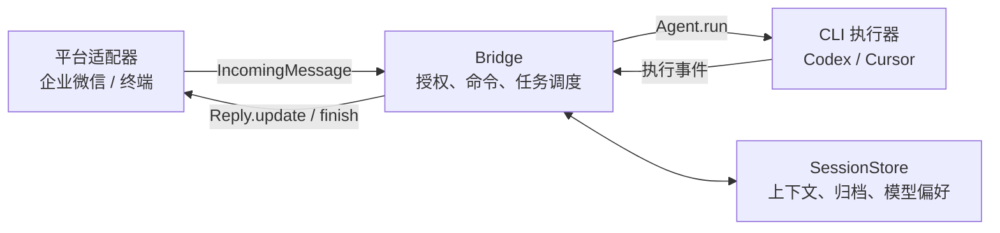

# 开发指南

在组件目录执行检查。环境与依赖安装见 [README](../README.md#0x01-快速开始)。

## 0x01 本地检查

```bash
npm run check
npm test
npm run build
```

`check` 检查 TypeScript 类型与代码格式，`test` 运行自动化测试，`build` 生成 `dist/`。

## 0x02 模块关系



| 扩展目标 | 契约 | 源码入口 |
| --- | --- | --- |
| 新聊天平台 | 将平台事件转换为 `IncomingMessage`，交给 `Bridge.handle()` | [channels/](../src/channels/) |
| 平台回复 | 实现 `Reply.update()` 和 `Reply.finish()`，处理限频、分段和交付失败 | [types.ts](../src/types.ts) |
| 新执行器 | 实现 `Agent.run()`，产出会话、正文和完成事件，遵守取消信号 | [agents/](../src/agents/) |
| 会话存储 | 通过 `SessionStore` 管理上下文与执行器选择 | [store.ts](../src/store.ts) |

- *[1] 耗时附件处理放在消息的可选 `prepare` 回调中，由 Bridge 在授权与任务准入通过后调用。*
- *[2] 平台适配器不持有执行器会话，平台消息和 CLI 协议分别维护。*

## 0x03 协议与验证

CLI 协议依据 [Codex 非交互模式](https://learn.chatgpt.com/docs/non-interactive-mode)、[Cursor 输出协议](https://cursor.com/docs/cli/reference/output-format)和[企业微信官方 SDK](https://github.com/WecomTeam/aibot-node-sdk)。

自动化测试覆盖协议解析、会话隔离、任务取消、首次配对、附件交付和本地 WebSocket 集成。真实账号与平台联调的范围、架构设计和验证证据见[实施方案](../../../knowledge/ai-workspace/issues/2026-10-17-agent-chat-bridge/PLAN.md)。
