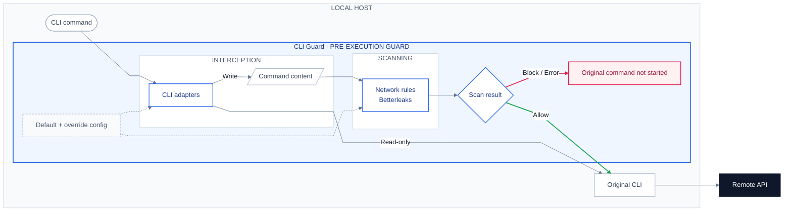

# CLI Guard

照常执行 CLI 命令。CLI Guard 在本地检查命令内容，命中敏感信息即拦截。

## 0x01 原理



- *[1] 仅检查经 PATH 调用的已接入命令，网页、MCP、CLI alias、扩展及原始二进制路径不在检查范围。*

## 0x02 使用

环境要求：

- Linux 或 macOS，支持 `arm64` 和 `x64`，使用 Bash 或 Zsh。
- Python `3.11+`，以及需要接入的原始 CLI。

在工作区根目录安装：

```bash
sh apps/cli-guard/install.sh
```

- *[1] 默认启用 `gh`，安装器跳过本机未安装的命令。*

使用增量配置：

```bash
sh apps/cli-guard/install.sh --config /path/to/config.toml
```

- *[1] 增量文件只写差异，字段见 [默认配置](config.toml)。*
- *[2] 表按层级合并，同名值由增量配置覆盖，数组整体替换。*
- *[3] 规则修改后下次调用生效，新增命令需重新安装。*

使用示例：

```bash
gh pr review 123 --comment --body-file /tmp/review.md
gh pr edit 123 --body-file /tmp/pr-body.md
gh issue comment 123 --body "LGTM"
```

- *[1] 使用内容参数或正文文件，交互编辑和自动填充会被拦截。*
- *[2] 规则可能拦截密码示例，也可能漏掉缺少上下文的随机字符串。*

## 0x03 扩展

| 职责 | 入口 | 契约 |
| --- | --- | --- |
| 拦截调度 | [guard.py](guard.py) | 固定内容、调用扫描器，放行后执行原命令 |
| 命令适配 | [adapters/](adapters/) | `classify()` 识别命令，`prepare()` 提取正文并替换文件参数 |
| 内容扫描 | [scanner.py](scanner.py) | 接收带字段名的文本，返回 `Finding(field, line, rule)` 或空结果 |

- *[1] 新增 CLI：在 `adapters/` 实现 `COMMANDS`、`classify()` 和 `prepare()`，在 `config.toml` 声明检查范围后重新安装。*
- *[2] 新增文本规则：在 `scan.secrets.patterns` 添加 RE2 正则，全部 CLI 即时共用。*
- *[3] 新增扫描引擎：只修改扫描层。*

## 0x04 维护

| 操作 | 工作区根目录命令 |
| --- | --- |
| 检查入口 | `command -v gh` |
| 预览安装 | `sh apps/cli-guard/install.sh --dry-run` |
| 运行测试 | `python3 -m unittest discover -s apps/cli-guard -p 'test_*.py' -v` |
| 代码检查 | `uvx ruff check apps/cli-guard` |
| 卸载 | `sh apps/cli-guard/install.sh --remove` |

错误示例：

```text
cli-guard: BLOCKED [sensitive_content]
Sensitive content detected.
Location: body:2
Rule: ip_address
Action: Redact the indicated content, then retry the same command.
Original gh was not executed.
```

- *[1] 命中规则返回 `1`，检查失败返回 `2`。*
- *[2] 错误写入 stderr，不回显敏感原文。*
