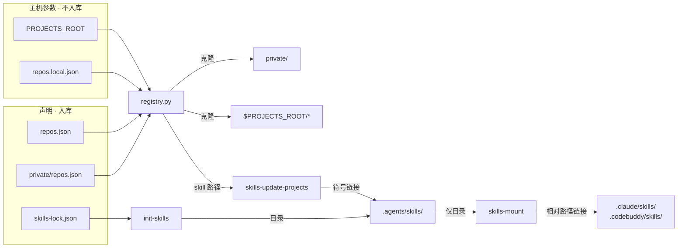

# 工作区跨主机一键初始化 —— 实施方案

## 0x01 调研与约束

### a. 术语

| 术语 | 含义 |
| --- | --- |
| 声明 | 入库的 `repos.json`、`private/repos.json`、`skills-lock.json` 和自研 skills 目录 |
| 本机状态 | 按声明在某台主机上生成的项目源码、`private/`、外部 skills 和各类符号链接 |
| 条目键 | `repos.json` 的条目为 `<name>`，`private/repos.json` 的条目为 `private/<name>` |
| 挂载 | 在 `.claude/skills/` 等 IDE 目录下创建指向 `.agents/skills/<name>` 的符号链接 |

### b. 问题本质

工作区要在任意主机上可用，需要同时满足下面三个条件，现状一个都不满足。

**（1）入库内容与主机无关**

- 两份注册表的 `local_path` 都是 `/Users/sandrincai/Project/...` 绝对路径。
- 三个 IDE 目录下入库了 `30` 个挂载链接，目标都是 `skills-mount` 用 `$(pwd)` 拼出的绝对路径。

**（2）声明全部入库**

- 全部 `25` 个项目 skill 都由 `private/repos.json` 声明，而 `private/` 既被工作区忽略，也不是独立仓库。
- `.agents/skills/` 下的 `bk-data-fetcher`、`iwiki-doc`、`find-skills` 和 `.cursor/skills/bk-mcp-builder` 没有任何声明。
- `bkm-skills` 条目没有列出它提供的 `bk-ci-helper`。

**（3）有命令按声明生成本机状态**

- 工作区没有按注册表克隆仓库的命令。
- `make init` 安装最新版外部 skills，不读取 `skills-lock.json`。
- `list_skills.py` 遇到缺失的项目目录就报错退出，`skills-mount` 拿到空的跳过名单，把项目 skills 也挂载出去。
- `Makefile` 依赖 zsh 和 nvm，Linux 主机默认都没有。

### c. 影响设计的事实

- 两份注册表共 `20` 个条目，都克隆在 `~/Project` 下，只有 `bkmonitor` 位于仓库子目录。
- 两份注册表各有一个 `bkmonitor-ecosystem`，分别是 GitHub 外部版和内网内部版。
- `bk-product-designs` 等条目指向内网 Git，地址只记在私有注册表。
- Cursor 读取 `.agents/skills/`、`.cursor/skills/` 和 `.claude/skills/`，Codex 读取 `.agents/skills/`，Claude Code 和 CodeBuddy 只读取各自的 `skills/`。
- `.claude/skills/code-review-workspace` 是 skill-creator 的评测目录，被 Cursor 误加载为过期的 `code-review` skill。

### d. 待确认

| 事项 | 影响 | 确认方式 |
| --- | --- | --- |
| 私有仓库地址 | 里程碑 1 | 已写入 `private/repos.json` 的 `ai-workspace-private` 条目，不在公开仓库中记录 |
| `npx skills experimental_install` 能否按锁文件恢复固定版本 | `init-skills` 的实现和 `SKILLS_IDE` 的去留 | [a] 在临时目录验证安装位置和 `--agent` 参数<br />[b] 不可用时按锁文件逐个 `npx skills add`，不保证版本 |
| 四个未声明目录的来源 | 归入哪类 skills | [a] 能用 skills CLI 安装：写入锁文件<br />[b] 有独立仓库：注册为项目 skills<br />[c] 其余：作为自研 skills 入库 |

## 0x02 架构设计

### a. 结构判断

**架构命题**：声明入库且与主机无关，本机状态一律由 `make bootstrap` 生成且不入库，主机参数只在 `registry.py` 中生效。



### b. 注册表协议

注册表条目和本机覆盖文件 `repos.local.json`（位于工作区根目录，不入库）示例：

```json
{
  "name": "bkmonitor",
  "git_url": "https://github.com/TencentBlueKing/bk-monitor.git",
  "branch": "master",
  "local_path": "Github/bk/monitor/bk-monitor",
  "subdir": "bkmonitor",
  "language": "zh"
}
```

```json
{
  "projects_root": "/data/workspace",
  "projects": {
    "private/bkmonitor-ecosystem": "/data/internal/bkmonitor-ecosystem"
  }
}
```

| 字段 | 类型 | 必填 | 说明 |
| --- | --- | --- | --- |
| `<entry>.local_path` | `string` | 是 | 仓库克隆目录，相对 `PROJECTS_ROOT`，`self` 条目可省略 |
| `<entry>.subdir` | `string` | 否 | 项目在仓库内的子目录，默认 `.` |
| `<entry>.self` | `boolean` | 否 | 为 `true` 时条目指向工作区自身 |
| `<local>.projects_root` | `string` | 否 | 本机的 `PROJECTS_ROOT`，同名环境变量优先 |
| `<local>.projects.<key>` | `string` | 否 | 按条目键覆盖单个仓库的克隆目录，值为绝对路径或 `~` 开头的路径 |

- *`<entry>` 指注册表条目，`<local>` 指 `repos.local.json`。*

```text
clone_dir(entry):
    if entry.self:
        return workspace_root
    override = local.projects[entry.key]
    if override:
        return expanduser(override)
    root = env.PROJECTS_ROOT ?? local.projects_root ?? "~/Project"
    return expanduser(root) / entry.local_path

project_dir(entry):
    return clone_dir(entry) / entry.subdir
```

`load()` 遇到以下情况时报配置错误：

- 入库注册表的 `local_path` 以 `/` 或 `~` 开头。
- `self` 条目的数量不等于 `1`。
- 两个条目的克隆目录相同，但 `git_url` 规范化后不同（协议无关，主机名小写，忽略 `.git` 后缀和末尾的 `/`）。

### c. 仓库同步模型

```text
sync(workspace_root):
    sync_one("private-repo", url=private_entry.git_url, branch=None, dir=workspace_root / "private")
    for entry in load(workspace_root):        # 已包含刚克隆的 private/repos.json
        if not entry.self:
            sync_one(entry.key, entry.git_url, entry.branch, clone_dir(entry))

sync_one(key, url, branch, dir):
    if exists(dir): return present
    if not url:     return skipped
    git clone [--branch <branch>] <url> <dir>
    return cloned | failed
```

- *[1] `git clone` 以非交互方式执行，HTTPS 设置 `GIT_TERMINAL_PROMPT=0`，SSH 启用 `BatchMode`。*
- *[2] 单个目标失败只计入汇总，`sync` 仅在 `load()` 报错时返回非零。*
- *[3] 其他主机注册的新项目，在工作区的 `private/` 执行 `git pull --ff-only` 后再执行 `make bootstrap` 即可就绪。`private/` 是日常工作副本；`ai-workspace-private` 的克隆目录只服务注册表条目，本机不重复维护。*

### d. skills 来源模型

| 来源 | 声明位置 | 生成方式 | 在 `.agents/skills/` 中的形态 |
| --- | --- | --- | --- |
| 自研 skills | `.agents/.gitignore` 白名单 | 随工作区克隆 | 目录，入库 |
| 外部 skills | `skills-lock.json` | `init-skills` | 目录，不入库 |
| 项目 skills | 注册表的 `skills[]` | `skills-update-projects` | 绝对路径符号链接，不入库 |

- 项目 skills 不挂载，只对 Cursor 和 Codex 可见。
- 挂载链接写成 `../../.agents/skills/<name>`，三个 IDE 的 `skills/` 目录都不入库。
- 未执行 `make bootstrap` 的主机上，Claude Code 和 CodeBuddy 看不到任何 skill。

### e. bootstrap 编排

| 步骤 | 职责 | 失败时 |
| --- | --- | --- |
| `repos-sync` | 克隆缺失的私有仓库和注册项目 | 计入汇总，继续执行 |
| `init-skills` | 按锁文件安装外部 skills | `bootstrap` 告警并继续 *[1]* |
| `skills-update-projects` | 链接已克隆项目的 skills，清理断开的链接 | 缺失的项目或 skill 告警并跳过 |
| `skills-mount` | 生成挂载链接 | 退出 |
| `init-pre-commit` | 安装 `pre-commit` hook | 退出 |
| `verify` | [a] 检查断开的符号链接<br />[b] 按「skills 来源模型」的声明位置判定来源，报告来源未知的 skill、未安装的外部 skill 和缺失的注册项目 | 存在断链时非零退出，其余只告警 |
| `init-gh` | 安装 GitHub CLI。未登录 github.com 且当前是交互终端时执行 `gh auth login` | 安装失败则退出。没有交互终端且未登录时打印登录命令并继续 |

- *[1] 单独执行 `make init-skills` 时，失败照常返回非零。*

表格顺序即执行顺序，每个步骤都可以单独执行。

## 0x03 开发方案

### a. 里程碑 1：私有仓库迁移

私有仓库先于注册表迁移上线，`private/repos.json` 的后续改动才能评审和回滚。

1. 在内网创建私有仓库。
2. 在 `private/` 初始化 Git 仓库，提交 `repos.json`、`knowledge/` 和 `configs/`。
3. 关联 remote 并推送。
4. 在临时目录克隆私有仓库，确认内容完整。
5. 在 `knowledge-mgr` 和 `git-workflow` 的 `SKILL.md` 中说明 `private/` 的改动在私有仓库中提交。

`configs/` 按原路径保存下面几份文件，换机时复制回去，不经 `make bootstrap` 改写：

| 仓库内路径 | 复制到 |
| --- | --- |
| `configs/cursor/mcp.json` | `~/.cursor/mcp.json` |
| `configs/codex/config.toml` | `~/.codex/config.toml` |
| `configs/codebuddy/mcp.json` | `~/.codebuddy/mcp.json` |
| `configs/bkm-cli/profiles/*.yaml` | `~/.bkm-cli/profiles/` |
| `configs/bkm-cli/k8s-readonly.json` | `~/.bkm-cli/k8s-readonly.json` |

不入库：`*.bak*`、Codex 的 `auth.json` 和会话目录、Cursor 的缓存与 `projects/`。`configs/README.md` 只写复制目标，不记录密钥内容。Git 凭据留在 `~/.git-credentials`，不进这个仓库。

### b. 里程碑 2：注册表脚本与迁移

`list_skills.py`、`test_list_skills.py` 分别重命名为 `registry.py`、`test_registry.py`，脚本只依赖 Python 标准库，按「注册表协议」和「仓库同步模型」实现：

```text
registry.py [--root <dir>] path <key>   -> <project_dir>\t<language>
registry.py [--root <dir>] skills       -> 每行一个项目 skill 的绝对路径
registry.py [--root <dir>] sync         -> 每行 <key>\t<state>\t<detail>，末行为各状态计数

state:   cloned | present | skipped | failed
--root:  默认为脚本所在工作区的根目录
```

| 变更点 | 目标 |
| --- | --- |
| **[Change]** `repos.json`、`private/repos.json` | [a] `local_path` 去掉 `/Users/sandrincai/Project/` 前缀<br />[b] `bkmonitor` 的 `local_path` 改为仓库根，补充 `subdir`<br />[c] `ai-workspace` 条目改为 `"self": true` |
| **[Change]** `.gitignore` | 忽略 `repos.local.json` |
| **[Change]** `Makefile` | `PROJECT_SKILLS_SCRIPT` 改名为 `REGISTRY_SCRIPT`，两处调用改为 `python3 "$(REGISTRY_SCRIPT)" --root "$$workspace_root" skills` |
| **[Change]** `AGENTS.md` | [a] 对话语言读取 `self` 条目的 `language`<br />[b] 项目目录通过 `python3 .agents/skills/project-mgr/scripts/registry.py path <key>` 获取 |
| **[Change]** `.agents/skills/project-mgr/SKILL.md` | [a] 对话语言读取 `self` 条目<br />[b] 添加项目时写入相对路径，不在 `PROJECTS_ROOT` 下的项目以 `<git 主机>/<owner>/<仓库名>` 入库，本机路径写入 `repos.local.json`<br />[c] 更新示例和脚本命令 |
| **[Change]** `.agents/skills/code-review/SKILL.md`、`.agents/skills/knowledge-mgr/references/retrieval.md` | 直接使用 `local_path` 的描述改为「项目目录」 |

`private/repos.json` 的改动在工作区 PR 合并后立即推送。其他主机拉取工作区时需同时拉取私有仓库，否则 `load()` 会因残留的绝对路径报错。

### c. 里程碑 3：skills 安装、挂载与 bootstrap

| 变更点 | 目标 |
| --- | --- |
| **[Change]** `Makefile` 运行环境 | [a] `SHELL` 改为 `/bin/bash`<br />[b] 有 nvm 时切换版本，否则使用 `PATH` 中的 `node` |
| **[Change]** `init-skills` | [a] 改为 `npx skills experimental_install`<br />[b] 删除 `SKILLS` 和 `SKILLS_SOURCE` |
| **[Change]** `skills-update` | [a] 改为 `npx skills update -p -y`（`-p` 只更新工作区内安装的 skills），仍调用 `skills-update-projects`<br />[b] 维护者检查差异后提交 `skills-lock.json` |
| **[Change]** `skills-update-projects` | 清理 `.agents/skills/` 中目标已不存在的符号链接 |
| **[Change]** `skills-mount` | [a] 只挂载目录，不再调用 `REGISTRY_SCRIPT`，链接目标改为 `../../$(SKILLS_DIR)/<name>`<br />[b] `SKILLS_MOUNT_TARGETS` 去掉 `.cursor`<br />[c] 清理三个 IDE 目录中指向 `.agents/skills/` 但不在本次名单中的链接 |
| **[Add]** `repos-sync`、`bootstrap`，**[Change]** `verify` | 按「bootstrap 编排」实现 |
| **[Change]** IDE 目录入库范围 | [a] 从 Git 中移除 `30` 个挂载链接<br />[b] 根目录 `.gitignore` 忽略三个 IDE 的 `skills/`，删除根目录和 `.codebuddy/.gitignore` 中的 skills 白名单<br />[c] 删除未入库的 `.cursor/skills/.gitignore` |
| **[Change]** `private/repos.json` | `bkm-skills` 条目增加 `bk-ci-helper` |
| **[Change]** 四个未声明目录 | 按「待确认」结论归类后迁到对应位置，删除原目录 |
| **[Move]** `.claude/skills/code-review-workspace` | 本机操作：移出 skills 扫描路径 |
| **[Change]** `README.md`、`CONTRIBUTING.md`、`Makefile` help | [a] 快速开始改为 `make bootstrap`<br />[b] 说明 `PROJECTS_ROOT`、`PRIVATE_GIT_URL` 和私有仓库的拉取方式<br />[c] 删除已移除变量的说明，按「待确认」结论处理 `SKILLS_IDE`<br />[d] 改写挂载说明，列出 `make bootstrap` 不处理的用户级配置 |

## 0x04 验收与验证

### a. 单元测试

测试门禁：`python3 -m unittest discover -s .agents/skills/project-mgr/tests`

| 测试类 | 断言重点 |
| --- | --- |
| `ResolveTest` | [a] `clone_dir()` 的四级优先级和 `self` 条目<br />[b] `project_dir()` 拼接 `subdir`<br />[c] 同名的公开和私有条目按条目键区分<br />[d] 三类配置错误都使 `load()` 报错，写法不同的同一 `git_url` 不报错 |
| `SkillsTest` | [a] 保留现有断言，夹具改为相对路径并补充 `self` 条目<br />[b] 缺失的项目目录或 skill 目录告警并跳过 |
| `SyncTest` | 基于本地裸仓库验证：<br />[a] 缺失目录记为 `cloned`<br />[b] 已存在目录记为 `present` 且内容不变<br />[c] 地址无效记为 `failed`，后续目标照常处理<br />[d] `private-repo` 无地址时记为 `skipped` |

### b. 端到端验证

将工作区克隆到临时目录，在同一个 shell 中执行：

```bash
export PROJECTS_ROOT=$(mktemp -d)
unset PRIVATE_GIT_URL
make bootstrap
make bootstrap
```

- 第一次执行满足：退出码为 `0`，`github.com` 上的仓库全部克隆完成，`private-repo` 为 `skipped`，`verify` 不报告未安装的外部 skill。
- 第二次执行的同步结果只有 `present` 和 `skipped`，工作区 `git status` 无变化。

### c. 本机回归

当前主机执行 `make bootstrap` 后满足：

- 工作区 `git status` 只包含「开发方案」列出的文件。
- 已有项目仓库全部记为 `present`。
- `make verify` 不报告来源未知的 skill，`.cursor/skills/` 中不再有指向 `.agents/skills/` 的链接。

## 0x05 实施进展

| 时间 | 结论性进展 |
| --- | --- |
| `2026-10-11 13:00` | 完成调研与方案设计，`3` 项待确认 |

## 0x06 参考

- 关联 issue：[Skills-First 架构演进](../2026-04-06-skills-first-architecture/README.md)
- skills CLI：[vercel-labs/skills](https://github.com/vercel-labs/skills)
- 现有实现：`Makefile`、`.agents/skills/project-mgr/scripts/list_skills.py`

## 0x07 版本锚点

| 状态 | 分支 | 里程碑 | PR |
| --- | --- | --- | --- |
| 🔄 | `<branch_name>` | 里程碑 1：私有仓库迁移 | 待创建 |
| 🔄 | `<branch_name>` | 里程碑 2：注册表脚本与迁移 | 待创建 |
| 🔄 | `<branch_name>` | 里程碑 3：skills 安装、挂载与 bootstrap | 待创建 |
