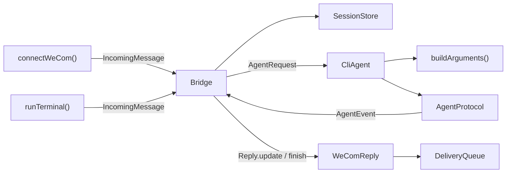
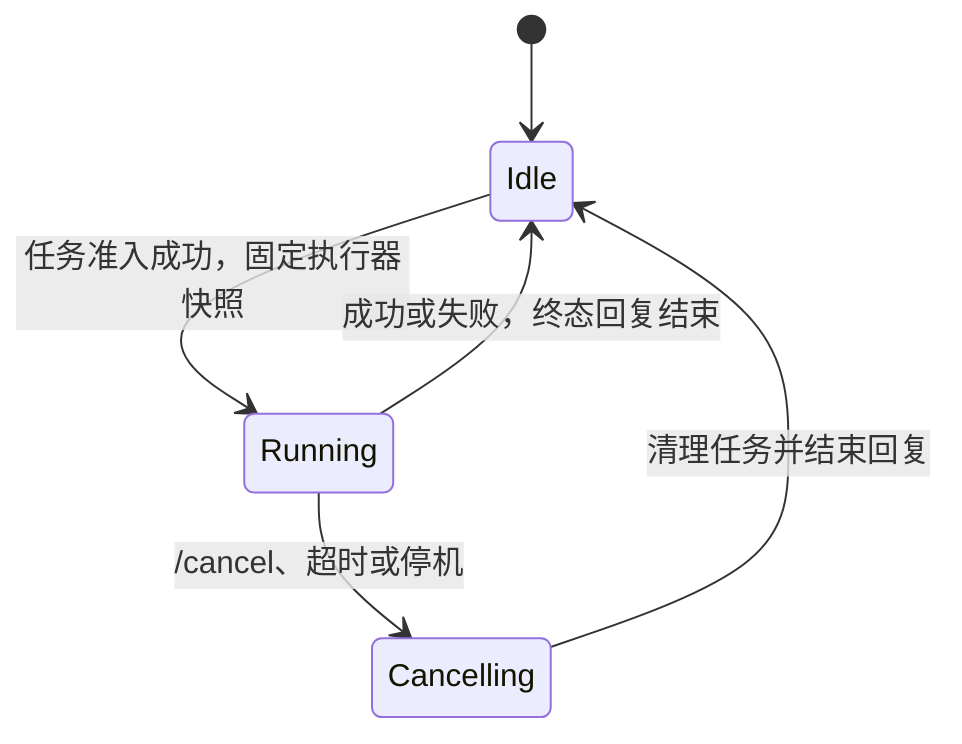
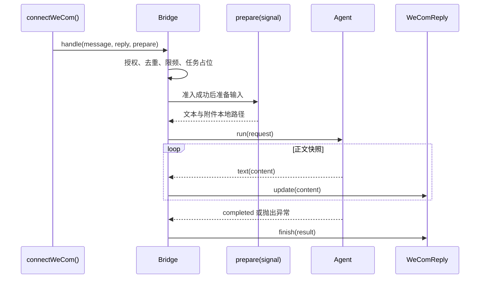
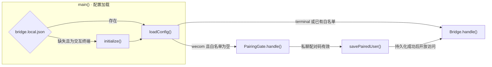
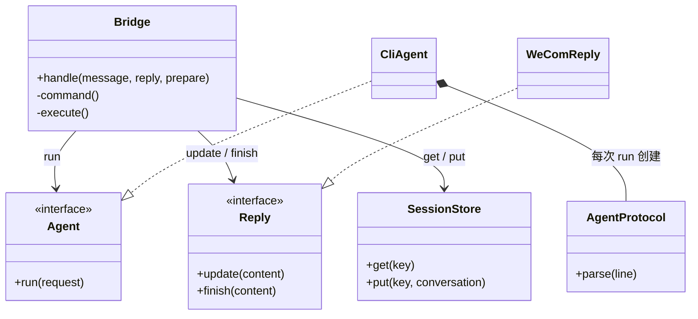
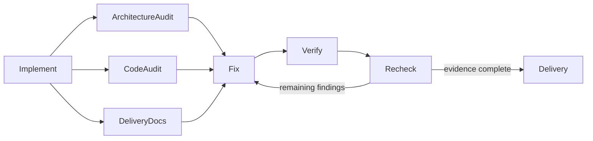

# 通用聊天 Agent 桥接组件实施方案

## 0x01 调研与约束

原项目以企业微信回调驱动任务编排，会话、进度交付和控制命令集中在同一个 Bridge 中。Agent 后端具备适配接口，但执行器选择属于进程配置，不能在用户会话内切换。

复杂度来自两个独立变化方向：聊天平台决定身份与交付协议，Agent 决定进程参数与上下文协议。复刻实现以通用消息和 Agent 事件为边界，保留两侧能力，重新组织会话生命周期。

### a. 原功能与授权

已读取原项目源码，基线提交为 `8915e33fce4aed7a6ba2526dcc01daf1a6849b25`。原项目采用 MIT 许可证，复用的文本分段器保留版权与许可证，其余核心按通用协议重写。

| 原能力 | 实现方式 |
| --- | --- |
| 企业微信长连接、多轮会话和任务并发控制 | 官方 SDK 适配器调用通用 `Bridge` |
| 流式进度、长任务推送和超长结果分段 | `WeComReply` 与 `DeliveryQueue` 管理平台交付 |
| 文本、媒体、语音转写和引用 | `readWeComInput()` 转换为通用文本与附件 |
| 历史会话和重跑 | 控制器按会话和执行器维护上下文 |
| 执行器与模型选择 | 状态目录保存一份全局偏好，全部聊天共用 |
| 本地图片结果 | 真实路径校验后上传为独立图片消息 |
| Claude 执行器、专属登录与配置 | 删除，执行器仅保留 Codex 和 Cursor |
| 原进程管理和配置入口 | 独立 npm 组件、首次安装向导与无参数启动 |

原项目私有地址、运行配置、真实对话和原始 CLI 流不进入公开目录。组件放在 `apps/agent-chat-bridge/`，公开范围按 Git 候选交付文件精确生成快照并通过 PreCI。

### b. 官方协议依据

| 依据 | 已确认机制 | 设计结论 |
| --- | --- | --- |
| [Codex 非交互模式](https://learn.chatgpt.com/docs/non-interactive-mode) | 事件流区分会话、Agent 消息和轮次终态，恢复可指定会话 ID | 保存明确的会话 ID，缺终态或异常退出均判失败 |
| [Cursor 输出协议](https://cursor.com/docs/cli/reference/output-format) 与 [参数](https://cursor.com/docs/cli/reference/parameters) | 默认流格式按完整助手消息输出，终态 `result` 提供汇总文本；无交互运行支持 `--trust` | 终态文本覆盖进度；固定工作目录显式 `--trust`，默认使用只读 `ask` 模式 |
| [企业微信官方 SDK](https://github.com/WecomTeam/aibot-node-sdk) | 流式回复使用原始请求身份和固定流 ID，主动发送独立于回调 | 平台适配器掌握回复窗口和主动推送切换 |

Codex 默认检查 Git 仓库，组件在固定工作目录上显式使用 `--skip-git-repo-check`，支持普通目录和 Git 项目。CLI 认证由运行服务的系统账号提供，桥接配置不保存 Agent 账号令牌。

## 0x02 架构设计

聊天平台负责转换消息与交付结果，执行器负责转换进程协议，会话控制统一收敛在 `Bridge`。



### a. 通用消息与执行协议

```text
IncomingMessage = {
  channel, accountId, conversationId, userId, messageId, text,
  attachments?: [{ path, name, mimeType }]
}
AgentRequest = { prompt, sessionId?, model?, images?, signal }
AgentEvent = session(id) | text(content) | completed
Reply = update(content) + finish(content)
```

| 协议对象 | 责任与边界 |
| --- | --- |
| `IncomingMessage` | 平台提供身份与文本，附件以本地文件路径表示 |
| `AgentRequest` | 控制器提供当前执行器的上下文、模型和取消信号 |
| `AgentEvent.text` | 累积正文快照，平台可合并尚未发送的进度 |
| `AgentEvent.completed` | CLI 正常退出且协议终态完整后才发出 |
| `Reply.finish` | 交付一次终态，发送失败向调用方报告 |

Agent 失败通过异步迭代异常返回。控制器把失败原因和已有正文组合为终态，保留已捕获的上下文 ID。

### b. 会话与控制命令

会话身份只隔离上下文。执行器与模型由状态目录中的一份 `AgentPreference` 决定，全部聊天共用。旧文件没有该偏好时，采用最近更新的执行器，并按时间合并各记录中的模型。

```text
key = SHA256([workspace, channel, accountId, conversationId, userId])

Conversation = {
  sessions: { codex?, cursor? },
  history: { codex?: SessionEntry[], cursor?: SessionEntry[] },
  updatedAt
}

AgentPreference = {
  selectedAgent,
  models: { codex?, cursor? },
  updatedAt
}
```

- *[1] `workspace` 使用目录真实路径，上下文按 `key` 隔离。*
- *[2] 切换执行器时保留另一执行器的上下文，也保留该执行器已选择的模型。*



- *[3] `Running` 和 `Cancelling` 是任务生命周期视图，对应 `Bridge.running` 和取消信号，不写入会话文件。*

| 命令组 | 状态作用 | 运行中规则 |
| --- | --- | --- |
| `/agent`、`/status`、`/sessions`、`/model`、`/help` | 查询选择、任务状态、归档或模型 | 可查询 |
| `/agent <name>`、`/model <id>` | 修改全局执行器，或修改当前执行器的全局模型 | 当前会话运行中拒绝修改，其他会话仍可修改 |
| `/reset`、`/new`、`/resume <序号>` | 归档当前 ID，或恢复当前执行器的归档 | 拒绝修改 |
| 普通输入、`/rerun` | 创建任务，或重用当前执行器的上一份输入 | 同会话忙碌或全局满额时拒绝 *[4]* |
| `/cancel`、`/stop` | 向当前任务发送取消信号 | 可取消，不占普通请求限频额度 |

- *[4] 不设置等待队列，避免用户切换意图后仍执行旧问题。*

### c. 平台交付与媒体

`WeComReply` 持有平台回调身份。



- *[5] `prepare` 调用 `readWeComInput()`，单次下载最长 `15` 秒，准备与执行共用任务时限和取消信号。*
- *[6] 入站附件使用随机文件名和受限权限，下载按字节限额读取，解密使用官方 SDK。*

| 交付条件 | `WeComReply` 的行为 |
| --- | --- |
| 流式窗口内有进度 | 合并更新，使用固定流 ID，通过 `DeliveryQueue` 串行限速发送 |
| 达到流式窗口 | 封口进度消息，终稿改用主动推送 |
| 终稿超过单条流容量 | 封口后按 UTF-8 字节分段，保持代码围栏闭合 |
| 流式发送失败 | 回退主动推送，主动推送失败向调用方报告 |
| 终稿引用本地图片 | 校验真实路径、大小与类型后上传为独立图片消息 *[7]* |

- *[7] 图片真实路径必须位于工作目录内，符号链接不能绕过此限制。*

### d. 配置与本机状态

企业微信首次接入只要求填写机器人凭据，用户身份由私聊配对写入白名单。



- *[8] `initialize()` 默认选择企业微信、当前目录、Codex 和只读权限，`npm run setup` 可单独运行向导。*
- *[9] `PairingGate` 仅在前台交互终端启用，`8` 位配对码有效 `10` 分钟，全局每分钟最多允许 `5` 次失败尝试。*
- *[10] 配对仅接受不含附件的纯文本指令。*

| 状态载体 | 保存内容 | 写入与恢复约束 |
| --- | --- | --- |
| `bridge.local.json` | 工作目录、执行器权限、平台与白名单 | `0600`，首次原子创建且不覆盖已有文件 |
| `.env` | 企业微信 Bot ID 和 Secret | `0600`，保留已有文件，配置写入失败只回滚新建凭据 |
| `SessionStore` 的会话文件 | 全局执行器与模型，以及按会话保存的 ID 和归档 | `0600`，原子替换，格式损坏时拒绝启动 *[11]* |
| `stateDir` 与 `bridge.lock` | 状态目录和单实例进程标识 | 目录 `0700`，锁文件 `0600`，同目录只运行一个实例 |
| 进程内存 | 上一份输入、消息去重与限频窗口 | 重启后清空 |

- *[11] 当前会话不因闲置失效，每个执行器最多保留 `10` 条归档，归档保留期为 `7` 天。*
- *[12] CLI 子进程会过滤 `WECOM_` 和 `BRIDGE_` 环境变量。*

## 0x03 开发方案

开发围绕任务所有权组织：`Bridge` 统一决定任务能否运行，平台和执行器通过协议参与同一生命周期。

### a. 核心设计决策

| 设计问题 | 选择与理由 | 代价或边界 |
| --- | --- | --- |
| 平台和执行器会独立变化 | 在 `types.ts` 声明 `IncomingMessage`、`Reply` 和 `Agent`，避免每个平台重复对接两种 CLI | 平台格式转换、发送窗口和 SDK 身份由适配器承担 |
| 切换执行器可能串用上下文 | 上下文只按会话读写，执行器和模型是全局偏好，同一任务固定开始时的快照 | 当前会话运行期间拒绝修改，其他会话可以修改全局选择 |
| CLI 协议变化不应影响进程清理 | `CliAgent` 管进程，`AgentProtocol` 管事件解析 | 每个任务启动独立进程，连续性依靠明确的会话 ID |
| 本地快速启动需要可恢复的状态 | 使用原子文件写入和单实例锁，减少外部服务配置 | 同一状态目录只支持单进程，不承担多实例协调 |

### b. 核心模块与依赖



- *[13] `Agent` 和 `Reply` 声明在 `src/types.ts`。*
- *[14] `CliAgent` 在 `src/agents/cli-agent.ts` 实现，协议构造与解析收敛于同目录的 `protocol.ts`。*
- *[15] `Bridge` 与 `SessionStore` 分别在 `src/bridge.ts` 和 `src/store.ts` 实现。*

### c. 核心协作约束

```text
Bridge.handle(message, reply, prepare?) -> Promise<void>
Agent.run(request)                    -> AsyncIterable<AgentEvent>
Reply.update(content) / finish(content) -> Promise<void>
```

| 协作主题 | 声明与调用约束 | 收敛位置 |
| --- | --- | --- |
| 任务准入与释放 | 任务槽位在 `finally` 中释放，覆盖成功、失败和取消 | `Bridge.handle()` 与 `execute()` |
| 进程执行与完成判定 | 使用参数数组和标准输入启动，取消回收进程组，正常退出与协议终态同时满足才算成功 | `CliAgent.run()` |
| 交付与失败反馈 | 平台实现 `Reply`，合并进度，等待终态发送结果，失败向调用方传播 | `WeComReply` 与 `DeliveryQueue` |

### d. 扩展与复用

- 微信和飞书新增消息与 `Reply` 适配器，在 `src/cli.ts` 和 `src/config.ts` 接入配置与启动，复用 `Bridge` 的控制命令和会话管理。
- CLI 参数或事件格式变化集中修改 `buildArguments()` 和 `AgentProtocol`，进程回收与平台交付继续使用原有实现。
- 新组件不导入原项目的 Claude 会话。

## 0x04 验收与验证

### a. 自动化门禁

在 `apps/agent-chat-bridge/` 执行：

```bash
npm run check
npm test
npm run build
```

| 验证主题 | 必须覆盖 |
| --- | --- |
| 会话命令 | 全局执行器与模型、按执行器保留模型、独立上下文、重启恢复和历史恢复 |
| 并发与取消 | 会话占位、全局并发拒绝、任务取消和进程组升级终止 |
| CLI 完整性 | 恢复参数、标准输入、非零退出、缺终态和无效 JSON |
| 平台收发 | 官方 SDK 认证、消息路由、白名单、流式封口和主动推送 |
| 媒体 | 语音、引用、附件落盘、UTF-8 分段和图片路径越界 |
| 状态与探活 | 锁、文件权限、损坏检测和连接状态探活 |
| 首次使用 | 安装向导、无参启动、私聊配对、配对过期和保存失败 |

### b. 交付证据

| 门禁 | 现有证据 | 状态 |
| --- | --- | --- |
| 原项目核对与授权 | 源码基线、能力对照、MIT 许可证和原作者版权保留 | 已确认 |
| 实现检查 | `npm run check`、`npm run build` 通过，`npm test` 共 `46/46` 通过 | 已通过 |
| 工作区检查 | `make verify` 退出码为 `0`，仍输出已有 skill 来源警告 | 已通过 |
| Codex 真实 CLI | 普通非 Git 目录内两轮调用成功，会话 ID 捕获与恢复一致，第二轮记住首轮验证词 | 已确认多轮恢复 |
| Cursor 真实 CLI | 官方 CLI 可运行，账号尚未登录 | 未完成真实账号联调 |
| 企业微信 SDK | 官方 SDK 与本地 WebSocket 服务完成认证、切换和多轮消息测试 | 已确认协议集成 |
| 企业微信真实机器人 | 需要部署凭据和平台权限 | 未完成真实机器人联调 |
| 真实 TTY 向导 | PTY 按默认值完成企业微信、Codex 和只读选择，Secret 无回显，配置与 `.env` 权限及解析值正确；终端无参启动自动向导后，`/status` 返回空闲，真实 Codex 任务返回 `TERMINAL_READY`，Ctrl+D 正常退出且退出码为 `0` | 已通过 |
| 公开范围扫描 | 全部 `46` 个公共变更文件的精确快照返回 `scan not defect`，包括组件 `40` 文件及需求、方案和索引；结果文件 `18` 字节，零发现 | 已通过 |
| 文档检查 | Markdown 门禁、索引和相对链接检查通过 | 已通过 |
| 代码复查 | 首次配置原子写入、故障回滚和 Cursor `--trust` 已修复并补回归 | 无遗留 P0/P1 |
| 架构复查 | 双轴接口与控制器边界清晰，Cursor `--trust` 保持默认只读，配对适配和引用命令独立验证通过 | 无遗留 P0/P1 或交付阻断 |

扫描范围排除被 Git 忽略的 `node_modules/`、`dist/` 和运行状态。根目录全量扫描因范围过大未形成全工作区结论；组件目录含依赖扫描的 `27` 项提示均位于公开依赖示例，不能据此宣称全工作区零发现。

协议测试不能证明部署账号、网络和真实机器人权限可用，账号联调状态单独记录。源码与方案随工作区提交。

### c. 自查与优化飞轮



架构审查核对用户目标与协议归属，代码审查检查冗余、并发和故障边界，文档审查核对运行步骤和验收证据。

独立自查已推动附件准备移到任务准入后、取消贯穿下载与进程组、`/rerun` 保留附件、Cursor 固定目录显式信任，以及首次配置原子写入与失败回滚。故障注入回归覆盖配置写入失败后可重新运行向导。

## 0x05 实施进展

| 时间 | 结论性进展 |
| --- | --- |
| `2026-10-23 18:00` | [a] 执行器与模型改为状态目录中的全局偏好，上下文仍按会话隔离<br />[b] 自动化测试 `78` 项、类型与格式检查、构建、工作区验证及 PreCI 通过<br />[c] 修复直接推送 `main`，原 PR #4 关闭 |
| `2026-10-17 16:00` | [a] 核对原项目与 MIT 授权，采用平台与执行器协议隔离的重写结构<br />[b] 完成非 Git 目录 Codex 两轮会话恢复和官方企业微信 SDK 本地协议集成<br />[c] 自动化测试 `46/46`、检查、构建、工作区验证和组件快照 PreCI 通过，真实 TTY 向导及凭据隐藏验证通过；架构与代码复查无遗留 P0/P1 或代码交付阻断 |

## 0x06 参考

- [需求](./README.md)
- [组件使用说明](../../../../apps/agent-chat-bridge/README.md)
- [Codex 非交互模式](https://learn.chatgpt.com/docs/non-interactive-mode)
- [Cursor CLI 输出协议](https://cursor.com/docs/cli/reference/output-format)
- [Cursor CLI 参数](https://cursor.com/docs/cli/reference/parameters)
- [企业微信官方 SDK](https://github.com/WecomTeam/aibot-node-sdk)

## 0x07 版本锚点

| 状态 | 分支 | 里程碑 | PR |
| --- | --- | --- | --- |
| ✅ | `main` | 通用组件本地交付，真实账号联调边界见交付证据 | 本地交付，未创建 PR |
| ✅ | `main` | 执行器与模型选择改为全局偏好 | 直接推送 [30036bb](https://github.com/ZhuoZhuoCrayon/ai-workspace/commit/30036bb7c7e4d5c36417e567305b5555fbd3f604) |
