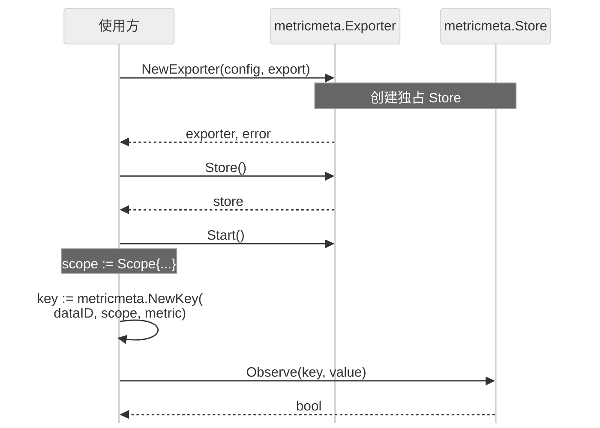
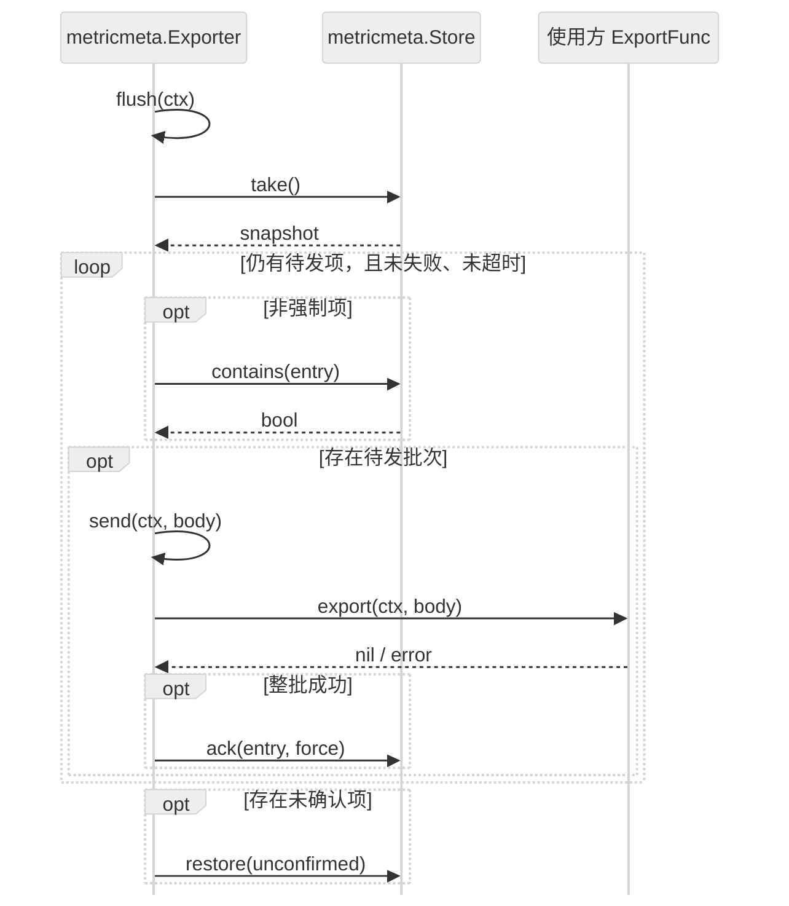
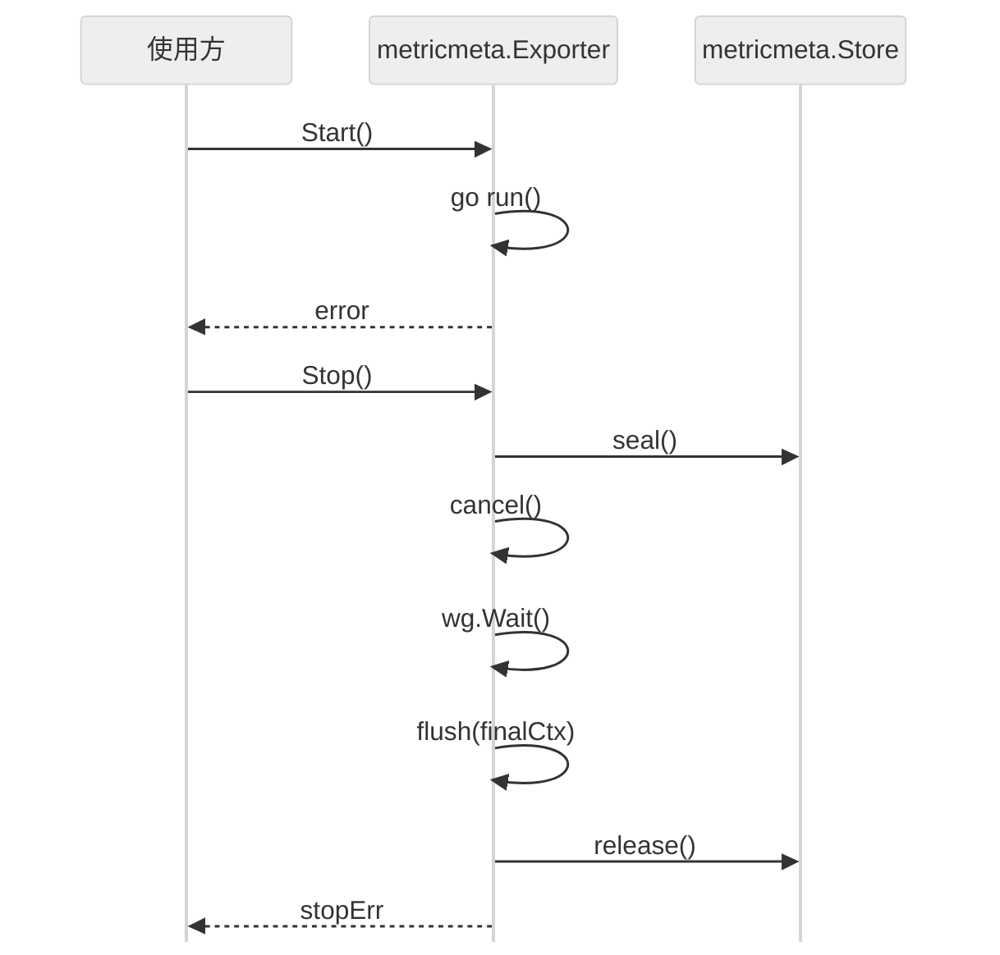
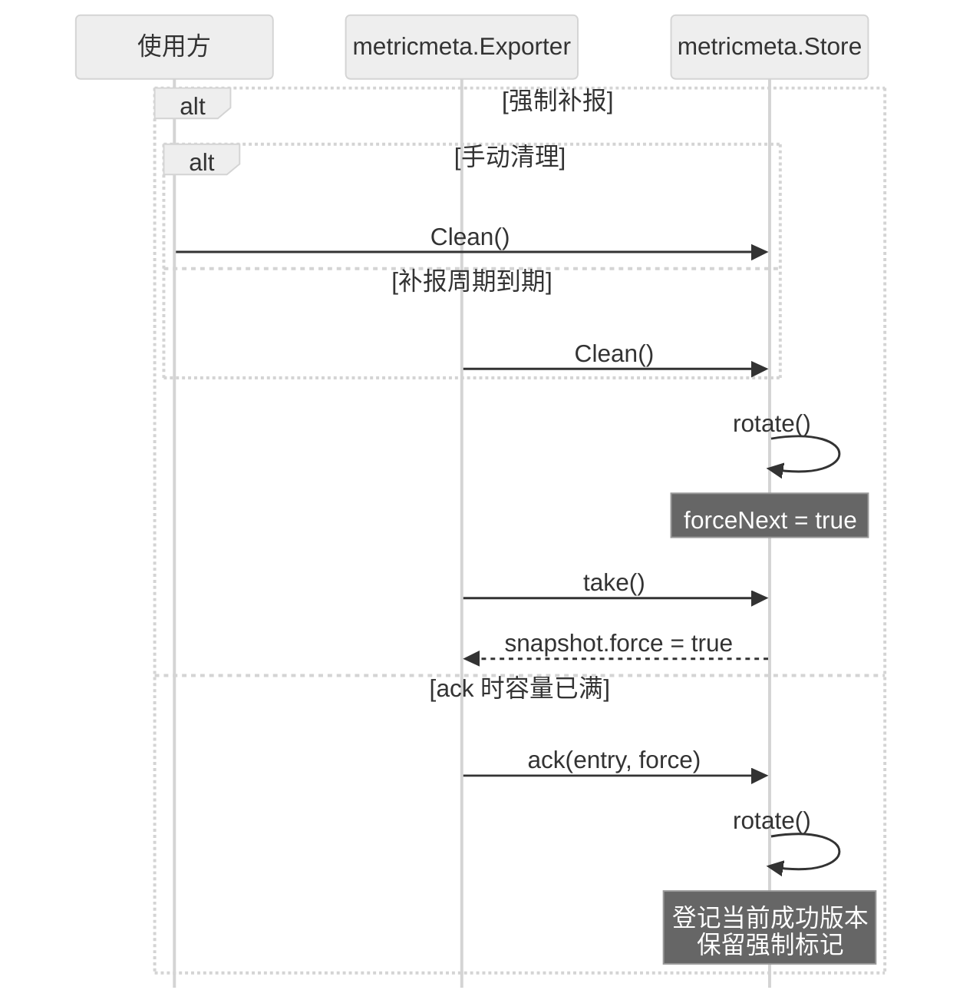

# bk-collector 指标元信息采集与同步方案

## 0x01 调研与选型

### a. 选型结论

**待发缓冲（pending）保存完整元信息，去重缓存（sent）用 Bloom 记录成功发送的版本。** 代价是极低概率遗漏，以及旧值回退可能等待补报；要求精确识别跨周期变化与回退的使用方应选完整值方案。

候选机制与源码依据见 [调研报告](./REPORT.md#0x03-业界机制与取舍)。

| 方案 | 长期保存内容 | 变更与回退 | 结论 |
| --- | --- | --- | --- |
| **Bloom** | 固定容量位图 | 变更可能误判，历史回退依赖补报 | **采用，允许少量遗漏** |
| map + 完整值 | 完整主键与最后成功值 | 精确比较 | 要求精确更新时采用 |
| go-cache + 完整值 | 编码主键、完整值与过期时间（TTL） | 精确比较，库管理过期 | 仍须长期保留原文 |
| map + SHA-256 值摘要 | 完整主键与值摘要 | 可识别回退，有摘要碰撞概率 | 缩小 Value，仍逐键存储 |

- *[1] 历史回退：`A → B → A` 的最后一个 A 会命中历史版本，等待强制补报恢复。*

### b. sent：内存与查询耗时

|        主键数 | 去重缓存内存（MiB） | 位图判断 ns/op *[2]* | 含指纹计算 ns/op *[3]* |
| ---------: | ----------: | ---------------: | ----------------: |
|     10,000 |        0.04 |            18.41 |             229.5 |
|    100,000 |        0.35 |            19.15 |             226.7 |
|  1,000,000 |        3.45 |            22.55 |             209.2 |
| 10,000,000 |       34.30 |           102.60 |             374.7 |

- *[1] 样本：每个主键只写入一个版本，容量等于键数，目标误判率 `10⁻⁶`，详见 [sent 评测](./REPORT.md#a-sent)。*
- *[2] 位图判断：用预计算指纹检查 Bloom 的 `20` 个位位置。*
- *[3] 含指纹计算：从 Key + Value 计算哈希指纹（含过滤器版本号），再执行位图判断。*
- *[4] 测量范围：内存为 GC 后保留的堆内存，耗时取三次中位数，不含 Store 锁与网络。*
- *[5] 🌟 判断方式：两个哈希值推导 20 个位位置，全部为 1 表示可能已发送，仍会误判。*
- *[6] 轮转重建：2h，每个 1h 维护一个布隆过滤器。*

### c. Exporter 发送缓冲：内存

|  每个缓冲的主键数 | 单条描述大小（B） | 待发缓冲（MiB） | 缓冲 + 发送快照（MiB） |
| --------: | --------: | --------: | -------------: |
|    10,000 |        64 |      4.19 |           8.37 |
|    10,000 |     1,024 |     13.34 |          26.68 |
|   100,000 |        64 |     38.29 |          76.49 |
|   100,000 |     1,024 |    129.82 |         259.67 |
| 1,000,000 |        64 |    500.37 |       1,000.69 |
| 1,000,000 |     1,024 |  1,415.89 |       2,831.74 |

- *[1] 测量范围：保存完整值的 map，不含 sent、JSON 批次与垃圾回收期间的额外内存。*
- *[2] 双缓冲：本轮发送快照与接收新记录的 pending 各保存 N 条，详见 [缓冲评测](./REPORT.md#b-exporter-发送缓冲)。*
- *[3] 单条描述大小：`__description` 按 UTF-8 编码后的字节数，主键和其他字段也计入内存列。*
- *[4] 容量：pending 默认上限为十万项，百万项实验需提高上限。*

### d. 冷启动与缓存重建

**清空 Bloom 后，通过 pending 和后续 Observe 重建缓存。** 进程重启会丢失内存中的原文。

| 触发 | 清理范围 | 重建与发送 |
| --- | --- | --- |
| 进程启动 | Store 为空 | 从 Observe 收集，首个快照强制发送 |
| 每 `2 h`／手动 Clean | 清零位图并增加 generation，保留 pending | 下一快照强制发送，成功版本重新加入 Bloom |
| 成功 Add 达容量 | 清零位图并增加 generation | 从当前成功版本重建，不顺延补报时钟 |

- *[1] 清理成本：原地清零位图，复杂度为 `O(位图字节数)`，千万容量约 `34.28 MiB`，Clean 延迟待测。*
- *[2] 补报周期：每 `2 h` 触发一次，实际送达时间取决于排队和重试，选值依据见 [周期实验](./REPORT.md#a-周期选择)。*

冷启动和强制重建共用发送限制：每批同时限制 `1,000` 项和 `256 KiB`，两次开始相隔至少 `100 ms`，每分钟最多处理 `5 s`。

| 待发主键数 | 单条描述 64 B：轮数／耗时 | 单条描述 1,024 B：轮数／耗时 |
| ---: | ---: | ---: |
| 10,000 | 1 / 1.0 s | 1 / 4.7 s |
| 100,000 | 3 / 120.6 s | 10 / 542.3 s |
| 1,000,000 | 22 / 1,261.4 s | 95 / 5,643.9 s |

- *[1] 实验条件：唯一指标样本、真实 JSON 与模拟时钟（`make buffer` 写入 `validation/results/buffer_coldstart.txt`），无新增、无失败，编码与网络耗时按零计算。*
- *[2] 耗时：首次 Flush 到最后一批开始发送的间隔，结果为理想最短耗时，启动等待与重新采集时间另计。*

## 0x02 架构设计

通用协议、Store 与 Exporter 归入 `pkg/utils/metricmeta`，供 collector、bkmonitorbeat 等使用。协议提取与业务范围判定留在使用方，发送目标通过 `ExportFunc` 注入。

### a. Scope、Key 与 Value

```go
type ScopeType string

const (
    ScopeAPM     ScopeType = "APM"
    ScopePlugin  ScopeType = "PLUGIN"
    ScopeDefault ScopeType = "DEFAULT"
)

type Scope struct {
    Type ScopeType
    Name string
}

type Key struct {
    DataID    int32
    ScopeType ScopeType
    Scope     string
    Metric    string
}

type Value struct {
    Name, Unit, Description string
    Type, OriginalType string // 输出序列类型、拆分前类型
    Temporality, Usage string
    Interval int64
    Present  uint8 // Unit / Description / Interval / Usage 是否已知
}

type Entry struct { Key Key; Value Value }

func NewKey(dataID int32, scope Scope, metric string) Key {
    return Key{DataID: dataID, ScopeType: scope.Type, Scope: scope.Name, Metric: metric}
}
```

- *[1] 🌟 ScopeType：要求非空，可用 `const ScopeCustom metricmeta.ScopeType = "CUSTOM"` 扩展。（ScopeType 不需要，由上层推断类型）*
- *[2] Scope.Name：使用方提供的稳定范围标识，空值表示该类型在 DataID 下不再细分。*
- *[3] Present：标记字段是否已知，编码规则见 [元信息字段](#0x03-元信息字段)。*
- *[4] 版本指纹：完整 Key 与 Value（含 OriginalType 与 Present）的哈希摘要，计算时加入过滤器版本号 generation。*

### b. Store：合并、去重与清理

Store 管理内存状态，Exporter 调度后台发送。take 取走当前 pending 作为本轮发送快照，新记录写入新的 pending。

```go
type Observer interface { Observe(Key, Value) bool }
type pendingEntry struct { Value Value; Force bool }
type snapshot struct { items map[Key]pendingEntry; force bool }

type Store struct {
    mu           sync.Mutex
    pending      map[Key]pendingEntry
    sent         *bloomFilter
    versions     int
    generation   uint64
    forceNext    bool
    closed       bool
    config       Config
}

func (s *Store) Observe(Key, Value) bool
func (s *Store) Clean() error

func (s *Store) take() snapshot
func (s *Store) contains(Entry) bool
func (s *Store) ack(Entry, bool) // bool 为该项的 Force
func (s *Store) restore(snapshot)
func (s *Store) rotate()        // 调用方持有 mu
func (s *Store) seal()          // 拒绝新 Observe，内部回填仍可执行
func (s *Store) release()       // 最终收尾后统计剩余丢弃并释放缓存
```

- *[1] 锁边界：mu 保护 pending 与 Bloom，快照遍历、编码和发送在锁外执行。*
- *[2] Clean：在锁内 rotate 并设置 forceNext，保留 pending，关闭后返回 ErrClosed。*
- *[3] take：交换 pending 并取走 forceNext，后续 Clean 作用于下一快照。*
- *[4] rotate：清零位图与计数，递增 generation，保留 forceNext，后续 ack 加入新一代 Bloom。*
- *[5] Observe：相同值复用，新增或变化值复制字符串并继承 Force，非法、关闭或超限时返回 false。*

### c. Exporter：周期与发送

```go
type ExportFunc func(context.Context, []byte) error // 统一协议的 JSON 数组

type Exporter struct {
    store           *Store
    export          ExportFunc
    config          Config
    nextFullReport  time.Time
    lastExportStart time.Time
    lifecycleMu     sync.Mutex
    started, closed bool
    stopOnce        sync.Once
    ctx             context.Context
    cancel          context.CancelFunc
    wg              sync.WaitGroup
    stopErr         error
}

func NewExporter(Config, ExportFunc) (*Exporter, error)
func (e *Exporter) Store() *Store
func (e *Exporter) Start() error // 首次调用设置 nextFullReport = now + fullReportInterval
func (e *Exporter) Stop() error
func (e *Exporter) run()
func (e *Exporter) flush(context.Context) error
func (e *Exporter) send(context.Context, []byte) error
```

- *[1] NewExporter：校验配置与回调，创建独占 Store，设置 forceNext=true，允许 Start 前 Observe。*
- *[2] run：每隔 flush_interval 串行执行 flush，发送满足限额的非空批次。*
- *[3] ExportFunc：返回 nil 确认整批，部分成功返回 error，重试可能重复发送。*
- *[4] 回调约束：响应 context 取消，返回后仍需保留 body 时自行复制。*
- *[5] 依赖边界：通用包只依赖标准库，HTTP、消息队列等客户端由使用方提供。*

### d. API 调用关系



- *[1] Scope 是值对象，NewKey 是包级函数，Store 作为 Observer 注入协议适配，无需传入 Exporter。*

## 0x03 元信息字段

```json
{
  "dataid": 1001,
  "__scope_type": "APM",
  "__scope": "checkout-http",
  "__name": "request.duration",
  "__metric": "request_duration_sum",
  "__description": "请求耗时",
  "__unit": "s",
  "__temporality": "delta",
  "__interval": null,
  "__original_type": "histogram",
  "__type": "counter",
  "__usage": "sum"
}
```

| 字段 | 类型 | 必填 | 说明 |
| --- | --- | --- | --- |
| `dataid` | int32 | 是 | 鉴权后的指标 DataID，必须大于 `0` |
| `__scope_type` | string | 是 | 预定义 APM／PLUGIN／DEFAULT，允许使用方扩展 |
| `__scope` | string | 是 | Scope.Name 原样序列化，APM 示例见 [范围绑定](#b-范围绑定) |
| `__metric` | string | 是 | 实际输出的单个指标名称，不能为空 |
| `__name` | string | 是 | 拆分、规范化前的逻辑指标名，同一原始指标的拆分子项保持一致 *[1]* |
| `__description` | string / null | 是 | 来源描述，未知为 null |
| `__unit` | string / null | 是 | 子项数值的单位，未知为 null，明确无量纲为 `1` |
| `__temporality` | string | 是 | `delta` 表示本周期增量（点值指标表示本次值），`cumulative` 表示累计值，见 [协议适配](#0x06-开发方案协议适配) |
| `__interval` | int64 / null | 是 | 毫秒，已知时必须大于 `0` |
| `__original_type` | string | 是 | 拆分前的原始指标类型：`sum`、`gauge`、`histogram`、`summary`、`counter`、`avg`、`unknown`，同一原始指标的拆分子项保持一致 |
| `__type` | string | 是 | 本条输出序列自身的类型：`counter` 为单调累计值，`gauge` 为点值，无法确定为 `unknown`，见 [协议适配](#0x06-开发方案协议适配) |
| `__usage` | string / null | 是 | 单个输出指标的默认查询汇聚操作：`sum`／`min`／`max`／`avg`／`last`，无法确定为 null |

- *[1] 原名：同一原始指标及其拆分子项称为指标族（family），共用拆分前的 `__name` 与 `__original_type`，OTP 先解析分组。*
- *[2] 主键：`DataID + ScopeType + Scope + Metric`，需求字段 `__scope_name` 统一命名为 `__scope`。*
- *[3] 合并：同一主键取最后一次 Observe 的完整值，包括空值和多实例冲突。*
- *[4] 点值：OTLP、Pushgateway 的 Gauge／Summary quantile 使用 delta，`__type` 为 gauge，默认汇聚为 last。*
- *[5] 空值：来源 unit／description 为空字符串时编码为 null。*
- *[6] 类型分工：`__original_type` 用于识别指标族，`__type` 描述输出序列能否按累计值求增量，两者都属于 Value，不参与主键。*

## 0x04 缓存与补报

### a. 发送、确认与清理



- *[1] 批次选择：snapshot.force 或条目 Force 为 true 时跳过 contains，否则跳过已命中项，剩余项按编码和限速规则组成批次。*
- *[2] 成功确认：逐项调用 ack，容量满时先 rotate，强制旧值成功后向 pending 中的更新值传递 Force。*
- *[3] 失败回填：同一主键取 pending 中的新值，合并双方 Force，任一为 true 就保留强制发送要求。*
- *[4] 容量处理：缓冲满时拒绝新主键，回填无空位或单条 JSON 超限时丢弃并计数，一并移除 Force。*
- *[5] 循环范围：flush 串行处理各批次，失败或整轮超时后回填未确认项并结束，超时包含编码、等待与回调。*

### b. 启动与关闭



- *[1] 并发控制：lifecycleMu 保护启动与关闭状态，wg.Add 先于 goroutine 启动。*
- *[2] 重复调用：Start 直接返回，Stop 等待同一次关闭并返回相同结果。*
- *[3] 调用顺序：允许未启动即关闭，关闭后 Start 返回 ErrClosed。*
- *[4] 关闭结果：最终发送使用独立的 5 s context，剩余项计入 shutdown 丢弃数，ErrUndelivered 返回数量。*
- *[5] 关闭前提：使用方先停止生产者，seal 后 Observe 返回 false、Clean 返回 ErrClosed。*

### c. 清理与补报



- *[1] 清理范围：保留 pending 和已取出的发送快照，容量清理保持原有强制标记。*
- *[2] 补报时间：从首次 Start 起按固定周期计算，手动清理与容量清理保持原计划，错过多个周期只补一次。*
- *[3] 首次发送：新 Store 的 forceNext=true，首个快照直接进入强制发送。*

## 0x05 开发方案

### a. 代码归属

| 位置 | 交付内容 |
| --- | --- |
| `pkg/utils/metricmeta` | model.go／wire.go 定义协议，store.go／bloom.go 管理缓存，exporter.go 调度发送 |
| `pkg/collector` | 保留协议提取与身份绑定，创建并持有 metricmeta.Exporter，注入 collector 发送回调 |
| 其他使用方 | bkmonitorbeat 等复用相同协议与接口，提供自己的 Scope 与 ExportFunc |

- *[1] 依赖发布：utils 使用 Go `1.21` 语言版本，新增包随 utils 发版，collector／bkmonitorbeat 更新依赖，本地用 go.work 或临时 replace 联调。*

### b. 范围绑定

范围由使用方显式选择，collector 支持 APM 和 DEFAULT。

```go
apm := metricmeta.Scope{
    Type: metricmeta.ScopeAPM,
    Name: escapeScopePart(serviceName) + "-" + escapeScopePart(scopeName),
}
plugin := metricmeta.Scope{Type: metricmeta.ScopePlugin, Name: pluginScope}
defaultScope := metricmeta.Scope{Type: metricmeta.ScopeDefault, Name: ""}

key := metricmeta.NewKey(dataID, selectedScope, finalMetric)
observer.Observe(key, value)
```

- *[1] 范围选择：selectedScope 来自业务路径，DEFAULT 可用非空 Name 进一步细分，PLUGIN 的 Name 由使用方定义。*
- *[2] APM 编码：从最终 dimensions 读取 service_name／scope_name，各自先将 `%` 转为 `%25`，再将 `-` 转为 `%2D`，最后用 `-` 连接。*

### c. 描述保留与登记

OTP 在 receiver 保留尚未绑定身份的描述，在 exporter 用最终 Scope、DataID 与 Timeseries 名称形成 Key。OTLP、Tars、Pushgateway 在既有 converter 中完成登记。

```go
// collector/define：随 Record 传递来源描述。
type MetricDescriptor struct { Value metricmeta.Value }

type RemoteWriteData struct {
    Timeseries        []prompb.TimeSeries
    MetricDescriptors []*MetricDescriptor
}
```

- *[1] 描述数组：为空或与 Timeseries 等长，nil 表示无描述，发布后只读，可共享指针。*
- *[2] 登记位置：OTP 在 Convert 前通过 Observer 登记，仅登记含有效样本的 Timeseries，Remote Write converter 沿用数值转换。*

### d. 装配与生命周期

沿用 collector Exporter 的生命周期入口，新增元信息模块的创建、启动和关闭。既有 converter.Clean 负责停止 Tars 聚合协程，数值队列与 Tars 缓冲沿用原有关闭行为。

```go
// collector/exporter：沿用既有 Exporter，增加通用模块实例。
type Exporter struct {
    metricMetadata *metricmeta.Exporter
    converter      converter.Converter
    // 既有字段省略
}
```

- *[1] New：创建 metricmeta.Exporter，注入发送回调与 Observer，禁用时注入空操作 Observer。*
- *[2] Start：先启动元信息 Exporter，再启动消费协程，Controller 沿用现有入口。*
- *[3] Stop：沿用 converter.Clean、cancel、wg.Wait 顺序，再调用 metricMetadata.Stop 并记录错误。*
- *[4] 等待范围：将消费函数内的 wg.Add／Done 移至 wait.Until 外层，启动前 Add、外层退出时 Done，确保 Stop 等到消费者退出。*

## 0x06 开发方案——协议适配

### a. OTP

`otpreceiver/internal/otp_to_prom.go` 在生成 Timeseries 时附带 MetricDescriptor，`exporter.consumeRecords` 在 Convert 前用最终 Token 和标签绑定身份。

`__temporality=delta` 覆盖全部 OTP 输出，包括内置 RPC 指标，这是 OTP 的接入约定。协议未提供 description／interval，对应元信息为 null。

**MetricOTP**：类型与 usage 读取 `h.Aggregation`。原名在解析 `h.Name` 的分组时保留，采用既有分组规则；解析失败取 h.Name，保存位置在规范化与拆分之前。

| `h.Aggregation` | `__original_type` | `__type` | `__usage` |
| --- | --- | --- | --- |
| `AGGREGATION_SET` | gauge | gauge | last |
| `AGGREGATION_MIN` | gauge | gauge | min |
| `AGGREGATION_MAX` | gauge | gauge | max |
| `AGGREGATION_SUM` | sum | counter | sum |
| `AGGREGATION_COUNTER` | counter | counter | sum |
| `AGGREGATION_AVG` | avg | counter | sum |
| `AGGREGATION_HISTOGRAM` | histogram | counter | sum |
| `default` | unknown | unknown | null |

- *[1] 枚举兜底：NONE、MAX_AGGREGATION 和未知值均归入 default。*
- *[2] AVG：输出 `_sum`／`_count`，两项分别求和后相除，两项的 `__type` 都是 counter。*
- *[3] 单位：Avg.Count、Histogram.Count 和 Histogram.Buckets[].Count 为 `1`，其余为 null，包括 COUNTER 标量。*
- *[4] SUM：周期内累加值按 counter 登记，业务上报负值时是否改为 gauge 待确认。*

**ClientMetrics／ServerMetrics**：字段分别来自 `Metrics.ClientMetrics[]` 和 `Metrics.ServerMetrics[]`。

| protobuf 字段 | `__original_type` | `__type` | `__unit` | `__usage` |
| --- | --- | --- | --- | --- |
| `RpcClientStartedTotal`／`RpcServerStartedTotal` | counter | counter | `1` | sum |
| `RpcClientHandledTotal`／`RpcServerHandledTotal` | counter | counter | `1` | sum |
| `RpcClientHandledSeconds.Sum`／`RpcServerHandledSeconds.Sum` | histogram | counter | `s` | sum |
| `RpcClientHandledSeconds.Count`／`RpcServerHandledSeconds.Count` | histogram | counter | `1` | sum |
| `RpcClientHandledSeconds.Buckets[].Count`／`RpcServerHandledSeconds.Buckets[].Count` | histogram | counter | `1` | sum |

- *[1] RPC 单位：秒来自 `omp.pb.go` 字段说明，自定义 Histogram.Sum 的单位为 null。*
- *[2] 下标关联：processor 对 Timeseries 的重排、删除、复制须同步描述，长度失配时跳过元信息。*

### b. Tars

`converter/tars.go` 在生成保留项时登记，原始 Stat 与聚合 Stat 共用 `stat.ToEvents`，Property 由 `handleProp` 处理。

Tars 的 `__description=null`、`__temporality=delta`。`rpc_*` 的 `__interval` 取 `AggregateInterval.Milliseconds()`，`origin_rpc_*` 和 Property 没有周期字段，使用 null。

**Stat**：所有输出都是周期内的计数或累加值，`__type` 为 counter，usage 为 sum。

| `StatMicMsgBody` | `__metric` | `__original_type` | `__type` | `__unit` | 备注 |
| --- | --- | --- | --- | --- | --- |
| `Count`／`ExecCount`／`TimeoutCount` | `{prefix}_{role}_handled_total` | counter | counter | `1` | 按现有返回状态分支生成 |
| `TotalRspTime` | `{prefix}_{role}_handled_seconds_sum` | histogram | counter | `s` | 数值除以 `1000` |
| `IntervalCount` | `{prefix}_{role}_handled_seconds_count` | histogram | counter | `1` | 分桶计数总和 |
| `IntervalCount` | `{prefix}_{role}_handled_seconds_bucket` | histogram | counter | `1` | 按上界累计 |

- *[1] 命名：prefix 为 origin_rpc／rpc，role 为 client／server，Histogram 子项共用拆分前原名。*
- *[2] 登记条件：origin_rpc 服从 IsDropOriginal 及服务过滤，rpc 使用聚合周期，推导服务使用自身 dimensions。*

**Property**：`__name=head.PropertyName`，实际名复用 `propNameToMetricName`，从 `body.VInfo[i].Policy` 决定属性语义。

| `Policy` | `__original_type` | `__type` | `__usage` | `__unit` |
| --- | --- | --- | --- | --- |
| `Sum` | sum | counter | sum | null |
| `Count` | counter | counter | sum | `1` |
| `Distr` | histogram | counter | sum | `1` |
| `Min` | gauge | gauge | min | null |
| `Max` | gauge | gauge | max | null |
| `Avg` | gauge | gauge | avg | null |
| `default` | unknown | unknown | null | null |

- *[1] Distr：登记实际生成的 `_count`／`_bucket`。*
- *[2] Avg：缺少计数权重，默认 avg 表示输出值的算术平均。*
- *[3] 累计方式：Stat／Property 的周期值依据 [TarsGo reportAndClear](https://github.com/TarsCloud/TarsGo/blob/v1.4.5/tars/statf.go)，原始数据未携带周期长度。*
- *[4] Sum：与 OTP 的 SUM 相同，周期内累加值按 counter 登记，负值的处理一并待确认。*

### c. Pushgateway

`publishEventsFromMetricFamily` 在 `compactTrpcOTFilter` 之后登记最终输出，输入为 `dto.MetricFamily mf`。

普通指标的 `__name`、`__description` 分别读取 `mf.GetName()`、`mf.GetHelp()`。当前 client_model 无 Unit／Interval 字段，对应元信息使用 null。

| `mf.GetType()` | `__original_type` | `__type` | `__temporality` | `__usage` | 备注 |
| --- | --- | --- | --- | --- | --- |
| `COUNTER` | counter | counter | cumulative | sum | 读取 Counter.Value |
| `GAUGE` | gauge | gauge | delta | last | 点值 |
| `HISTOGRAM` | histogram | counter | cumulative | sum | `_count`／`_bucket` 单位为 `1` |
| `SUMMARY` | summary | counter／gauge | cumulative／delta | sum／last | sum／count 为累计值（counter），quantile 为点值（gauge），count 单位为 `1` |
| `UNTYPED` | unknown | unknown | delta | null | 不推荐汇聚方式 |

- *[1] trpc 原名：删除 `_name`／`_type` 前保留描述，原名取 `_name`，指标名取兼容转换结果。*
- *[2] trpc 类型：校验 gauge／counter／histogram 与 MetricFamily 类型及 实际数据字段 一致，`__original_type` 取校验后的类型，校验失败时跳过元信息。*

### d. OTLP

`metricsConverter.Convert` 在 Extract 前保留 `pmetric.Metric m` 的语义，遍历实际输出项时登记。`m` 来自 `ResourceMetrics[i].ScopeMetrics[j].Metrics[k]`。

`__name` 读取 `m.Name()`，时机在 metricsfilter.replace 后、Extract 前。`__description`、`__unit` 分别读取 `m.Description()`、`m.Unit()`，对应 protobuf 的 `Metric.description`／`Metric.unit`；`__interval=null`。

| `m.Type()` | `__original_type` | `__type` | `__temporality` | `__usage` | 备注 |
| --- | --- | --- | --- | --- | --- |
| `MetricTypeSum` | sum | counter／gauge | `m.Sum().AggregationTemporality()` | sum | `m.Sum().IsMonotonic()` 为真时 counter，否则 gauge |
| `MetricTypeGauge` | gauge | gauge | delta | last | 协议无累计方式字段 |
| `MetricTypeHistogram` | histogram | counter／gauge | `m.Histogram().AggregationTemporality()` | sum／min／max | `_min`／`_max` 为 gauge 并分别用 min／max，其他子项为 counter 并用 sum |
| `MetricTypeSummary` | summary | counter／gauge | cumulative／delta | sum／last | sum／count 为累计值（counter），quantile 为点值（gauge） |

- *[1] 累计方式：Delta／Cumulative 映射为平台同名值，未指定或未知值跳过元信息。*
- *[2] 子项：count／bucket 单位为 `1`，其余使用 m.Unit()，仅登记转换器实际生成项。*
- *[3] 范围：`Scope().Name()` 写入 `scope_name`，合并时 resource／Scope 属性覆盖同名 datapoint 属性，以最终 dimensions 为准。*
- *[4] 查询约束：分位数跨实例汇聚、非单调累计值的处理见 [协议语义](./REPORT.md#c-协议语义与平台约定)。*
- *[5] 单调性：Sum 的 `__type` 由 `IsMonotonic()` 决定，非单调 Sum 的 `__original_type` 仍为 sum。*

### e. 原生 Remote Write

Prometheus v1 扩展可携带 `WriteRequest.Metadata`，提供以下指标族定义。本方案暂不登记独立 Metadata：即使明确使用 DEFAULT，仍缺少 指标族到实际序列的可靠绑定。

| `prompb.MetricMetadata` | 可获取内容 |
| --- | --- |
| `GetMetricFamilyName()` | 逻辑指标名 |
| `GetType()` | 指标类型 |
| `GetHelp()` | 描述 |
| `GetUnit()` | 单位 |

- *[1] 绑定限制：Metadata 可单独发送，同包也缺少与实际输出项的一一对应关系。*
- *[2] 名称歧义：相同 Counter 指标族可对应不同序列名，见 [协议反例](./REPORT.md#b-counter-指标族名称不等于序列名)。*
- *[3] v2 支持：TimeSeries 自带 Metadata，接入需升级现有解码器。*

## 0x07 配置与观测

使用方把下列参数映射到 `metricmeta.Config`，enabled 只控制是否创建模块实例。

```yaml
metric_metadata:
  enabled: false
  flush_interval: 1m
  full_report_interval: 2h
  bloom_capacity: 100000
  bloom_error_rate: 0.000001
  max_pending_entries: 100000
  max_entry_bytes: 4096
  export_batch_size: 1000
  export_batch_bytes: 262144
  export_min_interval: 100ms
  export_timeout: 5s
```

| 参数 | 类型 | 默认 | 校验／效果 |
| --- | --- | --- | --- |
| `enabled` | bool | false | 使用方开关，启用时 NewExporter 拒绝 nil ExportFunc，返回 ErrUnconfigured |
| `flush_interval` | duration | `1 min` | 大于 `0` |
| `full_report_interval` | duration | `2 h` | 大于发送周期，容量清理保持原补报时间 |
| `bloom_capacity` | int | `100,000` | 成功 Add 次数达到上限后清空位图并增加 generation |
| `bloom_error_rate` | float64 | `10⁻⁶` | 目标误判率，大于 `0`、小于 `1` |
| `max_pending_entries` | int | `100,000` | 大于 `0`，同时约束回填 |
| `max_entry_bytes` | int | `4,096 B` | 所有字符串 UTF-8 字节总和，超限拒绝整条元信息并计数 |
| `export_batch_size` | int | `1,000` | 大于 `0`，小于等于 pending 上限 |
| `export_batch_bytes` | int | `256 KiB` | 实际 JSON 数组字节上限，至少 `2` |
| `export_min_interval` | duration | `100 ms` | Export 开始间隔，大于 `0` 且小于 Flush 期限 |
| `export_timeout` | duration | `5 s` | 包含等待与发送的整次 Flush 期限，小于发送周期 |

- *[1] 生效方式：重启加载。*

collector 接入使用 `bk_collector_metric_metadata_` 前缀，通用模块的统计不携带采集器前缀：

| 指标后缀 | 类型 | 用途 |
| --- | --- | --- |
| `pending_entries`／`bloom_versions` | Gauge | 缓冲项数与本代成功 Add 次数 |
| `bloom_rotations_total{reason}`／`forced_entries_total` | Counter | 重置原因与强制补报量 |
| `export_entries_total`／`suppressed_total` | Counter | 成功发送与去重项数 |
| `dropped_total{reason}` | Counter | 容量、无可靠语义、描述失配等丢弃原因 |
| `export_failures_total` | Counter | 失败批次数 |
| `flush_duration_seconds` | Histogram | 周期处理耗时 |

- *[1] 标签范围：固定的 reason／source 枚举。*

## 0x08 验收与验证

### a. 验证范围

[Go 实验工程](./validation/README.md)已验证缓存算法、发送限制与协议反例。通用 Store／Exporter、生命周期和 collector 适配待实现，按下列用例验收。

### b. 实现验收

**协议与身份**

- 字段映射：以 [协议适配表](#0x06-开发方案协议适配)生成测试样例，逐字段比较元信息与实际数值输出。
- 类型字段：覆盖单调与非单调 Sum、Histogram 的 `_min`／`_max`、Summary quantile 和 trpc，校验 `__type` 与输出序列一致，`__original_type` 在同一原始指标的子项间一致。
- 名称与范围：覆盖 OTP 标签改写、trpc 兼容和 Tars 推导服务，校验最终指标名、Scope 与 DataID。
- 主键隔离：覆盖预定义及自定义 ScopeType、空类型拒绝、APM 转义，以及 bucket 共用主键。

**缓存与发送**

- 版本变化：分别修改各 Value 字段（含 Type、OriginalType）及 Present，验证去重、历史回退和首轮／周期强制补报。
- 并发回填：发送中更新值或调用 Clean，按 [确认与回填规则](#a-发送确认与清理)检查新值、Force 和成功版本。
- 容量与限速：覆盖 pending、回填、Bloom 容量及条目字节上限，检查冷启动批次、间隔、超时续传和丢弃计数。

**生命周期与兼容**

- 启动与关闭：覆盖并发、重复及未启动即关闭，检查关闭后拒收、独立收尾期限、剩余数量和协程退出。
- 发送回调：两个 Exporter 注入不同目标，校验目标隔离、批次串行、空批跳过和部分失败重试。
- 数值兼容：关闭功能、描述失配或语义未知时，既有数值测试样例的输出保持一致。

- *[1] 回归范围：utils/metricmeta 及受影响的 collector converter、receiver、processor，执行 go test -race。*
- *[2] 性能复测：模块拆分后的内存占用、查询耗时与 Clean 延迟。*

## 0x09 参考资料

[调研、源码与原始结果](./REPORT.md) · [Go 实验工程](./validation/README.md) · [参考限流方案](../2026-06-10-collector-adaptive-throttling/PLAN.md) · [doc-style](../../../../.agents/skills/doc-style/SKILL.md)
