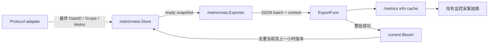
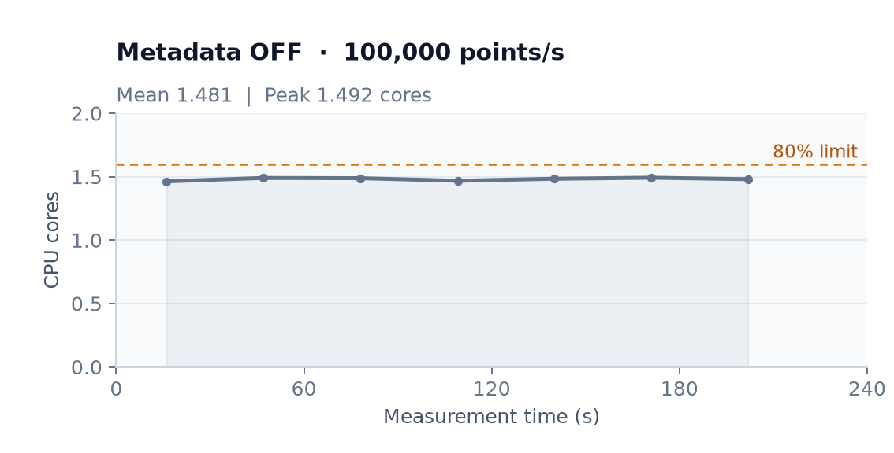
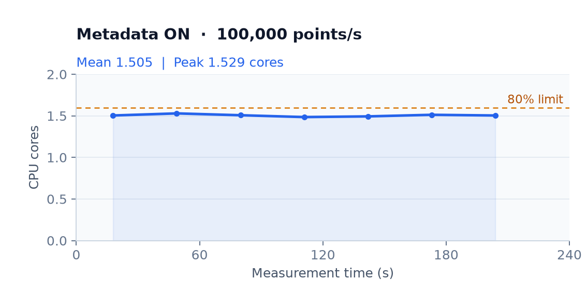
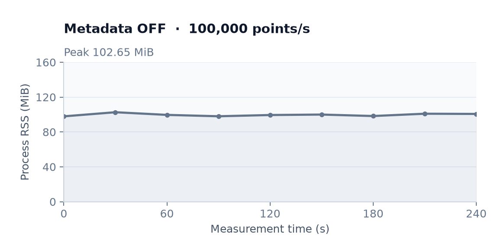
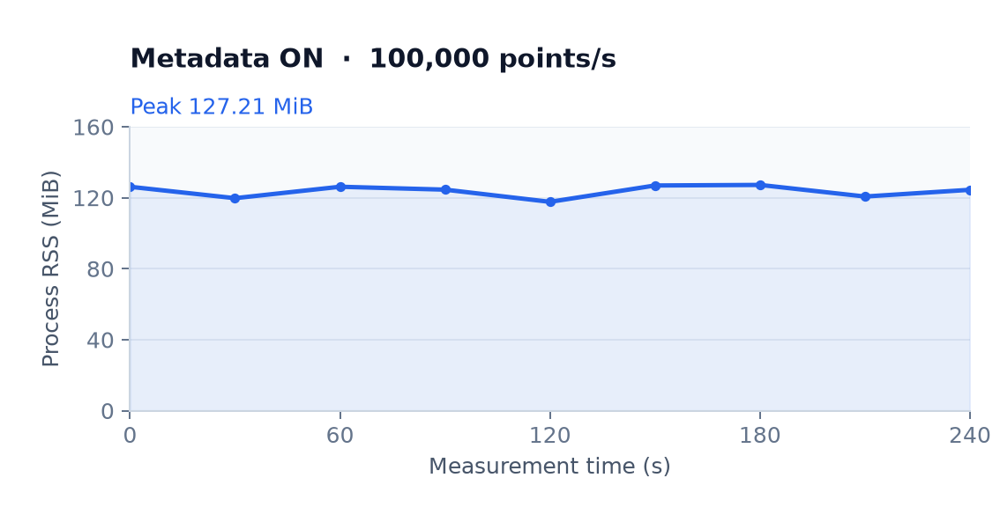

# bk-collector 指标元信息采集与同步方案

## 0x01 调研与约束

collector 在协议转换时丢失描述、单位和聚合语义。同一 DataID 中的不同服务可以上报同名指标，元信息必须跟随最终身份和实际输出序列登记。

**Store 只保存待发原文，成功版本由两个按小时轮换的 Bloom 去重。** 防抖合并主键内的版本变化，DataID 与全局配额控制异常更新，发送期限和批次限制控制出口。

| 约束 | 取舍 |
| --- | --- |
| 内存有界 | pending 与快照各不超过配置主键数，条目字符串有字节上限，Bloom 容量固定 |
| 允许极低概率遗漏 | 总目标误判率 `10⁻⁶`，持续观察的指标在过滤器过期后重发，一次性指标可能无法补回 |
| 历史回退 | `A → B → A` 可能命中历史版本，等待轮转或手动 Clean |
| 重启 | 只从后续观察重建，不承诺恢复未发送原文 |
| 协议复用 | utils 只依赖标准库，collector 提取语义并提供发送回调 |

[REPORT](./REPORT.md) 和 [验证原型](./validation/README.md)保留选型依据；原型的单 Bloom、容量清空和内存结果不代表生产双 Bloom 实现。

## 0x02 架构设计

### a. 职责与对象



| 对象 | 职责 |
| --- | --- |
| `Scope` | 使用方推断类型与稳定范围，utils 不推断业务身份 |
| `Key` | `DataID + ScopeType + Scope + Metric`，隔离服务、分组和实际输出序列 |
| `Value` | 原名、描述、单位、输出类型、原始类型、累计方式、周期和汇聚操作 |
| `Store` | 准入、防抖、待发值、成功版本、Clean 与统计 |
| `Exporter` | 串行发送、限速、整轮期限、确认、回填及生命周期 |

```go
type Scope struct { Type ScopeType; Name string }
type Key struct { DataID int32; ScopeType ScopeType; Scope, Metric string }
type Value struct {
    Name, Unit, Description string
    Type, OriginalType, Temporality, Usage string
    Interval int64
    Present uint8
}
type Observer interface { Observe(Key, Value) bool }
type ExportFunc func(context.Context, []byte) error
```

- `ScopeType` 预定义 APM／PLUGIN／DEFAULT，支持非空自定义类型；collector 根据最终维度推断 APM 或 DEFAULT。
- `Present` 区分未知字段与已知值，位标记依次为 Unit／Description／Interval／Usage。
- 版本使用完整 Key、全部 Value 字段及 Present 的 SHA-256 摘要，变长字段带长度前缀，避免拼接歧义。

### b. 双 Bloom 轮转

默认 `full_report_interval=2h`，每半周期轮换一个过滤器。查询两代，只向当前代登记成功版本；每代目标误判率为配置值的一半，重复观察不刷新任何代。

| 触发 | 行为 |
| --- | --- |
| 到达小时边界 | 切换当前代并清空该代，保留上一代 |
| 跨过至少两个小时边界 | 清空两代，轮转基准按固定节奏推进 |
| 当前代成功版本达容量 | 暂停后续发送，保留已接收积压，拒绝新增未命中版本，等下次轮换恢复 |
| 手动 `Clean()` | 清空两代，保留 pending 和防抖状态，下一快照强制发送 |

版本有效期为 `1 h～2 h`，实际重报还需等待重新观察、防抖和排队。容量满不会提前重建，避免版本抖动反复触发全量发送。

双 Bloom 分散跨小时批次的到期量，同小时集中写入仍会集中到期。批次间隔和准入配额限制重报峰值，整轮期限限制单次发送占用。

若需要进一步平滑到期，可按 Key 哈希划分固定分片，每片保留双 Bloom，并把轮转相位均匀错开在 `1 h` 内。该方案无需逐指标 TTL，但增加分片容量管理，且首次启动仍需出口限速；本实现保留双 Bloom 与有界发送。

`Clean()` 增加独立清理代号，在途旧快照成功后不再填充被清理的 Bloom；自然时间轮换按确认时间登记成功版本。

### c. 防抖与熔断

```text
Observe(Key, Value)
  → 黑名单 / 合法性 / 字节上限
  → 同键同值复用；已发送版本去重
  → Bloom / pending 容量限制
  → DataID 与全局更新配额
  → 覆盖该键候选，保留首次等待时间，重置最后变更时间

Flush
  → 稳定时间达到 debounce_interval，或累计等待达到 debounce_max_wait
  → 取出最新候选，按批次和发送间隔处理
```

相同值不延后稳定时间。默认等待稳定 `1 min`，持续变化满 `10 min` 后具备发送资格，由下一次刷新处理；默认刷新周期为 `1 min`，实际发布时间还包含调度与排队延迟。被防抖合并的版本也计入准入配额。

配额为固定窗口，按全局和 DataID 计候选新增及变更。DataID 独立配置覆盖默认值，`0` 禁用该 DataID；窗口到期自动恢复，Clean 不重置配额。拒绝当前变化时移除该键旧待发候选，避免直接发送已知过期值。

## 0x03 元信息协议

```json
{
  "dataid": 1001,
  "__scope_type": "APM",
  "__scope": "checkout%2Dhttp-sdk",
  "__metric": "request_duration_sum",
  "__name": "request.duration",
  "__description": "请求耗时",
  "__unit": "s",
  "__temporality": "delta",
  "__interval": null,
  "__original_type": "histogram",
  "__type": "counter",
  "__usage": "sum"
}
```

| 字段 | 类型 | 必填 | 契约 |
| --- | --- | --- | --- |
| `dataid` | int32 | 是 | 鉴权后的指标 DataID，大于 `0` |
| `__scope_type`／`__scope` | string | 是 | 类型非空，范围可以为空 |
| `__metric`／`__name` | string | 是 | 非空，分别为实际输出名和拆分、规范化前原名 |
| `__description`／`__unit` | string / null | 是 | 来源空字符串映射为 null，明确无量纲使用 `1` |
| `__temporality` | string | 是 | `delta`／`cumulative`，点值按 delta 登记 |
| `__interval` | int64 / null | 是 | 已知时为正数，单位毫秒 |
| `__original_type` | string | 是 | sum／gauge／histogram／summary／counter／avg／unknown，指标族内一致 |
| `__type` | string | 是 | counter／gauge／unknown，表示输出序列自身类型 |
| `__usage` | string / null | 是 | sum／min／max／avg／last，无法推断为 null |

APM Scope 从最终 `service_name` 与 `scope_name` 读取，各自先转义 `% → %25`、`- → %2D`，再用 `-` 连接。缺少服务名时使用 DEFAULT，以 scope_name 作为范围；bucket 的 `le` 和 Summary 的 `quantile` 不参与主键。

## 0x04 开发方案

### a. 接入与生命周期

| 位置 | 调用关系与边界 |
| --- | --- |
| `pkg/utils/metricmeta` | `DefaultConfig → NewExporter → Store/Start/Flush/Stop`，`Store` 实现 Observer 并提供 Clean、Stats |
| `collector/exporter.New` | 默认关闭，启用时创建元信息实例，通过 `NewCommonConverterWithMetadata` 注入 Observer |
| `collector/exporter.Start` | 先启动元信息，再启动消费者，外层 goroutine 启动前登记 WaitGroup |
| `collector/exporter.Stop` | 停止 Tars 聚合，再取消并等待消费者，最后停止元信息发送，重复调用幂等 |
| `collector/example/metric_metadata.yml` | 独立配置片段，不改动现有本地示例配置 |

快照直接接管 pending map，未稳定项留在新 pending；编码与回调均在锁外执行。发送失败或超时回填未确认项，同键保留并发新值，合并强制标记和首次等待时间；回填超限计数丢弃。

`ExportFunc` 必须响应 context，返回 nil 表示整批确认，部分成功返回错误可能导致重试重复。Stop 拒绝新 Observe，取消后台请求后，用独立期限执行最后一轮并跳过防抖，剩余丢弃计数后释放缓存。

### b. 协议适配

| 来源与采集位置 | 元信息映射 | 输出约束 |
| --- | --- | --- |
| OTLP：`metricsConverter.Convert`，Extract 前保留原名 | Description／Unit 来自 Metric，Sum 读取 IsMonotonic 和累计方式 | Gauge 为 gauge/delta/last，Histogram min/max 为 gauge + min/max，其他子项 counter/sum，count/bucket 单位 `1` |
| OTLP Summary | sum/count 为 counter/cumulative/sum，quantile 为 gauge/delta/last | `__original_type=summary`，count 单位 `1`，未知累计方式跳过语义登记 |
| Pushgateway：兼容转换后登记 | Name／Help 来自 MetricFamily，类型与实际数据字段一致 | Counter 为累计 counter，Gauge 为点值；Histogram／Summary 子项遵循 OTLP 对应规则，未知类型为 unknown |
| trpc：删除 `_name`／`_type` 前保留来源 | 原名取 `_name`，仅接受与 MetricFamily 和数据字段一致的 gauge/counter/histogram | 身份使用兼容转换后的最终指标名与维度，矛盾语义跳过元信息 |
| Tars Stat：`stat.ToEvents` | 计数为 counter，秒直方图共用原名与 histogram 类型，sum 单位 `s`，count/bucket 单位 `1` | 原始输出遵循服务过滤，聚合输出携带 AggregateInterval，推导服务按自身维度隔离 |
| Tars Property：`handleProp` | Sum 为 sum/counter/sum，Count 为 counter/counter/sum，Distr 为 histogram/counter/sum；Min/Max/Avg 为 gauge 及对应操作 | 原名为 PropertyName，实际名沿用 propNameToMetricName，单位仅 Count/Distr 已知为 `1` |
| OTP receiver → RemoteWrite converter | receiver 将只读 `MetricDescriptors` 与 Timeseries 等长传递，converter 在有效样本处绑定最终身份 | SET/MIN/MAX 为 gauge，SUM/COUNTER/AVG/HISTOGRAM 为 counter，全部 delta；AVG 和 Histogram count/bucket 单位 `1`，RPC sum 单位 `s` |
| 原生 Remote Write v1 | 缺少可靠指标族到序列绑定，不推断 Metadata | 描述为空、长度失配和未知语义均保留原有数值输出 |

OTP 描述中的原名在分组解析后、规范化与拆分前保存；中文原名解码保留，数值序列沿用 SDK 的 base62 编码。描述允许共享只读指针，processor 重排或删除 Timeseries 必须同步描述，长度失配跳过登记并计数；现有 metricsfilter 只改标签。

Tars／OTP 的周期 SUM 按 counter 记录，负值语义沿用平台约定。协议依据与 Remote Write 反例见 [REPORT](./REPORT.md)。

### c. 出口与接收端边界

默认发送回调将 JSON 批次发布为 `/metrics` 上的 `bk_collector_metric_metadata_info=1`。标签为 dataid、scope_type、scope、metric、name、description、unit、temporality、interval、original_type、type、usage、present；可空字段未知时标签为空，present 保留字段存在语义。

采集窗口按完整主键替换最新版本，容量复用 `max_pending_entries`，默认保留 `2 min`；到期由发送或采集清理，保留时间至少覆盖两次采集间隔。批次超容量时整批拒绝并回填，避免 Prometheus 标签向量永久保存历史版本。成功确认仅表示本机可采集，远端持久化通过现有监控链路验证；后续重报仍受 Bloom 控制。

指定 `endpoint` 时改为 HTTP POST，`2xx` 确认整批；重定向、`429`、其他错误均保留待发项。HTTP 消费方应按主键和版本幂等写入，并通过每 DataID 基数、更新速率和请求大小上限防御异常输入。

## 0x05 配置与观测

完整示例位于 `pkg/collector/example/metric_metadata.yml`，重启生效。

| 参数 | 默认 | 校验／效果 |
| --- | --- | --- |
| `enabled`／`endpoint` | false／空 | 启用后默认发布 info 指标；非空 endpoint 要求无 userinfo 的 HTTP(S) URL |
| `info_retention` | `2 min` | info 采集窗口保留时间，必须为正并覆盖至少两次采集间隔 |
| `flush_interval`／`full_report_interval` | `1 min`／`2 h` | 正数，半个补报周期大于 flush 周期 |
| `bloom_capacity`／`bloom_error_rate` | `100,000`／`10⁻⁶` | 每代容量，概率介于 `0` 和 `1`，拒绝 NaN 和过大分配 |
| `max_pending_entries`／`max_entry_bytes` | `100,000`／`4,096 B` | 同时限制入队与回填，字符串总字节超限拒绝整条 |
| `export_batch_size`／`export_batch_bytes` | `1,000`／`256 KiB` | 实际 JSON 数组同时满足两个限制，条目数不超过 pending 上限 |
| `export_min_interval`／`export_timeout` | `100 ms`／`5 s` | 开始间隔小于整轮期限，整轮期限小于 flush 周期 |
| `debounce_interval`／`debounce_max_wait` | `1 min`／`10 min` | 稳定时间允许 `0`，最大等待为正且不小于稳定时间 |
| `circuit_window`／`max_updates` | `1 min`／`100,000` | 固定窗口全局候选更新上限 |
| `max_updates_per_dataid` | `10,000` | 每 DataID 默认窗口上限 |
| `blocked_dataids` | `[]` | 正数 DataID 列表，拒绝黑名单元信息 |
| `dataid_limits` | `[]` | `[{dataid: 1001, max_updates: 1000}]`，DataID 唯一，上限允许 `0` |

collector 暴露 `bk_collector_metric_metadata_` 前缀的 info_entries、pending_entries、bloom_versions、bloom_rotations_total、cleans_total、forced_entries_total、export_entries_total、suppressed_total、debounced_total、export_failures_total、dropped_total 和 flush_duration_seconds。

丢弃 reason 固定为 blacklist、invalid、entry_bytes、bloom_capacity、pending_capacity、global_circuit、dataid_circuit、restore_capacity、batch_bytes、closed、shutdown；来源失败另计 source_dropped_total，reason 为 unknown_semantics／descriptor_mismatch，这些运行统计不以指标名或 DataID 创建标签；info 指标按元信息协议携带标签。

## 0x06 验收与验证

### a. 执行门禁

在仓库根目录使用 Go `1.23.4` 和包含 utils／collector 的 go.work 执行：

```bash
go test -race ./pkg/utils/metricmeta ./pkg/collector/exporter/... \
  ./pkg/collector/define ./pkg/collector/confengine \
  ./pkg/collector/processor/metricsfilter \
  ./pkg/collector/receiver/otlp/... ./pkg/collector/receiver/pushgateway/... \
  ./pkg/collector/receiver/remotewrite/...
go vet ./pkg/utils/metricmeta ./pkg/collector/exporter/...
go test ./pkg/utils/metricmeta -run '^$' -bench . -benchmem
```

竞争检测、改动包 vet、collector 编译通过；utils 兼容 Go `1.21`。

| 验收面 | 测试与断言 |
| --- | --- |
| 集中到期 | `TestRotationCohortExpiry`：同小时进入的两批各 1,000 条在两小时后全部到期；跨小时进入时仅第一批 1,000 条到期 |
| 轮转／误判／回退 | `TestHourlyRotationAndFallback`、`TestFalsePositiveExpiresWithoutRefresh`：两代去重不续期，Clean 与过期恢复发送 |
| 防抖／配额 | `TestDebounceLatestAndMaxWait`、`TestBlacklistCircuitCapacityAndRecovery`：稳定后取最新值，持续变化有最大等待，黑名单及配额到期恢复 |
| 容量／发送 | `TestBloomSaturationDefersAcceptedBacklogUntilRotation`、`TestBatchLimitsTimeoutAndRetry`：饱和不清空、不超发，数量和 JSON 字节限额、间隔、超时续传 |
| 回填／清理 | `TestRetryPreservesNewerAndClean`、`TestSuccessfulInFlightCleanCannotRepopulateBloom`：不覆盖并发新值，旧快照不污染 Clean 后的过滤器 |
| 生命周期 | `TestConcurrentLifecycle`、`TestStopCancelsBackgroundAndUsesIndependentFinalDeadline`：重复并发调用、未启动即关闭、取消和独立收尾期限 |
| 协议与身份 | `converter/metric_metadata_test.go`：OTLP 类型、单位和原名，trpc 校验，Summary quantile，Tars 聚合与推导服务，Remote Write 描述对齐及最终身份 |
| OTP 中文 Histogram | SDK 协议报文经集群上报，中文原名和分组保留，count／bucket 单位为 `1`，sum 未知单位为空，数值指标及三条 info 均可回读 |
| info 默认出口 | `TestMetadataDefaultInfoExporter`、`TestMetadataInfoReplacementCapacityAndExpiry`、`TestMetadataInfoConcurrentExportAndScrape`：配置默认值、真实 `/metrics` 编码、同键替换、整批容量拒绝、TTL 和并发采集 |
| HTTP 可选出口 | `TestMetricMetadataHTTPConfigAndFinalFlush`、`TestMetricMetadataHTTPFailureRetryAndCancellation`：真实配置解析、JSON 请求、429 重试、2xx 确认和关闭收尾 |

### b. 性能结果

`2026-10-23`，Apple M4 Pro／Go `1.23.4`，生产模块单次基准，查询不含网络；位图字节为两个过滤器 backing array 的实际大小，未含 pending、快照和进程总堆。

| 测量 | 结果 |
| --- | --- |
| pending 同值 Observe | `79.17 ns/op`，`0 B/op`，`0 allocs/op` |
| 已发送版本 Observe | `320.7 ns/op`，`0 B/op`，`0 allocs/op` |
| 默认十万容量 Clean | `3.100 μs/op`，`0 B/op`，`0 allocs/op` |
| 一万／十万／百万容量双位图 | `75,504 B`／`754,960 B`／`7,549,472 B` |
| 同容量单过滤器判断 | `16.11 ns/op`／`17.81 ns/op`／`34.75 ns/op` |

`2026-10-24`，同机 `BenchmarkMetadataOTLP/enabled=true` 连续 `5` 次：单批 `1,000` 点复用请求内 Scope 后，耗时中位数降低约 `15%`，每批减少 `2,997` 次分配和 `119,880 B` 分配量。缓存仅保存上一组最终身份，维度变化立即重算。

## 0x07 基准压测

### a. 配置

| 项目 | 配置 |
| --- | --- |
| 资源与范围 | 同一节点上的单 collector，`2 CPU / 4 GiB`；不外推整个集群容量 |
| 负载 | OTLP HTTP，`10` 服务 × `10` 分组 × `1,000` 个单点 Gauge，共 `100,000` 个组合 |
| 上报频率 | 每个指标 `1` 点／秒；`100 QPS`，每请求 `1,000` 点 |
| 身份 | service=`metricmeta-scale-00…09`，group=`metadata-benchmark-00…09`，metric=`metricmeta_acceptance_0…999` |
| A／B | 关闭／开启元信息，其他参数默认；相同发压程序与采样周期 |
| 窗口 | 开启组先完成首次登记及 info 窗口过期（本轮约 `17 min`）；每档预热 `60 s`，同量对照测量 `240 s`，`/metrics` 每 `30 s` 读取 |
| 稳态标准 | CPU ≤ `80%`，无接收错误，出口跟上输入，无持续增长的数值积压；记录 P99 |
| 限流 | 运行配置 `metrics.enabled=false`；接收预检、入口拒绝和 DataID 处理链路丢弃分别核对 |

### b. 数据采集 PromQL

| 观测 | PromQL |
| --- | --- |
| CPU 趋势 | `sum(rate(container_cpu_usage_seconds_total{pod="<pod>",container="collector"}[5m]))` |
| 容器内存工作集 | `sum(container_memory_working_set_bytes{pod="<pod>",container="collector"})` |
| 出口点速率 | `sum(rate(bkmonitor:bk_collector_exporter_queue_pop_batch_size_sum{pod="<pod>",id="<dataid>",record_type="metrics"}[1m]))` |
| 服务／分组入库 | `count by (service_name,scope_name)(bkmonitor:metricmeta_acceptance_1{service_name=~"metricmeta-scale.*"})` |

容量判定使用直接读取的 cgroup 累计 CPU 用量差分，采样间隔约 `30 s`；PromQL 用于趋势核对。RSS 来自进程指标，P99 为请求耗时。

### c. 记录

**单 `2c` 在本工况下验证到 `10 × 10 × 1,000 = 100,000` 个组合，每秒 `100,000` 点。** 两组连续采样的出口均跟上输入，所有接收、限流与处理链路错误增量为 `0`，全部 `100` 个服务／分组组合可从存储回读。

| 指标 | A：关闭 | B：开启 |
| --- | --- | --- |
| 实际 QPS | `100.00` | `100.00` |
| 出口点速率 | `100,039 点／秒` | `100,033 点／秒` |
| 成功请求／指标点 | `24,000 / 24,000,000` | `24,000 / 24,000,000` |
| 错误／部分接收 | `0 / 0` | `0 / 0` |
| 平均 CPU（cgroup） | `1.4807 核` | `1.5051 核` |
| 约 30 秒 CPU 窗口峰值 | `1.4921 核` | `1.5293 核` |
| 峰值 RSS | `102.65 MiB` | `127.21 MiB` |
| 请求 P99 | `3.60 ms` | `3.77 ms` |
| 限流拒绝／链路丢弃／重启 | `0 / 0 / 0` | `0 / 0 / 0` |

同量对照中，开启后的平均 CPU 增加 `1.6%`，峰值 RSS 增加 `24.56 MiB`，P99 增加 `0.17 ms`。这是同一节点的单轮去重稳态结果；首次登记、轮转重报和不同标签形态需另计开销。

| 边界档 | 进程 CPU | 实际点速率 | P99 | 判定 |
| --- | --- | --- | --- | --- |
| 关闭，`10 × 11 × 1,000`，`110 QPS` | `1.658` 核 | `11.00` 万／秒 | `3.72 ms` | 超过 80% 水位 |
| 开启，`10 × 11 × 1,000`，`110 QPS` | `1.657` 核 | `11.00` 万／秒 | `4.06 ms` | 超过 80% 水位 |
| 开启，`10 × 14 × 1,000`，目标 `140 QPS` | `1.999` 核 | `12.06` 万／秒 | `270.77 ms` | CPU 饱和、请求受背压，非稳态容量 |

边界档未发生入口限流拒绝。饱和档停压约 `62 s` 后继续输出约 `55` 万尾部点，CPU 均值降至 `0.145` 核；`10` 万是本次步长下的已验证容量，不是精确极限或其他上报频率的线性推算。

首次登记第 `13～17 min` 的过渡窗平均 CPU 为 `1.797` 核，P99 为 `68.93 ms`，接收与数值链路错误增量为 `0`。首次登记和轮转重报需要额外 CPU 余量，不能用去重稳态结果代替。

默认 Bloom 的 `100,000` 成功版本容量由所有 DataID 共用，背景业务也占用额度；满额后拒绝新增元信息，数值指标继续处理。因此数值组合容量不等于元信息完整覆盖数。

| 功能工况 | 结果 |
| --- | --- |
| 完整覆盖 | 新服务 `10 × 9 × 1,000` 共 `90,000` 条元信息，按默认配额发布，`90` 个分组均从存储回读到 `1,000` 条；pending 最终为 `0` |
| 持续变更 | `6,600` 次变更合并为运行中一次、稳定后最终版本一次，pending 最终归零 |
| DataID 配额 | 接纳 `10,000` 次、拒绝 `140,000` 次更新，下一窗口恢复 |
| 轮转到期 | 同代 `2,000` 个版本仍一起到期；跨代两小时边界仅第一批 `1,000` 个版本到期 |

压测曲线对照：

| 观测 | A：关闭 | B：开启 |
| --- | --- | --- |
| CPU 核心数 |  |  |
| 进程 RSS |  |  |

- *[1] 曲线由同量对照的原始采样数据绘制，A／B 使用相同坐标轴；CPU 虚线为 2 核配额的 80%。*

## 0x08 参考与版本锚点

| 状态 | 分支 | 里程碑 | PR |
| --- | --- | --- | --- |
| 🔄 | `feat/collector-metric-metadata/#1010158081139354539` | 指标元信息采集、轮转去重与默认 info 出口 | [#1556](https://github.com/TencentBlueKing/bkmonitor-datalink/pull/1556) |
