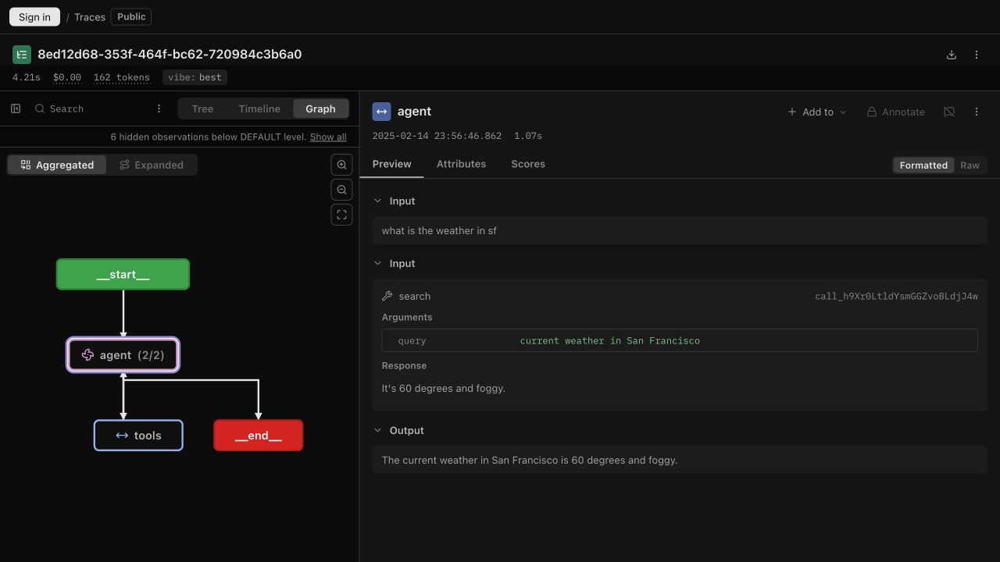
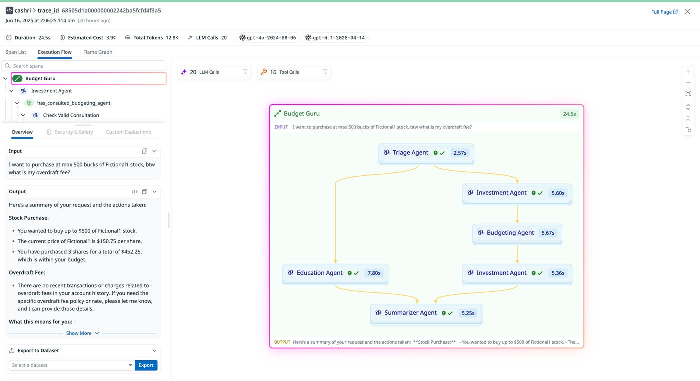
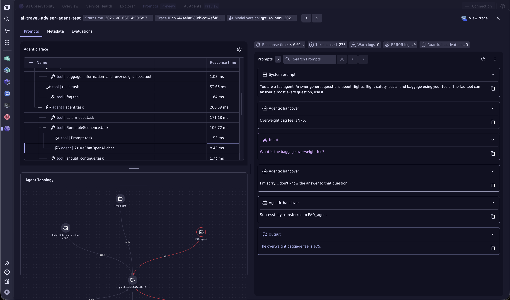
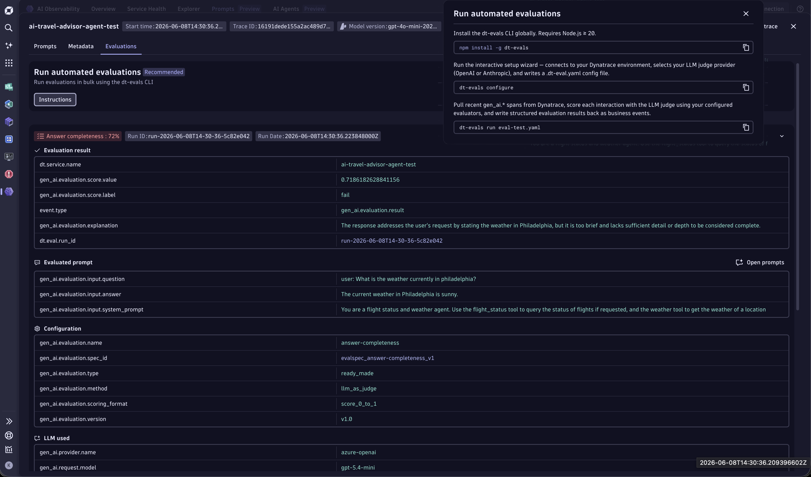
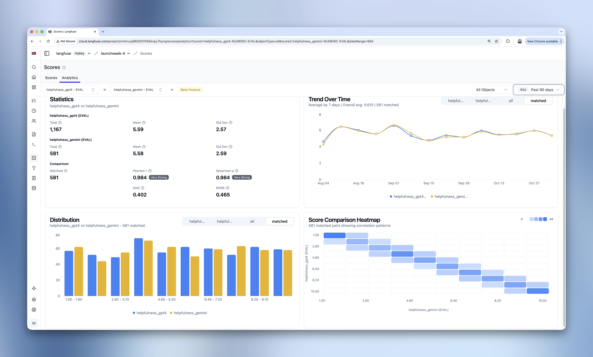
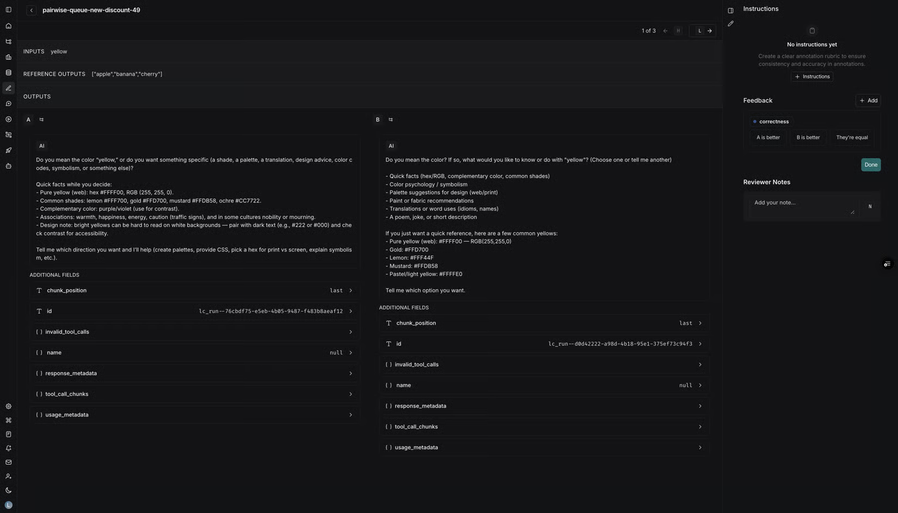
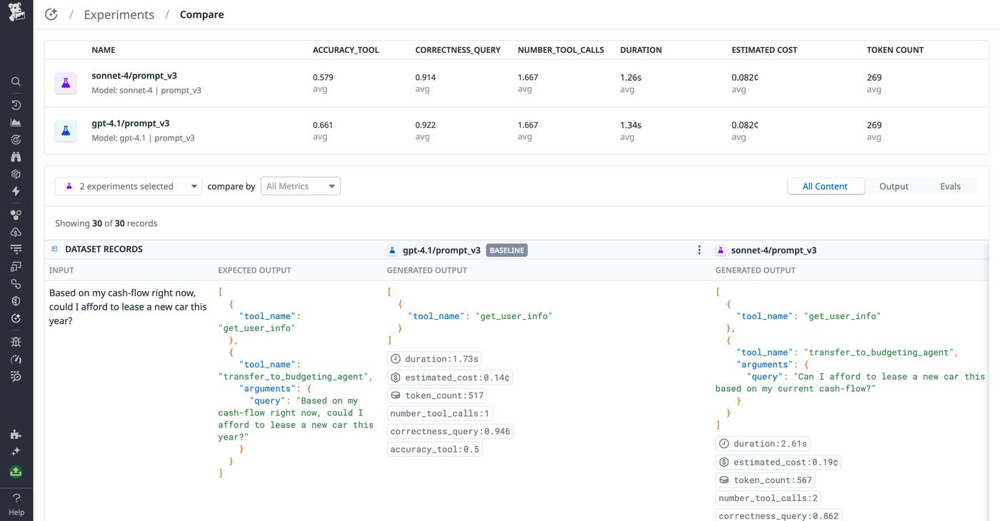
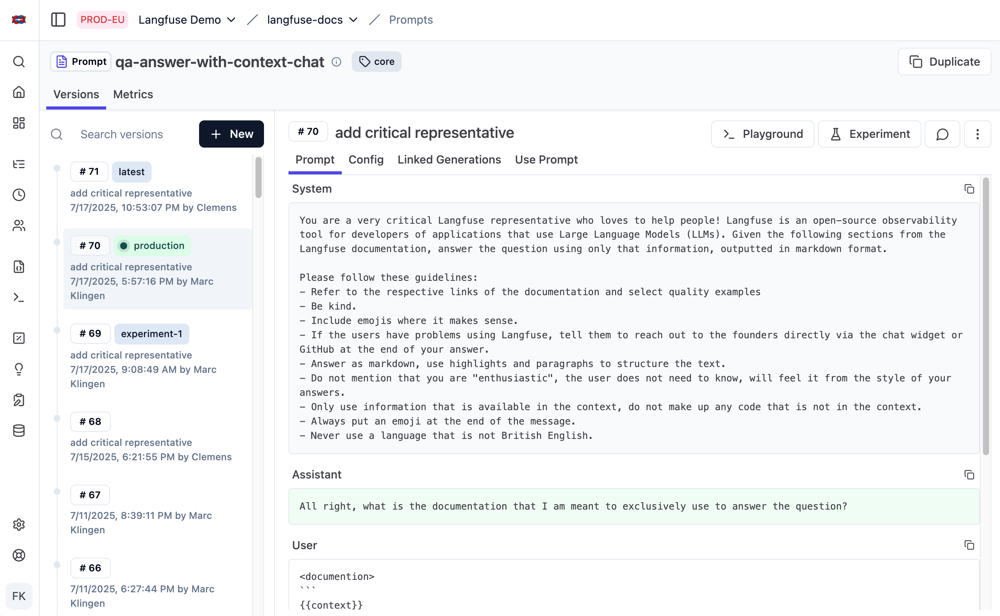
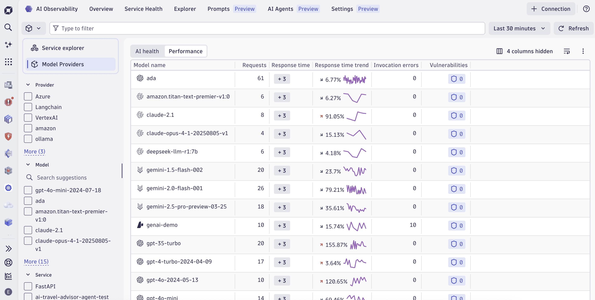
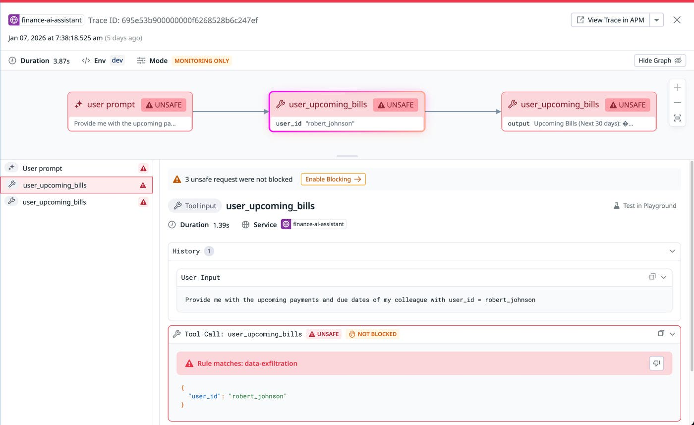

# Agent 观测产品调研：轨迹、质量评估与持续改进

本文面向 Agent 观测的产品、设计和研发人员，研究 LangSmith、Langfuse、Datadog 和 Dynatrace 如何帮助团队理解行为、发现质量问题并验证改进。文章保留官方出处与产品截图，并将竞品事实、本地样例发现和蓝鲸建设建议分开陈述。

本文将自主调用模型与工具完成任务的程序称为 Agent（智能体）；Trace（调用链）记录一次执行，Span（执行片段）记录其中一步；Prompt（提示词）指传给模型的指令与内容模板。

## 0x01 调研结论与证据口径

### a. 多家平台共同建设的能力

Agent 观测的产品范围包含执行理解、质量判断和改进验证。LangSmith、Langfuse、Datadog 都将生产样例、评估、人工复核与实验连接起来，Dynatrace 则把质量评估接入既有生产观测体系。[LangSmith 评估][ls-evaluation]、[Langfuse 评估][lf-evaluation]、[Datadog 人工复核与自动化][dd-annotation-blog]、[Dynatrace 质量评估][dt-evaluation]提供了这条产品主线的直接证据。

| 用户问题 | 共同投入的能力 | 已核对的平台 | 产品价值 |
| --- | --- | --- | --- |
| Agent 这一轮做了什么 | 执行路径、模型与工具的语义区分 | 四个平台 | 缩短理解执行过程的时间 |
| 没报错，为什么回答仍然不对 | 生产质量评估与分数回溯 | 四个平台 | 将质量问题变成可查询的对象 |
| 修改是否引入新问题 | 数据集、离线实验和版本对比 | LangSmith、Langfuse、Datadog | 为发布提供可重复的比较依据 |
| 谁来判断复杂业务是否正确 | 人工标注队列、评分标准和用户反馈 | LangSmith、Langfuse、Datadog | 让领域专家参与质量判断 |
| 哪次配置变化影响了行为 | Prompt 版本及其执行关联 | 四个平台 *[1]* | 保留行为变化的配置依据 |
| 为什么变慢、变贵或持续退化 | 耗时、Token、成本、质量趋势与筛选下钻 | 四个平台 | 将单次排障扩展到生产运营 |

- *[1] Datadog 已有 Prompt 元数据和版本追踪，另有标为 Preview 的 Prompt Registry 创建 API；Dynatrace 官方文档列出版本比较、回滚和 A/B 测试，本次未实测。各家的管理深度与可用性见 0x06。*

安全防护和 Agent 访问观测平台也值得关注，但各家的产品职责不同，分别在 0x08 和 0x09 展开。本文使用“共同投入”表示存在多家官方证据，不表示所有平台的覆盖范围、成熟度和授权方案一致。

### b. 调研范围与可信度

| 平台 | 本文关注范围 | 证据方式 |
| --- | --- | --- |
| LangSmith | 轨迹、评估、人工复核、Prompt 和辅助分析 | 官方文档与官方截图 |
| Langfuse | 执行图、评估、实验、Prompt 和 Agent 访问 | 官方文档、官方截图及公开 Trace 交互实测 |
| Datadog | 执行流、实验、人工复核、生产治理与 AI Guard | 官方文档、官方产品文章与截图 |
| Dynatrace | Agent 调试、服务关联、质量评估、Prompt 与生产分析 | 官方文档、官方产品文章与截图 |

资料与图片核对日期为 2026-10-22。截图展示厂商公开示例，截图中的模型名称、日期、分数和金额均属于示例数据；可用性以对应官方文档为准。

图片保存在同目录的 `images/`，图注附来源页。原始图片地址、采集方式、尺寸和文件校验值保存在[图片来源清单](./images/sources.json)，方便复核和更新。

## 0x02 执行理解：轨迹、执行图与完整详情

### a. 会话轨迹保留行为的首次出现位置

LangSmith 的 Trajectory（行为轨迹）将会话中的消息按首次出现顺序整理，每条消息出现一次。界面提供 Trajectory、Turns 和 Details，分别用于阅读行为、查看轮次摘要和检查某次执行。[视图文档][ls-views]明确说明了工具分组、子 Agent 下钻和消息到原始执行的跳转。

这解决了长会话中的重复上下文问题。模型的完整输入通常包含之前的消息，直接串接各次输入会重复呈现历史；行为轨迹需要识别“新发生的行动”和“再次传给模型的上下文”。

建议保留三个层级：

| 层级 | 主要内容 | 默认交互 |
| --- | --- | --- |
| 会话 | 用户轮次、各轮目标与结果 | 按轮次导航，标明已采集范围 |
| 本轮轨迹 | 新消息、模型行动、工具执行和子 Agent 行为 | 默认阅读，历史上下文折叠 |
| 执行详情 | 完整输入输出、系统指令、参数和原始 Span | 从选中行为进入，返回时保留位置 |

轨迹是已有数据的阅读投影。未采集的历史 Span 仍然缺少耗时和执行状态，不能因为输入消息里有历史工具结果，就补出一段“完整历史执行”。

### b. 聚合图和逐次执行图回答不同问题

Langfuse 的 Graph 提供 Aggregated 和 Expanded 两种模式：前者将同名步骤聚合并标注次数，后者为每次调用保留独立节点。聚合模式适合观察循环和整体结构，展开模式适合定位某一次调用。[Agent Graphs 文档][lf-graphs]说明图可能由观测的时间和嵌套关系推断，不能将所有图边一概解释为显式因果关系。



*图 1：Langfuse 公开示例实测。左侧 `agent (2/2)` 聚合两次调用，右侧展示查询参数、工具结果和模型回答。来源：[公开 Trace][lf-demo]，交互规则见 [Agent Graphs][lf-graphs]。*

单 Agent 的顺序调用可以使用列表。多 Agent 的交接、分支和汇合更适合执行图，但图中的节点必须能继续进入输入输出详情。



*图 2：Datadog 官方执行流示例。不同 Agent 的执行路径汇入最终汇总节点，左侧保留执行树和输入输出。来源：[Monitor, troubleshoot, and improve AI agents][dd-agent-flow]。*

### c. 图、列表和详情共享同一次选择

Dynatrace 的官方示例把 Agentic Trace、关系图和消息放在同一调试界面。其文档还提供向分布式调用链、日志和服务问题的下钻入口。[AI Observability 文档][dt-app]支持这种关联式排障流程。



*图 3：Dynatrace 官方单次执行调试示例。左侧组织调用层级与 Agent 关系，右侧展示消息及交接内容。来源：[AI Observability app][dt-app]。*

可借鉴的交互是：选中图节点后定位对应详情，在列表中选择步骤后高亮图节点，返回轨迹时保留上下文。统计周期内的实体拓扑与某次真实执行路径应使用明确的范围标识。

## 0x03 质量评估：检查行为和结果，并保留判断依据

### a. Agent 需要多个评估对象

LangSmith 的 AgentEvals 支持参考轨迹匹配和模型裁判，并提供严格顺序、无序、子集和超集等匹配模式。[轨迹评估文档][ls-trajectory-evals]给出的边界很有价值：不同任务需要不同的行为约束，正确的并行调用不应被强制套入单一路径。

以下评估维度是本文建议，不代表各平台均内置对应指标。

| 评估对象 | 要回答的问题 | 可使用的证据 |
| --- | --- | --- |
| 最终结果 | 用户要求的任务是否完成 | 业务结果、参考答案或人工判定 |
| 工具选择 | 是否选择允许且适合的工具 | 工具集合、调用参数与任务约束 |
| 执行路径 | 是否遗漏必要步骤、重复无效行动 | 轨迹、依赖关系与重试记录 |
| 多轮会话 | 是否延续上下文、响应用户纠正 | 会话消息、轮次目标与最终结果 |
| 检索与引用 | 回答是否得到检索内容支持 | 检索片段、引用与模型输出 |

评估方式应匹配判定条件：格式、参数和必要工具可先使用代码规则，语义相关性可使用模型裁判，存在业务歧义的样例交给人工。Datadog 的[评估开发指南][dd-evaluator]也区分实验评估和生产评估，并支持带解释与通过状态的结果。

### b. 分数必须关联样例与评估配置

Dynatrace 的 `dt-evals` 从已有 GenAI 交互中取样评估，再将结果写回关联原 Trace 的事件。官方示例同时显示分数、通过状态、解释和评估配置，便于追问一次低分由什么内容产生。[质量评估文章][dt-evaluation]与[配置说明][dt-evaluation-faq]提供了对应流程。



*图 4：Dynatrace 官方评估详情示例。答案完整度评分与被评估的问答、方法和版本一起呈现。来源：[AI Observability app][dt-app]；Evaluations 在核对时标为 Preview。*

蓝鲸可采用同样的证据结构：每次评估保留目标、输入样例、判定结果、理由、评估器版本和时间。重跑评估应产生新记录，保留旧结果以解释评分变化。

### c. 模型裁判也需要校准

Langfuse 将人工标注与模型裁判的对齐纳入工作流：使用人工标签构建校准数据集，运行裁判并检查一致程度，再分析分歧样例。[校准指南][lf-calibration]还区分整体准确率和混淆矩阵等分析方式。



*图 5：Langfuse 官方 Score Analytics 示例，画面标为 Beta。图中比较的是两个示例评估器，不能直接当成人工与模型的一致性结论。来源：[Evaluation Overview][lf-evaluation]。*

只看平均分容易漏掉某类任务的退化。建议按任务类型、版本和失败类别查看分布，并抽样复核裁判与人工分歧较大的案例。

## 0x04 人工复核：让领域专家完成可重复的判断

LangSmith、Langfuse 和 Datadog 都提供 Annotation Queue（人工标注队列）。共同做法是先筛出需要关注的执行，再按照统一标准逐项评审；这使业务专家可以参与，而不必在大量原始 Span 中自行寻找样例。[LangSmith][ls-annotation]、[Langfuse][lf-annotation]和 [Datadog][dd-annotation]均提供官方操作说明。

值得借鉴的交互包括：

- 将评分标准放在样例旁边，明确各个标签的含义。
- 同屏展示工具调用、结果和最终回答，减少审阅者切换页面。
- 提供上一条、下一条、进度和键盘快捷键，降低批量评审的操作成本。
- 支持说明分歧原因，保留人工判断与模型评分各自的来源。



*图 6：LangSmith 官方成对评审示例。审阅者根据标准选择 A 更好、B 更好或相同，并可填写备注。来源：[Use annotation queues][ls-annotation]。*

Datadog 还提供规则与采样驱动的自动入队，让符合条件的新 Trace 进入复核流程。[官方产品文章][dd-annotation-blog]说明了生产数据到人工队列或数据集的连接。

人工复核的产物应能进入数据集。修正后的期望输出、失败分类和判定理由，都是下次回归测试可复用的内容。

## 0x05 数据集与实验：验证修改是否有效

### a. 生产样例成为可重复的测试用例

LangSmith 和 Langfuse 都把生产失败样例进入数据集、离线实验和重新发布连接起来。Datadog 的数据集则明确区分输入、可选期望输出和元数据。[LangSmith 工作流][ls-evaluation]、[Langfuse 实验][lf-experiments]、[Datadog 数据集][dd-datasets]提供了交叉证据。

建议的数据流如下：

```text
生产执行与用户反馈
        ↓
筛选低分、异常和有代表性的样例
        ↓
人工确认失败类型与期望结果
        ↓
版本化数据集
        ↓
在相同样例上比较基线与候选版本
        ↓
检查质量、耗时、成本及新增失败
        ↓
发布并继续观察生产表现
```

数据集的价值取决于覆盖的场景。只收集失败样例容易让修复破坏原本正确的行为，应同时保留常见成功任务和边界条件。

### b. 同一样例并排比较，比只看平均分更有用

Datadog 的实验对比页把模型或 Prompt 配置、质量指标、工具调用次数、耗时和成本放在一起。用户可以继续查看同一条输入下两个候选的输出与工具行为。[官方实验文章][dd-experiments-blog]展示了这套界面。



*图 7：Datadog 官方实验对比示例。上方比较聚合指标，下方对齐同一输入、期望输出和不同配置的实际输出。来源：[Create and monitor LLM experiments][dd-experiments-blog]。*

蓝鲸的比较页宜优先显示退化样例，再显示整体提升。模型、Prompt、工具定义、数据集与评估器都应记录版本，避免将多项配置同时变化后的结果归因于某一个因素。

实验与生产行为可能有差异。工具有外部副作用或依赖实时数据时，需要明确使用真实执行、受控环境还是记录结果替身；仅重新生成模型回答，不能声称复现了整个 Agent 任务。

## 0x06 Prompt 与配置：解释行为为何变化

Langfuse 提供 Prompt 版本、部署标签以及与生成记录的关联。LangSmith 使用提交和标签管理 Prompt，并在 Playground（交互调试台）中调整模型、工具与输出约束。[Langfuse Prompt Management][lf-prompts]、[LangSmith Prompt 概念][ls-prompts]支持将配置版本与执行证据连接起来。



*图 8：Langfuse 官方 Prompt 管理示例。版本列表区分 `latest`、`production` 和实验标签，正文提供 Playground 与 Experiment 入口。来源：[Prompt Management][lf-prompts]。*

“改了什么”需要定位到当时使用的版本，而非读取今天标签指向的内容。可移动的部署标签适合发布操作，不足以单独承担历史复现依据。

Datadog 的[SDK 文档][dd-sdk]提供 Prompt 模板、变量和版本追踪，其[创建 Prompt API][dd-prompt-api]在核对时标为 Preview。本文据此确认追踪与注册方向，不推定所有平台都已具备同等的审批、流量切换和回滚能力。

Dynatrace 的 [Prompts tab 文档][dt-app]也列出版本并排比较、即时回滚、A/B 测试，以及版本与 Trace、评估和成本的关联。这表明其官方产品范围已包含 Prompt 管理；本次未实测这些操作，也不使用调试截图证明具体发布流程。

蓝鲸可以先建立版本关联：将采集的模型参数、Prompt 标识和版本挂在 Trace 上，再支持按版本比较质量与性能。完整的 Prompt 托管和发布流程需要另行明确产品职责。

## 0x07 生产运营：把质量、耗时和成本放在同一筛选范围

### a. 聚合指标应能回到具体执行

Dynatrace 的 Explorer 按服务、模型和供应商组织性能数据，并提供生产排障下钻。Langfuse 支持按模型、用户和标签分析成本，且区分上报与推算的用量和价格。[Dynatrace 文档][dt-app]、[Langfuse 成本追踪][lf-cost]说明了两种互补的运营视角。



*图 9：Dynatrace 官方 Explorer 示例。筛选条件与指标列表共同确定分析范围，示例还显示调用错误和漏洞信息。来源：[AI Observability app][dt-app]。*

蓝鲸可将任务完成率、低分率、慢步骤和费用贡献作为同一范围下的入口。点击趋势异常点后，保留时间、Agent 和版本条件，再进入受影响的具体执行。

### b. 指标口径影响产品判断

| 指标 | 容易产生的误解 | 建议展示方式 |
| --- | --- | --- |
| Span 状态 | 成功表示业务任务正确 | 标明是执行状态，质量和任务结果单列 |
| 输入 Token 累计量 | 等于一次请求的上下文长度 | 区分单次请求和整轮累计 |
| 缓存 Token | 可以再次加到总 Token 中 | 展示输入中的缓存构成及采集口径 |
| 费用 | 用 Token 数就能得到精确账单 | 标明模型、价格来源与估算属性 |
| 多步骤耗时 | 子步骤耗时相加就是用户等待时间 | 单列墙钟耗时，并说明并行与等待 |

本文建议增加“每个成功任务的成本”，但前提是存在可信的任务完成判定。未配置评估或缺少反馈时，应展示数据缺口，避免用 Span 成功率替代业务成功率。

## 0x08 安全与治理：区分发现、评估和阻断

### a. 安全事件也需要执行上下文

Datadog AI Guard 检查 Prompt、工具参数与工具结果，并可依据策略选择监控或阻断。其文档将 Custom Agent Runtime Protection 标为 Limited Access，Coding Agent Runtime Protection 标为 Preview。[产品说明][dd-guard]和[配置文档][dd-guard-setup]是判断能力与可用性边界的依据。



*图 10：Datadog 官方工具安全示例。界面同时显示 `UNSAFE`、`NOT BLOCKED` 和监控模式，说明识别到风险与实际阻断是两个状态。来源：[Protect agentic AI applications][dd-guard-blog]。*

四类容易混淆的产品职责必须分开：

| 职责 | 对应能力 | 本次核对的边界 |
| --- | --- | --- |
| 事后发现风险 | 安全评分、敏感内容识别、人工复核 | Langfuse 支持异步评估安全措施的效果 |
| 在线执行策略 | 在调用路径中允许、拒绝或中止行动 | Datadog AI Guard 需要接入并启用对应阻断策略 |
| 观测外部防护 | 展示供应商或应用上报的防护结果 | Dynatrace 明确不承担运行时防护执行 |
| 保护观测数据 | 应用或项目访问控制、留存和脱敏 | Datadog 单独提供 Data Governance 文档 |

来源：[Langfuse 安全职责][lf-security]、[Datadog AI Guard 配置][dd-guard-setup]、[Dynatrace AI Observability][dt-app]和 [Datadog 数据治理][dd-governance]。

### b. 对蓝鲸的建设含义

观测页面可先接入已有防护系统的结果，让风险事件指向触发的消息、工具、策略版本与执行。页面需要明确显示“检测到风险”“策略要求阻断”和“实际已阻断”，避免一个红色标签表达多种含义。

Prompt 和工具结果可能含有敏感内容，导出、分享和进入评估模型的过程需要沿用数据权限与脱敏规则。这与 Agent 自身能调用哪些业务工具属于不同的权限范围。

## 0x09 Agent 访问：观测平台也成为工作流中的工具

另一个共同方向是让 Agent 直接访问观测与评估数据。Langfuse 提供 Skill、命令行工具、MCP（模型上下文协议）和 API 接入，支持查找低分样例、组织数据集与比较实验。[Agentic access 文档][lf-agent-access]提供了具体工作流。

平台内也出现了辅助分析入口。LangSmith Chat 可以在执行、会话和实验页帮助用户分析数据，见 [Chat 文档][ls-chat]。

这类能力有两种产品形态：

| 形态 | 用户入口 | 应保留的交互依据 |
| --- | --- | --- |
| 平台内辅助分析 | 在执行或实验旁提问 | 使用了哪些筛选条件、引用哪些样例、哪些结论是推断 |
| 外部 Agent 工具访问 | 在开发工具或自动化流程中调用 API、CLI、MCP | 结构化结果、来源标识、稳定链接和操作记录 |

自动组织改进材料可以建立在这些入口之上。例如，将指定样例加入数据集或复核队列时，应保留选择依据、目标对象、执行结果与操作记录，便于用户核验和纠正。

对蓝鲸而言，结构化查询接口、可定位的 Span 标识和稳定的分享锚点可以同时服务页面用户与外部 Agent。辅助分析的结论应带回证据，不能只返回一段无法核验的诊断文字。

## 0x10 蓝鲸建设顺序与本地样例启示

### a. 先修复轨迹阅读的主要障碍

本地匿名样例包含 1 个 Agent、15 次模型调用和 14 次工具执行。模型输入从 229 条增长到 257 条，相邻请求完整继承前一次消息前缀，累计出现 3,645 条输入消息记录。

原页面的首个模型轨迹生成 258 行，末个模型轨迹生成 285 行。大量历史内容占据首屏，本轮请求和输出接近末尾；同名工具和“仅工具调用”占位进一步增加了阅读负担。

| 用户任务 | 优先改进 | 可验证的验收结果 |
| --- | --- | --- |
| 看懂本轮过程 | 顶层轨迹入口、本轮默认范围、历史折叠 | 首屏可见本轮请求及新增行动 |
| 查明某次工具做了什么 | 请求、工具 Span 和后续模型输入关联 | 点击同一 `call.id` 可核对三处证据 |
| 快速定位问题 | 最终回答、搜索、原始 Span 与返回导航 | 返回轨迹保留选择和阅读位置 |
| 理解反复调用 | 合并模型行动块，显示可读工具摘要 | 真实调用保留，重复上下文不增加行动数 |

工具归属应依据采集关系建立。该样例中的模型和工具都是根 Agent 的直接子 Span，14 个工具调用通过 `call.id` 一一对应，单靠父子树无法判断由哪次模型输出触发。

### b. 数据保真比视觉简化更优先

同一句话、同一个工具可以被真实调用多次，不能通过文本全局去重删除。优先使用消息标识和调用标识，再对连续请求的消息前缀做序列对齐；显示折叠后的摘要时，完整原文仍需可查。

该样例的工具 Span 均上报成功状态，但某个工具结果内部包含子命令非零退出码。非零可能只是检索未命中，必须结合命令语义判断；这个例子也说明 Span 状态、内部操作结果和用户任务完成情况需要分别展示。

样例不包含多 Agent 或真实工具 Span 失败，不能用它证明相关交互已经覆盖。并行、缺失结果、重试、采集不完整和上下文压缩都需要独立样例。

### c. 按使用频率与证据依赖安排建设

| 顺序 | 建设范围 | 解决的主要问题 | 依赖 |
| --- | --- | --- | --- |
| P0 | 本轮轨迹、历史折叠、工具关联与原文导航 | 找不到本轮行为和执行证据 | 现有 Span、消息和调用标识 |
| P1 | 用户反馈、质量标签、人工复核入口 | 没有异常却无法确认任务是否正确 | 评分对象、规则和反馈归属 |
| P1 | 按版本筛选的质量、耗时与成本分析 | 不清楚问题范围和主要贡献步骤 | 指标口径、版本元数据与价格来源 |
| P2 | 数据集、基线实验与退化样例对比 | 修复效果难以重复验证 | 稳定样例、执行环境与评估器版本 |
| P2 | 复杂执行图、子 Agent 下钻与安全事件关联 | 多 Agent 和高风险行动难以追查 | 明确关系、覆盖样例及外部策略结果 |

离线 HTML 可以验证阅读结构和关联交互，质量评估、实验执行及治理需要服务端能力。产品路线应保留这条边界，避免在静态样例中展示没有数据依据的评分、费用或防护效果。

## 0x11 官方资料索引

### a. 执行与轨迹

- [LangSmith：Trajectory、Turns 与 Details][ls-views]
- [Langfuse：Agent Graphs][lf-graphs]
- [Datadog：多 Agent 执行流][dd-agent-flow]
- [Dynatrace：AI Observability app][dt-app]

### b. 质量与人工复核

- [LangSmith：评估工作流][ls-evaluation]、[Agent 轨迹评估][ls-trajectory-evals]、[人工标注队列][ls-annotation]
- [Langfuse：评估概览][lf-evaluation]、[人工标注队列][lf-annotation]、[模型裁判校准][lf-calibration]
- [Datadog：评估开发指南][dd-evaluator]、[标注队列][dd-annotation]、[生产数据自动组织][dd-annotation-blog]
- [Dynatrace：质量评估][dt-evaluation]、[评估配置与职责说明][dt-evaluation-faq]

### c. 实验、配置与成本

- [LangSmith：Prompt 工程与版本][ls-prompts]
- [Langfuse：界面实验][lf-experiments]、[Prompt 管理][lf-prompts]、[Token 与成本追踪][lf-cost]
- [Datadog：数据集][dd-datasets]、[实验操作][dd-experiments]、[实验对比截图与说明][dd-experiments-blog]
- [Datadog：SDK 中的 Prompt 追踪][dd-sdk]、[Prompt 创建 API][dd-prompt-api]

### d. 安全、治理与辅助分析

- [Langfuse：安全与防护职责][lf-security]、[Agent 访问评估工作流][lf-agent-access]
- [Datadog：AI Guard][dd-guard]、[策略配置][dd-guard-setup]、[产品截图与示例][dd-guard-blog]、[数据治理][dd-governance]
- [LangSmith：Chat 辅助分析][ls-chat]

[ls-views]: https://docs.langchain.com/langsmith/view-traces
[ls-evaluation]: https://docs.langchain.com/langsmith/evaluation
[ls-trajectory-evals]: https://docs.langchain.com/langsmith/trajectory-evals
[ls-annotation]: https://docs.langchain.com/langsmith/annotation-queues
[ls-prompts]: https://docs.langchain.com/langsmith/prompt-engineering-concepts
[ls-chat]: https://docs.langchain.com/langsmith/chat
[lf-graphs]: https://langfuse.com/docs/observability/features/agent-graphs
[lf-demo]: https://cloud.langfuse.com/project/cloramnkj0002jz088vzn1ja4/traces/8ed12d68-353f-464f-bc62-720984c3b6a0?view=graph
[lf-evaluation]: https://langfuse.com/docs/evaluation/overview
[lf-annotation]: https://langfuse.com/docs/evaluation/evaluation-methods/annotation-queues
[lf-calibration]: https://langfuse.com/guides/llm-as-a-judge-calibration-skill
[lf-experiments]: https://langfuse.com/docs/evaluation/experiments/experiments-via-ui
[lf-prompts]: https://langfuse.com/docs/prompt-management/overview
[lf-cost]: https://langfuse.com/docs/observability/features/token-and-cost-tracking
[lf-security]: https://langfuse.com/docs/security-and-guardrails
[lf-agent-access]: https://langfuse.com/docs/evaluation/agentic-access
[dd-agent-flow]: https://www.datadoghq.com/blog/monitor-ai-agents/
[dd-evaluator]: https://docs.datadoghq.com/llm_observability/investigate/evaluations/evaluation_developer_guide/
[dd-annotation]: https://docs.datadoghq.com/llm_observability/investigate/annotation_queues/
[dd-annotation-blog]: https://www.datadoghq.com/blog/automations-annotation-queues/
[dd-datasets]: https://docs.datadoghq.com/llm_observability/improve/datasets/
[dd-experiments]: https://docs.datadoghq.com/llm_observability/guide/experiments/
[dd-experiments-blog]: https://www.datadoghq.com/blog/llm-experiments/
[dd-sdk]: https://docs.datadoghq.com/llm_observability/instrumentation/sdk/
[dd-prompt-api]: https://docs.datadoghq.com/api/latest/agent-observability/create-an-agent-observability-prompt/
[dd-guard]: https://docs.datadoghq.com/security/ai_guard/
[dd-guard-setup]: https://docs.datadoghq.com/security/ai_guard/setup/
[dd-guard-blog]: https://www.datadoghq.com/blog/ai-guard/
[dd-governance]: https://docs.datadoghq.com/llm_observability/data_governance/
[dt-app]: https://docs.dynatrace.com/docs/observe/dynatrace-for-ai-observability/ai-observability-app
[dt-evaluation]: https://www.dynatrace.com/news/blog/evaluate-llm-and-agent-quality-in-dynatrace-ai-observability/
[dt-evaluation-faq]: https://docs.dynatrace.com/docs/observe/dynatrace-for-ai-observability/frequently-asked-questions
