# 从会话到瀑布图：六家 RUM 平台交互调研

在真实用户监控（RUM）中，从会话里选中一次页面访问或操作，能看到哪些耗时？六家平台的入口和展开方式各有不同：Dynatrace 先展开动作摘要，再打开分析页；火山引擎和 Datadog 可以直接进入一次页面访问的瀑布图；New Relic 则把时序面板放在回放下方。

## 0x01 Dynatrace：从动作行打开独立分析页

[Dynatrace Classic 的结账案例](https://docs.dynatrace.com/docs/observe/digital-experience/dem-use-cases/customer-support-with-session-segmentation)记录了同一次失败请求的排查过程。会话时间轴负责定位异常时段，瀑布图入口在时间轴下方的动作列表里。

### a. 在会话时间轴上定位异常时段

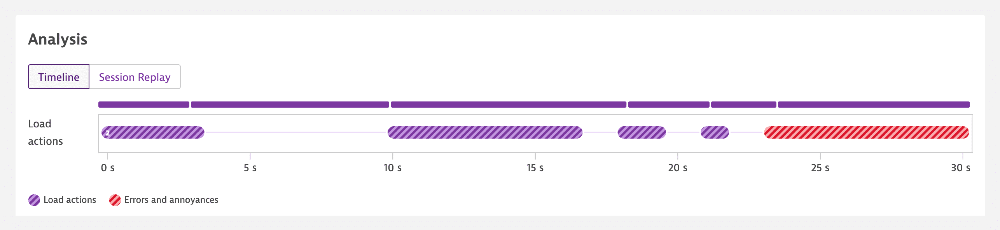

### b. 展开结账动作

在「Events and actions」中展开 `loading of page /cart/checkout`。行内先显示动作耗时和关键时间点，右下角的「Perform waterfall analysis」按钮才打开瀑布图。

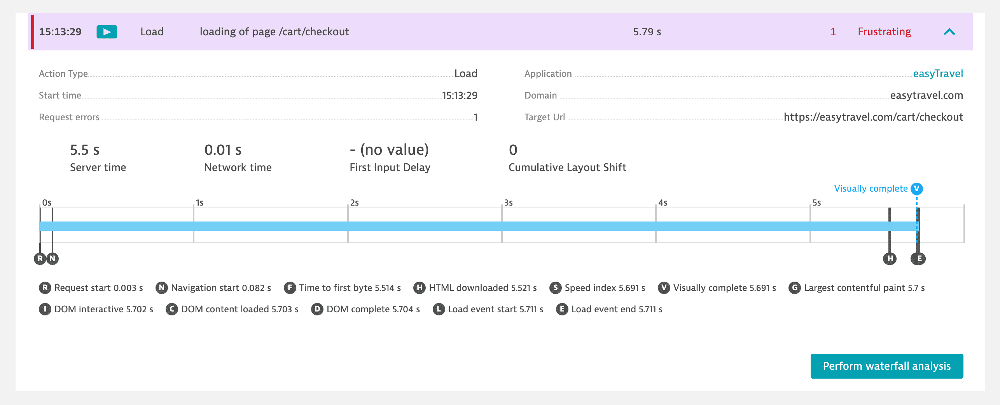

### c. 查看动作瀑布图

独立分析页的上方是动作和异常摘要，下方按请求和资源分行。所有行共用一条时间轴，便于对照请求的开始时间和持续时长。

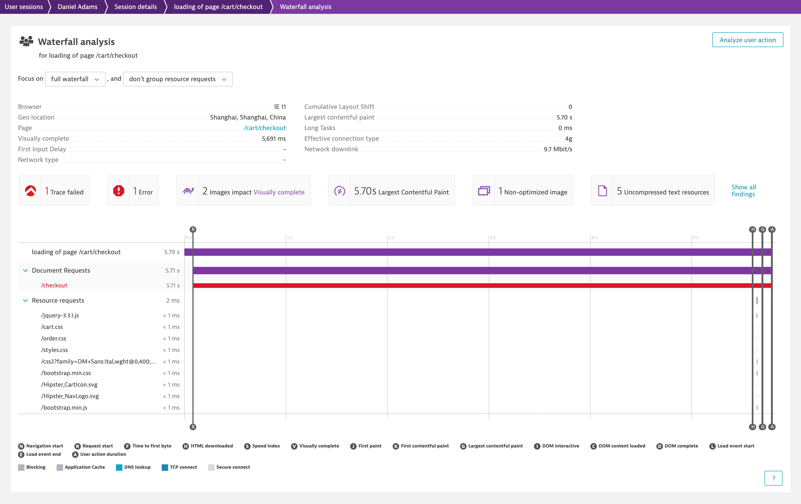

### d. 定位失败请求

选择错误摘要后，瀑布图标红 `/checkout` 请求。查看该行可见 HTTP 500 和请求各阶段的耗时。

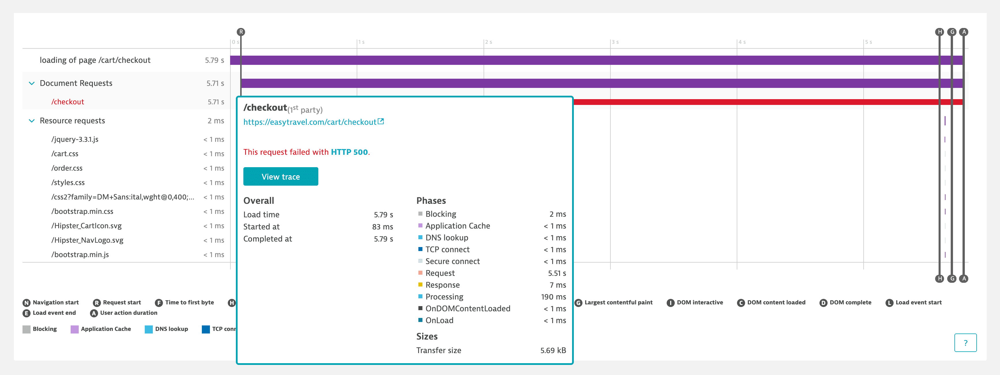

### e. 新版界面对照

[Experience Vitals 的动作瀑布图](https://docs.dynatrace.com/docs/whats-new/saas/sprint-343)将请求列表、耗时条和选中项详情并排显示。这张图用于对照新版布局，不属于前面 Classic 案例的操作步骤。

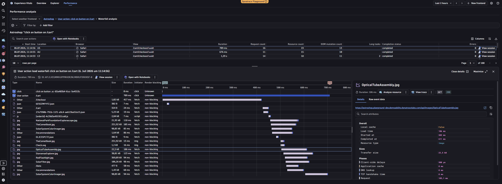

## 0x02 火山引擎：从会话层级切换到页面详情

[APMPlus WebPro 的长任务案例](https://docs.volcengine.com/docs/apmplus/Performancemonitor?lang=zh)从一条长任务记录回查它所属的页面。入口是详情顶部层级树里的页面链接。

### a. 在长任务详情中选择页面

当前记录是 `PERFORMANCE_LONGTASK`。点击「层级关系」中 `SESSION` 下方的蓝色 `VIEW` 链接，即原图红框所在处。

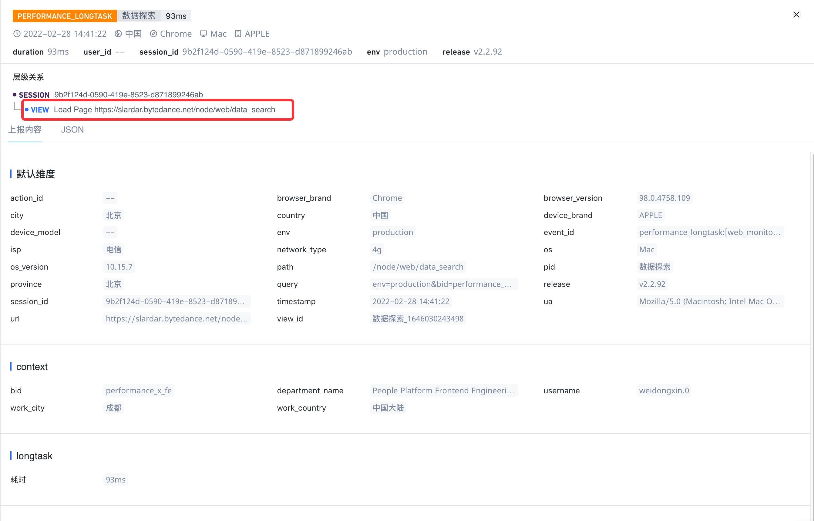

### b. 在 Performance 页签对照请求和长任务

详情标题变为 `VIEW`，仍可看到所属会话。左侧列出请求、长任务及耗时，右侧绘制时间条；悬停在图中 260 ms 的长任务上，可读出起止时间。旁边的「Request」和「Error」页签可查看同一次页面访问的请求和错误。

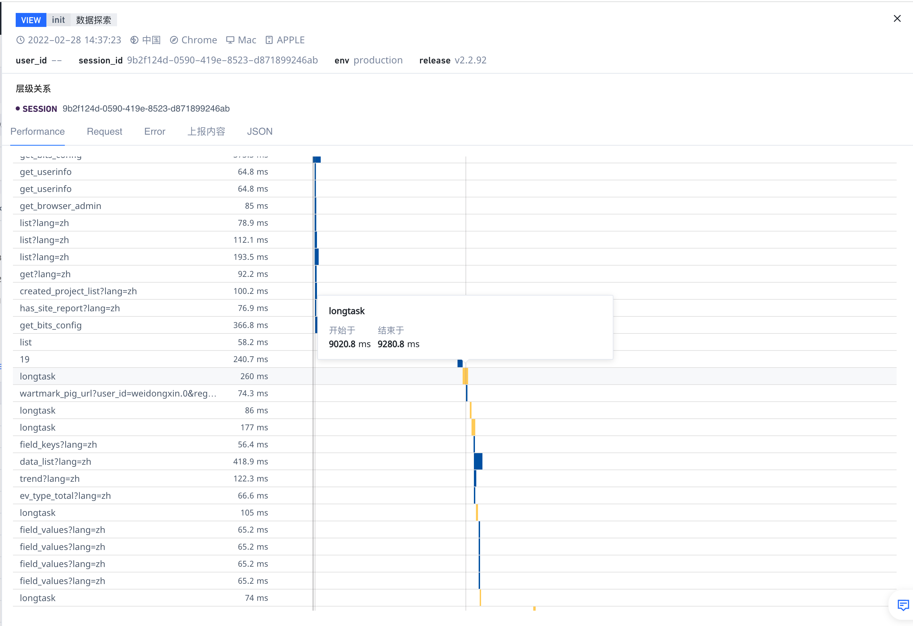

## 0x03 Datadog：从事件行进入页面瀑布图

### a. 悬停在页面加载事件上

在[移动应用内嵌网页（WebView）的会话示例](https://docs.datadoghq.com/real_user_monitoring/application_monitoring/web_view_tracking/)中，事件列表按相对时间排列。悬停在 1.99 s 的「View Load」行，事件名称右侧出现「Open View waterfall」。上一行是点击事件「Tap」，图示入口属于页面加载事件。

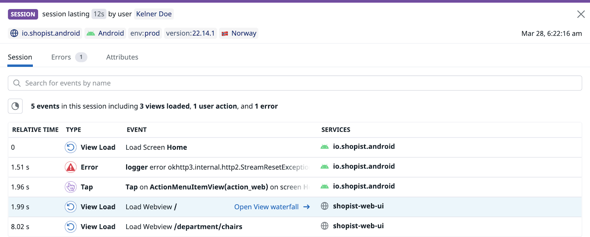

### b. 在页面详情侧栏查看瀑布图

WebView 指南将目标页签称为「Performance」。下图来自独立的 [RUM Explorer 侧栏示例](https://docs.datadoghq.com/real_user_monitoring/explorer/events/)，页签名为「Waterfall」。侧栏打开后，背景仍保留事件列表；侧栏上方可选时间范围，下方显示本次页面访问的事件。

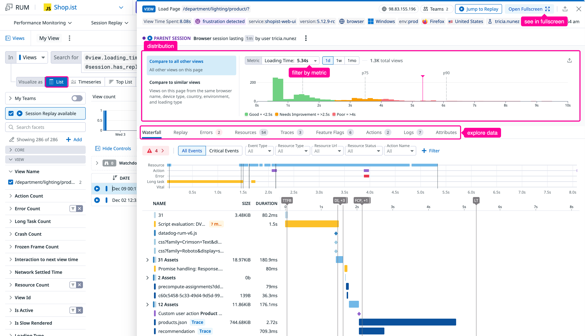

### c. 调整瀑布图的时间范围

以下两张截图取自同一段官方演示。第 1 秒显示较宽时间范围内的多条事件；第 7 秒选区缩窄，下方只显示该时段的事件，原本挤在一起的耗时条可以分开查看。

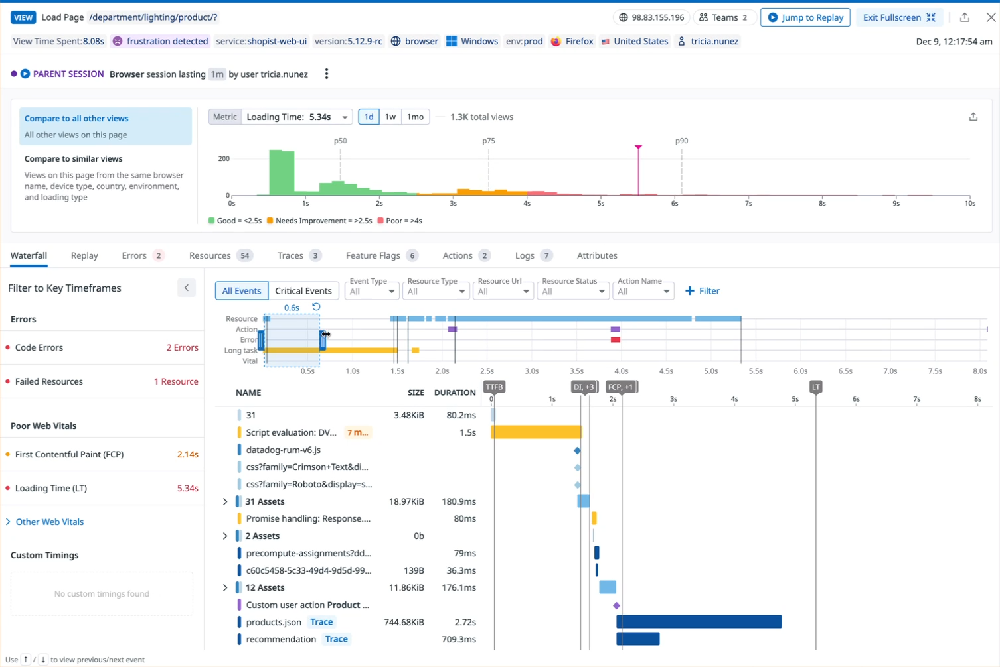

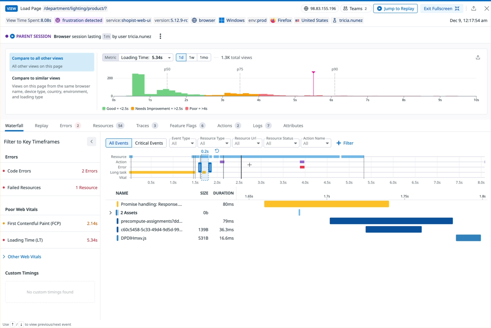

## 0x04 阿里云 ARMS：从慢加载事件进入资源详情

在 ARMS 前端监控的[会话轨迹](https://help.aliyun.com/zh/arms/browser-monitoring/user-guide/session-tracing)里展开页面记录，找到「慢加载」事件，点击右侧的「详情」。另一个入口是「慢页面会话追踪（TOP20）」列表中的页面名称。

[慢加载详情](https://help.aliyun.com/zh/arms/browser-monitoring/use-cases/diagnose-slow-page-loading)中的「页面资源加载瀑布图」按静态资源分行，右侧色条共用时间刻度。下图展示慢加载事件的结果页；不能据此推断任意点击事件都有同样的入口。

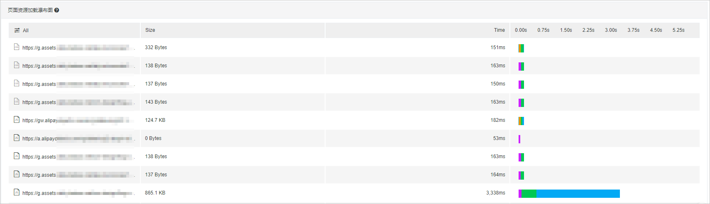

## 0x05 New Relic：在回放下方查看事件时序

### a. 回放与事件时序同屏

[会话回放界面](https://docs.newrelic.com/docs/browser/browser-monitoring/browser-pro-features/session-replay/get-started/)将回放画面、事件轨迹和时序表放在同一屏。图中右侧「Event trail」选中一次路由事件；下方「Session traces」页签显示事件列表和时间轴。截图能确认两者同屏，但不能确认点击任意事件都会打开该动作的瀑布图。

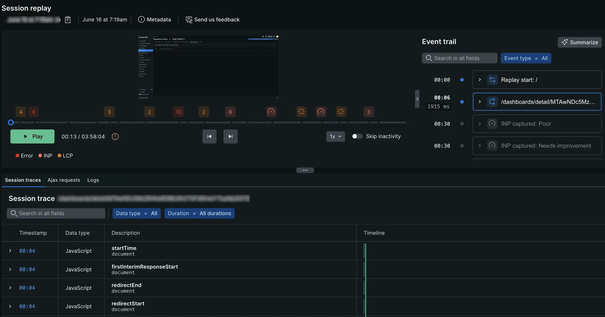

### b. 从追踪记录列表进入详情

[Session traces 列表](https://docs.newrelic.com/docs/browser/browser-monitoring/browser-pro-features/session-traces-explore-webpages-life-cycle/)提供另一个入口：在 Browser 应用内点击页面地址或追踪记录 ID，可进入单个网页生命周期的时序分析。下图是选择记录的列表页。

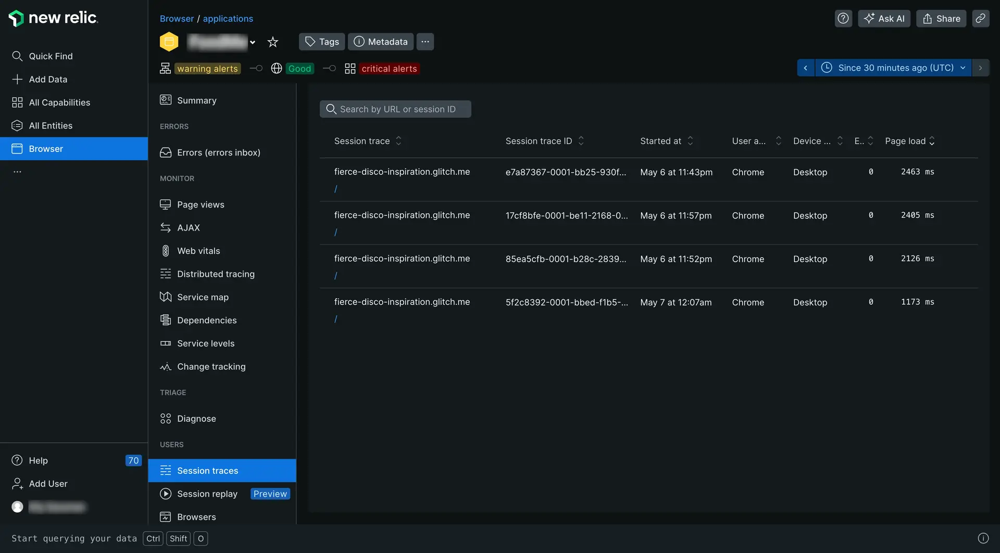

## 0x06 腾讯云：区分会话回放和页面加载阶段图

腾讯云[用户体验监控](https://cloud.tencent.com/document/product/248/139260)支持按会话、页面和事件逐层查看，回放时间轴标记错误和用户受阻的时刻。下图来自前端性能监控的[页面性能](https://cloud.tencent.com/document/product/248/87221)模块，纵轴列出 DNS 查询、TCP 连接、请求响应和内容解析等加载阶段。

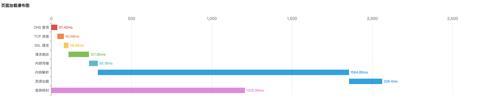

这张图用于比较一次加载中各阶段的耗时，每一行代表一个阶段。公开材料未确认从会话中点击某次操作后，能否直接打开逐条列出资源请求的瀑布图。
