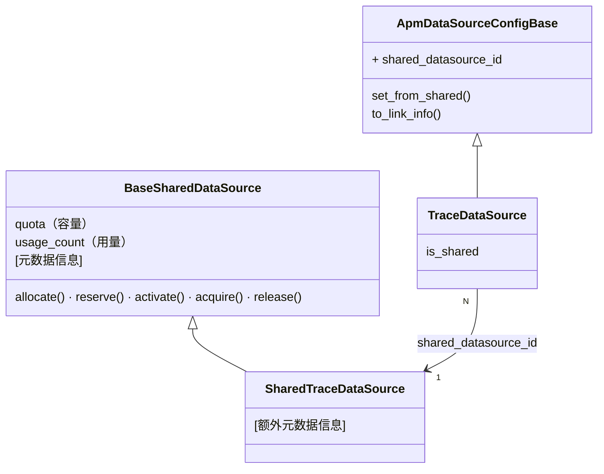
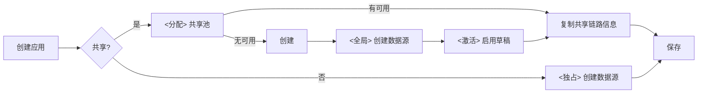
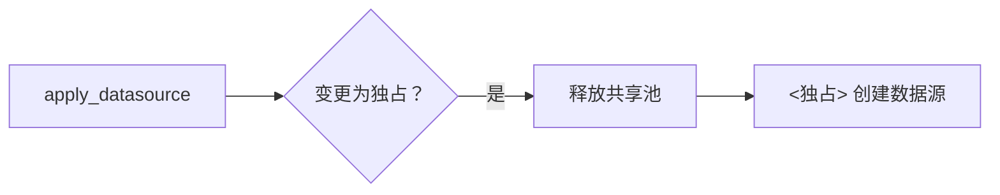
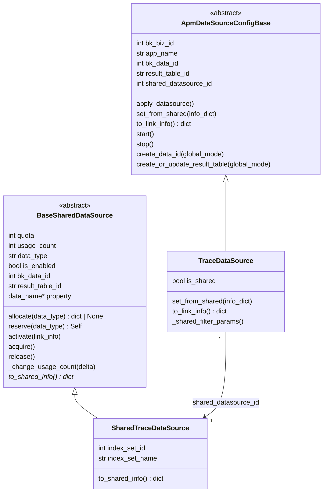
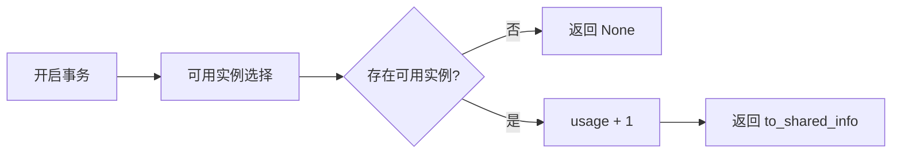
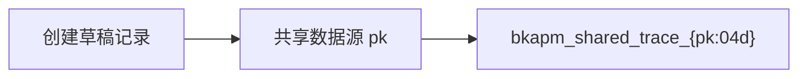
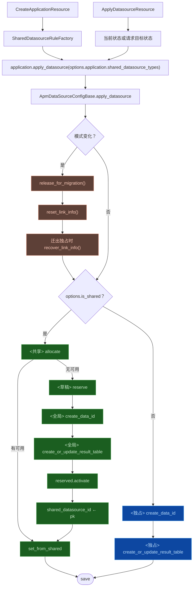
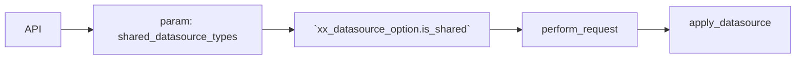
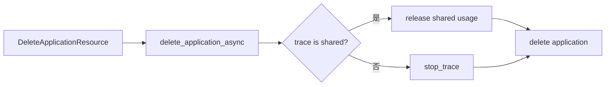

# APM 跨应用共享数据源 —— 实施方案

> 基于 [README.md](./README.md) 制定。

## 0x01 实现方案

### a. 思路

**1）数据源复用**

**Before**：应用 <> 数据源 = 1 : 1，应用独占 RT → ES 索引线性膨胀。

**After**：应用 <> 数据源 = N : 1，多应用复用结果表 → 链路资源（例如索引、DataID）收敛。

**2）数据隔离**：补充 `bk_biz_id` 、`app_name`  到原始数据，并在路由、逻辑层分别进行业务、应用级别查询隔离。

### b. 模型设计

两条独立继承链：**共享数据源池**管理容量与元数据，**应用数据源**通过 `shared_datasource_id` 引用共享池。



多应用复用同一共享数据源（N:1），共享池通过 quota / usage_count 控制容量，详细模型定义见 [0x02/a](#a-共享数据源模型)。

**关键决策**：

- **职责分离**：SharedDataSource 仅负责池管理（容量 + 元数据），外部链路资源创建与回填由 `ApmDataSourceConfigBase` 负责。
- **创建口径分层**：共享模式下，`create_data_id` 与 `create_or_update_result_table` 可使用不同业务口径，详见 `0x01.d` 与 `0x02.b`。
- **关联与扩展**：应用数据源通过 `shared_datasource_id` 引用共享池，共享池类型通过 `SHARED_DS_REGISTRY` 按 `data_type` 扩展。
- **草稿激活模型**：共享源先 reserve 为草稿，外部资源创建成功后再 activate，allocate 仅面向已启用实例。

### c. 共享机制

**创建应用**：

数据源配置增加「是否共享数据源」参数，目前「空间类型」为 `bkapp` 的，默认设置为共享。



**迁出**：从共享模式切换为独占模式。



### d. 命名规则


| 项 | 独占模式 | 共享模式 |
| ---- | ---- | ---- |
| **create_data_id.bk_biz_id** | 实际业务 ID | 环境变量 `SHARED_DATASOURCE_PRIVILEGED_BK_BIZ_ID`，默认 `2` |
| **create_result_table.bk_biz_id** | 实际业务 ID | `GLOBAL_CONFIG_BK_BIZ_ID`，固定 `0` |
| **create_result_table.bk_biz_id_alias** | 不涉及 | 字符串 `bk_biz_id` |
| **data_name** | `{bk_biz_id}_bkapm_trace_{app_name}` | `bkapm_shared_trace_{seq:04d}` |
| **result_table_id** | `{bk_biz_id}_bkapm.trace_{app_name}` | `apm_global.shared_trace_{seq:04d}` |

- `seq`：共享数据源表主键（AUTO_INCREMENT）。
- `seq` 的编号在每个子类内独立递增。
- `data_name`：property 推导，不单独存储。
- `bk_biz_id_alias`：共享模式下创建结果表时传入字符串 `bk_biz_id`。
- `bk_biz_id_alias` 的用途：查询阶段按业务 ID 做业务隔离。

### e. 数据链路

**写入**：bk-collector 从 Token 反解 `bk_biz_id` 、 `app_name`，注入到原始数据。

**预计算**：拆分到独立 issue [APM 预计算适配共享数据源](../2026-05-14-apm-precalc-shared-multi-app/README.md)。

**查询**：

* 逻辑层（应用级别隔离）：所有查询路径统一追加 `bk_biz_id` + `app_name` 过滤条件。
* 路由层（业务级别隔离）：支持以 `bk_biz_id` 作为 filter 查询业务 0 的全局结果表。
* 本能力可拆分到后续 PR，但共享 Trace 数据正式开放前必须补齐，否则同业务共享池内应用存在互读风险。

### f. 风险与约束


| 风险                 | 应对                                                         |
| -------------------- | ------------------------------------------------------------ |
| 共享索引故障爆炸半径 | quota 合理设定 + 监控                                        |
| 已删除应用数据残留   | ES ILM 自然过期                                              |

---

## 0x02 开发方案

### a. 共享数据源模型

`apm/models/datasource.py`

#### 模型概览

共享数据源池（BaseSharedDataSource）负责管理容量与元数据。

应用数据源（ApmDataSourceConfigBase）通过 `shared_datasource_id` 引用共享池。

完整类图如下：




#### 核心流程

**allocate**：选取可用共享源并占用，无可用时返回 None。



💡 Tips：

* 并发保护：`select_for_update()`。
* 可用实例选择：`filter(usage_count__lt=F('quota'), is_enabled=True)`。
* 负载均衡：`order_by('usage_count')`。
* 原子保证：`update(usage_count=F('usage_count') + 1)`。

**reserve**：创建草稿实例（`is_enabled=False`），pk 即 seq，用于推导 `data_name` / `result_table_id`。



💡 Tips： DB 默认值使用草稿状态：`is_enabled=False, usage_count=0`

**activate**：外部 API 调用成功后，填充链路元数据并启用。


💡 Tips：

* 设置链路信息：从 `link_info` dict 填充 `bk_data_id`、`result_table_id` 及子类扩展字段。
* 启用：`usage_count=1, is_enabled=True`。

**usage count 变更**：共享池占用计数表达当前启用中的共享应用占用数，随共享应用启停成对变更。

- `allocate()`：选取可用共享池并完成首次占用，命中后返回共享链路信息。
- `activate()`：新建共享池激活时设置 `usage_count=1`，表示首个应用已占用。
- `acquire()`：共享应用启动时占用槽位，`usage_count` 加 1。
- `release()`：共享应用停止、删除或显式迁出时释放槽位，`usage_count` 减 1。
- `acquire()` / `release()` 复用同一个底层 `_change_usage_count(delta)`，仅 `delta` 不同，查询条件与原子更新逻辑保持一致。
- 应用启停入口必须保持幂等：已启用的 `start_trace()` 不重复 `acquire()`，已停用的 `stop_trace()` 不重复 `release()`。

💡 Tips：

* `release()` 使用 `Greatest(F('usage_count') - 1, 0)` 防止 `usage_count` 变为负数。
* `allocate()` 仍负责选择可用共享池，命中后调用 `acquire()`。
* 删除或显式迁出时按当前启停状态调用 `release()`，避免重复释放。


#### SharedTraceDataSource

继承 BaseSharedDataSource，新增以下扩展字段：


| 字段             | 类型           | 说明         |
| -------------- | ------------ | ---------- |
| index_set_id   | IntegerField | 索引集 ID（可选） |
| index_set_name | CharField    | 索引集名称（可选）  |

- `to_shared_info()`：在基类字段上追加 trace 特有元数据，并作为 `TraceDataSource.set_from_shared()` 的输入。
- `to_shared_info()` 与 `to_link_info()` 维持同构字段集，例如 `bk_data_id`、`result_table_id` 与 `index_set_id`。
- 两者分别承担 SharedDS 导出与 DataSource 导出的相反方向。

#### 注册表

data_type → SharedDataSource 子类映射，供 apply_datasource 按类型查找并调用 allocate/reserve：

```python
SHARED_DS_REGISTRY = {
    "trace": SharedTraceDataSource,
    # "log": SharedLogDataSource,  # future
}
```

### b. ApmDataSourceConfigBase 变更

`apm/models/datasource.py`


| 变更点                                       | 目标                                                         |
| -------------------------------------------- | ------------------------------------------------------------ |
| **[Field]** `shared_datasource_id`           | 新增字段。                                                   |
| **[Field]** `backup_link_info`               | 新增字段，记录迁入共享前的原独占链路字段 *[1]*。<br />[a] `bk_data_id`：原独占 DataID。<br />[b] `result_table_id`：原独占 RT。<br />[c] `bkdata_datalink_config`：原独占 Trace 链路配置。 |
| **[Method]** `apply_datasource`              | 增加共享数据源处理逻辑，并在进入共享 / 独占分支前收口迁入、迁出判断。 |
| **[Method]** `create_data_id`                | 增加 `global_mode` 、`data_name[可选]` 参数。                |
| **[Method]** `create_or_update_result_table` | 增加 `global_mode` `result_table_id[可选]` 参数。            |
| **[Method]** `to_link_info`                  | 导出链路元数据字典（bk_data_id、result_table_id 等），子类覆写追加特有字段。 |
| **[Method]**  `set_from_shared`              | 由子类覆写，从共享链路信息字典提取各自字段并赋值。           |
| **[Method]** `reset_link_info`               | 重置当前数据源链路信息为未创建状态，用于迁入 / 迁出后复用原有创建流程。 |
| **[Method]** `recover_link_info`             | 根据目标模式处理备份链路。<br />[a] 迁入共享：保留 `backup_link_info`，不恢复活动链路字段。<br />[b] 迁出独占：从 `backup_link_info` 恢复原独占链路字段。 |
| **[Method]** `is_shared`                     | 是否共享，通过 `shared_datasource_id` 判断。                 |
| **[Method]** `start / stop`                  | 共享模式下不执行结果表启停，但每次应用启停需调整共享池占用计数。<br />应用层需保证 `start_trace()` / `stop_trace()` 幂等，避免重复占用或重复释放。<br />独占模式保持原有启停行为。 |

- *[1] Trace 同时备份 `index_set_id`、`index_set_name`，迁移时保留索引集，回切复用；旧备份缺少索引集时仍按原流程创建。*

**共享模式下创建参数结论**：

- `create_data_id(global_mode=True)`：
  - `bk_biz_id` 使用环境变量 `SHARED_DATASOURCE_PRIVILEGED_BK_BIZ_ID`。
  - 默认值为 `2`。
  - 目的：将共享 DataID 统一收口到单一业务空间管理。
- `create_or_update_result_table(global_mode=True)`：
  - `bk_biz_id` 使用 `GLOBAL_CONFIG_BK_BIZ_ID`，固定为 `0`。
  - `bk_biz_id_alias` 传入字符串 `bk_biz_id`。
  - 目的：保持结果表注册在全局业务下，并声明查询按业务 ID 做隔离。

**apply_datasource 共享数据源处理流程**（创建与更新最终汇总到 `application.apply_datasource`）：

两个入口都会生成 `shared_datasource_types`，并写入 `options.application.shared_datasource_types`。

| 入口 | 入参状态 | 取值来源 | 语义 |
| --- | --- | --- | --- |
| `CreateApplicationResource` | 不传 `shared_datasource_types` | `SharedDatasourceRuleFactory.list_shared_datasource_types(...)` | [1] 计算本次创建需要共享的数据源类型。<br />[2] 创建阶段仅生成初始目标状态，不产生迁移语义。 |
| `ApplyDatasourceResource` | 不传 `shared_datasource_types` | 查询各数据源配置的 `is_shared` 状态后构造 | [1] 以数据库当前状态作为本次 apply 的目标状态。<br />[2] 当前状态与目标状态一致，不触发迁入 / 迁出。 |
| `ApplyDatasourceResource` | 传入 `shared_datasource_types` | 请求体 `shared_datasource_types` | [1] 请求值作为本次 apply 的目标状态。<br />[2] `["trace"] -> []` 表示 Trace 从共享迁出。<br />[3] `[] -> ["trace"]` 表示 Trace 从独占迁入共享。<br />[4] 同模式不迁移；指定共享池的批量迁移由管理命令处理。 |



图中「模式变化」沿用当前代码触发条件：`obj.result_table_id != "" and obj.is_shared != options.is_shared`。

- `ds.is_shared`：数据库中当前数据源状态。
- `options.is_shared`：本次 apply 的目标状态。

迁移状态判断仍放在 `apply_datasource` 获取 / 创建 `obj` 后、进入共享 / 独占分支前。满足上述条件时执行迁入 / 迁出前置动作；新建应用不产生迁移语义，直接进入目标模式分支。

```python
is_shared = options.get("is_shared", False)

if obj.result_table_id != "" and obj.is_shared != is_shared:
    if is_shared:
        obj.backup_exclusive_link_info()
    obj.release_for_migration()
    obj.reset_link_info()
    # 迁入：保留 reset 前写入的 backup_link_info；迁出：从 backup_link_info 恢复链路信息。
    if not is_shared and obj.backup_link_info:
        obj.recover_link_info()
```

| 状态变化 | 语义 | 前置动作 | 后续动作 |
| --- | --- | --- | --- |
| `True → False` | 迁出：共享改独占 | [a] `release_for_migration()`：记录切换历史并释放共享池占用，保留旧 RT。<br />[b] `reset_link_info()`：清空当前共享链路。<br />[c] `recover_link_info()`：从 `backup_link_info` 恢复独占链路字段 *[3]*。 | `is_shared=False`，进入 `_apply_exclusive_datasource` 复用独占流程 *[1]*。 |
| `False → True` | 迁入：独占改共享 | [a] `backup_exclusive_link_info()`：备份原独占链路。<br />[b] `release_for_migration()`：记录切换历史，保留原独占 RT 和索引集 *[2]*。<br />[c] `reset_link_info()`：清空活动链路字段。<br />[d] 保留 `backup_link_info`，不恢复活动链路字段 *[3]*。 | `is_shared=True`，进入 `_apply_shared_datasource` *[1]*。 |
| 未变化 | 保持现状 | 不执行迁移清理 | 仍按目标状态进入原有共享或独占分支，支持同模式存储配置更新 *[4]*。 |

- *[1] `API` 失败回滚：`create_data_id` 或 `create_or_update_result_table` 抛异常时，删除草稿（`reserved.delete()`）并向上传播。*
- *[2] 迁移和显式停用分开：Trace 迁移保留旧 RT、索引集；显式 `stop()` 仍保留既有启停语义。其他数据类型的迁移默认沿用 `stop()`。*
- *[3] `DataID` 边界：本期迁入 / 迁出不启停 metadata `DataSource`，只备份和恢复 `bk_data_id` 字段。*
- *[4] `start_trace` 幂等边界：应用层需在已启用 Trace 时直接返回，避免共享模式重复 `acquire()`。*

### c. 共享判定机制

`SharedDatasourceRuleFactory` 是 `is_shared` 的统一决策入口。

它根据 `bk_biz_id`、`app_name` 与全局规则配置输出 `shared_datasource_types`，调用方只根据返回列表判断某类数据源是否使用共享模式。

配置示例：

```json
{
  "trace": {
    "list": [
      {
        "connector": "AND",
        "rules": [
          {
            "type": "SPACE_TYPE",
            "params": {
              "space_types": ["bksaas"]
            }
          },
          {
            "type": "APP_NAME_PREFIX",
            "params": {
              "prefixes": ["bk_ai"]
            }
          }
        ]
      }
    ]
  }
}
```

以上配置命中时返回 `["trace"]`，调用方据此将 Trace 数据源设置为共享模式。

协议结构：

| 字段 | 类型 | 必填 | 说明 |
| --- | --- | --- | --- |
| `<datasource_type>` | `object` | 是 | 数据源类型维度的规则配置，命中后返回该数据源类型，例如 `trace`。 |
| `<datasource_type>.list` | `array<object>` | 是 | 规则组列表，组间为 OR 关系，任一规则组命中即该数据源类型命中。 |
| `<datasource_type>.list[].connector` | `string` | 是 | 规则组内的组合关系，可选值为 `AND` / `OR`。 |
| `<datasource_type>.list[].rules` | `array<object>` | 是 | 规则列表，按 `connector` 汇总命中结果。 |
| `<datasource_type>.list[].rules[].type` | `string` | 是 | 规则类型，映射到具体 Rule 实现，例如 `SPACE_TYPE`、`APP_NAME_PREFIX`。 |
| `<datasource_type>.list[].rules[].params` | `object` | 否 | 具体 Rule 对象入参，结构由 `type` 对应的 Rule 定义。 |

调用边界：

- `CreateApplicationResource` 未显式传 `shared_datasource_types` 时，通过工厂解析默认共享类型。
- `ApplyDatasourceResource` 未显式传 `shared_datasource_types` 时，从数据库当前 `is_shared` 反推共享类型，表示本次更新不触发迁入 / 迁出。
- `ApplyDatasourceResource` 显式传入 `shared_datasource_types` 时，以请求列表作为目标状态，空列表也是有效输入。
- 规则命中不自动迁移存量独占应用，存量迁入共享池通过 `ApplyDatasourceResource` 显式传参或批量迁移命令触发。

### d. TraceDataSource 查询适配

`apm/models/datasource.py`


| 变更点                       | 说明                                  |
| ---------------------------- | ------------------------------------- |
| `build_filter_params`        | 增加过滤 <`bk_biz_id` / `app_name`>。 |
| `update_or_create_index_set` | 共享模式下不创建日志索引集。          |


### e. 应用生命周期

**创建**（`apm/resources.py` — `CreateApplicationResource` / `ApplyDatasourceResource`）：



| 变更点                                | 说明                                                         |
| ------------------------------------- | ------------------------------------------------------------ |
| **[Field]** `shared_datasource_types` | 新增字段： `CreateApplicationResource` / `ApplyDatasourceResource`。<br />创建默认值：由 `0x02.c` 的共享判定机制解析。<br />更新默认值：从数据库当前 `is_shared` 反推，表示保持现状。<br /><br />操作：设置到 `xx_datasource_option.is_shared`，显式传参时作为目标共享状态。 |


**删除**（`apm/task/tasks.py` — `delete_application_async`，由 `DeleteApplicationResource` 触发）：



- 共享模式：删除应用按当前启停状态释放共享池占用，但不执行结果表启停，也不删除共享日志索引集。
- 独占模式：保留现有 `stop_trace()` 关闭结果表流程。

### f. 应用信息注入


| 变更点                   | 说明                                                         |
| ------------------------ | ------------------------------------------------------------ |
| 清洗阶段（bk-collector） | 注入 `bk_biz_id` 、 `app_name` 到 Span（Token 反解），和 `resource` 同一级，无论共享与否均注入。 |
| 应用创建阶段（SaaS）     | 增加 `bk_biz_id` 、 `app_name` 作为 ES mapping 字段。       |

### g. 查询改造

Trace 原始表查询隔离只对 `apm_global.shared` 前缀结果表生效。

原始表按表类型决定隔离条件：历史共享表仍追加 `bk_biz_id` / `app_name`，独占表不强加存量数据可能缺失的字段。预计算表沿用自身的 `biz_id` / `app_name` 隔离条件。

改造原则：

- 查询消费方只声明查询目标，不判断 shared 前缀。
- shared 表缺少应用上下文时拒绝查询。
- `QueryConfigBuilder.table(t1, t2, ...)` 支持多结果表，上层不循环 `add_query()`。
- `UnifyQueryCompiler.as_sql` 只做 table 解包，不包含 APM 隔离判断。

#### 查询目标

新增 `bkmonitor/data_source/utils/apm.py` *[1]* *[2]* *[3]*：

```python
@dataclass(frozen=True)
class APMAppTarget:
    bk_biz_id: int
    app_name: str


@dataclass(frozen=True)
class TraceDatasourceTarget:
    table_id: str
    app: APMAppTarget

    @classmethod
    def build(cls, bk_biz_id: int, app_name: str, table_id: str) -> "TraceDatasourceTarget":
        return cls(table_id=table_id, app=APMAppTarget(bk_biz_id=bk_biz_id, app_name=app_name))
```

- *[1] `TraceDatasourceTarget` 表示一条 `table_id -> APM 应用` 绑定关系。*
- *[2] 工厂方法统一命名为 `build()`：`from` 是 Python 关键字，不能作为方法名；`from_` 语义不稳定，容易被误认为误输入。*
- *[3] 查询隔离必须保留 `table_id -> APM 应用` 的绑定关系，禁止把 `bk_biz_id` 与 `app_name` 拆成两个独立列表，避免跨业务或跨应用误匹配。*

#### 隔离入口

```python
class TraceQueryGuard:
    SHARED_TRACE_TABLE_PREFIXES = ("apm_global.shared",)

    @classmethod
    def get_q(cls, targets: Sequence[TraceDatasourceTarget]) -> QueryConfigBuilder:
        cls._validate_targets(targets)
        target = targets[0]
        q = QueryConfigBuilder((DataTypeLabel.LOG, DataSourceLabel.BK_APM)).table(target.table_id)
        return cls.apply_q(q, targets)

    @classmethod
    def apply_q(cls, q: QueryConfigBuilder, targets: Sequence[TraceDatasourceTarget]) -> QueryConfigBuilder:
        ...

    @classmethod
    def build_dsl(cls, body: dict, target: TraceDatasourceTarget) -> dict:
        ...
```

- `get_q()` 封装标准 APM Trace 查询构造，内部复用 `apply_q()`。
- `apply_q()` 负责判断 shared 表、校验 target，并把应用隔离条件绑定到 query 对象。
- `build_dsl()` 面向直接 ES DSL 查询路径：原查询整体进入 `bool.must`，应用隔离条件追加到 `bool.filter`。
- 现阶段按单 target 收敛，不改造 `QueryConfigBuilder.table(...)` 与 `UnifyQueryCompiler.as_sql` 的多 table 协议。

消费方式：

```python
target = TraceDatasourceTarget.build(2, "app_a", t1)

q = TraceQueryGuard.get_q([target]).time_field(OtlpKey.END_TIME).filter(trace_id__eq=trace_id)
```

需要复用已有 `QueryConfigBuilder` 时：

```python
q = QueryConfigBuilder((DataTypeLabel.LOG, DataSourceLabel.BK_APM)).table(t1)
q = TraceQueryGuard.apply_q(q, [target])
```

#### 改造边界

| 路径                                                       | 处理方式                                                            |
|----------------------------------------------------------|-----------------------------------------------------------------|
| `bkmonitor/data_source/utils/apm.py`                     | 新增 `APMAppTarget`、`TraceDatasourceTarget`、`TraceQueryGuard`。    |
| `bkmonitor/data_source/unify_query/builder.py`           | 本期不改造多 table 绑定，避免扩大统一查询层影响面。                         |
| `UnifyQueryCompiler.as_sql`                              | 不承载 APM shared 前缀判断。                                      |
| `apm/models/datasource.py::TraceDataSource.get_q`        | 改用 `TraceQueryGuard.get_q(...)`。                                |
| `apm/core/handlers/query/base.py::BaseQuery._get_q`      | Trace 数据源使用真实 `result_table_id` 生成 target。                      |
| `apm/core/handlers/query/proxy.py`                       | 关联应用 Span 查询使用 `relation_app.trace_datasource.result_table_id`。 |
| `packages/apm_web/handlers/db_handler.py::DbQuery.get_q` | 增加 target 绑定，DB 场景走 `TraceQueryGuard`。                          |
| `packages/apm_web/meta/resources.py`                     | 直接构造 Trace 查询处改用 `TraceQueryGuard.get_q(...)`。                  |
| `apm/core/discover/base.py`                              | 直接 ES DSL 路径调用 `TraceQueryGuard.build_dsl()`。                   |
| `apm/resources.py::QueryEsResource`                      | 删除旧直查入口，避免共享 Trace 表绕过隔离守卫。                              |

上线前保留审计命令：

```bash
rg "QueryConfigBuilder.*BK_APM"
rg "es_client\.search"
rg "DataSourceLabel\.BK_APM"
```

审计结论需确认所有原始 Trace 查询入口已接入 `TraceQueryGuard`。

### h. 运维操作边界

`OperateApmDataIdResource` 面向独占 DataID。

共享 Trace 数据源下，同一个 `bk_data_id` 被多个应用复用，单应用入口必须拒绝暂停或恢复操作。

如需暂停整池写入，后续应提供共享池级操作，并在接口层明确影响范围。

### i. 迁入迁出 command

#### 迁入迁出

新增位置：`bkmonitor/apm/management/commands/migrate_apm_trace_datasource.py`。

```bash
python manage.py migrate_apm_trace_datasource \
  --target shared \
  --apps "2:app_a" "2:app_b"
```

参数协议：

| 参数 | 必填 | 说明 |
| --- | --- | --- |
| `--target` | 是 | `shared` 表示迁入共享，`exclusive` 表示迁出独占 *[1]*。 |
| `--apps` | 是 | 接收多个应用，格式为 `<bk_biz_id>:<app_name>` *[2]*。 |
| `--shared-datasource-ids` | 否 | 仅用于 `shared`：限定目标共享池 ID，按预计用量分配，已在指定池内的应用保留原池。 |
| `--dry-run` | 否 | 校验整批目标池和容量，输出各应用的目标池及预计动作，不占用配额。 |

- *[1] 未指定池 ID 时，命令通过 `ApplicationHelper.get_default_storage_config()` 补齐配置，沿用 `ApplyDatasourceResource` 的迁入／迁出流程。*
- *[2] 指定池 ID 时，仅迁移已有且启用 Trace 的应用；循环内更新绑定和历史，循环后统一刷新 K8s 配置。*

批量模式复用基础方法，不进入应用完整 apply 流程：

```text
plan_shared_targets：校验现有链路、目标池与整批容量
  → 每个应用独立事务
      acquire → backup_exclusive_link_info（独占来源）
      → release_for_migration → set_from_shared → save
  → refresh_k8s（成功应用及已在目标池内的应用，一次调用）
```

- *[1] 单应用失败回滚绑定、历史和池计数，记录错误后继续其他应用；处理完后汇总失败并返回非零退出码。*
- *[2] 停用 Trace 的应用先报错，防止重复释放已归还的池占用；批量模式不创建池、不注册 RT、不修改其他数据源类型。*
- *[3] `refresh_k8s` 沿用既有部署和日志语义，返回不代表所有集群已生效；旧 Agent 配置刷新仍由既有定时任务处理。*

#### SaaS APM 元数据同步

迁入 / 迁出后 RT 会变化，需调用 `apm_web.models.application.Application.sync_datasource()` 同步 SaaS APM 元数据。

在 Django shell 执行：

```python
from apm_web.models.application import Application

apps = [
    (2, "app_a"),
    (2, "app_b"),
]

for bk_biz_id, app_name in apps:
    app = Application.objects.get(bk_biz_id=bk_biz_id, app_name=app_name)
    app.sync_datasource()
```

### j. Trace 切换后历史检索

`TraceDataSource.history_link_info` 按切换顺序记录迁出表 `table_id`、秒级切换时间 `switched_at` 和当时的 `retention`。当前表继续使用现有字段，A → B → A 只追加 A/T1、B/T2 两条记录；同模式重试不追加。

常规迁入／迁出保留 `apply_datasource` 原有事务和分配流程；批量指定池模式按迁移命令的基础方法流程执行。Trace 通过 `release_for_migration` 保留旧 RT 与索引集，共享迁出仅释放池占用；回到独占时复用备份并通过现有创建／更新流程启用目标 RT。数据库异常回滚覆盖应用绑定、历史记录和池计数，外部 API 仍遵循现有重试语义。

历史路由在构造查询对象前解析：

- `TraceDataSource.get_query_table_ids()` 按时间区间和延窗选表，先筛选再去重；`QueryProxy` 在每次请求构造查询对象前展开普通 `data_sources`，Target 和查询类不携带历史状态。
- `PrecalculateStorage` 统一解析原始 RT 对应的预计算表，查询层不直接接触哈希环。构造目标时保留历史与当前的最大保留期，TraceID 查询先重置时间范围再选表。
- 历史跨表检索以应用已启用 UQ 为前提，沿用现有灰度开关；排序、折叠与分页由 UQ 执行，ES 直查跨表合并不在保障范围。

无历史的应用与显式指定预计算表的关联查询沿用单表路径，不做历史选表及延窗计算。现有预计算写入路由仍按 `is_shared` 判断，每个 `QueryProxy` 复用预计算存储实例；无效存储直接返回 `FakeQuery`，不提前读取应用元数据。

应用元数据缓存维持 5 分钟，接受切换后的短暂查询延迟。30 分钟是约定的路由容错窗口，超过该窗口的补报或时间偏差不保证被时间裁剪命中；本次不扩展所有业务直查入口、不回填此前未记录的切换历史。

## 0x03 实施进展

| 时间 | 结论性进展 |
| --- | --- |
| `2026-10-29 08:00` | [a] 批量指定池迁移复用基础方法，每应用独立事务，循环后一次刷新 K8s 配置<br />[b] 通用 API 和池分配器恢复原接口，Trace 历史选表与纯独占查询兼容性保留<br />[c] 71 项回归及 4 项主干对照通过，真实存储、MySQL 锁及批量内存负载未联调<br />[d] 提交 `1631ae4b8a8b15bb75264c4438a36e954bc9240f` 已推送，[PR #13012](https://github.com/TencentBlueKing/bk-monitor/pull/13012) 待评审 |
| `2026-05-14 18:00` | [1] 将 BMW 预计算适配共享数据源拆分到独立 issue [2026-05-14-apm-precalc-shared-multi-app](../2026-05-14-apm-precalc-shared-multi-app/README.md)<br />[2] 旧 `0x02.i 预计算 Trace 视图隔离`「Span 优先 + `BaseInfo` 兜底 + 应用隔离键」方案推倒，连同 `2026-05-13 12:00` 进展条目一并移除<br />[3] 新方案改为「单任务多应用窗口」：`KafkaNotifier` 与 `DistributiveWindow` 之间插入 `Dispatcher`，按 Span 顶层 `(bk_biz_id, app_name)` 命中 Consul `apps[]` 路由到对应 `appBundle`<br />[4] 本 PLAN 的 `0x01.e` 数据链路段移除「预计算」子段，留链接指向新 issue<br />[1] 已核对 master `pkg/bk-monitor-worker/internal/apm/pre_calculate/**` 与 `pkg/collector/exporter/converter/traces.go` 共 `25` 个事实点<br />[2] 本次仅更新方案文档与索引，未改代码 |
| `2026-05-14 16:00` | [1] 复查 PR #10583 head `7174bb1`，确认检索隔离主路径仍由 `TraceQueryGuard` 收口<br />[2] 旧 `query_es` 直查入口和统计接口残留配置已清理，未发现新的检索隔离阻塞问题<br />[3] `APMAppTarget` 不再允许空应用上下文，预计算路径改为 `target=None + table_id` 旁路<br />[1] 已核对 `TraceQueryGuard`、`BaseQuery._get_q`、`TraceDataSource.get_q`、DB 场景、异常类型图、Trace ID 搜索和拓扑发现 DSL 路径<br />[2] 已自动 resolve `3` 个旧未解决 review 线程<br />[3] 本轮未发布新增 PR 评论，未运行自动测试 |
| `2026-05-13 00:00` | [1] 收口 PR #10583 检索隔离最终口径：共享 Trace 原始表只通过 `TraceQueryGuard` 追加应用隔离，旧 `query_apm_es` 直查入口删除<br />[2] `TraceDatasourceTarget` 工厂方法统一命名为 `build()`，本期按单 target 收敛，不改造统一查询层多 table 协议<br />[3] `build_dsl()` 合并规则固定为原查询进入 `bool.must`、隔离条件进入 `bool.filter`<br />[1] 已复查 PR head `b70572d`，旧 review 线程已全部 resolved<br />[2] 已发布 `1` 个新增 P1：统计接口删除不完整，需同步清理 SDK / docs / apigw 残留配置 |
| `2026-04-30 20:00` | [1] 收口 PR #10415 最终 review 结论：共享 Trace 的 `start` / `stop` 每次启停调整共享池计数，`start_trace` 需补充与 `stop_trace` 对称的幂等保护<br />[2] `apply_datasource` 按可重入口径处理，不再作为阻塞问题<br />[3] `shared_datasource_types` 接受非 Trace 类型视为扩展预留，不要求本 PR 调整<br />[1] 已更新 `usage_count` 主干语义与应用生命周期边界<br />[2] 已将 review 结论收敛为 1 个 P1：`start_trace` 幂等保护<br />[3] 已 Approve PR #10415 |
| `2026-04-30 00:00` | [1] 将「查询路径审计」调整为「查询改造」，明确 shared Trace 查询隔离只在 `TraceQueryGuard` 收口<br />[2] 补充 `APMAppTarget` / `TraceDatasourceTarget` 目标模型，保留 `table_id -> APM 应用` 一一绑定<br />[3] 明确 `UnifyQueryCompiler.as_sql` 仅负责多 table 解包，不承载 APM shared 前缀判断<br />[1] 已更新查询改造方案主干与审计命令<br />[2] 本次仅更新方案文档，未改代码 |
| `2026-04-27 20:00` | [1] PR review 收口共享池计数边界：补充 `acquire()` 与 `release()` 成对语义，并要求二者复用 `_change_usage_count(delta)`<br />[2] 明确共享 Trace 启停不操作 `switch_result_table()`，删除释放共享池占用但不删除共享日志索引集<br />[3] 补充以 `ApplyDatasourceResource.shared_datasource_types` 为入口的显式迁入 / 迁出方案：不传表示保持数据库现状，传入列表表示目标共享状态<br />[4] 撤回查询隔离默认开启阻塞意见，查询隔离作为后续 PR 的已知拆分事项继续保留在方案约束中<br />[1] 已复查 PR #10415 最新 head `a104714`<br />[2] 仍需开发修复删除共享应用未释放 `usage_count`、`release()` 负数保护，以及 apply 更新路径迁入 / 迁出状态判断<br />[3] 本次仅更新方案文档与 review 结论，不修改 PR 代码 |
| `2026-04-23 17:00` | [1] PR review 收口更新路径共享判定、启停边界与 DataID 运维边界<br />[2] 将 `SharedDatasourceRuleFactory` 抽成 `is_shared` 独立决策机制，并按协议文档补充 JSON 示例与字段表<br />[3] 明确查询隔离保留为共享 Trace 正式开放前必须补齐的后续 PR<br />[1] 已更新方案主干约束、共享判定机制小节与协议字段说明<br />[2] 已复查 PR #10415 最新 head `80e070f`<br />[3] 待开发修复 `ApplyDatasourceResource`、共享启停、`OperateApmDataIdResource` 与 migration LF |
| `2026-04-16 15:00` | [1] 合并同日重复文案迭代，只保留最终有效方案结论<br />[2] 明确 `bk_biz_id_alias` 固定传字符串 `bk_biz_id`，用于查询阶段业务隔离<br />[3] 保留共享模型接口约定与 DataID / 结果表创建口径分层<br />[1] 已更新关键决策、命名规则、共享模型与方法级参数约束<br />[2] 已统一 `SharedTraceDataSource` 接口说明和单句续行表达<br />[3] 本次仅更新方案文档，未改代码 |
| `2026-04-16 10:00` | [1] 合并同小时方案结论与文档结构迭代<br />[2] 共享模式下 DataID 与结果表创建口径拆分<br />[3] `create_data_id` 使用特权业务 ID，`create_or_update_result_table` 使用 `GLOBAL_CONFIG_BK_BIZ_ID=0` 并透传 `bk_biz_id_alias`<br />[1] 已更新关键决策、命名规则与方法级参数约束<br />[2] 已拆分共享模型、表格后说明与迁移备注<br />[3] 本次仅更新方案文档，未改代码 |

## 0x04 版本锚点

| 状态 | 分支 | 里程碑 | PR |
| --- | --- | --- | --- |
| ✅ | `feat/apm_application_share_datasource/#1010158081133297794` | APM 支持跨应用共享数据源 | [TencentBlueKing/bk-monitor #10415](https://github.com/TencentBlueKing/bk-monitor/pull/10415) |
| ✅ | `feat/apm_meta/#1010158081134003037` | 优化 APM 共享数据源索引集注册 | [TencentBlueKing/bk-monitor #10485](https://github.com/TencentBlueKing/bk-monitor/pull/10485) |
| ✅ | `feat/apm_shared_data_resource_rules_opt/#1010158081134024228` | 优化 APM 共享数据源规则配置默认值 | [TencentBlueKing/bk-monitor #10488](https://github.com/TencentBlueKing/bk-monitor/pull/10488) |
| ✅ | `feat/trace_query_shared_datasource/#1010158081134138352` | 调用链检索支持共享数据源场景 | [TencentBlueKing/bk-monitor #10583](https://github.com/TencentBlueKing/bk-monitor/pull/10583) |
| ✅ | `feat/apm_meta/#1010158081134345764` | APM 共享数据源增加空间路由 | [TencentBlueKing/bk-monitor #10656](https://github.com/TencentBlueKing/bk-monitor/pull/10656) |
| ✅ | `feat/apm_shared_datasource_opt/#1010158081134381477` | APM 跨应用共享数据源功能完善 | [TencentBlueKing/bk-monitor #10671](https://github.com/TencentBlueKing/bk-monitor/pull/10671) |
| ✅ | `feat/apm_meta/#1010158081134528860` | APM 预计算任务调度支持共享数据源场景 | [TencentBlueKing/bk-monitor #10725](https://github.com/TencentBlueKing/bk-monitor/pull/10725) |
| 🔄 | `feat/apm_trace_switch_history/#1010158081139512314` | APM 数据源切换后历史 Trace 可查，支持指定共享池批量迁移 | [PR #13012 → master](https://github.com/TencentBlueKing/bk-monitor/pull/13012)，未合并 |

## 0x05 运维操作

批量迁移低频 AI 应用时，SaaS 与后台需分开操作。执行顺序为「SaaS 筛选候选应用 → 后台迁移 → SaaS 同步元数据」。

### a. SaaS 筛选低频应用

以下脚本筛选最近 `7` 天访问次数小于 `10`，且 Trace 数据状态缓存为「有数据」的 AI 应用。无访问记录按 `0` 次处理，已指向共享 RT 的应用不进入候选列表。

```python
import json
from datetime import datetime, timedelta

from django.core.cache import cache
from django.db.models import Count
from django.utils import timezone

from apm_web.constants import ApmCacheKey, DataStatus
from apm_web.models.application import Application
from apm_web.models.visit_record import UserVisitRecord

PREFIX = "bkapp_ai0us0"
SHARED_RT_PREFIX = "apm_global.shared_trace_"
LIMIT = 10
since = timezone.now() - timedelta(days=7)

status_date = (datetime.now() - timedelta(days=1)).strftime("%Y%m%d")
status_key = ApmCacheKey.APP_APPLICATION_STATUS_KEY.format(date=status_date)
cached_status = cache.get(status_key)
if not cached_status:
    raise RuntimeError(f"应用数据状态缓存不存在：{status_key}")
status_by_application_id = json.loads(cached_status)

visits = {
    (row["bk_biz_id"], row["app_name"]): row["count"]
    for row in (
        UserVisitRecord.objects.filter(
            created_at__gte=since,
            app_name__startswith=PREFIX,
        )
        .values("bk_biz_id", "app_name")
        .annotate(count=Count("id"))
    )
}

candidates = set(
    (bk_biz_id, app_name)
    for application_id, bk_biz_id, app_name in (
        Application.objects.filter(app_name__startswith=PREFIX)
        .exclude(trace_result_table_id="")
        .exclude(trace_result_table_id__startswith=SHARED_RT_PREFIX)
        .values_list("application_id", "bk_biz_id", "app_name")
    )
    if status_by_application_id.get(str(application_id), {}).get("trace") == DataStatus.NORMAL
)

low = sorted(
    (visits.get(app, 0), *app)
    for app in candidates
    if visits.get(app, 0) < LIMIT
)

print("APPS = [")
for count, bk_biz_id, app_name in low:
    print(f"    ({bk_biz_id!r}, {app_name!r}),  # 7d={count}")
print("]")
```

数据状态使用 `APP_APPLICATION_STATUS_KEY` 的前一日快照，`trace=normal` 表示 Trace 有数据。缓存缺失时脚本直接终止，不将未知状态误判为无数据。

SaaS 通过 `trace_result_table_id` 的 `apm_global.shared_trace_` 前缀识别共享应用。如果应用迁移后未同步过 SaaS 元数据，该字段可能仍是旧值；后台迁移命令会按真实数据源状态执行幂等检查。

### b. 后台执行迁移

指定应用可以混合来自独占和共享数据源，要求 Trace 已启用且链路已创建。迁入指定的一组共享池时，先在后台运行预览：

```bash
python manage.py migrate_apm_trace_datasource \
  --target shared \
  --apps "2:app_a" "2:app_b" \
  --shared-datasource-ids 1 2 \
  --dry-run
```

- *[1] ID 为 `SharedTraceDataSource` 的主键；确认预览后去掉 `--dry-run` 执行迁移。*
- *[2] 先检查整批容量，再按预计 `usage_count` 分配；同用量按 ID 排序，已在目标池内的应用保持原池并刷新配置。*
- *[3] 指定池必须启用且链路完整；执行时仍原子校验容量，目标不可用会报错，不自动创建池或转入指定范围外的池。*

已有 `APPS` 列表时，在后台 Django shell 执行同一命令的处理入口：

```python
from apm.management.commands.migrate_apm_trace_datasource import Command

APPS = [
    # 粘贴筛选结果，或填写 (bk_biz_id, app_name)
]
TARGET = "shared"
SHARED_DATASOURCE_IDS = [1, 2]
DRY_RUN = True

if not APPS:
    raise ValueError("请填写 APPS")

Command().handle(
    target=TARGET,
    apps=[f"{bk_biz_id}:{app_name}" for bk_biz_id, app_name in APPS],
    shared_datasource_ids=SHARED_DATASOURCE_IDS,
    dry_run=DRY_RUN,
)
if not DRY_RUN:
    print(f"SYNC_APPS = {list(dict.fromkeys(APPS))!r}")
```

- *[1] 直接调用处理入口可保留负数业务 ID，同时整批预览分配，避免逐应用预览总是选中同一空闲池。*
- *[2] `TARGET="shared"` 且 `SHARED_DATASOURCE_IDS=[]` 沿用自动分配；迁出独占使用 `TARGET="exclusive"` 且目标池列表为空。*
- *[3] 指定池模式中，每个应用独立事务，失败后继续其他应用，最后统一刷新成功应用的 K8s 配置；整批结束后有失败则报错，逐应用结果从标准输出和错误输出查看。*
- *[4] 重跑时已在目标池内的应用不追加历史、不重复占位，仍加入批量配置刷新；刷新过程需结合既有部署日志确认。*
- *[5] 未指定池时沿用常规迁入／迁出，执行失败会停止本批；实际迁移后按下一节同步 SaaS 元数据。*

### c. SaaS 同步 APM 元数据

迁入或迁出会改变 RT。后台实际迁移完成后，在 SaaS Django shell 中同步迁移成功应用的元数据：

```python
from apm_web.models.application import Application

SYNC_APPS = [
    # 粘贴后台迁移脚本的输出
]

for bk_biz_id, app_name in SYNC_APPS:
    try:
        app = Application.objects.get(
            bk_biz_id=bk_biz_id,
            app_name=app_name,
        )
        app.sync_datasource()
        print(f"[synced] {bk_biz_id}:{app_name}")
    except Exception as error:
        print(f"[failed] {bk_biz_id}:{app_name}: {error}")
```

---

*制定日期：2026-03-03*
