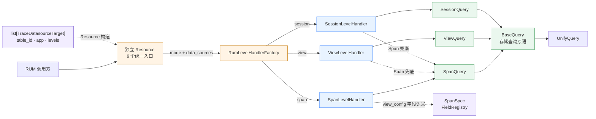
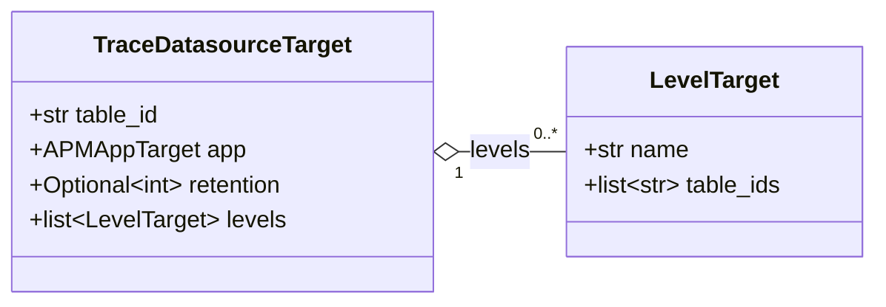
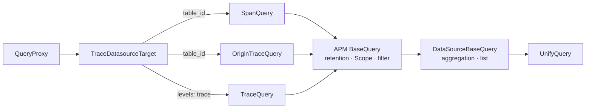
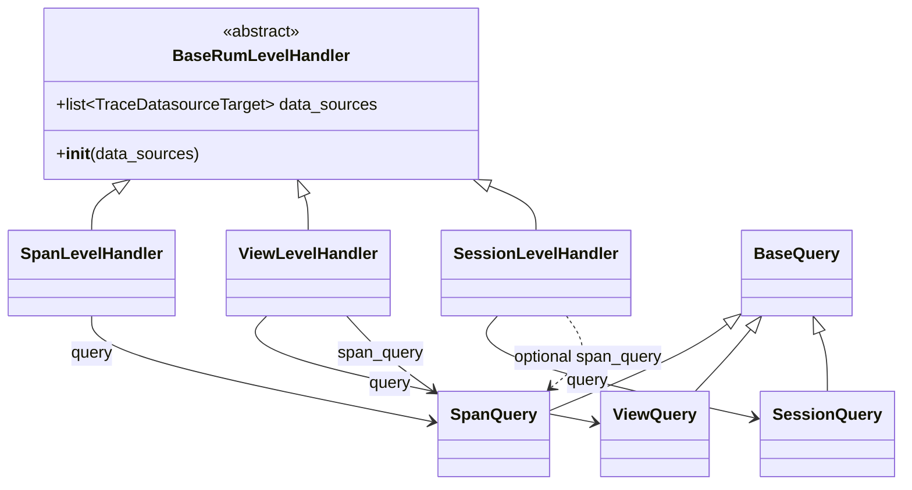

# RUM 分层统一查询 —— 实施方案

## 0x01 方案结论

### a. 目标调用链

```text
Resource
  └── RumLevelHandlerFactory.create(mode, data_sources)
        └── Span / View / Session LevelHandler(data_sources)
              ├── self.query → Span / View / Session Query → BaseQuery
              └── self.span_query → SpanQuery → BaseQuery（可选兜底）
```

| 决策点 | 结论 |
| --- | --- |
| HTTP 入口 | Resource 自行实现 `perform_request()`，不设公共基类 |
| Level 分派 | `RumLevelHandlerFactory` 只维护 `mode → LevelHandler` 映射 |
| 初始化参数 | Factory、Level、Query 均接收 `list[TraceDatasourceTarget]` |
| 结果表承载 | `table_id` 存原始表，`levels` 存 RUM 层级表和 APM 预计算表 |
| 查询职责 | Query 提供原子查询，Level 组合一个或多个 Query |
| 字段语义 | `semconv/rum` 定义原子字段，Trace 命名空间声明结构前缀，`SpanSpec` 统一访问 |
| APM 适配 | `QueryProxy` 统一构造 Target，3 类 Query 复用通用查询原语 |

### b. 方案边界

- 除 `view_config`、Span 核心详情与异步分析约定外的接口细节和错误码。
- View、Session 的预计算链路与数据生产方式。
- View、Session 查询原子的具体实现。
- 各 Level 页面配置和查询参数的业务细节。
- OTLP 编解码和 RUM 上报协议变更。

## 0x02 架构设计

### a. 总体结构



| 层 | 负责 | 不负责 |
| --- | --- | --- |
| Resource | 权限、参数校验、构造 `data_sources`、调用 Level | 选择具体 Level 类或执行存储查询 |
| Factory | 校验 `mode`、构造对应 Level | 解析结果表或实现接口能力 |
| Level | 组合一个或多个 Query，组装接口能力 | 处理 HTTP 或直接访问 UnifyQuery |
| Query | 从 Target 选择层级表、构造并执行存储查询 | 页面配置和 HTTP 返回组装 |
| Semconv | 定义字段语义、声明 Trace 命名空间、按完整路径查找 | 查询存储、决定字段是否实际存在 |

### b. 数据源目标

代码位置：`bkmonitor/data_source/utils/apm.py`。

```python
@dataclass(frozen=True)
class LevelTarget:
    name: str
    table_ids: list[str]


@dataclass(frozen=True)
class TraceDatasourceTarget:
    table_id: str
    app: APMAppTarget
    retention: int | None = None
    levels: list[LevelTarget] = field(default_factory=list)
```



| 查询层级 | 结果表来源 |
| --- | --- |
| Span | `TraceDatasourceTarget.table_id` |
| View | `TraceDatasourceTarget.levels` 中 `name = "view"` 的 `table_ids` |
| Session | `TraceDatasourceTarget.levels` 中 `name = "session"` 的 `table_ids` |
| APM Trace 预计算 | `TraceDatasourceTarget.levels` 中 `name = "trace"` 的 `table_ids` |

补充约束：

- `retention` 和 `levels` 为可选字段，仅提供 `table_id` 的调用方无需调整。
- `QueryProxy` 从 Trace 数据源填充 `retention`，APM Query 只消费 Target。
- `LevelTarget.name` 标识预计算层级，不与 `RumQueryMode` 绑定。

### c. APM 查询适配



`SpanQuery`、`OriginTraceQuery` 和 `TraceQuery` 构造查询配置并返回结果列表，`QueryProxy` 统一包装响应协议。

## 0x03 开发方案

### a. 代码落点

```text
bkmonitor/data_source/utils/
├── query.py                                  # [Keep] BaseQuery
└── apm.py                                    # [Change] LevelTarget、TraceDatasourceTarget.retention / levels

apm/core/handlers/query/
├── base.py                                   # [Change] 继承 APMQueryFilterMixin、DataSourceBaseQuery
├── proxy.py                                  # [Change] 统一构造 TraceDatasourceTarget
├── span_query.py                             # [Change] 使用原始表
├── origin_trace_query.py                     # [Change] 使用原始表
└── trace_query.py                            # [Change] 使用 trace 层级预计算表

packages/rum_web/
├── constants.py                              # [Change] RumQueryMode
├── query/
│   ├── resources.py                          # [Add] 9 个独立 Resource
│   ├── serializers.py                        # [Add] 请求序列化器分层
│   ├── views.py                              # [Add] SearchViewSet
│   └── urls.py                               # [Add] ResourceRouter，生成 search/
├── urls.py                                   # [Change] 在根路径挂载 rum_web.query.urls
└── handlers/
    ├── builder/
    │   ├── span/                             # [Add] Span Builder
    │   └── timeline.py                       # [Add] 会话时间线 Builder
    ├── query/
    │   ├── span.py                           # [Change] SpanQuery
    │   ├── view.py                           # [Reserved] ViewQuery
    │   └── session.py                        # [Reserved] SessionQuery
    └── level/
        ├── base.py                           # [Add] BaseRumLevelHandler
        ├── factory.py                        # [Add] RumLevelHandlerFactory
        ├── span.py                           # [Add] SpanLevelHandler
        ├── view.py                           # [Reserved] ViewLevelHandler
        └── session.py                        # [Reserved] SessionLevelHandler
```

### b. `mode` 与 Factory

```python
class RumQueryMode(CachedEnum):
    SPAN = "span"
    VIEW = "view"
    SESSION = "session"

    @classmethod
    def choices(cls) -> list[tuple[str, str]]:
        """枚举形态承接 choices 生成与取值容错，无需逐个维护选项列表。"""


class RumLevelHandlerFactory:
    HANDLERS = {
        RumQueryMode.SPAN.value: SpanLevelHandler,
    }

    @classmethod
    def create(
        cls,
        mode: str,
        data_sources: list[TraceDatasourceTarget],
    ) -> BaseRumLevelHandler:
        if mode not in cls.HANDLERS:
            raise UnsupportedRumQueryMode(mode)
        return cls.HANDLERS[mode](data_sources)
```

### c. 基础查询层

| 变更点                                                       | 代码位置                                     |
|--------------------------------------------------------------|----------------------------------------------|
| **[Keep]** `BaseQuery`                                       | `bkmonitor/data_source/utils/query.py`       |
| **[Change]** `SpanQuery`                                     | `packages/rum_web/handlers/query/span.py`    |
| **[Reserved]** `ViewQuery`                                   | `packages/rum_web/handlers/query/view.py`    |
| **[Reserved]** `SessionQuery`                                | `packages/rum_web/handlers/query/session.py` |
| **[Change]** APM `BaseQuery`                                 | `apm/core/handlers/query/base.py`            |
| **[Change]** `TraceQuery` / `OriginTraceQuery` / `SpanQuery` | `apm/core/handlers/query/`                   |

查询原语：

```text
query_list
query_total
query_field_topk
query_option_values
query_graph_config
query_field_aggregated_value
query_detail
query_fields
```

### d. Level 与 Query 交互



```python
from abc import ABC, abstractmethod
from typing import Any

from bkmonitor.data_source.utils import types


class BaseRumLevelHandler(ABC):
    def __init__(self, data_sources: list[TraceDatasourceTarget]):
        self.data_sources = data_sources

    @abstractmethod
    def view_config(
        self,
        extra_config: dict[str, Any] | None = None,
    ) -> dict[str, Any]:
        ...

    @abstractmethod
    def generate_query_string(
        self,
        filters: list[types.Filter],
        extra_config: dict[str, Any] | None = None,
    ) -> str:
        ...

    @abstractmethod
    def field_topk(
        self,
        start_time: int,
        end_time: int,
        field: str,
        limit: int = 5,
        filters: list[types.Filter] | None = None,
        query_string: str = "",
        extra_config: dict[str, Any] | None = None,
    ) -> list[dict[str, Any]]:
        ...

    @abstractmethod
    def field_statistics_info(
        self,
        start_time: int,
        end_time: int,
        field: dict[str, Any],
        filters: list[types.Filter] | None = None,
        query_string: str = "",
        extra_config: dict[str, Any] | None = None,
    ) -> dict[str, Any]:
        ...

    @abstractmethod
    def field_statistics_graph(
        self,
        start_time: int,
        end_time: int,
        field: dict[str, Any],
        filters: list[types.Filter] | None = None,
        query_string: str = "",
        extra_config: dict[str, Any] | None = None,
    ) -> dict[str, Any]:
        ...

    @abstractmethod
    def download_topk(
        self,
        start_time: int,
        end_time: int,
        field: str,
        limit: int = 5,
        filters: list[types.Filter] | None = None,
        query_string: str = "",
        extra_config: dict[str, Any] | None = None,
    ) -> bytes:
        ...

    @abstractmethod
    def get_fields_option_values(
        self,
        start_time: int,
        end_time: int,
        fields: list[str],
        limit: int = 10,
        filters: list[types.Filter] | None = None,
        query_string: str = "",
        extra_config: dict[str, Any] | None = None,
    ) -> dict[str, list[str]]:
        ...

    @abstractmethod
    def list_records(
        self,
        start_time: int,
        end_time: int,
        offset: int = 0,
        limit: int = 10,
        filters: list[types.Filter] | None = None,
        query_string: str = "",
        sort: list[str] | None = None,
        extra_config: dict[str, Any] | None = None,
    ) -> list[dict[str, Any]]:
        ...

    @abstractmethod
    def record_detail(
        self,
        record_id: str,
        extra_config: dict[str, Any] | None = None,
    ) -> dict[str, Any]:
        ...


class ViewLevelHandler(BaseRumLevelHandler):
    def __init__(self, data_sources: list[TraceDatasourceTarget]):
        super().__init__(data_sources)
        self.query = ViewQuery(data_sources)
        self.span_query = SpanQuery(data_sources)
```

- *[1] `extra_config` 仅承载服务端 Level 差异化配置。*
- *[2] Resource 按 `mode` 构造配置，请求序列化器不对外声明。*
- *[3] Level 只读取白名单字段，并将解析值按参数传给 Query。*
- *[4] `extra_config` 不能覆盖显式参数或 `data_sources`。*

### e. Resource 与 Level 交互

```python
class RumFieldTopKResource(Resource):
    RequestSerializer = RumFieldTopKRequestSerializer

    def perform_request(self, data):
        mode = data.pop("mode")
        application = self.get_authorized_application(data)
        data_sources = [
            TraceDatasourceTarget.build(
                bk_biz_id=application.bk_biz_id,
                app_name=application.app_name,
                table_id=application.span_result_table_id,
            )
        ]

        handler = RumLevelHandlerFactory.create(mode, data_sources)
        return handler.field_topk(
            start_time=data["start_time"],
            end_time=data["end_time"],
            field=data["field"],
            limit=data["limit"],
            filters=data["filters"],
            query_string=data["query_string"],
        )
```

- *[1] Resource 使用已鉴权的 `Application` 构造 `data_sources`，请求参数不能指定结果表。*
- *[2] 除 `generate_query_string` 外，所有 Resource 均按应用实例鉴权。*
- *[3] `generate_query_string` 只转换过滤条件，不查询业务数据，因此沿用 APM 的免实例鉴权规则。*

请求序列化器按「应用上下文 → 时间范围 → 检索条件」单链继承，接口参数只在叶子声明：

```text
FilterSerializer                            # 存储查询侧，value 收敛为字符串
  └── QueryStringFilterSerializer           # 查询串渲染侧，value 保留 JSON 原类型

BaseRumRequestSerializer                    # bk_biz_id、app_name、mode
  ├── RumGenerateQueryStringRequestSerializer
  └── BaseRumTimeRangeSerializer            # start_time、end_time
        ├── RumViewConfigRequestSerializer
        └── BaseRumSearchSerializer         # filters、query_string
              └── 列表类与分析类接口叶子      # offset / limit / sort / fields / field
```

- *[4] `FilterSerializer` 将 `value` 元素转换为字符串，满足 UnifyQuery condition 协议。*
- *[5] `QueryStringFilterSerializer` 保留 JSON 数值和布尔类型，用于渲染查询串。*
- *[6] 分页数量、TopK 数量和枚举值数量语义不同，`limit` 只在叶子声明。*
- *[7] `record_detail` 不需要时间范围，直接继承 `BaseRumRequestSerializer`。*

### f. Resource 接口

| URL                                          | Resource                          | Level 方法                 |
|----------------------------------------------|-----------------------------------|----------------------------|
| `GET` /rum/search/view_config/               | `RumViewConfigResource`           | `view_config`              |
| `POST` /rum/search/generate_query_string/    | `RumGenerateQueryStringResource`  | `generate_query_string`    |
| `POST` /rum/search/field_topk/               | `RumFieldTopKResource`            | `field_topk`               |
| `POST` /rum/search/field_statistics_info/    | `RumFieldStatisticsInfoResource`  | `field_statistics_info`    |
| `POST` /rum/search/field_statistics_graph/   | `RumFieldStatisticsGraphResource` | `field_statistics_graph`   |
| `POST` /rum/search/download_topk/            | `RumDownloadTopKResource`         | `download_topk`            |
| `POST` /rum/search/get_fields_option_values/ | `RumFieldsOptionValuesResource`   | `get_fields_option_values` |
| `POST` /rum/search/list_records/             | `RumRecordsResource`              | `list_records`             |
| `POST` /rum/search/record_detail/            | `RumRecordDetailResource`         | `record_detail`            |

### g. semconv

原子字段只定义一次，再由 `Attributes`、`Events` 等复合字段组成 Trace 结构。`SpanSpec` 组织整棵字段树，并支持按完整路径查找。

#### 1）代码结构

```text
bkmonitor/
├── constants/
│   └── apm.py                           # CachedEnum
├── semconv/
│   ├── constants.py                     # 通用字段展示、单位、Span Kind 和状态枚举
│   └── rum/
│       ├── constants.py                 # RUM 字段枚举和 Span 类型默认列
│       ├── field.py                     # FieldSpec
│       ├── registry.py                  # FieldRegistry
│       ├── attributes/
│       │   ├── span_attributes.py       # Span 根字段及 Span 语义字段
│       │   ├── action_attributes.py
│       │   └── *_attributes.py          # 按 view、network 等语义分段
│       └── trace/
│           ├── __init__.py              # SpanSpec
│           ├── resource.py
│           ├── status.py
│           ├── events.py
│           ├── attributes.py
│           └── links.py
└── packages/
    └── rum_web/                         # 消费 SpanSpec
```

#### 2）核心模型

```python
@dataclass(frozen=True, slots=True)
class FieldSpec:
    field_name: str
    field_alias: str = ""
    field_unit: str | None = None
    field_type: str | None = None
    field_display_type: str | None = None
    is_real: bool = True
    option_values: type[HasChoicesCachedEnum] | None = None
    _full_field_name: str = field(default="", init=False, repr=False, compare=False)

    def children(self) -> Iterator["FieldSpec"]:
        return (
            candidate
            for name, candidate in vars(type(self)).items()
            if name.isupper() and isinstance(candidate, FieldSpec)
        )

    def get_full_field_name(self) -> str:
        return self._full_field_name or self.field_name

    def bind(self, full_field_name: str) -> "FieldSpec":
        bound = replace(self)
        object.__setattr__(bound, "_full_field_name", full_field_name)
        return bound


# semconv/rum/trace/events.py
class EventAttributes(FieldSpec):
    CODE_LINENO = code_attributes.CODE_LINENO


class Events(FieldSpec):
    NAME = event_attributes.NAME
    ATTRIBUTES = EventAttributes(field_name="attributes")


# semconv/rum/registry.py
class FieldRegistry:
    def __init__(self, root: FieldSpec) -> None:
        self.originals: dict[str, FieldSpec] = {}
        self.bound_fields: dict[str, FieldSpec] = {}
        self._collect(root, parent_path="")

    def _collect(self, field: FieldSpec, parent_path: str) -> None:
        full_path = f"{parent_path}.{field.field_name}" if parent_path else field.field_name
        if full_path:
            if full_path in self.originals:
                raise ValueError(f"字段路径重复注册: {full_path}")
            self.originals[full_path] = field
            self.bound_fields[full_path] = field.bind(full_path)
        for child in field.children():
            self._collect(child, parent_path=full_path)

    def from_field(self, field_name: str) -> FieldSpec:
        spec = self.bound_fields.get(field_name)
        return spec if spec is not None else FieldSpec(field_name)

    def fields(self) -> list[FieldSpec]:
        return list(self.bound_fields.values())


# semconv/rum/trace/__init__.py
class SpanSpec(FieldSpec):
    KIND = span_attributes.KIND
    END_TIME = span_attributes.END_TIME

    RESOURCE = Resource(field_name="resource")
    STATUS = Status(field_name="status")
    EVENTS = Events(field_name="events")
    ATTRIBUTES = Attributes(field_name="attributes")
    LINKS = Links(field_name="links")

    @classmethod
    def from_field(cls, field_name: str) -> FieldSpec:
        return _SPAN_FIELDS.from_field(field_name)

    @classmethod
    def fields(cls) -> list[FieldSpec]:
        return _SPAN_FIELDS.fields()


_SPAN_FIELDS = FieldRegistry(SpanSpec(field_name=""))
```

`FieldRegistry` 为每条完整路径创建绑定副本，并保留原始 `FieldSpec` 引用。同一原始字段可以复用到多条路径，绑定副本通过
`get_full_field_name()` 返回当前路径。`from_field()` 返回绑定副本；未注册字段返回仅含输入字段名的 `FieldSpec`。`is_real`
默认取 `True`，只有虚拟字段显式设置为 `False`。

```python
assert SpanSpec.from_field("kind").get_full_field_name() == "kind"
assert SpanSpec.from_field("events.name").get_full_field_name() == "events.name"
```

#### 3）消费边界

**[1] `bkmonitor/data_source/utils/query.py`：**
* 不再承担别名、候选值、单位的渲染。
* 移除  FIELD_ALIAS_MAP_LIST、FIELD_UNITS、ENUM_FIELD_OPTION_VALUES 及相应的消费逻辑。

**[2] `rum_web.handlers.query.span.SpanQuery.query_fields()`：**
* 真实字段通过 `SpanSpec.from_field(field_name)` 补充别名、单位、展示类型和枚举候选值。
* 虚拟字段从 `SpanSpec.fields()` 统一读取，只注入 `is_real = False` 的字段。
* 字段名、映射键和 `origin_field` 基于 `get_full_field_name()` 生成，不再维护独立的 `VIRTUAL_FIELDS`。

### h. Span Builder

建议收敛成 **Handler 准备数据，Builder 组装协议**。

```text
SpanLevelHandler.record_detail(record_id)
  ├─ self.query.query_list(...)          # 查询主 Span
  ├─ self._query_related_spans(span)     # View 才补查生命周期和 Vital
  └─ span_builder.build(span, related_spans)
```

Builder 全部放在 `packages/rum_web/handlers/builder/span/`，接口骨架：

```python
class SpanBuilder:
    @classmethod
    def process(
        cls,
        span: dict[str, Any],
        related_spans: Sequence[dict[str, Any]] = (),
    ) -> dict[str, Any]:
        ...  # 默认返回公共头部和空 sections


# 各类型继承 SpanBuilder，实现 process。
BUILDERS = {
    "resource": ResourceSpanBuilder,
    "action": ActionSpanBuilder,
    "long_task": LongTaskSpanBuilder,
    "error": ErrorSpanBuilder,
    "vital": VitalSpanBuilder,
    "view": ViewSpanBuilder,
}


def build(
    span: dict[str, Any],
    related_spans: Sequence[dict[str, Any]] = (),
) -> dict[str, Any]:
    builder = BUILDERS.get(
        get_value(span, "attributes.span_type"), SpanBuilder
    )
    return builder.process(span, related_spans)
```

| 位置                                      | 职责                                               |
| --------------------------------------- | ------------------------------------------------ |
| `SpanLevelHandler.record_detail`        | 查询主 Span，处理记录不存在，调用 `build`                      |
| `SpanLevelHandler._query_related_spans` | 使用 `self.query.query_list` 查询关联记录，返回平铺的 Span 列表  |
| `SpanBuilder.process`                   | 组装 `origin_data`、`span_id`、`overview`、`sections` |
| 各类型 Builder                             | 按 `PLAN.md` 构造对应区块、评级配置及加载时序                     |

`_query_related_spans` 仅对 View 执行：

| 关联记录 | 过滤条件 | 选取 |
| --- | --- | --- |
| View 生命周期 | 同 View ID、`span_type=view` | 按 `view.version` 降序取最新一条 |
| Web Vitals | 同 View ID、`span_type=vital` | 每个指标按 `end_time` 降序取最新一条 |

- *[1] 关联查询沿用应用范围，按全局唯一的 View ID 定位，不追加 Session 条件。*
- *[2] 关联查询不指定时间边界，由查询层按保留期补齐窗口；其他类型返回空列表。*
- *[3] `ViewSpanBuilder` 用最新快照构造展示数据，`origin_data`、`span_id` 保留主记录。*
- *[4] Builder 不持有 Query，不引入 Context；计数和影响面仍由 `statistics` 获取。字段访问复用轻量取值函数，协议与计算公式直接遵循 `PLAN.md`，不在草稿重复维护。*

### i. Timeline Builder

会话时间线沿用 **Handler 准备数据，Builder 组装协议**。

```text
SpanLevelHandler.timeline(session_id)
  ├─ self.query.query_list(...)                   # 按 attributes.session.id 查询会话内全部 Span
  └─ timeline_builder.build(spans)
       └─ span_builder.build(span, related_spans)   # 每个节点构造一条 record
```

`packages/rum_web/handlers/builder/timeline.py` 接口骨架：

```python
from rum_web.handlers.builder.span import build as build_span


@dataclass
class ViewGroup:
    snapshots: list[dict[str, Any]]  # 同 View ID 的 View 快照
    vitals: list[dict[str, Any]]     # 同 View ID 的 Vital
    members: list[dict[str, Any]]    # 同 View ID 的其余 Span，作为子节点候选


def build(spans: Sequence[dict[str, Any]]) -> dict[str, Any]:
    sessions, groups = _partition(spans)
    tree, records = [], {}
    for group in sorted(groups, key=_started_at):
        view = min(group.snapshots, key=_version)
        records[view["span_id"]] = build_span(view, [*group.snapshots, *group.vitals])
        records.update({span["span_id"]: build_span(span) for span in group.members})
        tree.append(_node(view, _attach(group.members)))
    return {
        "start_time": _session_start_time(sessions),
        "end_time": _session_end_time(sessions),
        "tree": tree,
        "records": records,
    }
```

会话起止时间：

| 字段 | 过滤条件 | 聚合 |
| --- | --- | --- |
| `start_time` | `attributes.session.phase IN (start, rotate)` | `min(start_time)` |
| `end_time` | `attributes.session.phase = end` | `max(end_time)` |

- *[1] 无匹配的 Session Span 时返回 `null`。*
- *[2] `start`、`rotate` 的上报时刻晚于首个 View 的 `attributes.view.started_at` 约 `0.6 s～1.7 s`，待 SDK 优化。*

父子层级：

| 节点 | 父节点 | 判定规则 |
| --- | --- | --- |
| View | -- | 按 `attributes.view.id` 去重，取 `min(attributes.view.version)` 的快照 |
| Action | View | `attributes.view.id` 相等 |
| Resource | Action、View | 优先挂到 `attributes.view.id`、`attributes.action.id` 均相等的 Action，否则挂到 View |
| Long Task、Error、Custom、WebSocket | View | `attributes.view.id` 相等，忽略 `attributes.action.id` |

- *[1] View 按 `attributes.view.started_at` 升序，子节点按 `start_time` 升序。*
- *[2] Vital、Session 不生成节点。*
- *[3] `attributes.view.id` 为空或所属 View 无快照的 Span 丢弃。*

复用 Span Builder：两个入口调用同一个 `build(span, related_spans)`，只是入参来源不同。

| 入口 | `span` | `related_spans` |
| --- | --- | --- |
| `record_detail` | `query_detail(record_id)` | `_query_related_spans(span)` 回查存储 |
| `timeline` | 会话 Span 查询结果 | 同一结果按 `attributes.view.id` 切分 |

## 0x04 核心协议

### a. view_config

```json
{
  "default_sort": ["-end_time"],
  "span_type_display_fields": {"{span_type}": []},
  "fields": [
    {
      "field_name": "span_name",
      "field_alias": "Span 名称",
      "field_type": "keyword",
      "origin_field": "span_name",
      "is_real": true,
      "is_searchable": true,
      "is_agg": true,
      "is_list": true,
      "supported_operations": []
    },
    {
      "field_name": "end_time",
      "field_alias": "结束时间",
      "field_type": "long",
      "field_unit": "us",
      "field_display_type": "datetime",
      "origin_field": "end_time",
      "is_real": true,
      "is_searchable": true,
      "is_agg": true,
      "is_list": true,
      "supported_operations": []
    },
    {
      "field_name": "elapsed_time",
      "field_alias": "耗时",
      "field_type": "long",
      "field_unit": "us",
      "field_display_type": "duration",
      "origin_field": "elapsed_time",
      "is_real": true,
      "is_searchable": true,
      "is_agg": true,
      "is_list": true,
      "supported_operations": []
    },
    {
      "field_name": "attributes.span_type",
      "field_alias": "Span 类型",
      "field_type": "keyword",
      "origin_field": "attributes",
      "is_real": true,
      "is_searchable": true,
      "is_agg": true,
      "is_list": true,
      "supported_operations": [],
      "option_values": [
        {"value": "view", "alias": "视图"},
        {"value": "resource", "alias": "资源加载"}
      ]
    },
    {
      "field_name": "resource.user_agent.name",
      "field_alias": "代理名称",
      "field_type": "keyword",
      "origin_field": "resource",
      "is_real": true,
      "is_searchable": true,
      "is_agg": true,
      "is_list": true,
      "supported_operations": []
    },
    {
      "field_name": "LCP",
      "field_alias": "最大内容绘制",
      "field_type": "double",
      "field_unit": "ms",
      "field_display_type": "duration",
      "origin_field": "LCP",
      "is_real": false,
      "is_searchable": true,
      "is_agg": true,
      "is_list": false,
      "supported_operations": [],
      "rating_config": [
        {"rating": "good", "value": 2500},
        {"rating": "needs_improvement", "value": 4000},
        {"rating": "poor"}
      ]
    }
  ],
  "groups": [
    {
      "name": "DEVICE_BROWSER",
      "alias": "终端 & 浏览器",
      "supported_span_types": ["resource", "action"],
      "field_names": [
        "resource.user_agent.name"
      ]
    },
    {
      "name": "WEB_VITALS",
      "alias": "网页指标（Web Vitals）",
      "supported_span_types": ["vital"],
      "field_names": [
        "LCP"
      ]
    }
  ],
  "display_fields": [
    "span_name",
    "attributes.span_type",
    "end_time",
    "elapsed_time",
    "status.code",
    "attributes.view.url_template",
    "attributes.user.id"
  ]
}
```

- *[1] `origin_field` 标识字段在原始记录中的来源，打平字段使用所属顶层对象名。*
- *[2] `is_real` 区分原始字段与计算、虚拟字段。*
- *[3] `field_unit` 是原始字段的可选上报单位，如 `us`、`ms`、`s`。*
- *[4] `field_display_type` 是可选展示类型，支持 `datetime` 和 `duration`；消费方根据 `field_unit` 换算原始值。*
- *[5] `groups[].supported_span_types` 与 `span_type_display_fields` 只在 Span 视图下返回。*
- *[6] `is_list = false` 的字段只用于分析和检索，不进入列表字段。*
- *[7] `option_values` 存在别名时，字段分析和候选值使用 `{alias}（{value}）` 展示，列表使用 `{alias}`。*
- *[8] `rating_config` 按数组顺序匹配。`value` 是包含性上界，单位沿用字段的 `field_unit`；未设置 `value` 的末项承接剩余值。*


### b. RecordDetail（Resource）

#### 0）通用

加载时序计算方式：

| 指标                    | 计算方式                                                                            |
| --------------------- | ------------------------------------------------------------------------------- |
| `total_duration`      | `attributes.resource.download.start + attributes.resource.download.duration`    |
| `prepare.start`       | `attributes.resource.redirect.start`                                            |
| `prepare.duration`    | `attributes.resource.dns.start − attributes.resource.redirect.start`            |
| `dns.start`           | `attributes.resource.dns.start`                                                 |
| `dns.duration`        | `attributes.resource.dns.duration`                                              |
| `connect.start`       | `attributes.resource.connect.start`                                             |
| `connect.duration`    | `attributes.resource.connect.duration − attributes.resource.ssl.duration` *[1]* |
| `tls.start`           | `attributes.resource.ssl.start`                                                 |
| `tls.duration`        | `attributes.resource.ssl.duration`                                              |
| `first_byte.start`    | `attributes.resource.first_byte.start`                                          |
| `first_byte.duration` | `attributes.resource.first_byte.duration`                                       |
| `download.start`      | `attributes.resource.download.start`                                            |
| `download.duration`   | `attributes.resource.download.duration`                                         |

- *[1] TLS 分段有效时扣除其耗时，明确无 TLS 时直接取 `connect.duration`，缺少 TLS 字段不能视为未发生握手。*

#### 1）XHR & Fetch

```json
{
  "origin_data": {},
  "span_id": "7d2f09b6f8bc31aa",
  "overview": {
    "title": "POST /api/orders",
    "badges": [
      {"field_name": "elapsed_time", "value": 128000},
      {"field_name": "attributes.resource.type", "value": "fetch"},
      {"field_name": "attributes.http.response.status_code", "value": 200}
    ],
    "items": [
      {
	    "field_name": "display.span_type",
	    "field_alias": "类型",
	    "value": "Resource(fetch)",
	    "alias": "Resource(fetch)"
	  },
      {"field_name": "app_name", "value": "bkop"},
      {"field_name": "attributes.view.url_template", "value": "/order/submit"},
      {"field_name": "attributes.session.id", "value": "sess-001"},
      {"field_name": "attributes.view.id", "value": "view-001"},
      {"field_name": "start_time", "value": 1788451565200000},
      {"field_name": "end_time", "value": 1788451565328000},
      {"field_name": "attributes.user.id", "value": "user-001"},
      {"field_name": "resource.deployment.environment.name", "value": "prod"}
    ]
  },
  "sections": [
    {
      "key": "key_info",
      "type": "summary_cards",
      "data": {
        "request": {
          "attributes.http.request.method": "POST",
          "attributes.url.template": "/api/orders",
          "attributes.url.full": "https://example.com/api/orders",
          "attributes.server.address": "example.com"
        },
        "duration": {"elapsed_time": 128000},
        "http_result": {
          "attributes.http.response.status_code": 200,
          "attributes.outcome.type": "success"
        },
        "transfer": {
          "display.compression_ratio": 0.6295,
          "attributes.resource.transfer_size": 3260,
          "attributes.resource.encoded_body_size": 3120,
          "attributes.resource.decoded_body_size": 8420,
        }
      }
    },
    {
      "key": "loading_timing",
      "type": "waterfall",
      "data": {
        "unit": "ms",
        "total_duration": 128,
        "phases": [
	      {
		    "key": "prepare",
		    "alias": "浏览器准备",
		    "start": 0,
		    "duration": 1.2
          },
          {
            "key": "dns",
            "alias": "DNS",
            "start": 1.2,
            "duration": 3.8
          },
          {
            "key": "connect",
            "alias": "TCP",
            "start": 5,
            "duration": 4.1
          },
          {
            "key": "tls",
            "alias": "TLS",
            "start": 9.1,
            "duration": 5.9
          },

          {
            "key": "first_byte",
            "alias": "等待首字节",
            "start": 15,
            "duration": 86.7
          },
          {
            "key": "download",
            "alias": "内容下载",
            "start": 101.7,
            "duration": 26.3
          }
        ]
      }
    }
  ]
}
```

#### 2）others

```json
{
  "origin_data": {},
  "span_id": "8e301ac709bd42bb",
  "overview": {
    "title": "db.svg",
    "badges": [
      {"field_name": "elapsed_time", "value": 60300},
      {"field_name": "attributes.resource.type", "value": "img"},
      {"field_name": "attributes.http.response.status_code", "value": 200}
    ],
    // 和 1）XHR & Fetch 一致，省略。
    "items": []
  },
  "sections": [
    {
      "key": "key_info",
      "type": "summary_cards",
      "data": {
        "http_result": {
          "attributes.http.response.status_code": 200,
          "attributes.outcome.type": "success"
        },
        "duration": {"elapsed_time": 60300},
        "transfer": {
          "display.compression_ratio": 0.689,
          "attributes.resource.transfer_size": 0,
          "attributes.resource.encoded_body_size": 280833,
          "attributes.resource.decoded_body_size": 903000
        },
        "delivery": {
          "attributes.resource.delivery_type": "cache",
          "attributes.resource.cache.hit": true
        },
        "blocking": {
          "attributes.resource.render_blocking_status": "non-blocking"
        }
      }
    },
    {
      "key": "resource_info",
      "type": "summary_cards",
      "items": [
        {"field_name": "attributes.resource.type", "value": "img"},
        {"field_name": "attributes.url.template", "value": "/static/img/db.svg"},
        {
	      "field_name": "attributes.server.address",
	      "value": "bkmonitor.bkop.woa.com"
	    },
        {"field_name": "attributes.http.request.method", "value": "GET"},
        {"field_name": "attributes.resource.protocol", "value": "h2"}
      ]
    },
    // 同 1）XHR & Fetch，不复述。
    {"key": "loading_timing", "type": "waterfall", "data": {}}
  ]
}
```

### c. RecordDetail（Action）

```json
{
  "origin_data": {},
  "span_id": "e121536e5ae785a0",
  "overview": {
    "title": "click .submit-btn",
    "badges": [
      {"field_name": "elapsed_time", "value": 432000},
      {"field_name": "attributes.action.type", "value": "click"},
      {"field_name": "attributes.outcome.type", "value": "warning"}
    ],
    // 省略，同 Resource。
    "items": []
  },
  "sections": [
    {
      "key": "key_info",
      "type": "summary_cards",
      "data": {
        "interaction": {"attributes.action.type": "click"},
        "target": {
          "attributes.action.target.name": ".submit-btn",
          "attributes.action.target.tag": "button"
        }
      }
    }
  ]
}
```


需异步拉取的「关键信息」：

| 关联信息        | API          | 额外过滤条件                            | 统计                            |
| ----------- | ------------ | --------------------------------- | ----------------------------- |
| 触发请求数       | `statistics` | `attributes.span_type: resource`  | `count(attributes.span_type)` |
| 错误数         | `statistics` | `attributes.span_type: error`     | `count(attributes.span_type)` |
| LongTasks 数 | `statistics` | `attributes.span_type: long_task` | `count(attributes.span_type)` |
* *[1] 统一过滤条件：`attributes.action.id: {当前 Action ID}`。*
* *[2] 查询时间范围：[end_time - 1d, end_time + 1d]。*

### d. RecordDetail（LongTask）

```json
{
  "origin_data": {},
  "span_id": "c49ddfc2ac5214d7",
  "overview": {
    "title": "longTask",
    "badges": [
      {"field_name": "elapsed_time", "value": 123500},
      {"field_name": "attributes.outcome.type", "value": "warning"}
    ],
    // 省略，同 Resource。
    "items": []
  },
  "sections": [
    {
      "key": "key_info",
      "type": "summary_cards",
      "data": {
        "duration": {
          "elapsed_time": 123500,
          "attributes.long_task.blocking_duration": 42.5
        },
        "action": {"attributes.action.id": "xxxxxx"},
        "attribution": {
          "attributes.long_task.entry_type": "long-animation-frame",
          "attributes.long_task.name": "long-animation-frame",
        }
      }
    }
  ]
}
```

*[1] 根据 `attributes.action.id` 异步补齐名称和时间。*

异步拉取的「关键信息」：

| 关联信息      | API            | 过滤条件                                                         |
| --------- | -------------- | ------------------------------------------------------------ |
| 关联 Action | `list_records` | `attributes.span_type: action AND attributes.action.id: xxx` |

### e. RecordDetail（Error）

```json
{
  "origin_data": {},
  "span_id": "9d199175096474e4",
  "overview": {
    "title": "TypeError: Cannot read properties of undefined (reading 'name')",
    "badges": [
      {"field_name": "attributes.outcome.type", "value": "error"}
    ],
    // 省略，同 Resource。
    "items": []
  },
  "sections": [
    {
      "key": "key_info",
      "type": "summary_cards",
      "data": {
        "error_type": {"events.attributes.exception.type": "TypeError"},
        "source": {
          "attributes.code.filepath": "https://example.com/static/js/app.js",
          "attributes.code.lineno": 9,
          "attributes.code.column": 654249
        }
      }
    }
  ]
}
```

*[1] Error Span 是瞬时事件，`elapsed_time` 恒为 `0`，概览不展示耗时徽标。*

异步拉取的「关键信息」「影响面统计」：

| 关联信息    | API          | 聚合                                | 额外                                           |
| :------ | :----------- | --------------------------------- | -------------------------------------------- |
| 影响用户数   | `statistics` | `distinct(attributes.user.id)`    | `time_shifts=["0s", "{end - start}s"]`（计算环比） |
| 发生次数    | `statistics` | `count(attributes.span_type)`     |                                              |
| 影响会话数   | `statistics` | `distinct(attributes.session.id)` |                                              |
| 24 小时趋势 | `statistics` | `count(attributes.span_type)`     | `interval=3600`（按 1h 分桶）                     |

* *[1] 统一过滤条件：`attributes.code.lineno: "xx" AND attributes.code.filepath: "xxx" AND attributes.code.column: "xxx" AND events.attributes.exception.type: "xxx" AND attributes.span_type: "error"`。*
* *[2] 影响面统计查询时间范围：[end_time - 1d, end_time + 1d]。*
* *[3] 24 小时趋势查询时间范围：[end_time - 1d, end_time]。*

### f. RecordDetail（Vital）

```json
{
  "origin_data": {},
  "span_id": "ea1ae6490e17fd9d",
  "overview": {
    "title": "LCP",
    "badges": [
      {"field_name": "attributes.vital.value", "value": 2840},
      {
        "field_name": "display.rating_level",
        "value": "needs_improvement",
        "alias": "需改进"
      }
    ],
    // 省略，同 Resource。
    "items": []
  },
  "sections": [
    {
      "key": "vital_rating",
      "type": "rating_bar",
      "data": {
        "attributes.vital.metric": "lcp",
        "attributes.vital.value": 2840,
        "display.rating_config": [
          {"rating": "good", "value": 2500, "alias": "良好"},
          {"rating": "needs_improvement", "value": 4000, "alias": "需改进"},
          {"rating": "poor", "alias": "差"}
	    ]
      }
    },
  ]
}
```

*[1] Vital Span 是瞬时快照，`elapsed_time` 恒为 `0`，概览徽标使用指标值 `attributes.vital.value`。*

### g. RecordDetail（View）

加载时序计算方式：

| 指标                                | 计算方式                                                                      |
| --------------------------------- | ------------------------------------------------------------------------- |
| `total_duration`                  | `attributes.view.loading_time`                                            |
| `prepare.start`                   | `0`                                                                       |
| `prepare.duration`                | `attributes.vital.ttfb.waiting_duration`                                  |
| `dns.start`                       | `connect.start − dns.duration`                                            |
| `dns.duration`                    | `attributes.vital.ttfb.dns_duration`                                      |
| `connect.start`                   | `first_byte.start − connect.duration`                                     |
| `connect.duration`                | `attributes.vital.ttfb.connection_duration`                               |
| `first_byte.start`                | `attributes.vital.value − first_byte.duration`                            |
| `first_byte.duration`             | `attributes.vital.ttfb.request_duration`                                  |
| `dom_processing.start`            | `attributes.view.first_byte`                                              |
| `dom_processing.duration`         | `attributes.view.dom_content_loaded − attributes.view.first_byte` *[1]*   |
| `resource_load.start`             | `attributes.view.dom_content_loaded`                                      |
| `resource_load.duration`          | `attributes.view.load_event − attributes.view.dom_content_loaded` *[1]*   |
| `page_stable.start`               | `attributes.view.load_event`                                              |
| `page_stable.duration`            | `max(0, attributes.view.loading_time − attributes.view.load_event)` *[2]* |
| `markers[].value`                 | 同名 Vital 的 `attributes.vital.value`                                       |
| `markers[].display.rating_config` | 同名虚拟字段的 `rating_config`，与 `web_vitals` 卡片一致                               |
| `milestones.dom_complete`         | `attributes.view.dom_complete`                                            |
| `milestones.load_event`           | `attributes.view.load_event`                                              |
| `milestones.page_stable`          | `attributes.view.loading_time`                                            |

- *[1] 内容传输与 DOM 处理包含 HTML 接收、解析、阻塞脚本和 DOMContentLoaded 事件处理，剩余资源加载包含其后至 Load 完成的资源等待、脚本及事件处理，均为加载进程区间，不是纯下载或解析耗时。*
- *[2] 自动计时的 Loading Time 不早于 Load，`max(0, …)` 只消除浮点误差产生的微小负值。*

```json
{
  "origin_data": {},
  "span_id": "34e3b6ff1943346c",
  "overview": {
    "title": "view-001",
    "badges": [{"field_name": "display.view.duration", "field_unit": "ms", "value": 60300}],
    "items": [
      {
	    "field_name": "display.span_type",
	    "field_alias": "类型",
	    "value": "View",
	    "alias": "View"
	  },
      {"field_name": "app_name", "value": "bkop"},
      {"field_name": "attributes.view.url_template", "value": "/order/submit"},
      {
        "field_name": "attributes.view.previous_url_template",
        "value": "/product/:id/"
      },
      {"field_name": "attributes.session.id", "value": "sess-001"},
      {"field_name": "attributes.view.id", "value": "view-001"},
      {"field_name": "start_time", "value": 1788451565200000},
      {"field_name": "end_time", "value": 1788451625500000},
      {"field_name": "attributes.user.id", "value": "user-001"},
      {"field_name": "resource.deployment.environment.name", "value": "prod"}
    ]
  },
  "sections": [
    {
      "key": "key_info",
      "type": "summary_cards",
      "data": {
        "duration": {"display.view.duration": 60300},
        "loading": {
          "attributes.view.loading_time": 200,
          "attributes.view.loading_time_source": "auto",
          "attributes.view.loading_type": "initial_load",
          "attributes.view.first_byte": 101.7,
          "attributes.view.dom_content_loaded": 140,
          "attributes.view.load_event": 175
        }
      }
    },
    {
      "key": "web_vitals",
      "type": "summary_cards",
      "data": {
        "ttfb": {
          "attributes.vital.metric": "ttfb",
          "attributes.vital.value": 101.7,
          "attributes.vital.ttfb.waiting_duration": 1.2,
          "attributes.vital.ttfb.dns_duration": 3.8,
          "attributes.vital.ttfb.connection_duration": 10,
          "attributes.vital.ttfb.request_duration": 83.7,
          "display.rating_config": [
            {"rating": "good", "value": 800, "alias": "良好"},
            {"rating": "needs_improvement", "value": 1800, "alias": "需改进"},
            {"rating": "poor", "alias": "差"}
          ]
        },
        "fcp": {
          "attributes.vital.metric": "fcp",
          "attributes.vital.value": 120,
          "display.rating_config": [
            {"rating": "good", "value": 1800, "alias": "良好"},
            {"rating": "needs_improvement", "value": 3000, "alias": "需改进"},
            {"rating": "poor", "alias": "差"}
          ]
        },
        "lcp": {
          "attributes.vital.metric": "lcp",
          "attributes.vital.value": 250,
          "display.rating_config": [
            {"rating": "good", "value": 2500, "alias": "良好"},
            {"rating": "needs_improvement", "value": 4000, "alias": "需改进"},
            {"rating": "poor", "alias": "差"}
          ]
        },
        "inp": {
          "attributes.vital.metric": "inp",
          "attributes.vital.value": 86,
          "display.rating_config": [
            {"rating": "good", "value": 200, "alias": "良好"},
            {"rating": "needs_improvement", "value": 500, "alias": "需改进"},
            {"rating": "poor", "alias": "差"}
          ]
        },
        "cls": {
          "attributes.vital.metric": "cls",
          "attributes.vital.value": 0.023,
          "display.rating_config": [
            {"rating": "good", "value": 0.1, "alias": "良好"},
            {"rating": "needs_improvement", "value": 0.25, "alias": "需改进"},
            {"rating": "poor", "alias": "差"}
          ]
        }
      }
    },
    {
      "key": "loading_timing",
      "type": "waterfall",
      "data": {
        "unit": "ms",
        "total_duration": 200,
        "phases": [
          {
            "key": "prepare",
            "alias": "浏览器准备",
            "start": 0,
            "duration": 1.2
          },
          {
            "key": "dns",
            "alias": "DNS 查询",
            "start": 4.2,
            "duration": 3.8
          },
          {
            "key": "connect",
            "alias": "网络连接建立",
            "start": 8,
            "duration": 10
          },
          {
            "key": "first_byte",
            "alias": "等待首字节",
            "start": 18,
            "duration": 83.7
          },
          {
            "key": "dom_processing",
            "alias": "内容传输与 DOM 处理",
            "start": 101.7,
            "duration": 38.3
          },
          {
            "key": "resource_load",
            "alias": "剩余资源加载",
            "start": 140,
            "duration": 35
          },
          {
            "key": "page_stable",
            "alias": "页面趋于稳定",
            "start": 175,
            "duration": 25
          }
        ],
        "markers": [
          {
            "key": "TTFB",
            "field_name": "TTFB",
            "value": 101.7,
            "display.rating_config": [
              {"rating": "good", "value": 800, "alias": "良好"},
              {"rating": "needs_improvement", "value": 1800, "alias": "需改进"},
              {"rating": "poor", "alias": "差"}
            ]
          },
          {
            "key": "FCP",
            "field_name": "FCP",
            "value": 120,
            "display.rating_config": [
              {"rating": "good", "value": 1800, "alias": "良好"},
              {"rating": "needs_improvement", "value": 3000, "alias": "需改进"},
              {"rating": "poor", "alias": "差"}
            ]
          },
          {
            "key": "LCP",
            "field_name": "LCP",
            "value": 250,
            "display.rating_config": [
              {"rating": "good", "value": 2500, "alias": "良好"},
              {"rating": "needs_improvement", "value": 4000, "alias": "需改进"},
              {"rating": "poor", "alias": "差"}
            ]
          }
        ],
        "milestones": [
          {"key": "dom_complete", "field_name": "attributes.view.dom_complete", "value": 170},
          {"key": "load_event", "field_name": "attributes.view.load_event", "value": 175},
          {"key": "page_stable", "field_name": "attributes.view.loading_time", "value": 200}
        ]
      }
    }
  ]
}
```

- *[1] `loading_timing` 只在首次加载（`attributes.view.loading_type = initial_load`）时返回，路由切换等非首次加载没有导航计时，不返回该区块。*
- *[2] `phases`、`markers` 和 `milestones` 在字段缺失或非法时省略对应项，不用相邻时间点补造。*
- *[3] `phases` 和 `milestones` 中的 `page_stable` 只在 `attributes.view.loading_time_source = auto` 时返回，业务手动上报的 Loading Time 可能早于 Load，不代表页面稳定。*

异步拉取的「关键信息」：

| 关联信息   | API          | 额外                                                                            |
| :----- | :----------- | ----------------------------------------------------------------------------- |
| 触发请求数  | `statistics` | `attributes.span_type: resource AND attributes.resource.type: (xhr OR fetch)` |
| 错误数    | `statistics` | `attributes.span_type: error`                                                 |
| Span 数 | `statistics` | `NOT attributes.span_type: (view OR vital OR session)`                        |
|        |              |                                                                               |

- *[1] 统一过滤条件：`attributes.view.id: {当前 View ID}`；应用及 Session 与主记录一致。*
- *[2] 统一聚合方式：`count(attributes.span_type)`。*
- *[3] 查询时间范围：[end_time - 1d, end_time + 1d]。*

View Span 关联信息获取（后端）：

| 补齐信息       | 额外过滤条件                                                             | 补齐字段                                                                                                                                                                                  |
| :--------- | ------------------------------------------------------------------ | --------------------------------------------------------------------------------------------------------------------------------------------------------------------------------------- |
| View 生命周期  | `attributes.span_type: view AND attributes.view.id: {当前 View ID}`  | [a] 头部时间：`end_time` 和 `display.view.duration`<br />[b] 加载字段：`attributes.view` 下的 `loading_time`、`loading_time_source`、`loading_type`、`first_byte`、`dom_content_loaded`、`dom_complete` 和 `load_event` |
| Web Vitals | `attributes.span_type: vital AND attributes.view.id: {当前 View ID}` | TTFB 四段耗时，以及 FCP、LCP、INP 和 CLS 的 `attributes.vital.value`                                                                                                                              |

* *[1] `origin_data` 和 `span_id` 保留主记录，补齐字段只覆盖展示值。*
* *[2] View 生命周期 Span 是瞬时快照，`start_time` 等于上报时刻，`elapsed_time` 恒为 `0`，因此概览徽标使用 `display.view.duration`，通过 `field_unit` 声明毫秒，由前端格式化。*
* *[3] 概览 `start_time` 取 `attributes.view.started_at`（毫秒）换算的微秒值，`display.view.duration` 为最新快照 `end_time` 与导航开始的差值，未取得 `phase=end` 时仅表示已观测时长。*

## 0x05 验收与验证

查询测试位于 `packages/rum_web/tests/query/`，通用模块测试跟随 `core/` 和 `semconv/`：

| 测试                                     | 核心断言                                                                                                                                                                                                                                                 |
| -------------------------------------- | ---------------------------------------------------------------------------------------------------------------------------------------------------------------------------------------------------------------------------------------------------- |
| `test_datasource_target.py`            | [a] `levels` 默认空列表<br />[b] 现有 `TraceDatasourceTarget.build()` 行为不变<br />[c] 可携带多个层级结果表                                                                                                                                                              |
| `test_level_factory.py`                | [a] 合法 `mode` 返回对应 Level<br />[b] 未注册模式明确失败<br />[c] `data_sources` 原样传入 Level                                                                                                                                                                       |
| `test_query.py`                        | [a] Query 复用 `BaseQuery`<br />[b] 接收 `list[TraceDatasourceTarget]`<br />[c] 具备 8 项原子能力                                                                                                                                                               |
| `semconv/rum/tests/test_span_spec.py`  | [a] `field_alias` 默认空串，`is_real` 默认 `true`<br />[b] 同一原始 `FieldSpec` 可注册到多条路径，重复路径明确失败<br />[c] `from_field()` 返回携带完整路径的绑定副本<br />[d] `fields()` 返回全部已注册字段<br />[e] 枚举保留 `label` 和 `choices()`<br />[f] Web Vitals 评级阈值使用字段单位，末项省略 `value` 并兜底<br />[g] 未知路径返回仅含原始字段名的 `FieldSpec` |
| `packages/rum_web/tests/query/test_span_query.py` | [a] 真实字段从 `SpanSpec` 补充语义<br />[b] 虚拟字段从 `SpanSpec.fields()` 注入并使用完整路径<br />[c] 别名按语义配置、数据源值、完整字段名依次回退<br />[d] 评级末档省略空 `value`<br />[e] 数据源已有同名字段时不重复注入 |
| `test_level_handler.py`                | [a] 基类只保存 `data_sources`<br />[b] 具体 Level 可组合多个 Query<br />[c] TopK 方法只接收单个字段<br />[d] 9 项公共方法声明参数与返回类型<br />[e] 未知配置被拒绝，且不能覆盖公共参数或数据源                                                                                                              |
| `test_query_resources.py`              | [a] 9 个 URL、HTTP 方法、Resource 和 Level 方法一一对应<br />[b] Resource 不依赖公共基类<br />[c] 请求协议不接受 `extra_config`，客户端无法覆盖 Level 配置<br />[d] `view_config` 保留 `origin_field`，顶层维护全量字段，分组通过字段名引用<br />[e] Span 视图返回按类型配置的默认列与分组适用范围<br />[f] semconv 补充别名、单位、展示类型、枚举选项和评级阈值 |
| Span 详情验收（待实现） | [a] 五类详情复用字段元数据<br />[b] Long Task 保留上报的阻塞贡献<br />[c] Vital 与 Error 概览不使用 Span 耗时，Vital 徽标取指标值，CLS 无单位<br />[d] View 开始时间与停留时长取 `attributes.view.started_at`，结果不随点开的快照变化<br />[e] 非 View 类型不触发关联查询，记录不存在时明确失败 |
| View 加载时序验收（待实现） | [a] 前四段复用同条 TTFB 耗时，连接不拆 TLS，倒推起点保留空隙<br />[b] View 三段按首字节、DOMContentLoaded、Load 和自动 Loading Time 的边界计算并返回到 `phases`<br />[c] `markers` 仅包含 TTFB、FCP、LCP，评级阈值与 `web_vitals` 卡片一致，缺失指标不补造<br />[d] 非首次加载不返回 `loading_timing`，原点不一致、非法数值和倒序边界不组装伪时序，手动 Loading Time 不生成 `phases` 和 `milestones` 中的 `page_stable`，自动计时的微小负耗时按 `0` 处理<br />[e] `total_duration` 等于有效的 `view.loading_time`，缺失或非法时省略，有效零值保留，标记超出总耗时仅扩展横轴<br />[f] `milestones` 依次取 `dom_complete`、`load_event` 和 `loading_time`，不返回别名，缺失字段直接省略 |
| 异步分析验收（待实现） | [a] 基础详情不等待关联聚合<br />[b] 未加载、失败与统计为零可区分<br />[c] 应用、关联 ID 和时间边界一致，记录去重<br />[d] 区块合并保留基础字段，切换记录后丢弃旧响应 |
| 会话时间线验收（待实现） | [a] 每个 View ID 只生成一个 View 节点，`records` 与同 `span_id` 的 `record_detail` 一致<br />[b] Resource 只挂到同 View 内 `action.id` 相同的 Action，跨 View 的 Resource 留在自身 View<br />[c] Long Task 和 Error 携带 `action.id` 时仍挂在 View<br />[d] Vital 和 Session 不生成节点，无 `phase=end` 记录时 `end_time` 为 `null`<br />[e] 缺少 View ID 或所属 View 无快照的 Span 不进入时间线 |
| `apm/tests/test_unified_query_base.py` | [a] APM 继承通用基类<br />[b] 3 类 Query 统一接收 Target 列表<br />[c] Proxy 统一构造原始表与预计算层级<br />[d] 列表查询复用 `_query_list()`，Proxy 固定补 `total=0`<br />[e] 查询配置保持列表形态，多 Target 不丢表                                                                                   |

测试门禁：

```bash
pytest semconv/rum/tests -q
pytest packages/rum_web/tests/query -q
pytest apm/tests/test_unified_query_base.py apm/tests/test_trace_query_es_batch.py -q
```

## 0x06 实施进展

| 时间 | 结论性进展 |
| --- | --- |
| `2026-10-10 00:00` | [a] 设计会话时间线 Builder，节点按 View ID 和 Action ID 挂载，详情复用 Span Builder<br />[b] View 停留时长徽标通过 `field_unit` 声明毫秒，前端负责格式化 |
| `2026-10-09 15:00` | [a] 完成里程碑 7 第三轮 PR（[#12463](https://github.com/TencentBlueKing/bk-monitor/pull/12463)）review<br />[b] Vital 与 Error Span 为瞬时事件，概览去掉 `elapsed_time` 徽标，Vital 徽标改用指标值<br />[c] View 关联查询按 View ID 定位，不追加 Session 条件 |
| `2026-09-29 15:00` | [a] 完成里程碑 7 第二轮 PR（[#12463](https://github.com/TencentBlueKing/bk-monitor/pull/12463)）review<br />[b] View 生命周期 Span 为瞬时快照，导航开始取 `attributes.view.started_at`，概览徽标改用 `display.view.duration` |
| `2026-09-29 11:00` | 补齐 View 加载时序标注：[a] `milestones` 以 `dom_complete`、`load_event` 和 `loading_time` 标注累计时间点，别名沿用字段元数据，页面稳定仅在自动计时时返回，浮点负差按 `0` 处理<br />[b] `markers` 携带与 Web Vitals 卡片一致的评级阈值<br />[c] View 快照补齐字段增加 `dom_complete` |
| `2026-09-16 17:00` | 确认 View 加载时序协议：[a] TTFB 四段与 View 三段统一放入 `phases`，`markers` 仅保留可定位的 Vital 指标<br />[b] 加载总耗时直接取 Loading Time，与绘图横轴范围分离<br />[c] `loading_timing` 返回范围由 `loading_type` 和 `loading_time_source` 决定，非首次加载整块不返回<br />[d] 最新 View 快照只补齐头部时间和 View 侧加载字段，Vital 字段由 Web Vitals 关联查询补齐 |
| `2026-09-04 13:00` | 完成里程碑 5 的语义字段模型复查（[#12326](https://github.com/TencentBlueKing/bk-monitor/pull/12326)）：[a] RUM 枚举收归 `semconv/rum/constants.py`<br />[b] 虚拟字段归入 `attributes/virtual_attributes.py`<br />[c] `FieldRegistry` 以绑定副本携带完整路径<br />[d] `SpanQuery` 通过 `SpanSpec.fields()` 统一补充虚拟字段 |
| `2026-08-31 00:00` | `FieldSpec` 与 `view_config` 增加 Web Vitals 评级阈值，阈值沿用字段单位并按包含性上界依次匹配 |
| `2026-08-28 00:00` | `FieldSpec` 与 `view_config` 增加 `field_display_type`，`field_unit` 只标识原始上报单位 |
| `2026-08-26 22:00` | 完成里程碑 2 的后续实现并通过 [TencentBlueKing/bk-monitor #12094](https://github.com/TencentBlueKing/bk-monitor/pull/12094) review：`view_config` 支持省略时间范围，查询层根据 `DataSourceTarget.retention` 补齐缺失边界，RUM 与 APM Query 统一接收数据源列表 |
| `2026-08-24 00:00` | 统一字段语义与 `view_config` 协议：[a] 原子字段与 `Attributes`、`Events` 等复合字段统一使用 `FieldSpec`，由 `SpanSpec` 组成字段树<br />[b] `FieldRegistry` 遍历字段树生成完整路径，未注册字段保留原始字段名<br />[c] `CachedEnum` 只记录代码复制关系，枚举继续使用现有 `label` 和 `choices()` 协议 |
| `2026-08-18 15:00` | [a] 完成里程碑 2 首轮 PR（[#11887](https://github.com/TencentBlueKing/bk-monitor/pull/11887)）review<br />[b] 明确 `extra_config` 为 Level 层扩展位，不进入接口协议<br />[c] 确定请求序列化器单链分层：应用上下文 → 时间范围 → 检索条件，过滤条件按存储查询侧与查询串渲染侧拆分两类 |
| `2026-08-18 10:00` | 确认检索接口返回协议：`view_config` 维护字段元数据与枚举别名；`get_fields_option_values` 返回字段路径到原始值列表 |
| `2026-08-12 09:00` | 里程碑 4 已通过 [TencentBlueKing/bk-monitor #11877](https://github.com/TencentBlueKing/bk-monitor/pull/11877) 合入，统一 APM 查询基类和 `TraceDatasourceTarget` 协议 |
| `2026-08-10 22:00` | 统一 APM 查询继承链与 Target 协议：分析查询下沉到 APM 基类，列表查询由具体 Query 直接构造，所有查询配置保持 `list[QueryConfigBuilder]` 形态 |
| `2026-08-09 09:00` | 统一 Span 接口命名、里程碑和 `/rum/search/{API}/` 路由 |
| `2026-08-08 16:00` | 统一 Level 方法的参数、返回类型、命名和扩展边界 |
| `2026-08-07 19:00` | 完成分层设计：Level 以 `data_sources` 初始化，并可组合主查询与 Span 兜底查询 |

## 0x07 参考

- [<源码> bk-monitor/bkmonitor/data_source/utils](https://github.com/TencentBlueKing/bk-monitor/tree/master/bkmonitor/bkmonitor/data_source/utils)
- [<源码> bk-monitor/apm/core/handlers/query](https://github.com/TencentBlueKing/bk-monitor/tree/master/bkmonitor/apm/core/handlers/query)
- [<源码> bk-monitor/constants](https://github.com/TencentBlueKing/bk-monitor/tree/master/bkmonitor/constants)
- [<源码> bk-monitor/packages/rum_web](https://github.com/TencentBlueKing/bk-monitor/tree/master/bkmonitor/packages/rum_web)
- [<源码> bk-monitor/packages/apm_web/trace](https://github.com/TencentBlueKing/bk-monitor/tree/master/bkmonitor/packages/apm_web/trace)
- [RUM 数据协议](../../articles/2026-07-12-rum-span-data-protocol/README.md)
- [web-vitals 5.2.0 TTFB 归因](https://github.com/GoogleChrome/web-vitals/blob/v5.2.0/src/attribution/onTTFB.ts)
- [HTML 解析结束与加载事件](https://html.spec.whatwg.org/multipage/parsing.html#the-end)
- [OpenTelemetry Tracing API](https://opentelemetry.io/docs/specs/otel/trace/api/)
- [OpenTelemetry Semantic Attribute Naming](https://opentelemetry.io/docs/specs/semconv/general/naming/)
- [OpenTelemetry Semantic Convention Guidelines](https://opentelemetry.io/docs/specs/semconv/how-to-write-conventions/)

## 0x08 版本锚点

| 状态 | 分支 | 里程碑 | PR |
| --- | --- | --- | --- |
| ✅ | `feat/rum_base_search_module/#1010158081136933145` | 里程碑 0：提供 RUM 基础检索模块 | [TencentBlueKing/bk-monitor #11838](https://github.com/TencentBlueKing/bk-monitor/pull/11838) |
| ✅ | `feat/rum_base_query_fields/#1010158081136920078` | 里程碑 1：提供 RUM 字段元数据查询（`query_fields`） | [TencentBlueKing/bk-monitor #11840](https://github.com/TencentBlueKing/bk-monitor/pull/11840) |
| ✅ | `feat/rum_span_list_api/#1010158081137033151`<br />`feat/rum_view_config_add_span_type_display_fields/#1010158081137385339`<br />`feat/rum_view_config_api_add_span_type_display_fields/#1010158081137396316` | 里程碑 2：提供 RUM Span 列表类接口（`list_records`、`view_config`、`get_fields_option_values`、`generate_query_string`） *[1]* | [TencentBlueKing/bk-monitor #11887](https://github.com/TencentBlueKing/bk-monitor/pull/11887)<br />[TencentBlueKing/bk-monitor #12086](https://github.com/TencentBlueKing/bk-monitor/pull/12086)<br />[TencentBlueKing/bk-monitor #12094](https://github.com/TencentBlueKing/bk-monitor/pull/12094) |
| ✅ | — | 里程碑 3：提供 RUM Span 分析类接口（`field_topk`、`field_statistics_info`、`field_statistics_graph`、`download_topk`） *[1]* | — |
| ✅ | `feat/apm_trace/#1010158081137031784` | 里程碑 4：统一 APM 查询基类和 `TraceDatasourceTarget` 协议 | [TencentBlueKing/bk-monitor #11877](https://github.com/TencentBlueKing/bk-monitor/pull/11877) |
| ✅ | `feat/rum_span_semconv_build/#1010158081137728855`<br />`feat/rum_span_semconv_better/#1010158081137884971` | 里程碑 5：提供 RUM 语义字段目录和 `SpanSpec` 访问入口 | [TencentBlueKing/bk-monitor #12295](https://github.com/TencentBlueKing/bk-monitor/pull/12295)<br />[TencentBlueKing/bk-monitor #12326](https://github.com/TencentBlueKing/bk-monitor/pull/12326) |
| 🔄 | `<branch_name>` | 里程碑 6：提供 RUM 详情 Mock 接口 *[2]* | 待创建 |
| 🔄 | `feat/rum_span_detail/#1010158081138079323` | 里程碑 7：提供 RUM Span 详情类接口（`record_detail`） *[1]* | [TencentBlueKing/bk-monitor #12463](https://github.com/TencentBlueKing/bk-monitor/pull/12463) |
| 🔄 | `<branch_name>` | 里程碑 8：提供 RUM 分析接口（`statistic`） *[1]* | 待创建 |

- *[1] RUM 接口里程碑实施期间，随接口落地补充 `rum_web/docs/api/search.md`。*
- *[2] Mock 数据为每种 Span 类型分配固定 `span_id`；详情请求根据 `record_id` 返回对应类型的 Mock 数据。*
