# 指标元信息存储与 SaaS/APM 自定义指标开发方案

> 基于 [README.md](./README.md) 制定，选型压测见 [REPORT.md](./REPORT.md)，复现工程见 [validation](./validation/README.md)。

## 0x01 调研与约束

### a. 现有对象与读写链路

自定义时序数据源由三张表描述，其中指标项是管理、配置与路由的基本单位：

| 对象 | 模型 | 唯一键 | 二级索引 | 行数 | 体积 |
| --- | --- | --- | --- | --- | --- |
| 指标项 | `TimeSeriesMetric` | `(group_id, field_scope, field_name)` | `(group_id, scope_id, field_name)`、`group_id`、`scope_id`、`label`、`is_active` | `1,000,000` | `678 MiB` |
| 页面分组 | `TimeSeriesScope` | `(group_id, scope_name)` | `group_id`、`create_from` | `18,567` | `4 MiB` |
| 结果表字段 | `ResultTableField` | `(table_id, field_name, bk_tenant_id)` | 无 | 无 *[4]* | 无 *[4]* |

- *[1] 压测分活跃与上界两档规模，都有 `1,000,000` 个指标项，都含 `5` 个各有 `20,000` 个指标项的最大数据源。*
- *[2] 活跃规模按 bkte 应用的活跃服务数生成 `9,952,703` 个上报成员，上界规模按登记服务数生成 `40,091,444` 个。*
- *[3] 行数与体积取上界规模 `ANALYZE` 后的 `information_schema`，索引与线上建表语句一致。*
- *[4] 每个结果表字段一行，规模随各结果表的字段数变化，没有统一基线。*

下文 V2 指 APM 自定义指标 V2 功能，小写 v2 指它依赖的 BkBase 分组发现接口，`TimeSeriesGroup.metric_group_dimensions` 非空时两者同时启用。

开启 V2 的数据源中，一个指标名可能对应多行。服务 checkout、payment 都在 `http` 下上报 `request_duration_sum`，checkout 另在 `custom` 下上报 `order_total` 时：

| `field_id` | `field_scope` | `field_name` | `scope_id` | 页面分组 |
| --- | --- | --- | --- | --- |
| `201` | `http` | `request_duration_sum` | `12` | `http` |
| `202` | `custom` | `order_total` | `13` | `custom` |
| `150` | `default` | `request_duration_sum` | `0` | 无 |

- *[1] 表里没有服务，checkout、payment 是否上报 `request_duration_sum` 只能查 Redis 白名单。*
- *[2] 第三行是开启 V2 前留下的 `default` 行，被用户删除后 `scope_id` 为 `0`。*

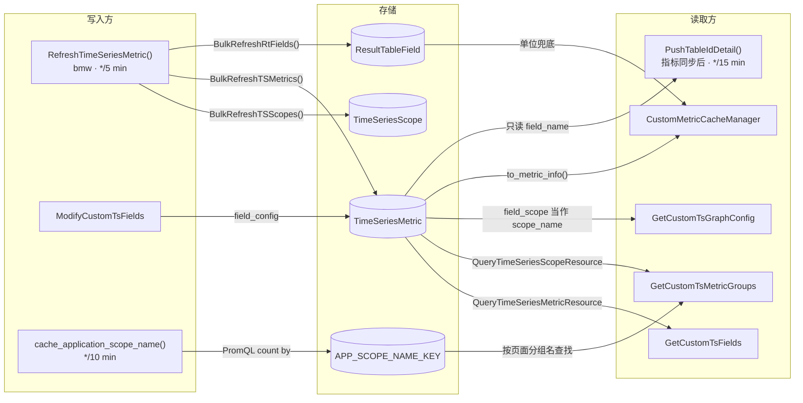

- *[1] 单位与描述只在 `to_metric_info()` 中合成，`field_config` 优先，`ResultTableField` 兜底。*
- *[2] 图表与分组视图只读 `field_config`。*
- *[3] SaaS 已保存视图按页面分组名加指标名还原选中的指标，再用当前的 `field_id` 请求图表，迁移必须保持指标项的 `field_id` 与所在分组不变。*

### b. 服务过滤的缺陷

APM 服务视图要回答「这个服务上报了哪些指标」，但这份事实没有存进任何表。现状由 `apm_web.tasks.cache_application_scope_name` 每 `10 min` 用 PromQL 扫描 VM（VictoriaMetrics），把 `(metric_name, scope_name, service_name)` 压缩后写入 Redis 白名单 `APP_SCOPE_NAME_KEY`，读取方再按页面分组名查询。这条链路有三类缺陷。

**按页面分组名查找**

白名单以 `scope_name` 为键，`monitor_web.scene_view.resources.custom_metric` 中的 `GetCustomTsMetricGroups` 却用指标所在的页面分组名查询，同模块的 `GetCustomTsDimensionValues` 收到的 `scope_name` 也是前端传入的分组名。用户把指标移入自建分组后，指标从服务视图消失，维度值为空。

**扫描结果不完整**

单次扫描受 `slimit 3000` 截断，按应用整体扫描时最大应用已触及 VM `500,000` 条上限。缓存未命中时 `apm_web.handlers.metric_group.helper.MetricHelper.get_monitor_info` 只回查最近 `5 min`，大应用与低频指标因此被隐藏。

**图表依赖 `field_scope`**

`monitor_web.scene_view.resources.custom_metric.GetCustomTsGraphConfig` 把 `field_scope` 当作 `scope_name` 过滤，单位只读 `field_config`。`field_scope` 一旦收敛为 `default`，图表就查不到数据，写在 `ResultTableField` 的单位也不会显示。

三类缺陷同源：服务与指标的关系没有存下来，只能从页面分组名或 VM 扫描间接推断。方案让 Collector 推送这份事实，bmw 按指标身份存入新表，服务视图、维度值与图表都改读新表。

### c. 指标项是热表

最直接的做法是把服务加入指标项身份，但 `TimeSeriesMetric` 是全平台共用的热表，周期任务反复整表读取，页面请求要求毫秒级响应。下表是 `1,000,000` 个指标项规模下的读取方，Go 路径相对 bmw 的 `pkg/bk-monitor-worker/`：

| 读取方 | 触发 | 读取范围 | 行数 | 实测 p50 |
| --- | --- | --- | --- | --- |
| `monitor_web.strategies.metric_list_cache.CustomMetricCacheManager` | 每 `10 min` | 全平台活跃指标项 *[1]* | `1,000,000` | `4.4 s` |
| `internal/metadata/task.RefreshTimeSeriesMetric` | 每 `5 min` | 每个数据源整组读取 `3` 次 | `3,000,000` | `83 ms` *[2]* |
| `internal/metadata/service.SpacePusher.PushTableIdDetail` | 每 `15 min` 及指标同步后 | 全部指标项的 `field_name` | `1,000,000` | 未压测 *[3]* |
| `monitor_web.custom_report.resources.metric.GetCustomTsFields` | 打开管理页 | 按名称排序取一页 | `50` | `15.4 ms` *[4]* |
| `monitor_web.scene_view.resources.custom_metric.GetCustomTsMetricGroups` | 打开指标树 | 最大数据源整组 | `19,440` | `83 ms` |
| `monitor_web.scene_view.resources.custom_metric.GetCustomTsGraphConfig` | 打开图表 | 按 `field_id` 取面板内的指标 | `≤ 50` | 未压测 *[5]* |

- *[1] 每个业务调用一次 `get_metric_info_list()`，p50 是全平台一轮的耗时。*
- *[2] p50 是最大数据源一次整组读取的耗时，新增与变更的指标项另行逐行写入。*
- *[3] 实际读表的是 `SpacePusher.batchQueryTsMetrics()`，只读 `field_name`，本方案不改变其结果。*
- *[4] 一次请求含 `1` 次计数与 `2` 次分页取数。*
- *[5] 按主键读取。*

服务进入身份后，每个指标项按上报它的服务各复制一份，上界规模下指标项从 `1,000,000` 行涨到 `40,091,444` 行。整表读取的周期任务要读的行数随之放大约 `40` 倍，最大数据源的管理页首页需 `1,133 ms`，服务关系另存窄表时只需 `15.6 ms`。

展开后再分表也不能缓解：热点数据源整组落在同一张分表，分 `16` 张表后最大数据源首页需 `1,387 ms`，比单表还慢 `22%`。因此指标项保持「数据源 × 指标名」一行，服务与指标的关系存入独立的窄表。

### d. 已有表的 DDL 风险

另一个直接做法是给指标项加列存放元信息，但线上发布的三个事实让已有表的 DDL 既慢又不可靠。

**迁移失败可能不阻断发布**

`bin/post-compile` 依次执行 `migrate` 且没有 `set -e`，后台库迁移在 `monitor_api.apps.MonitorAPIConfig.ready()` 中执行，除 `MigrateError` 外的异常只打印不抛出。PaaS 是否按 `post-compile` 退出码判定发布失败「待确认」，确认前必须假设新代码会跑在旧表结构上，下文把这种情形称为「迁移被吞」。

**加列要整表重建**

Django `4.2` 的最低数据库版本被补丁放宽到 MySQL `5.7`，平台必须兼容 `5.7`，而 `5.7` 没有 INSTANT 加列。`1,000,000` 行加 `5` 列时，`5.7` 整表重建需 `37.5 s`，`8.0` INSTANT 只需 `0.34 s`。`5.7` 也没有窗口函数、CTE 与多值索引，范围身份与写入语句都不依赖这些特性。

**ALTER 等锁期间读写全部排队**

`monitor_api` 库与 bmw 的连接都未设置 `lock_wait_timeout`，MySQL 默认值为 `31,536,000 s`。实测 `3 s` 长事务期间 ALTER 等待元数据锁，后续读写排队约 `2.7 s`。两项压测的明细见 [REPORT：MySQL 5.7 与 8.0](./REPORT.md#0x07-mysql-57-与-80)。

加列方案无论迁移成败都有代价。迁移被吞时新代码查询新列，全部指标项查询报 `1054`，迁移成功时热表又要整表重建并阻塞读写。因此元信息存入新表，已有表零 DDL，迁移失败只影响新功能。

### e. 现有写入代码的约束

新表由 Django 迁移创建、由 bmw 写入，两侧现有代码的以下行为决定了模型与写入细节：

| 现状 | 方案的应对 | 所在小节 |
| --- | --- | --- |
| bmw 的 gorm `v1.9.16` 插入时省略带 `default` 标签的零值字段，Django 建表不设库默认值 | 新表的 bmw 模型不声明 `default` 标签，上线前核实 `is_active` 是否带库默认值 *[1]* | 消费与写入、上线前置检查 |
| `internal/metadata/service.TimeSeriesMetricSvc.BulkUpdateMetricsByKeys` 忽略 `Delete()` 返回的错误 | 新表不建外键，避免删除被约束拦下后静默残留 | 数据模型与迁移 |
| bmw 的 DSN 字符集 `store.mysql.charset` 默认为 `utf8`，写不进四字节字符 | 写入前把四字节字符替换为 `U+FFFD` | 消费与写入 |
| Python 的 `metadata.models.custom_report.time_series.TimeSeriesGroup.is_enabled_data_scope` 与 Go 的 `internal/metadata/apiservice.BkdataService.QueryMetricAndDimension` 各自按 `metric_group_dimensions` 是否为空判定 BkBase v2 | 收敛时在改写指标项的同一事务内清空该列 | APM V2 收敛 |
| `internal/metadata/service.TimeSeriesMetricSvc.BulkMarkMetricsInactiveByFieldIDs` 立即失活本轮缺失的指标项，并刷新 `last_modify_time` | 收敛选保留项时活跃状态排在修改时间之前 | APM V2 收敛 |
| 迁移 `0251`、`0252` 发布后被修改过，bmw 在 Python 合入后当天到 `7 d` 内跟进 | 新迁移只含建表，版本共存覆盖 bmw 与迁移先后发布的两种顺序 | 版本共存 |

- *[1] Django `AddField` 会隐式删除库默认值，`0251` 只给 `field_scope`、`create_from` 补回，`is_active` 是否带库默认值「待确认」。*

源码依据见「代码依据」。

### f. 选型结论

前文的结论汇总如下，带链接的决策点可跳到 REPORT 的压测明细：

| 决策点 | 结论 | 理由 |
| --- | --- | --- |
| [指标项身份](./REPORT.md#a-展开与分表) | 按 `(group_id, field_name)` 唯一，`field_scope` 固定为 `default` | 服务进入身份后，上界规模指标项达 `40,091,444` 行 |
| [上报关系存储](./REPORT.md#0x05-上报关系存储) | 上报范围、范围标签、上报成员三张窄表 | 上界规模总体积 `7.9 GiB`，展开到指标项需 `30.5 GiB` |
| [分表](./REPORT.md#a-展开与分表) | 不分表 | 热点数据源整组落在同一张分表，分表后反而慢 `22%` |
| [按范围不同的元信息](./REPORT.md#e-按范围不同的取值) | 指标定义加稀疏例外，例外取值按指纹去重 | 按指标读取元信息只需 `66 ms`，体积稳定在 `5.8 GiB～6.2 GiB` |
| [元信息落点](./REPORT.md#0x06-元信息落点) | 独立定义表，按 `(group_id, field_name)` 关联指标项 | 已有表零 DDL，迁移被吞时只影响新功能 |
| 结果表字段复用 | 不复用 `ResultTableField` | 唯一键到字段，表达不了按范围的例外，写入后策略缓存立即生效也无法灰度 |
| 成员存储介质 | MySQL，不用 Redis | Redis 中的成员易失且无法按指标反查范围，bmw 也写不出 django-redis 的 pickle 格式 |
| [上报范围身份](./REPORT.md#b-__scope-表示) | 哈希唯一键加范围标签倒排 | `1,000` 个服务时按服务过滤 p50 为 `0.070 ms`，不依赖 `8.0` 多值索引 |
| 指标族存放 | 不存储，读取时由定义组装 | 族成员由原名与后缀确定，存储族只会多出一份需要同步的事实 |
| BkBase 指标发现 | 保留 v1 指标同步，废弃 v2 分组发现 | v2 分组键不含服务，无法按服务隔离 |

## 0x02 架构设计

指标项只认「数据源 × 指标名」，谁上报了它、上报了什么，由 Collector 元信息写入独立的事实表。

复杂度来自 V2 把 `scope_name` 写进了 `field_scope`。拿文件系统作比，`field_id` 是 inode，页面分组是目录，V2 把目录名编进了 inode 的身份。服务一旦加入，同一个文件要按服务复制出多个 inode，白名单又按目录名找文件，用户把文件移到别的目录就找不到了。

收敛点是 `MetricConfigResolver`：身份、上报事实与用户配置各存一处，有效配置只在解析器中合成。

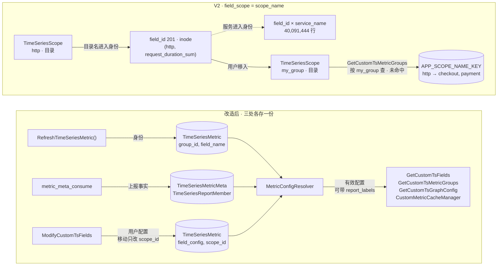

- *[1] 虚线是被否决的展开方案，服务并入 `field_scope` 后指标项行数等于上界规模的上报成员数。*
- *[2] 按服务覆盖的 `field_config` 写在成员上，同样属于用户配置，服务视图以 `report_labels` 传入 `service_name` 取得。*

### a. 对象模型

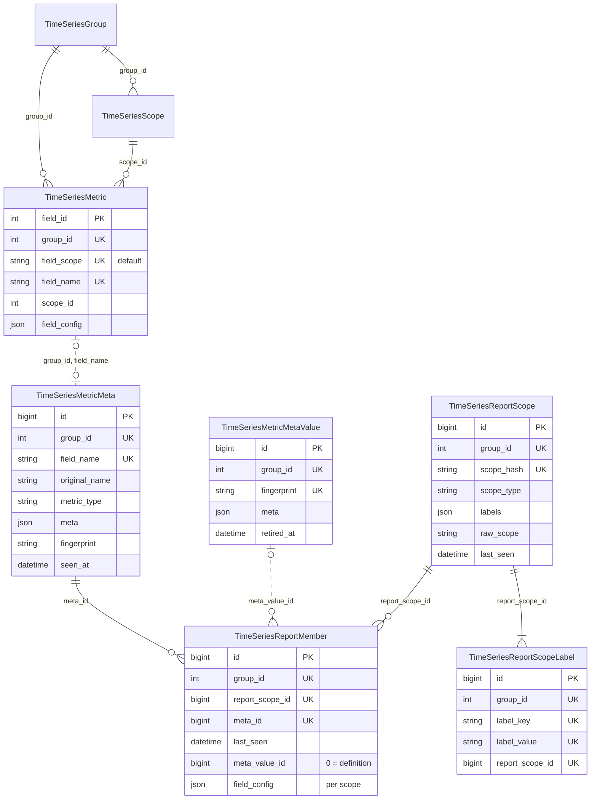

- *[1] 虚线是自然键或可为 `0` 的引用，不建外键，`TimeSeriesMetric` 与 `TimeSeriesScope` 表结构不变。*

写入方分三类：指标同步（bmw `RefreshTimeSeriesMetric()` 与 Python `TimeSeriesGroup.update_time_series_metrics()`）、元信息任务（bmw `MetricMetaSvc`）和用户（管理页写回）。

| 对象   | 模型                           | 一行表示                 | 写入方      |
| ---- | ---------------------------- | -------------------- | -------- |
| 指标项  | `TimeSeriesMetric`           | 数据源内的一个指标名 *[1]*     | 指标同步、用户  |
| 页面分组 | `TimeSeriesScope`            | 用户可见的一个指标分组 *[2]*    | 指标同步、用户  |
| 指标定义 | `TimeSeriesMetricMeta`       | 数据源内一个指标的元信息基线 *[3]* | 元信息任务    |
| 例外取值 | `TimeSeriesMetricMetaValue`  | 一种偏离定义的元信息 *[4]*     | 元信息任务    |
| 上报范围 | `TimeSeriesReportScope`      | 一个上报来源 *[5]*         | 元信息任务    |
| 范围标签 | `TimeSeriesReportScopeLabel` | 一个范围上的一个标签键值         | 元信息任务    |
| 上报成员 | `TimeSeriesReportMember`     | 一个范围上报的一个指标          | 元信息任务、用户 |

- *[1] 指标项同时保存用户配置与页面归属，`field_id` 是视图和链接引用的稳定 ID。*
- *[2] 页面分组只承载用户对指标的分组，不参与指标身份与元信息。*
- *[3] 定义不依赖指标项存在，元信息先于指标同步到达时也能落库。*
- *[4] 同一数据源内相同的元信息只存一条例外取值。*
- *[5] APM 的一个上报范围是一个服务的一个 `scope_name`，身份规则见「上报范围身份」。*

上报成员是唯一由两方写入的对象，字段按写入方划分：

| 字段 | 含义 | 写入方 |
| --- | --- | --- |
| `last_seen` | 最近一次上报的时间 | 元信息任务 |
| `meta_value_id` | 引用的例外取值 ID，`0` 表示与定义相同 | 元信息任务 |
| `field_config` | 只对该范围生效的用户配置 | 用户 |

### b. 元信息存储

每个指标在数据源内只存一份定义，某个范围的取值偏离定义时，才在该范围的成员上记一个例外。例外按指纹（`fingerprint`）去重存为例外取值，成员只保存定长的例外取值 ID，`0` 表示与定义相同，失去引用的例外取值由 `Compact()` 回收。

**示例**

`request_duration_sum` 由 `200` 个范围上报，其中 `search`、`billing` 仍用旧版 SDK，上报 `unit=ms`：

| 上报范围 | `request_duration_sum` | `order_total` |
| --- | --- | --- |
| `checkout` · `http` | · | · |
| `payment` · `http` | · | — |
| `search` · `http` | 例外取值 `#7` | — |
| `billing` · `http` | 例外取值 `#7` | — |
| 其余 `196` 个范围 | · | · |
| **定义** | `unit=s`、`description=请求耗时` | `unit=none` |

- *[1] `·` 表示与定义相同，`—` 表示未上报，例外取值 `#7` 为 `unit=ms`、`description=请求耗时`。*

落到存储后，`200` 个成员只对应 `1` 条定义和 `1` 条例外取值：

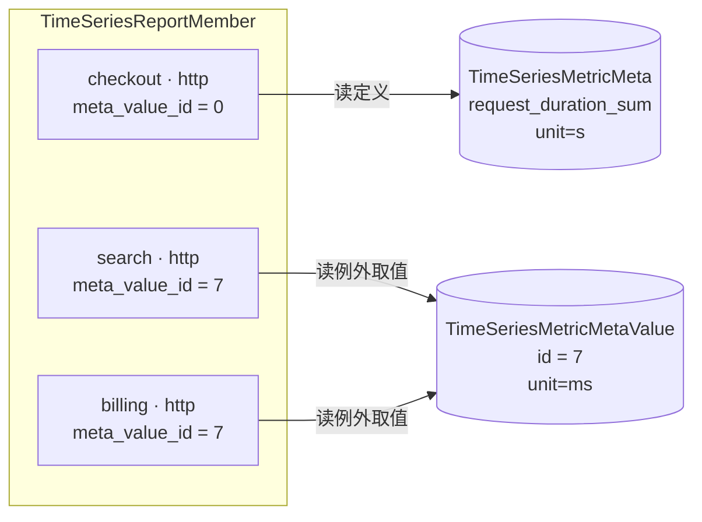

- *[1] 每个成员都以 `meta_id` 指向定义，图中只画解析时读取的引用。*
- *[2] `payment` 与其余 `196` 个范围同 `checkout`，图中省略。*
- *[3] 例外取值与用户配置、表级兜底的先后见「有效配置解析」。*

**写入**

`MetricMetaSvc.Apply()` 逐条比较上报与定义的指纹（`meta` 规范 JSON 的 MD5），带范围的记录指纹不同才产生例外：

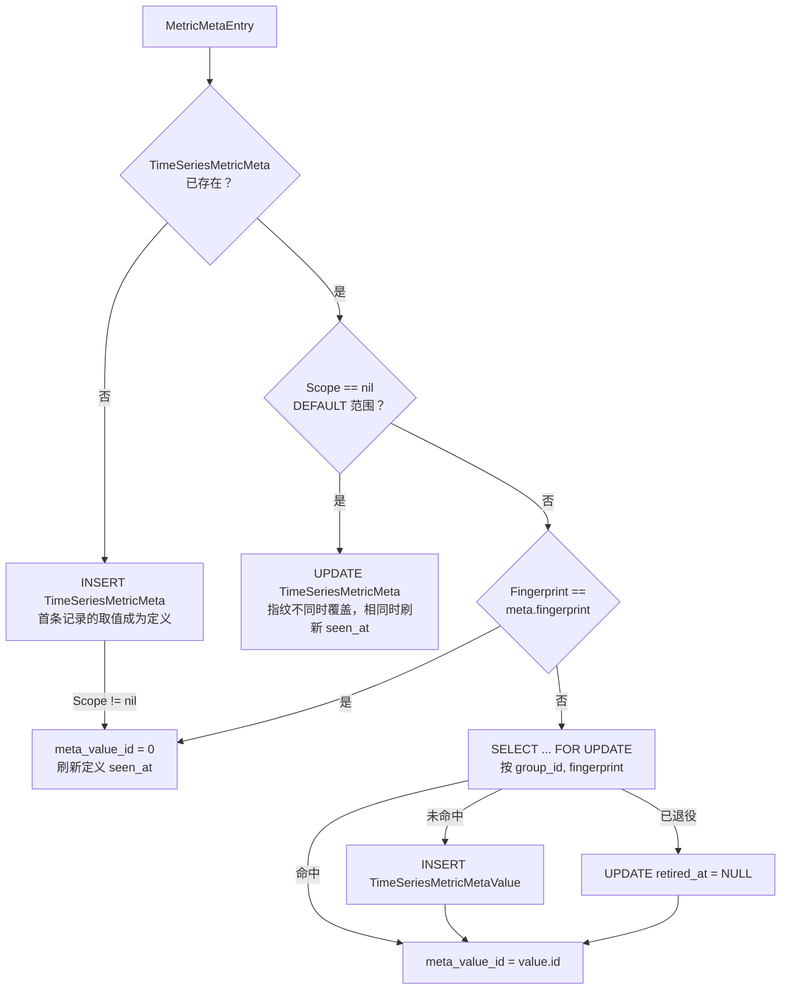

- *[1] 同值例外命中同一条例外取值，`search` 与 `billing` 都指向 `#7`。*
- *[2] 一个数据源的一批记录在同一个事务内写入，`SELECT ... FOR UPDATE` 的行锁持续到提交。*
- *[3] 成员引用未变时 `last_seen` 的刷新节流见「消费与写入」。*

**例外取值回收**

例外取值不存引用计数，`MetricMetaSvc.Compact()` 每 `1 h` 逐数据源扫描成员，统计每条例外取值的引用。无引用的例外取值先退役，退役超过 `valueRetireGrace` 后仍无引用才删除：

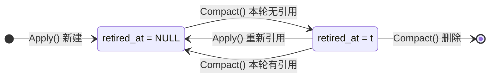

- *[1] `t` 是退役时刻，`Compact()` 只删除 `t` 早于 `now - valueRetireGrace` 且本轮仍无引用的例外取值。*
- *[2] 同一轮 `Compact()` 还处理成员过期、悬空引用修复以及上报范围与定义的回收，规则见「整理」。*

回收对并发写入提供三条保证：

- 例外取值从退役到删除至少间隔 `valueRetireGrace`，默认 `1h`，不小于 `Compact()` 周期。
- 扫描开始后新建的例外取值不参与本轮回收，以扫描开始时例外取值的最大 ID 为界。
- `Apply()` 刚引用的例外取值不会被 `Compact()` 删除，两者争同一行锁时的先后见下图。

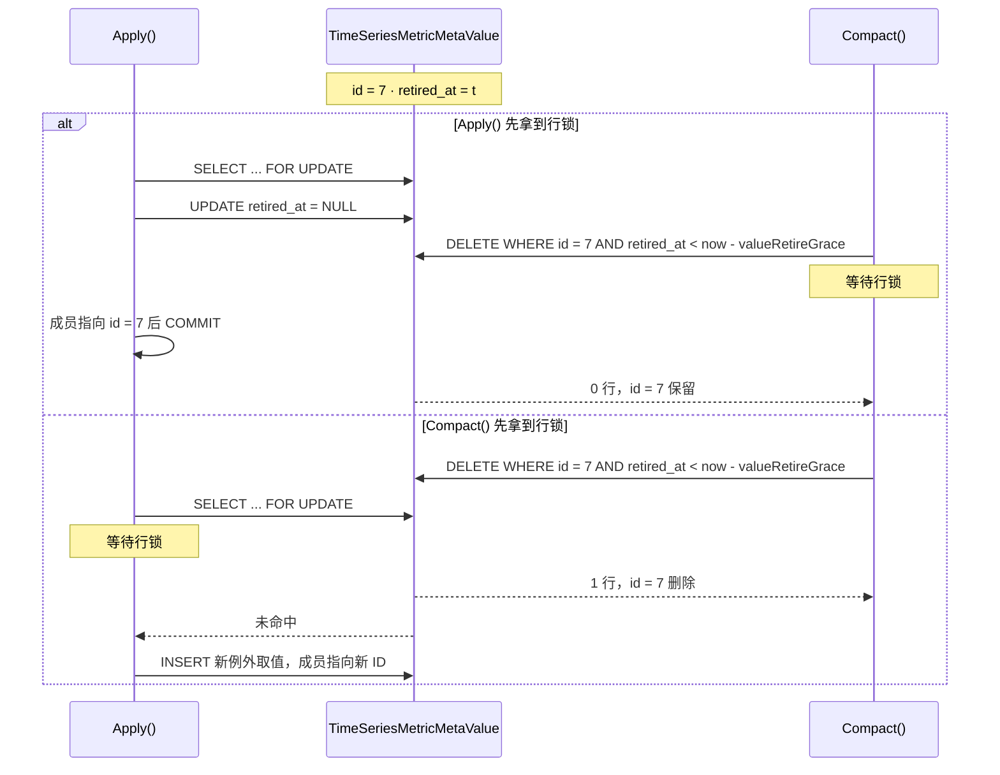

- *[1] `DELETE` 带与回收判定相同的 `retired_at` 条件，两种先后下成员都指向存在的例外取值。*

**重设基线**

定义的 `seen_at` 超过 `6 h` 未刷新且存在例外时，`Compact()` 把引用最多的例外取值晋升为定义，并把指向它的成员置 `0`。新版 SDK 把 `description` 改为 `HTTP 请求耗时` 后逐个服务升级：

| 阶段 | 定义 | 例外取值 | 成员 |
| --- | --- | --- | --- |
| 服务逐个升级 | 仍为 `description=请求耗时` | 新增 `#9`，`description=HTTP 请求耗时` | 已升级的成员引用 `#9`，`search`、`billing` 仍引用 `#7` |
| 旧定义超过 `6 h` 无人上报 | 改为 `#9` 的内容 | `#9` 失去引用，先退役，满 `valueRetireGrace` 后由 `Compact()` 删除 | 指向 `#9` 的成员置 `0` |
| `search`、`billing` 最后升级 | 不变 | `#7` 失去引用，先退役，满 `valueRetireGrace` 后由 `Compact()` 删除 | 两个成员置 `0` |

- *[1] `6 h` 是 Collector 强制补报周期 `2 h` 的 `3` 倍，持续上报的定义不会被误切换。*
- *[2] 晋升在一个事务内更新定义并清零扫描到的引用，每个范围解析出的取值前后不变。*
- *[3] 晋升后才写入的引用仍指向 `#9`，解析结果与新定义相同，下一次补报时置 `0`。*

**为什么这样存**

四种存法在同一数据集（`1,500,000` 个成员）上实测，体积按每成员字节数外推到上界规模，例外比例取 `1%` 档：

| 存法 | 成员保存 | 按指标读取 | 全体改值后体积 |
| --- | --- | --- | --- |
| 每范围一份 | 完整取值 | `940 ms` *[1]* | `13.5 GiB` |
| 内容寻址 | 按指纹去重的取值 ID | `709 ms` *[1]* | `5.8 GiB` |
| 定义加内联例外 | 偏离定义时的完整取值 | `63 ms` | `11.2 GiB` |
| **定义加例外引用** | **偏离定义时的例外取值 ID** | **`66 ms`** | **`5.9 GiB`** |

选定「定义加例外引用」，排除其余三种的理由如下：

- **排除每范围一份与内容寻址**：管理页、指标缓存与策略选择器都按指标读取元信息，没有定义行时只能对成员计票，耗时是有定义行存法的 `11` 倍～`15` 倍。
- **排除定义加内联例外**：全体改值让内联例外的成员行变宽而页分裂，`Compact()` 清空例外后 InnoDB 不归还页，成员表停在 `11.2 GiB` 的高水位。
- **代价**：单范围读取从内联例外的 `39 ms` 增加到 `64 ms`，无引用的例外取值也需要回收。

- *[1] 例外比例 `50%` 时计票失去多数，只有约一半指标的计票结果等于定义。*
- *[2] 耗时在 `20,000` 个指标 × `50` 个范围的大数据源上测量，全体改值把其中 `1,000,000` 个成员的单位从 `ms` 改为 `s` 并完成 `Compact()`。*
- *[3] 每个指标的例外只有一种取值，是去重最有利的情形，例外取值彼此不同时去重收益消失。*
- *[4] 线上例外比例取决于各服务的 SDK 版本分布，尚无数据，成员表又是新表，现在选定长引用可以避免日后对大表做 DDL。*
- *[5] 三档明细、单范围读取与写入耗时见 [REPORT：按范围不同的取值](./REPORT.md#e-按范围不同的取值)。*
- *[6] 四种存法每批 `1,000` 条上报的写入 p50 在 `6.59 ms～13.65 ms`，均低于「性能基线」的 `50 ms` 上限。*

### c. 上报范围身份

Collector 记录携带范围类型（`__scope_type`）与范围值（`__scope`），协议保持不变。bmw 按范围类型注册解码器，把范围值还原为标签，再以「范围类型 + 规范标签串」的哈希作为范围身份。

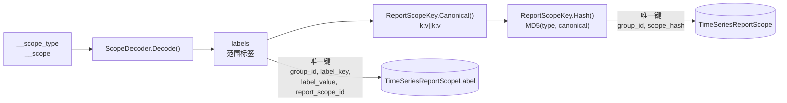

- *[1] 规范标签串按键名升序拼接 `k:v`，以 `||` 连接，标签值含 `||` 时拒收。*
- *[2] 哈希定长，规范串再长也不受索引长度限制。*
- *[3] 原始范围值保存在 `TimeSeriesReportScope.raw_scope`，供排障使用。*
- *[4] 每个数据源最多 `2,000` 个上报范围、`1,200,000` 个上报成员，超限时丢弃新范围并计数。*
- *[5] 上限用于防止 Pod 名等高基数标签进入范围。*

| 范围类型 | 范围值示例 | 解码后的标签 |
| --- | --- | --- |
| `APM` | `checkout-http%2Dclient` *[1]* | `service_name=checkout`、`scope_name=http-client` *[2]* |
| `DEFAULT` | `""` | 无 *[3]* |
| 其他 | 无 *[4]* | `scope=<原值>` |

- *[1] 服务名与 scope 各自把 `%` 转为 `%25`、`-` 转为 `%2D`，再用 `-` 连接。*
- *[2] 应用由 DataID 确定，`app_name` 不进入标签。*
- *[3] `DEFAULT` 不建上报范围，元信息直接作用于定义。*
- *[4] 其他类型的编码由上报方定义「待确认」，未注册解码器时整个范围值写入 `scope` 标签。*

范围哈希回答「这个范围是谁」，范围标签按标签值倒排，回答「哪些范围带这个标签」：

| 查询 | 条件 | 结果 | 索引 |
| --- | --- | --- | --- |
| 按范围精确定位 | `group_id`、`scope_hash` | 上报范围 | 范围唯一键 |
| 按标签过滤 | `group_id`、`label_key`、`label_value` | 上报范围 ID | 标签唯一键（覆盖索引） |
| 按范围取指标 | `group_id`、`report_scope_id` | 上报成员 | 成员唯一键前缀 |
| 按指标取范围 | `group_id`、`meta_id` | 上报成员 | 成员二级索引 |

### d. 写入链路

Collector 把元信息批量写入专用 DataID，由 bmw 常驻任务消费并按记录的 `dataid` 聚批写入。bmw 周期任务每 `1 h` 整理一次，负责回收与重设基线。

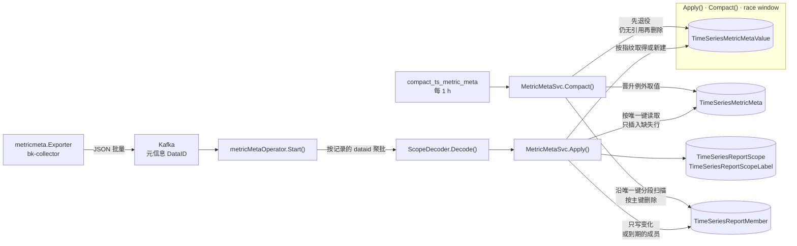

- *[1] `Race` 子图标出 `Apply()` 与 `Compact()` 争用的例外取值，两种先后顺序的结果见「元信息存储」的例外取值回收时序图。*

### e. 页面归属

页面归属只在指标同步创建指标项时决定，此后只由用户修改。新指标按以下顺序取第一个命中的分组：

```text
分组提示（成员标签按分组维度拼出分组名） → 用户分组 auto_rules → 默认分组
```

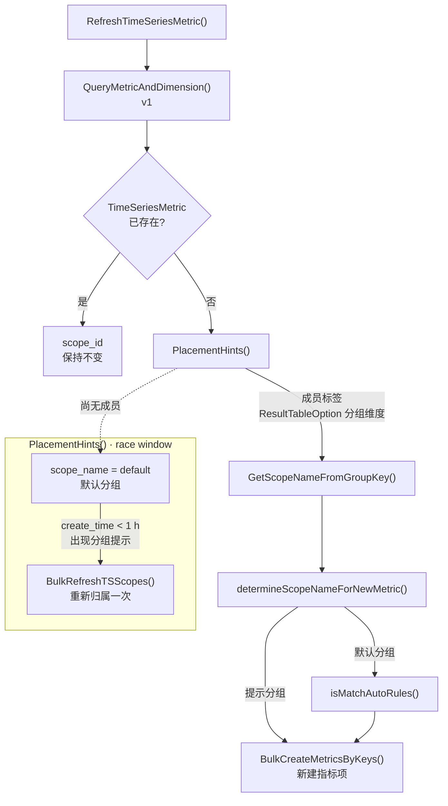

- *[1] 顺序沿用现有语义：数据带分组信息时直接使用，不带时才匹配 `auto_rules`。*
- *[2] 分组提示取代原来的「数据带分组信息」。*
- *[3] 分组维度只保存在 `ResultTableOption(metric_group_dimensions)`，默认分组判定与分组名拼接都读这一份。*
- *[4] `TimeSeriesGroup.metric_group_dimensions` 只保留 v2 开关语义，收敛后为空。*
- *[5] 一个指标有多个上报范围时，取成员数最多的分组名，相同时按名称升序。*
- *[6] `Race` 子图表示元信息晚于指标同步到达，新指标项先进入默认分组，`1 h` 内出现分组提示时再重新归属一次。*

### f. 有效配置解析

`MetricConfigResolver` 是有效配置的唯一计算入口。读取方可传入范围标签（`report_labels`），例如 APM 服务视图传入 `service_name`。每个配置项按以下顺序取第一个已设置的值：

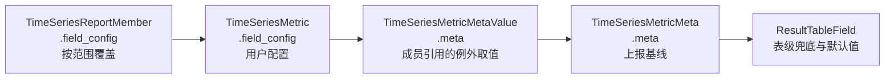

- *[1] 成员相关的两级（按范围覆盖与例外取值）只在传入 `report_labels` 时参与，未传时从 `TimeSeriesMetric.field_config` 开始。*

为什么用户配置排在上报例外之前？

- 用户显式修改的值必须稳定，不随 Collector 升级或补报改变。
- 上报例外只表达「这个范围报得不一样」，不表达用户意图。

| 配置项 | 用户配置键 | 上报元信息 | 兜底 |
| --- | --- | --- | --- |
| 单位 | `unit` | `meta.unit` *[3]* | `ResultTableField.unit` |
| 描述 | `alias` | `meta.description` | `ResultTableField.description` |
| 汇聚方法 | `aggregate_method` | `meta.usage` *[4]* | `AVG` |
| 函数 | `function` | `meta.temporality` *[5]* | `[]` |
| 聚合周期 | `interval` | `meta.interval` *[6]* | `auto` |

- *[1] 键不存在，或值为 `""`、`0`、`[]` 时视为未设置。*
- *[2] 管理页整包回写时 `MetricConfigResponseDTO` 会补齐这三种值，它们不能覆盖上报值。*
- *[3] 单位映射把 UCUM 单位转为 `core/unit` 已注册的 ID（`us → µs`、`min → m`、`By → bytes`、`1 → none`、`% → percent` 等），未命中时不采用。*
- *[4] `meta.usage` 是 Collector 给出的默认汇聚操作（`sum`、`min`、`max`、`avg`、`last`），到汇聚方法的映射表「待确认」。*
- *[5] 时间性为 `cumulative` 的 Counter 补 `increase`。*
- *[6] `meta.interval` 的单位是毫秒，解析时转为秒。*

### g. 读取路径

| 读取场景 | 改造前 | 改造后 |
| --- | --- | --- |
| 服务视图过滤 | 按页面分组名查 Redis 白名单 | 按上报成员的指标名过滤 *[1]* |
| 图表查询条件 | `scope_name` 取 `field_scope` | `scope_name` 取该服务成员的 `scope_name` 集合 *[2]* |
| 维度值查询条件 | `scope_name` 取页面分组名 | `scope_name` 按 `field_id` 套用图表的规则 |
| 管理页 | 分页读取指标项 | 分页读取指标项并关联定义 *[3]* |
| 指标树 | 整组读取指标项 | 整组读取指标项并关联定义 *[4]* |
| 指标缓存与策略选择器 | 单位只取用户配置与表级字段 | 全量预取定义以补齐上报的单位与描述 |

- *[1] 过渡期与 Redis 白名单取并集。*
- *[2] 只在 `field_scope` 为 `default` 时改取成员集合，未收敛的数据源仍取 `field_scope`。*
- *[3] 族视图按节点分页，一个节点是一个族或一个独立指标。*
- *[4] 族在内存中组装，规则见「指标族与复合视图」。*

### h. 指标族与复合视图

指标族在读取时由定义组装，不新增存储对象。族成员必须同时满足：

```text
同一数据源
  └─ 同一页面分组（scope_id）
      └─ 定义中 original_name 相同，metric_type = histogram
          └─ field_name = 规范化原名 + _sum / _count / _bucket / _min / _max
```

- *[1] 规范化原名把 `.` 替换为 `_`，后缀决定族成员的角色。*
- *[2] 缺少某个族成员时，只禁用依赖它的统计方法。*
- *[3] 族成员被单独移到其他页面分组后，两侧按各自的分组重新组族。*

族面板沿用现有图表协议：一个面板对应一个族，每个统计方法是一个 target，`target.alias` 标出方法名。现有协议中单指标 target 的 `alias` 恒为空串，`alias` 非空即可识别复合面板，不需要新增字段。

| 方法 | 族成员 | 表达式 | 单位 |
| --- | --- | --- | --- |
| `AVG` | `_sum`、`_count` | `b == 0 or a / b` | `_sum` 的单位 |
| `SUM` | `_sum` | `a` | `_sum` 的单位 |
| `COUNT` | `_count` | `a` *[1]* | `none` |
| `P50`、`P90`、`P95`、`P99` *[2]* | `_bucket` | `histogram_quantile(φ, sum by(G, le)(a))` *[3]* | `_sum` 的单位 |
| `Pxx` *[4]* | `_bucket` | `histogram_quantile(φ, sum by(G, le)(a))` | `_sum` 的单位 |

- *[1] `COUNT` 对 `_count` 求和，不用 `method: COUNT`，后者统计的是样本点数而不是请求次数。*
- *[2] `φ` 依次为 `0.5`、`0.9`、`0.95`、`0.99`。*
- *[3] `G` 为族成员维度的交集去掉 `le`，只有 `_bucket` 的查询追加 `le`。*
- *[4] `Pxx` 是用户自定义的分位，`φ` 由用户输入，满足 `0 < φ < 1`。*

| 时间性 | 时间聚合 | 窗口 |
| --- | --- | --- |
| `delta` | `sum_over_time` *[1]* | 当前周期 |
| `cumulative` | `increase` *[2]* | `max(当前周期, 2 × 上报周期)` |

- *[1] 族成员的查询一律写 `method: SUM`，由后端生成 `sum_over_time`。*
- *[2] cumulative 在 `functions` 前置 `increase`，替换 `sum_over_time`。*
- *[3] 族成员不继承各自的 `aggregate_method` 与 `function`。*
- *[4] 若继承，族成员自带的 `increase` 与 cumulative 前置的 `increase` 重复，会触发 `MultipleTimeAggregateFunctionError`。*
- *[5] cumulative 下 `increase` 对 `_sum` 成立的前提是观测值非负，时长与字节都满足。*

族视图关闭 Top/Bottom，因为按查询各自排名会裁掉部分桶。指标对比模式下不组族，族成员按单指标出图。

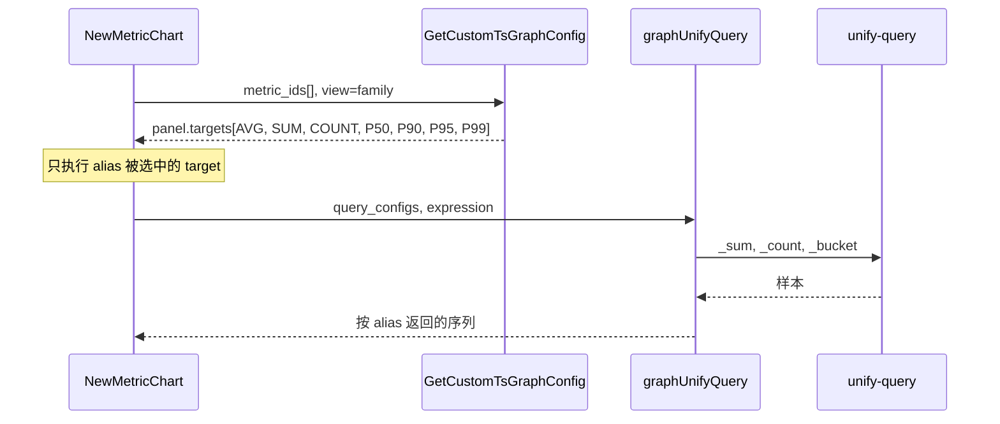

## 0x03 开发方案 —— Metadata 存储、解析与查询

### a. 数据模型与迁移

`bkmonitor/metadata/models/custom_report/metric_meta.py`（新增）、`bkmonitor/metadata/migrations/0278_metric_meta.py`（新增）

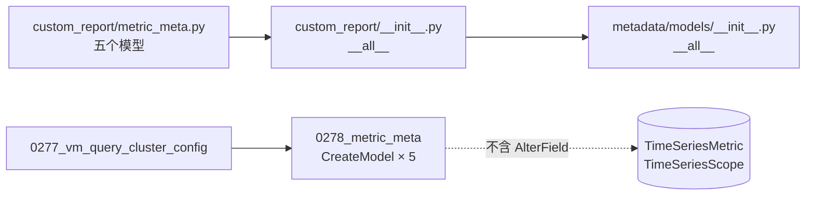

```python
class TimeSeriesMetricMeta(models.Model):  # 指标定义
    id = models.BigAutoField(primary_key=True)
    group_id = models.IntegerField()
    # 与 TimeSeriesMetric.field_name 同为 utf8_bin，关联时不需要 CONVERT，其余索引文本列同此
    # 不用 utf8mb4：COMPACT 行格式的索引前缀上限为 767 B
    #     varchar(255) 在 utf8 下占 765 B，在 utf8mb4 下建索引报 1071
    field_name = models.CharField(max_length=255, db_collation="utf8_bin")
    original_name = models.CharField(max_length=255, db_collation="utf8_bin")
    metric_type = models.CharField(max_length=16)
    # 可空：5.7 上非空 JSON 列不能有默认值，8.0 上非空 JSON 列不支持 INSTANT，其余 JSON 列同此
    meta = models.JSONField(null=True)
    # 元信息规范 JSON 的 MD5，哈希列用 ascii_bin
    fingerprint = models.CharField(max_length=32, db_collation="ascii_bin")
    # 最近一次收到与定义相同元信息的时间，超过 6 h 且存在例外时由 Compact 重设基线
    seen_at = models.DateTimeField()

    class Meta:
        unique_together = ("group_id", "field_name")
        indexes = [models.Index(fields=["group_id", "original_name"])]


class TimeSeriesMetricMetaValue(models.Model):  # 例外取值
    id = models.BigAutoField(primary_key=True)
    group_id = models.IntegerField()
    fingerprint = models.CharField(max_length=32, db_collation="ascii_bin")
    meta = models.JSONField(null=True)
    # 退役时刻：Compact 发现无引用时写入，Apply 重新引用时清空
    # 退役超过 valueRetireGrace 且仍无引用时删除
    retired_at = models.DateTimeField(null=True)

    class Meta:
        # 同一数据源内相同元信息只存一行
        unique_together = ("group_id", "fingerprint")


class TimeSeriesReportScope(models.Model):  # 上报范围
    id = models.BigAutoField(primary_key=True)
    group_id = models.IntegerField()
    # MD5(范围类型, 规范标签串)，定长，标签串变长时不受索引长度限制
    scope_hash = models.CharField(max_length=32, db_collation="ascii_bin")
    scope_type = models.CharField(max_length=32)
    labels = models.JSONField(null=True)
    # Collector 上报的原始 __scope，只供排障
    raw_scope = models.CharField(max_length=512)
    last_seen = models.DateTimeField()

    class Meta:
        unique_together = ("group_id", "scope_hash")


class TimeSeriesReportScopeLabel(models.Model):  # 范围标签
    id = models.BigAutoField(primary_key=True)
    group_id = models.IntegerField()
    label_key = models.CharField(max_length=64, db_collation="utf8_bin")
    # 与 TimeSeriesScope.scope_name 同为 utf8_bin，按分组名关联时不需要 CONVERT
    label_value = models.CharField(max_length=255, db_collation="utf8_bin")
    report_scope_id = models.BigIntegerField()

    class Meta:
        # 按标签过滤范围时作覆盖索引
        unique_together = ("group_id", "label_key", "label_value", "report_scope_id")


class TimeSeriesReportMember(models.Model):  # 上报成员
    id = models.BigAutoField(primary_key=True)
    group_id = models.IntegerField()
    report_scope_id = models.BigIntegerField()
    meta_id = models.BigIntegerField()
    # 最近一次上报时间，不建 (group_id, last_seen) 索引
    # 过期回收沿成员唯一键分段扫描，上界规模省 1,123 MiB
    last_seen = models.DateTimeField()
    # 例外取值 ID，0 表示与定义相同
    # 存 ID 不内联元信息：成员行定长，例外增减都是原地更新，不会页分裂
    # 不建索引：晋升与回收在成员唯一键分段扫描中顺带统计引用
    meta_value_id = models.BigIntegerField(default=0)
    # 只对该范围生效的用户配置，由管理页写回
    field_config = models.JSONField(null=True)

    class Meta:
        unique_together = ("group_id", "report_scope_id", "meta_id")
        indexes = [models.Index(fields=["group_id", "meta_id"])]
```

五个模型共同遵守两条约束：

**（1）主键显式声明为 `BigAutoField`**

全局 `DEFAULT_AUTO_FIELD` 是 `AutoField`，省略 `id` 会得到上限 `2,147,483,647` 的 `int` 主键。upsert 即使整批行都已存在，也按批大小消耗自增 ID，`int` 主键会被提前耗尽。

**（2）关联列声明为整数，不用 `ForeignKey`**

`meta_id`、`report_scope_id`、`meta_value_id` 只保存对方主键，`meta_value_id` 还用 `0` 表示与定义相同，本就无法建外键。bmw 会丢弃删除语句的错误，外键约束一旦拦下删除，行就会静默残留。

Bad：

```python
# 库中生成外键约束，bmw 删除定义被约束拦下时错误被丢弃
meta = models.ForeignKey(TimeSeriesMetricMeta, on_delete=models.CASCADE)
```

Good：

```python
# 只保存定义主键，库中没有外键约束
meta_id = models.BigIntegerField()
```

**bk-monitor**

| 变更点 | 目标 |
| --- | --- |
| **[Add]** `metadata.models.custom_report.metric_meta` | 声明五个模型、`MetricConfigResolver`、`metric_family_of()` 与 `placement_hints()` |
| **[Change]** `metadata.models.custom_report.__all__`<br />`metadata.models.__all__` | 导出五个模型 |
| **[Add]** `metadata/migrations/0278_metric_meta.py` | 创建五张新表，只含五个 `CreateModel` *[1]* *[2]* |
| **[Add]** `metadata.models.result_table.ResultTableOption.OPTION_ENABLE_METRIC_METADATA` | 声明数据源选项 `enable_metric_metadata`，打开后 bmw 才写入该数据源的元信息 *[3]* *[4]* |

- *[1] 迁移依赖 `0277_vm_query_cluster_config`，编号以合入时为准。*
- *[2] 代码中 `ResultTableOption.name` 的 `choices` 已含 `databus_prefer_cluster` 而历史迁移没有，`makemigrations` 会顺带生成一条 `AlterField`，需要手工剔除「待确认」。*
- *[3] 该选项按结果表写入 `ResultTableOption`，不属于 `global_config.py` 的 `ADVANCED_OPTIONS` 或 `STANDARD_CONFIGS`，未写入时视为关闭。*
- *[4] 该选项不加入 `name` 的 `choices`，与 `OPTION_METRIC_GROUP_DIMENSIONS` 一致，加入会让迁移多出 `AlterField`「待确认」。*

**bmw**

| 变更点 | 目标 |
| --- | --- |
| **[Add]** `internal/metadata/models.OptionEnableMetricMetadata` | 声明与 Python 侧同值的选项名，供写入前判定数据源是否打开接收 *[1]* |

- *[1] 常量写在 `internal/metadata/models/constants.go` 的 `ResultTableOption` 常量块，命名沿用 `OptionQueryRouterConfig` 的驼峰惯例。*

### b. 有效配置解析器

`bkmonitor/metadata/models/custom_report/metric_meta.py`

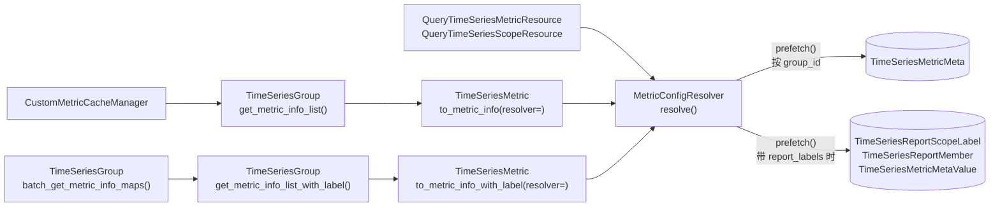

```python
RESOLVED_KEYS = ("unit", "alias", "aggregate_method", "function", "interval")
UNSET_VALUES = (None, "", 0, [])


class MetricConfigResolver:
    def __init__(self, group_id: int, report_labels: dict[str, str] | None = None) -> None: ...

    def prefetch(self, field_names: Iterable[str] | None = None) -> None:
        # [1] 按 group_id 一次读取定义，带 report_labels 时再按标签倒排取范围、按成员唯一键前缀取成员
        #     成员的非零 meta_value_id 去重后按主键一次读取例外取值
        ...

    def resolve(self, metric: TimeSeriesMetric, rt_field: dict[str, Any] | None) -> dict[str, Any]:
        # [2] RESOLVED_KEYS 逐键按「成员 field_config → 指标项 field_config → 例外取值 → 定义 meta → rt_field」回落
        #     例外取值缺失时视为与定义相同，由 bmw Compact 修复引用
        # [3] 值属于 UNSET_VALUES 时继续下一级，多个成员命中时取 last_seen 最近的一个
        ...

    def report_scopes(self, field_name: str) -> list[dict[str, str]]:
        # [4] 返回命中 report_labels 的范围标签，未带 report_labels 时返回 []
        ...


def metric_family_of(meta: TimeSeriesMetricMeta | None, field_name: str) -> dict[str, str] | None:
    # [5] histogram 且后缀可识别时返回 {"original_name", "role"}，否则返回 None
    ...
```

| 变更点 | 目标 |
| --- | --- |
| **[Change]** `metadata.models.custom_report.time_series.TimeSeriesMetric.to_metric_info` | 改从 `resolver.resolve()` 读取 `description` 与 `unit` *[1]* |
| **[Change]** `metadata.models.custom_report.time_series.TimeSeriesMetric.to_metric_info_with_label` | 改从 `resolver.resolve()` 读取 `description` 与 `unit` *[1]* |
| **[Change]** `metadata.models.custom_report.time_series.TimeSeriesGroup.get_metric_info_list` | 构造该数据源的解析器并预取，传给逐指标的 `to_metric_info()` |
| **[Change]** `metadata.models.custom_report.time_series.TimeSeriesGroup.get_metric_info_list_with_label` | 构造该数据源的解析器并预取，传给逐指标的 `to_metric_info_with_label()` |
| **[Change]** `metadata.models.custom_report.time_series.TimeSeriesGroup.batch_get_metric_info_maps` | 增加返回值 `resolver_by_group`，定义按 `group_id__in` 分页预取 |

- *[1] 新增关键字参数 `resolver: MetricConfigResolver | None`，未传时按单指标构造解析器。*

### c. 查询与写入接口

`bkmonitor/metadata/resources/resources.py`、`bkmonitor/api/metadata/default.py`、`bkmonitor/packages/monitor_web/custom_report/handlers/metric/query.py`

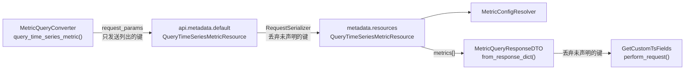

新增参数和字段要在四处同时声明，漏掉任何一处都会被静默丢弃：

- SaaS 转换器拼装的请求参数
- SaaS `api.metadata.default` 的 `RequestSerializer`
- Metadata `metadata.resources` 的 `RequestSerializer`
- SaaS 解析响应的 DTO

```json
{
  "field_id": 201,
  "name": "request_duration_sum",
  "field_scope": "default",
  "scope": {"id": 12, "name": "http", "create_from": "data"},
  "field_config": {},
  "meta": {"original_name": "request.duration", "metric_type": "histogram", "unit": "s", "description": "请求耗时", "is_exception": false},
  "family": {"key": {"scope_id": 12, "original_name": "request.duration"}, "role": "sum"},
  "effective_config": {"unit": "s", "alias": "请求耗时", "aggregate_method": "SUM", "function": [], "interval": 60},
  "report_scopes": [{"service_name": "checkout", "scope_name": "http"}]
}
```

| 字段 | 类型 | 必填 | 说明 |
| --- | --- | --- | --- |
| `metrics[].scope.create_from` | `string` | 是 | 页面分组的创建来源，取 `data`、`user` 或 `default` *[1]* |
| `metrics[].meta` | `object \| null` | 是 | 上报元信息，没有元信息时为 `null` *[2]* |
| `metrics[].meta.is_exception` | `bool` | 是 | 取自例外取值时为 `true` |
| `metrics[].family` | `object \| null` | 是 | 所属指标族，不是族成员时为 `null` *[3]* |
| `metrics[].family.role` | `string` | 是 | 族成员角色，取 `sum`、`count`、`bucket`、`min` 或 `max` |
| `metrics[].effective_config` | `object` | 是 | 有效配置，键为 `RESOLVED_KEYS` |
| `metrics[].report_scopes[]` | `array<object>` | 否 | 命中 `report_labels` 的范围标签 *[4]* |

- *[1] `GetCustomTsFields.get_movable()` 据此判断指标能否移出当前分组。*
- *[2] 请求带 `report_labels` 且命中例外时取成员引用的例外取值，否则取定义。*
- *[3] 由 `metric_family_of()` 计算，`family.key` 由 `scope_id` 与 `original_name` 组成。*
- *[4] 只在请求带 `report_labels` 时返回，为空表示该范围没有上报这个指标。*

| 变更点 | 目标 |
| --- | --- |
| **[Change]** `metadata.resources.resources.QueryTimeSeriesMetricResource.RequestSerializer` | 新增可选参数 `report_labels` 与 `view` *[1]* |
| **[Change]** `metadata.resources.resources.QueryTimeSeriesMetricResource.perform_request` | [a] 输出每项的 `meta`、`family`、`effective_config`、`report_scopes` 与 `scope.create_from`<br />[b] 支持 `view=family` *[2]* |
| **[Change]** `metadata.resources.resources.QueryTimeSeriesScopeResource` | 接收 `report_labels`，并在 `metric_list[]` 每项附上 `family` 与 `report_scopes` *[3]* |
| **[Change]** `metadata.resources.resources.CreateOrUpdateTimeSeriesMetricResource` | 接收 `report_labels`，把 `field_config` 写到命中范围的成员上 *[4]* |
| **[Change]** `api.metadata.default.QueryTimeSeriesMetricResource` | 声明 `report_labels` 与 `view`，原样透传给 Metadata |
| **[Change]** `api.metadata.default.QueryTimeSeriesScopeResource` | 声明 `report_labels`，原样透传给 Metadata |
| **[Change]** `api.metadata.default.CreateOrUpdateTimeSeriesMetricResource` | 声明 `report_labels`，原样透传给 Metadata |
| **[Change]** `monitor_web.custom_report.handlers.metric.query.MetricQueryConverter.query_time_series_metric` | 加入 `report_labels` 与 `view` 两个请求参数 *[5]* |
| **[Change]** `monitor_web.custom_report.handlers.metric.query.MetricQueryResponseDTO` | 解析 `metrics[]` 新增的四个字段，并把 `scope.create_from` 平铺为 `scope_create_from`，缺失时置 `None` *[6]* |
| **[Change]** `monitor_web.custom_report.handlers.metric.query.ScopeQueryMetricResponseDTO` | 解析 `metric_list[]` 新增的 `family` 与 `report_scopes`，缺失时置 `None` |

- *[1] `report_labels` 为 `DictField`，`view` 取 `metric` 或 `family`，默认 `metric`。*
- *[2] 节点划分、计数与排序见「族视图与 Histogram 复合面板」。*
- *[3] Metadata 侧只附加字段，不按 `report_labels` 过滤指标。*
- *[4] 命中的范围没有上报该指标时返回校验错误。*
- *[5] `ScopeQueryConverter.query_time_series_scope()` 同样逐个拼装参数，是否随之透传 `report_labels`「待确认」。*
- *[6] `GetCustomTsFields` 经 `MetricQueryConverter` 取 `metrics[]`，由这个 DTO 解析，`ScopeQueryMetricResponseDTO` 只解析分组查询的 `metric_list[]`。*

### d. 删除与数据迁移

删除数据源时一并删除新表中的行，删除指标项时保留元信息，数据迁移按原主键导出新表。

**bk-monitor**

| 变更点 | 目标 |
| --- | --- |
| **[Change]** `metadata.models.custom_report.time_series.TimeSeriesGroup.delete_time_series_group` | 删除该数据源的定义、例外取值、范围、范围标签与成员，按主键每批 `10,000` 行 |
| **[Keep]** `metadata.models.custom_report.base.CustomGroupBase.delete_custom_group` | 保持基类逻辑，不加入时序专属的删除 *[1]* |
| **[Keep]** `metadata.management.commands.check_ts_metrics.Command._delete` | 删除指标项时保留定义与成员 *[2]* |
| **[Change]** `monitor_web.data_migrate.fetcher.metadata.data_source.get_metadata_result_table_fetcher` | 导出定义、例外取值、范围、范围标签与 `field_config` 非空的成员 *[3]* *[4]* |

- *[1] 共享基类同时服务 `EventGroup`。*
- *[2] 指标重新出现时元信息仍在。*
- *[3] 迁移工具以 `use_natural_primary_keys=False` 导出，主键原样保留，无需 ID 重映射。*
- *[4] 未导出的成员由 Collector 在 `2 h` 内补报重建。*

**bmw**

| 变更点 | 目标 |
| --- | --- |
| **[Keep]** `internal/metadata/service.TimeSeriesMetricSvc.BulkUpdateMetricsByKeys` | 删除指标项时保留定义与成员 *[1]* |

- *[1] bmw 只在这个方法中删除指标项，删除对象是关闭自动发现时已失活的指标。*

## 0x04 开发方案 —— bmw 消费、整理与页面归属

### a. 接收协议

记录沿用 Collector 的 `11` 个字段：

```json
{
  "dataid": 1001,
  "__scope_type": "APM",
  "__scope": "checkout-http",
  "__name": "request.duration",
  "__metric": "request_duration_sum",
  "__description": "请求耗时",
  "__unit": "s",
  "__temporality": "delta",
  "__interval": null,
  "__type": "histogram",
  "__usage": "sum"
}
```

| 字段 | 类型 | 必填 | 说明 |
| --- | --- | --- | --- |
| `dataid` | `int32` | 是 | 指标数据所属的 DataID，映射到启用且未删除的数据源，未命中时丢弃 *[1]* |
| `__scope_type` | `string` | 是 | 范围类型，决定使用哪个 `ScopeDecoder` *[2]* |
| `__scope` | `string` | 是 | 范围值，由解码器还原为范围标签，解码失败时丢弃并计数 |
| `__metric` | `string` | 是 | 存储中的实际指标名，写入定义的 `field_name` |
| `__name` | `string` | 是 | 原始指标名，同一 Histogram 的族成员相同，写入定义的 `original_name` |
| `__type` | `string` | 是 | 原始指标类型，取 `sum`、`gauge`、`histogram`、`summary`、`counter`、`avg`、`unknown` 之一，写入定义的 `metric_type` |
| `__description` | `string \| null` | 否 | 指标描述，写入 `meta.description` |
| `__unit` | `string \| null` | 否 | 指标单位，无量纲为 `1`，写入 `meta.unit` |
| `__temporality` | `string` | 否 | 时间性，取 `delta` 或 `cumulative`，写入 `meta.temporality` |
| `__interval` | `int64 \| null` | 否 | 上报周期，单位毫秒，写入 `meta.interval` |
| `__usage` | `string \| null` | 否 | 默认汇聚方法，取 `sum`、`min`、`max`、`avg`、`last` 之一，写入 `meta.usage` |

- *[1] 记录的 `dataid` 与承载记录的元信息 DataID 不同，后者只决定 topic，元信息 DataID 的创建与下发属于 [Collector 元信息方案](../../../../knowledge/bkmonitor-datalink/issues/2026-09-15-collector-metric-metadata/PLAN.md)「待确认」。*
- *[2] `DEFAULT` 不建上报范围，未注册解码器的类型解码为 `scope=<原值>`，见「上报范围身份」。*
- *[3] Collector 总是输出 `meta` 对应的五个键，bmw 按非必填接收时缺键是否按 `null` 计入指纹「待确认」。*
- *[4] 指纹是 `meta` 按键名升序、紧凑分隔符序列化后的 MD5，`null` 值保留，定义与例外取值各存一份指纹，成员只比较例外取值 ID。*

### b. 消费与写入

`pkg/bk-monitor-worker/internal/metadata/task/metricmeta.go`（新增）、`pkg/bk-monitor-worker/internal/metadata/service/metricmeta.go`（新增）

```mermaid
flowchart LR
    Register["register_metric_meta_bmw_task()<br/>metadata worker · */1 min"] -->|"POST bmw/task/<br/>payload.data_id"| Define["daemon.taskDefine<br/>daemon:metadata:metric_meta_consume"]
    Define --> Op["metricMetaOperator.Start()"]
    Op -->|"DataSource → KafkaTopicInfo<br/>→ ClusterInfo"| Group["sarama.ConsumerGroup"]
    Group -->|"batchSize or batchWait"| Decode["ScopeDecoder.Decode()"]
    Decode --> Apply["MetricMetaSvc.Apply()"]
    Apply -->|"tx committed"| Mark["session.MarkMessage()"]
```

```go
// internal/metadata/task/metricmeta.go
type metricMetaOperator struct{ dataID uint }

// [1] 解析 payload.data_id，经 DataSource、KafkaTopicInfo、ClusterInfo 取 topic 与认证，复用 notifier/kafka.go 的 ConsumerGroup 写法
func (o *metricMetaOperator) Start(ctx context.Context, errCh chan<- error, payload []byte)
// [2] 返回 payload.data_id，同一 DataID 只运行一个实例
func (o *metricMetaOperator) GetTaskDimension(payload []byte) string

// internal/metadata/service/metricmeta.go
type ScopeDecoder interface {
	Decode(scope string) (map[string]string, error)
}

var scopeDecoders = map[string]ScopeDecoder{"APM": apmScopeDecoder{}}

type ReportScopeKey struct {
	Type   string
	Labels map[string]string
}

func (k ReportScopeKey) Canonical() string // 键名升序，k:v 用 || 连接
func (k ReportScopeKey) Hash() string      // MD5(Type + "\x00" + Canonical())

type MetricMetaEntry struct {
	Scope        *ReportScopeKey // nil 表示 DEFAULT
	FieldName    string
	OriginalName string
	MetricType   string
	Meta         map[string]any
	Fingerprint  string
}

type MetricMetaSvc struct{ db *gorm.DB }

// [3] 单个数据源一个事务：按唯一键批量读取定义、范围、例外取值与成员，只插入缺失行
// [4] 已有行只在变化或到期时更新：定义的 seen_at 早于 now - seenRefreshInterval 才刷新，
//     引用未变的成员 last_seen 早于 now - memberRefreshInterval 才刷新
// [5] 例外取值按 (group_id, fingerprint) 以 SELECT ... FOR UPDATE 读取，缺失时插入，已退役时清空 retired_at
func (s MetricMetaSvc) Apply(groupID uint, entries []MetricMetaEntry) error
```

bmw 的写入语句必须在 MySQL `5.7` 与 `8.0` 上行为一致。示例表名按 Django 默认的 `metadata_<模型名小写>` 书写 *[1]*。

- *[1] 模型骨架未声明 `db_table`，表名由应用标签 `metadata` 加小写模型名组成，与现有 `metadata_timeseriesmetric` 同一规则。*

**（1）批量查存在性用行构造 `IN`，并带上 `group_id`**

成员唯一键是 `(group_id, report_scope_id, meta_id)`，行构造 `IN` 带上首列 `group_id` 才能按唯一键逐组定位。实测 `1,000` 组唯一键用行构造 `IN` 需 `10 ms`，展开为 `OR` 需 `30 ms`。

Bad：

```sql
-- 展开为 OR：1,000 组需要 30 ms
SELECT id FROM metadata_timeseriesreportmember
WHERE (group_id = ? AND report_scope_id = ? AND meta_id = ?)
   OR (group_id = ? AND report_scope_id = ? AND meta_id = ?) /* ... */;

-- 缺少唯一键首列 group_id，无法按唯一键定位
SELECT id FROM metadata_timeseriesreportmember
WHERE (report_scope_id, meta_id) IN ((?, ?), (?, ?) /* ... */);
```

Good：

```sql
-- 行构造 IN，首列是 group_id：1,000 组需要 10 ms
SELECT id, report_scope_id, meta_id, meta_value_id, last_seen
FROM metadata_timeseriesreportmember
WHERE (group_id, report_scope_id, meta_id) IN ((?, ?, ?), (?, ?, ?) /* ... */);
```

**（2）只插入缺失行，不用 upsert 兜底**

`autoinc_lock_mode=1` 下，`INSERT ... ON DUPLICATE KEY UPDATE` 无论行是否已存在都按批大小预留自增 ID，每批 `1,000` 行消耗 `1,000` 个 ID。成员每 `2 h` 补报一轮且绝大多数已存在，upsert 会持续空耗自增 ID。

Bad：

```sql
-- 即使 1,000 行全部已存在，AUTO_INCREMENT 也前进 1,000
INSERT INTO metadata_timeseriesreportmember
    (group_id, report_scope_id, meta_id, last_seen, meta_value_id)
VALUES (?, ?, ?, ?, ?), (?, ?, ?, ?, ?) /* ... */
ON DUPLICATE KEY UPDATE last_seen = VALUES(last_seen), meta_value_id = VALUES(meta_value_id);
```

Good：

```sql
-- 先按（1）查出已有成员，只对缺失成员执行 INSERT，已有成员按 Apply() 注释 [4] 走主键更新
INSERT INTO metadata_timeseriesreportmember
    (group_id, report_scope_id, meta_id, last_seen, meta_value_id)
VALUES (?, ?, ?, ?, ?), (?, ?, ?, ?, ?) /* 仅缺失行 */;
```

**（3）只用 `5.7` 支持的语法**

`5.7` 不支持行别名 `AS new`、窗口函数、CTE 和 `SKIP LOCKED`，这些写法在 `5.7` 上直接报语法错误。必须 upsert 时用 `VALUES(col)`，排名与计数放到应用层，并发互斥用普通行锁。

Bad：

```sql
-- 行别名 AS new：8.0.19 起才支持
INSERT INTO metadata_timeseriesreportmember (group_id, report_scope_id, meta_id, last_seen)
VALUES (?, ?, ?, ?) AS new
ON DUPLICATE KEY UPDATE last_seen = new.last_seen;

-- 窗口函数：挑出每个定义引用最多的例外取值
SELECT meta_id, meta_value_id
FROM (
    SELECT meta_id, meta_value_id,
           ROW_NUMBER() OVER (PARTITION BY meta_id ORDER BY COUNT(*) DESC) AS rn
    FROM metadata_timeseriesreportmember
    WHERE group_id = ? AND meta_value_id <> 0
    GROUP BY meta_id, meta_value_id
) ranked
WHERE rn = 1;

-- SKIP LOCKED：8.0 起才支持
SELECT id FROM metadata_timeseriesmetricmetavalue
WHERE group_id = ? AND fingerprint = ?
FOR UPDATE SKIP LOCKED;
```

Good：

```sql
-- 必须 upsert 时用 VALUES(col)，8.0.20 起提示弃用但仍可执行
INSERT INTO metadata_timeseriesreportmember (group_id, report_scope_id, meta_id, last_seen)
VALUES (?, ?, ?, ?)
ON DUPLICATE KEY UPDATE last_seen = VALUES(last_seen);

-- 引用计数：沿成员唯一键分段扫描，每段 compactScanSize 行，在 Go 中累加
SELECT id, report_scope_id, meta_id, meta_value_id, last_seen
FROM metadata_timeseriesreportmember
WHERE group_id = ?
  AND (report_scope_id > ? OR (report_scope_id = ? AND meta_id > ?))
ORDER BY report_scope_id, meta_id
LIMIT 10000;

-- 互斥：Apply() 以普通行锁读取例外取值，与 Compact() 的删除在同一行锁上串行
SELECT id, retired_at FROM metadata_timeseriesmetricmetavalue
WHERE group_id = ? AND fingerprint = ?
FOR UPDATE;
```

**（4）写入前把四字节字符替换为 `U+FFFD`**

bmw 的 DSN 字符集默认 `utf8`，新表的索引文本列也是 `utf8_bin`，两者都只容纳三字节以内的字符。严格模式（`STRICT_TRANS_TABLES`）下，一个四字节字符就会让整条批量 `INSERT` 失败。

Bad：

```sql
-- label_value 含四字节字符 🛒，整条 INSERT 报错，同批的 http 标签也写不进去
INSERT INTO metadata_timeseriesreportscopelabel (group_id, label_key, label_value, report_scope_id)
VALUES (1001, 'service_name', 'checkout🛒', 42), (1001, 'scope_name', 'http', 42);
```

Good：

```sql
-- 写入前已在 Go 中把码点大于 0xFFFF 的字符替换为 utf8.RuneError（U+FFFD），两行都能写入
INSERT INTO metadata_timeseriesreportscopelabel (group_id, label_key, label_value, report_scope_id)
VALUES (1001, 'service_name', 'checkout�', 42), (1001, 'scope_name', 'http', 42);
```

**（5）事务提交后再标记 offset**

消费组只在 `session.MarkMessage()` 之后推进 offset，未标记的消息会在重启或再均衡后重新投递。`Apply()` 按指纹比较，重放不会产生重复写。

Bad：

```go
// 先标记再写入：Apply 失败时这批元信息不会重放，直接丢失
for _, msg := range batch {
	session.MarkMessage(msg, "")
}
if err := svc.Apply(groupID, entries); err != nil {
	return err
}
```

Good：

```go
// 事务提交后才标记：失败批次不标记，重放后由指纹比较去重
if err := svc.Apply(groupID, entries); err != nil {
	return err
}
for _, msg := range batch {
	session.MarkMessage(msg, "")
}
```

配置写在 `taskConfig.metadata.metricMeta` 下，值即默认值，时长使用 Go duration 格式：

```yaml
taskConfig:
  metadata:
    # metricMeta: 指标元信息的消费、写入与整理
    metricMeta:
      # ---- 开关与消费 ----
      # 全局开关，与 ResultTableOption(enable_metric_metadata) 同时为 true 才写入
      enabled: false
      # Kafka 消费组名
      consumerGroup: bkmonitor_metric_meta
      # 单个数据源一次聚批的最大条数，与 batchWait 先满足者触发写入
      batchSize: 1000
      # 单次聚批的最长等待时间
      batchWait: 1s

      # ---- 写入节流 ----
      # 定义 seen_at 的最短刷新间隔，必须小于 definitionTtl
      seenRefreshInterval: 30m
      # 成员 last_seen 的最短刷新间隔
      memberRefreshInterval: 24h

      # ---- 容量上限，超限时丢弃新范围并计数 ----
      # 每个数据源的上报范围数上限
      maxReportScopesPerGroup: 2000
      # 每个数据源的上报成员数上限
      maxMembersPerGroup: 1200000

      # ---- 整理与回收，Compact 每 1h 执行一次 ----
      # 定义无人上报超过该时长且存在例外时允许重设基线，取 Collector 补报周期 2h 的 3 倍
      definitionTtl: 6h
      # 成员 last_seen 超过该时长后删除，无成员的范围与定义也按此回收，即 30d
      memberExpire: 720h
      # Compact 每段扫描的成员行数
      compactScanSize: 10000
      # 例外取值退役后至少保留的时长，不得小于 Compact 周期 1h
      valueRetireGrace: 1h
```

变量在 `config/metadata_config.go` 的变量块中声明，由 `initMetadataVariables()` 读取，时长键用 `viper.GetDuration` 解析：

```go
var (
	// MetadataMetricMetaEnabled 指标元信息写入的全局开关
	MetadataMetricMetaEnabled bool
	// MetadataMetricMetaBatchWait 单次聚批的最长等待时间
	MetadataMetricMetaBatchWait time.Duration
	// 其余键同形，变量名为 MetadataMetricMeta 加首字母大写的键名
)

func initMetadataVariables() {
	MetadataMetricMetaEnabled = GetValue("taskConfig.metadata.metricMeta.enabled", false)
	MetadataMetricMetaBatchWait = GetValue("taskConfig.metadata.metricMeta.batchWait", time.Second, viper.GetDuration)
}
```

- *[1] `GetValue()` 在 `viper.AllKeys()` 不含该键时直接返回第二个参数，未配置的键取代码默认值。*
- *[2] `bmw.yaml.tpl` 本就只列出部分键，例如未列出已读取的 `taskConfig.metadata.global.fetchTimeSeriesMetricIntervalSeconds`，因此模板不新增 `metricMeta` 分组。*

任务暴露以下指标：

| 指标 | 类型 | 标签 | 含义 |
| --- | --- | --- | --- |
| `metric_meta_consumed_total` | Counter | `result`：写入、跳过、丢弃 | 消费的记录条数 |
| `metric_meta_dropped_total` | Counter | `reason`：未知 DataID、开关关闭、解码失败、校验失败、容量超限 | 丢弃的记录条数 |
| `metric_meta_compacted_total` | Counter | `action`：定义晋升、定义回收、成员过期、悬空引用修复、范围回收、例外取值退役、例外取值恢复、例外取值删除 | 整理处理的行数 |
| `metric_meta_apply_seconds` | Histogram | 无 | 单批写入耗时 |

**bk-monitor**

| 变更点 | 目标 |
| --- | --- |
| **[Add]** `config.default.METRIC_METADATA_DATA_IDS` | 列出需要消费的元信息 DataID，默认为空 *[1]* |
| **[Add]** `metadata.task.custom_report.register_metric_meta_bmw_task` | 补建列表中缺失 DataID 的 `daemon:metadata:metric_meta_consume` 常驻任务 *[2]* |
| **[Change]** `config.role.worker.DEFAULT_CRONTAB` | 登记 `register_metric_meta_bmw_task()`，每分钟在默认集群执行 *[3]* |

- *[1] 在 `config/default.py` 声明默认值 `[]`，在 `bkmonitor/define/global_config.py` 的 `ADVANCED_OPTIONS` 注册为 `slz.ListField`，与 `FRONTEND_REPORT_DATA_ID` 等后台数据源配置放在一起。*
- *[2] 先用 `GET bmw/task/` 比对已注册任务，`BMW_API_URL` 为空时跳过，写法同 `alarm_backends.service.scheduler.tasks.report_cron.register_alarm_cache_bmw_task`。*
- *[3] 登记项为 `("metadata.task.custom_report.register_metric_meta_bmw_task", "* * * * *", "global")`，`global` 只在默认集群执行。*

**bmw**

| 变更点 | 目标 |
| --- | --- |
| **[Add]** `internal/metadata/task.metricMetaOperator` | 按 `payload.data_id` 消费元信息 topic，聚批交给 `MetricMetaSvc.Apply()`，提交后标记 offset |
| **[Change]** `service/scheduler/daemon.taskDefine` | 注册 `daemon:metadata:metric_meta_consume`，`initialFunc` 返回实现 `Operator` 接口的 `metricMetaOperator` *[1]* |
| **[Add]** `internal/metadata/service.MetricMetaSvc` | 提供 `Apply()`、`Compact()` 与 `PlacementHints()` 三个入口 *[2]* *[3]* |
| **[Add]** `internal/metadata/models/customreport.TimeSeriesMetricMeta`<br />`internal/metadata/models/customreport.TimeSeriesMetricMetaValue`<br />`internal/metadata/models/customreport.TimeSeriesReportScope`<br />`internal/metadata/models/customreport.TimeSeriesReportScopeLabel`<br />`internal/metadata/models/customreport.TimeSeriesReportMember` | 映射五张新表，字段与 Django 模型逐列对应，不声明 `default` 标签 *[4]* |
| **[Keep]** `internal/metadata/models/customreport.TimeSeriesMetric` | 保持字段不变，新 bmw 在旧表结构上仍能创建指标项 |
| **[Add]** `config.MetadataMetricMeta*` | 声明配置骨架中的 `12` 个变量，由 `initMetadataVariables()` 读取 |
| **[Add]** `metric_meta_*` | 暴露上表的 `4` 个指标 *[5]* |

- *[1] 上界规模 `40,091,444` 个成员每 `2 h` 补报一轮，平均约 `5,600` 条每秒，单批实测吞吐约 `45,000` 条每秒，每个元信息 DataID 一个实例即可承载。*
- *[2] 数据库会话取 `mysql.GetDBSession().DB`。*
- *[3] 新表不存在（迁移被吞）时 `Apply()` 报错并计数，常驻任务退避重试，不影响指标同步。*
- *[4] 每个模型文件带 `//go:generate goqueryset` 与 `// gen:qs` 注释，由工具生成 QuerySet。*
- *[5] 指标在 `metrics/metadata.go` 声明，并在该文件的 `init()` 中注册。*

### c. 整理

`pkg/bk-monitor-worker/internal/metadata/service/metricmeta.go`

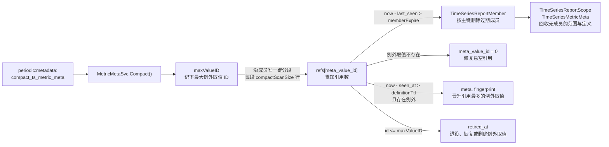

```go
// [1] 逐数据源执行：先记下例外取值的最大 ID maxValueID，再沿 (group_id, report_scope_id, meta_id) 分段扫描，单段失败只跳过该数据源
// [2] 扫描中累加 refs[meta_value_id]，成员过期与悬空引用修复在同一次扫描内完成
// [3] 晋升在单个事务内完成：更新定义的 meta 与 fingerprint，再把扫描到的指向该例外取值的成员置 0
// [4] 回收只处理 id <= maxValueID 的例外取值：无引用的写 retired_at，有引用的清空 retired_at，
//     retired_at 早于 now - valueRetireGrace 且仍无引用的按主键删除，DELETE 带同样的 retired_at 条件
func (s MetricMetaSvc) Compact(ctx context.Context, now time.Time) error
```

定义晋升与例外取值的退役、恢复、删除见「元信息存储」，`Compact()` 还按下表回收过期对象与悬空引用：

| 对象 | 条件 | 动作 |
| --- | --- | --- |
| 上报成员 | `last_seen` 超过 `memberExpire` | 沿成员唯一键分段扫描，按主键批量删除 |
| 上报成员 | 引用的例外取值不存在 | `meta_value_id` 置 `0` 并计数 |
| 上报范围 | 无成员且 `last_seen` 超过 `memberExpire` | 删除范围及其标签 |
| 指标定义 | 无指标项、无成员且 `seen_at` 超过 `memberExpire` | 删除定义 |

| 变更点 | 目标 |
| --- | --- |
| **[Change]** `service/scheduler/periodic.getPeriodicTasks` | 登记 `periodic:metadata:compact_ts_metric_meta`，每 `1 h` 调用 `MetricMetaSvc.Compact(ctx, time.Now())` *[1]* |

- *[1] 处理函数签名与 `internal/metadata/task.RefreshTimeSeriesMetric` 相同。*

### d. 页面归属

`pkg/bk-monitor-worker/internal/metadata/service/timeseriesscope.go`、`bkmonitor/metadata/models/custom_report/time_series.py`

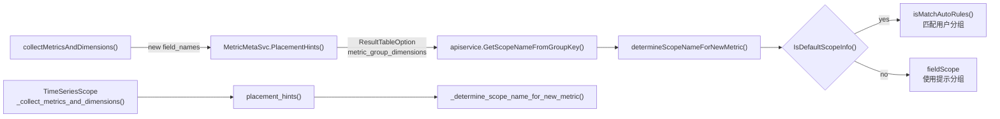

```go
// [1] 只查询本批新指标：field_name → 定义 → (group_id, meta_id) 索引取成员 → 范围标签
// [2] 按分组维度把标签拼成分组名，多个范围时取成员数最多者，相同时按名称升序，无分组维度时返回空 map
func (s MetricMetaSvc) PlacementHints(groupID uint, dims []string, fieldNames []string) (map[string]string, error)
```

**bk-monitor**

| 变更点 | 目标 |
| --- | --- |
| **[Change]** `metadata.models.custom_report.time_series.TimeSeriesGroup.is_default_scope_info` | 改从 `ResultTableOption(metric_group_dimensions)` 读取分组维度，不再读 `TimeSeriesGroup.metric_group_dimensions` |
| **[Add]** `metadata.models.custom_report.metric_meta.placement_hints` | 返回本批新指标的分组提示 *[1]* |
| **[Change]** `metadata.models.custom_report.time_series.TimeSeriesScope._collect_metrics_and_dimensions` | 调用 `placement_hints()` 为新指标取分组提示 |
| **[Change]** `metadata.models.custom_report.time_series.TimeSeriesScope.bulk_refresh_ts_scopes` | 重放一次默认分组中创建不足 `1 h` 且出现提示的指标项 |
| **[Change]** `metadata.models.custom_report.time_series.TimeSeriesGroup.get_metric_from_bkdata` | 删除 `is_enabled_data_scope()` 为真时的 v2 分支，v1 分支继续维护指标名、维度与活跃时间 *[2]* |

- *[1] 签名为 `placement_hints(group_id, dims, field_names)`，与 `PlacementHints()` 共用测试样例。*
- *[2] 白名单下线阶段执行，`is_enabled_data_scope()` 另有调用方，保留不删。*

**bmw**

| 变更点 | 目标 |
| --- | --- |
| **[Change]** `internal/metadata/service.collectMetricsAndDimensions` | 改用 `PlacementHints()` 的结果作为新指标的 `fieldScope`，无提示时为 `default` |
| **[Change]** `internal/metadata/service.determineScopeNameForNewMetric` | 把提示分组归入「数据带分组信息」分支，`default` 仍走 `auto_rules` 分支 *[1]* |
| **[Change]** `internal/metadata/apiservice.getScopeNameFromGroupKey` | 原地导出为 `GetScopeNameFromGroupKey`，供 `PlacementHints()` 拼接分组名 *[2]* |
| **[Change]** `internal/metadata/service.TimeSeriesGroupSvc.IsDefaultScopeInfo` | 改从 `ResultTableOption(metric_group_dimensions)` 读取分组维度，不再读 `TimeSeriesGroup.metric_group_dimensions` |
| **[Change]** `internal/metadata/service.BulkRefreshTSScopes` | 重放一次默认分组中创建不足 `1 h` 且出现提示的指标项 |
| **[Change]** `internal/metadata/apiservice.BkdataService.QueryMetricAndDimension` | 删除 `useV2` 为真时的 v2 分支，v1 分支继续维护指标名、维度与活跃时间 *[3]* |

- *[1] 函数签名不变。*
- *[2] `apiservice` 内部仍调用该函数，而 `service` 已导入 `apiservice`，迁入 `service` 包会形成循环导入。*
- *[3] 白名单下线阶段执行。*

## 0x05 开发方案 —— SaaS、APM 与前端

### a. 服务范围对象

`bkmonitor/packages/monitor_web/scene_view/resources/custom_metric.py`

服务过滤、图表 `scope_name` 与维度值 `scope_name` 都在回答「这个服务在哪些范围上报了这个指标」，三处统一读取 `ServiceMetricScope`。

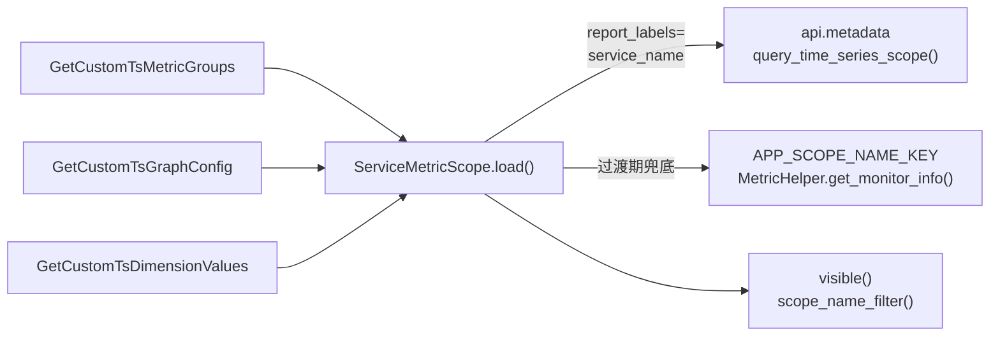

```python
@dataclass(frozen=True)
class ServiceMetricScope:
    member_scopes: dict[str, set[str]]         # 指标名 → 成员上报的 scope_name 集合
    legacy_scopes: dict[str, set[str]] | None  # 指标名 → 白名单中的 scope_name 集合，None 表示白名单不可用

    @classmethod
    def load(cls, params: dict[str, Any], group_id: int) -> "ServiceMetricScope | None":
        # [1] 非 APM 场景返回 None
        # [2] 成员取 report_scopes，剔除 client_metrics、server_metrics 与 bk_apm_、apm_ 前缀指标，缺失 scope_name 记为空串
        ...

    def visible(self, metric_name: str) -> bool:
        # [3] 白名单不可用且成员为空时不过滤，否则按成员与白名单的并集判断
        ...

    def scope_name_filter(self, metric_name: str, field_scope: str) -> str | list[str] | None:
        # [4] field_scope 不是 default 时原样返回
        # [5] 否则取成员集合，为空时取白名单集合，单值返回字符串，多值返回升序列表，无值返回 None
        ...
```

| 变更点 | 目标 |
| --- | --- |
| **[Add]** `monitor_web.scene_view.resources.custom_metric.ServiceMetricScope` | 汇总一个服务按指标上报的 `scope_name`，供服务过滤、图表与维度值共用 *[1]* |
| **[Delete]** `monitor_web.scene_view.resources.custom_metric.GetCustomTsMetricGroups._get_service_scope_metric_whitelist` | 移除按页面分组名查找白名单的逻辑，白名单改由 `ServiceMetricScope.load()` 读取 |
| **[Change]** `monitor_web.scene_view.resources.custom_metric.GetCustomTsMetricGroups.perform_request` | 改用 `scope.visible(metric_name)` 过滤指标，并在 `metrics[]` 每项带出 `family` |
| **[Add]** `config.default.APM_CUSTOM_METRIC_MEMBER_FILTER_ENABLED` | 控制服务过滤是否读取成员，默认开启 *[2]* *[3]* |
| **[Keep]** `apm_web.tasks.cache_application_scope_name` | 继续在过渡期缓存白名单，提供并集的另一半 |
| **[Delete]** `apm_web.tasks.cache_application_scope_name` | 删除白名单缓存任务 *[4]* |
| **[Delete]** `apm_web.constants.ApmCacheKey.APP_SCOPE_NAME_KEY` | 删除白名单缓存键 *[4]* |

- *[1] `load()` 每个请求只调用一次。*
- *[2] 开关关闭时 `member_scopes` 视为空。*
- *[3] 在 `config/default.py` 声明默认值 `True`，在 `bkmonitor/define/global_config.py` 的 `STANDARD_CONFIGS` 注册为 `slz.BooleanField`，与同类开关 `APM_METRIC_GROUP_DIMENSIONS_ENABLED` 放在一起。*
- *[4] 两个 `[Delete]` 行在白名单下线阶段执行。*

### b. 图表与维度值

`bkmonitor/packages/monitor_web/scene_view/resources/custom_metric.py`

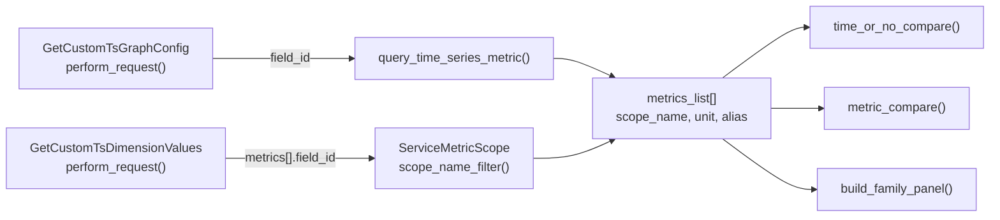

**SaaS**

| 变更点 | 目标 |
| --- | --- |
| **[Change]** `monitor_web.scene_view.resources.custom_metric.GetCustomTsGraphConfig.perform_request` | 组装 `metrics_list` 时一次取齐 `scope_name`、`unit`、`alias`、`aggregate_method` 与 `function` *[1]* *[2]* |
| **[Change]** `monitor_web.scene_view.resources.custom_metric.GetCustomTsGraphConfig.time_or_no_compare` | 跳过值为 `None` 的 `scope_name`，不写入 `filter_dict.scope_name` *[3]* |
| **[Change]** `monitor_web.scene_view.resources.custom_metric.GetCustomTsGraphConfig.metric_compare` | 跳过值为 `None` 的 `scope_name`，不写入 `filter_dict.scope_name` *[3]* |
| **[Change]** `monitor_web.scene_view.resources.custom_metric.GetCustomTsDimensionValues.RequestSerializer.MetricSerializer` | 新增可选字段 `field_id`，保留 `scope_name` 与 `name` |
| **[Change]** `monitor_web.scene_view.resources.custom_metric.GetCustomTsDimensionValues.perform_request` | 计算 `scope_name` 时优先按 `field_id` 调用 `scope_name_filter()` *[4]* |

- *[1] `scope_name` 取 `scope_name_filter()` 的结果，其余四项取 `effective_config`。*
- *[2] 规则不依赖数据源是否已收敛：未收敛时 `field_scope` 仍是真实的 `scope_name`，收敛后改取成员集合。*
- *[3] `scope_name` 为列表时沿用现有多值过滤 `=~"^(a|b)$"`。*
- *[4] 请求不带 `field_id` 时沿用请求中的 `scope_name`。*

**前端**（模块路径相对 `bkmonitor/webpack/src/monitor-pc/pages/custom-escalation/metric-detail/components/view-main/components/header-box/components/where-condition/components/`）

| 变更点 | 目标 |
| --- | --- |
| **[Change]** `render-result-list/components/edit-panel/components/panel-value-select.PanelValueSelect.currentSelectedMetricNameList` | 补上请求 `metrics[]` 每项的 `field_id` *[1]* *[2]* |
| **[Change]** `commom/key-value-selector.FilterConditions.currentSelectedMetricNameList` | 补上请求 `metrics[]` 每项的 `field_id` *[1]* *[2]* |

- *[1] `field_id` 取自 `customEscalationViewStore.currentSelectedMetricList`，其中每项已带该字段。*
- *[2] APM 服务页的 `apm-custom-graph-v2.tsx` 只把 `getCustomTsDimensionValues` 注入复用的 `view-main`，维度值请求由这两个组件发出。*

### c. 管理页与写回

`bkmonitor/packages/monitor_web/custom_report/resources/metric.py`、`bkmonitor/packages/apm_web/custom_metric/resources.py`

```mermaid
flowchart LR
    List["MetricList<br/>BatchEdit"] -->|"整包 config"| Modify["ModifyCustomTsFields"]
    ApmModify["ApmModifyCustomTsFields<br/>service_name"] -->|"report_labels"| Svc
    Modify --> Svc["FieldsModifyService<br/>apply_change()"]
    Svc --> CU["create_or_update_time_series_metric()"]
    CU -->|"不带 report_labels"| Metric[("TimeSeriesMetric<br/>field_config")]
    CU -->|"带 report_labels"| Member[("TimeSeriesReportMember<br/>field_config")]
```

| 变更点 | 目标 |
| --- | --- |
| **[Change]** `monitor_web.custom_report.resources.metric.GetCustomTsFields.perform_request` | 返回每项的 `meta` 与 `effective_config`，不并入 `config` |
| **[Change]** `monitor_web.custom_report.resources.metric.GetCustomTsFields.get_movable` | 判定能否移动时改用 `metric_obj.scope_create_from != "data"` *[1]* |
| **[Change]** `monitor_web.custom_report.handlers.metric.service.FieldsModifyService` | 跳过值为 `""`、`0`、`[]` 的配置项，回写时不写入 `field_config` *[2]* |
| **[Change]** `apm_web.custom_metric.resources.ApmModifyCustomTsFields.RequestSerializer` | 新增可选参数 `service_name`，存在时转为 `report_labels={"service_name": ...}` *[3]* |
| **[Change]** `monitor_web.custom_report.resources.metric.ModifyCustomTsFields.perform_request` | 把请求中的 `report_labels` 传给 `FieldsModifyService` |
| **[Change]** `monitor_web.custom_report.handlers.metric.service.FieldsModifyService.__init__` | 新增可选参数 `report_labels`，同步指标时交给转换器 |
| **[Change]** `monitor_web.custom_report.handlers.metric.query.MetricQueryConverter.create_or_update_time_series_metric` | 新增参数 `report_labels`，非空时随 `metrics` 一并发给 Metadata |
| **[Change]** `monitor_web.custom_report.resources.metric.ImportCustomTimeSeriesFields.perform_request` | 导入已收敛数据源时把非 `default` 的 `field_scope` 归一为 `default`，不再静默跳过 |
| **[Change]** `monitor_web.custom_report.resources.metric.ModifyCustomTimeSeries.update_fields` | 只更新不删除带分组维度数据源的指标 *[4]* |
| **[Keep]** `metadata.models.custom_report.time_series.TimeSeriesMetric.field_id` | 保持保留项收敛前后的 `field_id` 与 `scope_id` 不变，其余指标项只保留 `field_id` *[5]* |

- *[1] 与 `TimeSeriesScope` 现有的「数据创建的分组禁止移出」规则一致。*
- *[2] 原因见「有效配置解析」。*
- *[3] 前端入口待确认。*
- *[4] 避免收敛后原非 `default` 指标被旧调用方禁用。*
- *[5] 已保存视图按 `scope_name` 加指标名还原。*

### d. 指标缓存与选择器

`bkmonitor/packages/monitor_web/strategies/metric_list_cache.py`

`CustomMetricCacheManager` 继续调用 `get_metric_info_list()`，单位与描述的变化全部发生在 Metadata 的 `to_metric_info()` 中。

| 变更点 | 目标 |
| --- | --- |
| **[Keep]** `monitor_web.strategies.metric_list_cache.BaseMetricCacheManager._run` | 增量写入指标缓存，按 `metric_md5` 跳过未变化的指标 *[1]* |
| **[Change]** `monitor_web.strategies.metric_list_cache.CustomMetricCacheManager.get_apm_extra_tables` | 合并多张 APM 表的同名指标时取第一个非空单位 *[2]* |
| **[Keep]** `bkmonitor.strategy.serializers.TimeSeriesQueryConfigSerializer.unit` | 保留策略保存时的单位快照，已保存策略不随上报单位变化 *[3]* |

- *[1] `CustomMetricCacheManager` 继承这一写入流程。*
- *[2] 现有实现只保留最先出现的指标信息，单位取决于表的返回顺序。*
- *[3] `QueryConfig.save()` 把该字段写入 `QueryConfigModel.config`。*

### e. 族视图与 Histogram 复合面板

`bkmonitor/packages/monitor_web/scene_view/resources/custom_metric.py`、`bkmonitor/metadata/resources/resources.py`

```mermaid
flowchart LR
    Tree["GetCustomTsMetricGroups"] -->|"metrics[].family"| Node["RenderMetricsGroup<br/>指标树节点"]
    Node -->|"metric_ids, view=family"| Graph["GetCustomTsGraphConfig"]
    Graph -->|"按 family.key 归组"| Builder["build_family_panel()"]
    Builder --> Targets["targets[]<br/>alias = AVG … P99"]
    Manage["GetCustomTsFields<br/>view=family"] --> Paging["QueryTimeSeriesMetricResource<br/>按节点分页"]
```

```python
FAMILY_METHODS: tuple[str, ...] = ("AVG", "SUM", "COUNT", "P50", "P90", "P95", "P99")


def build_family_panel(
    family: dict[str, Any],
    members: dict[str, dict[str, Any]],  # role → 族成员的 metrics_list 项
    common: dict[str, Any],              # interval、table、data_label、where、filter_dict 等公共字段
    temporality: str,                    # delta 或 cumulative，取 _count 族成员的定义
) -> dict[str, Any]:
    # [1] 只生成依赖的族成员齐全的方法，group_by 取族成员维度交集去掉 le，_bucket 查询追加 le
    # [2] 族成员强制 method=SUM，忽略其 aggregate_method 与 function
    # [3] cumulative 时每个查询的 functions 前置 increase，window 写兜底值 2 × 上报周期（缺失时 2m）
    # [4] sub_title 取 _count 族成员的真实指标 ID，跳转与策略链路仍按单指标解析
    ...
```

每个 `query_config` 的公共字段与单指标面板相同：

```json
{
  "interval": "$interval",
  "table": "2_bkmonitor_time_series_1001.__default__",
  "data_label": "<data_label>",
  "data_source_label": "custom",
  "data_type_label": "time_series",
  "where": [],
  "filter_dict": {"group_filter": {}, "common_filter": {}, "service_name": "checkout", "scope_name": "http"}
}
```

服务 checkout 的 `request.duration` 族面板（delta，省略公共字段）：

```json
{
  "title": "请求耗时",
  "sub_title": "custom:<data_label>:request_duration_count",
  "targets": [
    {"alias": "AVG", "expression": "b == 0 or a / b", "unit": "s", "query_configs": [
      {"metrics": [{"field": "request_duration_sum", "method": "SUM", "alias": "a"}], "group_by": ["method"], "functions": []},
      {"metrics": [{"field": "request_duration_count", "method": "SUM", "alias": "b"}], "group_by": ["method"], "functions": []}
    ]},
    {"alias": "SUM", "expression": "a", "unit": "s", "query_configs": [
      {"metrics": [{"field": "request_duration_sum", "method": "SUM", "alias": "a"}], "group_by": ["method"], "functions": []}
    ]},
    {"alias": "COUNT", "expression": "a", "unit": "none", "query_configs": [
      {"metrics": [{"field": "request_duration_count", "method": "SUM", "alias": "a"}], "group_by": ["method"], "functions": []}
    ]},
    {"alias": "P50", "expression": "a", "unit": "s", "query_configs": [
      {"metrics": [{"field": "request_duration_bucket", "method": "SUM", "alias": "a"}], "group_by": ["method", "le"],
       "functions": [{"id": "histogram_quantile", "params": [{"id": "scalar", "value": 0.5}]}]}
    ]},
    {"alias": "P90", "expression": "a", "unit": "s", "query_configs": [
      {"metrics": [{"field": "request_duration_bucket", "method": "SUM", "alias": "a"}], "group_by": ["method", "le"],
       "functions": [{"id": "histogram_quantile", "params": [{"id": "scalar", "value": 0.9}]}]}
    ]},
    {"alias": "P95", "expression": "a", "unit": "s", "query_configs": [
      {"metrics": [{"field": "request_duration_bucket", "method": "SUM", "alias": "a"}], "group_by": ["method", "le"],
       "functions": [{"id": "histogram_quantile", "params": [{"id": "scalar", "value": 0.95}]}]}
    ]},
    {"alias": "P99", "expression": "a", "unit": "s", "query_configs": [
      {"metrics": [{"field": "request_duration_bucket", "method": "SUM", "alias": "a"}], "group_by": ["method", "le"],
       "functions": [{"id": "histogram_quantile", "params": [{"id": "scalar", "value": 0.99}]}]}
    ]}
  ]
}
```

- *[1] 每个 target 另带 `"function": {}` 与 `"metric": {"name": "request.duration", "alias": "请求耗时"}`，取值相同。*
- *[2] 响应序列化器只保留面板的 `title`、`sub_title`、`targets` 与 target 的 `expression`、`alias`、`query_configs`、`function`、`metric`、`unit`，示例没有使用其他字段。*

cumulative 与 delta 只差 `functions`：每个查询前置 `increase`，分位查询的 `histogram_quantile` 排在其后。cumulative 的 `P95` target 如下：

```json
{"alias": "P95", "expression": "a", "unit": "s", "query_configs": [
  {"metrics": [{"field": "request_duration_bucket", "method": "SUM", "alias": "a"}], "group_by": ["method", "le"],
   "functions": [
     {"id": "increase", "params": [{"id": "window", "value": "2m"}]},
     {"id": "histogram_quantile", "params": [{"id": "scalar", "value": 0.95}]}
   ]}
]}
```

| `target.alias` | 族成员 | delta 的 `functions` | cumulative 的 `functions` *[1]* |
| --- | --- | --- | --- |
| `AVG` | `_sum`、`_count` | `[]` | `[increase]` |
| `SUM` | `_sum` | `[]` | `[increase]` |
| `COUNT` | `_count` | `[]` | `[increase]` |
| `P50` | `_bucket` | `[histogram_quantile(0.5)]` | `[increase, histogram_quantile(0.5)]` |
| `P90` | `_bucket` | `[histogram_quantile(0.9)]` | `[increase, histogram_quantile(0.9)]` |
| `P95` | `_bucket` | `[histogram_quantile(0.95)]` | `[increase, histogram_quantile(0.95)]` |
| `P99` | `_bucket` | `[histogram_quantile(0.99)]` | `[increase, histogram_quantile(0.99)]` |
| `P99.9` *[2]* | `_bucket` | `[histogram_quantile(0.999)]` | `[increase, histogram_quantile(0.999)]` |

- *[1] `increase` 指上方 JSON 中带 `window` 的函数对象，`histogram_quantile(φ)` 指 `scalar` 取 `φ` 的函数对象。*
- *[2] `P99.9` 代表自定义 `Pxx`，`φ` 由用户输入。*

自定义 `Pxx` 由前端克隆 `P99` target，把 `alias` 改为 `P99.9`、`scalar` 改为 `0.999`。不用变量占位：查看大图、维度下钻与跳转三条路径不替换变量，`float()` 会直接报错。

| 变更点 | 目标 |
| --- | --- |
| **[Add]** `monitor_web.scene_view.resources.custom_metric.build_family_panel` | 组装族面板，每个方法对应一个 target |
| **[Change]** `monitor_web.scene_view.resources.custom_metric.GetCustomTsGraphConfig.RequestSerializer` | 新增参数 `view`，取值 `metric` 或 `family`，默认 `metric` |
| **[Change]** `monitor_web.scene_view.resources.custom_metric.GetCustomTsGraphConfig.perform_request` | 归组请求的 `field_id`，同一 `family.key` 的指标交给 `build_family_panel()` 生成族面板 *[1]* *[2]* |
| **[Change]** `metadata.resources.resources.QueryTimeSeriesMetricResource.perform_request` | 支持 `view=family`：按节点分页，再批量补齐本页节点的全部族成员 *[3]* *[4]* |
| **[Add]** `config.default.CUSTOM_METRIC_FAMILY_VIEW_ENABLED` | 控制是否开放族视图，默认关闭 *[5]* *[6]* |

- *[1] 只在 `view=family` 且不是指标对比时归组，其余指标走现有分支。*
- *[2] Top/Bottom 对族面板不生效。*
- *[3] 节点键为族键或 `field_id`，计数与 `LIMIT` 都按节点 `GROUP BY`。*
- *[4] 排序沿用 `ORDER_FIELD_MAPPING`，名称取 `MIN(field_name)`，更新时间取 `MAX(last_modify_time)`。*
- *[5] 开关关闭时 `GetCustomTsMetricGroups` 不返回 `family`，前端逐个展示族成员。*
- *[6] 在 `config/default.py` 声明默认值 `False`，在 `bkmonitor/define/global_config.py` 的 `STANDARD_CONFIGS` 注册为 `slz.BooleanField`，与同类开关 `APM_METRIC_GROUP_DIMENSIONS_ENABLED` 放在一起。*

### f. 前端

`bkmonitor/webpack/src/monitor-pc/pages/custom-escalation/`

前端改动集中在「只执行选中的 target」。APM 服务页 `apm-custom-graph-v2` 复用同一个 `view-main` 组件，改动同时生效。

```mermaid
flowchart LR
    Header["StatusTab<br/>statusList = targets[].alias"] --> Chart["NewMetricChart<br/>getPanelData()"]
    Chart -->|"只请求选中的 alias"| Query["graphUnifyQuery"]
    Chart -->|"increase.window =<br/>max(interval, 兜底值)"| Query
    Chart --> Copy["getCopyPanel()<br/>选中的 targets"]
    Copy --> Drill["DrillAnalysisView"]
    Copy --> Check["CheckViewDetail"]
```

**图表**（模块路径相对 `metric-detail/components/view-main/components/panel-chart-view/components/`）

| 变更点 | 目标 |
| --- | --- |
| **[Change]** `layout-chart-table/components/metric-chart.NewMetricChart.methodList` | 改由 `panel.targets[].alias` 生成复合面板的方法选项，默认选中 `AVG`、`P95`、`P99` *[1]* *[2]* *[3]* |
| **[Change]** `layout-chart-table/components/metric-chart.NewMetricChart.getPanelData` | 只请求 `alias` 被选中的 target，请求前改写 `increase.window` *[4]* |
| **[Change]** `layout-chart-table/components/metric-chart.NewMetricChart.handleMethodChange` | 跳过复合面板，不覆盖 `metrics.method` |
| **[Change]** `layout-chart-table/components/metric-chart.NewMetricChart.getCopyPanel` | 只带上选中的 target |
| **[Change]** `layout-chart-table.LayoutChartTable.currentMethod` | 改为记录选中的 `alias` 集合，并写入 URL 参数 *[5]* |
| **[Change]** `layout-chart-table/components/drill-analysis.DrillAnalysisView` | 保留全部 `query_configs`，切换周期时不截断 *[6]* |
| **[Change]** `layout-chart-table/components/check-view.CheckViewDetail.handleDimensionParamsChange` | 合并而非覆盖 `functions` 与 `group_by` *[7]* |

- *[1] 选项支持多选，`COUNT` 与时长类方法单位不同，二者互斥。*
- *[2] 自定义 `Pxx` 输入框校验 `0 < φ < 1`。*
- *[3] `StatusTab` 的 `value` 现为单个字符串，多选所需的改动位置待确认。*
- *[4] 改写值为 `max(当前周期秒数, 兜底值)`。*
- *[5] 不再从 `targets[0]` 读取当前方法。*
- *[6] 取值请求传 `aggregation_method: "avg"`。*
- *[7] 保留 `histogram_quantile`、`increase` 与 `le`。*

**管理页**（模块路径相对 `metric-manage/components/indicator-dimension/components/`）

| 变更点 | 目标 |
| --- | --- |
| **[Change]** `metric-list.MetricList` | 展开族视图父行下的族成员，并展示上报单位与描述 *[1]* |
| **[Change]** `metric-list/components/batch-edit.BatchEdit` | 拆分父行的隐藏、禁用与移动，逐个作用到族成员的 `field_id` *[2]* |

- *[1] 保存时不回写 `meta`。*
- *[2] 空值不覆盖上报值。*

## 0x06 开发方案 —— 迁移、发布与兼容

### a. 发布顺序

发布按下图从左到右推进，节点主标题是控制该阶段的迁移、开关或命令，副行是阶段名。

```mermaid
flowchart LR
    Mig["0278_metric_meta<br/>建表与只读解析"] --> SaaS["APM_CUSTOM_METRIC_MEMBER_FILTER_ENABLED<br/>SaaS 读取改造"]
    SaaS --> Bmw["enable_metric_metadata<br/>bmw 接收"]
    Bmw --> Collector["metric_metadata.enabled<br/>Collector 上报"]
    Collector --> Collapse["collapse_ts_metric_scope<br/>APM V2 收敛"]
    Collapse --> Shrink["cache_application_scope_name<br/>白名单下线"]
    Bmw -.-> Family["CUSTOM_METRIC_FAMILY_VIEW_ENABLED<br/>族视图"]
```

| 阶段 | 发布内容 | 进入条件 | 回退 |
| --- | --- | --- | --- |
| 建表与只读解析 | [a] 执行 `0278_metric_meta` 新建五张表<br />[b] 上线解析器与查询接口的新增字段 | 迁移成功 | 删除五张新表 *[1]* |
| SaaS 读取改造 | [a] 上线服务过滤、图表、维度值与管理页写回改造<br />[b] 分组维度的三个写回入口只写 `ResultTableOption` | 建表与只读解析已发布 | 关闭 `APM_CUSTOM_METRIC_MEMBER_FILTER_ENABLED` |
| bmw 接收 | [a] 上线元信息消费、整理与分组提示<br />[b] 逐个数据源打开接收 | 五张新表已创建 | 关闭 `enable_metric_metadata` *[2]* |
| Collector 上报 | 逐个集群打开元信息上报 | bmw 接收已发布 | 关闭 Collector 的 `metric_metadata.enabled` *[3]* |
| APM V2 收敛 | 逐个数据源执行 `collapse_ts_metric_scope` | [a] SaaS 读取改造已发布<br />[b] 数据源已有成员 | 按快照执行 `--phase rollback` |
| 族视图 | 打开 `CUSTOM_METRIC_FAMILY_VIEW_ENABLED` | bmw 接收已发布 | 关闭 `CUSTOM_METRIC_FAMILY_VIEW_ENABLED` *[4]* |
| 白名单下线 | [a] 删除白名单任务与缓存键<br />[b] 删除 Python 与 Go 的 v2 分支 | 全部 Collector 已升级满 `30 d` | 重新发布上一版本 |

- *[1] 已有表没有 DDL，回退不影响已有表。*
- *[2] 已写入新表的数据保留。*
- *[3] 配置键取自关联方案「bk-collector 指标元信息采集与同步方案」。*
- *[4] 关闭后的表现见「族视图与 Histogram 复合面板」。*

**为什么 SaaS 读取改造必须先于收敛？**

- 旧 SaaS 的图表把 `field_scope` 当作 `scope_name` 过滤，收敛后过滤值变为 `default`，图表无数据。
- 新建应用不再写 `TimeSeriesGroup.metric_group_dimensions`，同样依赖新 SaaS 从 `ResultTableOption` 读取分组维度。

### b. 版本共存

**版本组合**

表结构指 `0278_metric_meta` 建出的五张新表，以迁移是否执行区分新旧。

| 新版本 | 旧版本 | 表现 | 兼容方式 |
| --- | --- | --- | --- |
| 表结构 | bmw | 新表无人写入 | 解析器回落到用户配置与表级字段 |
| bmw | 表结构 | `Apply` 报错并计数 | 常驻任务退避重试，指标同步不受影响 |
| Metadata | SaaS | 旧 SaaS 忽略新字段，策略选择器经 `to_metric_info()` 读到上报单位 | 逐个数据源开启接收 *[1]* |
| SaaS | Metadata | 响应缺少新字段，DTO 置 `None` | 新 SaaS 对 `None` 走旧逻辑 |
| SaaS、bmw | Collector | 不上报元信息 | [a] 服务视图走白名单<br />[b] 页面归属回落到 `auto_rules` 与默认分组 |

- *[1] 单位变化只在数据源开启接收后出现。*

**异常场景**

| 场景 | 表现 | 兼容方式 |
| --- | --- | --- |
| 迁移被吞 | 新表不存在，新功能报错并计数 | 已有表零 DDL，存量同步、查询与管理页不受影响 |
| 存量 `alias=""` 的指标项 | 解析器把空串视为未设置，描述从空变为上报描述或表级描述 | 作为预期变化，随数据源开启接收灰度 |
| 旧 ESB 调用 `ModifyCustomTimeSeries.update_fields` | 收敛后原非 `default` 指标项变为 `default`，旧调用方未传入的指标项会被禁用 | `update_fields` 在数据源存在分组维度时只更新不删除 |

### c. APM V2 收敛

收敛改写指标项的 `field_scope`、`scope_id` 与 `field_config`，删除占位的 `default` 旧指标项，并清空 `TimeSeriesGroup.metric_group_dimensions`。页面分组、`ResultTableOption` 与 VM 存储绑定保持不动。

收敛不能靠暂停同步实现：bmw 与订阅下发都按 `is_enable` 过滤数据源，临时停用会中断上报。因此收敛先用单事务改写，等待一个同步超时（`10 min`）后再复跑修复：

```mermaid
flowchart LR
    Check["precheck()<br/>统计同名指标项"] --> Snapshot["snapshot()<br/>指标项整行<br/>metric_group_dimensions, T0"]
    Snapshot --> Tx
    subgraph Window["RefreshTimeSeriesMetric() v2 · 竞态窗口 ≤ 10 min"]
        direction TB
        Tx["transaction.atomic()<br/>保留项 field_scope<br/>= default<br/>metric_group_dimensions<br/>= []"] --> Stale["BulkRefreshTSMetrics()<br/>T0 前启动的 v2 同步<br/>可能新建<br/>(field_name, field_scope)"]
    end
    Window -->|"等待 10 min"| Rerun["--phase rerun<br/>删除 T0 后创建的<br/>field_scope != default<br/>指标项"]
    Rerun --> V1["RefreshTimeSeriesMetric()<br/>按 v1 同步"]
```

- *[1] `transaction.atomic()` 清空列时调用 `save(update_fields=["metric_group_dimensions"])`，不走 `modify_time_series_group`，避免改写 `ResultTableOption` 并重新下发 VM 绑定。*
- *[2] VM 绑定保留 v2 维度对 BkBase v1 结果的影响「待确认」。*

事务内必须先改写指标项，再清空 `metric_group_dimensions`。顺序反过来时，下一轮 v1 同步会为 `(field_name, default)` 新建一个指标项（新 `field_id`），并把旧指标项置为失活。

同名指标项按以下顺序选出保留项，保留项的 `field_scope` 改为 `default`：

```text
scope_id ≠ 0  →  is_active = true 优先  →  last_modify_time 最近  →  field_id 最小
```

| 同名情况 | 保留项 | 其余指标项 |
| --- | --- | --- |
| 只有一个指标项 | 该指标项 | 无 |
| 有多个指标项 | 按上述顺序选出 *[1]* | [a] `scope_id` 置 `0`，从列表隐藏<br />[b] `field_id` 保留，配置并入保留项 *[2]*<br />[c] 引用其原分组的已保存视图打开后缺少该指标 *[3]* |
| 另有 `scope_id = 0` 的 `default` 旧指标项 | 从其余指标项中按上述顺序选出 *[4]* | [a] 旧指标项记入快照后删除 *[5]*<br />[b] 其他非保留项同「有多个指标项」 |

- *[1] 活跃状态排在修改时间之前：bmw v2 同步把本轮缺失的指标项置为失活并刷新修改时间，只看修改时间会选中刚失活的旧指标项。*
- *[2] 其余指标项的 `field_config` 按修改时间由旧到新并入保留项，保留项自身的键优先。*
- *[3] 视图按页面分组名加指标名还原，非保留项离开原分组后匹配不到，保留项所在分组的视图不受影响。*
- *[4] 旧指标项不能作为保留项：`scope_id = 0` 的指标项在同步命中时会被重置 `field_config`。*
- *[5] 旧指标项占用保留项改写后的唯一键 `(group_id, field_scope, field_name)`，不删除就无法改写。*

收敛命令位于 `bkmonitor/metadata/management/commands/collapse_ts_metric_scope.py`，写法参照 `refresh_ts_metric`：

```text
python manage.py collapse_ts_metric_scope [选项]

# 要处理的数据源 ID，可重复传入，与 --all-v2 二选一
--group-id <group_id>
# 选中 metric_group_dimensions 非空的全部数据源
--all-v2
# 执行阶段，各阶段行为见下方列表
--phase <collapse|rerun|rollback>
# 快照目录，必填，必须位于持久卷，快照文件名为 <group_id>-<T0>.json
--snapshot-dir <dir>
# 只输出同名指标项统计与保留项，不写库
--dry-run
```

- **`collapse`**：加锁、预检、写快照并执行单事务改写，结束时输出 `T0`。
- **`rerun`**：距 `T0` 不足 `10 min` 时拒绝执行，否则删除 `T0` 之后创建且 `field_scope != default` 的指标项。
- **`rollback`**：按快照恢复指标项的 `field_scope`、`scope_id`、`field_config` 与 `metric_group_dimensions` 原值，并重建被删除的旧指标项。
- **可重入**：`metric_group_dimensions` 为空且没有 `scope_id ≠ 0` 的非 `default` 指标项时视为已收敛，直接跳过。
- **人工同步锁**：`collapse` 期间持有缓存锁 `metadata:collapse_ts_metric_scope:<group_id>`（TTL `10 min`），`TimeSeriesGroup.update_metrics()` 检测到锁时拒绝同步该数据源。

| 变更点 | 目标 |
| --- | --- |
| **[Add]** `metadata/management/commands/collapse_ts_metric_scope.py` | 按 `--phase` 执行收敛、复跑与回退，快照写入 `--snapshot-dir` |
| **[Change]** `metadata.models.custom_report.time_series.TimeSeriesGroup.update_metrics` | 检测到收敛锁时拒绝同步该数据源 |

三个入口会把分组维度写回 `metric_group_dimensions` 列，从 SaaS 读取改造阶段起只写 `ResultTableOption`，收敛窗口内不再写回：

| 变更点 | 目标 |
| --- | --- |
| **[Change]** `metadata.models.custom_report.time_series.TimeSeriesGroup.create_time_series_group` | 只把分组维度写入 `ResultTableOption` *[1]* |
| **[Change]** `metadata.models.custom_report.time_series.TimeSeriesGroup.modify_time_series_group` | 只把分组维度写入 `ResultTableOption` |
| **[Keep]** `apm/management/commands/refresh_apm_datalink.py` | 继续经 `api.metadata.modify_time_series_group` 写入分组维度 *[2]* |

- *[1] APM 新建应用由 `apm.models.datasource.MetricDataSource.create_or_update_result_table` 传入分组维度。*
- *[2] 该命令随 `modify_time_series_group` 的改造只写 `ResultTableOption`，无需单独修改。*

### d. 上线前置检查

每个环境上线前逐项检查，新表的建表语句与 `5.7` 专用查询见表下代码块。

| 检查项 | 方法 | 关注点 | 处置 |
| --- | --- | --- | --- |
| MySQL 版本 | `SELECT VERSION()` | 是否为 `5.7` 或 `8.0` | 两个版本都按本方案执行 *[1]* |
| 索引前缀上限 | `SELECT @@innodb_default_row_format` | 单列索引前缀上限是否不小于 `767 B` | 无需处理 *[2]* |
| 新表字符集 | `SHOW CREATE TABLE <新表>` | 索引文本列是否为 `utf8_bin` | 出现 `utf8mb4` 时改回 `utf8` *[3]* |
| `is_active` 库默认值 | `SHOW CREATE TABLE metadata_timeseriesmetric` | `is_active` 是否带库默认值 | 缺失时登记为独立缺陷，不改热表 *[4]* |
| `sql_mode` | `SELECT @@sql_mode` | 是否含 `STRICT_TRANS_TABLES` | 含该模式时确认四字节字符替换生效 |
| `post-compile` 迁移失败 | 「待确认」 | `migrate` 失败时发布是否失败 | 发布不失败时按「版本共存」的迁移被吞场景处理 *[5]* |
| V2 同名指标项 | `collapse_ts_metric_scope --dry-run` | 同名指标项是否跨 `scope_name` | 跨 `scope_name` 时人工确认保留项 |

- *[1] `8.0` 支持 INSTANT 加列，也不改用扩列方案。*
- *[2] 所有配置下单列上限都不小于 `767 B`，`utf8` 的 `varchar(255)` 单列 `765 B`，两种配置都能建表。*
- *[3] `utf8mb4` 的 `varchar(255)` 单列 `1,020 B`，超过前缀上限，建索引报 `1071`。*
- *[4] 缺默认值时 bmw 省略该列会报 `1364`。*
- *[5] 背景见「已有表的 DDL 风险」，确认位置为 PaaS 发布日志。*

```sql
-- 新表字符集：表名按 Django 默认命名，以 0278_metric_meta 生成结果为准
SHOW CREATE TABLE metadata_timeseriesmetricmeta;
SHOW CREATE TABLE metadata_timeseriesmetricmetavalue;
SHOW CREATE TABLE metadata_timeseriesreportscope;
SHOW CREATE TABLE metadata_timeseriesreportscopelabel;
SHOW CREATE TABLE metadata_timeseriesreportmember;

-- 索引前缀上限：只在 5.7 上执行，8.0 已移除 innodb_large_prefix
SELECT @@innodb_large_prefix, @@innodb_default_row_format;
```

## 0x07 验收与验证

### a. 测试门禁

**bk-monitor**

```bash
cd bkmonitor && pytest metadata/tests packages/monitor_web/tests packages/apm_web/tests
```

| 用例 | 断言重点 |
| --- | --- |
| `metadata/tests/custom_report/test_metric_meta.py::TestMetricConfigResolver` | [a] 五级回落顺序<br />[b] `""`、`0`、`[]` 视为未设置<br />[c] 多个成员命中时取 `last_seen` 最近的一个 |
| `metadata/tests/custom_report/test_metric_meta.py::TestPlacementHints` | [a] 与 Go `TestPlacementHints` 共用样例，输出一致<br />[b] 无分组维度时返回空 |
| `metadata/tests/commands/test_collapse_ts_metric_scope.py::TestCollapseTsMetricScope` | [a] 三种同名情况的保留项与配置合并正确，失活指标项不被选为保留项<br />[b] 模拟 `T0` 前启动的 v2 同步写入后，复跑删除新建的指标项<br />[c] 按快照回退后与收敛前一致 |
| `packages/monitor_web/tests/scene_view/test_service_metric_scope.py::TestServiceMetricScope` | [a] 指标移入用户分组后仍可见<br />[b] 成员为空时等价于现状白名单<br />[c] 白名单不可用且成员为空时不过滤，成员非空时按成员过滤 |
| `packages/monitor_web/tests/scene_view/test_service_metric_scope.py::TestScopeNameFilter` | [a] 未收敛时取 `field_scope`<br />[b] 收敛后单值返回字符串，多值返回列表<br />[c] 无值时不加 `scope_name` 过滤 |
| `packages/monitor_web/tests/scene_view/test_family_panel.py::TestBuildFamilyPanel` | [a] delta 与 cumulative 的 `functions` 与示例一致<br />[b] 缺 `_bucket` 时不生成分位方法<br />[c] `_bucket` 之外的查询不带 `le` |

**bmw**

```bash
cd pkg/bk-monitor-worker && go test -race ./internal/metadata/...
```

| 用例 | 断言重点 |
| --- | --- |
| `internal/metadata/service/metricmeta_test.go::TestScopeDecoderAPM` | [a] `%`、`-` 转义往返一致<br />[b] 标签值含 `\|\|` 时拒收 |
| `internal/metadata/service/metricmeta_test.go::TestPlacementHints` | [a] 与 Python `TestPlacementHints` 共用样例，输出一致<br />[b] 无分组维度时返回空 map |
| `internal/metadata/service/metricmeta_test.go::TestMetricMetaApply` | [a] 「元信息存储」写入判定图的每个分支与两个容量上限<br />[b] 同值例外只产生一个例外取值，刷新间隔内的重复上报与消息重放都不产生写入<br />[c] 四字节字符被替换为 `U+FFFD` |
| `internal/metadata/service/metricmeta_test.go::TestMetricMetaCompact` | [a] 分段回收不使用无索引的 `DELETE ... LIMIT`，悬空引用被置 `0`<br />[b] 持续上报的定义不被切换<br />[c] 退役未满 `valueRetireGrace` 的例外取值不被删除，退役期间被 `Apply` 引用的例外取值不被删除 |

### b. 场景验收

| 场景 | 输入 | 预期 |
| --- | --- | --- |
| 与定义相同 | `200` 个服务上报相同元信息 | [a] `1` 个定义、`200` 个成员<br />[b] `meta_value_id` 均为 `0`，没有例外取值 |
| 同值例外去重 | `100` 个服务上报同一份偏离定义的元信息 | `1` 个例外取值，`100` 个成员引用它 |
| 重设基线 | 全部服务改报新单位，持续超过 `6 h` | [a] 新值晋升为定义，成员引用置 `0`<br />[b] 旧例外取值退役满 `valueRetireGrace` 后删除 |
| 按服务覆盖 | 在服务 A 修改单位 | 修改只对服务 A 生效 |
| 元信息先到 | 元信息早于指标同步到达 | 新指标项直接按分组提示归入页面分组 |
| 元信息后到 | 元信息晚于指标同步到达 | 默认分组中的新指标项在 `1 h` 内重放一次 |
| V2 收敛 | 已保存视图引用收敛前的 `field_id` | 视图正常打开，页面分组不变，图表有数据 |
| 迁移被吞 | 新代码运行在无新表的库上 | [a] 指标同步、管理页与图表正常<br />[b] 新功能报错并计数 |
| 复合计算 *[1]* | delta 的 `_sum` 为 `[0.3, 0.9]`，`_count` 为 `[2, 3]` | [a] `AVG` 为 `0.24`<br />[b] 样本只累计一次 |
| cumulative 窗口 *[1]* | 当前周期 `5 min`，上报周期 `30 s` | [a] `increase` 窗口为 `300s`<br />[b] `COUNT` 等于该周期内的请求数 |

- *[1] 数值验收必须走实际存储查询路径，图表配置 JSON 正确不能替代结果核对。*

### c. 性能基线

上线前在目标 MySQL 版本上复跑 [validation](./validation/README.md) 的 `make m1 m2 meta-layout compat`，以 [REPORT](./REPORT.md) 为基线：

| 基线项 | 统计对象 | 统计量 | 上限 |
| --- | --- | --- | --- |
| 服务视图成员查询 | `126` 个服务的数据源 | p50 | `2 ms` |
| 服务视图成员查询 | 最大数据源 | p50 | `20 ms` |
| 管理页首页 | 最大数据源 | p50 增量 *[1]* | `2 ms` |
| 族视图节点分页 | 最大数据源 | p50 | `150 ms` |
| 指标缓存全量扫描 | 全平台 | 一轮耗时 | `6 s` |
| bmw 元信息写入 | 每批 `1,000` 条上报 | p50 | `50 ms` |
| 成员回收 | 最大数据源 | 单组耗时 | `5 s` |

- *[1] 相对改造前现状的增量。*

## 0x08 实施进展

| 时间 | 结论性进展 |
| --- | --- |
| `2026-10-12 11:30` | [a] 实测四种按范围存放元信息的存法，选定「定义加稀疏例外」且例外引用按指纹去重的取值，体积不随例外比例与全体改值膨胀，例外取值退役满 `valueRetireGrace` 后回收<br />[b] 补齐解析器接入、接口四处同改、服务范围对象、族面板构造、bmw 任务注册与配置、收敛命令等开发契约<br />[c] 修正收敛保留项规则（活跃优先）、页面归属顺序（分组提示、`auto_rules`、默认分组）与「未设置」口径<br />[d] 调研与约束改为从服务过滤缺陷、热表、DDL 风险与代码约束推导到选型，元信息存储改为结论、示例、状态图与时序图组织，变更表统一为变更点与目标两列，写入规则改为正反例，配置改为 YAML 骨架<br />[e] 补齐 APM 按服务写回的 `report_labels` 传递链与收敛命令变更行，按前端代码修正已保存视图的还原口径 |
| `2026-10-11 18:00` | [a] 按 `1,000,000` 指标项完成活跃规模、上界规模满量压测与 MySQL `5.7`、`8.0` 兼容实测，选定窄成员表，不分表<br />[b] 按上线风险选定独立定义表，已有表零 DDL<br />[c] 给出分阶段发布与版本共存矩阵，APM V2 收敛改为单事务改写加复跑修复 |
| `2026-09-15 10:00` | 完成自定义指标模型、指标发现与图表接口链路回查，确定 Histogram 复合视图沿用多指标运算协议 |

## 0x09 参考 & 版本锚点

### a. 代码依据

| 来源                                                                                                                                                                                                                                   | 核查内容                                                                                                                 |
| ------------------------------------------------------------------------------------------------------------------------------------------------------------------------------------------------------------------------------------ | -------------------------------------------------------------------------------------------------------------------- |
| [<源码> bk-monitor/bkmonitor/metadata/models/custom_report/time_series.py](https://github.com/TencentBlueKing/bk-monitor/blob/master/bkmonitor/metadata/models/custom_report/time_series.py)                                           | `TimeSeriesGroup` 的 v2 开关、分组键推导、`modify_time_series_group`，`TimeSeriesScope` 的页面归属，`TimeSeriesMetric.to_metric_info` |
| [<源码> bk-monitor/bkmonitor/metadata/resources/resources.py](https://github.com/TencentBlueKing/bk-monitor/blob/master/bkmonitor/metadata/resources/resources.py)                                                                     | `QueryTimeSeriesMetricResource` 的计数、分页与排序，`QueryTimeSeriesScopeResource` 的整组读取                                       |
| [<源码> bk-monitor/bkmonitor/api/metadata/default.py](https://github.com/TencentBlueKing/bk-monitor/blob/master/bkmonitor/api/metadata/default.py)                                                                                     | SaaS 侧接口的请求声明                                                                                                        |
| [<源码> bk-monitor/bkmonitor/packages/monitor_web/scene_view/resources/custom_metric.py](https://github.com/TencentBlueKing/bk-monitor/blob/master/bkmonitor/packages/monitor_web/scene_view/resources/custom_metric.py)               | 白名单查找、维度值、图表配置与响应序列化器                                                                                                |
| [<源码> bk-monitor/bkmonitor/packages/monitor_web/custom_report/resources/metric.py](https://github.com/TencentBlueKing/bk-monitor/blob/master/bkmonitor/packages/monitor_web/custom_report/resources/metric.py)                       | `get_movable`、`ModifyCustomTimeSeries.update_fields`、导入                                                              |
| [<源码> bk-monitor/bkmonitor/packages/monitor_web/custom_report/handlers/metric/query.py](https://github.com/TencentBlueKing/bk-monitor/blob/master/bkmonitor/packages/monitor_web/custom_report/handlers/metric/query.py)             | `MetricConfigResponseDTO` 补齐空值                                                                                       |
| [<源码> bk-monitor/bkmonitor/packages/apm_web/tasks.py](https://github.com/TencentBlueKing/bk-monitor/blob/master/bkmonitor/packages/apm_web/tasks.py)                                                                                 | `cache_application_scope_name` 白名单任务                                                                                 |
| [<源码> bk-monitor/bkmonitor/metadata/models/custom_report/subscription_config.py](https://github.com/TencentBlueKing/bk-monitor/blob/master/bkmonitor/metadata/models/custom_report/subscription_config.py)                           | 订阅下发按 `is_enable` 过滤                                                                                                 |
| [<源码> bk-monitor/bkmonitor/alarm_backends/service/scheduler/tasks/report_cron.py](https://github.com/TencentBlueKing/bk-monitor/blob/master/bkmonitor/alarm_backends/service/scheduler/tasks/report_cron.py)                         | `register_alarm_cache_bmw_task` 注册 bmw 常驻任务                                                                          |
| [<源码> bk-monitor/bkmonitor/bin/post-compile](https://github.com/TencentBlueKing/bk-monitor/blob/master/bkmonitor/bin/post-compile) | 发布时依次执行 `migrate`，脚本没有 `set -e` |
| [<源码> bk-monitor/bkmonitor/packages/monitor_api/apps.py](https://github.com/TencentBlueKing/bk-monitor/blob/master/bkmonitor/packages/monitor_api/apps.py) | `ready()` 执行后台库迁移，除 `MigrateError` 外的异常只打印 |
| [<源码> bk-monitor/bkmonitor/settings.py](https://github.com/TencentBlueKing/bk-monitor/blob/master/bkmonitor/settings.py) | Django `4.2` 最低数据库版本放宽到 MySQL `5.7` 的补丁 |
| [<源码> bk-monitor/bkmonitor/config/default.py](https://github.com/TencentBlueKing/bk-monitor/blob/master/bkmonitor/config/default.py) | `monitor_api` 库连接未设置 `lock_wait_timeout` |
| [<源码> bk-monitor/bkmonitor/metadata/migrations/](https://github.com/TencentBlueKing/bk-monitor/blob/master/bkmonitor/metadata/migrations) | `0251`、`0252` 发布后的修改记录与 bmw 对应提交的跟进时间 |
| [<源码> bkmonitor-datalink/pkg/bk-monitor-worker/internal/metadata/service/timeseriesmetric.go](https://github.com/TencentBlueKing/bkmonitor-datalink/blob/master/pkg/bk-monitor-worker/internal/metadata/service/timeseriesmetric.go) | 按键差集新建、失活与 `scope_id = 0` 重置                                                                                         |
| [<源码> bkmonitor-datalink/pkg/bk-monitor-worker/internal/metadata/service/timeseriesscope.go](https://github.com/TencentBlueKing/bkmonitor-datalink/blob/master/pkg/bk-monitor-worker/internal/metadata/service/timeseriesscope.go)   | `determineScopeNameForNewMetric`、`collectMetricsAndDimensions`                                                       |
| [<源码> bkmonitor-datalink/pkg/bk-monitor-worker/internal/metadata/apiservice/bkdata.go](https://github.com/TencentBlueKing/bkmonitor-datalink/blob/master/pkg/bk-monitor-worker/internal/metadata/apiservice/bkdata.go)               | Go 侧 v1、v2 判定与分组键推导                                                                                                  |
| [<源码> bkmonitor-datalink/pkg/bk-monitor-worker/service/scheduler/daemon/daemon.go](https://github.com/TencentBlueKing/bkmonitor-datalink/blob/master/pkg/bk-monitor-worker/service/scheduler/daemon/daemon.go)                       | 常驻任务注册与 `Operator` 接口                                                                                                |
| [<源码> bkmonitor-datalink/pkg/bk-monitor-worker/config/metadata_config.go](https://github.com/TencentBlueKing/bkmonitor-datalink/blob/master/pkg/bk-monitor-worker/config/metadata_config.go)                                         | `taskConfig.metadata.*` 配置惯例                                                                                         |
| [<源码> bkmonitor-datalink/pkg/bk-monitor-worker/store/mysql/mysql.go](https://github.com/TencentBlueKing/bkmonitor-datalink/blob/master/pkg/bk-monitor-worker/store/mysql/mysql.go) | bmw 连接未设置 `lock_wait_timeout` |
| [<源码> bkmonitor-datalink/pkg/bk-monitor-worker/config/config.go](https://github.com/TencentBlueKing/bkmonitor-datalink/blob/master/pkg/bk-monitor-worker/config/config.go) | DSN 字符集 `store.mysql.charset` 默认为 `utf8` |
| [<源码> jinzhu/gorm v1.9.16 callback_create.go](https://github.com/jinzhu/gorm/blob/v1.9.16/callback_create.go) | 带 `default` 标签的零值字段不进 INSERT |

### b. 关联方案

- [bk-collector 指标元信息采集与同步方案](../../../../knowledge/bkmonitor-datalink/issues/2026-09-15-collector-metric-metadata/PLAN.md)：元信息字段、APM 范围编码、Exporter 去重与强制补报周期。
- [APM 应用级配置](../../../../knowledge/bkmonitor/issues/2026-03-04-apm-app-level-config/PLAN.md)：分清存储对象与读取视角。

### c. 版本锚点

| 状态 | 分支 | 里程碑 | PR |
| --- | --- | --- | --- |
| 🔄 | `<branch_name>` | 里程碑 1：Metadata 五张新表、解析器与查询接口 | 待创建 |
| 🔄 | `<branch_name>` | 里程碑 2：SaaS/APM 服务视图、图表、维度值与管理页改造 | 待创建 |
| 🔄 | `<branch_name>` | 里程碑 3：bmw 元信息消费、整理与页面分组提示 | 待创建 |
| 🔄 | `<branch_name>` | 里程碑 4：APM V2 收敛与白名单下线 | 待创建 |
| 🔄 | `<branch_name>` | 里程碑 5：指标族与 Histogram 复合视图 | 待创建 |
