# 指标元信息存储与 SaaS/APM 自定义指标开发方案

> 基于 [README.md](./README.md) 制定，选型压测见 [REPORT.md](./REPORT.md)，复现工程见 [validation](./validation/README.md)。

## 0x00 结论速览

**建议采用方案 D「元信息建表」。** 它修复服务视图缺指标，让 Histogram 合成一个面板，已有表结构不变，迁移失败时已有功能自动降级。代价是读取变慢，指标树与指标缓存约为现状的 `2` 倍，比方案 C 慢约 `50%`。

**要解决的问题**

- 服务视图缺指标：服务与指标的对应关系没有落库，只靠定时扫描生成的白名单缓存推断，指标换分组后查不到，大应用超出查询上限被截断。
- Histogram 难用：一个直方图拆成 `_bucket`、`_sum`、`_count` 三个指标逐项展示，用户要自己拼运算。
- 元信息无处存：同名指标在不同服务上报的单位与描述可能不同，现有表只能存一份。

**四个方案**

| 方案 | 采用 | 做法 | 依据 |
| --- | :---: | --- | --- |
| A 沿用白名单 | ❌ | 结构不变，白名单改按上报的埋点范围名 `scope_name` 查找 | 服务关系仍靠推断，元信息仍只能存一份 |
| B 按服务拆行 | ❌ | 指标项按服务各复制一行 | 最大数据源管理页首页 `28.6 s`，存储 `42.7 GiB` |
| C 元信息加列 | ❌ | 服务关系存新表，元信息加 `5` 列到指标项表 | 上线时指标项表整表重建 `68 s～129 s`，迁移失败时管理页、指标树、图表与指标同步报错 |
| D 元信息建表 | ✅ | 服务关系与元信息都存新表 | 已有表不改，管理页首页 `38 ms`，与现状 `37 ms` 持平，存储 `8.3 GiB` |

**代价与风险**

代价是读取约慢一倍、多出三项后台任务 *[1]*，风险是 APM V2 收敛要改写存量数据 *[2]*。

| 读取场景 | 现状 | C 元信息加列 | D 元信息建表 |
| --- | --- | --- | --- |
| 指标树 | `108 ms` | `144 ms` | `217 ms` |
| APM 服务视图 | `103 ms` | `140 ms` | `214 ms` |
| Histogram 族视图首页 | `37.4 ms` | `63.4 ms` | `100.7 ms` |
| 指标缓存全平台扫描 | `4.9 s` | `6.7 s` | `9.6 s` |
| 管理页首页 | `36.8 ms` | `43.8 ms` | `38.0 ms` |

- *[1] 新增三项后台任务：元信息消费、每小时整理与每分钟任务注册。*
- *[2] 收敛回退有损：APM 自定义指标 V2 按埋点范围把同名指标拆成多行，收敛把它们合并为一行，可按快照回退，但会丢失合并后的用户修改。*

**上线后用户看到的变化**

服务视图与 Histogram 两处变好，策略选择器与 APM V2 已保存视图两处行为改变，需要提前告知用户。

- ✅ 服务视图：列出该服务实际上报的全部指标，换分组后不再消失。
- ✅ Histogram：管理页与详情页合成一个族，单位与描述按上报自动显示，用户配置仍然优先。
- ⚠️ 策略选择器：未填单位与描述的指标改显示表级值，撤销要重新发布上一版本。
- ⚠️ APM V2 已保存视图：同名指标合并为一行，引用被合并行原分组的视图会缺少该指标。

**能否平滑上线与回退**

**能**，已有表结构不变，新旧版本可以共存，迁移失败时已有功能自动降级 *[1]*，四个阶段中只有「APM V2 收敛」回退有损 *[2]*：


- *[1] 唯一要人工处置的情况：迁移只建出部分新表，处置方式见下方拍板事项。*
- *[2] 回退按阶段倒序执行：从阶段四倒序执行到阶段一，各阶段包含的发布步骤与开关见「发布顺序」。*

**需要拍板的事项**

三项都不改变选型，影响的是上线处置与验收标准：

1. **已保存视图缺指标是否可接受**：APM V2 收敛后，引用被合并行原分组的视图会缺少该指标，受影响的视图数待统计。
2. **迁移部分失败如何处置**：只建出部分新表时后续 metadata 迁移都会卡住，二选一是每张表拆成一条迁移，或手工删表后重跑。
3. **两项性能上限是否按 `5.7` 重定**：按 MySQL `9.2` 定的上限在 `5.7` 上贴线或超出。管理页首页增量两轮实测为 `1.2 ms`、`2.3 ms`，上限 `2 ms`；指标缓存扫描 `9.6 s`，超过 `6 s`。建议放宽到 `3.5 ms` 与 `15 s`。

方案细节见「完整方案对比」，上线影响明细见「上线影响与兼容」，压测数据见 [REPORT](./REPORT.md)。

## 0x01 调研与约束

### a. 现有对象与读写链路

一个数据源的指标存在三张表里 *[1]*，没有一张表记录上报服务，迁移还要保住 `field_id` 与所在分组 *[2]*：

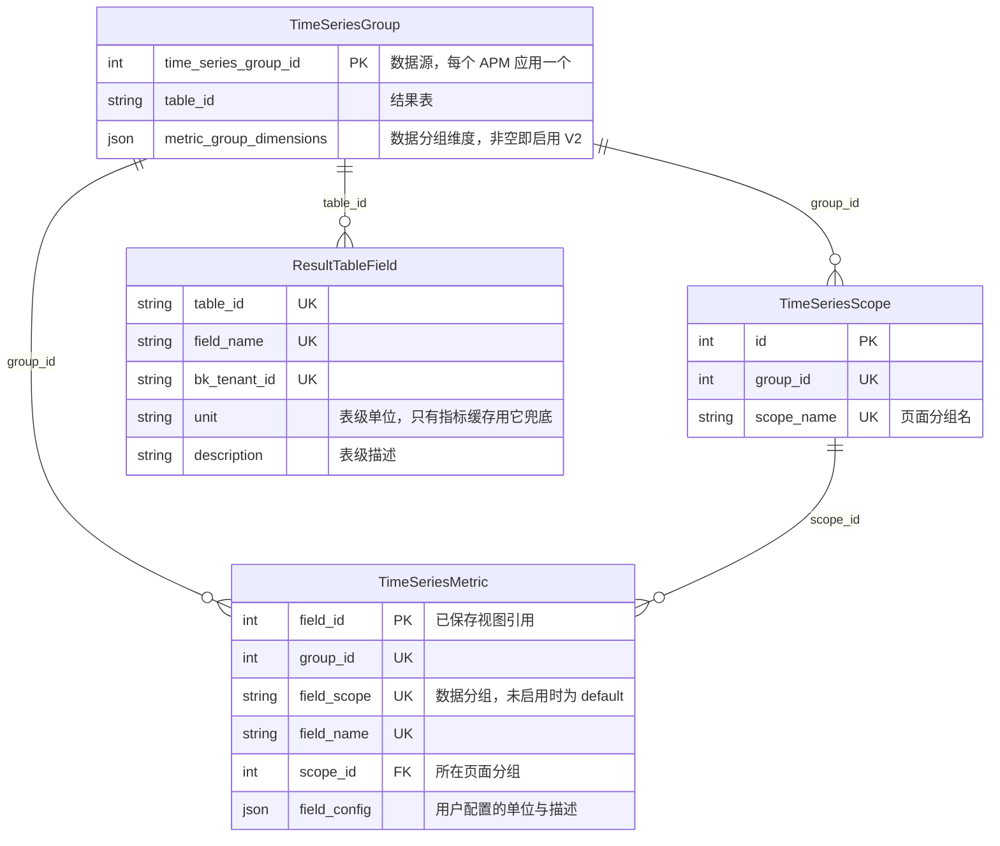

- *[1] 三张表由指标同步维护：bk-monitor-worker（下称 bmw）的 `RefreshTimeSeriesMetric()` 每 `5 min` 同步一次，管理页只写 `field_config` 与页面分组。*
- *[2] 迁移不能改 `field_id` 与所在分组：已保存视图按页面分组名加指标名还原指标，再用当前 `field_id` 请求图表。*

APM 自定义指标 V2 按埋点范围名 `scope_name` 拆行，同一指标名在每个数据分组各占一行，表中仍不记录上报服务：

| `field_id` | 数据分组 `field_scope` | `field_name` | 页面分组 | 上报服务（表中没有） |
| --- | --- | --- | --- | --- |
| `201` | `http` | `request_duration_sum` | `http` | checkout、payment |
| `202` | `default` | `order_total` | 订单（自建） | checkout |
| `150` *[1]* | `default` | `request_duration_sum` | 无 | 无 |

- *[1] 删除只是隐藏：`150` 是开启 V2 前留下的 `default` 行，管理页删除只把 `scope_id` 置 `0`，行仍保留。*

数据分组在建行时写定，移动指标只改页面分组，查询始终带建行时的数据分组：

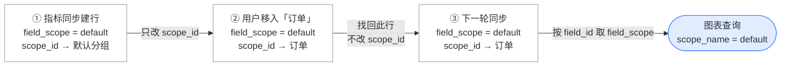

数据分组变化不改时序存储 VictoriaMetrics（下称 VM），只在指标项表新增一行，每轮同步按指标发现结果刷新各行的活跃状态：

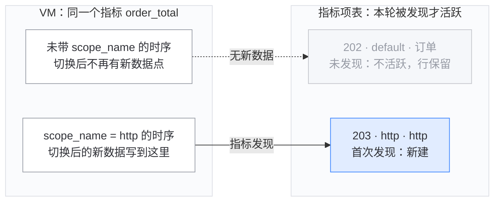

两个数据分组同时上报时，两行都活跃。旧行不删除，是为了保留 `field_id` 与用户配置，恢复上报后下一轮同步会把它改回活跃。

### b. 服务过滤的缺陷

服务与指标的关系只存在 Redis 白名单 `APP_SCOPE_NAME_KEY` 里 *[1]*，服务视图靠它间接推断，有三类缺陷：

| 缺陷 | 现象 | 原因 |
| --- | --- | --- |
| 按页面分组名查找 | 指标移入自建分组后从服务视图消失，维度值为空 | 白名单以 `scope_name` 为键，`GetCustomTsMetricGroups` 与 `GetCustomTsDimensionValues` 传入的是页面分组名 |
| 扫描结果不完整 | 大应用与低频指标被隐藏 | [a] VM 单次返回上限 `slimit 3000`，最大应用已触及 `500,000` 序列上限<br />[b] 缓存未命中时只回查最近 `5 min` |
| 图表依赖 `field_scope` | `field_scope` 收敛为 `default` 后图表无数据，表级单位不显示 | [a] `GetCustomTsGraphConfig` 把 `field_scope` 当作 `scope_name` 过滤<br />[b] 单位只读用户配置 |

- *[1] 白名单靠定时扫描生成：`apm_web.tasks.cache_application_scope_name` 每 `10 min` 用 PromQL 扫描 VM，生成应用内「指标 × `scope_name` × 服务」集合。*

方案改由 Collector 推送这份关系、bmw 存入新表，服务视图、维度值与图表改读新表。

### c. 指标项是热表

指标项 *[1]* 保持「数据源 × 指标名」一行，服务关系存入独立的窄表：

| 读取方 *[2]*                                                                | 触发时机              | 读取范围                 | 实测 p50    |
| ------------------------------------------------------------------------ | ----------------- | -------------------- | --------- |
| `monitor_web.strategies.metric_list_cache.CustomMetricCacheManager`      | 每 `10 min`        | 全平台活跃指标项             | `4.92 s`  |
| `internal/metadata/task.RefreshTimeSeriesMetric`                         | 每 `5 min`         | 每个数据源整组读取 `3` 次      | `108 ms`  |
| `internal/metadata/service.SpacePusher.PushTableIdDetail`                | 每 `15 min` 及指标同步后 | 全部指标项的 `field_name`  | 未压测       |
| `monitor_web.custom_report.resources.metric.GetCustomTsFields`           | 打开管理页             | 按名称排序取一页 `50` 条      | `36.8 ms` |
| `monitor_web.scene_view.resources.custom_metric.GetCustomTsMetricGroups` | 打开指标树             | 最大数据源整组              | `108 ms`  |
| `monitor_web.scene_view.resources.custom_metric.GetCustomTsGraphConfig`  | 打开图表              | 按 `field_id` 取面板内的指标 | 未压测       |

- *[1] 指标项远大于页面分组：上界规模下指标项 `1,000,000` 行、`678 MiB`，页面分组只有 `18,567` 行、`4 MiB`。*
- *[2] Go 路径省略模块前缀：均相对 `pkg/bk-monitor-worker/` 书写。*

### d. 已有表的 DDL 风险

平台必须兼容 MySQL `5.7`，所以元信息存入新表，已有表零 DDL。在 `5.7` 上给指标项表加列，上线过程如下 *[1]*：

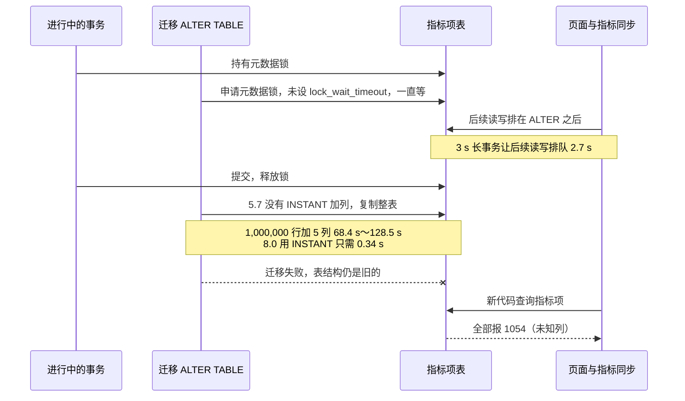

- *[1] 耗时区间取决于 ALTER 条数：下限是一条 ALTER 加 `5` 列，上限是 Django 默认每列一条 ALTER，明细见 [REPORT：在线 DDL](./REPORT.md#a-在线-ddl)。*

### e. 完整方案对比

四个方案按同一组需求 *[1]* 评估，差别在服务关系与元信息存在哪：

| # | 方案 | 服务关系 | 元信息 | 采用 | 依据 |
| --- | --- | --- | --- | :---: | --- |
| A | 沿用白名单 | Redis 白名单，改按 `scope_name` 查找 | 结果表字段 | ❌ | [a] 大应用触及 VM `500,000` 序列上限，服务视图缺指标<br />[b] 一个字段只存一份元信息，不能按范围例外，Histogram 不能按原名组族 |
| B | 按服务拆行 | 指标项按服务复制成行，上界规模 `40,144,125` 行 | 指标项表加 `5` 列 *[2]* | ❌ | [a] 最大数据源管理页首页 `28.6 s`<br />[b] 迁移失败时 `5` 项存量功能中 `4` 项报 `1054`<br />[c] 拆出的行如何分配 `field_id` 未评估 |
| C | 元信息加列 | 三张新表，指标项不变 *[3]* | 指标项表加 `5` 列 *[2]* | ❌ | [a] 上线时整表重建 `68.4 s～128.5 s`<br />[b] 迁移失败时 `5` 项存量功能中 `4` 项报 `1054`<br />[c] 回退要删列再重建 `24.5 s～176.1 s` |
| D | 元信息建表 | 三张新表，指标项不变 | 两张新表 | ✅ | [a] 建表 `0.12 s`，迁移失败时存量功能不受影响<br />[b] 回退删表 `0.12 s` |

- *[1] 四项需求缺一不可：服务视图按服务过滤指标、元信息可按上报范围不同、Histogram 按原名组族、在 MySQL `5.7` 上安全发布。*
- *[2] 五列对应 D 的定义表：`original_name` 存原名，`metric_type` 存类型，`meta` 存元信息 JSON，`meta_fingerprint` 存指纹，`meta_seen_at` 存最近上报时间。*
- *[3] C、D 都要收敛存量 V2：同名指标项合并为 `field_scope=default` 的一行，其余行保留 `field_id` 但从列表隐藏，规则见「APM V2 收敛」。*

加入服务后，关系数 = 指标数 × 每个指标的上报服务数，压测最大数据源的关系数约为生产最大应用的 `230` 倍：

| 场景 | 指标数 | × 每指标服务数 | = 关系数 | 依据 |
| --- | --- | --- | --- | --- |
| 生产：bkte 最大应用 | `217` | `20` | `4,358` | `15 min` 内实测 |
| 压测：最大数据源 | `2` 万 | `50` | `100` 万 | 单数据源设计上界，共 `5` 个 |
| 压测：全平台活跃规模 | `100` 万 | `10` | `995` 万 | 按上云应用的活跃服务数分档 |
| 压测：全平台上界规模 | `100` 万 | `40` | `4,009` 万 | 大型档服务数放大到 APM 登记数 `126` |

加入服务后，B 把指标项放大到 `4,014` 万行，C、D 另存一张 `4,009` 万行的关系表。C、D 在 MySQL `5.7` 与 `9.2` 上都按 `4,009` 万行全量压测，B 最多压到 `995` 万行：

| # | 方案 | 加入服务后的行数（活跃 / 上界） | 存储（活跃 / 上界），推算 | 实测装载的行数 |
| --- | --- | --- | --- | --- |
| A | 沿用白名单 | 指标项 `100` 万，不增加 | `0.7` / `0.7 GiB` | `5.7`：指标项 `100` 万 |
| B | 按服务拆行 | 指标项 `1,005` 万 / `4,014` 万 | `10.7` / `42.7 GiB` | `5.7`：指标项 `232` 万<br />`9.2`：指标项 `995` 万 |
| C | 元信息加列 | 指标项 `100` 万，关系 `995` 万 / `4,009` 万 | `2.8` / `8.2 GiB` | `5.7`：指标项 `100` 万，关系 `4,009` 万<br />`9.2`：关系 `995` 万、`4,009` 万两档 |
| D | 元信息建表 | 指标项 `100` 万，定义 `95` 万，关系 `995` 万 / `4,009` 万 | `2.9` / `8.3 GiB` | `5.7`：指标项 `100` 万，定义 `95` 万，关系 `4,009` 万<br />`9.2`：关系 `995` 万、`4,009` 万两档 |

C、D 在关系表装满 `4,009` 万行时，读取都在现状的 `2.7` 倍以内；B 只装了 `232` 万行，读取已比现状慢 `15～777` 倍。括号内为相对现状 A 的倍数：

| 类别 | 测量项 | A 现状 | B 按服务拆行 | C 元信息加列 | 🌟 D 元信息建表 *[1]* |
| --- | --- | --- | --- | --- | --- |
| 读取 | 最大数据源管理页首页 | `36.8 ms` | `28.6 s`（×777） | `43.8 ms`（×1.2） | `38.0 ms`（×1.0） |
| 读取 | 最大数据源管理页搜索 | `20.2 ms` | 未测 | `20.8 ms`（×1.0） | `21.0 ms`（×1.0） |
| 读取 | 最大数据源族视图首页 | `37.4 ms` | 未测 | `63.4 ms`（×1.7） | `100.7 ms`（×2.7） |
| 读取 | 最大数据源指标树 | `108 ms` | `7,539 ms`（×69） | `144 ms`（×1.3） | `217 ms`（×2.0） |
| 读取 | 指标缓存全平台扫描，活跃规模 | `4.9 s` | `72.0 s`（×15，推算） | `6.7 s`（×1.4） | `9.6 s`（×2.0） |
| 读取 | 最大数据源 APM 服务视图 | `103 ms`，不含白名单过滤 | 未测 | `140 ms`（×1.4） | `214 ms`（×2.1） |
| 读取 | 单个上报范围 | 不涉及 | 未测 | `36.2 ms` | `43.1 ms` |
| 写入 | bmw 每批 `1,000` 条上报 p50 | 不写元信息 | `22.6 ms` | `37.2 ms` | `31.7 ms` |
| 写入 | 最大数据源重报一轮，推算 | 不涉及 | `1,810 s` | `37.7 s` | `32.1 s` |

- *[1] 选定 D 用读取换发布安全：它是唯一满足全部需求且已有表零 DDL 的方案，族视图、指标树、扫描与服务视图比 C 慢 `44%～59%`。*

### f. 其他被否决的做法

除四个完整方案外，下列局部做法也不采用：

| 做法 | 否决原因 |
| --- | --- |
| 用 gh-ost 等在线改表工具执行 C 元信息加列 | 新代码依赖新列这一点不变，迁移失败时仍报 `1054`，且要在 `migrate` 之外执行，平台是否支持「待确认」 |
| 按 `field_id` 建一对一元信息表 | 元信息早于指标项到达时无处落库，收敛前同名的多个 `field_id` 会拆出多份元信息 |
| [按数据源分表](./REPORT.md#a-展开与分表) | 热点数据源整组落在同一张分表，按数据源分 `16` 张表后，MySQL `9.2` 上首页反而慢 `22%` |
| 上报成员存 Redis | 易失，无法按指标反查范围，bmw 也写不出 django-redis 的 pickle 格式 |
| 存储指标族 | 族成员由原名与后缀确定，存储只会多出一份要同步的事实 |
| 保留 BkBase v2 分组发现、不收敛 | 分组键不含服务，无法按服务隔离，V2 数据源要长期单独维护一套指标发现 |

### g. 现有写入代码的约束

新表由 Django 迁移创建、由 bmw 写入，设计必须规避两侧的六项现有行为：

| 现有行为 | 不处理的后果 | 应对 |
| --- | --- | --- |
| gorm `v1.9.16` 插入时省略带 `default` 标签的零值字段 *[1]* | 非空列缺库默认值时 INSERT 报 `1364` | 新表的 bmw 模型不声明 `default` 标签 |
| bmw 删除指标项时忽略 `Delete()` 的错误 | 外键拦下的删除静默残留 | 新表不建外键 |
| bmw 连接字符集 `store.mysql.charset` 默认为 `utf8` | 一个四字节字符让整批 INSERT 失败 | 写入前把四字节字符替换为 `U+FFFD` |
| Python 与 Go 各自按 `metric_group_dimensions` 是否为空判定 v2 | 清空该列与改写指标项不在同一事务时，v1 同步会新建指标项，`field_id` 改变 | 收敛在改写指标项的同一事务内清空该列 |
| bmw 立即失活本轮缺失的指标项并刷新修改时间 | 只按修改时间选保留项会选中刚失活的指标项 | 收敛选保留项时活跃状态排在修改时间之前 |
| bmw 在 Python 迁移合入后当天到 `7 d` 内跟进 | 新 bmw 可能跑在旧表上 | 新迁移只含建表，版本共存覆盖两种发布顺序 |

- *[1] 已有表可能缺库默认值：Django `AddField` 会隐式删除库默认值，已有表的 `is_active` 是否带库默认值「待确认」。*

## 0x02 架构设计

**结构判断：`field_scope` 一列承担的三种语义拆给三个对象，有效配置与服务范围各在一个入口合成。**

现状 `field_scope` 同时是指标项身份、上报来源与页面分组。服务一旦进入它，指标项就按服务膨胀，元信息也只能存一份，局部修补绕不开这一列：

| `field_scope` 承担的语义 | 改造后的承载对象 | 收敛入口 |
| --- | --- | --- |
| 指标项身份 | 指标项 `TimeSeriesMetric`，`field_scope` 固定为 `default` *[1]* | 唯一键不变 |
| 上报来源：哪个服务、哪个 `scope_name` | 上报范围与上报成员 | 服务范围 `ServiceMetricScope` |
| 页面分组 | 页面分组 `TimeSeriesScope` 与 `scope_id` | 不变 |
| 元信息（新增需求） | 指标定义与例外取值 | 有效配置解析器 `MetricConfigResolver` |

- *[1] 收敛不改唯一键：收敛后 `field_scope` 固定为 `default`，唯一键的定义保持原样。*

身份与用户配置由指标同步与页面维护，上报事实由 bmw 写入五张新表 *[1]*，两者在两个入口合成后交给读取方：

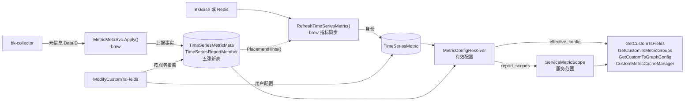

- *[1] 虚线只在归属时读取：指标同步新建指标项，或重放 `1 h` 内新建的默认分组指标项时，读取成员标签决定页面分组。*

### a. 对象模型

已有的指标项与页面分组表结构不变，五张新表分别存元信息、上报来源和两者的连接：

| 对象 | 模型 | 一行表示 | 写入方 |
| --- | --- | --- | --- |
| 指标项 | `TimeSeriesMetric` | 数据源内的一个指标名，带用户配置与所在分组 | 指标同步、用户 |
| 页面分组 | `TimeSeriesScope` | 用户可见的一个指标分组 | 指标同步、用户 |
| 指标定义 | `TimeSeriesMetricMeta` | 一个指标的默认元信息，不依赖指标项存在 | bmw |
| 例外取值 | `TimeSeriesMetricMetaValue` | 一种偏离定义的元信息，同一数据源内按内容去重 | bmw |
| 上报范围 | `TimeSeriesReportScope` | 一个上报来源，APM 中是一个服务的一个 `scope_name` | bmw |
| 范围标签 | `TimeSeriesReportScopeLabel` | 范围上的一个标签键值，按标签反查范围 | bmw |
| 上报成员 | `TimeSeriesReportMember` | 一个范围上报的一个指标 | [a] bmw：`last_seen` 与 `meta_value_id`<br />[b] 用户：按范围覆盖的 `field_config` |

新表都不建外键 *[1]*，指标项按指标名关联定义 *[2]*：


- *[1] 新表不建外键：虚线是自然键或可为 `0` 的引用，新表之间与新旧表之间都如此。*
- *[2] 同名多行共享定义：指标项按 `(group_id, field_name)` 关联定义，不依赖 `field_scope`，收敛前同名的多行指标项都指向同一份定义与成员。*

**存量收敛**：APM V2 的存量数据源要逐个收敛，同名的多行指标项合并为一行，`field_scope` 才能固定为 `default`：

- **选保留项**：优先选有页面分组且活跃的一行，改为 `field_scope=default`，`field_id` 与所在分组不变。
- **其余行隐藏**：其余行移出页面分组并保留 `field_id`，用户配置按修改时间由旧到新并入，保留项自身的键优先。
- **可按快照回退**：收敛前写快照，回退会覆盖收敛后的用户修改，所以有损。
- **未收敛照旧**：未收敛数据源的 `field_scope` 仍可能不是 `default`，读取方按原值过滤。
- **先读后收敛再下线**：SaaS 改读成员后才逐个收敛，全部收敛且 Collector 升级满 `30 d` 后，才删除 v2 分支并下线白名单。

### b. 元信息存储

一个指标的元信息只存一份「定义」，个别上报范围的取值与定义不同时，才另存一份「例外取值」由该范围引用。

**存什么**

定义表 `TimeSeriesMetricMeta` 的字段与上报字段一一对应，只有 `meta` 会因上报范围而不同 *[1]*，例外取值表只存 `meta`：

| 存储字段 | 含义 | 元信息字段 |
| --- | --- | --- |
| `field_name` | 存储中的指标名 | `__metric` |
| `original_name` | 原始指标名，Histogram 的族成员相同 | `__name` |
| `metric_type` | 指标类型 | `__type` |
| `meta` | [a] `description`：描述<br />[b] `unit`：单位<br />[c] `temporality`：累计方式<br />[d] `interval`：上报周期<br />[e] `usage`：汇聚方式 | [a] `__description`<br />[b] `__unit`<br />[c] `__temporality`<br />[d] `__interval`<br />[e] `__usage` |

- *[1] 指纹只算 `meta`：指纹是 `meta` 规范 JSON 的 MD5，用来判断取值是否与定义相同，以及给例外取值去重。*

**存在哪**

`request_duration_sum` 有 `200` 个上报范围，其中两个用旧版 SDK 上报 `unit=ms`。成员都指向定义 *[1]*，例外取值存整份 *[2]*，三张表各存：

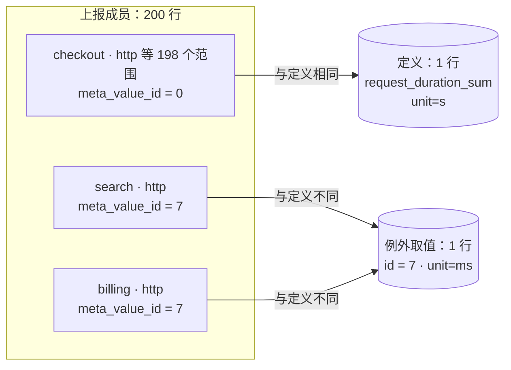

- *[1] 成员都指向定义：每个成员都以 `meta_id` 指向定义，`meta_value_id` 为 `0` 表示与定义相同，图中只画读取时用到的引用。*
- *[2] 例外取值存整份：例外取值不只存差异，同一数据源内取值相同的例外只存一行，不同指标也可共用。*

读一个范围的元信息时，成员的 `meta_value_id` 不为 `0` 就读例外取值，否则读定义；不分范围时直接读定义。

**什么时候变**

定义与例外取值随 bmw 写入与每小时整理变化，新增、改值与停报时各表的变化见「生命周期」。

**为什么这样存**

`9.2` 上实测四种存法，选定的「定义加例外引用」读一个指标的元信息与体积都接近最优（🟢）：

| 存法 | 采用 | 成员行存的值 | 读一个指标的元信息 | 全部范围改值后的体积 | 缺点 |
| --- | :---: | --- | --- | --- | --- |
| 每范围一份 | ❌ | 完整取值 | `940 ms` | `13.5 GiB` | 没有定义，要扫描全部成员取多数值 |
| 内容寻址 | ❌ | 按指纹去重的取值 ID | `709 ms` | 🟢 `5.8 GiB` *[1]* | 同样要扫描全部成员取多数值 |
| 定义加内联例外 | ❌ | 偏离定义时的完整取值 | 🟢 `63 ms` | `11.2 GiB` | 成员行变宽而页分裂，回收后 InnoDB 不归还页 |
| 定义加例外引用 | ✅ | 偏离定义时的例外取值 ID | `66 ms` | `5.9 GiB` *[1]* | 读一个范围多一次按 ID 读取，`5.7` 上慢约 `6%` |

- *[1] 去重收益是乐观值：数据集中每个指标的例外只有一种取值，例外取值各不相同时去重收益消失。*

线上例外比例取决于各服务的 SDK 版本分布，尚无数据。成员表是新表，现在留出引用列，日后例外变多也不必对大表做 DDL。

### c. 上报范围身份

上报范围的身份 `scope_hash` 是范围类型与规范标签串 *[1]* 的 MD5 *[2]*，Collector 协议不变，bmw 按范围类型解码出范围标签：

| 范围类型 `__scope_type` | 范围值 `__scope` 示例 | 解码后的标签 |
| --- | --- | --- |
| `APM` | `checkout-http%2Dclient` *[3]* | [a] `service_name=checkout`、`scope_name=http-client`<br />[b] 应用由 DataID 确定，`app_name` 不进入标签 |
| `DEFAULT` | `""` | 无，不建上报范围，元信息直接作用于定义 |
| 其他（未注册解码器） | 由上报方定义，编码方式「待确认」 | `scope=<原值>`，原值另存 `raw_scope` 供排障 |

- *[1] 标签串排序后拼接：按键名升序拼接 `k:v` 并以 `||` 连接，标签值含 `||` 时拒收。*
- *[2] 身份取定长哈希：哈希长度固定，不受索引长度限制。*
- *[3] 服务名与 scope 各自转义：两者先各自转义再用 `-` 连接，转义把 `%` 写成 `%25`，把 `-` 写成 `%2D`。*

每个数据源最多 `2,000` 个上报范围、`1,200,000` 个上报成员，超限时丢弃新范围并计数，防止 Pod 名等高基数标签进入范围。

四类查询都走唯一键或二级索引，其中范围标签按标签值倒排，回答「哪些范围带这个标签」：

| 查询 | 条件 | 结果 | 索引 |
| --- | --- | --- | --- |
| 按范围精确定位 | `group_id`、`scope_hash` | 上报范围 | 范围唯一键 |
| 按标签过滤 | `group_id`、`label_key`、`label_value` | 上报范围 ID | [a] 标签唯一键（覆盖索引）*[1]*<br />[b] 不依赖 `8.0` 多值索引 |
| 按范围取指标 | `group_id`、`report_scope_id` | 上报成员 | 成员唯一键前缀 |
| 按指标取范围 | `group_id`、`meta_id` | 上报成员 | 成员二级索引 |

- *[1] 过滤耗时来自早期实验：`1,000` 个服务时按服务过滤 p50 为 `0.070 ms`，取自 REPORT 的早期 `__scope` 表示实验，测试环境「待确认」。*

### d. 写入链路

Collector 把元信息发往专用的元信息 DataID，它只决定 Kafka topic，记录内的 `dataid` 才指向指标所属的数据源。bmw 常驻任务按数据源聚批写入新表，周期任务每 `1 h` 整理一次：

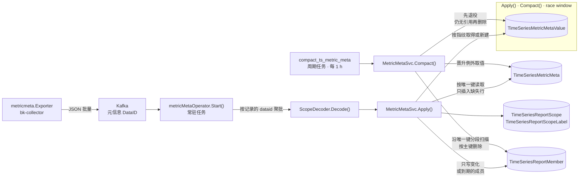

写入遵守三条约束：

1. **一个数据源一个事务**：一批记录按数据源聚合，事务提交后才标记 offset，失败的批次会重放，重放由指纹比较去重。
2. **只写变化或到期的行**：Collector 每 `2 h` 补报一轮，取值未变的成员只在刷新间隔到期后才更新 `last_seen`。
3. **整理与写入互不阻断**：例外取值先退役、满 `1 h` 仍无引用才删除，两者争同一行时靠行锁复查保证成员不悬空。

### e. 与指标发现的关系

原有指标发现任务即 bmw 的 `RefreshTimeSeriesMetric()`，下文称指标同步，改造后保留，仍是指标项的唯一创建方。元信息链路只补它查不到的两类事实：谁在上报，上报了什么元信息：

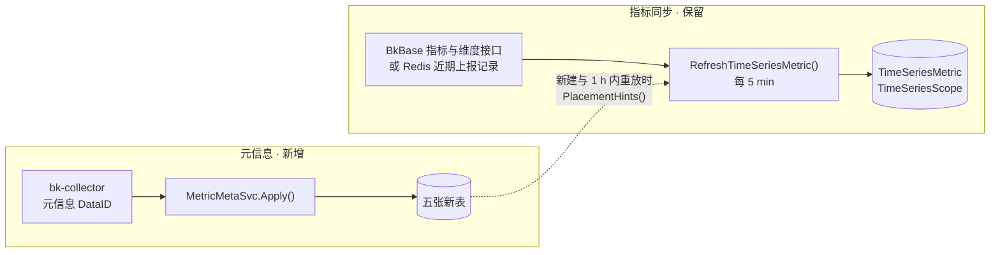

| 数据 | 存储位置 | 写入方 | 改造后 |
| --- | --- | --- | --- |
| 指标名、维度与活跃状态 | `TimeSeriesMetric` | 指标同步，取自存储中的实际数据 | 不变，元信息不含维度 |
| 页面分组 | [a] `TimeSeriesScope`<br />[b] `TimeSeriesMetric.scope_id` | 指标同步新建时决定，之后由用户修改 | 新建时多一个分组提示来源 |
| 上报范围与成员 | [a] `TimeSeriesReportScope`<br />[b] `TimeSeriesReportScopeLabel`<br />[c] `TimeSeriesReportMember` | bmw `Apply()`，取自 Collector 上报 | 新增 |
| 单位、描述等元信息 | [a] `TimeSeriesMetricMeta`<br />[b] `TimeSeriesMetricMetaValue` | bmw `Apply()`，取自 Collector 上报 | 新增，原先只有用户配置与表级字段 |

两条链路以 `(group_id, field_name)` 对齐，交互只有以下几点：

- **互不创建**：元信息不创建指标项，指标同步不写新表，只有元信息而没有数据的指标不出现在管理页。
- **只在归属时交汇**：指标同步只为新建与 `1 h` 内新建的指标项查分组提示，其余指标项不读新表，整组读取的开销不变。
- **到达先后不定**：元信息先到时，新指标项直接按提示归组；后到时，指标同步把 `1 h` 内新建、仍在默认分组的指标项重新归属一次。
- **回收各自独立**：指标同步失活指标项不动新表，新表回收也不动指标项，见「生命周期」。
- **只停用 v2 分组发现**：指标同步有两个分支，`metric_group_dimensions` 非空时走 v2，按分组维度拆行，否则走 v1，按指标名一行。白名单下线时，Python 与 Go 两侧只删除 v2 分支。
- **没有元信息照常运行**：Collector 未上报的数据源，指标同步行为不变，有效配置回落到用户配置与表级字段。

### f. 页面归属

页面归属在指标同步新建指标项时决定，分组提示取多数 *[1]*，分组维度只读一处 *[2]*。元信息晚到时再重放一次，此后只由用户修改：

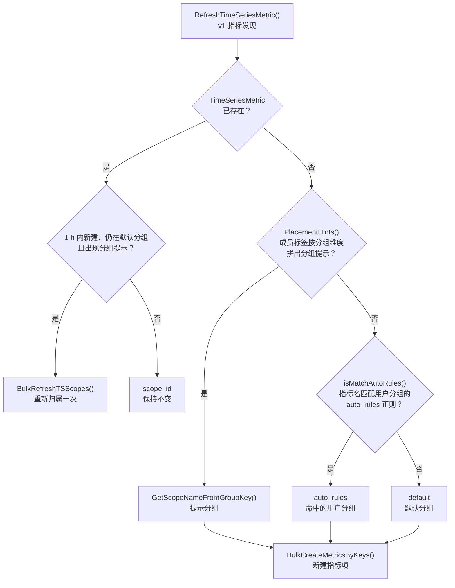

- *[1] 多个提示取多数：多个范围给出不同的分组提示时取成员数最多的分组名，相同时按名称升序。*
- *[2] 分组维度只读一处：只读 `ResultTableOption(metric_group_dimensions)`，`TimeSeriesGroup.metric_group_dimensions` 只保留 v2 开关语义，收敛后为空。*

### g. 有效配置解析

`MetricConfigResolver` 是有效配置的唯一计算入口，用户配置优先于上报元信息 *[1]*，成员两级按需参与 *[2]*：

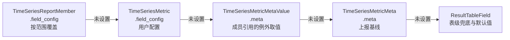

- *[1] 上报会随升级变化：Collector 升级或补报会改变上报值，用户配置排在上报例外之前，用户改过的值才不受影响。*
- *[2] 成员两级按需参与：只在传入范围标签 `report_labels` 时参与，例如服务视图传入 `service_name`，多个成员命中时取 `last_seen` 最近的一个，按服务覆盖会写到全部命中成员，覆盖值不随所取成员变化。*

页面保存只写 `field_config`，不改上报的 `meta`，两者不一致时有效配置取用户值，清空该项即回落到上报值 *[1]*。

- *[1] 清空即删除该键：Metadata 用请求中的 `field_config` 整份替换，回写跳过的空值不会出现在新配置中。*

五个配置项都按上图顺序取值，上报值多数要转换后才能采用：

| 配置项 | `field_config` 键 *[1]* | `meta` 键 | 上报值的转换 | 表级兜底与默认值 |
| --- | --- | --- | --- | --- |
| 单位 | `unit` | `unit` | [a] UCUM 单位转为 `core/unit` 已注册的 ID，未命中时不采用<br />[b] 例如 `us → µs`、`min → m`、`By → bytes`、`1 → none`、`% → percent` | `ResultTableField.unit` |
| 描述 | `alias` | `description` | 无 | `ResultTableField.description` |
| 汇聚方法 | `aggregate_method` | `usage` | 映射表「待确认」 | `AVG` |
| 函数 | `function` | `temporality` | `cumulative` 的 Counter 补 `increase` | `[]` |
| 聚合周期 | `interval` | `interval` | 毫秒转为秒 | `auto` |

- *[1] 空值不覆盖上报值：键不存在或值为 `""`、`0`、`[]` 时视为未设置，管理页整包回写会补齐这三种值。*

### h. 生命周期

五张新表随上报新建，随整理晋升与回收；指标项与页面分组沿用现状。两条线只靠 `(group_id, field_name)` 对齐，互不触发写入。

**谁写哪张表**

上报与整理只写五张新表，指标同步只写指标项与页面分组，页面编辑两边都写 *[1]*：

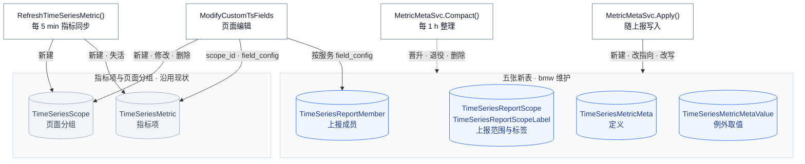

- *[1] 两条线的回收互不牵动：指标同步只读成员标签取分组提示，失活指标项不动新表，新表回收也不动指标项。*

各表何时新建、变化与删除如下，时长都是 bmw 配置的默认值 *[1]*：

| 数据表 | 新建 | 变化 | 删除 |
| --- | --- | --- | --- |
| `TimeSeriesMetric` | 指标同步首次发现该指标，`field_scope` 为 `default` | [a] 指标同步：刷新活跃状态与维度<br />[b] 用户：修改 `field_config` 与 `scope_id` | 不删除，指标同步不再返回时置为失活 |
| `TimeSeriesScope` | 指标同步或用户新建 | 用户修改 | 用户删除 |
| `TimeSeriesMetricMeta` | 指标第一次上报元信息 | [a] 不带范围的上报改值时改写<br />[b] `6 h` 无人上报且存在例外时，晋升例外取值 | 无指标项、无成员，且 `30 d` 未上报 |
| `TimeSeriesMetricMetaValue` | 带范围的上报与定义不同，且没有同指纹的取值 | [a] 无引用时退役<br />[b] 退役期间被引用即恢复 | 退役满 `1 h` 仍无引用 |
| `TimeSeriesReportScope` | 新范围第一次上报，超出 `2,000` 个时丢弃 | 刷新 `last_seen` | 无成员且 `30 d` 未上报 |
| `TimeSeriesReportScopeLabel` | 随范围插入 | 无，标签是范围身份的一部分 | 随范围删除 |
| `TimeSeriesReportMember` | 范围第一次上报该指标，超出 `1,200,000` 个时丢弃 | [a] bmw：改指向，`last_seen` 至少隔 `24 h` 刷新<br />[b] 用户：按范围覆盖 `field_config` | `30 d` 未上报 |

- *[1] 时长可调：时长由 bmw 配置项控制，例外取值的退役保留期不得小于整理周期。*

**状态与迁移**

成员、例外取值与定义各有一台状态机，边上写明由谁、在什么条件下触发。蓝色是常态，琥珀色是等待整理处理的状态。

成员只在指向定义与指向例外取值之间切换 *[1]*，首次上报时决定初始指向 *[2]*，整理可把它拨回定义 *[3]*：

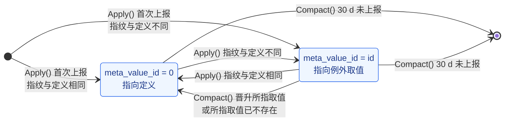

- *[1] 指向之外的写入不迁移状态：取值未变的重复上报只在 `last_seen` 满 `24 h` 时刷新，用户按服务写入的 `field_config` 也不改指向。*
- *[2] 首条上报即定义：指标还没有定义时，本条上报先成为定义，成员随之指向定义，不带范围的上报不建成员。*
- *[3] 整理只拨回同一指标的成员：晋升只把同一定义下指向该取值的成员置 `0`，所指取值已不存在时同样置 `0` 并计数。*

例外取值不存引用计数 *[1]*，由整理按本轮扫描的引用决定去留，退役期是删除前的缓冲 *[2]*：

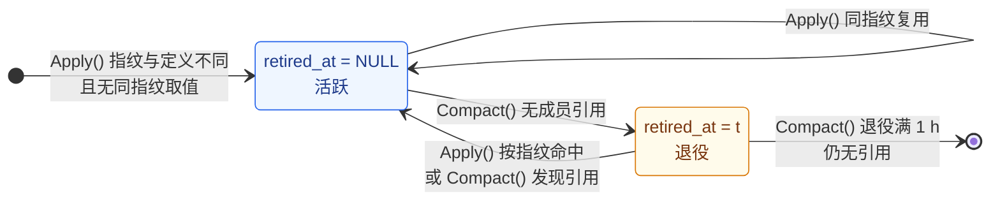

- *[1] 失去引用有三条途径：成员改报其他取值、该取值被晋升为定义、引用它的成员全部过期，取值按指纹去重，同一数据源内不同指标也可共用一行。*
- *[2] 退役期挡住竞态：`Apply()` 与 `Compact()` 争同一行时靠行锁复查，成员不会指向已删除的取值，扫描开始后新建的取值也不参与本轮回收。*

定义由首条上报写入 *[1]*，不带范围的上报直接改写它 *[2]*，`6 h` 无人沿用且存在例外时晋升多数取值 *[3]*，晋升后靠成员上报回到常态 *[4]*：

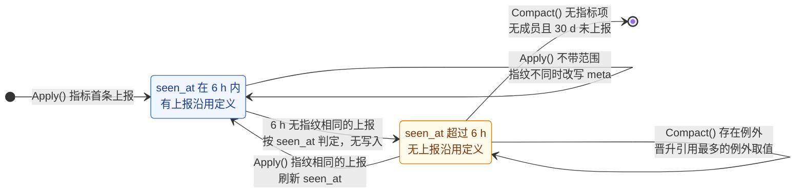

- *[1] 首条上报可能是旧值：首个上报方若用旧版 SDK，其余成员先记为例外，晋升前按范围读取不受影响，不分范围时读到旧值。*
- *[2] 只有不带范围的上报能改写：带范围的上报不改定义的 `meta`、`original_name` 与 `metric_type`，取值未变时 `seen_at` 至少隔 `30 min` 刷新。*
- *[3] `6 h` 不会误切换：它是 Collector 强制补报周期 `2 h` 的 `3` 倍，持续上报的定义总会在期间刷新 `seen_at`。*
- *[4] 晋升是否刷新 `seen_at` 未定：晋升同时刷新 `seen_at`「待确认」，不刷新时下一轮整理可能接着晋升剩余的例外取值。*

**场景走查**

下面以数据源 `1001` 的 `request_duration_sum` 为例走查四个场景。快照图中每张表是一个分组，行是节点，引用是边。绿色是新增，蓝色是改值或改指向，琥珀色虚线是退役，红色虚线是删除，灰色是未变。

**新增：不同范围上报相同或不同的元信息**

首条上报成为定义，取值相同的范围指向定义，不同的范围引用例外取值，同值只存一份，所以图中各行都是新增。元信息不创建指标项 *[1]*，指标同步在下一轮补建，元信息晚到也能归组 *[2]*：

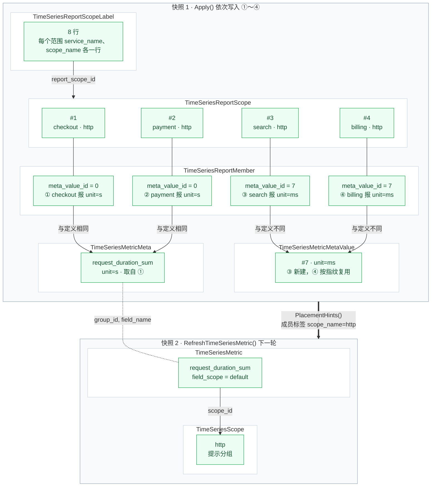

- *[1] 元信息不创建指标项：指标同步新建 `field_scope = default` 的一行，分组维度为 `scope_name` 时取提示分组 `http`。*
- *[2] 元信息晚到时重放一次：指标项先建在默认分组时，指标同步对 `1 h` 内新建且出现提示的指标项重新归属一次。*

**更新：同一范围改报元信息**

写入时 `Apply()` 只改成员的指向，例外取值的去留由整理决定。payment 先改报 `unit=ms`，三个范围再一起改报 `unit=s` *[1]*：

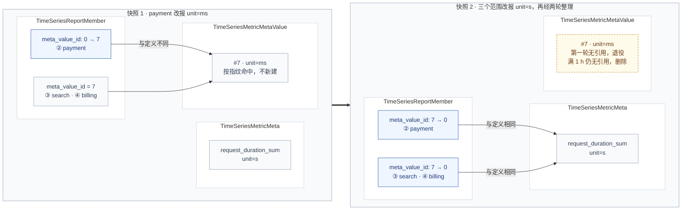

- *[1] 图中省略 checkout：checkout 始终报 `unit=s`，成员一直指向定义。*

另外三种更新不改成员指向，或在退役期内恢复：

| 变更 | 各表的变化 | 原因 |
| --- | --- | --- |
| 退役期间又有范围改报 `unit=ms` | [a] 按指纹命中 `#7`，清空 `retired_at`<br />[b] 该成员的 `meta_value_id` 改为 `7` | 退役期间被引用即恢复，不必新建 |
| 不带范围的上报改值 | 指纹不同时改写定义的 `meta` 与指纹 | 不带范围的元信息直接作用于定义 |
| 取值未变的重复上报 | [a] 定义的 `seen_at` 至少隔 `30 min` 刷新<br />[b] 成员的 `last_seen` 至少隔 `24 h` 刷新 | Collector 每 `2 h` 补报一轮，只写变化或到期的行 |

**更新：全部范围改值后的时钟**

全部范围在 `02:00` 改报 `unit=us`，成员都指向新例外 `#8`。定义 `6 h` 无人沿用后由整理晋升 `#8` 的取值 *[1]*，`#8` 随即失去引用，退役 `1 h` 后删除 *[2]*：

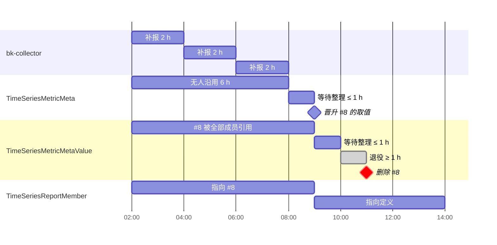

- *[1] 连续三轮补报无人沿用才晋升：仍有成员指向定义时每轮补报都会刷新 `seen_at`，`30 min` 的刷新间隔远小于 `6 h`。*
- *[2] 晋升的下一轮才退役：晋升当轮扫描时 `#8` 仍有引用，下一轮整理才退役，图中按每轮最长等待 `1 h` 示意。*

**删除与恢复：指标停止上报**

停报 `30 d` 后成员过期删除 *[1]*，范围与例外取值随之回收。指标项只失活 *[2]*，定义保留 *[3]*，恢复上报时 `field_id`、指标项上的用户配置与定义都还在。下图 `10-01` 停报、`11-10` 恢复，灰色是行保留但不再刷新，红色菱形是由整理删除：

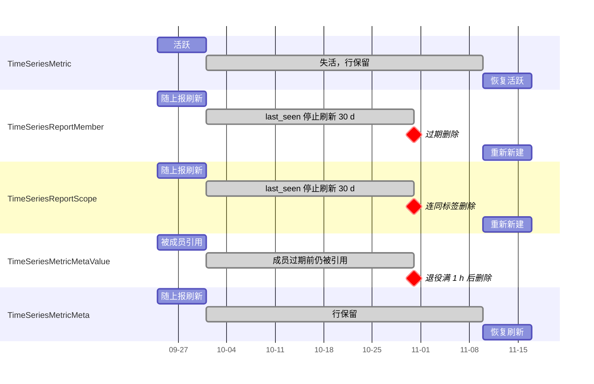

- *[1] 停报期间仍在服务视图：`visible()` 只看成员是否存在，是否按 `last_seen` 提前隐藏「待确认」，按服务覆盖的 `field_config` 随成员删除，恢复后不会还原。*
- *[2] 失活沿用现有判定：指标同步不再返回该指标时置为失活，具体时刻取决于现有的活跃判定，图中按停报当天示意。*
- *[3] 定义随指标项删除才回收：指标项被 `check_ts_metrics` 或关闭自动发现删除后，定义在无成员且 `30 d` 未上报时删除。*

**页面编辑：移入用户分组与修改单位**

页面编辑只写用户配置与所在分组，不触发上面任何状态迁移，上报的 `meta` 不变。下图依次移入「订单」、改单位为 `ms`、在服务 checkout 改单位为 `us`：

```mermaid
%%{init: {"themeVariables": {"clusterBkg": "#ffffff", "clusterBorder": "#cbd5e1"}}}%%
flowchart LR
    subgraph G["TimeSeriesScope"]
        direction TB
        G1["http<br/>提示分组"]
        G2["订单<br/>用户创建"]
    end
    subgraph T["TimeSeriesMetric"]
        T1["request_duration_sum<br/>scope_id: http → 订单<br/>field_config.unit = ms"]
    end
    subgraph M["TimeSeriesReportMember"]
        M1["① checkout<br/>field_config.unit = us"]
    end
    subgraph D["TimeSeriesMetricMeta"]
        D1["request_duration_sum<br/>meta.unit = s"]
    end
    G1 ~~~ G2
    T1 -.->|"原 scope_id"| G1
    T1 -->|"scope_id"| G2
    T1 -.->|"group_id, field_name"| D1
    M1 -->|"meta_id"| D1

    classDef change fill:#eff6ff,stroke:#2563eb,color:#1e3a8a
    classDef keep fill:#f8fafc,stroke:#94a3b8,color:#334155
    class T1,M1 change
    class G1,G2,D1 keep
```

读取时按服务覆盖优先于指标项的配置，用户配置优先于上报值，清空即回落：

| 操作 | 写入的字段 | 读取结果 |
| --- | --- | --- |
| 移入用户分组「订单」 | `TimeSeriesMetric.scope_id` | [a] 管理页与指标树在「订单」下展示 *[1]*<br />[b] 服务视图按成员判断，仍然可见<br />[c] 后续指标同步不改 `scope_id` |
| 修改单位为 `ms` | `TimeSeriesMetric.field_config.unit` | 有效单位取 `ms`，之后上报的单位变化也不影响 |
| 清空单位 | 从 `field_config` 删除 `unit` *[2]* | 回落到上报的单位 |
| 在服务 checkout 修改单位为 `us` *[3]* | 成员的 `field_config.unit` | 只有 checkout 的服务视图取 `us` |

- *[1] 族成员要同在一个分组：族键含 `scope_id`，只移走一个族成员时，原分组的族只禁用依赖它的方法。*
- *[2] 清空即删除该键：Metadata 用请求中的 `field_config` 整份替换，上报的 `meta` 始终不变。*
- *[3] 按服务覆盖写全部命中成员：服务页带 `service_name` 写回，覆盖值不随所取成员变化，页面入口「待确认」。*

### i. 读取路径

读取方仍只调 Metadata 的查询接口，SaaS 不直接读新表。Metadata 先按现状读指标项，再按指标名补读定义与成员，合成后随每个指标返回。SaaS 的服务范围对象带 `report_labels` 查询，再汇总返回的 `report_scopes`：

```mermaid
flowchart LR
    subgraph SaaS["SaaS"]
        direction TB
        Tree["GetCustomTsMetricGroups"]
        Graph["GetCustomTsGraphConfig<br/>GetCustomTsDimensionValues"]
        Fields["GetCustomTsFields"]
        Scope["ServiceMetricScope<br/>visible()<br/>scope_name_filter()"]
    end
    subgraph Meta["Metadata"]
        direction TB
        Query["QueryTimeSeriesScopeResource<br/>QueryTimeSeriesMetricResource"]
        Resolver["MetricConfigResolver<br/>prefetch() · resolve()"]
        Info["to_metric_info()"]
    end
    Cache["CustomMetricCacheManager"] --> Info
    Tree --> Scope
    Graph --> Scope
    Scope <-->|"report_labels<br/>report_scopes"| Query
    Fields --> Query
    Graph --> Query
    Query -->|"① 语句不变"| Metric[("TimeSeriesMetric")]
    Query --> Resolver
    Info --> Resolver
    Resolver -->|"② 按指标名一次补读"| New[("定义、成员<br/>例外取值")]
```

**查询协议**：查询接口新增两个可选参数，范围标签 `report_labels` 与视图 `view`，每个指标在原有字段之外多返回四个字段：

| 字段 | 含义 | 何时有值 |
| --- | --- | --- |
| `meta` | 上报的元信息，命中例外时取例外取值 | 有定义时 |
| `effective_config` | 有效配置，按「有效配置解析」合成 | 总是 |
| `report_scopes` | 命中范围标签的上报范围，例如 `{service_name, scope_name}` | 请求带 `report_labels` 时 |
| `family` | 所属指标族与族内角色 | 是 Histogram 族成员时 |

**服务范围协议**：`ServiceMetricScope` 每个请求构造一次，汇总该服务各指标上报的 `scope_name`。白名单下线前，再并上现有的 Redis 白名单 *[1]*：

```text
ServiceMetricScope.load(params, group_id) -> ServiceMetricScope | None   # 非 APM 场景为 None
visible(metric_name) -> bool                                              # 该服务是否上报了这个指标
scope_name_filter(metric_name, field_scope) -> str | list[str] | None     # field_scope 不是 default 时原样返回，否则返回成员的 scope_name
```

- *[1] 白名单由扫描生成：`APP_SCOPE_NAME_KEY` 每 `10 min` 扫描 VM 得到，记录应用内「指标 × `scope_name` × 服务」集合，成员数据稳定后下线。*

各读取方按以下方式使用两个协议：

- **服务视图过滤**：`GetCustomTsMetricGroups` 用 `visible()` 替代按页面分组名比对白名单，指标在哪个页面分组都不影响可见性。
- **图表与维度值**：`scope_name` 条件取 `scope_name_filter()`，单位、别名、汇聚方法与函数取 `effective_config`。维度值请求带上 `field_id`，后端才能反查成员。
- **管理页**：`meta` 与 `effective_config` 并列返回，页面同时看到上报值与生效值，编辑仍只写 `field_config`。
- **指标缓存与策略选择器**：`to_metric_info()` 改经解析器取单位与描述，缓存的读取路径不变。
- **族视图**：读取方按 `family` 归组，规则见「指标族与复合视图」。

读取遵守三条约束：

1. **与指标项分开读取**：新表不与指标项 JOIN，`5.7` 上 JOIN 时整组读取为 `237 ms`、按描述搜索为 `377 ms`。
2. **按数据源一次预取**：每个请求对一个数据源只读一次定义，带 `report_labels` 时再读一次成员，不逐个指标查询。
3. **新表缺失只降级**：读新表报 `1146`（表不存在）时视为没有定义与成员，结果回落到改造前。

### j. 指标族与复合视图

Histogram 的族成员在读取时组成一个族，详情页一个族一个面板，每个统计方法一个 target。配置接口返回全部方法的 target，前端只执行选中的那些。

**族成员**：同一数据源、同一页面分组，定义的 `original_name` 相同且 `metric_type = histogram`，`field_name` 为规范化原名 *[1]* 加 `_sum`、`_count`、`_bucket`、`_min` 或 `_max`。族由 Metadata 的 `metric_family_of()` 判定，随查询接口的 `family` 字段带给指标树、管理页与图表配置。

- *[1] 规范化替换点号：`http.server.duration` 规范化为 `http_server_duration`。*

**复合视图结构**：沿用现有面板协议，不新增键。以服务 checkout 的 `request.duration`（delta）为例 *[1]*：

```json
{
  "title": "请求耗时",
  "sub_title": "custom:APM:request_duration_count",
  "targets": [
    {
      "alias": "AVG",
      "expression": "b == 0 or a / b",
      "unit": "s",
      "function": {},
      "metric": {"name": "request.duration", "alias": "请求耗时"},
      "query_configs": [
        {
          "metrics": [{"field": "request_duration_sum", "method": "SUM", "alias": "a"}],
          "interval": "$interval",
          "table": "2_bkapm_metric_demo.__default__",
          "data_label": "APM",
          "data_source_label": "custom",
          "data_type_label": "time_series",
          "group_by": ["method"],
          "where": [],
          "functions": [],
          "filter_dict": {"group_filter": {}, "common_filter": {}, "scope_name": "http", "service_name": "checkout"}
        },
        {
          "metrics": [{"field": "request_duration_count", "method": "SUM", "alias": "b"}],
          "interval": "$interval",
          "table": "2_bkapm_metric_demo.__default__",
          "data_label": "APM",
          "data_source_label": "custom",
          "data_type_label": "time_series",
          "group_by": ["method"],
          "where": [],
          "functions": [],
          "filter_dict": {"group_filter": {}, "common_filter": {}, "scope_name": "http", "service_name": "checkout"}
        }
      ]
    },
    {
      "alias": "COUNT",
      "expression": "a",
      "unit": "none",
      "function": {},
      "metric": {"name": "request.duration", "alias": "请求耗时"},
      "query_configs": [
        {
          "metrics": [{"field": "request_duration_count", "method": "SUM", "alias": "a"}],
          "interval": "$interval",
          "table": "2_bkapm_metric_demo.__default__",
          "data_label": "APM",
          "data_source_label": "custom",
          "data_type_label": "time_series",
          "group_by": ["method"],
          "where": [],
          "functions": [],
          "filter_dict": {"group_filter": {}, "common_filter": {}, "scope_name": "http", "service_name": "checkout"}
        }
      ]
    },
    {
      "alias": "P95",
      "expression": "a",
      "unit": "s",
      "function": {},
      "metric": {"name": "request.duration", "alias": "请求耗时"},
      "query_configs": [
        {
          "metrics": [{"field": "request_duration_bucket", "method": "SUM", "alias": "a"}],
          "interval": "$interval",
          "table": "2_bkapm_metric_demo.__default__",
          "data_label": "APM",
          "data_source_label": "custom",
          "data_type_label": "time_series",
          "group_by": ["le", "method"],
          "where": [],
          "functions": [{"id": "histogram_quantile", "params": [{"id": "scalar", "value": 0.95}]}],
          "filter_dict": {"group_filter": {}, "common_filter": {}, "scope_name": "http", "service_name": "checkout"}
        }
      ]
    }
  ]
}
```

- *[1] 示例节选三个 target：`SUM` 与 `COUNT` 同构，只把族成员换成 `_sum`，其余分位方法只改 `scalar`，`alias` 非空即表示复合面板。*

结构上有三条取值约束：

- **族成员一律 `SUM`**：不继承各自的 `aggregate_method` 与 `function`，`COUNT` 也是对 `_count` 求和，`method: COUNT` 统计的是样本点数。
- **cumulative 前置 `increase`**：每个查询的 `functions` 最前面加 `increase`，窗口取当前周期与 `2 ×` 上报周期的较大值。上报周期取 `_count` 定义的 `meta.interval`，缺失时取 `2m`。
- **`le` 只进分位查询**：`group_by` 取族成员维度的交集，只有 `_bucket` 的查询追加 `le`。

**基于现有代码的调整**：现状每个指标走一遍 `time_or_no_compare()`，生成一个面板、一个 target。族视图在同一条链路上插入归组，单指标与指标对比的路径不变：

```mermaid
flowchart LR
    Perform["perform_request()<br/>组装 metrics_list"] --> Branch{"view=family<br/>且不是指标对比？"}
    Branch -- 否 --> Old["time_or_no_compare()<br/>metric_compare()<br/>每个指标一个面板"]
    Branch -- 是 --> Group["按 family.key 归组<br/>族外指标照旧"]
    Group --> Series["query_metric_series()<br/>以 _count 成员拆图"]
    Series --> QC["_build_query_config()<br/>从现有循环中抽出"]
    QC --> Panel["build_family_panel()<br/>每个方法一个 target"]
    Old --> Resp["ResponseSerializer<br/>结构不变"]
    Panel --> Resp
```

| 现有环节 | 现状 | 族视图的调整 |
| --- | --- | --- |
| `metrics_list` 组装 | 每项带名称、别名、汇聚方法、函数、单位与 `scope_name` | 另带 `family`，以及 `_count` 定义的 `temporality` 与 `interval` |
| 拆图 `query_metric_series()` | 按指标维度与拆图维度查 series，每个 series 一组面板 | 族以 `_count` 成员参与，其余族成员跟随同一组 |
| `query_config` 构造 | 写在 `time_or_no_compare()` 的循环内，`functions` 为 Top/Bottom 加指标函数 | 抽成 `_build_query_config()` 共用，族成员不叠加 Top/Bottom 与指标函数 |
| 面板 | 每个指标一个面板一个 target，`alias` 为空串 | 每个族一个面板，每个方法一个 target，`alias` 为方法名 |
| 时间对比 | `time_compare` 写在 target 的 `function` | 不变，族面板的每个 target 同样带上 |
| 指标对比 `metric_compare()` | 一个面板放多个指标 | 不组族 |
| 响应序列化器 | 面板与 target 只保留固定键 | 不变，族面板不依赖新键 |

## 0x03 开发方案 —— Metadata 存储、解析与查询

### a. 数据模型与迁移

`bkmonitor/metadata/models/custom_report/metric_meta.py`（新增）、`bkmonitor/metadata/migrations/0278_metric_meta.py`（新增）

迁移 `0278_metric_meta` 只含下面五个模型的 `CreateModel`，`makemigrations` 顺带生成的 `ResultTableOption.name` 的 `AlterField` 要手工删除：

```python
# metadata/models/custom_report/metric_meta.py，五个模型从 metadata.models 导出
# 主键用 BigAutoField：upsert 按批消耗自增 ID；引用列只存主键，不用 ForeignKey：bmw 忽略删除错误
# JSON 列均可空：5.7 上非空 JSON 列不能有默认值
UTF8 = "utf8_bin"  # 索引列不能用 utf8mb4，COMPACT 行格式下超过 767 B 报 1071
ASCII = "ascii_bin"


class TimeSeriesMetricMeta(models.Model):
    id = models.BigAutoField(primary_key=True)
    group_id = models.IntegerField()
    field_name = models.CharField(max_length=255, db_collation=UTF8)
    original_name = models.CharField(max_length=255, db_collation=UTF8)
    metric_type = models.CharField(max_length=16)
    meta = models.JSONField(null=True)
    fingerprint = models.CharField(max_length=32, db_collation=ASCII)
    seen_at = models.DateTimeField()

    class Meta:
        unique_together = (("group_id", "field_name"),)
        indexes = [models.Index(fields=["group_id", "original_name"], name="tsmm_group_original_idx")]


class TimeSeriesMetricMetaValue(models.Model):
    id = models.BigAutoField(primary_key=True)
    group_id = models.IntegerField()
    fingerprint = models.CharField(max_length=32, db_collation=ASCII)
    meta = models.JSONField(null=True)
    retired_at = models.DateTimeField(null=True)

    class Meta:
        unique_together = (("group_id", "fingerprint"),)


class TimeSeriesReportScope(models.Model):
    id = models.BigAutoField(primary_key=True)
    group_id = models.IntegerField()
    scope_hash = models.CharField(max_length=32, db_collation=ASCII)
    scope_type = models.CharField(max_length=32)
    labels = models.JSONField(null=True)
    raw_scope = models.CharField(max_length=512)
    last_seen = models.DateTimeField()

    class Meta:
        unique_together = (("group_id", "scope_hash"),)


class TimeSeriesReportScopeLabel(models.Model):
    id = models.BigAutoField(primary_key=True)
    group_id = models.IntegerField()
    label_key = models.CharField(max_length=64, db_collation=UTF8)
    label_value = models.CharField(max_length=255, db_collation=UTF8)
    report_scope_id = models.BigIntegerField()

    class Meta:
        unique_together = (("group_id", "label_key", "label_value", "report_scope_id"),)


class TimeSeriesReportMember(models.Model):
    id = models.BigAutoField(primary_key=True)
    group_id = models.IntegerField()
    report_scope_id = models.BigIntegerField()
    meta_id = models.BigIntegerField()
    last_seen = models.DateTimeField()
    meta_value_id = models.BigIntegerField(default=0)  # 0 表示与定义相同
    field_config = models.JSONField(null=True)

    class Meta:
        unique_together = (("group_id", "report_scope_id", "meta_id"),)
        # last_seen 与 meta_value_id 不建索引：回收与引用统计沿唯一键分段扫描
        indexes = [models.Index(fields=["group_id", "meta_id"], name="tsrm_group_meta_idx")]


# metadata/models/result_table.py
class ResultTableOption(OptionBase):
    # 打开后 bmw 才写入该数据源的元信息，不加入 name 的 choices，否则迁移多出 AlterField
    OPTION_ENABLE_METRIC_METADATA = "enable_metric_metadata"


# core/prometheus/metrics.py
METADATA_METRIC_META_DEGRADED_TOTAL = Counter(
    name="bkmonitor_metadata_metric_meta_degraded_total",
    documentation="元信息新表读写降级次数",
    labelnames=("entry", "code"),
)
```

bmw 在 `internal/metadata/models/constants.go` 声明同名常量 `OptionEnableMetricMetadata`，写入前据此判断。

### b. 有效配置解析器

`bkmonitor/metadata/models/custom_report/metric_meta.py`

现状 `to_metric_info()` 的描述取 `field_config["alias"]`、单位取 `field_config["unit"]`，键缺失才取表级字段，空串原样返回。各读取方的回落规则散落在各自的转换方法里。

改造把「有效配置解析」的五级回落收进 `MetricConfigResolver`，读取方只负责构造解析器并预取，每个数据源只预取一次定义与成员：

```mermaid
flowchart LR
    Cache["CustomMetricCacheManager"] --> List["TimeSeriesGroup<br/>get_metric_info_list()"]
    Batch["TimeSeriesGroup<br/>batch_get_metric_info_maps()"] --> WithLabel["TimeSeriesGroup<br/>get_metric_info_list_with_label()"]
    List --> Info["TimeSeriesMetric<br/>to_metric_info(resolver=)"]
    WithLabel --> InfoLabel["TimeSeriesMetric<br/>to_metric_info_with_label(resolver=)"]
    Query["QueryTimeSeriesMetricResource<br/>QueryTimeSeriesScopeResource"] --> Resolve
    Info --> Resolve["MetricConfigResolver<br/>resolve()"]
    InfoLabel --> Resolve
    Resolve -->|"prefetch()<br/>按 group_id"| Meta[("TimeSeriesMetricMeta")]
    Resolve -->|"prefetch()<br/>带 report_labels 时"| Member[("TimeSeriesReportScopeLabel<br/>TimeSeriesReportMember<br/>TimeSeriesMetricMetaValue")]
```

```python
RESOLVED_KEYS = ("unit", "alias", "aggregate_method", "function", "interval")
UNSET_VALUES = (None, "", 0, [])
UCUM_UNIT_ALIASES = {"us": "µs", "min": "m", "By": "bytes", "1": "none", "%": "percent"}  # 未列出的单位按原值匹配 core/unit

class MetricConfigResolver:
    def __init__(self, group_id: int, report_labels: dict[str, str] | None = None) -> None: ...

    # 定义按 group_id 一条语句读取，带 report_labels 时再取范围与成员，例外取值按主键去重后一次读取
    # 只把错误码 1146（表不存在）的 ProgrammingError 视为没有定义与成员，其余异常照常抛出
    def prefetch(self, field_names: Iterable[str] | None = None) -> None: ...

    # 值属于 UNSET_VALUES 时取下一级，多个成员命中时取 last_seen 最近的一个，例外取值缺失时按定义处理
    # 上报值先按「有效配置解析」的转换规则转换，转换不了时视为未设置
    def resolve(self, metric: TimeSeriesMetric, rt_field: dict[str, Any] | None) -> dict[str, Any]: ...

    # 未带 report_labels 时返回 []
    def report_scopes(self, field_name: str) -> list[dict[str, str]]: ...

# histogram 且后缀可识别时返回 {"original_name", "role"}，否则返回 None
def metric_family_of(meta: TimeSeriesMetricMeta | None, field_name: str) -> dict[str, str] | None: ...
```

| 变更点 *[1]*                                                                                                  | 目标                                                                                                              |
| ---------------------------------------------------------------------------------------------------------- | --------------------------------------------------------------------------------------------------------------- |
| **[Change]** `TimeSeriesMetric.to_metric_info`<br />`TimeSeriesMetric.to_metric_info_with_label`           | 新增关键字参数 `resolver: MetricConfigResolver \| None`，`description` 与 `unit` 改从 `resolver.resolve()` 读取，未传时按单指标构造解析器 |
| **[Change]** `TimeSeriesGroup.get_metric_info_list`<br />`TimeSeriesGroup.get_metric_info_list_with_label` | 为该数据源构造解析器并预取，传给逐指标的转换方法                                                                                        |
| **[Change]** `TimeSeriesGroup.batch_get_metric_info_maps`                                                  | 增加返回值 `resolver_by_group`，定义按 `group_id__in` 分页预取                                                               |

- *[1] 路径省略模块前缀：均相对 `metadata.models.custom_report.time_series`。*

### c. 查询与写入接口

`bkmonitor/metadata/resources/resources.py`、`bkmonitor/api/metadata/default.py`、`bkmonitor/packages/monitor_web/custom_report/handlers/metric/query.py`

指标查询新增的参数与字段必须在下图标出的四处同时声明，漏掉一处即被静默丢弃：

```mermaid
flowchart LR
    Conv["MetricQueryConverter<br/>query_time_series_metric()"] -->|"request_params<br/>只发送列出的键"| Gw["api.metadata.default<br/>QueryTimeSeriesMetricResource"]
    Gw -->|"两层 RequestSerializer<br/>丢弃未声明的键"| Res["metadata.resources<br/>QueryTimeSeriesMetricResource"]
    Res --> Resolver["MetricConfigResolver"]
    Res -->|"metrics[]"| DTO["MetricQueryResponseDTO<br/>from_response_dict()"]
    DTO -->|"丢弃未声明的键"| Page["GetCustomTsFields<br/>perform_request()"]
```

接口内部先按现状读指标项，再按指标名补读定义，搜索仍只匹配名称与别名：

```python
# 改造前：QueryTimeSeriesMetricResource.perform_request()
page = TimeSeriesMetric.objects.filter(group_id=group_id, **conditions).order_by(order_by)[offset:offset + limit]
items = [{**m.to_dict(), "field_config": m.field_config} for m in page]
# 指标缓存 TimeSeriesMetric.to_metric_info()：unit = field_config.get("unit", rt_field["unit"])
```

```python
# 改造后
page = TimeSeriesMetric.objects.filter(group_id=group_id, **conditions).order_by(order_by)[offset:offset + limit]
resolver = MetricConfigResolver(group_id, report_labels)
resolver.prefetch([m.field_name for m in page])  # 一条语句读本页定义，带 report_labels 时再读成员与例外取值
items = [
    {
        **m.to_dict(),
        "field_config": m.field_config,
        "meta": ...,                                   # 定义，带 report_labels 且命中例外时取例外取值
        "family": ...,                                 # metric_family_of(本页定义, m.field_name)
        "effective_config": resolver.resolve(m, rt_field),
        "report_scopes": resolver.report_scopes(m.field_name),
    }
    for m in page
]
# 指标树 QueryTimeSeriesScopeResource 同理：整组读指标项，再整组预取定义
# 指标缓存 batch_get_metric_info_maps()：按 group_id__in 分页预取全部数据源的定义，补齐上报的单位与描述
```

```json
{
  "field_id": 201,
  "name": "request_duration_sum",
  "field_scope": "default",
  "scope": {"id": 12, "name": "http", "create_from": "data"},
  "field_config": {},
  "meta": {"original_name": "request.duration", "metric_type": "histogram", "unit": "s", "description": "请求耗时", "temporality": "delta", "interval": 60000, "usage": "sum", "is_exception": false},
  "family": {"key": {"scope_id": 12, "original_name": "request.duration"}, "role": "sum"},
  "effective_config": {"unit": "s", "alias": "请求耗时", "aggregate_method": "SUM", "function": [], "interval": 60},
  "report_scopes": [{"service_name": "checkout", "scope_name": "http"}]
}
```

| 字段 | 类型 | 必填 | 说明 |
| --- | --- | --- | --- |
| `metrics[].scope.create_from` | `string` | 是 | [a] 页面分组的创建来源，取 `data`、`user` 或 `default`<br />[b] `GetCustomTsFields.get_movable()` 据此判断能否移出当前分组 |
| `metrics[].meta` | `object \| null` | 是 | 上报元信息，请求带 `report_labels` 且命中例外时取成员引用的例外取值，否则取定义，没有元信息时为 `null` |
| `metrics[].meta.is_exception` | `bool` | 是 | 取自例外取值时为 `true` |
| `metrics[].family` | `object \| null` | 是 | 由 `metric_family_of()` 计算的所属指标族，不是族成员时为 `null` |
| `metrics[].family.key` | `object` | 是 | 族身份，由 `scope_id` 与 `original_name` 组成 |
| `metrics[].family.role` | `string` | 是 | 族成员角色，取 `sum`、`count`、`bucket`、`min` 或 `max` |
| `metrics[].effective_config` | `object` | 是 | 有效配置，键为 `RESOLVED_KEYS` |
| `metrics[].report_scopes[]` | `array<object>` | 否 | 命中 `report_labels` 的范围标签，只在请求带 `report_labels` 时返回，为空表示该范围没有上报这个指标 |

| 变更点 *[1]* | 目标 |
| --- | --- |
| **[Change]** `QueryTimeSeriesMetricResource.RequestSerializer` | [a] 新增可选参数 `report_labels`，类型为 `DictField`<br />[b] 新增可选参数 `view`，默认 `metric`，族视图传 `family` |
| **[Change]** `QueryTimeSeriesMetricResource.perform_request` | [a] 每项输出上表的新字段与 `scope.create_from`<br />[b] 支持 `view=family`，节点分页见「族视图与 Histogram 复合面板」 |
| **[Change]** `QueryTimeSeriesScopeResource` | [a] 接收 `report_labels`<br />[b] `metric_list[]` 每项附上 `family` 与 `report_scopes`<br />[c] 不按范围标签过滤指标 |
| **[Change]** `CreateOrUpdateTimeSeriesMetricResource` | [a] 接收 `report_labels`，把 `field_config` 写到命中范围的成员上<br />[b] 命中的范围没有上报该指标时返回校验错误 |
| **[Change]** `api.metadata.default.QueryTimeSeriesMetricResource`<br />`api.metadata.default.QueryTimeSeriesScopeResource`<br />`api.metadata.default.CreateOrUpdateTimeSeriesMetricResource` | 声明 `report_labels` 并原样透传，`QueryTimeSeriesMetricResource` 另声明 `view` |
| **[Change]** `monitor_web.custom_report.handlers.metric.query.MetricQueryConverter.query_time_series_metric` | 加入 `report_labels` 与 `view` 两个请求参数 *[2]* |
| **[Change]** `monitor_web.custom_report.handlers.metric.query.MetricQueryResponseDTO` | [a] 解析 `metrics[]` 的四个新字段，缺失时置 `None`<br />[b] `scope.create_from` 平铺为 `scope_create_from` |
| **[Change]** `monitor_web.custom_report.handlers.metric.query.ScopeQueryMetricResponseDTO` | 解析 `metric_list[]` 新增的两个字段，缺失时置 `None` |

- *[1] 路径省略模块前缀：未写全的路径均相对 `metadata.resources.resources`。*
- *[2] 范围查询透传未定：`ScopeQueryConverter.query_time_series_scope()` 是否随之透传 `report_labels`「待确认」。*

### d. 删除与跨环境导出

删除数据源时一并删除新表中的行，删除指标项时保留元信息，跨环境导出保留原主键：

| 变更点 | 目标 |
| --- | --- |
| **[Change]** `metadata.models.custom_report.time_series.TimeSeriesGroup.delete_time_series_group` | 删除该数据源在五张新表中的行，按主键每批 `10,000` 行 |
| **[Keep]** `metadata.models.custom_report.base.CustomGroupBase.delete_custom_group` | 共享基类同时服务 `EventGroup`，不加入时序专属的删除 |
| **[Keep]** `metadata.management.commands.check_ts_metrics.Command._delete` | 删除指标项时保留定义与成员，指标重新出现时元信息仍在 |
| **[Keep]** `internal/metadata/service.TimeSeriesMetricSvc.BulkUpdateMetricsByKeys` | bmw 只在这里删除关闭自动发现后已失活的指标项，同样保留定义与成员 |
| **[Change]** `monitor_web.data_migrate.fetcher.metadata.data_source.get_metadata_result_table_fetcher` | 导出定义、例外取值、范围、范围标签与 `field_config` 非空的成员 *[1]* |

- *[1] 导出保留主键并靠补报补全：以 `use_natural_primary_keys=False` 导出，未导出的成员由 Collector 在 `2 h` 内补报重建。*

## 0x04 开发方案 —— bmw 消费、整理与分组提示

### a. 接收协议

每条记录是一个范围上报的一个指标的元信息，字段沿用 Collector 协议，可选字段都写入 `meta` *[1]*：

```json
{
  "dataid": 1001,
  "__scope_type": "APM",
  "__scope": "checkout-http",
  "__name": "request.duration",
  "__metric": "request_duration_sum",
  "__description": "请求耗时",
  "__unit": "s",
  "__temporality": "delta",
  "__interval": null,
  "__type": "histogram",
  "__usage": "sum"
}
```

| 字段 | 类型 | 必填 | 说明 |
| --- | --- | --- | --- |
| `dataid` | `int32` | 是 | [a] 指标数据所属的 DataID，按 `TimeSeriesGroup.bk_data_id` 映射到启用且未删除的数据源<br />[b] 数据源的 `time_series_group_id` 即 `Apply()` 的 `groupID`，未命中时丢弃 *[2]* |
| `__scope_type` | `string` | 是 | 范围类型，决定使用哪个 `ScopeDecoder` |
| `__scope` | `string` | 是 | 范围值，解码失败时丢弃并计数 |
| `__metric` | `string` | 是 | 存储中的实际指标名，写入 `field_name` |
| `__name` | `string` | 是 | 原始指标名，同一 Histogram 的族成员相同，写入 `original_name` |
| `__type` | `string` | 是 | 取 `sum`、`gauge`、`histogram`、`summary`、`counter`、`avg`、`unknown` 之一，写入 `metric_type` |
| `__description` | `string \| null` | 否 | 写入 `meta.description` |
| `__unit` | `string \| null` | 否 | 无量纲为 `1`，写入 `meta.unit` |
| `__temporality` | `string` | 否 | 取 `delta` 或 `cumulative`，写入 `meta.temporality` |
| `__interval` | `int64 \| null` | 否 | 上报周期，单位毫秒，写入 `meta.interval` |
| `__usage` | `string \| null` | 否 | 取 `sum`、`min`、`max`、`avg`、`last` 之一，写入 `meta.usage` |

- *[1] 指纹是 meta 的 MD5：先按键名升序、紧凑分隔符序列化，`null` 值保留，Collector 缺键时是否按 `null` 计入「待确认」。*
- *[2] 两类 DataID 不同：记录的 `dataid` 不是承载记录的元信息 DataID，后者只决定 topic，其创建与下发属于 [Collector 元信息方案](../../../../knowledge/bkmonitor-datalink/issues/2026-09-15-collector-metric-metadata/PLAN.md)「待确认」。*

### b. 消费与写入

`pkg/bk-monitor-worker/internal/metadata/task/metricmeta.go`（新增）、`pkg/bk-monitor-worker/internal/metadata/service/metricmeta.go`（新增）

消费链路复用 bmw 已有的两套机制：常驻任务的注册写法同 `register_alarm_cache_bmw_task`，Kafka 消费复用 `internal/apm/pre_calculate/notifier/kafka.go` 的消费组写法。新写的只有消费任务 `metricMetaOperator` 与写入服务 `MetricMetaSvc`，每个元信息 DataID 一个常驻任务，事务提交后才标记 offset：

```mermaid
flowchart LR
    Register["register_metric_meta_bmw_task()<br/>metadata worker · */1 min"] -->|"POST bmw/task/<br/>payload.data_id"| Define["daemon.taskDefine<br/>daemon:metadata:metric_meta_consume"]
    Define --> Op["metricMetaOperator.Start()"]
    Op -->|"DataSource → KafkaTopicInfo<br/>→ ClusterInfo"| Group["sarama.ConsumerGroup"]
    Group -->|"按数据源聚批<br/>batchSize or batchWait"| Decode["ScopeDecoder.Decode()"]
    Decode --> Apply["MetricMetaSvc.Apply()<br/>每批一个事务"]
    Apply -->|"tx committed"| Mark["session.MarkMessage()"]
```

```go
// internal/metadata/task/metricmeta.go
type metricMetaOperator struct{ dataID uint }

// 经 DataSource、KafkaTopicInfo、ClusterInfo 取 topic 与认证，复用 notifier/kafka.go 的 ConsumerGroup 写法
func (o *metricMetaOperator) Start(ctx context.Context, errCh chan<- error, payload []byte)
// 返回 payload.data_id，同一 DataID 只运行一个实例
func (o *metricMetaOperator) GetTaskDimension(payload []byte) string

// internal/metadata/service/metricmeta.go
type ScopeDecoder interface {
	Decode(scope string) (map[string]string, error)
}

var scopeDecoders = map[string]ScopeDecoder{"APM": apmScopeDecoder{}}

type ReportScopeKey struct {
	Type   string
	Labels map[string]string
}

func (k ReportScopeKey) Canonical() string // 键名升序，k:v 用 || 连接
func (k ReportScopeKey) Hash() string      // MD5(Type + "\x00" + Canonical())

type MetricMetaEntry struct {
	Scope        *ReportScopeKey // nil 表示 DEFAULT
	FieldName    string
	OriginalName string
	MetricType   string
	Meta         map[string]any
	Fingerprint  string
}

type MetricMetaSvc struct{ db *gorm.DB } // 会话取 mysql.GetDBSession().DB

// 一个数据源一个事务，已有行只在变化或到期时更新
func (s MetricMetaSvc) Apply(groupID uint, entries []MetricMetaEntry) error
```

`Apply()` 在一个事务内按依赖顺序写四类行，后一步引用前一步的主键：

1. **上报范围与标签**：按 `scope_hash` 批量查存在性，缺失的范围连同标签插入，超出 `maxReportScopesPerGroup` 时丢弃并计数。
2. **定义**：按 `(group_id, field_name)` 批量查存在性，缺失时插入，已有时按下图判定。
3. **例外取值**：只在带范围且指纹与定义不同时取得或新建，见下图。
4. **上报成员**：缺失时插入，超出 `maxMembersPerGroup` 时丢弃。已有成员只在 `meta_value_id` 变化或 `last_seen` 超过 `memberRefreshInterval` 时按主键更新。

第 2、3 步逐条比较上报与定义的指纹，只有带范围且指纹不同的记录才产生例外，例外取值在行锁下取得 *[1]*：

```mermaid
flowchart TD
    Entry["MetricMetaEntry"] --> Found{"TimeSeriesMetricMeta<br/>已存在？"}
    Found -- 否 --> Create["INSERT TimeSeriesMetricMeta<br/>首条记录的取值成为定义"]
    Found -- 是 --> IsDefault{"Scope == nil<br/>DEFAULT 范围？"}
    IsDefault -- 是 --> Overwrite["UPDATE TimeSeriesMetricMeta<br/>指纹不同时覆盖，相同时刷新 seen_at"]
    IsDefault -- 否 --> Same{"Fingerprint ==<br/>meta.fingerprint"}
    Create -->|"Scope != nil"| Zero
    Same -- 是 --> Zero["meta_value_id = 0<br/>刷新定义 seen_at"]
    Same -- 否 --> Lock["SELECT ... FOR UPDATE<br/>按 group_id, fingerprint"]
    Lock -- 未命中 --> Insert["INSERT TimeSeriesMetricMetaValue"]
    Lock -- 已退役 --> Restore["UPDATE retired_at = NULL"]
    Lock -- 命中 --> Ref["meta_value_id = value.id"]
    Insert --> Ref
    Restore --> Ref
```

- *[1] 行锁持续到提交：一个数据源的一批记录在同一个事务内写入，`SELECT ... FOR UPDATE` 取得的锁随事务提交才释放。*

写入语句只用 MySQL `5.7` 与 `8.0` 行为一致的写法：

| 规则 | 原因 | 写法 |
| --- | --- | --- |
| 批量查存在性用行构造 `IN`，首列带 `group_id` | 按唯一键逐组定位，`1,000` 组需 `10 ms`，展开为 `OR` 需 `30 ms` | `WHERE (group_id, report_scope_id, meta_id) IN ((?, ?, ?), ...)` |
| 只插入缺失行，不用 upsert 兜底 | [a] `autoinc_lock_mode=1` 下 upsert 每批预留 `1,000` 个自增 ID<br />[b] 成员每 `2 h` 补报一轮，绝大多数已存在 | 先查出已有行，缺失行 `INSERT`，已有行按主键 `UPDATE` |
| 只用 `5.7` 支持的语法 | 行别名 `AS new`、窗口函数、CTE 与 `SKIP LOCKED` 在 `5.7` 上报语法错误 | [a] 必须 upsert 时用 `VALUES(col)`<br />[b] 排名与计数在 Go 中完成<br />[c] 互斥用普通行锁 |
| 写入前替换四字节字符 | DSN 与索引列都是 `utf8`，严格模式下一个四字节字符让整条批量 `INSERT` 失败 | 码点大于 `0xFFFF` 的字符替换为 `utf8.RuneError`（`U+FFFD`） |
| 事务提交后再标记 offset | 先标记时 `Apply()` 失败的批次不会重放 | `Apply()` 成功后才调用 `session.MarkMessage()`，重放由指纹比较去重 |

记录进入 `Apply()` 前后的边界情况中，只有并发写入重试仍失败会让批次等待重放，各项处理均「待确认」：

| 边界情况 | 处理方式 |
| --- | --- |
| 同批内重复记录 | 按 `(scope_hash, field_name)` 去重，保留 offset 最大的一条 |
| 四字节字符 | 先替换再计算指纹，存储的 `meta` 与指纹一致，重放时仍能去重 |
| 字段超长 | [a] `field_name`、`original_name`、`label_value`、`label_key`、`metric_type` 超出列长度时丢弃该条，计入 `reason=校验失败`<br />[b] `raw_scope` 截断到 `512` 字符 |
| 成员数超限 | 已有成员照常刷新，新成员丢弃并计入 `reason=容量超限` |
| 已有定义的 `original_name` 或 `metric_type` 变化 | 只随 `DEFAULT` 范围的记录更新，带范围的记录不改这两列，与定义 `meta` 的覆盖规则一致 |
| 同一数据源被并发写入 *[1]* | [a] 插入遇 `1062`（唯一键冲突）时回滚该数据源的事务，重读已有行后重试一次<br />[b] 仍失败时不标记 offset，等待重放 |

- *[1] 并发可能有两个来源：sarama 消费组按分区并发调用 `ConsumeClaim()`，同一数据源的记录可能落在不同分区，多个元信息 DataID 是否会携带同一数据源的记录同样「待确认」。*

元信息写入默认关闭，配置写在 `taskConfig.metadata.metricMeta` 下：

| 键 | 默认值 *[1]* | 含义 |
| --- | --- | --- |
| `enabled` | `false` | 全局开关，与 `enable_metric_metadata` 同时为真才写入 |
| `consumerGroup` | `bkmonitor_metric_meta` | Kafka 消费组名 |
| `batchSize` | `1000` | 单个数据源一次聚批的最大条数 |
| `batchWait` | `1s` | 单次聚批的最长等待，与 `batchSize` 先满足者触发写入 |
| `seenRefreshInterval` | `30m` | 定义 `seen_at` 的最短刷新间隔，必须小于 `definitionTtl` |
| `memberRefreshInterval` | `24h` | 引用未变的成员 `last_seen` 的最短刷新间隔 |
| `maxReportScopesPerGroup` | `2000` | 每个数据源的上报范围数上限 |
| `maxMembersPerGroup` | `1200000` | 每个数据源的上报成员数上限 |
| `definitionTtl` | `6h` | 定义无人上报超过该时长且存在例外时重设基线 |
| `memberExpire` | `720h` | 成员 `last_seen` 超过该时长后删除，无成员的范围与定义同样回收 |
| `compactScanSize` | `10000` | `Compact()` 每段扫描的成员行数 |
| `valueRetireGrace` | `1h` | 例外取值退役后至少保留的时长，不得小于 `Compact()` 周期 |

- *[1] 默认值来自代码：未配置的键取代码中的值，时长键按 Go duration 格式书写。*

消费、整理与分组提示共用 `5` 个指标：

| 指标 | 类型 | 标签 | 含义 |
| --- | --- | --- | --- |
| `metric_meta_consumed_total` | Counter | `result`：写入、跳过、丢弃 | 消费的记录条数 |
| `metric_meta_dropped_total` | Counter | `reason`：未知 DataID、开关关闭、解码失败、校验失败、容量超限 | 丢弃的记录条数 |
| `metric_meta_compacted_total` | Counter | `action`：定义晋升、定义回收、成员过期、悬空引用修复、范围回收、例外取值退役、恢复与删除 | 整理处理的行数 |
| `metric_meta_db_errors_total` | Counter | [a] `op`：`Apply`、`Compact`、`PlacementHints`<br />[b] `code`：MySQL 错误码 | 读写新表失败的次数 |
| `metric_meta_apply_seconds` | Histogram | 无 | 单批写入耗时 |

**bk-monitor**

| 变更点 | 目标 |
| --- | --- |
| **[Add]** `config.default.METRIC_METADATA_DATA_IDS` | [a] 列出需要消费的元信息 DataID，默认为空<br />[b] 在 `bkmonitor/define/global_config.py` 的 `ADVANCED_OPTIONS` 注册为 `slz.ListField`<br />[c] 与 `FRONTEND_REPORT_DATA_ID` 等后台数据源配置放在一起 |
| **[Add]** `metadata.task.custom_report.register_metric_meta_bmw_task` | [a] 用 `GET bmw/task/` 比对已注册任务，为列表中缺失的 DataID 补建 `daemon:metadata:metric_meta_consume` 常驻任务<br />[b] `BMW_API_URL` 为空时跳过<br />[c] 写法同 `alarm_backends.service.scheduler.tasks.report_cron.register_alarm_cache_bmw_task` |
| **[Change]** `config.role.worker.DEFAULT_CRONTAB` | 登记 `("metadata.task.custom_report.register_metric_meta_bmw_task", "* * * * *", "global")`，只在默认集群执行 |

**bmw**

| 变更点 | 目标 |
| --- | --- |
| **[Add]** `internal/metadata/task.metricMetaOperator` | 按 `payload.data_id` 消费元信息 topic，聚批交给 `Apply()`，提交后标记 offset *[1]* |
| **[Change]** `service/scheduler/daemon.taskDefine` | [a] 注册 `daemon:metadata:metric_meta_consume`<br />[b] `initialFunc` 返回 `metricMetaOperator`，实现 `Operator` 接口 |
| **[Change]** `service/scheduler/periodic.getPeriodicTasks` | [a] 登记 `periodic:metadata:compact_ts_metric_meta`，每 `1 h` 调用 `Compact(ctx, time.Now())`<br />[b] 签名同 `internal/metadata/task.RefreshTimeSeriesMetric` |
| **[Add]** `internal/metadata/service.MetricMetaSvc` | [a] 提供 `Apply()`、`Compact()` 与 `PlacementHints()` 三个入口<br />[b] 新表不存在时 `Apply()` 报错并计数，常驻任务退避重试，不影响指标同步 |
| **[Add]** `internal/metadata/models/customreport.TimeSeriesMetricMeta` 等五个模型 | [a] 映射五张新表，表名为 Django 默认的 `metadata_<小写模型名>`，字段逐列对应，不声明 `default` 标签<br />[b] 每个模型文件带 `//go:generate goqueryset` 与 `// gen:qs` 注释，由工具生成 QuerySet |
| **[Keep]** `internal/metadata/models/customreport.TimeSeriesMetric` | 字段不变，新 bmw 在旧表结构上仍能创建指标项 |
| **[Add]** `config.MetadataMetricMeta*` | [a] 在 `config/metadata_config.go` 声明配置表的 `12` 个变量，命名为 `MetadataMetricMeta` 加首字母大写的键名<br />[b] 由 `initMetadataVariables()` 经 `GetValue()` 读取<br />[c] 时长键必须传入 `viper.GetDuration`，否则 `value.(time.Duration)` 断言失败会 panic<br />[d] `bmw.yaml.tpl` 不新增该分组 |
| **[Add]** `metric_meta_*` | 在 `metrics/metadata.go` 声明上表的 `5` 个指标，并在该文件的 `init()` 中注册 |

- *[1] 每 DataID 单实例够用：上界规模 `40,091,444` 个成员每 `2 h` 补报一轮，平均约 `5,600` 条每秒，低于 `5.7` 实测单批吞吐约 `31,000` 条每秒。*

### c. 整理

`pkg/bk-monitor-worker/internal/metadata/service/metricmeta.go`

`Compact()` 每 `1 h` 逐数据源执行下图的过期、修复、晋升与回收，单段失败只跳过该数据源：

```mermaid
flowchart LR
    Periodic["periodic:metadata:<br/>compact_ts_metric_meta"] --> Compact["MetricMetaSvc.Compact()"]
    Compact --> Mark["maxValueID<br/>记下最大例外取值 ID"]
    Mark -->|"沿成员唯一键分段<br/>每段 compactScanSize 行"| Scan["refs[meta_value_id]<br/>累加引用数"]
    Scan -->|"now - last_seen > memberExpire"| Expire["TimeSeriesReportMember<br/>按主键删除过期成员"]
    Scan -->|"例外取值不存在"| Repair["meta_value_id = 0<br/>修复悬空引用并计数"]
    Scan -->|"now - seen_at > definitionTtl<br/>且存在例外"| Promote["meta, fingerprint<br/>晋升引用最多的例外取值"]
    Scan -->|"id <= maxValueID<br/>不含扫描期间新建的"| Sweep["retired_at<br/>退役、恢复或删除例外取值"]
    Expire -->|"无成员且 last_seen<br/>超过 memberExpire"| ScopeGC["TimeSeriesReportScope<br/>删除范围及其标签"]
    Expire -->|"无指标项、无成员<br/>且 seen_at 超过 memberExpire"| MetaGC["TimeSeriesMetricMeta<br/>删除定义"]
```

分段扫描的引用计数在 Go 中累加，不使用无索引的 `DELETE ... LIMIT`：

```sql
SELECT id, report_scope_id, meta_id, meta_value_id, last_seen
FROM metadata_timeseriesreportmember
WHERE group_id = ?
  AND (report_scope_id > ? OR (report_scope_id = ? AND meta_id > ?))
ORDER BY report_scope_id, meta_id
LIMIT 10000;
```

`Compact()` 让定义跟上多数成员的取值，并回收没有引用的例外取值：

| 规则 | 触发条件 | 动作 | 安全依据 |
| --- | --- | --- | --- |
| 重设基线 *[1]* | 定义的 `seen_at` 超过 `6 h` 未刷新，且存在例外 | 一个事务内把该定义下引用最多的例外取值晋升为定义，并把指向它的成员置 `0` *[2]* | [a] `6 h` 是 Collector 强制补报周期 `2 h` 的 `3` 倍，持续上报的定义不会被误切换<br />[b] 指向定义的成员上报时会刷新 `seen_at`，所以晋升时仍为 `0` 的成员都已超过 `6 h` 未上报，恢复上报后重新记为例外<br />[c] 活跃范围解析出的取值不变，晋升后才写入的旧引用在下一次补报时置 `0` |
| 例外取值回收 *[3]* | 本轮扫描中没有成员引用 | [a] 先退役，即写入 `retired_at`<br />[b] 退役超过 `valueRetireGrace` 仍无引用才删除<br />[c] `valueRetireGrace` 默认 `1h`，不小于 `Compact()` 周期 | [a] 退役期间被 `Apply()` 或 `Compact()` 发现引用即恢复<br />[b] 扫描开始时记下最大 ID，之后新建的例外取值不参与本轮 |

- *[1] 定义可能偏离多数：定义取首条记录的取值，首个上报方用旧版 SDK 或服务陆续升级到新版 SDK 后，多数成员会变成例外。*
- *[2] 晋升只影响同一指标：例外取值在数据源内跨指标共享，引用计数与置 `0` 都只作用于同一 `meta_id` 的成员。*
- *[3] 例外取值会失去引用：它不存引用计数，晋升与服务升级都可能让所有成员不再指向它。*

`Apply()` 与 `Compact()` 争同一行锁时，无论谁先拿到锁，成员都指向存在的例外取值 *[1]*：

```mermaid
sequenceDiagram
    participant A as Apply()
    participant V as TimeSeriesMetricMetaValue
    participant C as Compact()
    Note over V: id = 7 · retired_at = t
    alt Apply() 先拿到行锁
        A->>V: SELECT ... FOR UPDATE
        A->>V: UPDATE retired_at = NULL
        C->>V: DELETE WHERE id = 7 AND retired_at #lt; now - valueRetireGrace
        Note over C: 等待行锁
        A->>A: 成员指向 id = 7 后 COMMIT
        V-->>C: 0 行，id = 7 保留
    else Compact() 先拿到行锁
        C->>V: DELETE WHERE id = 7 AND retired_at #lt; now - valueRetireGrace
        A->>V: SELECT ... FOR UPDATE
        Note over A: 等待行锁
        V-->>C: 1 行，id = 7 删除
        V-->>A: 未命中
        A->>V: INSERT 新例外取值，成员指向新 ID
    end
```

- *[1] `DELETE` 会复查条件：拿到行锁后再次检查回收判定的 `retired_at` 条件。*

### d. 分组提示

`pkg/bk-monitor-worker/internal/metadata/service/timeseriesscope.go`、`bkmonitor/metadata/models/custom_report/time_series.py`

Python 与 Go 两侧的指标同步新建指标项时，按分组提示决定页面分组，流程见「页面归属」。提示查询失败时返回空提示，不中断同步：

```go
// 只查询本批新指标：field_name → 定义 → (group_id, meta_id) 索引取成员 → 范围标签
// 无分组维度时返回空 map，查询出错（含新表不存在）时记日志、计数并返回空 map
func (s MetricMetaSvc) PlacementHints(groupID uint, dims []string, fieldNames []string) map[string]string
```

分组提示复用指标发现的分组键规则：按分组维度的顺序从范围标签取值，拼成 `k:v||k:v` 形式的分组键，交给 `GetScopeNameFromGroupKey()` 得到分组名。例如分组维度只有 `scope_name` 时，标签为 `service_name=checkout`、`scope_name=http` 的范围给出提示 `http`。

**bk-monitor**

| 变更点 *[1]* | 目标 |
| --- | --- |
| **[Change]** `time_series.TimeSeriesGroup.is_default_scope_info` | 改从 `ResultTableOption(metric_group_dimensions)` 读取分组维度 |
| **[Add]** `metric_meta.placement_hints` | 签名为 `placement_hints(group_id, dims, field_names)`，与 Go 共用测试样例 |
| **[Change]** `time_series.TimeSeriesScope._collect_metrics_and_dimensions` | 调用 `placement_hints()` 为新指标取分组提示 |
| **[Change]** `time_series.TimeSeriesScope.bulk_refresh_ts_scopes` | 重放一次默认分组中创建不足 `1 h` 且出现提示的指标项 |
| **[Change]** `time_series.TimeSeriesGroup.get_metric_from_bkdata` | [a] 白名单下线阶段删除 v2 分支，v1 分支继续维护指标名、维度与活跃时间<br />[b] `is_enabled_data_scope()` 另有调用方，保留不删 |

- *[1] 路径省略模块前缀：均相对 `metadata.models.custom_report`。*

**bmw**

| 变更点 *[1]* | 目标 |
| --- | --- |
| **[Change]** `collectMetricsAndDimensions` | 用 `PlacementHints()` 的结果作为新指标的 `fieldScope`，无提示时为 `default` |
| **[Change]** `determineScopeNameForNewMetric` | 提示分组归入「数据带分组信息」分支，`default` 仍走 `auto_rules` 分支，签名不变 |
| **[Change]** `internal/metadata/apiservice.getScopeNameFromGroupKey` | [a] 原地导出为 `GetScopeNameFromGroupKey`<br />[b] `service` 已导入 `apiservice`，函数迁入 `service` 包会循环导入 |
| **[Change]** `TimeSeriesGroupSvc.IsDefaultScopeInfo` | 改从 `ResultTableOption(metric_group_dimensions)` 读取分组维度 |
| **[Change]** `BulkRefreshTSScopes` | 重放一次默认分组中创建不足 `1 h` 且出现提示的指标项 |
| **[Change]** `internal/metadata/apiservice.BkdataService.QueryMetricAndDimension` | 白名单下线阶段删除 `useV2` 分支，v1 分支继续维护指标名、维度与活跃时间 |

- *[1] 路径省略模块前缀：未写全的路径均相对 `internal/metadata/service`。*

## 0x05 开发方案 —— SaaS 与 APM

SaaS 不直接读新表，成员、元信息与族都经 Metadata 查询接口取得。五处改造按依赖开发，先完成「查询与写入接口」的新字段：

| 改造 | 承接的架构设计 | 依赖的 Metadata 能力 |
| --- | --- | --- |
| 服务范围对象 | 服务视图改为按上报成员过滤 | `report_labels` 查询与 `report_scopes` |
| 图表与维度值 | `scope_name` 改取成员 | 服务范围对象 |
| 管理页与写回 | 页面只写 `field_config` | `meta`、`effective_config` 与按服务写回 |
| 指标缓存与选择器 | 补读定义 | `to_metric_info()` 补齐单位与描述 |
| 族视图与 Histogram 复合面板 | 指标族与复合视图 | `family` 与 `view=family` |

### a. 服务范围对象

`bkmonitor/packages/monitor_web/scene_view/resources/custom_metric.py`

现状三个接口各自推断服务范围：指标树按页面分组名查白名单，图表取 `field_scope`，维度值沿用前端传入的 `scope_name`。指标移入自建分组或收敛后，三处都会对不上。

改造把「该服务上报了哪些指标、各用哪些 `scope_name`」收敛为请求级对象 `ServiceMetricScope`。每个请求 `load()` 一次，三个接口只调用它的两个方法 *[1]*：

```mermaid
flowchart LR
    Tree["GetCustomTsMetricGroups<br/>服务过滤"] --> Load["ServiceMetricScope.load()"]
    Graph["GetCustomTsGraphConfig<br/>图表 scope_name"] --> Load
    Dim["GetCustomTsDimensionValues<br/>维度值 scope_name"] --> Load
    Load -->|"report_labels=<br/>service_name"| Scope["query_time_series_scope()<br/>api.metadata"]
    Load -->|"白名单下线前"| White["APP_SCOPE_NAME_KEY<br/>MetricHelper.get_monitor_info()"]
    Load --> Obj["visible()<br/>scope_name_filter()"]
```

- *[1] 过渡期兼顾白名单：白名单下线前，`visible()` 按成员与白名单的并集判断。*

```python
@dataclass(frozen=True)
class ServiceMetricScope:
    member_scopes: dict[str, set[str]]         # 指标名 → 成员上报的 scope_name 集合
    legacy_scopes: dict[str, set[str]] | None  # 指标名 → 白名单中的 scope_name 集合，None 表示白名单不可用

    # 每个请求调用一次，params 为三个接口共有的请求参数，group_id 取 params["time_series_group_id"]
    # is_apm_scenario 为假，或缺 bk_biz_id、apm_app_name、apm_service_name 时返回 None，Metadata 报错时成员视为空
    # 成员取 report_scopes，剔除 APM 内置指标，缺失 scope_name 记为空串
    @classmethod
    def load(cls, params: dict[str, Any], group_id: int) -> "ServiceMetricScope | None": ...

    # 白名单不可用且成员为空时不过滤，否则按成员与白名单的并集判断
    def visible(self, metric_name: str) -> bool: ...

    # field_scope 不是 default 时原样返回，否则取成员集合，成员为空时取白名单集合
    # 单值返回字符串，多值返回升序列表，无值返回 None
    def scope_name_filter(self, metric_name: str, field_scope: str) -> str | list[str] | None: ...
```

改造前按页面分组名比对白名单，指标移入自建分组后就从服务视图消失：

```python
# 改造前：GetCustomTsMetricGroups.perform_request()
# 白名单由 apm_web.tasks.cache_application_scope_name 写入 Redis，缺失时回源 MetricHelper.get_monitor_info()
whitelist = redis.get(APP_SCOPE_NAME_KEY)[service]  # {指标名: {"monitor_name_list": [scope_name, ...]}}
allowed = invert(whitelist)                         # {scope_name: {指标名, ...}}
for page_group in api.metadata.query_time_series_scope(group_id=group_id, include_metrics=True):
    for metric in page_group.metric_list:
        if metric.name not in allowed.get(page_group.name, set()):  # 把页面分组名当作 scope_name 比对
            continue
        metrics.append(metric)
```

改造后只看该服务是否上报了这个指标，与指标所在的页面分组无关：

```python
# 改造后
scope = ServiceMetricScope.load(params, group_id)  # 按 report_labels={"service_name": service} 读成员，白名单下线前取并集
for page_group in api.metadata.query_time_series_scope(group_id=group_id, include_metrics=True):
    for metric in page_group.metric_list:
        if scope and not scope.visible(metric.name):
            continue
        metrics.append({**metric, "family": metric.family})
```

分三步落地，每步可单独发布：

1. **新增对象，复用白名单读取**：`_get_service_scope_metric_whitelist()` 的 Redis 读取与回源原样移入 `load()`，按指标反转后作为 `legacy_scopes`，成员取自 `report_scopes`。
2. **三个接口接入**：指标树用 `visible()` 替换白名单判断，图表与维度值改调 `scope_name_filter()`。
3. **白名单下线**：成员数据稳定后删除缓存任务与缓存键，`legacy_scopes` 恒为 `None`。

| 变更点 *[1]* | 目标 |
| --- | --- |
| **[Add]** `ServiceMetricScope` | [a] 按指标汇总一个服务上报的 `scope_name`，供服务过滤、图表与维度值共用<br />[b] 沿用现状剔除 `apm_`、`bk_apm_` 前缀的内置指标 *[2]* |
| **[Delete]** `GetCustomTsMetricGroups._get_service_scope_metric_whitelist` | 不再按页面分组名查白名单，白名单改由 `load()` 读取 |
| **[Change]** `GetCustomTsMetricGroups.perform_request` | [a] 按 `scope.visible(metric_name)` 过滤指标<br />[b] `metrics[]` 每项带出 `family` |
| **[Add]** `config.default.APM_CUSTOM_METRIC_MEMBER_FILTER_ENABLED` | [a] 默认开启，关闭时 `member_scopes` 视为空<br />[b] 在 `bkmonitor.define.global_config.STANDARD_CONFIGS` 注册为 `slz.BooleanField`，紧邻 `APM_METRIC_GROUP_DIMENSIONS_ENABLED` |
| **[Keep]** `apm_web.tasks.cache_application_scope_name` | 白名单下线前继续缓存白名单，提供并集的另一半 |
| **[Delete]** `apm_web.tasks.cache_application_scope_name` | 白名单下线阶段删除 |
| **[Delete]** `apm_web.constants.ApmCacheKey.APP_SCOPE_NAME_KEY` | 白名单下线阶段删除 |

- *[1] 路径省略模块前缀：未写全的路径均相对 `monitor_web.scene_view.resources.custom_metric`。*
- *[2] 多剔除两类指标：`load()` 另剔除 `client_metrics`、`server_metrics`，现有代码没有这项过滤，来源「待确认」。*

### b. 图表与维度值

`bkmonitor/packages/monitor_web/scene_view/resources/custom_metric.py`

现状图表的 `scope_name` 取 `field_scope`，收敛后都是 `default`，按它过滤查不到数据。维度值请求只带指标名与 `scope_name`，后端无从反查成员。

改造只换查询条件的来源，面板组装与 PromQL 拼接不变，未收敛的数据源行为也不变：

- **图表**：组装 `metrics_list` 时改调 `scope_name_filter()`，单位、别名、汇聚方法与函数改取 `effective_config`。
- **维度值**：请求新增可选的 `field_id`，带上时同样取 `scope_name_filter()`，不带时沿用请求值。
- **空值边界**：`scope_name_filter()` 返回 `None` 时不写 `scope_name` 条件。

`metrics_list` 组装的改造前后：

```python
# 改造前：GetCustomTsGraphConfig.perform_request()
for m in api.metadata.query_time_series_metric(group_id=group_id, conditions=field_id_in(metric_ids))["metrics"]:
    metrics_list.append({
        "scope_name": m["field_scope"],
        "unit": m["field_config"].get("unit", ""),  # 只有用户配置，上报的单位不生效
        "alias": ..., "aggregate_method": ..., "function": ...,
    })
# GetCustomTsDimensionValues：scope_name 直接用前端传入的页面分组名
```

```python
# 改造后
for m in api.metadata.query_time_series_metric(group_id=group_id, conditions=field_id_in(metric_ids))["metrics"]:
    metrics_list.append({
        "scope_name": scope.scope_name_filter(m["name"], m["field_scope"]),  # default 时取该服务成员的 scope_name 集合
        **m["effective_config"],                                           # unit、alias、aggregate_method、function
    })
# GetCustomTsDimensionValues：请求带 field_id 时同样取 scope_name_filter()，不带时沿用请求值
```

调用关系：

```mermaid
flowchart LR
    Perform["GetCustomTsGraphConfig<br/>perform_request()"] -->|"field_id"| Metrics["query_time_series_metric()"]
    Metrics --> Build["metrics_list[]<br/>scope_name, unit, alias"]
    Scope["ServiceMetricScope<br/>scope_name_filter()"] --> Build
    Build --> Time["time_or_no_compare()"]
    Build --> Compare["metric_compare()"]
    Build --> Family["build_family_panel()"]
    DimValues["GetCustomTsDimensionValues<br/>perform_request()"] -->|"metrics[].field_id"| Scope
```

| 变更点 *[1]* | 目标 |
| --- | --- |
| **[Change]** `GetCustomTsGraphConfig.perform_request` | [a] `metrics_list[].scope_name` 取 `scope_name_filter()`<br />[b] `unit`、`alias`、`aggregate_method` 与 `function` 取 `effective_config` |
| **[Change]** `GetCustomTsGraphConfig.time_or_no_compare` | `scope_name` 为 `None` 时不写入 `filter_dict.scope_name` *[2]* |
| **[Change]** `GetCustomTsGraphConfig.metric_compare` | `scope_name` 为 `None` 时不写入 `filter_dict.scope_name` *[2]* |
| **[Change]** `GetCustomTsDimensionValues.RequestSerializer.MetricSerializer` | 新增可选字段 `field_id`，保留 `scope_name` 与 `name` |
| **[Change]** `GetCustomTsDimensionValues.perform_request` | 带 `field_id` 时 `scope_name` 取 `scope_name_filter()`，不带时沿用请求值 |

- *[1] 路径省略模块前缀：均相对 `monitor_web.scene_view.resources.custom_metric`。*
- *[2] 列表值走正则匹配：`scope_name` 为列表时沿用现有多值过滤 `=~"^(a|b)$"`。*

### c. 管理页与写回

`bkmonitor/packages/monitor_web/custom_report/resources/metric.py`、`bkmonitor/packages/apm_web/custom_metric/resources.py`

现状管理页只读写指标项的 `field_config`，改造按读、写与收敛兼容三处展开：

| 改造点 | 现状 | 改造后 |
| --- | --- | --- |
| 读 | 只返回 `config`，即 `field_config` | 另返回 `meta` 与 `effective_config`，不并入 `config` |
| 写：空值 | 整包回写把未设置项写成 `""`、`0`、`[]`，盖住上报值 | 回写跳过这三种值，清空即回落到上报值 |
| 写：按服务 | 只能写指标项 | `report_labels` 从 APM 接口透传到 Metadata，写到命中的成员 |
| 收敛兼容 | 多处按 `field_scope == default` 判断 | 移动判断改按 `scope_create_from`，导入与更新不再误跳过或误删 |

写回链路：

```mermaid
flowchart LR
    List["MetricList<br/>BatchEdit"] -->|"整包 config"| Modify["ModifyCustomTsFields"]
    ApmModify["ApmModifyCustomTsFields<br/>service_name"] -->|"report_labels"| Svc
    Modify --> Svc["FieldsModifyService<br/>apply_change()"]
    Svc --> CU["create_or_update_time_series_metric()"]
    CU -->|"不带 report_labels"| Metric[("TimeSeriesMetric<br/>field_config")]
    CU -->|"带 report_labels"| Member[("TimeSeriesReportMember<br/>field_config")]
```

| 变更点 *[1]* | 目标 |
| --- | --- |
| **[Change]** `GetCustomTsFields.perform_request` | 每项返回 `meta` 与 `effective_config`，不并入 `config` |
| **[Change]** `GetCustomTsFields.get_movable` | 改按 `metric_obj.scope_create_from != "data"` 判定，数据创建的分组内指标禁止移出 *[2]* |
| **[Change]** `monitor_web.custom_report.handlers.metric.service.FieldsModifyService` | 回写时跳过值为 `""`、`0`、`[]` 的配置项，不写入 `field_config` |
| **[Change]** `monitor_web.custom_report.handlers.metric.service.FieldsModifyService.__init__` | 新增可选参数 `report_labels`，同步指标时交给转换器 |
| **[Change]** `apm_web.custom_metric.resources.ApmModifyCustomTsFields.RequestSerializer` | [a] 新增可选参数 `service_name`，存在时转为 `report_labels={"service_name": ...}`<br />[b] 前端入口「待确认」 |
| **[Change]** `ModifyCustomTsFields.perform_request` | 把请求中的 `report_labels` 传给 `FieldsModifyService` |
| **[Change]** `monitor_web.custom_report.handlers.metric.query.MetricQueryConverter.create_or_update_time_series_metric` | 新增参数 `report_labels`，非空时随 `metrics` 发给 Metadata |
| **[Change]** `ImportCustomTimeSeriesFields.perform_request` | 导入已收敛数据源时把非 `default` 的 `field_scope` 归一为 `default`，不再静默跳过 |
| **[Change]** `ModifyCustomTimeSeries.update_fields` | 带分组维度的数据源只更新、不删除指标 *[3]* |
| **[Keep]** `metadata.models.custom_report.time_series.TimeSeriesMetric.field_id` | 收敛前后保留项的 `field_id` 与 `scope_id` 不变，其余指标项只保留 `field_id` |

- *[1] 路径省略模块前缀：未写全的路径均相对 `monitor_web.custom_report.resources.metric`。*
- *[2] 不改则全部可移动：现状按 `field_scope == default` 判定，收敛后全部指标项的 `field_scope` 都是 `default`。*
- *[3] 不改会误删指标项：现状只处理 `field_scope` 为 `default` 的指标项并删除调用方未传入的部分，收敛后原非 `default` 指标项也落入删除范围。*

### d. 指标缓存与选择器

`bkmonitor/packages/monitor_web/strategies/metric_list_cache.py`

现状策略选择器的单位只取用户配置与表级字段。上报的单位与描述改在 Metadata 的 `to_metric_info()` 里补齐，SaaS 的缓存读取路径不变，只修合并逻辑并保留策略的单位快照 *[1]*：

| 变更点 | 目标 |
| --- | --- |
| **[Keep]** `monitor_web.strategies.metric_list_cache.BaseMetricCacheManager._run` | 增量写入指标缓存，按 `metric_md5` 跳过未变化的指标 |
| **[Change]** `monitor_web.strategies.metric_list_cache.CustomMetricCacheManager.get_apm_extra_tables` | 合并多张 APM 表的同名指标时取第一个非空单位 *[2]* |
| **[Keep]** `bkmonitor.strategy.serializers.TimeSeriesQueryConfigSerializer.unit` | 保留策略保存时的单位快照，已保存策略不随上报单位变化 |

- *[1] 缓存仍走原接口：`CustomMetricCacheManager` 仍经 `api.metadata.query_time_series_group` 读取 `get_metric_info_list()`。*
- *[2] 现状单位取决于表序：同一业务下多个 APM 应用的同名指标合并为 `custom:${data_label}:${field}`，现状只保留最先返回的表中的一条。*

### e. 族视图与 Histogram 复合面板

`bkmonitor/packages/monitor_web/scene_view/resources/custom_metric.py`、`bkmonitor/metadata/resources/resources.py`

族在 Metadata 判定后随 `family` 返回，SaaS 只在图表配置一处组装：组装完 `metrics_list` 后按 `family.key` 归组，交给 `build_family_panel()` 按「指标族与复合视图」的协议生成 targets。管理页族视图的节点分页在 Metadata 的 `QueryTimeSeriesMetricResource` 内完成。

组装函数骨架：

```python
FAMILY_METHODS: tuple[str, ...] = ("AVG", "SUM", "COUNT", "P50", "P90", "P95", "P99")

# 只生成所依赖族成员齐全的方法，group_by 取族成员维度的交集去掉 le，只有 _bucket 查询追加 le
# 族成员 method 固定为 SUM，cumulative 的 increase 与窗口按「指标族与复合视图」生成
# sub_title 取 _count 族成员的真实指标 ID，跳转与策略链路仍按单指标解析
def build_family_panel(
    family: dict[str, Any],
    members: dict[str, dict[str, Any]],  # role → 族成员的 metrics_list 项
    common: dict[str, Any],              # interval、table、data_label、where、filter_dict 等公共字段
    temporality: str,                    # delta 或 cumulative，取 _count 族成员的定义
) -> dict[str, Any]: ...
```

| 变更点 *[1]* | 目标 |
| --- | --- |
| **[Add]** `build_family_panel` | 组装族面板，每个方法一个 target |
| **[Change]** `GetCustomTsGraphConfig.time_or_no_compare` | 把循环内的 `query_config` 构造抽成 `_build_query_config()`，供族面板复用 |
| **[Change]** `GetCustomTsGraphConfig.RequestSerializer` | 新增参数 `view`，取值 `metric`（默认）或 `family` |
| **[Change]** `GetCustomTsGraphConfig.perform_request` | [a] `metrics_list[]` 另带 `family` 与 `_count` 定义的 `temporality`、`interval`<br />[b] `view=family` 且不是指标对比时，同一 `family.key` 的指标交给 `build_family_panel()`<br />[c] 族面板不生效 Top/Bottom |
| **[Change]** `metadata.resources.resources.QueryTimeSeriesMetricResource.perform_request` | 支持 `view=family`：读出整组指标项与定义的原名，在内存中归组、排序与分页，再补齐本页节点的全部族成员 *[2]* |
| **[Add]** `config.default.CUSTOM_METRIC_FAMILY_VIEW_ENABLED` | [a] 默认关闭，关闭时 `GetCustomTsMetricGroups` 不返回 `family`，仍逐个展示族成员<br />[b] 在 `bkmonitor.define.global_config.STANDARD_CONFIGS` 注册为 `slz.BooleanField` |

- *[1] 路径省略模块前缀：未写全的路径均相对 `monitor_web.scene_view.resources.custom_metric`。*
- *[2] 内存分页比联表快：在 `5.7` 上，内存分页的首页完整步骤为 `100.7 ms`，按节点 `GROUP BY` 的联表语句仅分页就要 `201 ms`。*

`view=family` 把一个族或一个独立指标作为一个分页节点：

| 节点字段 | 取值 |
| --- | --- |
| 键 | 族键或 `field_id` |
| 名称 | 族内最小的 `field_name` |
| 更新时间 | 族内最大的 `last_modify_time` |
| 排序 | 沿用 `ORDER_FIELD_MAPPING` |

## 0x06 开发方案 —— 迁移、发布与兼容

### a. 发布顺序

七个发布步骤按「结论速览」的四个阶段推进 *[1]*，族视图可单独切换 *[2]*，回退按相反顺序执行：

```mermaid
flowchart LR
    subgraph S1["阶段一 · 重新发布回退"]
        direction TB
        Mig["0278_metric_meta<br/>建表与只读解析"] --> SaaS["APM_CUSTOM_METRIC_MEMBER_FILTER_ENABLED<br/>SaaS 读取改造"]
    end
    subgraph S2["阶段二 · 关开关回退"]
        direction TB
        Bmw["enable_metric_metadata<br/>bmw 接收"] --> Collector["metric_metadata.enabled<br/>Collector 上报"]
        Bmw -.-> Family["CUSTOM_METRIC_FAMILY_VIEW_ENABLED<br/>族视图"]
    end
    subgraph S3["阶段三 · 按快照有损回退"]
        Collapse["collapse_ts_metric_scope<br/>APM V2 收敛"]
    end
    subgraph S4["阶段四 · 重新发布回退"]
        Shrink["cache_application_scope_name<br/>白名单下线 · 删除代码"]
    end
    SaaS --> Bmw
    Collector --> Collapse
    Collapse --> Shrink

    classDef safe fill:#e3f2fd,stroke:#1e88e5,color:#0d47a1
    classDef switch fill:#fff8e1,stroke:#f9a825,color:#5d4037
    classDef lossy fill:#ffebee,stroke:#e53935,color:#b71c1c
    classDef redeploy fill:#fff3e0,stroke:#ef6c00,color:#bf360c
    class Mig,SaaS safe
    class Bmw,Collector,Family switch
    class Collapse lossy
    class Shrink redeploy
```

- *[1] 白名单下线必须最后部署：前三个阶段的代码可以任意先后部署，进入条件只约束开关与命令，白名单下线因为删除代码而例外。*
- *[2] 族视图可单独切换：节点主标题是控制该步骤的迁移、开关或命令，实线是推荐顺序，虚线表示族视图只依赖 bmw 接收。*

多数步骤靠关开关或重新发布回退，只有 APM V2 收敛的回退有损：

| 步骤 | 组件 | 发布内容 | 进入条件 | 回退与后果 |
| --- | --- | --- | --- | --- |
| 建表与只读解析 | Metadata | 执行 `0278_metric_meta`，上线解析器与查询接口的新字段 | 无 | [a] 重新发布上一版本<br />[b] 再删除五张新表，用反向迁移还是手工 `DROP`「待确认」 |
| SaaS 读取改造 | SaaS、Metadata | 服务过滤、图表、维度值与写回改造，分组维度只写 `ResultTableOption` | 建表与只读解析已发布 | [a] 关闭 `APM_CUSTOM_METRIC_MEMBER_FILTER_ENABLED`，服务过滤回到白名单<br />[b] 其余改造重新发布上一版本 |
| bmw 接收 | bmw、Metadata | [a] 上线元信息消费、整理与分组提示<br />[b] 配置 `METRIC_METADATA_DATA_IDS`，打开 `taskConfig.metadata.metricMeta.enabled`<br />[c] 逐个数据源打开 `enable_metric_metadata` | 五张新表已创建 | 关闭 `enable_metric_metadata` *[1]* |
| Collector 上报 | Collector | 逐个集群打开 `metric_metadata.enabled`，键名取自关联方案「bk-collector 指标元信息采集与同步方案」 | bmw 接收已发布 | 关闭 `metric_metadata.enabled` *[1]* |
| 族视图 | SaaS | 打开 `CUSTOM_METRIC_FAMILY_VIEW_ENABLED` | [a] bmw 接收已发布<br />[b] Collector 上报前没有定义，打开后仍逐个展示族成员 | 关闭该开关 |
| APM V2 收敛 | Metadata | 逐个数据源执行 `collapse_ts_metric_scope` | SaaS 读取改造已发布，数据源已有成员 | 按快照执行 `--phase rollback`，覆盖收敛后的用户修改 |
| 白名单下线 | SaaS、Metadata、bmw | 删除白名单任务、缓存键与 Python、Go 两侧的 v2 分支 | [a] 全部 Collector 已升级满 `30 d`<br />[b] `collapse_ts_metric_scope --all-v2 --dry-run` 没有待收敛的数据源 *[2]* | [a] 重新发布上一版本<br />[b] 白名单任务每 `10 min` 扫描一轮，积累完成前服务视图只在缓存未命中时回查最近 `5 min` |

- *[1] 关开关不撤销已写入值：开关只停止写入，已写入的元信息继续生效，撤销已显示的上报值要清理该数据源在新表中的行，清理方式「待确认」。*
- *[2] 未收敛会让已保存视图失效：未收敛就删除 v2 分支时，这些数据源按 v1 同步新建 `default` 指标项，`field_id` 随之改变。*

发布与回退有三条顺序不能颠倒：

| 顺序约束 | 原因 |
| --- | --- |
| SaaS 读取改造先于收敛发布、晚于收敛回退 | 旧 SaaS 把 `field_scope` 当作 `scope_name` 过滤，收敛后图表无数据 |
| 白名单下线最后发布、最先回退 | 收敛回退会恢复 `metric_group_dimensions`，v2 分支已删时这些数据源按 v1 新建指标项 |
| 删除新表排在回退最后，且先重新发布上一版本 | 解析器、bmw 与 SaaS 都读写新表 |

### b. 上线影响与兼容

已有表结构与可见指标项的 `field_id` 不变，新代码遇到旧表结构或旧组件时降级运行，旧代码读不到新表也不报错。

| 对象 | 可见变化 | 兼容与回退 |
| --- | --- | --- |
| 普通自定义指标数据源 | [a] Metadata 发布后，空串的单位与描述改显示表级值 *[1]*<br />[b] 打开接收后显示上报值，Collector 是否为普通自定义指标上报元信息「待确认」 | 空值回落没有开关，撤销要重新发布上一版本 |
| APM V2 数据源 | 收敛后同名的多行指标项合并为一行，非保留项从列表隐藏 | 按快照回退，覆盖收敛后的用户修改 |
| APM 服务视图 | [a] 移入自建分组的指标仍可见<br />[b] Collector 上报后，大应用与低频指标不再截断 | 关闭 `APM_CUSTOM_METRIC_MEMBER_FILTER_ENABLED` 回到白名单 |
| 按服务覆盖的配置 | APM 用户可按服务修改单位等配置，前端入口「待确认」 | 回退 SaaS 后不生效，数据保留在上报成员上 |
| 新建 APM 应用 | 不再启用 v2 分组发现，Collector 上报前新指标按 `auto_rules` 或默认分组归属 | 回退后旧代码是否补写 `metric_group_dimensions`「待确认」 |
| 告警策略与指标选择器 | [a] 显示上报单位与描述<br />[b] 多个 APM 应用的同名指标取第一个非空单位 | [a] 已保存策略保留单位快照<br />[b] 按 `scope_name` 过滤的存量策略是否受影响「待确认」 |
| 已保存视图与链接 | 保留项的 `field_id` 与分组不变，引用非保留项原分组的视图缺少该指标 *[2]* | [a] 按快照回退后恢复<br />[b] 关闭族视图后，带统计方法参数的链接如何展示「待确认」 |
| 旧 ESB 调用方 | `ModifyCustomTimeSeries.update_fields` 对带分组维度的数据源只更新不删除 | 依赖「未传入即删除」的调用方会看到残留指标项 |

- *[1] 空串单位很普遍：管理页整包回写会把未设置的键补成空串，现状 `to_metric_info()` 对空串原样返回。*
- *[2] 视图按分组名匹配指标：非保留项离开原分组后，用页面分组名加指标名还原时匹配不到，受影响的视图数待统计。*

### c. 版本共存

各组件新旧版本共存时都有兜底：

| 新版本组件 | 旧版本组件 | 表现 | 兼容方式 |
| --- | --- | --- | --- |
| 表结构 *[1]* | bmw | 新表无人写入 | 解析器回落到用户配置与表级字段 |
| bmw | 表结构 | `Apply()` 报错并计数 | 常驻任务退避重试，指标同步不受影响 |
| Metadata | SaaS | 旧 SaaS 忽略新字段，策略选择器经 `to_metric_info()` 读到上报单位 | 逐个数据源开启接收 |
| SaaS | Metadata | 响应缺少新字段，DTO 置 `None` | 新 SaaS 对 `None` 走旧逻辑 |
| SaaS、bmw | Collector | 不上报元信息 | 服务视图走白名单，页面归属回落到 `auto_rules` 与默认分组 |

- *[1] 表结构以迁移为界：新旧以 `0278_metric_meta` 是否执行区分，该迁移建五张新表。*

迁移部分失败没有兜底。MySQL 的 DDL 不在事务内，一条迁移建五张表时中途失败会留下已建的表且迁移未记录，之后每次发布都在 `0278_metric_meta` 报表已存在，metadata 后续迁移全部不执行。处置「待确认」，候选为每张表拆成一条迁移，或手工删除已建的表后重跑。

### d. 新表缺失时的降级

迁移失败时，已有功能的五个入口降级运行 *[1]*，新功能入口不降级 *[2]*：

| 入口 | 所在的已有功能 | 表不存在时 |
| --- | --- | --- |
| `metadata.models.custom_report.metric_meta.MetricConfigResolver.prefetch` | 指标缓存、管理页、指标树、APM 服务视图、图表与维度值 | 视为没有定义与成员，配置回落到指标项与表级字段，服务过滤回落到白名单 |
| `metadata.models.custom_report.metric_meta.placement_hints` | Python 指标同步 | 返回空提示，新指标按 `auto_rules` 与默认分组归属 *[3]* |
| `internal/metadata/service.MetricMetaSvc.PlacementHints` | bmw 指标同步 | 返回空提示，新指标按 `auto_rules` 与默认分组归属 *[3]* |
| `metadata.models.custom_report.time_series.TimeSeriesGroup.delete_time_series_group` | 删除数据源 | 跳过新表中的行 |
| `monitor_web.data_migrate.fetcher.metadata.data_source.get_metadata_result_table_fetcher` | 数据迁移导出 | 不导出新表 |

- *[1] 缺表错误被入口吸收：入口遇到 MySQL 错误码 `1146`（表不存在）时记录日志并计数，不向调用方抛出。*
- *[2] 新功能入口不降级：包括 bmw `Apply()`、`Compact()` 与按服务写回，表不存在时直接报错并计数。*
- *[3] 分组提示不阻断同步：分组提示只决定新指标的初始分组，查询出现任何错误都返回空提示。*

Python 侧的降级计入 `bkmonitor_metadata_metric_meta_degraded_total`，bmw 侧计入 `metric_meta_db_errors_total`。发布后任一计数中 `code=1146` 持续增长即说明迁移失败，可据此配置告警。

### e. APM V2 收敛

存量 V2 数据源要逐个收敛，把同名指标项改写为一行 `field_scope=default`。停用 v2 后，指标同步按 `(field_name, default)` 匹配指标项。未收敛的数据源会新建指标项并失活原指标项，`field_id` 随之改变。

收敛只改动以下对象：

| 对象 | 收敛时的处理 |
| --- | --- |
| 同名指标项 | 改写 `field_scope`、`scope_id` 与 `field_config` |
| 占位的 `default` 旧指标项 | 删除 |
| `TimeSeriesGroup.metric_group_dimensions` | 清空 |
| 页面分组与 VM 存储绑定 | 不动 |

收敛期间无法暂停同步 *[1]*，所以 `rerun` 在事务提交满 `10 min` 后，删除写快照时刻 `T0` 之后新建的非 `default` 指标项。改写与清空在同一事务内提交 *[2]*，清空不触碰 VM 绑定 *[3]*：

```mermaid
flowchart LR
    Check["precheck()<br/>统计同名指标项"] --> Snapshot["snapshot()<br/>T0 · 写快照时刻<br/>指标项整行<br/>metric_group_dimensions"]
    Snapshot --> Tx
    subgraph Window["RefreshTimeSeriesMetric() v2 · 竞态窗口 ≤ 10 min<br/>一轮指标同步的超时上限"]
        direction TB
        Tx["transaction.atomic()<br/>保留项 field_scope<br/>= default<br/>metric_group_dimensions<br/>= []"] --> Stale["BulkRefreshTSMetrics()<br/>T0 前启动的 v2 同步<br/>可能新建<br/>(field_name, field_scope)"]
    end
    Window -->|"提交满 10 min<br/>提交前启动的 v2 同步都已结束"| Rerun["--phase rerun<br/>删除 T0 后创建的<br/>field_scope != default<br/>指标项"]
    Rerun --> V1["RefreshTimeSeriesMetric()<br/>按 v1 同步"]
```

- *[1] 停用数据源会中断上报：不能用停用来暂停同步，bmw 与订阅下发都按 `is_enable` 过滤数据源。*
- *[2] 两步改写必须同一事务：改写指标项与清空 `metric_group_dimensions` 在 `monitor_api` 库的同一事务内提交，先单独清空时，下一轮 v1 同步会抢先新建 `(field_name, default)` 指标项。*
- *[3] 清空列不触碰 VM 绑定：清空列用 `save(update_fields=["metric_group_dimensions"])`，不走 `modify_time_series_group`，避免改写 `ResultTableOption` 并重新下发 VM 绑定，VM 绑定保留 v2 维度对 v1 结果的影响「待确认」。*

同名指标项按以下顺序选出保留项，保留项的 `field_scope` 改为 `default`：

```text
scope_id ≠ 0  →  is_active = true 优先  →  last_modify_time 最近  →  field_id 最小
```

| 同名情况 | 保留项 | 其余指标项 |
| --- | --- | --- |
| 只有一个指标项 | 该指标项 | 无 |
| 有多个指标项 | 按上述顺序选出 *[1]* | [a] `scope_id` 置 `0`，从列表隐藏<br />[b] `field_id` 保留<br />[c] 配置并入保留项 *[2]* |
| 另有 `scope_id = 0` 的 `default` 旧指标项 | 从旧指标项以外的指标项中选出 *[3]* | 旧指标项记入快照后删除，其他非保留项同「有多个指标项」 |

- *[1] 活跃优先于修改时间：bmw 会把本轮缺失的指标项置为失活并刷新修改时间，只看修改时间会选中失活项。*
- *[2] 保留项的键优先：其余指标项的 `field_config` 按修改时间由旧到新并入保留项。*
- *[3] 旧指标项不能当保留项：它占用保留项改写后的唯一键，且 `scope_id = 0` 的指标项在同步命中时会被重置 `field_config`。*

收敛命令的写法参照 `refresh_ts_metric`：

```text
python manage.py collapse_ts_metric_scope [选项]

# 要处理的数据源 ID，可重复传入，与 --all-v2 二选一
--group-id <group_id>
# 选中 metric_group_dimensions 非空的全部数据源，已收敛的数据源选不中，rollback 必须用 --group-id
--all-v2
--phase <collapse|rerun|rollback>
# 快照目录，必填，必须位于持久卷，文件名为 <group_id>-<T0>.json
--snapshot-dir <dir>
# 只输出同名指标项统计与保留项，不写库
--dry-run
```

三个阶段都以快照文件为准，`rollback` 不合并 `T0` 之后的修改：

| 阶段 | 行为 |
| --- | --- |
| `collapse` | [a] 加锁、预检、写快照，再执行单事务改写<br />[b] 结束时输出 `T0` 与事务提交时刻，两者都写入快照文件 |
| `rerun` | [a] 距事务提交不足 `10 min` 时拒绝执行<br />[b] 否则删除 `T0` 之后创建且 `field_scope != default` 的指标项 |
| `rollback` | [a] 按快照恢复指标项的 `field_scope`、`scope_id` 与 `field_config`<br />[b] 按快照恢复 `metric_group_dimensions`<br />[c] 重建被删除的旧指标项<br />[d] 只恢复上述四列，`T0` 之后对这四列的修改不合并<br />[e] 快照之后新建的指标项如何处理「待确认」 |

收敛锁让 Python 侧的写入入口等到锁过期再重试，bmw 同步不受锁约束 *[1]*：

| 写入入口 | 收敛锁生效时 |
| --- | --- |
| `refresh_ts_metric` 命令 | 被拒绝，锁过期后重试 |
| `kernel_api.rpc.functions.admin.custom_report.refresh_custom_report_metrics` | 被拒绝，锁过期后重试 |
| `CustomGroupBase.modify_custom_group`，带 `metric_info_list` 时 | 被拒绝，锁过期后重试 |
| bmw `RefreshTimeSeriesMetric()` | 不检查此锁，`T0` 前启动的同步留下的指标项由 `rerun` 删除 |

- *[1] 锁在指标写入方法内检查：`collapse` 期间持有缓存锁 `metadata:collapse_ts_metric_scope:<group_id>`，TTL 为 `10 min`，`TimeSeriesGroup.update_metrics()` 检测到锁时拒绝写入。*

其他执行约束：

- **可重入**：`metric_group_dimensions` 为空且没有 `scope_id ≠ 0` 的非 `default` 指标项时视为已收敛，命令直接跳过。
- **事务规模**：单事务改写一个数据源的全部同名指标项，最大数据源约 `20,000` 个，事务耗时与行锁等待未压测「待确认」。

从 SaaS 读取改造起，分组维度的写回入口只写 `ResultTableOption`，收敛窗口内不再写回 `metric_group_dimensions` 列：

| 变更点 *[1]* | 目标 |
| --- | --- |
| **[Add]** `metadata/management/commands/collapse_ts_metric_scope.py` | 按 `--phase` 执行收敛、复跑与回退，快照写入 `--snapshot-dir` |
| **[Change]** `TimeSeriesGroup.update_metrics` | 检测到收敛锁时拒绝同步该数据源 |
| **[Change]** `TimeSeriesGroup.create_time_series_group` | 只把分组维度写入 `ResultTableOption`，APM 新建应用经 `apm.models.datasource.MetricDataSource.create_or_update_result_table` 传入分组维度 |
| **[Change]** `TimeSeriesGroup.modify_time_series_group` | 只把分组维度写入 `ResultTableOption` |
| **[Keep]** `apm/management/commands/refresh_apm_datalink.py` | 继续经 `api.metadata.modify_time_series_group` 写入分组维度，随该接口的改造只写 `ResultTableOption` |

- *[1] 路径省略模块前缀：未写全的路径均相对 `metadata.models.custom_report.time_series`。*

### f. 上线前置检查

每个环境上线前逐项检查：

| 检查项 | 方法 | 关注点 | 处置 |
| --- | --- | --- | --- |
| MySQL 版本 | `SELECT VERSION()` | 是否为 `5.7` 或 `8.0` | 两个版本都按本方案执行，`8.0` 支持 INSTANT 加列也不改用 C 元信息加列 |
| 索引前缀上限 | `SELECT @@innodb_default_row_format` | 单列索引前缀上限是否不小于 `767 B` | [a] 无需处理，任何行格式都满足<br />[b] `utf8` 的 `varchar(255)` 单列只占 `765 B` |
| 新表字符集 | 对五张新表执行 `SHOW CREATE TABLE` | 索引文本列是否为 `utf8_bin` | 出现 `utf8mb4` 时改回 `utf8` |
| `is_active` 库默认值 | `SHOW CREATE TABLE metadata_timeseriesmetric` | `is_active` 是否带库默认值，缺失时 bmw 省略该列会报 `1364` | 缺失时登记为独立缺陷，不对指标项表做 DDL |
| `sql_mode` | `SELECT @@sql_mode` | 是否含 `STRICT_TRANS_TABLES` | 含该模式时确认四字节字符替换生效 |
| V2 同名指标项 | `collapse_ts_metric_scope --dry-run` | 同名指标项是否跨 `scope_name` | 跨 `scope_name` 时人工确认保留项 |

## 0x07 验收与验证

### a. 测试门禁

bk-monitor 与 bmw 的下列用例全部通过才能合并。

**bk-monitor**

```bash
cd bkmonitor && pytest metadata/tests packages/monitor_web/tests packages/apm_web/tests
```

| 用例 | 断言重点 |
| --- | --- |
| `metadata/tests/custom_report/test_metric_meta.py::TestMetricConfigResolver` | [a] 五级回落顺序<br />[b] `""`、`0`、`[]` 视为未设置<br />[c] 多个成员命中时取 `last_seen` 最近的一个<br />[d] 新表不存在时回落到指标项 `field_config` 与表级字段，不抛出异常 |
| `metadata/tests/custom_report/test_metric_meta.py::TestPlacementHints` | [a] 与 Go `TestPlacementHints` 共用样例，输出一致<br />[b] 无分组维度时返回空<br />[c] 新表不存在时返回空，指标同步照常创建指标项 |
| `metadata/tests/commands/test_collapse_ts_metric_scope.py::TestCollapseTsMetricScope` | [a] 三种同名情况的保留项与配置合并正确，失活指标项不被选为保留项<br />[b] 模拟 `T0` 前启动的 v2 同步写入后，复跑删除新建的指标项<br />[c] 按快照回退后与收敛前一致 |
| `packages/monitor_web/tests/scene_view/test_service_metric_scope.py::TestServiceMetricScope` | [a] 指标移入用户分组后仍可见<br />[b] 成员为空时等价于现状白名单<br />[c] 白名单不可用且成员为空时不过滤，成员非空时按成员过滤 |
| `packages/monitor_web/tests/scene_view/test_service_metric_scope.py::TestScopeNameFilter` | [a] 未收敛时取 `field_scope`<br />[b] 收敛后单值返回字符串，多值返回列表<br />[c] 无值时不加 `scope_name` 过滤 |
| `packages/monitor_web/tests/scene_view/test_family_panel.py::TestBuildFamilyPanel` | [a] 校验 delta 与 cumulative 的 `functions`，规则见「族视图与 Histogram 复合面板」<br />[b] 缺 `_bucket` 时不生成分位方法<br />[c] `_bucket` 之外的查询不带 `le` |

**bmw**

```bash
cd pkg/bk-monitor-worker && go test -race ./internal/metadata/...
```

| 用例 | 断言重点 |
| --- | --- |
| `internal/metadata/service/metricmeta_test.go::TestScopeDecoderAPM` | [a] `%`、`-` 转义往返一致<br />[b] 标签值含 `\|\|` 时拒收 |
| `internal/metadata/service/metricmeta_test.go::TestPlacementHints` | [a] 与 Python `TestPlacementHints` 共用样例，输出一致<br />[b] 无分组维度时返回空 map<br />[c] 新表不存在时返回空 map，`RefreshTimeSeriesMetric()` 照常完成 |
| `internal/metadata/service/metricmeta_test.go::TestMetricMetaApply` | [a] 「消费与写入」写入判定图的每个分支与两个容量上限<br />[b] 同值例外只产生一个例外取值，刷新间隔内的重复上报、同批重复记录与消息重放都不产生写入<br />[c] 四字节字符被替换为 `U+FFFD` 后再计算指纹<br />[d] 并发插入遇 `1062` 时重读重试一次，结果与串行写入一致 |
| `internal/metadata/service/metricmeta_test.go::TestMetricMetaCompact` | [a] 分段回收不使用无索引的 `DELETE ... LIMIT`，悬空引用被置 `0`<br />[b] 持续上报的定义不被切换<br />[c] 退役未满 `valueRetireGrace` 的例外取值不被删除，退役期间被 `Apply()` 引用的例外取值不被删除 |

### b. 场景验收

场景验收逐项核对端到端结果，不以配置正确代替数值正确：

| 场景 | 输入 | 预期 |
| --- | --- | --- |
| 与定义相同 | `200` 个服务上报相同元信息 | [a] `1` 个定义、`200` 个成员<br />[b] `meta_value_id` 均为 `0`，没有例外取值 |
| 同值例外去重 | `100` 个服务上报同一份偏离定义的元信息 | `1` 个例外取值，`100` 个成员引用它 |
| 重设基线 | 全部服务改报新单位，持续超过 `6 h` | 新值晋升为定义，成员引用置 `0`，旧例外取值退役满 `valueRetireGrace` 后删除 |
| 按服务覆盖 | 在服务 A 修改单位 | 修改只对服务 A 生效 |
| 元信息先到 | 元信息早于指标同步到达 | 新指标项直接按分组提示归入页面分组 |
| 元信息后到 | 元信息晚于指标同步到达 | 默认分组中的新指标项在 `1 h` 内重放一次 |
| V2 收敛 | 已保存视图引用收敛前的 `field_id` | 视图正常打开，页面分组不变，图表有数据 |
| 迁移失败 | 新代码运行在无新表的库上 | 指标同步、指标缓存、管理页、指标树、APM 服务视图、图表与删除数据源正常，新功能报错并计数 |
| 复合计算 *[1]* | delta 的 `_sum` 为 `[0.3, 0.9]`，`_count` 为 `[2, 3]` | `AVG` 为 `0.24`，样本只累计一次 |
| cumulative 窗口 *[1]* | 当前周期 `5 min`，上报周期 `30 s` | `increase` 窗口为 `300s`，`COUNT` 等于该周期内的请求数 |

- *[1] 配置正确不算通过：这两项必须走实际存储查询路径核对数值，图表配置 JSON 不能替代结果核对。*

### c. 性能基线

上线前在目标 MySQL `5.7` 上复跑 [validation](./validation/README.md) 的 `make plans57-full`，以 [REPORT](./REPORT.md) 为基线，各项不超过上限。方案 D 按本 PLAN 的读取写法实测，已测项都在上限内，其中两项上限按实测重定：

| 基线项 | 统计对象 | 统计量 | amd64 模拟 `5.7.44`<br />关系 `4,009` 万行 | arm64 原生 `5.7.30`<br />关系 `232` 万行 | 上限 |
| --- | --- | --- | --- | --- | --- |
| 服务视图成员查询 | `126` 个服务的数据源 | p50 | `0.96 ms` | `0.68 ms` | `2 ms` |
| 服务视图成员查询 | 最大数据源 | p50 | `5.2 ms` | `3.0 ms` | `20 ms` |
| 服务视图完整路径 | 最大数据源 | p50 | `214 ms` | `188 ms` | `350 ms` *[1]* |
| 管理页首页 | 最大数据源 | p50 增量 *[2]* | `1.2 ms` | `0.6 ms` | 原 `2 ms`，现 `3.5 ms` *[3]* |
| 管理页搜索 | 最大数据源 | p50 增量 *[2]* | `0.8 ms` | `0.4 ms` | `2 ms` |
| 族视图首页完整步骤 | 最大数据源 | p50 | `100.7 ms` | `91.0 ms` | `150 ms` |
| 指标缓存全量扫描 | 全平台 | 一轮耗时 | `9.6 s` | `8.6 s` | 原 `6 s`，现 `15 s` *[3]* |
| bmw 元信息写入 | 每批 `1,000` 条上报 | p50 | `31.7 ms` | 未测 | `50 ms` |
| 成员回收 | 最大数据源 | 单组耗时 | 未测 | 未测 | `5 s` |

- *[1] 新增项按实测定上限：按 amd64 实测留约 `1.5` 倍余量设定，其中成员查询约 `5 ms`，其余是整组读取指标项与定义。*
- *[2] 增量不受硬件影响：增量相对同一环境中改造前的现状计算。*
- *[3] 原上限已按实测上调：原上限按本机 `9.2` 设定，`5.7` 上扫描超出、首页增量贴线，现按 amd64 实测留约 `1.5` 倍余量重定，是否接受「待确认」。*

## 0x08 实施进展

| 时间 | 结论性进展 |
| --- | --- |
| `2026-10-13 02:30` | [a] 在 MySQL `5.7` 上把 C、D 的关系表装满上界规模 `4,009` 万行复测，读写耗时与 `232` 万行时相差在 `11%` 以内，结论不变<br />[b] 方案对比与性能基线的数字换为全量实测<br />[c] 管理页首页增量为 `1.2 ms`，回到原上限 `2 ms` 以内 |
| `2026-10-12 18:00` | [a] 收敛复跑的等待改从事务提交起算<br />[b] 按快照回退只恢复四项：`field_scope`、`scope_id`、`field_config`、`metric_group_dimensions`<br />[c] 补齐 bmw 写入的四条边界规则，均「待确认」：同批去重、超长字段、成员超限、并发写入遇 `1062` 重试<br />[d] 不再区分迁移失败是否阻断发布，统一按迁移失败设计降级 |
| `2026-10-12 16:00` | [a] 在 MySQL `5.7` 上完成四个方案的端到端压测与 arm64 原生复核，结论仍为元信息建表<br />[b] 方案对比与性能基线的数字换为 `5.7` 实测<br />[c] 定义改为单独一条语句读取，族视图节点改在内存中组装<br />[d] 管理页搜索与现状持平，节点分页低于 `150 ms`<br />[e] 两项性能上限按 `5.7` 实测重定「待确认」：管理页首页增量 `3.5 ms`，指标缓存扫描 `15 s` |
| `2026-10-12 12:00` | [a] 四个完整方案端到端对比，选定元信息建表<br />[b] 给出上线影响、两层兼容、新表缺失时的降级与回退顺序<br />[c] 实测四种按范围存放元信息的存法，选定定义加例外引用<br />[d] 例外取值按指纹去重，退役满 `valueRetireGrace` 后回收<br />[e] 补齐开发契约：解析器接入、接口四处同改、服务范围对象、族面板、bmw 任务注册、收敛命令、按服务写回<br />[f] 修正收敛保留项（活跃优先）、页面归属顺序与空串回落的生效时机 |
| `2026-10-11 18:00` | [a] 按 `1,000,000` 指标项完成活跃规模、上界规模满量压测与 MySQL `5.7`、`8.0` 兼容实测，选定窄成员表，不分表<br />[b] 按上线风险选定独立定义表，已有表零 DDL<br />[c] 给出分阶段发布与版本共存矩阵，APM V2 收敛改为单事务改写加复跑修复 |
| `2026-09-15 10:00` | 完成自定义指标模型、指标发现与图表接口链路回查，确定 Histogram 复合视图沿用多指标运算协议 |

## 0x09 参考 & 版本锚点

### a. 代码依据

**bk-monitor**

- [<源码> bk-monitor/bkmonitor/metadata/models/custom_report/time_series.py](https://github.com/TencentBlueKing/bk-monitor/blob/master/bkmonitor/metadata/models/custom_report/time_series.py)：`TimeSeriesGroup` 的 v2 开关、分组键推导与 `modify_time_series_group`，`TimeSeriesScope` 的页面归属，`TimeSeriesMetric.to_metric_info`。
- [<源码> bk-monitor/bkmonitor/metadata/resources/resources.py](https://github.com/TencentBlueKing/bk-monitor/blob/master/bkmonitor/metadata/resources/resources.py)：`QueryTimeSeriesMetricResource` 的计数、分页与排序，`QueryTimeSeriesScopeResource` 的整组读取。
- [<源码> bk-monitor/bkmonitor/api/metadata/default.py](https://github.com/TencentBlueKing/bk-monitor/blob/master/bkmonitor/api/metadata/default.py)：SaaS 侧接口的请求声明。
- [<源码> bk-monitor/bkmonitor/packages/monitor_web/scene_view/resources/custom_metric.py](https://github.com/TencentBlueKing/bk-monitor/blob/master/bkmonitor/packages/monitor_web/scene_view/resources/custom_metric.py)：白名单查找、维度值、图表配置与响应序列化器。
- [<源码> bk-monitor/bkmonitor/packages/monitor_web/custom_report/resources/metric.py](https://github.com/TencentBlueKing/bk-monitor/blob/master/bkmonitor/packages/monitor_web/custom_report/resources/metric.py)：`get_movable`、`ModifyCustomTimeSeries.update_fields` 与导入。
- [<源码> bk-monitor/bkmonitor/packages/monitor_web/custom_report/handlers/metric/query.py](https://github.com/TencentBlueKing/bk-monitor/blob/master/bkmonitor/packages/monitor_web/custom_report/handlers/metric/query.py)：`MetricConfigResponseDTO` 补齐空值。
- [<源码> bk-monitor/bkmonitor/packages/apm_web/tasks.py](https://github.com/TencentBlueKing/bk-monitor/blob/master/bkmonitor/packages/apm_web/tasks.py)：`cache_application_scope_name` 白名单任务。
- [<源码> bk-monitor/bkmonitor/packages/apm_web/handlers/metric_group/helper.py](https://github.com/TencentBlueKing/bk-monitor/blob/master/bkmonitor/packages/apm_web/handlers/metric_group/helper.py)：`MetricHelper.get_monitor_info` 回查白名单。
- [<源码> bk-monitor/bkmonitor/metadata/models/custom_report/subscription_config.py](https://github.com/TencentBlueKing/bk-monitor/blob/master/bkmonitor/metadata/models/custom_report/subscription_config.py)：订阅下发按 `is_enable` 过滤。
- [<源码> bk-monitor/bkmonitor/alarm_backends/service/scheduler/tasks/report_cron.py](https://github.com/TencentBlueKing/bk-monitor/blob/master/bkmonitor/alarm_backends/service/scheduler/tasks/report_cron.py)：`register_alarm_cache_bmw_task` 注册 bmw 常驻任务。
- [<源码> bk-monitor/bkmonitor/settings.py](https://github.com/TencentBlueKing/bk-monitor/blob/master/bkmonitor/settings.py)：Django `4.2` 最低数据库版本放宽到 MySQL `5.7` 的补丁。
- [<源码> bk-monitor/bkmonitor/config/default.py](https://github.com/TencentBlueKing/bk-monitor/blob/master/bkmonitor/config/default.py)：`monitor_api` 库连接未设置 `lock_wait_timeout`。
- [<源码> bk-monitor/bkmonitor/metadata/migrations/](https://github.com/TencentBlueKing/bk-monitor/blob/master/bkmonitor/metadata/migrations)：`0251`、`0252` 发布后的修改记录与 bmw 对应提交的跟进时间。

**bkmonitor-datalink**

- [<源码> bkmonitor-datalink/pkg/bk-monitor-worker/internal/metadata/service/timeseriesmetric.go](https://github.com/TencentBlueKing/bkmonitor-datalink/blob/master/pkg/bk-monitor-worker/internal/metadata/service/timeseriesmetric.go)：按键差集新建、失活与 `scope_id = 0` 重置。
- [<源码> bkmonitor-datalink/pkg/bk-monitor-worker/internal/metadata/service/timeseriesscope.go](https://github.com/TencentBlueKing/bkmonitor-datalink/blob/master/pkg/bk-monitor-worker/internal/metadata/service/timeseriesscope.go)：`determineScopeNameForNewMetric` 与 `collectMetricsAndDimensions`。
- [<源码> bkmonitor-datalink/pkg/bk-monitor-worker/internal/metadata/apiservice/bkdata.go](https://github.com/TencentBlueKing/bkmonitor-datalink/blob/master/pkg/bk-monitor-worker/internal/metadata/apiservice/bkdata.go)：Go 侧 v1、v2 判定与分组键推导。
- [<源码> bkmonitor-datalink/pkg/bk-monitor-worker/service/scheduler/daemon/daemon.go](https://github.com/TencentBlueKing/bkmonitor-datalink/blob/master/pkg/bk-monitor-worker/service/scheduler/daemon/daemon.go)：常驻任务注册与 `Operator` 接口。
- [<源码> bkmonitor-datalink/pkg/bk-monitor-worker/config/metadata_config.go](https://github.com/TencentBlueKing/bkmonitor-datalink/blob/master/pkg/bk-monitor-worker/config/metadata_config.go)：`taskConfig.metadata.*` 配置惯例。
- [<源码> bkmonitor-datalink/pkg/bk-monitor-worker/store/mysql/mysql.go](https://github.com/TencentBlueKing/bkmonitor-datalink/blob/master/pkg/bk-monitor-worker/store/mysql/mysql.go)：bmw 连接未设置 `lock_wait_timeout`。
- [<源码> bkmonitor-datalink/pkg/bk-monitor-worker/config/config.go](https://github.com/TencentBlueKing/bkmonitor-datalink/blob/master/pkg/bk-monitor-worker/config/config.go)：DSN 字符集 `store.mysql.charset` 默认为 `utf8`。

**第三方**

- [<源码> jinzhu/gorm v1.9.16 callback_create.go](https://github.com/jinzhu/gorm/blob/v1.9.16/callback_create.go)：带 `default` 标签的零值字段不进 INSERT。

### b. 关联方案

- [bk-collector 指标元信息采集与同步方案](../../../../knowledge/bkmonitor-datalink/issues/2026-09-15-collector-metric-metadata/PLAN.md)：元信息字段、APM 范围编码、Exporter 去重与强制补报周期。
- [APM 应用级配置](../../../../knowledge/bkmonitor/issues/2026-03-04-apm-app-level-config/PLAN.md)：分清存储对象与读取视角。

### c. 版本锚点

| 状态 | 分支 | 里程碑 | PR |
| --- | --- | --- | --- |
| 🔄 | `<branch_name>` | 里程碑 1：Metadata 五张新表、解析器与查询接口 | 待创建 |
| 🔄 | `<branch_name>` | 里程碑 2：SaaS/APM 服务视图、图表、维度值与管理页改造 | 待创建 |
| 🔄 | `<branch_name>` | 里程碑 3：bmw 元信息消费、整理与页面分组提示 | 待创建 |
| 🔄 | `<branch_name>` | 里程碑 4：APM V2 收敛与白名单下线 | 待创建 |
| 🔄 | `<branch_name>` | 里程碑 5：指标族与 Histogram 复合视图 | 待创建 |

