# 指标元信息存储与 SaaS/APM 自定义指标开发方案

> 基于 [README.md](./README.md) 制定，选型压测见 [REPORT.md](./REPORT.md)，复现工程见 [validation](./validation/README.md)。

## 0x00 结论速览

**建议采用方案 D「全建新表」。** 它修复服务视图缺指标，让 Histogram 合成一个面板，已有表结构不变，迁移失败时已有功能自动降级。代价是读取变慢，指标树与指标缓存约为现状的 `2` 倍，比方案 C 慢约 `50%`。

**要解决的问题**

- 服务视图缺指标：服务与指标的对应关系没有落库，只靠定时扫描生成的白名单缓存推断，指标换分组后查不到，大应用超出查询上限被截断。
- Histogram 难用：一个直方图拆成 `_bucket`、`_sum`、`_count` 三个指标逐项展示，用户要自己拼运算。
- 元信息无处存：同名指标在不同服务上报的单位与描述可能不同，现有表只能存一份。

**四个方案**

| 方案 | 采用 | 做法 | 依据 *[1]* |
| --- | :---: | --- | --- |
| A 只修白名单 | ❌ | 结构不变，白名单改按上报的埋点范围名 `scope_name` 查找 | 服务关系仍靠推断，元信息仍只能存一份 |
| B 按服务拆行 | ❌ | 指标项按服务各复制一行 | 最大数据源管理页首页 `28.6 s`，存储 `42.7 GiB` |
| C 旧表加列 | ❌ | 服务关系存新表，元信息加 `5` 列到指标项表 | 上线时指标项表整表重建 `68 s～129 s` *[2]*，迁移失败时管理页、指标树、图表与指标同步报错 |
| D 全建新表 | ✅ | 服务关系与元信息都存新表 | 已有表不改，管理页首页 `37 ms`，与现状 `35 ms` 持平，存储 `8.3 GiB` |

- *[1] 指标项是指标管理中的一行记录，数据为 MySQL `5.7` 实测，平台 `1,000,000` 个指标项，最大数据源 `20,000` 个，存储为上界规模下指标项表与新增表的合计。*
- *[2] 一条 ALTER 加 `5` 列时为下限，Django 默认每列一条 ALTER、整表重建 `5` 次时为上限。*

**代价与风险**

代价是读取约慢一倍、多出三项后台任务，风险是 APM V2 收敛要改写存量数据。

| 读取场景 *[1]* | 现状 | C 旧表加列 | D 全建新表 |
| --- | --- | --- | --- |
| 指标树 | `112 ms` | `148 ms` | `221 ms` |
| APM 服务视图 | `114 ms` | `156 ms` | `231 ms` |
| Histogram 族视图首页 | `36.4 ms` | `60.6 ms` | `96.2 ms` |
| 指标缓存全平台扫描 | `4.9 s` | `6.8 s` | `9.9 s` |
| 管理页首页 | `35.0 ms` | `42.3 ms` | `37.3 ms` |

- *[1] 除指标缓存外均为最大数据源，指标缓存每 `10 min` 扫描一轮，管理页搜索三者持平。*

三项后台任务是元信息消费、每小时整理与每分钟任务注册。APM V2 收敛把同名的多行指标合并为一行，可按快照回退，但会丢失合并后的用户修改。

**上线后用户看到的变化**

服务视图与 Histogram 两处变好，策略选择器与 APM V2 已保存视图两处行为改变，需要提前告知用户。

- ✅ 服务视图：列出该服务实际上报的全部指标，换分组后不再消失。
- ✅ Histogram：管理页与详情页合成一个族，单位与描述按上报自动显示，用户配置仍然优先。
- ⚠️ 策略选择器：未填单位与描述的指标改显示表级值，撤销要重新发布上一版本。
- ⚠️ APM V2 已保存视图：同名指标合并为一行，引用被合并行原分组的视图会缺少该指标。

**能否平滑上线与回退**

**能。** 已有表结构不变，新旧版本可以共存，迁移失败时已有功能自动降级。功能分四个阶段打开，回退有损的只有「APM V2 收敛」，「白名单下线」与策略选择器的空值回落要重新发布才能撤销。唯一要人工处置的是迁移只建出部分新表，见下方拍板事项。


- *[1] 回退从阶段四倒序执行到阶段一，各阶段包含的发布步骤与开关见「发布顺序」。*

**需要拍板的事项**

三项都不改变选型，影响的是上线处置与验收标准：

1. **已保存视图缺指标是否可接受**：APM V2 收敛后，引用被合并行原分组的视图会缺少该指标，受影响的视图数待统计。
2. **迁移部分失败如何处置**：只建出部分新表时后续 metadata 迁移都会卡住，二选一是每张表拆成一条迁移，或手工删表后重跑。
3. **两项性能上限是否按 `5.7` 重定**：按 MySQL `9.2` 定的上限在 `5.7` 上被超出，管理页首页增量 `2.3 ms` 超过 `2 ms`，指标缓存扫描 `9.9 s` 超过 `6 s`，建议放宽到 `3.5 ms` 与 `15 s`。

方案细节见「完整方案对比」，上线影响明细见「上线影响与兼容」，压测数据见 [REPORT](./REPORT.md)。

## 0x01 调研与约束

### a. 现有对象与读写链路

自定义时序数据源 `TimeSeriesGroup` 由三张表描述，表里没有服务。谁上报了哪个指标，只能查 Redis 白名单推断。元信息是指标的单位、描述、类型、时间性、上报周期与默认汇聚方法，由 Collector 随上报推送。

SaaS 与 Metadata 同属 bk-monitor 代码库、可分别发布，Metadata 与 bmw 读写同一个后台库 `monitor_api`：

| 组件 | 代码 | 职责 |
| --- | --- | --- |
| SaaS | `monitor_web`、`apm_web` | 监控与 APM 页面的后端，以及指标缓存等周期任务，经 `api.metadata` 调用 Metadata |
| Metadata | `metadata` | 管理数据源、结果表与指标项，对 SaaS 提供 `metadata.resources` 接口 |
| bmw | bkmonitor-datalink 的 `pkg/bk-monitor-worker/` | bk-monitor-worker，Go 后台任务服务，执行指标同步等周期任务 |
| Collector | bk-collector | 接收 SDK 上报，把元信息推送到专用的元信息 DataID *[1]* |
| BkBase | 蓝鲸数据平台 | 提供 v1 指标发现与 v2 分组发现 |
| unify-query | 统一查询服务 | 图表经它查询 VM（VictoriaMetrics） |

- *[1] DataID 是上报通道 ID，一个 DataID 对应一个 Kafka topic，bmw 按 DataID 消费元信息。*

每个 APM 应用的自定义指标占一个数据源。三张表的规模取压测上界规模 `ANALYZE` 后的 `information_schema`，索引与线上建表语句一致：

| 对象 | 模型 | 一行表示 | 唯一键 | 规模 |
| --- | --- | --- | --- | --- |
| 指标项 | `TimeSeriesMetric` | 数据源内的一个指标，主键 `field_id` 被已保存视图与链接引用 *[1]* | `(group_id, field_scope, field_name)` | `1,000,000` 行、`678 MiB` |
| 页面分组 | `TimeSeriesScope` | 管理页与服务视图中的一个指标分组，用户可自建 | `(group_id, scope_name)` | `18,567` 行、`4 MiB` |
| 结果表字段 | `ResultTableField` | 存储表中的一个字段，带表级单位与描述 | `(table_id, field_name, bk_tenant_id)` | 随结果表变化 |

- *[1] 已保存视图按页面分组名加指标名还原选中的指标，再用当前 `field_id` 请求图表，所以迁移必须保持 `field_id` 与所在分组不变。*

指标项按 `(group_id, field_scope, field_name)` 唯一，普通数据源的 `field_scope` 都是 `default`。APM 自定义指标 V2 把 OpenTelemetry 埋点范围名 `scope_name` 写进 `field_scope`，同一个指标名因此有多行。数据源配置分组维度 `metric_group_dimensions` 即启用 V2，指标发现随之改用 BkBase 的 v2 分组发现 *[1]*。

- *[1] 分组维度在 `TimeSeriesGroup` 列与 `ResultTableOption` 选项中各存一份，本方案让前者只作 V2 开关、收敛时清空，后者继续提供分组维度。*

例如 checkout、payment 都在 `http` 下上报 `request_duration_sum`，checkout 还在 `custom` 下上报 `order_total`：

| `field_id` | `field_scope` | `field_name` | `scope_id` | 页面分组 |
| --- | --- | --- | --- | --- |
| `201` | `http` | `request_duration_sum` | `12` | `http` |
| `202` | `custom` | `order_total` | `13` | `custom` |
| `150` *[1]* | `default` | `request_duration_sum` | `0` | 无 |

- *[1] `150` 是开启 V2 前留下的 `default` 行，用户在管理页删除后只把 `scope_id` 置 `0`，行仍保留。*

两个服务共用 `201` 一行，表里查不出谁上报了它。

全文有四个带 scope 含义的词，以服务 checkout 在 `http` 下上报为例：

| 词 | 含义 | 示例 |
| --- | --- | --- |
| `scope_name` | OpenTelemetry 埋点范围名，随上报携带 | `http` |
| `field_scope` | 指标项唯一键的范围段，普通数据源为 `default` | V2 中为 `http`，收敛后为 `default` |
| 页面分组 | 管理页与服务视图中的指标分组 `TimeSeriesScope`，用户可自建 | `http` 或自建分组 |
| 上报范围 | 新表中的一个上报来源，APM 中是一个服务的一个 `scope_name` | `service_name=checkout`、`scope_name=http` |

指标项由 bmw 指标同步与管理页写入，被页面与周期任务读取，服务过滤另读 Redis 白名单：

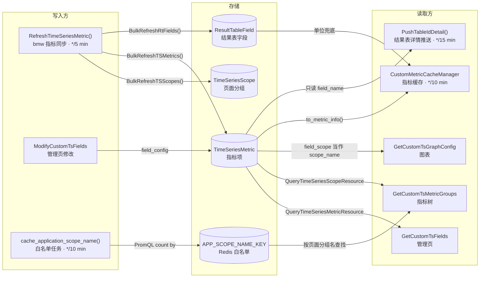

- *[1] 单位与描述只在 `to_metric_info()` 中合成，用户配置优先、`ResultTableField` 兜底。*
- *[2] 图表与分组视图只读 `field_config`，看不到表级单位与描述。*

### b. 服务过滤的缺陷

服务视图的三类缺陷同源：服务与指标的关系没有落库，只能由白名单间接推断。白名单是 `apm_web.tasks.cache_application_scope_name` 每 `10 min` 用 PromQL 扫描 VM、写入 Redis `APP_SCOPE_NAME_KEY` 的「指标 × `scope_name` × 服务」集合：

| 缺陷 | 现象 | 原因 |
| --- | --- | --- |
| 按页面分组名查找 | 指标移入自建分组后从服务视图消失，维度值为空 | 白名单以 `scope_name` 为键，`GetCustomTsMetricGroups` 与 `GetCustomTsDimensionValues` 传入的是页面分组名 |
| 扫描结果不完整 | 大应用与低频指标被隐藏 | [a] VM 单次返回上限 `slimit 3000`，最大应用已触及 `500,000` 序列上限<br />[b] 缓存未命中时只回查最近 `5 min` |
| 图表依赖 `field_scope` | `field_scope` 收敛为 `default` 后图表无数据，表级单位不显示 | [a] `GetCustomTsGraphConfig` 把 `field_scope` 当作 `scope_name` 过滤<br />[b] 单位只读用户配置 |

方案改由 Collector 推送这份关系、bmw 存入新表，服务视图、维度值与图表改读新表。

### c. 指标项是热表

指标项保持「数据源 × 指标名」一行，服务关系存入独立的窄表。`TimeSeriesMetric` 既被周期任务整表读取，又承载毫秒级的页面请求，服务进入指标项身份后：

- 上界规模下指标项从 `1,000,000` 行涨到 `40,144,125` 行，最大数据源管理页首页从 `35.0 ms` 变为 `28.6 s`。
- 按数据源分 `16` 张表也无效，热点数据源整组落在同一张分表，MySQL `9.2` 上首页反而慢 `22%`。

现状读取方在 MySQL `5.7.44`、`1,000,000` 个指标项上的实测如下，最大数据源有 `20,000` 个指标项，Go 路径相对 `pkg/bk-monitor-worker/`：

| 读取方 | 触发 | 读取范围 | 实测 p50 |
| --- | --- | --- | --- |
| `monitor_web.strategies.metric_list_cache.CustomMetricCacheManager` | 每 `10 min` | 全平台活跃指标项 | `4.91 s` |
| `internal/metadata/task.RefreshTimeSeriesMetric` | 每 `5 min` | 每个数据源整组读取 `3` 次 | `112 ms` |
| `internal/metadata/service.SpacePusher.PushTableIdDetail` | 每 `15 min` 及指标同步后 | 全部指标项的 `field_name` | 未压测 |
| `monitor_web.custom_report.resources.metric.GetCustomTsFields` | 打开管理页 | 按名称排序取一页 `50` 条 | `35.0 ms` |
| `monitor_web.scene_view.resources.custom_metric.GetCustomTsMetricGroups` | 打开指标树 | 最大数据源整组 | `112 ms` |
| `monitor_web.scene_view.resources.custom_metric.GetCustomTsGraphConfig` | 打开图表 | 按 `field_id` 取面板内的指标 | 未压测 |

### d. 已有表的 DDL 风险

元信息存入新表，已有表零 DDL。平台必须兼容 MySQL `5.7`，在 `5.7` 上给指标项表加列，上线时有两个后果：

| 原理 | 后果 | 实测 *[1]* |
| --- | --- | --- |
| `5.7` 没有 INSTANT 加列，加列要复制整表 | 上线时整表重建 | `1,000,000` 行加 `5` 列 `68.4 s～128.5 s`，`8.0` 用 INSTANT 只需 `0.34 s` |
| ALTER 要等元数据锁，连接未设置 `lock_wait_timeout` | 等锁期间指标项读写全部排队，页面与指标同步被阻塞 | `3 s` 长事务让后续读写排队 `2.7 s` |

- *[1] 区间下限是一条 ALTER 加 `5` 列，上限是 Django 默认每列一条 ALTER，明细见 [REPORT：在线 DDL](./REPORT.md#a-在线-ddl)。*

迁移失败、新代码运行在旧表结构上时，指标项的全部查询都会报 `1054`（未知列）。

### e. 完整方案对比

选定 D 全建新表：它是唯一满足全部功能需求且已有表零 DDL 的方案，代价是除管理页首页外的读取比 C 慢 `50%～60%`。四个方案按同一组需求比较：服务视图按服务过滤指标、元信息可按上报范围不同、Histogram 按原名组族、在 MySQL `5.7` 上安全发布。

| 方案 | 指标项 | 服务关系 | 元信息 |
| --- | --- | --- | --- |
| A 只修白名单 | 表结构不变 | Redis 白名单，改按 `scope_name` 查找 | 写入 `ResultTableField` 与 `field_config` |
| B 按服务拆行 | `field_scope` 编入服务，每个「指标 × 服务 × `scope_name`」一行 | 由指标项行表达 | 作为 `5` 列加到指标项表 |
| C 旧表加列 | 每个指标名一行 | 上报范围、范围标签与上报成员三张新表 | 作为 `5` 列加到指标项表 |
| D 全建新表 | 每个指标名一行 | 同 C | 定义与例外取值两张新表，按 `(group_id, field_name)` 关联指标项 |

C 与 D 都要把存量 V2 数据源的同名指标项合并为 `field_scope=default` 的一行，其余行保留 `field_id` 但从列表隐藏，规则见「APM V2 收敛」。

下表为 Docker MySQL `5.7.44` 实测，amd64 模拟使绝对值偏大，arm64 原生 `5.7.30` 复核的快慢顺序相同，明细见 [REPORT：完整方案对比](./REPORT.md#0x02-完整方案对比mysql-57)。D 先读指标项、再用一条语句批量读取定义，C 的搜索与族视图按同一读法测量，族视图与服务视图计页面完整步骤。

图例：🟢 为 B、C、D 中该行最优，🔴 为不可接受（阻断需求或上线风险），A 不满足功能需求，读数只作现状基线。

| 维度 | 指标 | A 只修白名单 | B 按服务拆行 | C 旧表加列 | D 全建新表（选定） |
| --- | --- | --- | --- | --- | --- |
| 功能 | 服务视图不缺指标 | 🔴 大应用触及 VM `500,000` 序列上限 | 🟢 不缺 | 🟢 不缺 | 🟢 不缺 |
| 功能 | 按范围的例外 | 🔴 不支持，一个结果表字段只存一份 | 🟢 支持 | 🟢 支持 | 🟢 支持 |
| 功能 | 元信息早于指标项到达 *[1]* | 丢弃 | 丢弃 | 丢弃 | 🟢 落库 |
| 体积 | 存储合计，活跃规模 *[2]* | `678 MiB` | `10,948 MiB` | 🟢 `2,829 MiB` | `2,966 MiB` |
| 体积 | 存储合计，上界规模 *[2]* | `678 MiB` | `43,743 MiB` | 🟢 `8,375 MiB` | `8,511 MiB` |
| 读取 | 最大数据源管理页首页 | `35.0 ms` | 🔴 `28.6 s` | `42.3 ms` | 🟢 `37.3 ms` |
| 读取 | 最大数据源管理页搜索 | `20.0 ms` | 未测 | 🟢 `20.4 ms` | 🟢 `20.4 ms` |
| 读取 | 最大数据源族视图首页 | `36.4 ms` | 未测 | 🟢 `60.6 ms` | `96.2 ms` |
| 读取 | 最大数据源指标树 | `112 ms` | 🔴 `7,539 ms` | 🟢 `148 ms` | `221 ms` |
| 读取 | 指标缓存全平台扫描，活跃规模 | `4.9 s` | `72.0 s` | 🟢 `6.8 s` | `9.9 s` |
| 读取 | 最大数据源 APM 服务视图 | `114 ms`，不含白名单过滤 | 未测 | 🟢 `156 ms` | `231 ms` |
| 写入 | bmw 每批 `1,000` 条上报 p50 *[3]* | 不写元信息 | 🟢 `22.6 ms` | `34.4 ms` | `29.1 ms` |
| 写入 | 最大数据源重报一轮 *[3]* | 不涉及 | `1,810 s` | 🟢 `34.9 s` | 🟢 `29.5 s` |
| 上线风险 | 已有表 DDL | 无 | 🔴 整表重建 `68.4 s～128.5 s` | 🔴 整表重建 `68.4 s～128.5 s` | 🟢 无，建五张新表 `0.12 s` |
| 上线风险 | 迁移失败 | 无迁移 | 🔴 指标项查询全部报 `1054` | 🔴 指标项查询全部报 `1054` | 🟢 只有新功能报错 |
| 兼容 | 可见指标项的 `field_id` | 不变 | 未评估，存量按服务拆行后 `field_id` 如何分配、已保存视图能否还原 | 🟢 不变 | 🟢 不变 |
| 兼容 | 回退 | 写入即全量生效，无法灰度 | 未评估 | 收敛按快照回退，删列再重建 `24.5 s～176.1 s` | 🟢 收敛按快照回退，删表 `0.12 s` |

- *[1] A、B、C 的元信息写在指标项或结果表字段的行上，指标同步建出该行之前只能丢弃。*
- *[2] 两档规模按上云环境（bkte）APM 应用的活跃服务数与登记服务数生成，分别有 `9,952,703` 与 `40,091,444` 个上报成员，合计为指标项表与新增表之和。*
- *[3] C 先于 D 运行，替 D 刷新了共用成员表中的部分到期行，所以 C、D 的写入视为持平，B 逐行 UPDATE `984,828` 行，C、D 按每千条 p50 换算 `1,014,511` 个成员。*

按本方案的读法，D 要把成员与定义分两条语句读取，读取单个上报范围为 `42.2 ms`，比 C 的 `33.2 ms` 慢约 `27%`。选 D 是用每次读取多付的这份开销，换掉 C 上线时无法回避的热表重建与迁移失败风险。

### f. 其他被否决的做法

除四个完整方案外，下列局部做法也不采用：

| 做法 | 否决原因 |
| --- | --- |
| 用 gh-ost 等在线改表工具执行 C 旧表加列 | 新代码依赖新列这一点不变，迁移失败时仍报 `1054`，且要在 `migrate` 之外执行，平台是否支持「待确认」 |
| 按 `field_id` 建一对一元信息表 | 元信息早于指标项到达时无处落库，收敛前同名的多个 `field_id` 会拆出多份元信息 |
| [按数据源分表](./REPORT.md#a-展开与分表) | 热点数据源整组落在同一张分表，实测见「指标项是热表」 |
| 上报成员存 Redis | 易失，无法按指标反查范围，bmw 也写不出 django-redis 的 pickle 格式 |
| 存储指标族 | 族成员由原名与后缀确定，存储只会多出一份要同步的事实 |
| 保留 BkBase v2 分组发现、不收敛 | 分组键不含服务，无法按服务隔离，V2 数据源要长期单独维护一套指标发现 |

### g. 现有写入代码的约束

新表由 Django 迁移创建、由 bmw 写入，两侧有六项现有行为必须在设计中规避，否则写入失败或数据出错：

| 现有行为 | 不处理的后果 | 应对 |
| --- | --- | --- |
| gorm `v1.9.16` 插入时省略带 `default` 标签的零值字段 *[1]* | 非空列缺库默认值时 INSERT 报 `1364` | 新表的 bmw 模型不声明 `default` 标签 |
| bmw 删除指标项时忽略 `Delete()` 的错误 | 外键拦下的删除静默残留 | 新表不建外键 |
| bmw 连接字符集 `store.mysql.charset` 默认为 `utf8` | 一个四字节字符让整批 INSERT 失败 | 写入前把四字节字符替换为 `U+FFFD` |
| Python 与 Go 各自按 `metric_group_dimensions` 是否为空判定 v2 | 清空该列与改写指标项不在同一事务时，v1 同步会新建指标项，`field_id` 改变 | 收敛在改写指标项的同一事务内清空该列 |
| bmw 立即失活本轮缺失的指标项并刷新修改时间 | 只按修改时间选保留项会选中刚失活的指标项 | 收敛选保留项时活跃状态排在修改时间之前 |
| bmw 在 Python 迁移合入后当天到 `7 d` 内跟进 | 新 bmw 可能跑在旧表上 | 新迁移只含建表，版本共存覆盖两种发布顺序 |

- *[1] Django `AddField` 会隐式删除库默认值，所以已有表的 `is_active` 是否带库默认值「待确认」。*

## 0x02 架构设计

指标项只承载身份「数据源 × 指标名」与用户配置，谁上报了指标、上报了什么由 bmw 消费 Collector 元信息后写入五张新表。读取方都经 `MetricConfigResolver` 合成有效配置，收敛后 `field_scope` 固定为 `default`，指标项唯一键不变。

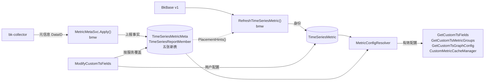

- *[1] 虚线表示指标同步新建指标项时读取成员标签决定页面分组，规则见「页面归属」。*

### a. 对象模型

已有的指标项与页面分组表结构不变，五张新表分别存元信息（定义、例外取值）、上报来源（上报范围、范围标签）和两者的连接（上报成员）：

| 对象 | 模型 | 一行表示 | 写入方 |
| --- | --- | --- | --- |
| 指标项 | `TimeSeriesMetric` | 数据源内的一个指标名，带用户配置与所在分组 | 指标同步、用户 |
| 页面分组 | `TimeSeriesScope` | 用户可见的一个指标分组 | 指标同步、用户 |
| 指标定义 | `TimeSeriesMetricMeta` | 一个指标的默认元信息，不依赖指标项存在 | bmw |
| 例外取值 | `TimeSeriesMetricMetaValue` | 一种偏离定义的元信息，同一数据源内按内容去重 | bmw |
| 上报范围 | `TimeSeriesReportScope` | 一个上报来源，APM 中是一个服务的一个 `scope_name` | bmw |
| 范围标签 | `TimeSeriesReportScopeLabel` | 范围上的一个标签键值，按标签反查范围 | bmw |
| 上报成员 | `TimeSeriesReportMember` | 一个范围上报的一个指标 | [a] bmw：`last_seen` 与 `meta_value_id`<br />[b] 用户：按范围覆盖的 `field_config` |


- *[1] 虚线是自然键或可为 `0` 的引用，新表之间与新旧表之间都不建外键。*
- *[2] 指标项按 `(group_id, field_name)` 关联定义，不依赖 `field_scope`，收敛前同名的多行指标项共享一份定义与成员。*

### b. 元信息存储

每个指标在数据源内存一份定义，某个范围的取值与定义不同时，该范围的成员才引用一条例外取值。指纹是 `meta` 规范 JSON 的 MD5，例外取值按指纹在数据源内去重。成员的 `meta_value_id` 为 `0` 表示与定义相同。

例如 `request_duration_sum` 由 `200` 个范围上报，其中两个范围用旧版 SDK 上报 `unit=ms`：

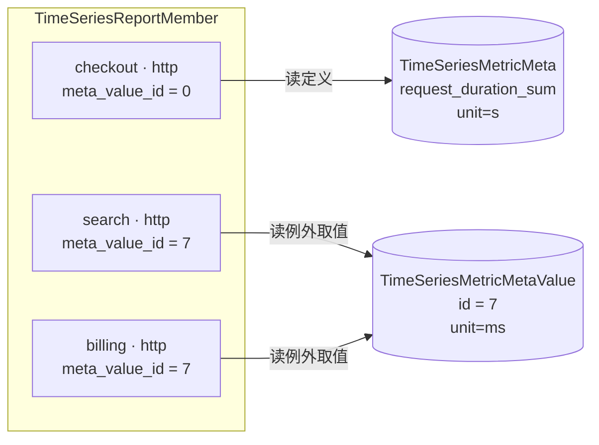

- *[1] 每个成员都以 `meta_id` 指向定义，图中只画解析时读取的引用，其余 `197` 个范围同 `checkout`。*

存储只有 `1` 条定义与 `1` 条例外取值，两个旧版范围共用这条例外取值。

选定「定义加例外引用」，它的按指标读取与体积都接近最优。

四种存法在 MySQL `9.2` 上用同一数据集实测，数据集有 `1,500,000` 个成员，例外比例 `1%`。体积列先把 `1,000,000` 个成员的单位由 `ms` 改为 `s` 并完成回收，再把三张表按每成员字节外推到上界规模，只用于存法之间比较。🟢 为该列最优，明细见 [REPORT：按范围不同的取值](./REPORT.md#e-按范围不同的取值)：

| 存法 | 采用 | 成员保存 | 按指标读取 | 全体改值后体积 | 取舍 |
| --- | :---: | --- | --- | --- | --- |
| 每范围一份 | ❌ | 完整取值 | `940 ms` | `13.5 GiB` | 没有定义行，按指标读取要扫描全部成员取多数值 |
| 内容寻址 | ❌ | 按指纹去重的取值 ID | `709 ms` | 🟢 `5.8 GiB` *[1]* | 同样要扫描全部成员取多数值 |
| 定义加内联例外 | ❌ | 偏离定义时的完整取值 | 🟢 `63 ms` | `11.2 GiB` | 成员行变宽而页分裂，回收后 InnoDB 不归还页 |
| 定义加例外引用 | ✅ | 偏离定义时的例外取值 ID | `66 ms` | `5.9 GiB` *[1]* | 单范围读取多一次按 ID 读取，`5.7` 上慢约 `6%` *[2]* |

- *[1] 数据集中每个指标的例外只有一种取值，是去重最有利的情形，例外取值各不相同时去重收益消失。*
- *[2] 线上例外比例取决于各服务的 SDK 版本分布，尚无数据，成员表又是新表，现在选定例外引用可以避免日后对大表做 DDL。*

`MetricMetaSvc.Apply()` 逐条比较上报与定义的指纹，只有带范围且指纹不同的记录才产生例外：

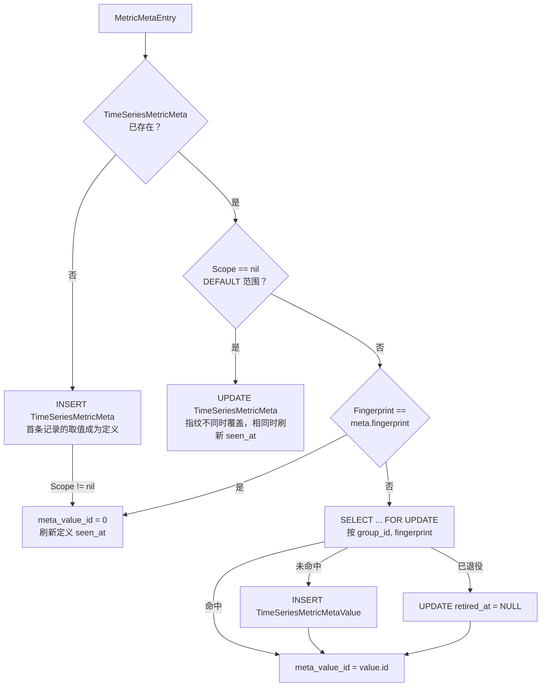

- *[1] 一个数据源的一批记录在同一个事务内写入，`SELECT ... FOR UPDATE` 的行锁持续到提交。*

首条记录的取值成为定义，首个上报方用旧版 SDK 或服务陆续升级到新版 SDK 后，多数成员会变成例外。例外取值不存引用计数，晋升与服务升级都会让它失去引用。`Compact()` 用两条规则处理：

| 规则 | 触发条件 | 动作 | 为何安全 |
| --- | --- | --- | --- |
| 重设基线 | 定义的 `seen_at` 超过 `6 h` 未刷新，且存在例外 | 一个事务内把该定义下引用最多的例外取值晋升为定义，并把指向它的成员置 `0` *[1]* | [a] `6 h` 是 Collector 强制补报周期 `2 h` 的 `3` 倍，持续上报的定义不会被误切换<br />[b] 指向定义的成员上报时会刷新 `seen_at`，所以晋升时仍为 `0` 的成员都已超过 `6 h` 未上报，恢复上报后重新记为例外<br />[c] 活跃范围解析出的取值不变，晋升后才写入的旧引用在下一次补报时置 `0` |
| 例外取值回收 | 本轮扫描中没有成员引用 | [a] 先退役，即写入 `retired_at`<br />[b] 退役超过 `valueRetireGrace` 仍无引用才删除<br />[c] `valueRetireGrace` 默认 `1h`，不小于 `Compact()` 周期 | [a] 退役期间被 `Apply()` 或 `Compact()` 发现引用即恢复<br />[b] 扫描开始时记下最大 ID，之后新建的例外取值不参与本轮 |

- *[1] 例外取值在数据源内跨指标共享，引用计数与置 `0` 都只作用于同一 `meta_id` 的成员。*

`Apply()` 与 `Compact()` 争同一行锁时，无论谁先拿到锁，成员都指向存在的例外取值。原因是 `DELETE` 会再次检查回收判定的 `retired_at` 条件：

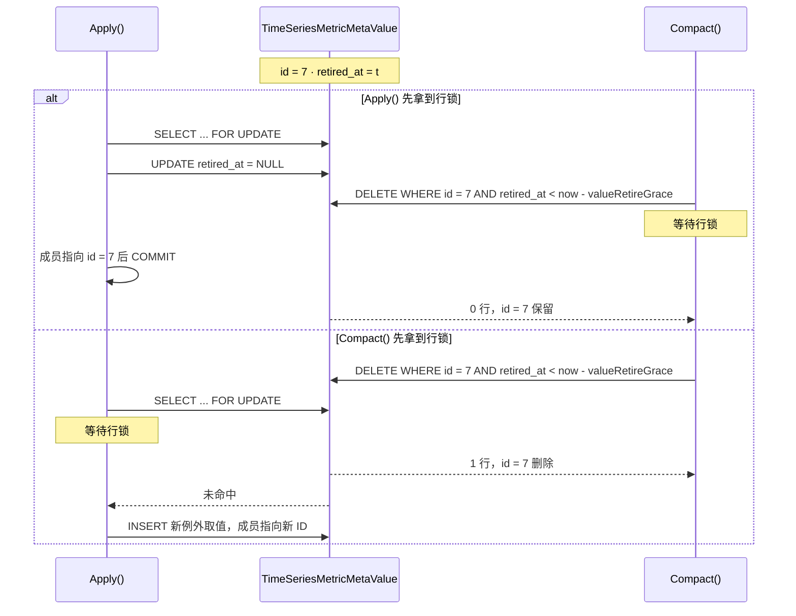

### c. 上报范围身份

上报范围以「范围类型 + 规范标签串」的 MD5 `scope_hash` 为身份，Collector 协议不变。bmw 按范围类型 `__scope_type` 选解码器，把范围值 `__scope` 还原为范围标签：

| 范围类型 | 范围值示例 | 解码后的标签 |
| --- | --- | --- |
| `APM` | `checkout-http%2Dclient` *[1]* | [a] `service_name=checkout`、`scope_name=http-client`<br />[b] 应用由 DataID 确定，`app_name` 不进入标签 |
| `DEFAULT` | `""` | 无，不建上报范围，元信息直接作用于定义 |
| 其他（未注册解码器） | 由上报方定义，编码方式「待确认」 | `scope=<原值>`，原值另存 `raw_scope` 供排障 |

- *[1] 服务名与 scope 先各自转义再用 `-` 连接，转义把 `%` 写成 `%25`，把 `-` 写成 `%2D`。*

规范标签串按键名升序拼接 `k:v`，以 `||` 连接。标签值含 `||` 时拒收，哈希定长，不受索引长度限制。

每个数据源最多 `2,000` 个上报范围、`1,200,000` 个上报成员，超限时丢弃新范围并计数，防止 Pod 名等高基数标签进入范围。

范围哈希回答「这个范围是谁」，范围标签按标签值倒排，回答「哪些范围带这个标签」：

| 查询 | 条件 | 结果 | 索引 |
| --- | --- | --- | --- |
| 按范围精确定位 | `group_id`、`scope_hash` | 上报范围 | 范围唯一键 |
| 按标签过滤 | `group_id`、`label_key`、`label_value` | 上报范围 ID | [a] 标签唯一键（覆盖索引）*[1]*<br />[b] 不依赖 `8.0` 多值索引 |
| 按范围取指标 | `group_id`、`report_scope_id` | 上报成员 | 成员唯一键前缀 |
| 按指标取范围 | `group_id`、`meta_id` | 上报成员 | 成员二级索引 |

- *[1] `1,000` 个服务时按服务过滤 p50 为 `0.070 ms`，该值来自 REPORT 的早期 `__scope` 表示实验，测试环境「待确认」。*

### d. 写入链路

Collector 把元信息批量写入专用的元信息 DataID，bmw 常驻任务按记录所属的 `dataid` 聚批写入新表，周期任务每 `1 h` 整理一次。`Race` 子图中的例外取值由 `Apply()` 与 `Compact()` 争用，两种先后见「元信息存储」：

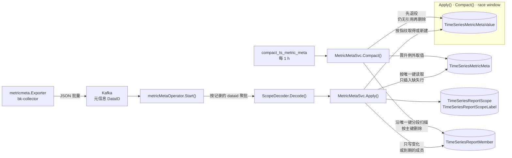

### e. 页面归属

页面归属只在指标同步新建指标项时决定，此后只由用户修改。

分组提示是成员标签按分组维度拼出的分组名。`auto_rules` 是用户分组上按指标名匹配的正则列表。新指标依次尝试分组提示、`auto_rules` 与默认分组，取第一个命中的分组：

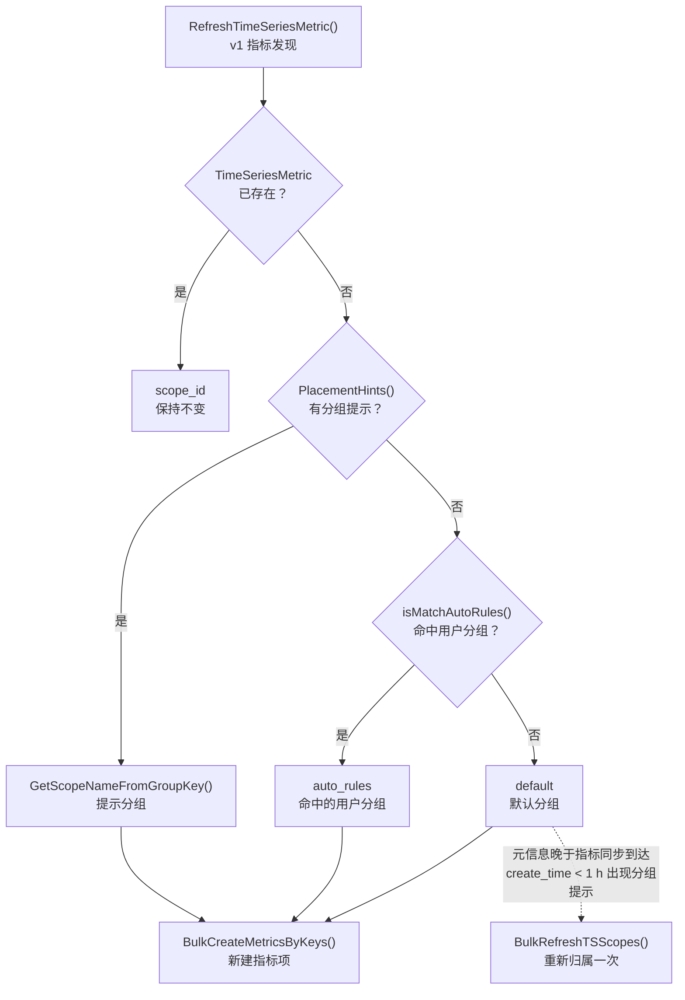

- *[1] 多个范围给出不同的分组提示时取成员数最多的分组名，相同时按名称升序。*
- *[2] 分组维度只读 `ResultTableOption(metric_group_dimensions)`，`TimeSeriesGroup.metric_group_dimensions` 只保留 v2 开关语义，收敛后为空。*

### f. 有效配置解析

`MetricConfigResolver` 是有效配置的唯一计算入口，每个配置项取下图中第一个已设置的值。用户配置排在上报例外之前，因为用户改过的值不能随 Collector 升级或补报改变。

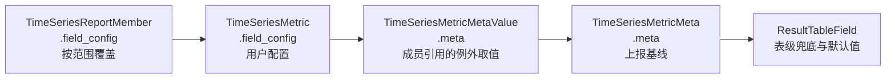

- *[1] 成员相关的两级只在读取方传入范围标签 `report_labels` 时参与，例如 APM 服务视图传入 `service_name`，未传时从 `TimeSeriesMetric.field_config` 开始。*

| 配置项 | 用户配置键 *[1]* | 上报元信息 | 上报值的转换 | 兜底 |
| --- | --- | --- | --- | --- |
| 单位 | `unit` | `meta.unit` | [a] UCUM 单位转为 `core/unit` 已注册的 ID，未命中时不采用<br />[b] 例如 `us → µs`、`min → m`、`By → bytes`、`1 → none`、`% → percent` | `ResultTableField.unit` |
| 描述 | `alias` | `meta.description` | 无 | `ResultTableField.description` |
| 汇聚方法 | `aggregate_method` | `meta.usage` | 映射表「待确认」 | `AVG` |
| 函数 | `function` | `meta.temporality` | `cumulative` 的 Counter 补 `increase` | `[]` |
| 聚合周期 | `interval` | `meta.interval` | 毫秒转为秒 | `auto` |

- *[1] 键不存在或值为 `""`、`0`、`[]` 时视为未设置，管理页整包回写会补齐这三种值，它们不能覆盖上报值。*

### g. 读取路径

服务视图改按上报成员过滤并取成员的 `scope_name`，其余读取方先读指标项、再批量读取定义：

| 读取场景 | 改造前 | 改造后 |
| --- | --- | --- |
| 服务视图过滤 | 按页面分组名查 Redis 白名单 | 按上报成员的指标名过滤，过渡期与白名单取并集 |
| 图表查询条件 | `scope_name` 取 `field_scope` | [a] `field_scope` 为 `default` 时取该服务成员的 `scope_name` 集合<br />[b] 其余仍取 `field_scope` |
| 维度值查询条件 | `scope_name` 取页面分组名 | `scope_name` 按 `field_id` 套用图表的规则 |
| 管理页 | 分页读取指标项 | [a] 分页读取指标项，再用一条语句批量读取定义 *[1]*<br />[b] 搜索只匹配指标项上的名称与别名 *[2]*<br />[c] 族视图按节点在内存中组装后分页，一个节点是一个族或一个独立指标 |
| 指标树 | 整组读取指标项 | 整组读取指标项，再用一条语句批量读取定义 *[1]* *[2]* |
| 指标缓存与策略选择器 | 单位只取用户配置与表级字段 | 按 `group_id__in` 分页预取全部定义，补齐上报的单位与描述 *[1]* |

- *[1] 定义与指标项分开读取、不 JOIN，新表缺失时只有读定义的语句报 `1146`（表不存在）并降级。*
- *[2] 分开读取也更快，`5.7` 上 JOIN 时整组读取为 `236 ms`、按描述搜索为 `372 ms`。*

### h. 指标族与复合视图

指标族在读取时由定义组装，不新增存储对象。族成员必须同时满足：

```text
同一数据源
  └─ 同一页面分组（scope_id）
      └─ 定义中 original_name 相同，metric_type = histogram
          └─ field_name = 规范化原名 + _sum / _count / _bucket / _min / _max
```

- *[1] 规范化原名把 `.` 替换为 `_`。*

缺少某个族成员时，只禁用依赖它的统计方法。族成员被单独移到其他分组后，两侧各自组族。

族面板沿用现有图表协议：一个族一个面板，每个统计方法一个 target，`target.alias` 标出方法名。现有单指标 target 的 `alias` 恒为空串，`alias` 非空即可识别复合面板，不需要新增字段。

| 方法 | 族成员 | 等价计算 | 单位 |
| --- | --- | --- | --- |
| `AVG` | `_sum`、`_count` | `b == 0 or a / b` | `_sum` 的单位 |
| `SUM` | `_sum` | `a` | `_sum` 的单位 |
| `COUNT` | `_count` | `a` *[1]* | `none` |
| `P50`、`P90`、`P95`、`P99`、自定义 `Pxx` | `_bucket` | `histogram_quantile(φ, sum by(G, le)(a))` *[2]* *[3]* | `_sum` 的单位 |

- *[1] `COUNT` 对 `_count` 求和，不用 `method: COUNT`，后者统计的是样本点数而不是请求次数。*
- *[2] `φ` 为分位值，自定义 `Pxx` 由用户输入且 `0 < φ < 1`。*
- *[3] `G` 为族成员维度的交集去掉 `le`。*

族成员的时间聚合按时间性区分，族面板必须遵守：

- SaaS 查询层 `bkmonitor.data_source` 把 `method: SUM` 转为 `sum_over_time`。
- `delta`：不加函数，`sum_over_time` 的窗口为当前周期。
- `cumulative`：前置 `increase` 函数替换 `sum_over_time`，前提是观测值非负。
- `increase` 的窗口兜底为 `2 × 上报周期`，前端请求前改写为 `max(当前周期秒数, 兜底值)`。
- 上报周期取 `_count` 族成员定义的 `meta.interval`，缺失时兜底窗口取 `2m`。

族成员一律写 `method: SUM`，不继承各自的 `aggregate_method` 与 `function`。否则两个 `increase` 会触发 `MultipleTimeAggregateFunctionError`。

族视图关闭 Top/Bottom，因为按查询各自排名会裁掉部分桶，指标对比模式下不组族。前端只执行选中的 target：

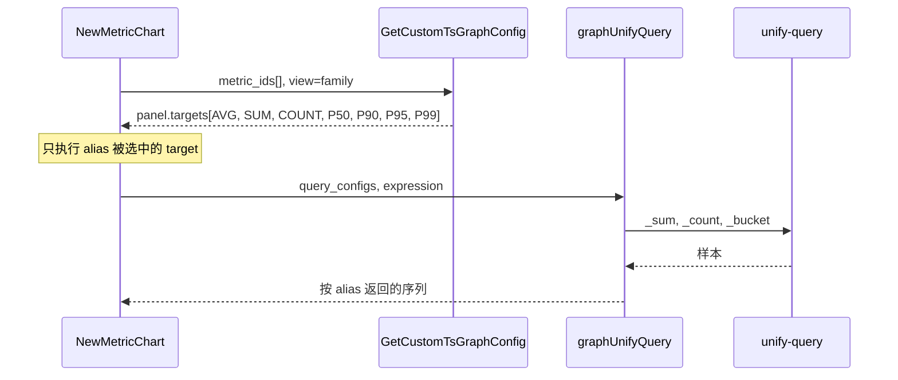

## 0x03 开发方案 —— Metadata 存储、解析与查询

### a. 数据模型与迁移

`bkmonitor/metadata/models/custom_report/metric_meta.py`（新增）、`bkmonitor/metadata/migrations/0278_metric_meta.py`（新增）、`pkg/bk-monitor-worker/internal/metadata/models/constants.go`

迁移 `0278_metric_meta` 只建五张新表，不改已有表。字段与唯一键见「对象模型」，建表约束如下：

| 约束 | 适用对象 | 原因 |
| --- | --- | --- |
| 主键声明 `BigAutoField` | 五个模型 | 全局默认 `AutoField` 上限为 `2,147,483,647`，upsert 按批消耗自增 ID |
| 不声明 `db_table` | 五个模型 | 表名取 Django 默认的 `metadata_<小写模型名>`，如 `metadata_timeseriesreportmember`，bmw 的 `TableName()` 逐一写死同名 |
| 文本列长度 | [a] `255`：`field_name`、`original_name`、`label_value`<br />[b] `512`：`raw_scope`<br />[c] `64`：`label_key`<br />[d] `32`：`scope_type`<br />[e] `16`：`metric_type` | `255` 是 `utf8` 下单列索引前缀不超过 `767 B` 的最大长度 |
| 引用只存主键，不用 `ForeignKey` | `meta_id`、`report_scope_id`、`meta_value_id` | bmw 忽略删除错误，外键拦下的删除会静默残留 |
| 索引文本列用 `utf8_bin` | `field_name`、`original_name`、`label_key`、`label_value` | [a] 与已有表的同名列一致，关联时不需要 `CONVERT`<br />[b] COMPACT 行格式下改用 `utf8mb4` 会超出 `767 B`，建索引报 `1071` |
| 哈希列用 `ascii_bin` | `fingerprint`、`scope_hash` | 定长 `32` 字符的 MD5 |
| JSON 列可空 | `meta`、`labels`、`field_config` | [a] `5.7` 上非空 JSON 列不能有默认值<br />[b] `8.0` 上非空 JSON 列不支持 INSTANT |
| 二级索引只建两个 | [a] 定义 `(group_id, original_name)`<br />[b] 成员 `(group_id, meta_id)` | [a] 按原名组族<br />[b] 按指标取范围 |
| `last_seen` 与 `meta_value_id` 不建索引 | `TimeSeriesReportMember` | 回收与引用统计沿成员唯一键分段扫描，上界规模省 `1,123 MiB` |

| 变更点 | 目标 |
| --- | --- |
| **[Add]** `metadata.models.custom_report.metric_meta` | 声明五个模型、`MetricConfigResolver`、`metric_family_of()` 与 `placement_hints()` |
| **[Change]** `metadata.models.custom_report.__all__`<br />`metadata.models.__all__` | 导出五个模型 |
| **[Add]** `metadata/migrations/0278_metric_meta.py` | 只含五个 `CreateModel` *[1]* |
| **[Add]** `metadata.models.result_table.ResultTableOption.OPTION_ENABLE_METRIC_METADATA` | 数据源选项 `enable_metric_metadata`，打开后 bmw 才写入该数据源的元信息，未写入时视为关闭 *[2]* |
| **[Add]** `internal/metadata/models.OptionEnableMetricMetadata` | bmw 侧的同名常量，写入前据此判断 |
| **[Add]** `core.prometheus.metrics.METADATA_METRIC_META_DEGRADED_TOTAL` | Counter `bkmonitor_metadata_metric_meta_degraded_total`，按 `entry` 与 MySQL 错误码 `code` 记录降级次数 |

- *[1] `makemigrations` 会顺带生成一条 `ResultTableOption.name` 的 `AlterField`，必须手工删除。*
- *[2] 不加入 `name` 的 `choices`，否则迁移会多出 `AlterField`，与已有的分组维度选项写法相同。*

### b. 有效配置解析器

`bkmonitor/metadata/models/custom_report/metric_meta.py`

所有读取方经 `MetricConfigResolver` 取有效配置：先按数据源一次预取定义与成员，再逐指标按「有效配置解析」的顺序回落。

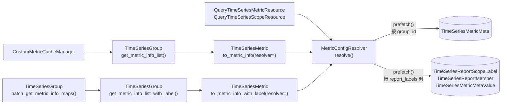

```python
RESOLVED_KEYS = ("unit", "alias", "aggregate_method", "function", "interval")
UNSET_VALUES = (None, "", 0, [])

class MetricConfigResolver:
    def __init__(self, group_id: int, report_labels: dict[str, str] | None = None) -> None: ...

    # 定义按 group_id 一条语句读取，带 report_labels 时再取范围与成员，例外取值按主键去重后一次读取
    # 只把错误码 1146（表不存在）的 ProgrammingError 视为没有定义与成员，其余异常照常抛出
    def prefetch(self, field_names: Iterable[str] | None = None) -> None: ...

    # 值属于 UNSET_VALUES 时取下一级，多个成员命中时取 last_seen 最近的一个，例外取值缺失时按定义处理
    def resolve(self, metric: TimeSeriesMetric, rt_field: dict[str, Any] | None) -> dict[str, Any]: ...

    # 未带 report_labels 时返回 []
    def report_scopes(self, field_name: str) -> list[dict[str, str]]: ...

# histogram 且后缀可识别时返回 {"original_name", "role"}，否则返回 None
def metric_family_of(meta: TimeSeriesMetricMeta | None, field_name: str) -> dict[str, str] | None: ...
```

| 变更点 | 目标 |
| --- | --- |
| **[Change]** `metadata.models.custom_report.time_series.TimeSeriesMetric.to_metric_info`<br />`metadata.models.custom_report.time_series.TimeSeriesMetric.to_metric_info_with_label` | 新增关键字参数 `resolver: MetricConfigResolver \| None`，`description` 与 `unit` 改从 `resolver.resolve()` 读取，未传时按单指标构造解析器 |
| **[Change]** `metadata.models.custom_report.time_series.TimeSeriesGroup.get_metric_info_list`<br />`metadata.models.custom_report.time_series.TimeSeriesGroup.get_metric_info_list_with_label` | 为该数据源构造解析器并预取，传给逐指标的转换方法 |
| **[Change]** `metadata.models.custom_report.time_series.TimeSeriesGroup.batch_get_metric_info_maps` | 增加返回值 `resolver_by_group`，定义按 `group_id__in` 分页预取 |

### c. 查询与写入接口

`bkmonitor/metadata/resources/resources.py`、`bkmonitor/api/metadata/default.py`、`bkmonitor/packages/monitor_web/custom_report/handlers/metric/query.py`

指标查询为每项新增元信息、指标族、有效配置与范围标签。新参数和字段必须在下图的转换器、两层 `RequestSerializer` 与 DTO 四处同时声明，漏掉一处即被静默丢弃：

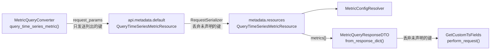

```json
{
  "field_id": 201,
  "name": "request_duration_sum",
  "field_scope": "default",
  "scope": {"id": 12, "name": "http", "create_from": "data"},
  "field_config": {},
  "meta": {"original_name": "request.duration", "metric_type": "histogram", "unit": "s", "description": "请求耗时", "is_exception": false},
  "family": {"key": {"scope_id": 12, "original_name": "request.duration"}, "role": "sum"},
  "effective_config": {"unit": "s", "alias": "请求耗时", "aggregate_method": "SUM", "function": [], "interval": 60},
  "report_scopes": [{"service_name": "checkout", "scope_name": "http"}]
}
```

| 字段 | 类型 | 必填 | 说明 |
| --- | --- | --- | --- |
| `metrics[].scope.create_from` | `string` | 是 | [a] 页面分组的创建来源，取 `data`、`user` 或 `default`<br />[b] `GetCustomTsFields.get_movable()` 据此判断能否移出当前分组 |
| `metrics[].meta` | `object \| null` | 是 | 上报元信息，请求带 `report_labels` 且命中例外时取成员引用的例外取值，否则取定义，没有元信息时为 `null` |
| `metrics[].meta.is_exception` | `bool` | 是 | 取自例外取值时为 `true` |
| `metrics[].family` | `object \| null` | 是 | 由 `metric_family_of()` 计算的所属指标族，不是族成员时为 `null` |
| `metrics[].family.key` | `object` | 是 | 族身份，由 `scope_id` 与 `original_name` 组成 |
| `metrics[].family.role` | `string` | 是 | 族成员角色，取 `sum`、`count`、`bucket`、`min` 或 `max` |
| `metrics[].effective_config` | `object` | 是 | 有效配置，键为 `RESOLVED_KEYS` |
| `metrics[].report_scopes[]` | `array<object>` | 否 | 命中 `report_labels` 的范围标签，只在请求带 `report_labels` 时返回，为空表示该范围没有上报这个指标 |

| 变更点 | 目标 |
| --- | --- |
| **[Change]** `metadata.resources.resources.QueryTimeSeriesMetricResource.RequestSerializer` | [a] 新增可选参数 `report_labels`，类型为 `DictField`<br />[b] 新增可选参数 `view`，默认 `metric`，族视图传 `family` |
| **[Change]** `metadata.resources.resources.QueryTimeSeriesMetricResource.perform_request` | [a] 每项输出上表的新字段与 `scope.create_from`<br />[b] 支持 `view=family`，节点分页见「族视图与 Histogram 复合面板」 |
| **[Change]** `metadata.resources.resources.QueryTimeSeriesScopeResource` | [a] 接收 `report_labels`<br />[b] `metric_list[]` 每项附上 `family` 与 `report_scopes`<br />[c] 不按范围标签过滤指标 |
| **[Change]** `metadata.resources.resources.CreateOrUpdateTimeSeriesMetricResource` | [a] 接收 `report_labels`，把 `field_config` 写到命中范围的成员上<br />[b] 命中的范围没有上报该指标时返回校验错误 |
| **[Change]** `api.metadata.default.QueryTimeSeriesMetricResource`<br />`api.metadata.default.QueryTimeSeriesScopeResource`<br />`api.metadata.default.CreateOrUpdateTimeSeriesMetricResource` | 声明 `report_labels` 并原样透传，`QueryTimeSeriesMetricResource` 另声明 `view` |
| **[Change]** `monitor_web.custom_report.handlers.metric.query.MetricQueryConverter.query_time_series_metric` | 加入 `report_labels` 与 `view` 两个请求参数 *[1]* |
| **[Change]** `monitor_web.custom_report.handlers.metric.query.MetricQueryResponseDTO` | [a] 解析 `metrics[]` 的四个新字段，缺失时置 `None`<br />[b] `scope.create_from` 平铺为 `scope_create_from` |
| **[Change]** `monitor_web.custom_report.handlers.metric.query.ScopeQueryMetricResponseDTO` | 解析 `metric_list[]` 新增的两个字段，缺失时置 `None` |

- *[1] `ScopeQueryConverter.query_time_series_scope()` 是否随之透传 `report_labels`「待确认」。*

### d. 删除与跨环境导出

删除数据源时一并删除新表中的行，删除指标项时保留元信息。跨环境数据迁移工具 `data_migrate` 按原主键导出新表：

| 变更点 | 目标 |
| --- | --- |
| **[Change]** `metadata.models.custom_report.time_series.TimeSeriesGroup.delete_time_series_group` | 删除该数据源在五张新表中的行，按主键每批 `10,000` 行 |
| **[Keep]** `metadata.models.custom_report.base.CustomGroupBase.delete_custom_group` | 共享基类同时服务 `EventGroup`，不加入时序专属的删除 |
| **[Keep]** `metadata.management.commands.check_ts_metrics.Command._delete` | 删除指标项时保留定义与成员，指标重新出现时元信息仍在 |
| **[Keep]** `internal/metadata/service.TimeSeriesMetricSvc.BulkUpdateMetricsByKeys` | bmw 只在这里删除关闭自动发现后已失活的指标项，同样保留定义与成员 |
| **[Change]** `monitor_web.data_migrate.fetcher.metadata.data_source.get_metadata_result_table_fetcher` | 导出定义、例外取值、范围、范围标签与 `field_config` 非空的成员 *[1]* |

- *[1] 以 `use_natural_primary_keys=False` 导出以保留主键，未导出的成员由 Collector 在 `2 h` 内补报重建。*

## 0x04 开发方案 —— bmw 消费、整理与分组提示

### a. 接收协议

每条记录是一个范围上报的一个指标的元信息，字段沿用 Collector 协议：

```json
{
  "dataid": 1001,
  "__scope_type": "APM",
  "__scope": "checkout-http",
  "__name": "request.duration",
  "__metric": "request_duration_sum",
  "__description": "请求耗时",
  "__unit": "s",
  "__temporality": "delta",
  "__interval": null,
  "__type": "histogram",
  "__usage": "sum"
}
```

| 字段 | 类型 | 必填 | 说明 |
| --- | --- | --- | --- |
| `dataid` | `int32` | 是 | 指标数据所属的 DataID，映射到启用且未删除的数据源，未命中时丢弃 *[1]* |
| `__scope_type` | `string` | 是 | 范围类型，决定使用哪个 `ScopeDecoder` |
| `__scope` | `string` | 是 | 范围值，解码失败时丢弃并计数 |
| `__metric` | `string` | 是 | 存储中的实际指标名，写入定义的 `field_name` |
| `__name` | `string` | 是 | 原始指标名，同一 Histogram 的族成员相同，写入 `original_name` |
| `__type` | `string` | 是 | 取 `sum`、`gauge`、`histogram`、`summary`、`counter`、`avg`、`unknown` 之一，写入 `metric_type` |
| `__description` | `string \| null` | 否 | 写入 `meta.description` |
| `__unit` | `string \| null` | 否 | 无量纲为 `1`，写入 `meta.unit` |
| `__temporality` | `string` | 否 | 取 `delta` 或 `cumulative`，写入 `meta.temporality` |
| `__interval` | `int64 \| null` | 否 | 上报周期，单位毫秒，写入 `meta.interval` |
| `__usage` | `string \| null` | 否 | 取 `sum`、`min`、`max`、`avg`、`last` 之一，写入 `meta.usage` |

- *[1] 记录的 `dataid` 不是承载记录的元信息 DataID，后者只决定 topic，其创建与下发属于 [Collector 元信息方案](../../../../knowledge/bkmonitor-datalink/issues/2026-09-15-collector-metric-metadata/PLAN.md)「待确认」。*

指纹是 `meta` 按键名升序、紧凑分隔符序列化后的 MD5，`null` 值保留。Collector 缺键时是否按 `null` 计入指纹「待确认」。

### b. 消费与写入

`pkg/bk-monitor-worker/internal/metadata/task/metricmeta.go`（新增）、`pkg/bk-monitor-worker/internal/metadata/service/metricmeta.go`（新增）

每个元信息 DataID 由一个 bmw 常驻任务消费。记录按所属数据源聚批，每批一个事务，提交后才标记 offset：

```mermaid
flowchart LR
    Register["register_metric_meta_bmw_task()<br/>metadata worker · */1 min"] -->|"POST bmw/task/<br/>payload.data_id"| Define["daemon.taskDefine<br/>daemon:metadata:metric_meta_consume"]
    Define --> Op["metricMetaOperator.Start()"]
    Op -->|"DataSource → KafkaTopicInfo<br/>→ ClusterInfo"| Group["sarama.ConsumerGroup"]
    Group -->|"batchSize or batchWait"| Decode["ScopeDecoder.Decode()"]
    Decode --> Apply["MetricMetaSvc.Apply()"]
    Apply -->|"tx committed"| Mark["session.MarkMessage()"]
```

```go
// internal/metadata/task/metricmeta.go
type metricMetaOperator struct{ dataID uint }

// 经 DataSource、KafkaTopicInfo、ClusterInfo 取 topic 与认证，复用 notifier/kafka.go 的 ConsumerGroup 写法
func (o *metricMetaOperator) Start(ctx context.Context, errCh chan<- error, payload []byte)
// 返回 payload.data_id，同一 DataID 只运行一个实例
func (o *metricMetaOperator) GetTaskDimension(payload []byte) string

// internal/metadata/service/metricmeta.go
type ScopeDecoder interface {
	Decode(scope string) (map[string]string, error)
}

var scopeDecoders = map[string]ScopeDecoder{"APM": apmScopeDecoder{}}

type ReportScopeKey struct {
	Type   string
	Labels map[string]string
}

func (k ReportScopeKey) Canonical() string // 键名升序，k:v 用 || 连接
func (k ReportScopeKey) Hash() string      // MD5(Type + "\x00" + Canonical())

type MetricMetaEntry struct {
	Scope        *ReportScopeKey // nil 表示 DEFAULT
	FieldName    string
	OriginalName string
	MetricType   string
	Meta         map[string]any
	Fingerprint  string
}

type MetricMetaSvc struct{ db *gorm.DB } // 会话取 mysql.GetDBSession().DB

// 一个数据源一个事务，已有行只在变化或到期时更新
func (s MetricMetaSvc) Apply(groupID uint, entries []MetricMetaEntry) error
```

写入语句只用 MySQL `5.7` 与 `8.0` 行为一致的写法：

| 规则 | 原因 | 写法 |
| --- | --- | --- |
| 批量查存在性用行构造 `IN`，首列带 `group_id` | 按唯一键逐组定位，`1,000` 组需 `10 ms`，展开为 `OR` 需 `30 ms` | `WHERE (group_id, report_scope_id, meta_id) IN ((?, ?, ?), ...)` |
| 只插入缺失行，不用 upsert 兜底 | [a] `autoinc_lock_mode=1` 下 upsert 每批预留 `1,000` 个自增 ID<br />[b] 成员每 `2 h` 补报一轮，绝大多数已存在 | 先查出已有行，缺失行 `INSERT`，已有行按主键 `UPDATE` |
| 只用 `5.7` 支持的语法 | 行别名 `AS new`、窗口函数、CTE 与 `SKIP LOCKED` 在 `5.7` 上报语法错误 | [a] 必须 upsert 时用 `VALUES(col)`<br />[b] 排名与计数在 Go 中完成<br />[c] 互斥用普通行锁 |
| 写入前替换四字节字符 | DSN 与索引列都是 `utf8`，严格模式下一个四字节字符让整条批量 `INSERT` 失败 | 码点大于 `0xFFFF` 的字符替换为 `utf8.RuneError`（`U+FFFD`） |
| 事务提交后再标记 offset | 先标记时 `Apply()` 失败的批次不会重放 | `Apply()` 成功后才调用 `session.MarkMessage()`，重放由指纹比较去重 |

记录进入 `Apply()` 前后的边界情况按下表处理，各项均「待确认」：

| 情况 | 处理 |
| --- | --- |
| 同批内重复记录 | 按 `(scope_hash, field_name)` 去重，保留 offset 最大的一条 |
| 四字节字符 | 先替换再计算指纹，存储的 `meta` 与指纹一致，重放时仍能去重 |
| 字段超长 | [a] `field_name`、`original_name`、`label_value`、`label_key`、`metric_type` 超出列长度时丢弃该条，计入 `reason=校验失败`<br />[b] `raw_scope` 截断到 `512` 字符 |
| 成员数超限 | 已有成员照常刷新，新成员丢弃并计入 `reason=容量超限` |
| 已有定义的 `original_name` 或 `metric_type` 变化 | 只随 `DEFAULT` 范围的记录更新，带范围的记录不改这两列，与定义 `meta` 的覆盖规则一致 |
| 同一数据源被并发写入 *[1]* | [a] 插入遇 `1062`（唯一键冲突）时回滚该数据源的事务，重读已有行后重试一次<br />[b] 仍失败时不标记 offset，等待重放 |

- *[1] sarama 消费组按分区并发调用 `ConsumeClaim()`，同一数据源的记录可能落在不同分区，多个元信息 DataID 是否会携带同一数据源的记录同样「待确认」。*

配置写在 `taskConfig.metadata.metricMeta` 下，时长用 Go duration 格式，未配置时取代码默认值：

| 键 | 默认值 | 含义 |
| --- | --- | --- |
| `enabled` | `false` | 全局开关，与 `enable_metric_metadata` 同时为真才写入 |
| `consumerGroup` | `bkmonitor_metric_meta` | Kafka 消费组名 |
| `batchSize` | `1000` | 单个数据源一次聚批的最大条数 |
| `batchWait` | `1s` | 单次聚批的最长等待，与 `batchSize` 先满足者触发写入 |
| `seenRefreshInterval` | `30m` | 定义 `seen_at` 的最短刷新间隔，必须小于 `definitionTtl` |
| `memberRefreshInterval` | `24h` | 引用未变的成员 `last_seen` 的最短刷新间隔 |
| `maxReportScopesPerGroup` | `2000` | 每个数据源的上报范围数上限 |
| `maxMembersPerGroup` | `1200000` | 每个数据源的上报成员数上限 |
| `definitionTtl` | `6h` | 定义无人上报超过该时长且存在例外时重设基线 |
| `memberExpire` | `720h` | 成员 `last_seen` 超过该时长后删除，无成员的范围与定义同样回收 |
| `compactScanSize` | `10000` | `Compact()` 每段扫描的成员行数 |
| `valueRetireGrace` | `1h` | 例外取值退役后至少保留的时长，不得小于 `Compact()` 周期 |

消费、整理与分组提示共用 `5` 个指标：

| 指标 | 类型 | 标签 | 含义 |
| --- | --- | --- | --- |
| `metric_meta_consumed_total` | Counter | `result`：写入、跳过、丢弃 | 消费的记录条数 |
| `metric_meta_dropped_total` | Counter | `reason`：未知 DataID、开关关闭、解码失败、校验失败、容量超限 | 丢弃的记录条数 |
| `metric_meta_compacted_total` | Counter | `action`：定义晋升、定义回收、成员过期、悬空引用修复、范围回收、例外取值退役、恢复与删除 | 整理处理的行数 |
| `metric_meta_db_errors_total` | Counter | [a] `op`：`Apply`、`Compact`、`PlacementHints`<br />[b] `code`：MySQL 错误码 | 读写新表失败的次数 |
| `metric_meta_apply_seconds` | Histogram | 无 | 单批写入耗时 |

**bk-monitor**

| 变更点 | 目标 |
| --- | --- |
| **[Add]** `config.default.METRIC_METADATA_DATA_IDS` | 列出需要消费的元信息 DataID，默认为空，[a] 在 `bkmonitor/define/global_config.py` 的 `ADVANCED_OPTIONS` 注册为 `slz.ListField`<br />[b] 与 `FRONTEND_REPORT_DATA_ID` 等后台数据源配置放在一起 |
| **[Add]** `metadata.task.custom_report.register_metric_meta_bmw_task` | [a] 用 `GET bmw/task/` 比对已注册任务，为列表中缺失的 DataID 补建 `daemon:metadata:metric_meta_consume` 常驻任务<br />[b] `BMW_API_URL` 为空时跳过<br />[c] 写法同 `alarm_backends.service.scheduler.tasks.report_cron.register_alarm_cache_bmw_task` |
| **[Change]** `config.role.worker.DEFAULT_CRONTAB` | 登记 `("metadata.task.custom_report.register_metric_meta_bmw_task", "* * * * *", "global")`，只在默认集群执行 |

**bmw**

| 变更点 | 目标 |
| --- | --- |
| **[Add]** `internal/metadata/task.metricMetaOperator` | 按 `payload.data_id` 消费元信息 topic，聚批交给 `Apply()`，提交后标记 offset *[1]* |
| **[Change]** `service/scheduler/daemon.taskDefine` | [a] 注册 `daemon:metadata:metric_meta_consume`<br />[b] `initialFunc` 返回 `metricMetaOperator`，实现 `Operator` 接口 |
| **[Change]** `service/scheduler/periodic.getPeriodicTasks` | [a] 登记 `periodic:metadata:compact_ts_metric_meta`，每 `1 h` 调用 `Compact(ctx, time.Now())`<br />[b] 签名同 `internal/metadata/task.RefreshTimeSeriesMetric` |
| **[Add]** `internal/metadata/service.MetricMetaSvc` | [a] 提供 `Apply()`、`Compact()` 与 `PlacementHints()` 三个入口<br />[b] 新表不存在时 `Apply()` 报错并计数，常驻任务退避重试，不影响指标同步 |
| **[Add]** `internal/metadata/models/customreport.TimeSeriesMetricMeta` 等五个模型 | [a] 映射五张新表，字段与 Django 模型逐列对应，不声明 `default` 标签<br />[b] 每个模型文件带 `//go:generate goqueryset` 与 `// gen:qs` 注释，由工具生成 QuerySet |
| **[Keep]** `internal/metadata/models/customreport.TimeSeriesMetric` | 字段不变，新 bmw 在旧表结构上仍能创建指标项 |
| **[Add]** `config.MetadataMetricMeta*` | [a] 在 `config/metadata_config.go` 声明配置表的 `12` 个变量，命名为 `MetadataMetricMeta` 加首字母大写的键名<br />[b] 由 `initMetadataVariables()` 经 `GetValue()` 读取<br />[c] 时长键必须传入 `viper.GetDuration`，否则 `value.(time.Duration)` 断言失败会 panic<br />[d] `bmw.yaml.tpl` 不新增该分组 |
| **[Add]** `metric_meta_*` | 在 `metrics/metadata.go` 声明上表的 `5` 个指标，并在该文件的 `init()` 中注册 |

- *[1] 每个元信息 DataID 一个实例即可承载：上界规模 `40,091,444` 个成员每 `2 h` 补报一轮，平均约 `5,600` 条每秒，低于 `5.7` 实测单批吞吐约 `34,000` 条每秒。*

### c. 整理

`pkg/bk-monitor-worker/internal/metadata/service/metricmeta.go`

`Compact()` 每 `1 h` 逐数据源整理一次新表，单段失败只跳过该数据源。它沿成员唯一键分段扫描，按下图删除、修复、晋升与回收。扫描开始时记下例外取值的最大 ID，之后新建的例外取值不参与本轮回收：

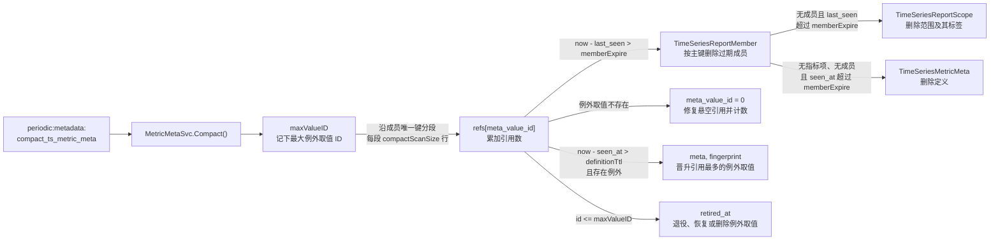

晋升与例外取值回收的规则见「元信息存储」。分段扫描的引用计数在 Go 中累加，不使用无索引的 `DELETE ... LIMIT`：

```sql
SELECT id, report_scope_id, meta_id, meta_value_id, last_seen
FROM metadata_timeseriesreportmember
WHERE group_id = ?
  AND (report_scope_id > ? OR (report_scope_id = ? AND meta_id > ?))
ORDER BY report_scope_id, meta_id
LIMIT 10000;
```

### d. 分组提示

`pkg/bk-monitor-worker/internal/metadata/service/timeseriesscope.go`、`bkmonitor/metadata/models/custom_report/time_series.py`

Python 与 Go 两侧的指标同步新建指标项时，按分组提示决定页面分组，流程见「页面归属」。提示查询失败时返回空提示，不中断同步：

```go
// 只查询本批新指标：field_name → 定义 → (group_id, meta_id) 索引取成员 → 范围标签
// 无分组维度时返回空 map，查询出错（含新表不存在）时记日志、计数并返回空 map
func (s MetricMetaSvc) PlacementHints(groupID uint, dims []string, fieldNames []string) map[string]string
```

**bk-monitor**

| 变更点 | 目标 |
| --- | --- |
| **[Change]** `metadata.models.custom_report.time_series.TimeSeriesGroup.is_default_scope_info` | 改从 `ResultTableOption(metric_group_dimensions)` 读取分组维度 |
| **[Add]** `metadata.models.custom_report.metric_meta.placement_hints` | 签名为 `placement_hints(group_id, dims, field_names)`，与 Go 共用测试样例 |
| **[Change]** `metadata.models.custom_report.time_series.TimeSeriesScope._collect_metrics_and_dimensions` | 调用 `placement_hints()` 为新指标取分组提示 |
| **[Change]** `metadata.models.custom_report.time_series.TimeSeriesScope.bulk_refresh_ts_scopes` | 重放一次默认分组中创建不足 `1 h` 且出现提示的指标项 |
| **[Change]** `metadata.models.custom_report.time_series.TimeSeriesGroup.get_metric_from_bkdata` | [a] 白名单下线阶段删除 v2 分支，v1 分支继续维护指标名、维度与活跃时间<br />[b] `is_enabled_data_scope()` 另有调用方，保留不删 |

**bmw**

| 变更点 | 目标 |
| --- | --- |
| **[Change]** `internal/metadata/service.collectMetricsAndDimensions` | 用 `PlacementHints()` 的结果作为新指标的 `fieldScope`，无提示时为 `default` |
| **[Change]** `internal/metadata/service.determineScopeNameForNewMetric` | 提示分组归入「数据带分组信息」分支，`default` 仍走 `auto_rules` 分支，签名不变 |
| **[Change]** `internal/metadata/apiservice.getScopeNameFromGroupKey` | [a] 原地导出为 `GetScopeNameFromGroupKey`<br />[b] `service` 已导入 `apiservice`，函数迁入 `service` 包会循环导入 |
| **[Change]** `internal/metadata/service.TimeSeriesGroupSvc.IsDefaultScopeInfo` | 改从 `ResultTableOption(metric_group_dimensions)` 读取分组维度 |
| **[Change]** `internal/metadata/service.BulkRefreshTSScopes` | 重放一次默认分组中创建不足 `1 h` 且出现提示的指标项 |
| **[Change]** `internal/metadata/apiservice.BkdataService.QueryMetricAndDimension` | 白名单下线阶段删除 `useV2` 分支，v1 分支继续维护指标名、维度与活跃时间 |

## 0x05 开发方案 —— SaaS、APM 与前端

### a. 服务范围对象

`bkmonitor/packages/monitor_web/scene_view/resources/custom_metric.py`

服务过滤、图表 `scope_name` 与维度值 `scope_name` 统一由 `ServiceMetricScope` 计算，指标移入自建分组后仍按服务可见，白名单下线前与白名单取并集：


```python
@dataclass(frozen=True)
class ServiceMetricScope:
    member_scopes: dict[str, set[str]]         # 指标名 → 成员上报的 scope_name 集合
    legacy_scopes: dict[str, set[str]] | None  # 指标名 → 白名单中的 scope_name 集合，None 表示白名单不可用

    # 每个请求调用一次，非 APM 场景返回 None，Metadata 报错时成员视为空
    # 成员取 report_scopes，剔除 APM 内置指标，缺失 scope_name 记为空串
    @classmethod
    def load(cls, params: dict[str, Any], group_id: int) -> "ServiceMetricScope | None": ...

    # 白名单不可用且成员为空时不过滤，否则按成员与白名单的并集判断
    def visible(self, metric_name: str) -> bool: ...

    # field_scope 不是 default 时原样返回，否则取成员集合，成员为空时取白名单集合
    # 单值返回字符串，多值返回升序列表，无值返回 None
    def scope_name_filter(self, metric_name: str, field_scope: str) -> str | list[str] | None: ...
```

| 变更点 | 目标 |
| --- | --- |
| **[Add]** `monitor_web.scene_view.resources.custom_metric.ServiceMetricScope` | [a] 按指标汇总一个服务上报的 `scope_name`，供服务过滤、图表与维度值共用<br />[b] 沿用现状剔除 `apm_`、`bk_apm_` 前缀的内置指标 *[1]* |
| **[Delete]** `monitor_web.scene_view.resources.custom_metric.GetCustomTsMetricGroups._get_service_scope_metric_whitelist` | 不再按页面分组名查白名单，白名单改由 `load()` 读取 |
| **[Change]** `monitor_web.scene_view.resources.custom_metric.GetCustomTsMetricGroups.perform_request` | [a] 按 `scope.visible(metric_name)` 过滤指标<br />[b] `metrics[]` 每项带出 `family` |
| **[Add]** `config.default.APM_CUSTOM_METRIC_MEMBER_FILTER_ENABLED` | [a] 默认开启，关闭时 `member_scopes` 视为空<br />[b] 在 `bkmonitor.define.global_config.STANDARD_CONFIGS` 注册为 `slz.BooleanField`，紧邻 `APM_METRIC_GROUP_DIMENSIONS_ENABLED` |
| **[Keep]** `apm_web.tasks.cache_application_scope_name` | 白名单下线前继续缓存白名单，提供并集的另一半 |
| **[Delete]** `apm_web.tasks.cache_application_scope_name` | 白名单下线阶段删除 |
| **[Delete]** `apm_web.constants.ApmCacheKey.APP_SCOPE_NAME_KEY` | 白名单下线阶段删除 |

- *[1] `load()` 另剔除 `client_metrics`、`server_metrics`，现有代码没有这项过滤，来源「待确认」。*

### b. 图表与维度值

`bkmonitor/packages/monitor_web/scene_view/resources/custom_metric.py`

图表与维度值的 `scope_name` 改取 `scope_name_filter()`：收敛后按该服务成员的 `scope_name` 出数，未收敛的数据源行为不变。

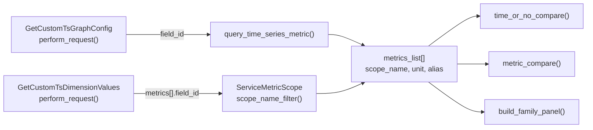

**SaaS**

| 变更点 | 目标 |
| --- | --- |
| **[Change]** `monitor_web.scene_view.resources.custom_metric.GetCustomTsGraphConfig.perform_request` | [a] `metrics_list[].scope_name` 取 `scope_name_filter()`<br />[b] `unit`、`alias`、`aggregate_method` 与 `function` 取 `effective_config` |
| **[Change]** `monitor_web.scene_view.resources.custom_metric.GetCustomTsGraphConfig.time_or_no_compare` | `scope_name` 为 `None` 时不写入 `filter_dict.scope_name` *[1]* |
| **[Change]** `monitor_web.scene_view.resources.custom_metric.GetCustomTsGraphConfig.metric_compare` | `scope_name` 为 `None` 时不写入 `filter_dict.scope_name` *[1]* |
| **[Change]** `monitor_web.scene_view.resources.custom_metric.GetCustomTsDimensionValues.RequestSerializer.MetricSerializer` | 新增可选字段 `field_id`，保留 `scope_name` 与 `name` |
| **[Change]** `monitor_web.scene_view.resources.custom_metric.GetCustomTsDimensionValues.perform_request` | 带 `field_id` 时 `scope_name` 取 `scope_name_filter()`，不带时沿用请求值 |

- *[1] `scope_name` 为列表时沿用现有多值过滤 `=~"^(a|b)$"`。*

**前端**

模块路径相对 `bkmonitor/webpack/src/monitor-pc/pages/custom-escalation/metric-detail/components/view-main/components/header-box/components/where-condition/components/`。

维度值请求由下面两个组件发出。APM 服务页 `apm-custom-graph-v2.tsx` 复用同一个 `view-main`，两侧同时生效。

两个组件都在 `currentSelectedMetricNameList` 中为请求的每个指标补上 `field_id`，取值来自 `customEscalationViewStore.currentSelectedMetricList`：

- **[Change]** `render-result-list/components/edit-panel/components/panel-value-select.PanelValueSelect`
- **[Change]** `commom/key-value-selector.FilterConditions`

### c. 管理页与写回

`bkmonitor/packages/monitor_web/custom_report/resources/metric.py`、`bkmonitor/packages/apm_web/custom_metric/resources.py`

管理页并列返回上报值与有效配置，APM 用户可按服务覆盖配置，整包回写的空值不再覆盖上报值：

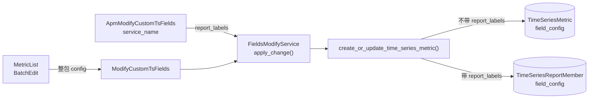

| 变更点 | 目标 |
| --- | --- |
| **[Change]** `monitor_web.custom_report.resources.metric.GetCustomTsFields.perform_request` | 每项返回 `meta` 与 `effective_config`，不并入 `config` |
| **[Change]** `monitor_web.custom_report.resources.metric.GetCustomTsFields.get_movable` | 改按 `metric_obj.scope_create_from != "data"` 判定，数据创建的分组内指标禁止移出 *[1]* |
| **[Change]** `monitor_web.custom_report.handlers.metric.service.FieldsModifyService` | 回写时跳过值为 `""`、`0`、`[]` 的配置项，不写入 `field_config` |
| **[Change]** `monitor_web.custom_report.handlers.metric.service.FieldsModifyService.__init__` | 新增可选参数 `report_labels`，同步指标时交给转换器 |
| **[Change]** `apm_web.custom_metric.resources.ApmModifyCustomTsFields.RequestSerializer` | [a] 新增可选参数 `service_name`，存在时转为 `report_labels={"service_name": ...}`<br />[b] 前端入口「待确认」 |
| **[Change]** `monitor_web.custom_report.resources.metric.ModifyCustomTsFields.perform_request` | 把请求中的 `report_labels` 传给 `FieldsModifyService` |
| **[Change]** `monitor_web.custom_report.handlers.metric.query.MetricQueryConverter.create_or_update_time_series_metric` | 新增参数 `report_labels`，非空时随 `metrics` 发给 Metadata |
| **[Change]** `monitor_web.custom_report.resources.metric.ImportCustomTimeSeriesFields.perform_request` | 导入已收敛数据源时把非 `default` 的 `field_scope` 归一为 `default`，不再静默跳过 |
| **[Change]** `monitor_web.custom_report.resources.metric.ModifyCustomTimeSeries.update_fields` | 带分组维度的数据源只更新、不删除指标 *[2]* |
| **[Keep]** `metadata.models.custom_report.time_series.TimeSeriesMetric.field_id` | 收敛前后保留项的 `field_id` 与 `scope_id` 不变，其余指标项只保留 `field_id` |

- *[1] 现状按 `field_scope == default` 判定，收敛后全部指标项的 `field_scope` 都是 `default`，会全部变为可移动。*
- *[2] 现状只处理 `field_scope` 为 `default` 的指标项并删除调用方未传入的部分，收敛后原非 `default` 指标项也会被删除。*

### d. 指标缓存与选择器

`bkmonitor/packages/monitor_web/strategies/metric_list_cache.py`

策略选择器的单位与描述改由 Metadata 的 `to_metric_info()` 补齐。SaaS 侧只改一处：多张 APM 表合并同名指标时的单位取值。

`CustomMetricCacheManager` 的读取路径不变，仍经 `api.metadata.query_time_series_group` 读取 `get_metric_info_list()`：

| 变更点 | 目标 |
| --- | --- |
| **[Keep]** `monitor_web.strategies.metric_list_cache.BaseMetricCacheManager._run` | 增量写入指标缓存，按 `metric_md5` 跳过未变化的指标 |
| **[Change]** `monitor_web.strategies.metric_list_cache.CustomMetricCacheManager.get_apm_extra_tables` | 合并多张 APM 表的同名指标时取第一个非空单位 *[1]* |
| **[Keep]** `bkmonitor.strategy.serializers.TimeSeriesQueryConfigSerializer.unit` | 保留策略保存时的单位快照，已保存策略不随上报单位变化 |

- *[1] 同一业务下多个 APM 应用的同名指标合并为 `custom:${data_label}:${field}`，现状只保留最先出现的一条，单位取决于表的返回顺序。*

### e. 族视图与 Histogram 复合面板

`bkmonitor/packages/monitor_web/scene_view/resources/custom_metric.py`、`bkmonitor/metadata/resources/resources.py`

管理页按原名展示 Histogram 父行，详情页一个族对应一个复合面板，`CUSTOM_METRIC_FAMILY_VIEW_ENABLED` 关闭时仍逐个展示族成员。族成员、方法与时间聚合规则见「指标族与复合视图」：

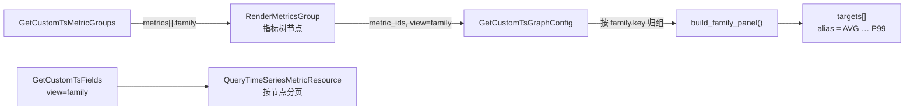

```python
FAMILY_METHODS: tuple[str, ...] = ("AVG", "SUM", "COUNT", "P50", "P90", "P95", "P99")

# 只生成所依赖族成员齐全的方法，group_by 取族成员维度的交集去掉 le，只有 _bucket 查询追加 le
# 族成员 method 固定为 SUM，cumulative 的 increase 与窗口按「指标族与复合视图」生成
# sub_title 取 _count 族成员的真实指标 ID，跳转与策略链路仍按单指标解析
def build_family_panel(
    family: dict[str, Any],
    members: dict[str, dict[str, Any]],  # role → 族成员的 metrics_list 项
    common: dict[str, Any],              # interval、table、data_label、where、filter_dict 等公共字段
    temporality: str,                    # delta 或 cumulative，取 _count 族成员的定义
) -> dict[str, Any]: ...
```

以服务 checkout 的 `request.duration` 族面板（delta）为例：

```json
{
  "title": "请求耗时",
  "sub_title": "custom:<data_label>:request_duration_count",
  "targets": [
    {"alias": "AVG", "expression": "b == 0 or a / b", "unit": "s", "query_configs": [
      {"metrics": [{"field": "request_duration_sum", "method": "SUM", "alias": "a"}], "group_by": ["method"], "functions": []},
      {"metrics": [{"field": "request_duration_count", "method": "SUM", "alias": "b"}], "group_by": ["method"], "functions": []}
    ]},
    {"alias": "P95", "expression": "a", "unit": "s", "query_configs": [
      {"metrics": [{"field": "request_duration_bucket", "method": "SUM", "alias": "a"}], "group_by": ["method", "le"],
       "functions": [{"id": "histogram_quantile", "params": [{"id": "scalar", "value": 0.95}]}]}
    ]}
  ]
}
```

- *[1] 示例只列出两个 target，每个 `query_config` 省去了与单指标面板相同的公共字段。*
- *[2] 每个 target 另带取值相同的 `"function": {}` 与 `"metric": {"name": "request.duration", "alias": "请求耗时"}`。*

响应序列化器只保留以下键，族面板不能依赖其他键：

- 面板：`title`、`sub_title`、`targets`。
- target：`expression`、`alias`、`query_configs`、`function`、`metric`、`unit`。

各方法查询的 `functions` 如下：

- `AVG`、`SUM`、`COUNT` 不带函数。
- 分位方法 `P50`、`P90`、`P95`、`P99` 与自定义 `Pxx` 只带 `histogram_quantile(φ)`。
- cumulative 的每个查询在最前面加 `increase`。

`increase` 写作 `{"id": "increase", "params": [{"id": "window", "value": "2m"}]}`，`window` 填「指标族与复合视图」中的兜底值。

前端克隆 `P99` target 生成自定义分位，只改 `alias` 与 `scalar`。例如 `P99.9` 的 `scalar` 为 `0.999`。

自定义分位不用变量占位，因为查看大图、维度下钻与跳转三条路径不替换变量，`float()` 会直接报错。

| 变更点 | 目标 |
| --- | --- |
| **[Add]** `monitor_web.scene_view.resources.custom_metric.build_family_panel` | 组装族面板，每个方法一个 target |
| **[Change]** `monitor_web.scene_view.resources.custom_metric.GetCustomTsGraphConfig.RequestSerializer` | 新增参数 `view`，取值 `metric`（默认）或 `family` |
| **[Change]** `monitor_web.scene_view.resources.custom_metric.GetCustomTsGraphConfig.perform_request` | [a] `view=family` 且不是指标对比时，同一 `family.key` 的指标交给 `build_family_panel()`<br />[b] 族面板不生效 Top/Bottom |
| **[Change]** `metadata.resources.resources.QueryTimeSeriesMetricResource.perform_request` | 支持 `view=family`：读出整组指标项与定义的原名，在内存中归组、排序与分页，再补齐本页节点的全部族成员 *[1]* |
| **[Add]** `config.default.CUSTOM_METRIC_FAMILY_VIEW_ENABLED` | [a] 默认关闭，关闭时 `GetCustomTsMetricGroups` 不返回 `family`<br />[b] 在 `bkmonitor.define.global_config.STANDARD_CONFIGS` 注册为 `slz.BooleanField` |

- *[1] 在 `5.7` 上，内存分页的首页完整步骤为 `96.2 ms`，按节点 `GROUP BY` 的联表语句仅分页就要 `208 ms`。*

`view=family` 的分页节点是一个族或一个独立指标，字段取值如下：

| 节点字段 | 取值 |
| --- | --- |
| 键 | 族键或 `field_id` |
| 名称 | 族内最小的 `field_name` |
| 更新时间 | 族内最大的 `last_modify_time` |
| 排序 | 沿用 `ORDER_FIELD_MAPPING` |

### f. 前端

`bkmonitor/webpack/src/monitor-pc/pages/custom-escalation/`

用户勾选统计方法后只查询选中的 target，管理页父行可展开族成员。APM 服务页 `apm-custom-graph-v2` 复用同一个 `view-main`，改动同时生效：

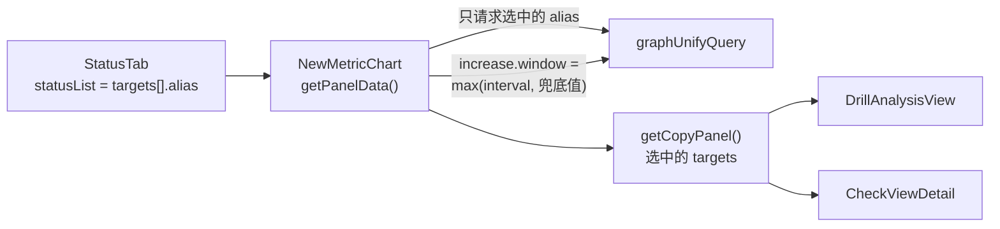

**图表**

模块路径相对 `metric-detail/components/view-main/components/panel-chart-view/components/`。

| 变更点 | 目标 |
| --- | --- |
| **[Change]** `layout-chart-table/components/metric-chart.NewMetricChart.methodList` | [a] 由 `panel.targets[].alias` 生成，可多选<br />[b] 默认选中 `AVG`、`P95`、`P99`<br />[c] `COUNT` 与时长类方法单位不同，二者互斥<br />[d] 自定义 `Pxx` 输入框校验 `0 < φ < 1` *[1]* |
| **[Change]** `layout-chart-table/components/metric-chart.NewMetricChart.getPanelData` | [a] 只请求选中的 target<br />[b] 请求前按「指标族与复合视图」改写 `increase.window` |
| **[Change]** `layout-chart-table/components/metric-chart.NewMetricChart.handleMethodChange` | 跳过复合面板，不覆盖 `metrics.method` |
| **[Change]** `layout-chart-table/components/metric-chart.NewMetricChart.getCopyPanel` | 只带上选中的 target |
| **[Change]** `layout-chart-table.LayoutChartTable.currentMethod` | 记录选中的 `alias` 集合并写入 URL 参数，不再读 `targets[0]` |
| **[Change]** `layout-chart-table/components/drill-analysis.DrillAnalysisView` | [a] 保留全部 `query_configs`，切换周期时不截断<br />[b] 取值请求传 `aggregation_method: "avg"` |
| **[Change]** `layout-chart-table/components/check-view.CheckViewDetail.handleDimensionParamsChange` | [a] 合并而非覆盖 `functions` 与 `group_by`<br />[b] 保留 `histogram_quantile`、`increase` 与 `le` |

- *[1] `StatusTab` 的 `value` 是单个字符串，支持多选的改动位置「待确认」。*

**管理页**

模块路径相对 `metric-manage/components/indicator-dimension/components/`。

- **[Change]** `metric-list.MetricList`：展开族视图父行下的族成员，展示上报单位与描述，保存时不回写 `meta`。
- **[Change]** `metric-list/components/batch-edit.BatchEdit`：父行的隐藏、禁用与移动逐个作用到族成员的 `field_id`，空值不覆盖上报值。

## 0x06 开发方案 —— 迁移、发布与兼容

### a. 发布顺序

七个发布步骤分四个阶段推进，阶段与「结论速览」一致，回退按相反顺序执行。前三个阶段的代码可以任意先后部署，进入条件只约束开关与命令。白名单下线删除代码，必须最后部署。

```mermaid
flowchart LR
    subgraph S1["阶段一 · 重新发布回退"]
        direction TB
        Mig["0278_metric_meta<br/>建表与只读解析"] --> SaaS["APM_CUSTOM_METRIC_MEMBER_FILTER_ENABLED<br/>SaaS 读取改造"]
    end
    subgraph S2["阶段二 · 关开关回退"]
        direction TB
        Bmw["enable_metric_metadata<br/>bmw 接收"] --> Collector["metric_metadata.enabled<br/>Collector 上报"]
        Bmw -.-> Family["CUSTOM_METRIC_FAMILY_VIEW_ENABLED<br/>族视图"]
    end
    subgraph S3["阶段三 · 按快照有损回退"]
        Collapse["collapse_ts_metric_scope<br/>APM V2 收敛"]
    end
    subgraph S4["阶段四 · 重新发布回退"]
        Shrink["cache_application_scope_name<br/>白名单下线"]
    end
    SaaS --> Bmw
    Collector --> Collapse
    Collapse --> Shrink

    classDef safe fill:#e3f2fd,stroke:#1e88e5,color:#0d47a1
    classDef switch fill:#fff8e1,stroke:#f9a825,color:#5d4037
    classDef lossy fill:#ffebee,stroke:#e53935,color:#b71c1c
    classDef redeploy fill:#fff3e0,stroke:#ef6c00,color:#bf360c
    class Mig,SaaS safe
    class Bmw,Collector,Family switch
    class Collapse lossy
    class Shrink redeploy
```

- *[1] 节点主标题是控制该步骤的迁移、开关或命令，实线是推荐顺序，虚线表示族视图只依赖 bmw 接收，可单独切换。*

| 步骤 | 组件 | 发布内容 | 进入条件 | 回退与后果 |
| --- | --- | --- | --- | --- |
| 建表与只读解析 | Metadata | 执行 `0278_metric_meta`，上线解析器与查询接口的新字段 | 无 | [a] 重新发布上一版本<br />[b] 再删除五张新表，用反向迁移还是手工 `DROP`「待确认」 |
| SaaS 读取改造 | SaaS、Metadata | 服务过滤、图表、维度值与写回改造，分组维度只写 `ResultTableOption` | 建表与只读解析已发布 | [a] 关闭 `APM_CUSTOM_METRIC_MEMBER_FILTER_ENABLED`，服务过滤回到白名单<br />[b] 其余改造重新发布上一版本 |
| bmw 接收 | bmw、Metadata | [a] 上线元信息消费、整理与分组提示<br />[b] 配置 `METRIC_METADATA_DATA_IDS`，打开 `taskConfig.metadata.metricMeta.enabled`<br />[c] 逐个数据源打开 `enable_metric_metadata` | 五张新表已创建 | 关闭 `enable_metric_metadata` *[1]* |
| Collector 上报 | Collector | 逐个集群打开 `metric_metadata.enabled`，键名取自关联方案「bk-collector 指标元信息采集与同步方案」 | bmw 接收已发布 | 关闭 `metric_metadata.enabled` *[1]* |
| 族视图 | SaaS | 打开 `CUSTOM_METRIC_FAMILY_VIEW_ENABLED` | [a] bmw 接收已发布<br />[b] Collector 上报前没有定义，打开后仍逐个展示族成员 | 关闭该开关 |
| APM V2 收敛 | Metadata | 逐个数据源执行 `collapse_ts_metric_scope` | SaaS 读取改造已发布，数据源已有成员 | 按快照执行 `--phase rollback`，覆盖收敛后的用户修改 |
| 白名单下线 | SaaS、Metadata、bmw | 删除白名单任务、缓存键与 Python、Go 两侧的 v2 分支 | [a] 全部 Collector 已升级满 `30 d`<br />[b] `collapse_ts_metric_scope --all-v2 --dry-run` 没有待收敛的数据源 *[2]* | [a] 重新发布上一版本<br />[b] 白名单任务每 `10 min` 扫描一轮，积累完成前服务视图只在缓存未命中时回查最近 `5 min` |

- *[1] 关闭开关只停止写入，已写入的元信息继续生效，撤销已显示的上报值要清理该数据源在新表中的行，清理方式「待确认」。*
- *[2] 未收敛就删除 v2 分支时，这些数据源按 v1 同步新建 `default` 指标项，`field_id` 改变，已保存视图失效。*

回退按上表自下而上执行，以下三条顺序不能颠倒：

| 顺序约束 | 原因 |
| --- | --- |
| SaaS 读取改造先于收敛发布、晚于收敛回退 | 旧 SaaS 把 `field_scope` 当作 `scope_name` 过滤，收敛后图表无数据 |
| 白名单下线最后发布、最先回退 | 收敛回退会恢复 `metric_group_dimensions`，v2 分支已删时这些数据源按 v1 新建指标项 |
| 删除新表排在回退最后，且先重新发布上一版本 | 解析器、bmw 与 SaaS 都读写新表 |

### b. 上线影响与兼容

已有表结构与可见指标项的 `field_id` 不变，新代码遇到旧表结构或旧组件时降级运行，旧代码读不到新表也不报错。

| 对象 | 可见变化 | 兼容与回退 |
| --- | --- | --- |
| 普通自定义指标数据源 | [a] Metadata 发布后，空串的单位与描述改显示表级值 *[1]*<br />[b] 打开接收后显示上报值，Collector 是否为普通自定义指标上报元信息「待确认」 | 空值回落没有开关，撤销要重新发布上一版本 |
| APM V2 数据源 | 收敛后同名的多行指标项合并为一行，非保留项从列表隐藏 | 按快照回退，覆盖收敛后的用户修改 |
| APM 服务视图 | [a] 移入自建分组的指标仍可见<br />[b] Collector 上报后，大应用与低频指标不再截断 | 关闭 `APM_CUSTOM_METRIC_MEMBER_FILTER_ENABLED` 回到白名单 |
| 按服务覆盖的配置 | APM 用户可按服务修改单位等配置，前端入口「待确认」 | 回退 SaaS 后不生效，数据保留在上报成员上 |
| 新建 APM 应用 | 不再启用 v2 分组发现，Collector 上报前新指标按 `auto_rules` 或默认分组归属 | 回退后旧代码是否补写 `metric_group_dimensions`「待确认」 |
| 告警策略与指标选择器 | [a] 显示上报单位与描述<br />[b] 多个 APM 应用的同名指标取第一个非空单位 | [a] 已保存策略保留单位快照<br />[b] 按 `scope_name` 过滤的存量策略是否受影响「待确认」 |
| 已保存视图与链接 | 保留项的 `field_id` 与分组不变，引用非保留项原分组的视图缺少该指标 *[2]* | [a] 按快照回退后恢复<br />[b] 关闭族视图后，带统计方法参数的链接如何展示「待确认」 |
| 旧 ESB 调用方 | `ModifyCustomTimeSeries.update_fields` 对带分组维度的数据源只更新不删除 | 依赖「未传入即删除」的调用方会看到残留指标项 |

- *[1] 管理页整包回写会把未设置的键补成空串，所以空串单位很普遍，现状 `to_metric_info()` 对空串原样返回。*
- *[2] 视图按页面分组名加指标名还原，非保留项离开原分组后匹配不到，受影响的视图数待统计。*

### c. 版本共存

各组件新旧版本共存时都有兜底，表结构的新旧以 `0278_metric_meta`（建五张新表）是否执行区分：

| 新版本 | 旧版本 | 表现 | 兼容方式 |
| --- | --- | --- | --- |
| 表结构 | bmw | 新表无人写入 | 解析器回落到用户配置与表级字段 |
| bmw | 表结构 | `Apply()` 报错并计数 | 常驻任务退避重试，指标同步不受影响 |
| Metadata | SaaS | 旧 SaaS 忽略新字段，策略选择器经 `to_metric_info()` 读到上报单位 | 逐个数据源开启接收 |
| SaaS | Metadata | 响应缺少新字段，DTO 置 `None` | 新 SaaS 对 `None` 走旧逻辑 |
| SaaS、bmw | Collector | 不上报元信息 | 服务视图走白名单，页面归属回落到 `auto_rules` 与默认分组 |

迁移部分失败没有兜底。MySQL 的 DDL 不在事务内，一条迁移建五张表时中途失败会留下已建的表且迁移未记录，之后每次发布都在 `0278_metric_meta` 报表已存在，metadata 后续迁移全部不执行。处置「待确认」，候选为每张表拆成一条迁移，或手工删除已建的表后重跑。

### d. 新表缺失时的降级

迁移失败时，已有功能的五个入口按下表降级。入口遇到 MySQL 错误码 `1146`（表不存在）时记录日志并计数，不向调用方抛出。新功能入口不降级，直接报错并计数，包括 bmw `Apply()`、`Compact()` 与按服务写回。

| 入口 | 所在的已有功能 | 表不存在时 |
| --- | --- | --- |
| `metadata.models.custom_report.metric_meta.MetricConfigResolver.prefetch` | 指标缓存、管理页、指标树、APM 服务视图、图表与维度值 | 视为没有定义与成员，配置回落到指标项与表级字段，服务过滤回落到白名单 |
| `metadata.models.custom_report.metric_meta.placement_hints` | Python 指标同步 | 返回空提示，新指标按 `auto_rules` 与默认分组归属 *[1]* |
| `internal/metadata/service.MetricMetaSvc.PlacementHints` | bmw 指标同步 | 返回空提示，新指标按 `auto_rules` 与默认分组归属 *[1]* |
| `metadata.models.custom_report.time_series.TimeSeriesGroup.delete_time_series_group` | 删除数据源 | 跳过新表中的行 |
| `monitor_web.data_migrate.fetcher.metadata.data_source.get_metadata_result_table_fetcher` | 数据迁移导出 | 不导出新表 |

- *[1] 分组提示只决定新指标的初始分组，查询出现任何错误都返回空提示，不阻断指标同步。*

Python 侧的降级计入 `bkmonitor_metadata_metric_meta_degraded_total`，bmw 侧计入 `metric_meta_db_errors_total`。发布后任一计数中 `code=1146` 持续增长即说明迁移失败，可据此配置告警。

### e. APM V2 收敛

存量 V2 数据源要逐个收敛，把同名指标项改写为一行 `field_scope=default`。停用 v2 后，指标同步按 `(field_name, default)` 匹配指标项。未收敛的数据源会新建指标项并失活原指标项，`field_id` 随之改变。

收敛只改动以下对象：

| 对象 | 收敛时的处理 |
| --- | --- |
| 同名指标项 | 改写 `field_scope`、`scope_id` 与 `field_config` |
| 占位的 `default` 旧指标项 | 删除 |
| `TimeSeriesGroup.metric_group_dimensions` | 清空 |
| 页面分组与 VM 存储绑定 | 不动 |

收敛期间不能停用数据源来暂停同步。bmw 与订阅下发都按 `is_enable` 过滤数据源，停用会中断上报。

`T0` 是写快照的时刻，`10 min` 是一轮指标同步的超时上限。事务提交满 `10 min` 后，提交前启动的 v2 同步都已结束。`rerun` 此时删除 `T0` 后新建的非 `default` 指标项：

```mermaid
flowchart LR
    Check["precheck()<br/>统计同名指标项"] --> Snapshot["snapshot()<br/>指标项整行<br/>metric_group_dimensions, T0"]
    Snapshot --> Tx
    subgraph Window["RefreshTimeSeriesMetric() v2 · 竞态窗口 ≤ 10 min"]
        direction TB
        Tx["transaction.atomic()<br/>保留项 field_scope<br/>= default<br/>metric_group_dimensions<br/>= []"] --> Stale["BulkRefreshTSMetrics()<br/>T0 前启动的 v2 同步<br/>可能新建<br/>(field_name, field_scope)"]
    end
    Window -->|"等待 10 min"| Rerun["--phase rerun<br/>删除 T0 后创建的<br/>field_scope != default<br/>指标项"]
    Rerun --> V1["RefreshTimeSeriesMetric()<br/>按 v1 同步"]
```

- *[1] 改写指标项与清空 `metric_group_dimensions` 必须在 `monitor_api` 库的同一事务内提交，先单独清空时，下一轮 v1 同步会抢先新建 `(field_name, default)` 指标项。*
- *[2] 清空列用 `save(update_fields=["metric_group_dimensions"])`，不走 `modify_time_series_group`，避免改写 `ResultTableOption` 并重新下发 VM 绑定，VM 绑定保留 v2 维度对 v1 结果的影响「待确认」。*

同名指标项按以下顺序选出保留项，保留项的 `field_scope` 改为 `default`：

```text
scope_id ≠ 0  →  is_active = true 优先  →  last_modify_time 最近  →  field_id 最小
```

| 同名情况 | 保留项 | 其余指标项 |
| --- | --- | --- |
| 只有一个指标项 | 该指标项 | 无 |
| 有多个指标项 | 按上述顺序选出 *[1]* | [a] `scope_id` 置 `0`，从列表隐藏<br />[b] `field_id` 保留<br />[c] 配置并入保留项 *[2]* |
| 另有 `scope_id = 0` 的 `default` 旧指标项 | 从旧指标项以外的指标项中选出 *[3]* | 旧指标项记入快照后删除，其他非保留项同上 |

- *[1] 活跃状态排在修改时间之前，因为 bmw 会把本轮缺失的指标项置为失活并刷新修改时间。*
- *[2] 其余指标项的 `field_config` 按修改时间由旧到新并入保留项，保留项自身的键优先。*
- *[3] 旧指标项占用保留项改写后的唯一键，且 `scope_id = 0` 的指标项在同步命中时会被重置 `field_config`，所以不能作为保留项。*

收敛命令的写法参照 `refresh_ts_metric`：

```text
python manage.py collapse_ts_metric_scope [选项]

# 要处理的数据源 ID，可重复传入，与 --all-v2 二选一
--group-id <group_id>
# 选中 metric_group_dimensions 非空的全部数据源，已收敛的数据源选不中，rollback 必须用 --group-id
--all-v2
--phase <collapse|rerun|rollback>
# 快照目录，必填，必须位于持久卷，文件名为 <group_id>-<T0>.json
--snapshot-dir <dir>
# 只输出同名指标项统计与保留项，不写库
--dry-run
```

| 阶段 | 行为 |
| --- | --- |
| `collapse` | [a] 加锁、预检、写快照，再执行单事务改写<br />[b] 结束时输出 `T0` 与事务提交时刻，两者都写入快照文件 |
| `rerun` | [a] 距事务提交不足 `10 min` 时拒绝执行<br />[b] 否则删除 `T0` 之后创建且 `field_scope != default` 的指标项 |
| `rollback` | [a] 按快照恢复指标项的 `field_scope`、`scope_id` 与 `field_config`<br />[b] 按快照恢复 `metric_group_dimensions`<br />[c] 重建被删除的旧指标项<br />[d] 只恢复上述四列，`T0` 之后对这四列的修改不合并<br />[e] 快照之后新建的指标项如何处理「待确认」 |

`collapse` 期间持有缓存锁 `metadata:collapse_ts_metric_scope:<group_id>`，TTL 为 `10 min`。`TimeSeriesGroup.update_metrics()` 检测到锁时拒绝写入，各写入入口的表现如下：

| 写入入口 | 收敛锁生效时 |
| --- | --- |
| `refresh_ts_metric` 命令 | 被拒绝，锁过期后重试 |
| `kernel_api.rpc.functions.admin.custom_report.refresh_custom_report_metrics` | 被拒绝，锁过期后重试 |
| `CustomGroupBase.modify_custom_group`，带 `metric_info_list` 时 | 被拒绝，锁过期后重试 |
| bmw `RefreshTimeSeriesMetric()` | 不检查此锁，`T0` 前启动的同步留下的指标项由 `rerun` 删除 |

其他执行约束：

- **可重入**：`metric_group_dimensions` 为空且没有 `scope_id ≠ 0` 的非 `default` 指标项时视为已收敛，命令直接跳过。
- **事务规模**：单事务改写一个数据源的全部同名指标项，最大数据源约 `20,000` 个，事务耗时与行锁等待未压测「待确认」。

从 SaaS 读取改造起，分组维度的写回入口只写 `ResultTableOption`，收敛窗口内不再写回 `metric_group_dimensions` 列：

| 变更点 | 目标 |
| --- | --- |
| **[Add]** `metadata/management/commands/collapse_ts_metric_scope.py` | 按 `--phase` 执行收敛、复跑与回退，快照写入 `--snapshot-dir` |
| **[Change]** `metadata.models.custom_report.time_series.TimeSeriesGroup.update_metrics` | 检测到收敛锁时拒绝同步该数据源 |
| **[Change]** `metadata.models.custom_report.time_series.TimeSeriesGroup.create_time_series_group` | 只把分组维度写入 `ResultTableOption`，APM 新建应用经 `apm.models.datasource.MetricDataSource.create_or_update_result_table` 传入分组维度 |
| **[Change]** `metadata.models.custom_report.time_series.TimeSeriesGroup.modify_time_series_group` | 只把分组维度写入 `ResultTableOption` |
| **[Keep]** `apm/management/commands/refresh_apm_datalink.py` | 继续经 `api.metadata.modify_time_series_group` 写入分组维度，随该接口的改造只写 `ResultTableOption` |

### f. 上线前置检查

每个环境上线前逐项检查：

| 检查项 | 方法 | 关注点 | 处置 |
| --- | --- | --- | --- |
| MySQL 版本 | `SELECT VERSION()` | 是否为 `5.7` 或 `8.0` | 两个版本都按本方案执行，`8.0` 支持 INSTANT 加列也不改用 C 旧表加列 |
| 索引前缀上限 | `SELECT @@innodb_default_row_format` | 单列索引前缀上限是否不小于 `767 B` | [a] 无需处理，任何行格式都满足<br />[b] `utf8` 的 `varchar(255)` 单列只占 `765 B` |
| 新表字符集 | 对五张新表执行 `SHOW CREATE TABLE` | 索引文本列是否为 `utf8_bin` | 出现 `utf8mb4` 时改回 `utf8` |
| `is_active` 库默认值 | `SHOW CREATE TABLE metadata_timeseriesmetric` | `is_active` 是否带库默认值，缺失时 bmw 省略该列会报 `1364` | 缺失时登记为独立缺陷，不对指标项表做 DDL |
| `sql_mode` | `SELECT @@sql_mode` | 是否含 `STRICT_TRANS_TABLES` | 含该模式时确认四字节字符替换生效 |
| V2 同名指标项 | `collapse_ts_metric_scope --dry-run` | 同名指标项是否跨 `scope_name` | 跨 `scope_name` 时人工确认保留项 |

## 0x07 验收与验证

### a. 测试门禁

bk-monitor 与 bmw 的下列用例全部通过才能合并。

**bk-monitor**

```bash
cd bkmonitor && pytest metadata/tests packages/monitor_web/tests packages/apm_web/tests
```

| 用例 | 断言重点 |
| --- | --- |
| `metadata/tests/custom_report/test_metric_meta.py::TestMetricConfigResolver` | [a] 五级回落顺序<br />[b] `""`、`0`、`[]` 视为未设置<br />[c] 多个成员命中时取 `last_seen` 最近的一个<br />[d] 新表不存在时回落到指标项 `field_config` 与表级字段，不抛出异常 |
| `metadata/tests/custom_report/test_metric_meta.py::TestPlacementHints` | [a] 与 Go `TestPlacementHints` 共用样例，输出一致<br />[b] 无分组维度时返回空<br />[c] 新表不存在时返回空，指标同步照常创建指标项 |
| `metadata/tests/commands/test_collapse_ts_metric_scope.py::TestCollapseTsMetricScope` | [a] 三种同名情况的保留项与配置合并正确，失活指标项不被选为保留项<br />[b] 模拟 `T0` 前启动的 v2 同步写入后，复跑删除新建的指标项<br />[c] 按快照回退后与收敛前一致 |
| `packages/monitor_web/tests/scene_view/test_service_metric_scope.py::TestServiceMetricScope` | [a] 指标移入用户分组后仍可见<br />[b] 成员为空时等价于现状白名单<br />[c] 白名单不可用且成员为空时不过滤，成员非空时按成员过滤 |
| `packages/monitor_web/tests/scene_view/test_service_metric_scope.py::TestScopeNameFilter` | [a] 未收敛时取 `field_scope`<br />[b] 收敛后单值返回字符串，多值返回列表<br />[c] 无值时不加 `scope_name` 过滤 |
| `packages/monitor_web/tests/scene_view/test_family_panel.py::TestBuildFamilyPanel` | [a] 校验 delta 与 cumulative 的 `functions`，规则见「族视图与 Histogram 复合面板」<br />[b] 缺 `_bucket` 时不生成分位方法<br />[c] `_bucket` 之外的查询不带 `le` |

**bmw**

```bash
cd pkg/bk-monitor-worker && go test -race ./internal/metadata/...
```

| 用例 | 断言重点 |
| --- | --- |
| `internal/metadata/service/metricmeta_test.go::TestScopeDecoderAPM` | [a] `%`、`-` 转义往返一致<br />[b] 标签值含 `\|\|` 时拒收 |
| `internal/metadata/service/metricmeta_test.go::TestPlacementHints` | [a] 与 Python `TestPlacementHints` 共用样例，输出一致<br />[b] 无分组维度时返回空 map<br />[c] 新表不存在时返回空 map，`RefreshTimeSeriesMetric()` 照常完成 |
| `internal/metadata/service/metricmeta_test.go::TestMetricMetaApply` | [a] 「元信息存储」写入判定图的每个分支与两个容量上限<br />[b] 同值例外只产生一个例外取值，刷新间隔内的重复上报、同批重复记录与消息重放都不产生写入<br />[c] 四字节字符被替换为 `U+FFFD` 后再计算指纹<br />[d] 并发插入遇 `1062` 时重读重试一次，结果与串行写入一致 |
| `internal/metadata/service/metricmeta_test.go::TestMetricMetaCompact` | [a] 分段回收不使用无索引的 `DELETE ... LIMIT`，悬空引用被置 `0`<br />[b] 持续上报的定义不被切换<br />[c] 退役未满 `valueRetireGrace` 的例外取值不被删除，退役期间被 `Apply()` 引用的例外取值不被删除 |

### b. 场景验收

场景验收核对端到端结果，复合计算与 cumulative 窗口必须走实际存储查询路径核对数值，图表配置 JSON 正确不能替代结果核对。

| 场景 | 输入 | 预期 |
| --- | --- | --- |
| 与定义相同 | `200` 个服务上报相同元信息 | [a] `1` 个定义、`200` 个成员<br />[b] `meta_value_id` 均为 `0`，没有例外取值 |
| 同值例外去重 | `100` 个服务上报同一份偏离定义的元信息 | `1` 个例外取值，`100` 个成员引用它 |
| 重设基线 | 全部服务改报新单位，持续超过 `6 h` | 新值晋升为定义，成员引用置 `0`，旧例外取值退役满 `valueRetireGrace` 后删除 |
| 按服务覆盖 | 在服务 A 修改单位 | 修改只对服务 A 生效 |
| 元信息先到 | 元信息早于指标同步到达 | 新指标项直接按分组提示归入页面分组 |
| 元信息后到 | 元信息晚于指标同步到达 | 默认分组中的新指标项在 `1 h` 内重放一次 |
| V2 收敛 | 已保存视图引用收敛前的 `field_id` | 视图正常打开，页面分组不变，图表有数据 |
| 迁移失败 | 新代码运行在无新表的库上 | 指标同步、指标缓存、管理页、指标树、APM 服务视图、图表与删除数据源正常，新功能报错并计数 |
| 复合计算 | delta 的 `_sum` 为 `[0.3, 0.9]`，`_count` 为 `[2, 3]` | `AVG` 为 `0.24`，样本只累计一次 |
| cumulative 窗口 | 当前周期 `5 min`，上报周期 `30 s` | `increase` 窗口为 `300s`，`COUNT` 等于该周期内的请求数 |

### c. 性能基线

上线前在目标 MySQL `5.7` 上复跑 [validation](./validation/README.md) 的 `make plans57 plans57-supplement plans57-supplement2`，以 [REPORT](./REPORT.md) 为基线，各项不超过上限。实测列前者为 amd64 模拟的 `5.7.44`，后者为 arm64 原生的 `5.7.30`，方案 D 按本 PLAN 的读取写法。

| 基线项 | 统计对象 | 统计量 | `5.7` 实测 | 上限 |
| --- | --- | --- | --- | --- |
| 服务视图成员查询 | `126` 个服务的数据源 | p50 | `0.92 ms` / `0.68 ms` | `2 ms` |
| 服务视图成员查询 | 最大数据源 | p50 | `3.8 ms` / `3.0 ms` | `20 ms` |
| 服务视图完整路径 | 最大数据源 | p50 | `231 ms` / `188 ms` | `350 ms` *[3]* |
| 管理页首页 | 最大数据源 | p50 增量 *[1]* | `2.3 ms` / `0.6 ms` | 原 `2 ms`，现 `3.5 ms` *[2]* |
| 管理页搜索 | 最大数据源 | p50 增量 *[1]* | `0.4 ms` / `0.4 ms` | `2 ms` |
| 族视图首页完整步骤 | 最大数据源 | p50 | `96.2 ms` / `91.0 ms` | `150 ms` |
| 指标缓存全量扫描 | 全平台 | 一轮耗时 | `9.9 s` / `8.6 s` | 原 `6 s`，现 `15 s` *[2]* |
| bmw 元信息写入 | 每批 `1,000` 条上报 | p50 | `29.1 ms` / 未测 | `50 ms` |
| 成员回收 | 最大数据源 | 单组耗时 | 未测 | `5 s` |

- *[1] 增量相对同一环境中改造前的现状，不受硬件差异影响。*
- *[2] 原上限按本机 `9.2` 设定，在 `5.7` 上超出，现按 amd64 实测留约 `1.5` 倍余量重定，是否接受「待确认」。*
- *[3] 新增项，按 amd64 实测留约 `1.5` 倍余量设定，其中成员查询约 `4 ms`，其余是整组读取指标项与定义。*

## 0x08 实施进展

| 时间 | 结论性进展 |
| --- | --- |
| `2026-10-12 18:00` | [a] 收敛复跑的等待改从事务提交起算<br />[b] 按快照回退只恢复四项：`field_scope`、`scope_id`、`field_config`、`metric_group_dimensions`<br />[c] 补齐 bmw 写入的四条边界规则，均「待确认」：同批去重、超长字段、成员超限、并发写入遇 `1062` 重试<br />[d] 不再区分迁移失败是否阻断发布，统一按迁移失败设计降级 |
| `2026-10-12 16:00` | [a] 在 MySQL `5.7` 上完成四个方案的端到端压测与 arm64 原生复核，结论仍为全建新表<br />[b] 方案对比与性能基线的数字换为 `5.7` 实测<br />[c] 定义改为单独一条语句读取，族视图节点改在内存中组装<br />[d] 管理页搜索与现状持平，节点分页低于 `150 ms`<br />[e] 两项性能上限按 `5.7` 实测重定「待确认」：管理页首页增量 `3.5 ms`，指标缓存扫描 `15 s` |
| `2026-10-12 12:00` | [a] 四个完整方案端到端对比，选定全建新表<br />[b] 给出上线影响、两层兼容、新表缺失时的降级与回退顺序<br />[c] 实测四种按范围存放元信息的存法，选定定义加例外引用<br />[d] 例外取值按指纹去重，退役满 `valueRetireGrace` 后回收<br />[e] 补齐开发契约：解析器接入、接口四处同改、服务范围对象、族面板、bmw 任务注册、收敛命令、按服务写回<br />[f] 修正收敛保留项（活跃优先）、页面归属顺序与空串回落的生效时机 |
| `2026-10-11 18:00` | [a] 按 `1,000,000` 指标项完成活跃规模、上界规模满量压测与 MySQL `5.7`、`8.0` 兼容实测，选定窄成员表，不分表<br />[b] 按上线风险选定独立定义表，已有表零 DDL<br />[c] 给出分阶段发布与版本共存矩阵，APM V2 收敛改为单事务改写加复跑修复 |
| `2026-09-15 10:00` | 完成自定义指标模型、指标发现与图表接口链路回查，确定 Histogram 复合视图沿用多指标运算协议 |

## 0x09 参考 & 版本锚点

### a. 代码依据

**bk-monitor**

- [<源码> bk-monitor/bkmonitor/metadata/models/custom_report/time_series.py](https://github.com/TencentBlueKing/bk-monitor/blob/master/bkmonitor/metadata/models/custom_report/time_series.py)：`TimeSeriesGroup` 的 v2 开关、分组键推导与 `modify_time_series_group`，`TimeSeriesScope` 的页面归属，`TimeSeriesMetric.to_metric_info`。
- [<源码> bk-monitor/bkmonitor/metadata/resources/resources.py](https://github.com/TencentBlueKing/bk-monitor/blob/master/bkmonitor/metadata/resources/resources.py)：`QueryTimeSeriesMetricResource` 的计数、分页与排序，`QueryTimeSeriesScopeResource` 的整组读取。
- [<源码> bk-monitor/bkmonitor/api/metadata/default.py](https://github.com/TencentBlueKing/bk-monitor/blob/master/bkmonitor/api/metadata/default.py)：SaaS 侧接口的请求声明。
- [<源码> bk-monitor/bkmonitor/packages/monitor_web/scene_view/resources/custom_metric.py](https://github.com/TencentBlueKing/bk-monitor/blob/master/bkmonitor/packages/monitor_web/scene_view/resources/custom_metric.py)：白名单查找、维度值、图表配置与响应序列化器。
- [<源码> bk-monitor/bkmonitor/packages/monitor_web/custom_report/resources/metric.py](https://github.com/TencentBlueKing/bk-monitor/blob/master/bkmonitor/packages/monitor_web/custom_report/resources/metric.py)：`get_movable`、`ModifyCustomTimeSeries.update_fields` 与导入。
- [<源码> bk-monitor/bkmonitor/packages/monitor_web/custom_report/handlers/metric/query.py](https://github.com/TencentBlueKing/bk-monitor/blob/master/bkmonitor/packages/monitor_web/custom_report/handlers/metric/query.py)：`MetricConfigResponseDTO` 补齐空值。
- [<源码> bk-monitor/bkmonitor/packages/apm_web/tasks.py](https://github.com/TencentBlueKing/bk-monitor/blob/master/bkmonitor/packages/apm_web/tasks.py)：`cache_application_scope_name` 白名单任务。
- [<源码> bk-monitor/bkmonitor/packages/apm_web/handlers/metric_group/helper.py](https://github.com/TencentBlueKing/bk-monitor/blob/master/bkmonitor/packages/apm_web/handlers/metric_group/helper.py)：`MetricHelper.get_monitor_info` 回查白名单。
- [<源码> bk-monitor/bkmonitor/metadata/models/custom_report/subscription_config.py](https://github.com/TencentBlueKing/bk-monitor/blob/master/bkmonitor/metadata/models/custom_report/subscription_config.py)：订阅下发按 `is_enable` 过滤。
- [<源码> bk-monitor/bkmonitor/alarm_backends/service/scheduler/tasks/report_cron.py](https://github.com/TencentBlueKing/bk-monitor/blob/master/bkmonitor/alarm_backends/service/scheduler/tasks/report_cron.py)：`register_alarm_cache_bmw_task` 注册 bmw 常驻任务。
- [<源码> bk-monitor/bkmonitor/settings.py](https://github.com/TencentBlueKing/bk-monitor/blob/master/bkmonitor/settings.py)：Django `4.2` 最低数据库版本放宽到 MySQL `5.7` 的补丁。
- [<源码> bk-monitor/bkmonitor/config/default.py](https://github.com/TencentBlueKing/bk-monitor/blob/master/bkmonitor/config/default.py)：`monitor_api` 库连接未设置 `lock_wait_timeout`。
- [<源码> bk-monitor/bkmonitor/metadata/migrations/](https://github.com/TencentBlueKing/bk-monitor/blob/master/bkmonitor/metadata/migrations)：`0251`、`0252` 发布后的修改记录与 bmw 对应提交的跟进时间。

**bkmonitor-datalink**

- [<源码> bkmonitor-datalink/pkg/bk-monitor-worker/internal/metadata/service/timeseriesmetric.go](https://github.com/TencentBlueKing/bkmonitor-datalink/blob/master/pkg/bk-monitor-worker/internal/metadata/service/timeseriesmetric.go)：按键差集新建、失活与 `scope_id = 0` 重置。
- [<源码> bkmonitor-datalink/pkg/bk-monitor-worker/internal/metadata/service/timeseriesscope.go](https://github.com/TencentBlueKing/bkmonitor-datalink/blob/master/pkg/bk-monitor-worker/internal/metadata/service/timeseriesscope.go)：`determineScopeNameForNewMetric` 与 `collectMetricsAndDimensions`。
- [<源码> bkmonitor-datalink/pkg/bk-monitor-worker/internal/metadata/apiservice/bkdata.go](https://github.com/TencentBlueKing/bkmonitor-datalink/blob/master/pkg/bk-monitor-worker/internal/metadata/apiservice/bkdata.go)：Go 侧 v1、v2 判定与分组键推导。
- [<源码> bkmonitor-datalink/pkg/bk-monitor-worker/service/scheduler/daemon/daemon.go](https://github.com/TencentBlueKing/bkmonitor-datalink/blob/master/pkg/bk-monitor-worker/service/scheduler/daemon/daemon.go)：常驻任务注册与 `Operator` 接口。
- [<源码> bkmonitor-datalink/pkg/bk-monitor-worker/config/metadata_config.go](https://github.com/TencentBlueKing/bkmonitor-datalink/blob/master/pkg/bk-monitor-worker/config/metadata_config.go)：`taskConfig.metadata.*` 配置惯例。
- [<源码> bkmonitor-datalink/pkg/bk-monitor-worker/store/mysql/mysql.go](https://github.com/TencentBlueKing/bkmonitor-datalink/blob/master/pkg/bk-monitor-worker/store/mysql/mysql.go)：bmw 连接未设置 `lock_wait_timeout`。
- [<源码> bkmonitor-datalink/pkg/bk-monitor-worker/config/config.go](https://github.com/TencentBlueKing/bkmonitor-datalink/blob/master/pkg/bk-monitor-worker/config/config.go)：DSN 字符集 `store.mysql.charset` 默认为 `utf8`。

**第三方**

- [<源码> jinzhu/gorm v1.9.16 callback_create.go](https://github.com/jinzhu/gorm/blob/v1.9.16/callback_create.go)：带 `default` 标签的零值字段不进 INSERT。

### b. 关联方案

- [bk-collector 指标元信息采集与同步方案](../../../../knowledge/bkmonitor-datalink/issues/2026-09-15-collector-metric-metadata/PLAN.md)：元信息字段、APM 范围编码、Exporter 去重与强制补报周期。
- [APM 应用级配置](../../../../knowledge/bkmonitor/issues/2026-03-04-apm-app-level-config/PLAN.md)：分清存储对象与读取视角。

### c. 版本锚点

| 状态 | 分支 | 里程碑 | PR |
| --- | --- | --- | --- |
| 🔄 | `<branch_name>` | 里程碑 1：Metadata 五张新表、解析器与查询接口 | 待创建 |
| 🔄 | `<branch_name>` | 里程碑 2：SaaS/APM 服务视图、图表、维度值与管理页改造 | 待创建 |
| 🔄 | `<branch_name>` | 里程碑 3：bmw 元信息消费、整理与页面分组提示 | 待创建 |
| 🔄 | `<branch_name>` | 里程碑 4：APM V2 收敛与白名单下线 | 待创建 |
| 🔄 | `<branch_name>` | 里程碑 5：指标族与 Histogram 复合视图 | 待创建 |

