# 指标元信息存储与 SaaS/APM 自定义指标开发方案

> 基于 [README.md](./README.md) 制定，选型压测见 [REPORT.md](./REPORT.md)，复现工程见 [validation](./validation/README.md)。

## 0x00 结论速览

**采用方案 E「取值去重」。** 它让服务视图列出全部上报指标，把 Histogram 合成一个面板，按服务保留同名指标的类型与单位，并支持按服务编辑与分组。

`1,000` 个服务上报同一批指标时，E 存 `3,000` 行、`18.1 MiB`，D 存 `2,005,000` 行、`346.7 MiB`。代价是读取比 D 慢 `1.4～1.7` 倍、页面分组表做一次秒级 DDL，另有两项上线标准待拍板。

**要解决的问题**

五个问题都源于服务关系与上报元信息没有落库位置：

- 服务视图缺指标：指标换分组后查不到，大应用超出查询上限被截断，因为服务关系只靠定时扫描生成的白名单缓存推断。
- Histogram 难用：一个直方图拆成 `_bucket`、`_sum`、`_count` 三个指标逐项展示，用户要自己拼运算。
- 元信息无处存：Collector 上报的类型、单位与描述没有落库位置，同名指标在不同服务可能分别是 Counter 与 Gauge，单位可能分别是 `s` 与 `ms`。
- 不能按服务编辑：现有表只有一份全局配置，用户无法为单个服务改单位、别名与页面分组，也无法保证指标同步不覆盖这些修改。
- V2 不区分服务：APM 自定义指标 V2 只按 `scope_name` 拆行，`service_name` 不在任何表里，多个服务的同名指标共用一行。

**方案对比**

五个方案中只有 E 同时满足五项需求且不改指标项表，评估明细见「完整方案对比」：

| 方案 | 采用 | 做法 | 依据 |
| --- | :---: | --- | --- |
| A 沿用白名单 | ❌ | 结构不变，白名单改按 `scope_name` 查找 | 服务关系仍靠推断，元信息仍只能存一份 |
| B 按服务拆行 | ❌ | 指标项按服务各复制一行 | 最大数据源管理页首页 `28.6 s`，存储 `42.7 GiB` |
| C 元信息加列 | ❌ | 服务关系存新表，元信息加 `5` 列到指标项表 | [a] 上线时指标项表整表重建 `68.4 s～128.5 s`<br />[b] 迁移失败时管理页、指标树、图表与指标同步报错 |
| D 元信息建表 | ❌ | 元信息按指标存默认值加差异，每个「scope × 指标」一行关系 | [a] `1,000` 个服务上报同一批指标存 `2,005,000` 行<br />[b] 类型按指标只存一份，异构上报时 `1.6%` 读到错误类型 |
| E 取值去重 | ✅ | 元信息按内容去重为取值，scope 一行只存取值 ID 列表 | [a] 同场景存 `3,000` 行<br />[b] 类型随取值保存<br />[c] 读取比 D 慢 `1.4～1.7` 倍 |

**存储结构**

**一个指标被多个 scope 上报时，元信息按内容只存一次，每个 scope 只在自己那一行记下 `4` 字节的取值 ID。**

| 对象 | 模型 | 变更 | 一行是什么 | 关键列 | 写入方 | 随上报过期 |
| --- | --- | --- | --- | --- | --- | --- |
| 指标项 | `TimeSeriesMetric` | 不变 | 数据源内一个指标名 | [a] `field_name`<br />[b] `field_config`：全局配置<br />[c] `scope_id`：全局页面分组 | [a] 指标同步建行<br />[b] 用户全局修改 | 沿用现有 `30 d` 过滤 |
| 页面分组 | `TimeSeriesScope` | 加两列 | 用户归类指标的一个目录 | [a] `scope_name`<br />[b] `selector` *[1]*：新增，NULL 为全局 | 用户、指标同步 | 否 |
| 取值 | `TimeSeriesReportValue` | 新增 | 一个指标的一种完整上报元信息 | [a] `field_name`、`fingerprint`：数据源内唯一<br />[b] `metric_type`、`meta`<br />[c] `scope_count`：引用数 | bmw | `scope_count` 为 `0` 时删除 |
| scope | `TimeSeriesReportScope` | 新增 | 一个上报来源，APM 中是一个服务的一个 `scope_name` | [a] `labels`<br />[b] `report_value_ids`：取值 ID 列表<br />[c] `last_seen` | bmw | `30 d` 未上报时删除 |
| 覆盖 | `TimeSeriesMetricOverride` | 新增 | 用户在某个选择器下对一个指标的修改 | [a] `selector`、`field_name`：数据源内唯一<br />[b] `field_config`、`scope_id` | 用户 | 否 |

- *[1] 选择器表示生效范围：修改可用全局 `{}`、`{service_name}` 与 `{service_name, scope_name}` 三级，页面分组只用前两级。*

上报与配置两条写入路径各写各的表，互不覆盖：

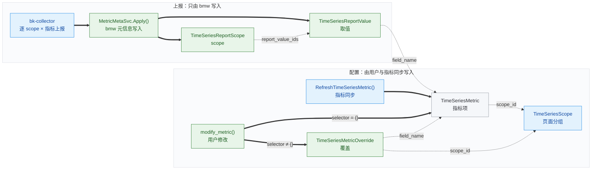

- *[1] 颜色表示变更：绿色为新增，蓝色为修改，灰色为结构不变，粗线写表，虚线为引用。*

**例子**

数据源 `9` 中，checkout 在 `http`、`grpc` 下上报，cart 在 `http` 下用旧版 SDK 上报，耗时单位为毫秒。每个 scope 一行，记录它上报的取值 ID：

| `TimeSeriesReportScope.id` | scope | `report_value_ids` | `last_seen` |
| --- | --- | --- | --- |
| 11 | checkout · http | `[1, 2, 3, 4]` | `10-13` |
| 12 | checkout · grpc | `[1, 6]` | `10-13` |
| 13 | cart · http | `[1, 2, 4, 5]` | `10-12` |

元信息相同的 scope 共用一行取值，`request_total` 被三个 scope 上报也只存取值 `1`，cart 的 `_sum` 单位不同才多存取值 `5`：

| `TimeSeriesReportValue.id` | `field_name` | `metric_type` | `meta` | `scope_count` |
| --- | --- | --- | --- | --- |
| 1 | `request_total` | counter | `{"unit": "1", "description": "请求数"}` | 3 |
| 2 | `duration_seconds_bucket` | counter | `{"unit": ""}` | 2 |
| 3 | `duration_seconds_sum` | counter | `{"unit": "s"}` | 1 |
| 4 | `duration_seconds_count` | counter | `{"unit": ""}` | 2 |
| 5 | `duration_seconds_sum` | counter | `{"unit": "ms"}` | 1 |
| 6 | `queue_size` | gauge | `{"unit": "1"}` | 1 |

checkout 的服务视图只合并 scope `11`、`12` 的列表，得到 `5` 个指标，不读 cart 的列表，服务视图读法见「读取路径」。

用户修改按选择器只写一张表：全局写指标项，按服务写覆盖。全局把 `duration_seconds_sum` 命名为「请求耗时」并移入分组 `22`，写入指标项 `1003`。checkout 把它的单位改为 `ms` 并移入本服务分组 `31`，写入覆盖 `1`。

有效配置按 scope 级覆盖、服务级覆盖、全局配置、上报取值与表级字段逐级查找，`duration_seconds_sum` 在三个视图中读到：

| 视图 | 单位 | 别名 | 页面分组 |
| --- | --- | --- | --- |
| 不分服务 | `s`：取值 `3`、`5` 各被 `1` 个 scope 引用，取 ID 小者 | 请求耗时：全局 | 支付 `22`：全局 |
| checkout · http | `ms`：覆盖 `1` | 请求耗时：全局 | 支付 `31`：覆盖 `1` |
| cart · http | `ms`：scope `13` 引用取值 `5` | 请求耗时：全局 | 支付 `22`：全局 |

**压测结论**

**E 在存储、写入、过期与类型正确性上优于 D，读取比 D 慢 `1.4～1.7` 倍。** 服务视图读法在新表上的 p95 低于 `21 ms`。 两者在同一 MySQL `5.7` 容器中单独压测，🟢 为该行较优，🔴 为不可接受，全表见「完整方案对比」：

| 测量项 *[1]* | D 元信息建表 | E 取值去重 |
| --- | --- | --- |
| 存储 · S1 | `2,005,000` 行，`346.7 MiB` | 🟢 `3,000` 行，`18.1 MiB` |
| 次日首次重发 · S1 | 写 `2,002,940` 行，`133.4 s` | 🟢 写 `1,000` 行，`1.7 s` |
| 服务视图 p50 · S1 / S2 | 🟢 `10.2 ms` / `9.4 ms` | `16.8 ms` / `15.5 ms` |
| 读到错误类型 · S2 | 🔴 `29,447` 个 scope × 指标，占 `1.6%` | 🟢 `0` |

- *[1] 两个场景都有 `1,000` 个服务：S1 上报同一批 `2,000` 个元信息一致的指标，S2 分属 `5` 种 SDK、每种 `1～3` 个元信息版本。*

**代价与风险**

**设计上的主要代价是读取变慢：以 D 实测为下限，多数读取约为现状的 `2` 倍。加上 E 的差值推算，指标树约 `2.5` 倍，族视图首页约 `4` 倍，上线前按「性能基线」复测。上线风险是页面分组表的一次 DDL、旧代码取错分组与 APM V2 收敛，四个阶段中只有收敛回退有损。**

设计代价：

| 代价 | 后果 | 量化或应对 |
| --- | --- | --- |
| 读取变慢 | [a] 读取比 D 慢 `1.4～1.7` 倍<br />[b] D 实测时指标树、服务视图与指标缓存扫描约为现状的 `2` 倍，族视图首页为 `2.7` 倍<br />[c] 加上 E 的差值推算，指标树约 `269 ms`，族视图首页约 `153 ms`，分别约为现状的 `2.5` 倍与 `4` 倍 | E 的端到端读取未单独实测，上线前按「性能基线」复测 |
| 取值数有上限 | 每个数据源最多 `2,000` 个 scope、`60,000` 个取值，超出时 bmw 丢弃新增并计数 | 防止高基数标签撑大新表，限额见「scope 身份」 |
| 单个指标停报不单独清理 | scope 仍在上报其他指标时，停报的指标留在它的取值列表里 | 保留到该 scope 整体 `30 d` 未上报，全数据源都停报的指标按指标项过期隐藏 |
| 依赖 bmw 单实例消费与缓存 | 多实例写同一 scope 行会反复冲突重放，缓存缺失时每批都要读回 scope 行 | 沿用每个 DataID 单实例消费，一批一个事务，写回前校验 `version` |
| 按指标反查 scope 要扫整个数据源 | `PlacementHints()` 读本数据源全部 scope 的取值列表 | S1 上 `16.7 ms`，只在新建指标项与 `1 h` 重放时调用 |

上线风险，按「发布顺序」的步骤处置：

| 风险 | 后果 | 应对 | 对应步骤 |
| --- | --- | --- | --- |
| `TimeSeriesScope` 加列换唯一键 | 等元数据锁（MDL）期间页面分组表的读写排队 | `10` 万行在 `5.7` 上 `3.7 s`、`8.0` 上 `3.5 s`，迁移前检查长事务 | 建表与加列 |
| 旧代码按名称取页面分组 | 同名的服务分组存在时，旧代码取到多行 | 全部组件升级后才开放按服务建分组 | 按服务建分组与编辑 |
| APM V2 收敛改写存量 | 同名的多行指标项合并为一行 | 可按快照回退，但会丢失收敛后的用户修改 | APM V2 收敛 |

**上线后用户看到的变化**

停报指标、策略选择器与 V2 已保存视图三处行为改变，要提前告知用户。停报指标的规则见「生命周期」，另两处明细见「上线影响与兼容」：

| 位置 | 变化 |
| --- | --- |
| ✅ 服务视图 | 列出该服务实际上报的全部指标，换分组后不再消失，同名指标显示本服务的类型与单位 |
| ✅ 按服务编辑与分组 | 服务页可单独改单位、别名与页面分组，标明「本服务覆盖」或「继承全局」，指标同步不覆盖 |
| ✅ Histogram | 管理页与详情页合成一个族，单位与描述按上报自动显示，用户配置仍然优先 |
| ⚠️ 停报指标 | 服务停报某指标、其他服务仍在报时，该服务视图继续显示它，直到该服务的 scope 过期 |
| ⚠️ 策略选择器 | 未填单位与描述的指标改显示表级值，撤销要重新发布上一版本 |
| ⚠️ APM V2 已保存视图 | 同名指标合并为一行，引用被合并行原分组的视图会缺少该指标 |

**能否平滑上线与回退**

**能**，`TimeSeriesMetric` 结构不变，新旧版本可以共存，新表缺失时已有功能自动降级 *[1]*。四个阶段中只有「APM V2 收敛」回退有损 *[2]*：

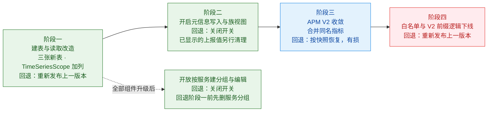

- *[1] 迁移中途失败可直接重跑：MySQL 的 DDL 不在事务内，所以建表用 `CREATE TABLE IF NOT EXISTS`，页面分组加列是一条整体成败的 ALTER。*
- *[2] 回退按阶段倒序执行：各阶段包含的发布步骤与开关见「发布顺序」。*

**需要拍板的事项**

下列两项不改变选型，只影响上线处置与验收标准，其余「待确认」项同样不影响选型：

1. **已保存视图缺指标是否可接受**：APM V2 收敛后，引用被合并行原分组的视图会缺少该指标，受影响的视图数待统计。
2. **两项读取上限是否放宽**：建议按下列预期放宽，上线前复测：
   - 指标缓存全平台扫描：D 实测 `9.6 s`，超过原上限 `6 s`，建议放宽到 `15 s`。
   - 族视图首页：D 实测加 E 的差值约 `153 ms`，超过原上限 `150 ms`，建议放宽到 `200 ms`。

## 0x01 调研与约束

现状没有任何表记录上报服务，指标项表是百万行热表且必须兼容 MySQL `5.7`，所以服务关系与元信息只能存进新表。

### a. 现有对象与读写链路

一个数据源的指标存在三张表里，没有一张记录上报服务 *[1]*。迁移必须保住指标的 `field_id` 与所在分组 *[2]*。

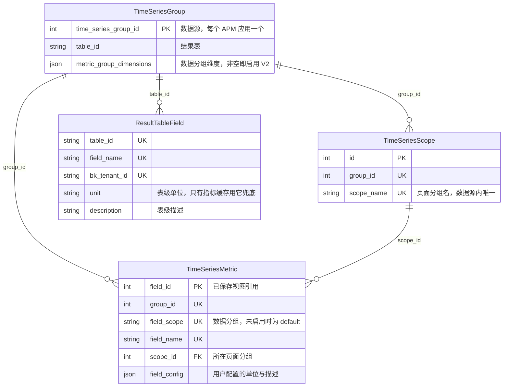

- *[1] 三张表由指标同步维护：bk-monitor-worker（bmw）的 `RefreshTimeSeriesMetric()` 每 `5 min` 同步一次，管理页只写 `field_config` 与页面分组。*
- *[2] 已保存视图依赖这两项：视图按页面分组名加指标名还原指标，再用当前 `field_id` 请求图表。*

APM 自定义指标 V2 按 scope 名 `scope_name` 拆行，同一指标名在每个数据分组各占一行，仍不记录上报服务：

| `field_id` | 数据分组 `field_scope` | `field_name` | 页面分组 | 上报服务（表中没有） |
| --- | --- | --- | --- | --- |
| `201` | `http` | `request_duration_sum` | `http` | checkout、payment |
| `202` | `default` | `order_total` | 订单（自建） | checkout |
| `150` *[1]* | `default` | `request_duration_sum` | 无 | 无 |

- *[1] 删除只是隐藏：`150` 是开启 V2 前留下的 `default` 行，管理页删除只把 `scope_id` 置 `0`，行仍保留。*

数据分组在建行时写定，移动指标只改页面分组，查询始终带建行时的数据分组：

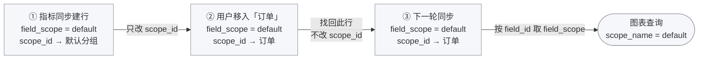

数据分组变化时，时序存储 VictoriaMetrics（VM）中的已有数据不改写，指标项表新增一行，每轮同步按指标发现结果刷新各行的活跃状态：

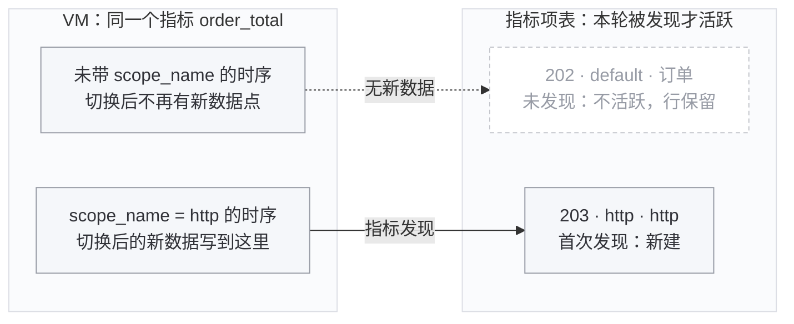

两个数据分组同时上报时，两行都活跃。旧行保留 `field_id` 与用户配置，恢复上报后下一轮同步把它改回活跃。

### b. 服务过滤的缺陷

服务与指标的关系只存在 Redis 白名单 `APP_SCOPE_NAME_KEY` 中 *[1]*，服务视图靠它推断，有三类缺陷：

| 缺陷 | 现象 | 原因 |
| --- | --- | --- |
| 按页面分组名查找 | 指标移入自建分组后从服务视图消失，维度值为空 | 白名单以 `scope_name` 为键，`GetCustomTsMetricGroups` 与 `GetCustomTsDimensionValues` 传入的是页面分组名 |
| 扫描结果不完整 | 大应用与低频指标被隐藏 | [a] VM 单次返回上限 `slimit 3000`，最大应用已触及 `500,000` 序列上限<br />[b] 缓存未命中时只回查最近 `5 min` |
| 图表依赖 `field_scope` | `field_scope` 收敛为 `default` 后图表无数据，表级单位不显示 | [a] `GetCustomTsGraphConfig` 把 `field_scope` 当作 `scope_name` 过滤<br />[b] 单位只读用户配置 |

- *[1] 白名单靠定时扫描生成：`apm_web.tasks.cache_application_scope_name` 每 `10 min` 用 PromQL 扫描 VM，生成应用内「指标 × `scope_name` × 服务」集合。*

所以本方案改由 Collector 推送这份关系，bmw 写入 `TimeSeriesReportScope`，服务视图、维度值与图表改读这张表。

### c. 指标项是热表

指标项表上界 `1,000,000` 行、`678 MiB`，六个读取方中有四个按整组或全平台读取它：

| 读取方 *[1]* | 触发时机 | 读取范围 | 实测 p50 |
| --- | --- | --- | --- |
| `monitor_web.strategies.metric_list_cache.CustomMetricCacheManager` | 每 `10 min` | 全平台活跃指标项 | `4.92 s` |
| `internal/metadata/task.RefreshTimeSeriesMetric` | 每 `5 min` | 每个数据源整组读取 `3` 次 | `108 ms` |
| `internal/metadata/service.SpacePusher.PushTableIdDetail` | 每 `15 min` 及指标同步后 | 全部指标项的 `field_name` | 未压测 |
| `monitor_web.custom_report.resources.metric.GetCustomTsFields` | 打开管理页 | 按名称排序取一页 `50` 条 | `36.8 ms` |
| `monitor_web.scene_view.resources.custom_metric.GetCustomTsMetricGroups` | 打开指标树 | 最大数据源整组 | `108 ms` |
| `monitor_web.scene_view.resources.custom_metric.GetCustomTsGraphConfig` | 打开图表 | 按 `field_id` 取面板内的指标 | 未压测 |

- *[1] Go 路径省略模块前缀：均相对 `pkg/bk-monitor-worker/` 书写。*

所以指标项仍是「数据源 × 指标名」一行，不按服务拆行，服务关系存入新表。

### d. 已有表的 DDL 风险

平台必须兼容 MySQL `5.7`，指标项表与页面分组表的规模相差约 `54` 倍，DDL 代价随之不同：

| 表 | 模型 | 上界规模 | 若做 DDL | `5.7` 耗时 *[1]* | `8.0` 耗时 | 本方案 |
| --- | --- | --- | --- | --- | --- | --- |
| 指标项 | `TimeSeriesMetric` | `1,000,000` 行，`678 MiB` | 加 `5` 列，整表重建 | `68.4 s～128.5 s` | `0.34 s` | 零 DDL |
| 页面分组 | `TimeSeriesScope` | `18,567` 行，`4 MiB` | 加两列，换唯一键 | `3.7 s` *[2]* | `3.5 s` | 接受 |

- *[1] 指标项的区间取决于 ALTER 条数：下限是一条 ALTER 加 `5` 列，上限是 Django 默认每列一条 ALTER，明细见 [REPORT：在线 DDL](./REPORT.md#a-在线-ddl)。*
- *[2] 页面分组取 `10` 万行实测作上界：加列与换唯一键合成一条 ALTER，`1` 万行时 `5.7` 为 `0.77 s`、`8.0` 为 `0.82 s`。*

两张表的 ALTER 都要等元数据锁（MDL），连接未设置 `lock_wait_timeout`，等锁期间该表的读写全部排队：

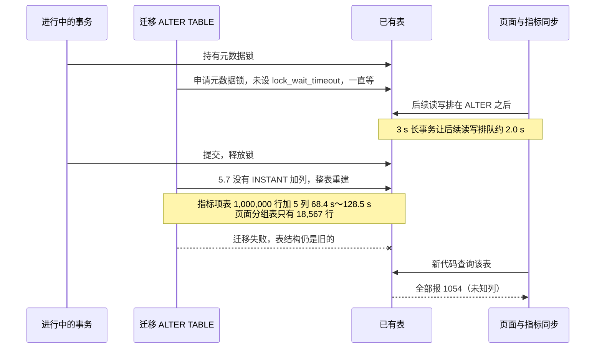

页面分组表的 DDL 是一条整体成败的 ALTER，失败时表结构不变，重跑即可，写法见「数据模型与迁移」。**所以指标项表 `TimeSeriesMetric` 零 DDL，页面分组表 `TimeSeriesScope` 加两列并换唯一键是唯一例外。**

### e. 完整方案对比

五个方案中只有 E 同时满足五项需求 *[1]*，代价是读取比 D 慢 `1.4～1.7` 倍。各方案的差别在服务关系与元信息的存放位置：

| # | 方案 | 服务关系 | 元信息 | 采用 | 依据 |
| --- | --- | --- | --- | :---: | --- |
| A | 沿用白名单 | Redis 白名单，改按 `scope_name` 查找 | 结果表字段 | ❌ | [a] 大应用触及 VM `500,000` 序列上限，服务视图缺指标<br />[b] 一个字段只存一份元信息，不能按 scope 不同，Histogram 不能按原名组族 |
| B | 按服务拆行 | 指标项按服务复制成行，上界规模 `40,144,125` 行 | 指标项表加 `5` 列 *[2]* | ❌ | [a] 最大数据源管理页首页 `28.6 s`<br />[b] 迁移失败时 `5` 项存量功能中 `4` 项报 `1054`<br />[c] 拆出的行如何分配 `field_id` 未评估 |
| C | 元信息加列 | 新表，指标项不变 *[3]* | 指标项表加 `5` 列 *[2]* | ❌ | [a] 上线时整表重建 `68.4 s～128.5 s`<br />[b] 迁移失败时 `5` 项存量功能中 `4` 项报 `1054`<br />[c] 回退要删列再重建 `24.5 s～176.1 s` |
| D | 元信息建表 | 每个「scope × 指标」一行成员 | 定义表加例外取值表 | ❌ | [a] 定义与例外取值的 `meta` 结构相同，只差谁是默认，一份内容存两张表<br />[b] 类型与原名放在指标级定义上，同名指标在部分 SDK 换类型后，其他 scope 读到首个上报者的类型<br />[c] `1,000` 个服务上报同一批指标仍是 `2,000,000` 行成员，最普遍的场景没有压缩 |
| E | 取值去重 | scope 一行，存取值 ID 列表 | 取值表，按内容去重 | ✅ | [a] 同场景 `3,000` 行<br />[b] 类型随取值保存，S2 读错类型为 `0`<br />[c] 读取比 D 慢 `1.4～1.7` 倍 |

- *[1] 五项需求缺一不可：服务视图按服务过滤指标、元信息与类型可按 scope 不同、Histogram 按原名组族、可按服务编辑与分组、在 MySQL `5.7` 上安全发布。*
- *[2] 五列都是元信息：分别存原名、类型、元信息 JSON、指纹与最近上报时间。*
- *[3] C、D、E 都要收敛存量 V2：同名指标项合并为 `field_scope=default` 的一行，其余行保留 `field_id` 但从列表隐藏，规则见「APM V2 收敛」。*

加入服务后，关系数 = 指标数 × 每个指标的上报服务数，压测最大数据源的关系数约为生产最大应用的 `230` 倍：

| 场景 | 指标数 | × 每指标服务数 | = 关系数 | 依据 |
| --- | --- | --- | --- | --- |
| 生产：bkte 最大应用 | `217` | `20` | `4,358` | `15 min` 内实测 |
| 压测：最大数据源 | `2` 万 | `50` | `100` 万 | 单数据源设计上界，共 `5` 个 |
| 压测：全平台活跃规模 | `100` 万 | `10` | `995` 万 | 按上云应用的活跃服务数分档 |
| 压测：全平台上界规模 | `100` 万 | `40` | `4,009` 万 | 大型档服务数放大到 APM 登记数 `126` |

B、C、D 的行数随服务数放大，E 把关系并入约 `25` 万行 scope：

| # | 方案 | 加入服务后的行数（活跃 / 上界） | 存储（活跃 / 上界） | 实测装载的行数 |
| --- | --- | --- | --- | --- |
| A | 沿用白名单 | 指标项 `100` 万，不增加 | 推算 `0.7` / `0.7 GiB` | `5.7`：指标项 `100` 万 |
| B | 按服务拆行 | 指标项 `1,005` 万 / `4,014` 万 | 推算 `10.7` / `42.7 GiB` | `5.7`：指标项 `232` 万<br />`9.2`：指标项 `995` 万 |
| C | 元信息加列 | 指标项 `100` 万，关系 `995` 万 / `4,009` 万 | 推算 `2.8` / `8.2 GiB` | `5.7`：指标项 `100` 万，关系 `4,009` 万<br />`9.2`：关系 `995` 万、`4,009` 万两档 |
| D | 元信息建表 | 指标项 `100` 万，定义 `95` 万，关系 `995` 万 / `4,009` 万 | 推算 `2.9` / `8.3 GiB` | `5.7`：指标项 `100` 万，定义 `95` 万，关系 `4,009` 万<br />`9.2`：关系 `995` 万、`4,009` 万两档 |
| E | 取值去重 | 指标项 `100` 万，取值约 `100` 万，scope 约 `25` 万 | 活跃未测 / 上界实测 `960.5 MiB` | `5.7`：关系约 `4,000` 万条，并入 scope 行 |

关系表装满 `4,009` 万行时，C、D 的读取都在现状的 `2.7` 倍以内。B 只装 `232` 万行，读取已比现状慢 `15` 倍～`777` 倍，括号内为相对现状 A 的倍数：

| 类别 | 测量项 | A 现状 | B 按服务拆行 | C 元信息加列 | D 元信息建表 *[1]* |
| --- | --- | --- | --- | --- | --- |
| 读取 | 最大数据源管理页首页 | `36.8 ms` | `28.6 s`（×777） | `43.8 ms`（×1.2） | `38.0 ms`（×1.0） |
| 读取 | 最大数据源管理页搜索 | `20.2 ms` | 未测 | `20.8 ms`（×1.0） | `21.0 ms`（×1.0） |
| 读取 | 最大数据源族视图首页 | `37.4 ms` | 未测 | `63.4 ms`（×1.7） | `100.7 ms`（×2.7） |
| 读取 | 最大数据源指标树 | `108 ms` | `7,539 ms`（×69） | `144 ms`（×1.3） | `217 ms`（×2.0） |
| 读取 | 指标缓存全平台扫描，活跃规模 | `4.9 s` | `72.0 s`（×15，推算） | `6.7 s`（×1.4） | `9.6 s`（×2.0） |
| 读取 | 最大数据源 APM 服务视图 | `103 ms`，不含白名单过滤 | 未测 | `140 ms`（×1.4） | `214 ms`（×2.1） |
| 读取 | 单个 scope | 不涉及 | 未测 | `36.2 ms` | `43.1 ms` |
| 写入 | bmw 每批 `1,000` 条上报 p50 | 不写元信息 | `22.6 ms` | `37.2 ms` | `31.7 ms` |
| 写入 | 最大数据源重报一轮，推算 | 不涉及 | `1,810 s` | `37.7 s` | `32.1 s` |

- *[1] D 慢在逐行关联元信息：整组读取与全平台扫描对每个指标项关联一次定义，族视图、指标树、扫描与服务视图比 C 慢 `44%～59%`。*

E 与 D 按四个场景对照，从同构上报到全平台上界：

| 场景 | 上报构成 |
| --- | --- |
| S1 | `1,000` 个服务各一个 scope，都上报同一批 `2,000` 个元信息一致的指标 |
| S2 | `1,000` 个服务分属 `5` 种 SDK，每种 SDK 有 `1` 个～`3` 个元信息版本 |
| S3 | 全平台上界，共 `1,000,000` 个指标 |
| S3x | 最大档的单个数据源 |

E 在存储、写入、过期与类型正确性上优于 D，只在读取上慢于 D *[1]*。两者在同一 MySQL `5.7` 库中单独压测 *[2]*，🟢 为该行较优，🔴 为不可接受：

| 测量项 | 场景 | D 元信息建表 | E 取值去重 | D 与 E 之比 |
| --- | --- | --- | --- | --- |
| 行数 | S1 | `2,005,000` *[3]* | 🟢 `3,000` | `668` |
| 体积 | S1 | `346.7 MiB` | 🟢 `18.1 MiB` | `19.2` |
| 体积 | S2 | `336.6 MiB` | 🟢 `41.2 MiB` | `8.2` |
| 体积 | S3 | `7,849 MiB` | 🟢 `960.5 MiB` | `8.2` |
| 冷启动写入，同用 `30,000` 条聚批 | S1 | `77.3 s` | 🟢 `29.1 s` | `2.7` |
| 同日 `2 h` 重发 | S1 | 写 `2,000` 行 | 🟢 写 `0` 行 | 无 |
| 次日首次重发 | S1 | `133.4 s`，写 `2,002,940` 行 | 🟢 `1.7 s`，写 `1,000` 行 | 行数 `2,003` |
| 新服务加入 | S1 | `108 ms` | 🟢 `31 ms` | `3.5` |
| 过期扫描一轮 | S1 | `1,190 ms` | 🟢 `0.34 ms` | `3,500` |
| 服务视图 p50 | S1 / S2 / S3x | 🟢 `10.2` / `9.4` / `8.5 ms` | `16.8` / `15.5` / `13.3 ms` | `0.6` |
| 整组预取有效元信息 p50 | S2 | 🟢 `133 ms` | `185 ms` | `0.7` |
| 按指标取全部 scope p50 | S1 / S2 | 🟢 `10.2` / `0.53 ms` | `16.7` / `11.2 ms` | 无 |
| 读到错误类型 | S2 | 🔴 `29,447` 个 scope × 指标，占 `1.6%` | 🟢 `0` | 无 |

- *[1] 读取慢在不建标签表：每次读全组 scope 的 `id` 与 `labels` 约 `4 ms`，D 按标签表点查只要 `0.2 ms`，E 的服务视图 p95 仍低于 `21 ms`。*
- *[2] 同库装两套表：用同一组打乱顺序的记录驱动，无其他负载，绝对耗时可用。*
- *[3] D 的行数主要是成员：定义 `2,000` 行、例外 `0` 行、scope `1,000` 行、标签 `2,000` 行，「scope × 指标」成员 `2,000,000` 行，每行约 `178 B`，含两个索引。*

所以采用 E。E 的端到端读取未单独实测，上线前按「性能基线」复测。

### f. 其他被否决的做法

下列十四种局部做法都不采用，按存储结构、额外维护的数据、覆盖与页面分组、上线与迁移分为四组。

**存储结构**

| 做法 | 否决原因 |
| --- | --- |
| 按 `field_id` 建一对一元信息表 | [a] 元信息早于指标项到达时无处落库<br />[b] 收敛前同名的多个 `field_id` 会拆出多份元信息 |
| [按数据源分表](./REPORT.md#a-展开与分表) | 热点数据源整组仍落在同一张分表，分 `16` 张表后 MySQL `9.2` 上首页反而慢 `22%` |
| 服务关系存 Redis | [a] 易失，无法按指标反查 scope<br />[b] bmw 写不出 django-redis 的 pickle 格式 |
| 画像共享：上报完全相同指标集合的 scope 共用一份画像 | [a] 存储最省，S1 只要 `3.8 MiB`，但要 `7` 张表，实现与测试成本最高<br />[b] 新上报最多晚 `10 min` 可见 |
| 取值倒排：每种取值一行，位图记哪些 scope 在报 | [a] 每个数据源最多 `2,047` 个 scope<br />[b] 冷启动与新服务加入的 redo 是 D 的 `10` 倍～`15` 倍<br />[c] 多线程写同一取值行有锁等待，S2 服务视图慢约 `1.6` 倍 |
| 只存例外、不存关系：与默认取值一致的 scope 不落行 | [a] 服务视图需要完整的「服务 → 指标」关系<br />[b] 现有白名单只扫 `5 min` 窗口，受 `slimit 3000` 截断，且只增不删 |

**额外维护的数据**

| 做法 | 否决原因 |
| --- | --- |
| 存储指标族 | 族成员由原名与后缀确定，存储只会多出一份要同步的事实 |
| 用标签倒排表查 scope | 每个数据源最多 `2,000` 个 scope，读出全部 `id` 与 `labels` 在内存中过滤即可，少维护一张表 |
| scope 内每条取值记最后上报天 | 次日重发要改写每个 scope 的取值列表，只为清理单个停报的指标 |

**覆盖与页面分组**

| 做法 | 否决原因 |
| --- | --- |
| 覆盖表以 scope ID 为键 | [a] 服务新增 scope 时不继承修改<br />[b] scope 过期会删掉用户修改 |
| 全局修改也写覆盖表 | [a] 读取方与指标同步直接读写 `TimeSeriesMetric`，约 `100` 万行要搬迁并双写<br />[b] 覆盖表不再稀疏 |
| 页面分组名沿用 V2 的 `\|\|` 前缀 | 服务改由选择器表达，不编进分组名，V2 前缀机制随之下线 |

**上线与迁移**

| 做法 | 否决原因 |
| --- | --- |
| 用 gh-ost 等在线改表工具执行 C 元信息加列 | [a] 新代码仍依赖新列，迁移失败时照样报 `1054`<br />[b] 要在 `migrate` 之外执行，平台是否支持「待确认」 |
| 保留 BkBase v2 分组发现、不收敛 | [a] 分组键不含服务，无法按服务隔离<br />[b] V2 数据源要长期单独维护一套指标发现 |

### g. 现有写入代码的约束

新表与加列由 Django 迁移创建、由 bmw 写入，两侧有八项现有行为必须规避：

| 现有行为 | 不处理的后果 | 应对 |
| --- | --- | --- |
| gorm `v1.9.16` 插入时省略带 `default` 标签的零值字段 *[1]* | 非空列缺库默认值时 INSERT 报 `1364` | 新表的 bmw 模型不声明 `default` 标签 |
| Django `4.2` 的 `AddField` 不保留库默认值 | 旧版本代码插入页面分组时不写 `selector_hash`，严格模式下报 `1364` | 迁移为 `selector_hash` 补库默认值 `''` |
| 旧版本代码按 `(group_id, scope_name)` 取页面分组 | 同名的服务分组存在时取到多行 | 按服务建分组在全部组件升级后开放 |
| bmw 删除指标项时忽略 `Delete()` 的错误 | 外键拦下的删除静默残留 | 新表不建外键 |
| bmw 连接字符集 `store.mysql.charset` 默认为 `utf8` | 一个四字节字符让整批 INSERT 失败 | 写入前把四字节字符替换为 `U+FFFD` |
| Python 与 Go 各自按 `metric_group_dimensions` 是否为空判定是否启用 V2 | 清空该列与改写指标项不在同一事务时，v1 同步会新建指标项，`field_id` 改变 | 收敛在改写指标项的同一事务内清空该列 |
| bmw 把本轮缺失的指标项立即置为不活跃，并刷新修改时间 | 只按修改时间选保留项，会选中刚置为不活跃的指标项 | 收敛选保留项时活跃状态排在修改时间之前 |
| bmw 在 Python 迁移合入后当天到 `7 d` 内跟进 | 新 bmw 可能跑在旧表上 | 新迁移只建表与给页面分组加列，版本共存覆盖两种发布顺序 |

- *[1] 已有表可能缺库默认值：Django `AddField` 会隐式删除库默认值，已有表的 `is_active` 是否带库默认值「待确认」。*

## 0x02 架构设计

**同一指标的元信息按内容只存一次，各 scope 只在自己那一行记 `4` 字节的取值 ID。读取方只经解析器与服务范围对象两个入口取结果。**

全文各图默认使用以下配色，图下另有说明的以说明为准：绿色新增，蓝色修改，红色删除，灰色现有不变；粗线写表，虚线为读取或引用。

bmw、指标同步 *[1]* 与用户分别写入不同的表 *[2]*：

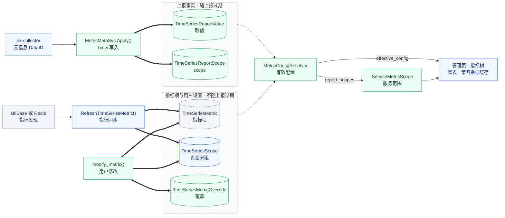

- *[1] 指标同步是现有任务：bmw 即 Go 后台服务 bk-monitor-worker，每 `5 min` 从 BkBase 或 Redis 发现指标并创建指标项。*
- *[2] 指标同步只在归属时读 scope：新建指标项与 `1 h` 重放时按 scope 标签选页面分组，见「页面分组与归属」。*

### a. 对象模型

**上报事实与用户设置分表存放：bmw 只写取值与 scope，用户只写指标项、覆盖与页面分组。**

| 对象 | 模型 | 一行表示 | 写入方 | 随上报过期 | 例子 |
| --- | --- | --- | --- | --- | --- |
| 指标项 | `TimeSeriesMetric` | 数据源内的一个指标名，带全局配置与全局分组 | [a] 指标同步：新建与活跃状态<br />[b] 用户：全局修改 | 否，过期只隐藏 *[1]* | `1003`：`duration_seconds_sum` |
| 页面分组 | `TimeSeriesScope` | 用户看到的一个指标目录 | [a] 指标同步：全局分组<br />[b] 用户：自建分组 | 否 | [a] `21`：全局分组 `http`<br />[b] `31`：checkout 的分组「支付」 |
| 取值 | `TimeSeriesReportValue` | 一个指标的一种完整上报元信息，数据源内按内容去重 | bmw | 是，无 scope 引用即删除 | `3`：`duration_seconds_sum`，单位 `s` |
| scope | `TimeSeriesReportScope` | 一个上报来源，带它当前上报的取值 ID 列表 | bmw | 是，`30 d` 未上报即删除 | `11`：checkout 在 `http` 下上报 |
| 覆盖 | `TimeSeriesMetricOverride` | 某个选择器下对某个指标的修改 | 用户 | 否 *[2]* | `1`：checkout 的 `duration_seconds_sum` 改用 `ms` |

- *[1] 指标项过期只隐藏：`last_modify_time` 超过过期时长后读取方不再显示，行与 `field_id` 保留。*
- *[2] 用户数据只随用户操作删除：覆盖与页面分组在用户清除或指标项删除时才删，scope 过期不影响用户修改。*

**scope 不是页面分组**：scope `11` 与页面分组 `21` 都叫 `http`，前者是数据来源，后者是页面目录，两者没有引用关系。

指标项仍是「数据源 × 指标名」一行，存量 APM V2 的同名多行按「APM V2 收敛」合并。

新表不建外键，引用列只存主键或自然键 *[1]*，查询都先按 `group_id` 过滤 *[2]*。取值可以先于指标项存在 *[3]*：

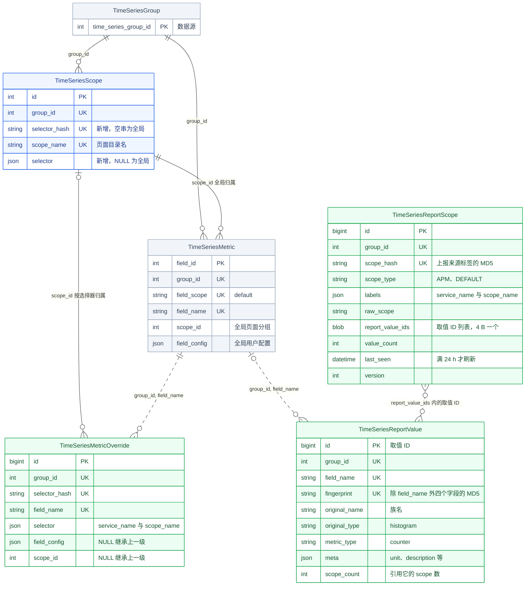

- *[1] 线型区分引用方式：实线引用主键 ID，虚线是自然键或 `report_value_ids` 内的取值 ID。*
- *[2] 图中省略到数据源的连线：所有新表都带 `group_id`，不画到 `TimeSeriesGroup` 的边。*
- *[3] 元信息可能早于指标同步到达：此时取值照常落库，不等指标项创建。*

### b. 元信息存储

**上报元信息只存在取值表：每种取值一行，scope 行里只记它引用了哪些取值 ID。**

取值之间没有主次，不分服务视图选用哪种取值由读取规则决定，见「有效配置与页面编辑」。

**存什么**

除 `fingerprint` 外每一列都来自上报字段，任一字段不同即为另一种取值：

| 存储列 | 含义 | 上报字段 |
| --- | --- | --- |
| `field_name` | 存储中的指标名 | `__metric` |
| `original_name` | 拆分前的原名，Histogram 族成员的族名 | `__name` |
| `original_type` | 拆分前的原始类型，如 histogram | `__original_type` *[1]* |
| `metric_type` | 本条输出序列自身的类型，取 counter、gauge 或 unknown | `__type` |
| `meta` | [a] `unit`：单位<br />[b] `description`：描述<br />[c] `temporality`：累计方式<br />[d] `interval`：上报周期<br />[e] `usage`：汇聚方式 | [a] `__unit`<br />[b] `__description`<br />[c] `__temporality`<br />[d] `__interval`<br />[e] `__usage` |
| `fingerprint` | 除 `field_name` 外四个字段规范 JSON 的 MD5 | 无，bmw 计算 |

- *[1] 原始类型是新增字段：Collector 协议新增 `__original_type`，`__type` 改为本条序列自身的类型，见「接收协议」。*

类型随取值逐 scope 保存：同名指标在一个 scope 报 counter、在另一个报 gauge 时存为两行取值，各 scope 引用自己那行，读取不会拿错类型。

**例子**

数据源 `9` 中，checkout 在 `http`、`grpc` 两个 scope 名下上报。cart 在 `http` 下用旧版 SDK 上报，耗时单位为 `ms`。Histogram `duration_seconds` 拆成三个族成员：

```text
Histogram(duration_seconds)
-> _bucket(metric="duration_seconds_bucket", name="duration_seconds", original_type="histogram", type="counter", unit="")
-> _sum   (metric="duration_seconds_sum",    name="duration_seconds", original_type="histogram", type="counter", unit="s")
-> _count (metric="duration_seconds_count",  name="duration_seconds", original_type="histogram", type="counter", unit="")
```

`TimeSeriesReportValue` 存六种取值，`request_total` 被三个 scope 上报也只有一行：

| id | field_name | original_name | original_type | metric_type | meta | scope_count *[1]* |
| --- | --- | --- | --- | --- | --- | --- |
| 1 | `request_total` | `request_total` | counter | counter | `{"unit": "1", "description": "请求数"}` | 3 |
| 2 | `duration_seconds_bucket` | `duration_seconds` | histogram | counter | `{"unit": ""}` | 2 |
| 3 | `duration_seconds_sum` | `duration_seconds` | histogram | counter | `{"unit": "s"}` | 1 |
| 4 | `duration_seconds_count` | `duration_seconds` | histogram | counter | `{"unit": ""}` | 2 |
| 5 | `duration_seconds_sum` | `duration_seconds` | histogram | counter | `{"unit": "ms"}` | 1 |
| 6 | `queue_size` | `queue_size` | gauge | gauge | `{"unit": "1"}` | 1 |

- *[1] 引用数随写入与过期增减：值为列表含该 ID 的 scope 数，不分服务视图用它挑默认取值。*

`TimeSeriesReportScope` 每个 scope 一行，cart 因旧版 SDK 引用取值 `5` 而不是 `3`：

| id | scope_type | labels | report_value_ids | last_seen |
| --- | --- | --- | --- | --- |
| 11 | APM | `{"service_name": "checkout", "scope_name": "http"}` | `[1, 2, 3, 4]` | `10-13` |
| 12 | APM | `{"service_name": "checkout", "scope_name": "grpc"}` | `[1, 6]` | `10-13` |
| 13 | APM | `{"service_name": "cart", "scope_name": "http"}` | `[1, 2, 4, 5]` | `10-12` |

**压缩效果**

场景 S1 中 `1,000` 个服务各一个 scope，都上报同一批 `2,000` 个一致的指标，两张表共 `3,000` 行：

| 存储内容 | 存放位置 | 规模 |
| --- | --- | --- |
| 元信息 | `TimeSeriesReportValue` | `2,000` 行 |
| scope | `TimeSeriesReportScope` | `1,000` 行，每行列表 `8 KB` |
| 上报关系 | scope 行的取值 ID 列表，不单独成行 | 每条 `4 B` |
| 合计 | 两张新表 | `3,000` 行，`18.1 MiB` |

场景定义、对照方案与其他场景的读写耗时见「完整方案对比」。

**`report_value_ids` 编码**

列表是定长整数的紧凑数组。scope `11` 引用取值 `1`～`4`，存为 `16 B`：

```text
01 00 00 00 | 02 00 00 00 | 03 00 00 00 | 04 00 00 00
```

| 约束 | 规则 |
| --- | --- |
| 列类型 | MEDIUMBLOB，不选 JSON *[1]* |
| 字节序 | uint32 小端序，每个 ID 占 `4 B`，无表头 |
| 顺序 | 按 ID 升序 |
| 唯一性 | 同一 `field_name` 在一个 scope 内最多一个 ID |
| 长度 | `value_count` 等于字节数除以 `4` |
| ID 上限 | 取值 ID 必须小于 `2^32`，超出时 bmw 拒写并计数 *[2]* |

- *[1] JSON 体积大且无查询收益：同样内容的 JSON 约为 `2.5` 倍体积，SQL 也不按列表内容过滤。*
- *[2] 自增 ID 消耗慢：取值只在缺失时插入，不因 upsert 消耗自增 ID。*

### c. scope 身份

**scope 由 scope 类型与规范标签串唯一确定，bmw 把 Collector 的 scope 值解码为标签后计算 `scope_hash`。**

```text
规范标签串 = 标签按键名升序，每个写成 k:v，以 || 连接
scope_hash = MD5(scope_type + 规范标签串)
scope 11   = MD5("APM" + "scope_name:http||service_name:checkout")
```

Collector 协议不变，bmw 按 scope 类型解码 *[1]*，解码与转义规则见「接收协议」：

| scope 类型 | 解码后的 `labels` | 说明 |
| --- | --- | --- |
| `APM` | `service_name` 与 `scope_name` | 应用由 DataID 确定，`app_name` 不进标签 |
| `DEFAULT` | `{}` | 每个数据源最多一个 |
| 未注册解码器的类型 | `scope=<原值>` | [a] 编码方式由上报方定义，「待确认」<br />[b] 原值另存 `raw_scope` 供排障 |

- *[1] 值含分隔符时拒收：标签值含 `||` 会让两个 scope 算出同一个哈希。*

DEFAULT 上报也建一个 scope，让作用于整个指标的元信息与普通 scope 走同一套写入与过期。

按标签找 scope 不建索引表，读出本数据源全部 scope 的 `id` 与 `labels` 后在内存中过滤 *[1]*：

```sql
SELECT id, labels FROM TimeSeriesReportScope WHERE group_id = 9;  -- 不选 report_value_ids
```

- *[1] 不选列表可跳过溢出页：超过约 `8 KB` 的列表存在溢出页，更短的列表随行读入，不选它只省传输与解码。*

每个数据源最多 `2,000` 个 scope、`60,000` 个取值。超限时 bmw 丢弃新 scope 或新取值并计数，防止 Pod 名等高基数标签撑大新表。

### d. 生命周期

**scope 行随上报写入，随 scope 整体过期删除；取值在引用数归零后删除；覆盖与页面分组不随上报过期。**

Collector 收到指标数据时才发送元信息，同一 Key 每 `2 h` 至多重发一次，按天上报的稀疏指标的元信息也按天到达。服务升级 SDK 可能改变单位等取值，服务下线会停报，之后还可能恢复。

**写入**

bmw 按数据源聚批，每条记录对照进程内缓存 *[1]*，落入四种情况之一：

| 情况 | 例子 | 动作 | 写库 |
| --- | --- | --- | --- |
| scope 已含这个取值 ID | checkout · `grpc` 重发 `request_total` | 不改列表，`last_seen` 距上次写入满 `24 h` 才刷新 | 每个 scope 每天至多 `1` 行 |
| scope 含同 `field_name` 的另一个取值 ID | cart · `http` 升级 SDK，`duration_seconds_sum` 改报 `s` *[2]* | [a] 列表中 `5` 换成 `3`<br />[b] 取值 `5` 的 `scope_count - 1`，取值 `3` 的 `+ 1` | 改写 scope `1` 行与取值 `2` 行 |
| scope 不含这个 `field_name` | checkout · `http` 开始上报 `queue_size` | [a] 列表加入 `6`，取值 `6` 的 `scope_count + 1`<br />[b] 取值不存在时先插入 | 改写 scope `1` 行与取值 `1～2` 行 |
| scope 不存在 | cart 开始在 `grpc` 下上报 | 新建 scope 行，列表按第三种情况逐条加入 | 插入 scope `1` 行，引用的取值 `scope_count + 1`，缺失的取值先插入 |

- *[1] 缓存让重发不访问数据库：缓存每个 scope 的 `version` 与取值 ID 集合，结构见「消费与写入」。*
- *[2] 变化最多晚到 `2 h`：Collector 用 Bloom 记录已发送的版本，少数变化与取值回退会被误判为已发送，要等去重缓存每 `2 h` 清空后才到达。*

例子中，前三种情况只改写已有的行，图中 `a → b` 表示列的前后值 *[1]*：

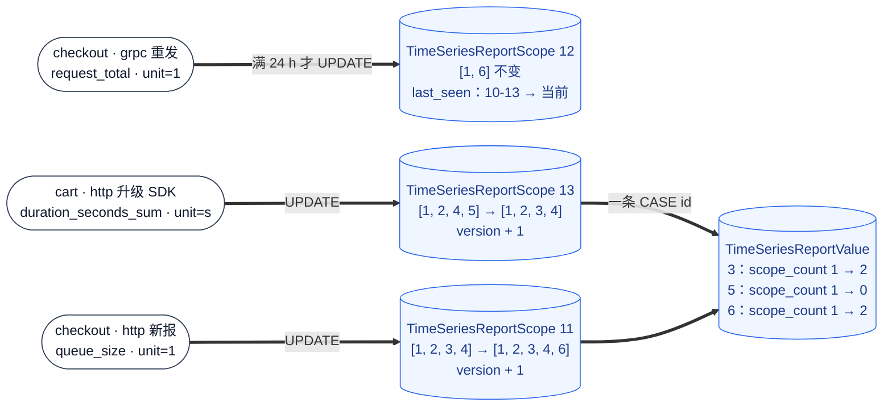

- *[1] 演示只用于本节：其他小节仍以变化前的例子为准。*

批末把本批全部变化放进一个事务 *[1]*，先锁 scope 再改取值，与过期清理的加锁顺序相同：

1. 加行锁锁住本批有变化的 scope，`version` 不一致时重读该 scope 并重放本批改动。
2. 写回列表、`value_count` 与 `last_seen`，`version + 1`。
3. 用一条 `CASE id` 语句增减 `scope_count` 后提交，影响行数不足时回滚，重新插入取值并换用新 ID 重试 *[2]*。

- *[1] 逐个 scope 提交更慢：S1 冷启动一批一个事务 `29.1 s`，逐个 scope 提交 `142 s`，见「消费与写入」。*
- *[2] 写入与过期清理不丢引用：过期清理只删 `scope_count = 0` 的取值，写入先加引用时删不掉，过期先删时写入按影响行数发现并重建，竞态见「过期清理」。*

**过期**

过期清理并入每 `5 min` 一轮的指标同步。scope `13` 自 `10-12` 起停报，`30 d` 后的那一轮删除它 *[1]*，并清理不再被引用的取值 *[2]*：

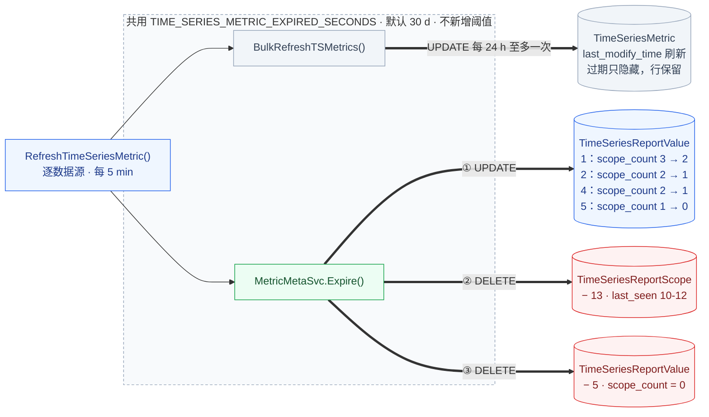

- *[1] scope 过期直接删行：scope 不承载 `field_id` 与用户配置，再次上报按新 scope 重建。*
- *[2] 两类删除都走索引：删 scope 走 `(group_id, last_seen)`，删取值走 `(group_id, scope_count)`。*

稀疏上报的 scope 与指标项同样处理：`30 d` 内上报过一次就保留。

**单个指标停报**

停报的指标不单独清理：它的取值 ID 留在 scope 列表里，直到 scope 整体过期或该指标改报另一种取值。停报范围决定视图是否还显示它：

| 停报范围 | 例子 | 该服务视图 | 不分服务视图 |
| --- | --- | --- | --- |
| 全数据源都停报 | checkout · `grpc` 停报 `queue_size`，其他 scope 都不报 | 指标项 `30 d` 后过期，之后不显示 *[1]* | 指标项过期后不显示 |
| 部分服务停报 | cart · `http` 停报 `duration_seconds_bucket`，checkout 仍在报 | cart 视图仍显示，直到 scope `13` 过期 | 显示 |

- *[1] 指标项过期已过滤：读取方按 `last_modify_time` 过滤过期指标项，列表里残留的 ID 不会让它重新出现。*

部分服务停报时，该服务视图会多显示到 scope 过期，这是本方案接受的代价。多显示只发生在这一种情况，读取方按 `last_modify_time` 过滤过期指标项。按条目清理要给每个 ID 记最后上报日，每条从 `4 B` 增到 `6 B`，并多一个过期扫描索引。

### e. 与指标发现的分工

**指标同步仍是指标项唯一的创建方：元信息链路不建指标项，只给新指标项提供分组提示，并在同一轮里清理过期的 scope 与取值。**

改动叠加在现有 `RefreshTimeSeriesMetric` 链路上 *[1]* *[2]*：

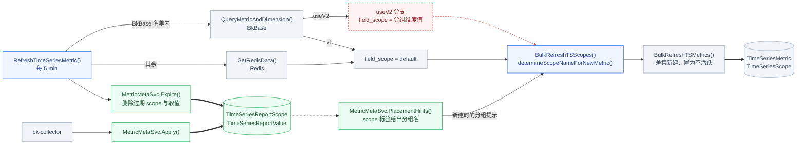

- *[1] V2 分支随白名单下线删除：删除时机见「发布顺序」，未收敛的 V2 数据源在此之前照旧同步。*
- *[2] 分组提示失败不阻断同步：查询出错或新表不存在时返回空提示，新指标按 `auto_rules` 与默认分组归属。*

### f. 现有功能怎么变

**五处现有功能改读新入口，配置读取与服务视图改动最大：**

| 现有功能 | 怎么变 | 详见 |
| --- | --- | --- |
| 配置读取 | 读取方改取解析器合成的 `effective_config` | 本节 |
| 服务视图 | 按该服务上报的 scope 过滤，不再比对页面分组名 | 本节 |
| 页面编辑 | 一个入口按选择器写指标项或覆盖表 | 「有效配置与页面编辑」 |
| 新指标归属 | 分组提示改取 scope 标签，V2 前缀机制下线 | 「页面分组与归属」 |
| Histogram 展示 | 按 `original_type` 组族，一个族一个面板 | 「指标族与复合视图」 |

**配置读取**：四个读取方都经解析器取单位与描述，指标项的查询语句不变：

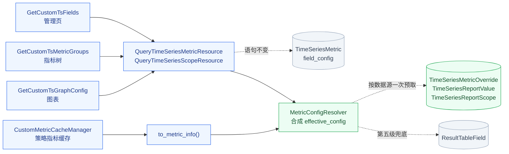

**服务视图**：可见性只看该服务是否上报了这个指标，与指标所在的页面分组无关 *[1]*：

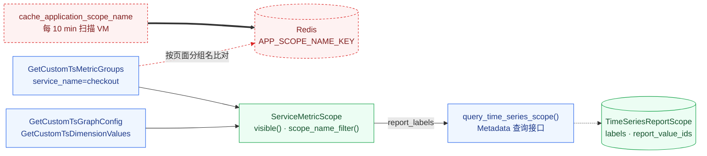

- *[1] 白名单在 scope 数据稳定后下线：下线前 `visible()` 取 scope 与白名单的并集，时机见「发布顺序」。*

### g. 页面分组与归属

**页面分组仍是 `TimeSeriesScope`，新增的选择器表示分组属于全局还是某个服务。服务视图看到的分组是全局分组加上选择器命中该服务的分组。**

**选择器**

选择器只有三级 *[1]*：

| 级别 | `selector` | `selector_hash` | 生效范围 |
| --- | --- | --- | --- |
| 全局 | `{}`，页面分组中存 NULL | `''` | 所有视图 |
| 服务 | `{"service_name": "checkout"}` | `md5("service_name:checkout")` | checkout 的服务视图 |
| 服务与 scope 名 | `{"service_name": "checkout", "scope_name": "grpc"}` | 规范串的 MD5 | checkout 在 `grpc` 下的视图，只用于修改配置，页面分组不用这一级 |

- *[1] 规范化同「scope 身份」：键名升序拼成 `k:v` 并以 `||` 连接，不带 scope 类型，值含 `||` 时拒收。*

**页面分组表的变化**

| 列或约束 | 变化 | 含义 |
| --- | --- | --- |
| `selector` | 新增 | NULL 表示全局分组 |
| `selector_hash` | 新增 | `''` 表示全局分组，旧代码写入时落默认值 `''` |
| 唯一键 | 由 `(group_id, scope_name)` 换为 `(group_id, selector_hash, scope_name)` | 同名分组可以分属全局与不同服务 |

页面分组表每个数据源只有几十到几百行，DDL 耗时见「已有表的 DDL 风险」，`TimeSeriesMetric` 仍零 DDL。旧代码按 `(group_id, scope_name)` 取分组，遇到同名的服务分组会取错或报错，所以按服务建分组在全部组件升级后才开放，见「版本共存」与「发布顺序」。

**例子**

分组 `31` 只属于 checkout，与全局分组 `22` 同名不冲突：

| id | selector_hash | selector | scope_name | 说明 |
| --- | --- | --- | --- | --- |
| 21 | `''` | NULL | `http` | 全局分组 |
| 22 | `''` | NULL | `支付` | 全局分组 |
| 31 | `md5("service_name:checkout")` | `{"service_name": "checkout"}` | `支付` | 只属于 checkout |

指标所在分组取最具体选择器的覆盖 `scope_id`，都没有时用 `TimeSeriesMetric.scope_id`：

| 视图 | 可见的页面分组 | `duration_seconds_sum` 所在分组 | 来源 |
| --- | --- | --- | --- |
| 不分服务 | `21`、`22` | `22` | 指标项 `1003` 的全局 `scope_id` |
| checkout | `21`、`22`、`31` | `31` | 覆盖 `1` |
| cart | `21`、`22` | `22` | 指标项 `1003` 的全局 `scope_id` |

**新指标项的默认归属**

新指标项的全局分组沿用现有归属规则，只把分组提示的来源换成 scope 标签 *[1]*：

1. **分组提示**：取引用该指标的 scope 的 `scope_name`，落入同名全局分组 *[2]*。
2. **自动规则**：没有提示时，指标名匹配用户分组的 `auto_rules` 正则。
3. **默认分组**：都不命中时落入默认分组。

- *[1] 晚到的元信息再归属一次：`1 h` 内新建、仍在默认分组的指标项出现提示时，重新归属一次。*
- *[2] 多个提示取上报最多者：按引用该指标的 scope 数取提示，相同时按名称升序，指标同步只读写全局分组。*

例如 `request_total` 被 scope `11`、`13` 以 `http` 上报，被 `12` 以 `grpc` 上报。提示取 `http`，指标项 `1001` 落入分组 `21`。

**V2 前缀机制下线**

服务改由选择器表达，不再编进分组名：

| V2 机制 | 现有做法 | 下线后 |
| --- | --- | --- |
| 分组名前缀 | 多个分组维度的值拼成 `checkout\|\|http` 式的分组名 | 分组名只取 `scope_name` *[1]* |
| 每个前缀一个默认分组 | 自动补建 `<前缀>\|\|default` | 只有一个全局默认分组 |
| 按前缀匹配自动规则 | 只在同前缀的分组里匹配 `auto_rules` | 在全部全局分组里匹配 |

- *[1] 分组维度不含服务：APM 默认分组维度只有 `scope_name`，配置了 `service_name` 的存量数据源如何处理「待确认」。*

### h. 有效配置与页面编辑

**有效配置按配置键逐个取第一个已设置的值，用户修改总在上报值之前。用户每次修改只写一张表。**

**生效顺序**

解析器 `MetricConfigResolver` 按以下五级逐级查找 *[1]*。不分服务视图从第三级开始。服务视图不指定 scope 名时，指标只由一个 scope 名上报才用第一级。例如 checkout 的 `queue_size` 只在 grpc 下上报，服务视图显示 checkout · grpc 页设置的别名：

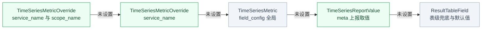

- *[1] 空值不覆盖：管理页整包回写时把用户没填的键写成 `""`、`0`、`[]`，所以这三种值与键不存在都视为未设置。*

第四级的上报取值按视图选出：

| 视图 | 选用的取值 |
| --- | --- |
| 带 scope，如 checkout · `http` | 该 scope 引用的取值 |
| 带服务，该服务多个 scope 引用不同取值 | `last_seen` 最近的 scope 引用的取值 |
| 不分服务 | [a] DEFAULT scope 引用的取值优先<br />[b] 否则取 `scope_count` 最大者，并列取 ID 小者<br />[c] 候选取值的 `metric_type` 或 `original_type` 不止一种时置 `type_conflict` |

**配置键映射**

五个配置项都按生效顺序查找，单位、函数与聚合周期的上报值要先转换：

| 配置项 | `field_config` 键 | `meta` 键 | 上报值的转换 | 表级兜底与默认值 |
| --- | --- | --- | --- | --- |
| 单位 | `unit` | `unit` | [a] UCUM 单位转为 `core/unit` 已注册的 ID，未命中时不采用<br />[b] 时间与字节：`us → µs`、`min → m`、`By → bytes`<br />[c] 无量纲与百分比：`1 → none`、`% → percent` | `ResultTableField.unit` |
| 描述 | `alias` | `description` | 无 | `ResultTableField.description` |
| 汇聚方法 | `aggregate_method` | `usage` | 映射表「待确认」 | `AVG` |
| 函数 | `function` | `temporality` | `cumulative` 的 Counter 补 `increase` | `[]` |
| 聚合周期 | `interval` | `interval` | 毫秒转为秒 | `auto` |

**写入路由**

用户修改只走一个入口，按选择器写一张表 *[1]*，清除覆盖即恢复继承 *[2]*。上报值只由 bmw 写入：

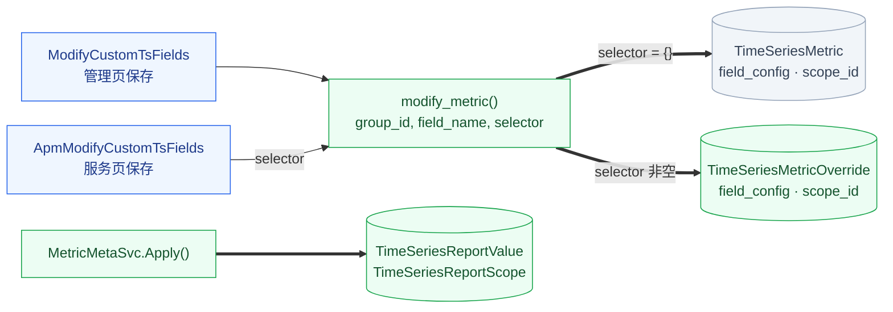

- *[1] 全局修改不进覆盖表：读取方与 bmw 的指标同步都直接读写 `TimeSeriesMetric`，存量约 `100` 万指标项零搬迁，覆盖表保持约 `0.1%` 的稀疏度。*
- *[2] 来源随有效配置返回：每个键标明来自本服务覆盖还是继承全局，清除覆盖后回到上一级的生效值。*

例子中的四次修改分别写入：

| 修改 | `modify_metric` 参数 | 写入的行 |
| --- | --- | --- |
| 全局把 `duration_seconds_sum` 的别名改为「请求耗时」 | [a] `selector={}`<br />[b] `field_config={"alias": "请求耗时"}` | 指标项 `1003` 的 `field_config` |
| 全局把它移入「支付」 | [a] `selector={}`<br />[b] `scope_id=22` | 指标项 `1003` 的 `scope_id`：`21 → 22` |
| checkout 把它的单位改为 `ms`，并移入自己的「支付」 | [a] `selector={"service_name": "checkout"}`<br />[b] `field_config={"unit": "ms"}`<br />[c] `scope_id=31` | 新增覆盖 `1` |
| checkout 在 `grpc` 下把 `queue_size` 的别名改为「gRPC 队列长度」 | [a] `selector={"service_name": "checkout", "scope_name": "grpc"}`<br />[b] `field_config={"alias": "gRPC 队列长度"}` | 新增覆盖 `2` |

后两次修改写入的覆盖：

| id | selector | field_name | field_config | scope_id |
| --- | --- | --- | --- | --- |
| 1 | `{"service_name": "checkout"}` | `duration_seconds_sum` | `{"unit": "ms"}` | 31 |
| 2 | `{"service_name": "checkout", "scope_name": "grpc"}` | `queue_size` | `{"alias": "gRPC 队列长度"}` | NULL |

**读取结果**

`duration_seconds_sum` 在三个视图中的有效配置：

| 视图 | 单位 | 别名 | 页面分组 |
| --- | --- | --- | --- |
| 不分服务 | [a] `s`<br />[b] 取值 `3`、`5` 各被 `1` 个 scope 引用，取 ID 小者 `3` | 请求耗时，来自全局 | 支付 `22`，来自全局 |
| checkout · `http` | [a] `ms`<br />[b] 来自覆盖 `1` | 请求耗时，来自全局 | 支付 `31`，来自覆盖 `1` |
| cart · `http` | [a] `ms`<br />[b] scope `13` 引用取值 `5` | 请求耗时，来自全局 | 支付 `22`，来自全局 |

**同步不覆盖用户设置**

| 写入方 | 入口 | 写入 | 从不写 |
| --- | --- | --- | --- |
| bmw 元信息写入 | `MetricMetaSvc.Apply()` | 取值与 scope | 指标项、覆盖与页面分组 |
| bmw 指标同步 | `RefreshTimeSeriesMetric()` | [a] 新建指标项与活跃状态<br />[b] 新建与 `1 h` 重放时写全局 `scope_id` | 覆盖与服务分组 |
| 用户 | `modify_metric()` | 指标项的配置与分组、覆盖与页面分组 | 取值与 scope |

### i. 读取路径

**新表有两个查询方向：服务视图按 scope 取全部指标，属于高频读取；分组提示按指标取全部 scope，只在新建指标项与 `1 h` 重放时调用。**

**按 scope 取所有指标**

checkout 的服务视图读法分五步，其中三次查询新表，每次只读需要的列 *[1]*：


- *[1] 第一步不读列表：未命中的 scope 不读列表溢出页，S2 场景实测 p50 `15.5 ms`。*

**按指标取所有 scope**

分组提示为 `duration_seconds_sum` 找上报它的 scope，只要数量时直接读 `scope_count` *[1]*：

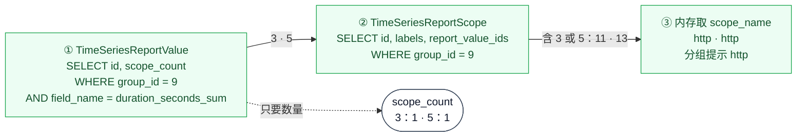

- *[1] 低频调用可读全部列表：S1 实测 p50 `16.7 ms`，见「性能基线」。*

**查询接口与服务范围对象**

查询接口新增 `report_labels` 与 `view` 两个可选参数，每个指标多返回七个字段，协议见「查询与写入接口」。

服务范围对象每个请求构造一次，汇总该服务各指标上报的 `scope_name`，接口见「服务范围对象」。指标树按 `visible()` 过滤，图表与维度值按 `scope_name_filter()` 写 `scope_name` 条件。维度值请求要带 `field_id`，后端才能反查 scope。

**读取约束**

1. **与指标项分开读取**：新表不与指标项 JOIN，指标项的现有查询语句不变，结果在内存中合并。
2. **按数据源一次预取**：每个请求对一个数据源只预取一次，不逐个指标查询，S2 整组预取 `185 ms`。
3. **新表缺失只降级**：读新表报 `1146`（表不存在）时视为没有取值、scope 与覆盖，结果回落到指标项与表级字段。

### j. 指标族与复合视图

**Histogram 的族成员在读取时组成一个族，详情页一个族一个面板，每个统计方法一个 target。**

**族成员**

族按拆分前的原始类型判断，不看 `metric_type`：

| 条件 | 规则 |
| --- | --- |
| 范围 | 同一 scope 视图，不分服务视图用选出的默认取值 |
| 原名 | `original_name` 相同 *[1]* |
| 原始类型 | `original_type = histogram` |
| 指标名 | [a] 规范化原名 *[2]* 加 `_bucket`、`_sum`、`_count`<br />[b] 或加 `_min`、`_max` |

- *[1] 独立指标不会误入族：独立上报的 Counter `duration_seconds_sum` 的 `original_name` 是它自己。*
- *[2] 规范化替换点号：`http.server.duration` 规范化为 `http_server_duration`。*

checkout · `http` 视图中，取值 `2`、`3`、`4` 组成 `duration_seconds` 族。族成员的 `metric_type` 都是 counter，`cumulative` 的 Counter 补 `increase` 作用于全部族成员。

族成员要同在一个页面分组，按服务移动时以该服务视图的有效页面分组判断。例子按族移动，`_bucket`、`_sum`、`_count` 的指标项或覆盖都改写分组，族面板因此同属分组 `31`。只移走一个族成员时，原分组的族只禁用依赖它的方法。

**族面板结构**

族面板沿用现有面板协议，不新增键 *[1]*。checkout · `http` 视图中 `duration_seconds` 的族面板如下 *[2]* *[3]*：

```json
{
  "title": "请求耗时",
  "sub_title": "custom:APM:duration_seconds_count",
  "targets": [
    {
      "alias": "AVG",
      "expression": "b == 0 or a / b",
      "unit": "ms",
      "function": {},
      "metric": {"name": "duration_seconds", "alias": "请求耗时"},
      "query_configs": [
        {
          "metrics": [{"field": "duration_seconds_sum", "method": "SUM", "alias": "a"}],
          "interval": "$interval",
          "table": "2_bkapm_metric_demo.__default__",
          "data_label": "APM",
          "data_source_label": "custom",
          "data_type_label": "time_series",
          "group_by": ["method"],
          "where": [],
          "functions": [],
          "filter_dict": {"group_filter": {}, "common_filter": {}, "scope_name": "http", "service_name": "checkout"}
        },
        {
          "metrics": [{"field": "duration_seconds_count", "method": "SUM", "alias": "b"}],
          "interval": "$interval",
          "table": "2_bkapm_metric_demo.__default__",
          "data_label": "APM",
          "data_source_label": "custom",
          "data_type_label": "time_series",
          "group_by": ["method"],
          "where": [],
          "functions": [],
          "filter_dict": {"group_filter": {}, "common_filter": {}, "scope_name": "http", "service_name": "checkout"}
        }
      ]
    },
    {
      "alias": "COUNT",
      "expression": "a",
      "unit": "none",
      "function": {},
      "metric": {"name": "duration_seconds", "alias": "请求耗时"},
      "query_configs": [
        {
          "metrics": [{"field": "duration_seconds_count", "method": "SUM", "alias": "a"}],
          "interval": "$interval",
          "table": "2_bkapm_metric_demo.__default__",
          "data_label": "APM",
          "data_source_label": "custom",
          "data_type_label": "time_series",
          "group_by": ["method"],
          "where": [],
          "functions": [],
          "filter_dict": {"group_filter": {}, "common_filter": {}, "scope_name": "http", "service_name": "checkout"}
        }
      ]
    },
    {
      "alias": "P95",
      "expression": "a",
      "unit": "ms",
      "function": {},
      "metric": {"name": "duration_seconds", "alias": "请求耗时"},
      "query_configs": [
        {
          "metrics": [{"field": "duration_seconds_bucket", "method": "SUM", "alias": "a"}],
          "interval": "$interval",
          "table": "2_bkapm_metric_demo.__default__",
          "data_label": "APM",
          "data_source_label": "custom",
          "data_type_label": "time_series",
          "group_by": ["le", "method"],
          "where": [],
          "functions": [{"id": "histogram_quantile", "params": [{"id": "scalar", "value": 0.95}]}],
          "filter_dict": {"group_filter": {}, "common_filter": {}, "scope_name": "http", "service_name": "checkout"}
        }
      ]
    }
  ]
}
```

- *[1] `alias` 非空即表示族面板：读取方按 `alias` 区分统计方法。*
- *[2] 示例只节选三个 target：SUM 与 COUNT 同构，其余分位方法只改 `scalar`，`table` 是数据源 `9` 结果表的示意值。*
- *[3] 单位与标题取 `_sum` 的有效配置：checkout 视图中覆盖 `1` 把单位改为 `ms`，别名「请求耗时」来自指标项 `1003`。*

**现有代码的调整**

族视图只在图表配置接口加一个分支，其余请求与族外指标照旧，两条路径共用从现有循环抽出的查询构造：

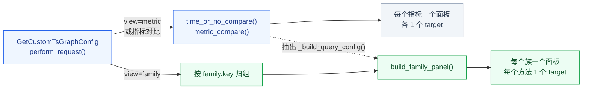

## 0x03 开发方案 —— Metadata 存储、解析与查询

**Metadata 新增三张表、一个解析器和一个写入入口，已有表只给页面分组加两列。** 读取方仍只调 Metadata 接口，SaaS 不直接读新表。

| 模块 | 文件 | 内容 |
| --- | --- | --- |
| 数据模型 | `metadata/models/custom_report/metric_report.py`（新增） | [a] 三个新模型与 `MediumBlobField`<br />[b] 取值 ID 编解码<br />[c] 标签规范化与哈希<br />[d] `modify_metric()` 与清理函数 |
| 解析器 | `metadata/models/custom_report/metric_config.py`（新增） | [a] `MetricConfigResolver`<br />[b] `metric_family_of()` |
| 迁移 | [a] `metadata/migrations/0278_metric_report_tables.py`<br />[b] `metadata/migrations/0279_timeseriesscope_selector.py` | [a] 建三张新表<br />[b] 页面分组加两列并换唯一键 |
| 接口 | [a] `metadata/resources/resources.py`<br />[b] `api/metadata/default.py` | [a] 查询参数与返回字段<br />[b] 写入路由<br />[c] 页面分组带选择器 |

### a. 数据模型与迁移

**三张新表按取值、scope、覆盖分开存，页面分组表加选择器列。** 三个新模型放在同一文件，`TimeSeriesScope` 的改动在代码块末尾：

```python
# metadata/models/custom_report/metric_report.py，三个模型从 metadata.models 导出
# 不建外键：bmw 删除时忽略错误，外键拦下的删除会静默残留
# JSON 列都可空：5.7 上 JSON 列不能带默认值
UTF8 = "utf8_bin"    # 索引列不能用 utf8mb4：COMPACT 行格式下单列超过 767 B 报 1071
ASCII = "ascii_bin"


class MediumBlobField(models.BinaryField):
    """BinaryField 在 MySQL 上映射为 LONGBLOB，这里固定为 MEDIUMBLOB，上限 16 MiB。"""

    def db_type(self, connection):
        return "mediumblob" if connection.vendor == "mysql" else super().db_type(connection)


class TimeSeriesReportValue(models.Model):
    """取值：一个指标的一种完整上报元信息，数据源内按内容去重。元信息只存在这里。"""

    id = models.BigAutoField(primary_key=True)                           # 必须 < 2^32，见 encode_report_value_ids()
    group_id = models.IntegerField()
    field_name = models.CharField(max_length=255, db_collation=UTF8)     # __metric
    fingerprint = models.CharField(max_length=32, db_collation=ASCII)    # 下面四个字段规范 JSON 的 MD5
    original_name = models.CharField(max_length=255, db_collation=UTF8)  # __name：拆分前原名，即族名
    original_type = models.CharField(max_length=16)                      # __original_type：histogram 等
    metric_type = models.CharField(max_length=16)                        # __type：本条序列自身的类型
    meta = models.JSONField(null=True)                                   # unit、description、temporality、interval、usage
    scope_count = models.IntegerField(default=0)                         # 引用它的 scope 数，写入与过期时增减

    class Meta:
        constraints = [
            models.UniqueConstraint(fields=["group_id", "field_name", "fingerprint"], name="tsrv_group_field_fp_uniq"),
        ]
        indexes = [
            models.Index(fields=["group_id", "original_name"], name="tsrv_group_original_idx"),  # 族视图按原名归组
            models.Index(fields=["group_id", "scope_count"], name="tsrv_group_count_idx"),       # 过期删除 scope_count = 0
        ]


class TimeSeriesReportScope(models.Model):
    """scope：一个上报来源，report_value_ids 是它当前上报的取值 ID 列表。"""

    id = models.BigAutoField(primary_key=True)
    group_id = models.IntegerField()
    scope_hash = models.CharField(max_length=32, db_collation=ASCII)  # MD5(scope_type + canonical_labels(labels))
    scope_type = models.CharField(max_length=32)                      # APM、DEFAULT 等
    labels = models.JSONField(null=True)                              # {"service_name": "checkout", "scope_name": "http"}
    raw_scope = models.CharField(max_length=512)                      # Collector 原值，排障用
    report_value_ids = MediumBlobField()                              # uint32 小端序、升序，每个 4 B，无表头
    value_count = models.IntegerField(default=0)                      # len(report_value_ids) / 4
    last_seen = models.DateTimeField()                                # 距上次写入满 24 h 才刷新
    version = models.IntegerField(default=0)                          # 每次改写 +1，bmw 与清理函数据此校验并发

    class Meta:
        constraints = [models.UniqueConstraint(fields=["group_id", "scope_hash"], name="tsrs_group_hash_uniq")]
        indexes = [models.Index(fields=["group_id", "last_seen"], name="tsrs_group_seen_idx")]  # 过期扫描


class TimeSeriesMetricOverride(models.Model):
    """覆盖：用户在一个选择器下对一个指标的修改。全局修改写 TimeSeriesMetric，不进这张表。"""

    id = models.BigAutoField(primary_key=True)
    group_id = models.IntegerField()
    selector_hash = models.CharField(max_length=32, db_collation=ASCII)  # selector_hash(selector)，永不为空串
    selector = models.JSONField(null=True)                               # {"service_name": "checkout"} 或再带 scope_name
    field_name = models.CharField(max_length=255, db_collation=UTF8)
    field_config = models.JSONField(null=True)                           # 只存设置过的键，其余继承上一级
    scope_id = models.IntegerField(null=True)                            # 该选择器下的页面分组，NULL 继承上一级

    class Meta:
        constraints = [
            models.UniqueConstraint(fields=["group_id", "selector_hash", "field_name"], name="tsmo_group_selector_field_uniq"),
        ]


# metadata/models/custom_report/time_series.py：TimeSeriesScope 新增两列并换唯一键
class TimeSeriesScope(models.Model):
    ...
    selector = models.JSONField(null=True)                                           # NULL 表示全局分组
    selector_hash = models.CharField(max_length=32, default="", db_collation=ASCII)  # "" 表示全局分组

    class Meta:
        unique_together = ("group_id", "selector_hash", "scope_name")  # 原为 ("group_id", "scope_name")
```

取值 ID 列表与选择器都靠下面的纯函数读写，bmw 的 Go 实现必须逐字节一致 *[1]*：

```python
REPORT_VALUE_ID_MAX = 2**32 - 1
SELECTOR_KEYS = ("service_name", "scope_name")

# 去重升序后按 uint32 小端序拼接；ID 不在 1～REPORT_VALUE_ID_MAX 内时抛 ValueError
def encode_report_value_ids(ids: Iterable[int]) -> bytes: ...

# None 与 b"" 返回 []；长度不是 4 的倍数时抛 ValueError，读取方计数后按空列表处理
def decode_report_value_ids(blob: bytes | memoryview | None) -> list[int]: ...

# 跨环境导入时把旧 ID 换成新 ID，映射里没有的 ID 丢弃，结果重新升序
def remap_report_value_ids(blob: bytes | memoryview, id_map: Mapping[int, int]) -> bytes: ...

# 键名升序拼 k:v，以 || 连接；值为空或含 || 时抛 ValueError
def canonical_labels(labels: Mapping[str, str]) -> str: ...

def scope_hash(scope_type: str, labels: Mapping[str, str]) -> str:  # md5(scope_type + canonical_labels(labels))
def selector_hash(selector: Mapping[str, str]) -> str:              # {} 返回 ""，否则 md5(canonical_labels(selector))

# 只接受 {}、{service_name}、{service_name, scope_name} 三级，其余抛 ValidationError
def normalize_selector(selector: Mapping[str, str] | None) -> dict[str, str]: ...
```

- *[1] 两端共用一组测试向量：例子中 scope 11 的列表编码为 `01000000 02000000 03000000 04000000`，`selector_hash({"service_name": "checkout"})` 即 `md5("service_name:checkout")`。*

**迁移拆成两条，任一条中途失败后都可直接重跑。** 两条迁移依次接在 metadata 最新迁移 `0277_vm_query_cluster_config` 之后：

| 迁移 | 内容 | 写法 | 中途失败后 |
| --- | --- | --- | --- |
| `0278_metric_report_tables` | 建三张新表 | [a] `SeparateDatabaseAndState`<br />[b] 库操作是三条 `CREATE TABLE IF NOT EXISTS` *[1]*<br />[c] 状态操作是三个 `CreateModel` | 已建的表被跳过，重跑即可 |
| `0279_timeseriesscope_selector` | 页面分组加两列并换唯一键 | [a] `SeparateDatabaseAndState`<br />[b] 库操作是一条 `ALTER TABLE`<br />[c] 状态操作是两个 `AddField` 与 `AlterUniqueTogether` | 整条回滚，表结构不变，重跑即可 |

- *[1] 一张表只用一条建表语句：取 `sqlmigrate` 的输出，把二级索引并入 `CREATE TABLE`，单条语句要么建全要么不建，单测用 `introspection.get_constraints()` 核对键名与模型一致。*

`0279` 的库操作合成一条 ALTER，耗时见「已有表的 DDL 风险」 *[1]*：

```sql
ALTER TABLE `metadata_timeseriesscope`
    ADD COLUMN `selector` json NULL,
    ADD COLUMN `selector_hash` varchar(32) CHARACTER SET ascii COLLATE ascii_bin NOT NULL DEFAULT '',
    DROP INDEX `metadata_timeseriesscope_group_id_scope_name_47eede0c_uniq`,
    ADD UNIQUE INDEX `metadata_timeseriesscope_group_id_selector_hash_s_feae1a29_uniq` (`group_id`, `selector_hash`, `scope_name`);
-- reverse_sql：删两列、删新键、加回旧键；存在同名的服务分组时加回旧键会报 1062，先删服务分组再回退
```

- *[1] 合成一条换来原子性：`8.0` 上分条执行时加列走 INSTANT，合计 `0.59 s`，合并后整表重建，页面分组表行数少，可以接受。*

| 迁移细节 | 取值 | 依据 |
| --- | --- | --- |
| 旧唯一键名 | `metadata_timeseriesscope_group_id_scope_name_47eede0c_uniq` | [a] `0251` 以 `unique_together` 建键，名字是表名、列名、摘要与 `_uniq` 拼接 *[1]*<br />[b] 上线前用 `SHOW INDEX` 核对 |
| 新唯一键名 | `metadata_timeseriesscope_group_id_selector_hash_s_feae1a29_uniq` | 完整名超过 `64` 字符，按 Django 规则截断，后续 `AlterUniqueTogether` 仍能按列找到它 |
| `selector_hash` 库默认值 | `''` | 旧代码插入时不带该列 *[2]* |
| `ResultTableOption.name` | 不改 | `makemigrations` 顺带生成的 `AlterField` 要手工删除 |

- *[1] 键名在本地按源码复算：用 Django `4.2.27` 的 `_create_index_name()` 计算，表名与列名的 MD5 取前 `8` 位作摘要。*
- *[2] 库默认值不能交给 AddField：Django 加列后会删除库默认值，旧 Django 代码与 bmw 的 gorm 模型插入时不带该列，缺默认值报 `1364`。*

开关与降级计数沿用现有对象：

```python
# metadata/models/result_table.py
class ResultTableOption(OptionBase):
    # 打开后 bmw 才写入该数据源的取值与 scope；不加入 name 的 choices，否则迁移多出 AlterField
    OPTION_ENABLE_METRIC_METADATA = "enable_metric_metadata"


# core/prometheus/metrics.py
METADATA_METRIC_REPORT_DEGRADED_TOTAL = Counter(
    name="bkmonitor_metadata_metric_report_degraded_total",
    documentation="指标上报新表读写降级次数",
    labelnames=("entry", "code"),  # entry 取 resolver、purge、export；code 取 MySQL 错误码，如 1146
)
```

| 变更点 | 目标 |
| --- | --- |
| **[Add]** `metadata.models.custom_report.metric_report` | 三个模型、`MediumBlobField`、编解码与哈希函数 |
| **[Change]** `metadata.models.custom_report.time_series.TimeSeriesScope` | 新增 `selector`、`selector_hash`，唯一键加入 `selector_hash` |
| **[Add]** `metadata/migrations/0278_metric_report_tables.py`<br />`metadata/migrations/0279_timeseriesscope_selector.py` | 两条可重跑的迁移 |
| **[Add]** `ResultTableOption.OPTION_ENABLE_METRIC_METADATA` | bmw 在 `internal/metadata/models/constants.go` 声明同名常量 `OptionEnableMetricMetadata` |
| **[Add]** `core.prometheus.metrics.METADATA_METRIC_REPORT_DEGRADED_TOTAL` | Python 侧缺表降级计数 |

### b. 有效配置解析器

**有效配置只在 `MetricConfigResolver` 中计算。** 每个请求对一个数据源预取一次，逐指标在内存中合成，不与指标项 JOIN：

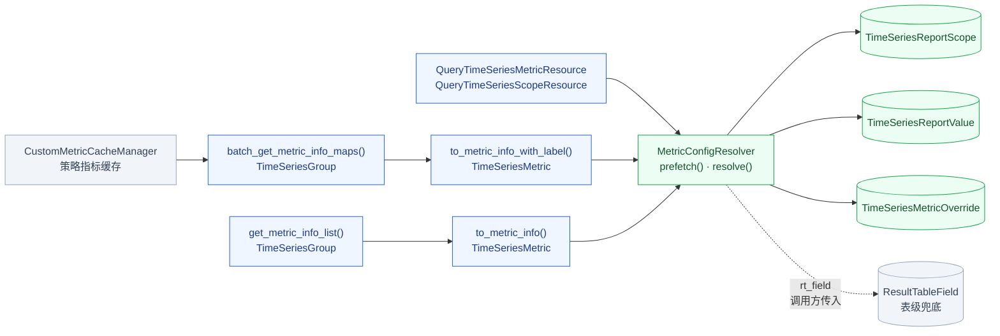

预取按视图分两条路径，每条语句都避开 `5.7` 的退化写法 *[1]*：

| 视图 | 步骤 | 语句 | 访问路径 |
| --- | --- | --- | --- |
| 带 scope 标签 | ① 找 scope | `TimeSeriesReportScope.filter(group_id).values("id", "labels", "last_seen")` | 唯一键前缀，不选二进制列 *[2]* |
| 带 scope 标签 | ② 读取值 ID | `TimeSeriesReportScope.filter(id__in).values("id", "report_value_ids")` | 主键，每批 `1,000` 个 |
| 带 scope 标签 | ③ 读取值 | `TimeSeriesReportValue.filter(id__in)` | 主键，每批 `1,000` 个 |
| 带 scope 标签 | ④ 读覆盖 | `TimeSeriesMetricOverride.filter(group_id, selector_hash__in)` | 唯一键前缀，哈希最多 `1 + scope_name 数` 个 |
| 不分服务 | ① 读取值 | `TimeSeriesReportValue.filter(group_id, field_name__in)` | 唯一键前缀，每批 `500` 个指标名 |
| 不分服务 | ② 读 DEFAULT scope | `TimeSeriesReportScope.filter(group_id, scope_hash)` | 唯一键 |

- *[1] 三种写法一律不用：三列行构造 `IN`、`(a > ? OR (a = ? AND b > ?))` 分段扫描、按标签回连其他表。*
- *[2] 不选二进制列就不读溢出页：`report_value_ids` 超过约 `8 KB` 时存在溢出页，第一步不选该列。*

解析器以视图的 scope 标签 `labels` 构造，`resolve()` 逐个配置键合成五级配置：

```python
RESOLVED_KEYS = ("unit", "alias", "aggregate_method", "function", "interval")
OVERRIDE_KEYS = RESOLVED_KEYS                  # 覆盖不接受 disabled 与 hidden，停用与隐藏只能全局操作
UNSET_VALUES = (None, "", 0, [])
UCUM_UNIT_ALIASES = {"us": "µs", "min": "m", "By": "bytes", "1": "none", "%": "percent"}  # 未列出的按原值匹配 core/unit


class Source(StrEnum):
    SCOPE = "scope"        # {service_name, scope_name} 覆盖
    SERVICE = "service"    # {service_name} 覆盖
    GLOBAL = "global"      # TimeSeriesMetric.field_config 与 scope_id
    REPORT = "report"      # 上报取值
    TABLE = "table"        # ResultTableField 与默认值


class MetricConfigResolver:
    def __init__(self, group_id: int, labels: Mapping[str, str] | None = None) -> None:
        self.labels = normalize_selector(labels)

    # 按上表读取；只把错误码 1146 视为没有上报数据，计入降级计数，其余异常照常抛出
    def prefetch(self, field_names: Collection[str] | None = None) -> None: ...

    # 跳过与 labels 完全相同的那一级覆盖再合成，modify_metric() 据此丢弃与上一级相同的键
    def inherited(self, field_name: str) -> ResolvedMetric: ...

    def resolve(self, metric: TimeSeriesMetric, rt_field: Mapping | None = None) -> ResolvedMetric:
        hits = self._hits.get(metric.field_name, [])   # [(scope, value)]，按 last_seen 降序、scope.id 升序
        value, conflict = self._report_value(metric.field_name, hits)
        layers = [*self._override_layers(metric.field_name, hits),
                  (Source.GLOBAL, metric.field_config or {}),
                  (Source.REPORT, convert_report_meta(value)),     # 转换规则见「有效配置与页面编辑」
                  (Source.TABLE, table_fallback(rt_field))]
        config, source = {}, {}
        for key in RESOLVED_KEYS:                                  # 每个键各自取第一个已设置的值，都未设置时取默认值
            src, layer = next(((s, l) for s, l in layers if l.get(key) not in UNSET_VALUES), layers[-1])
            config[key], source[key] = layer[key], src
        scope_id, source["scope_id"] = self._page_group(metric, layers)
        return ResolvedMetric(config, source, scope_id, value, conflict,
                              report_scopes=self._report_scopes(hits),
                              family=metric_family_of(value, metric.field_name))

    def _override_layers(self, field_name, hits) -> list[tuple[Source, dict]]:
        if not self.labels:                                        # 不分服务的视图只有全局一级
            return []
        service = {"service_name": self.labels["service_name"]}
        scope_names = {s.labels.get("scope_name", "") for s, _ in hits}
        scope_name = self.labels.get("scope_name") or (scope_names.pop() if len(scope_names) == 1 else None)
        layers = [(Source.SCOPE, self._override(field_name, {**service, "scope_name": scope_name}))] if scope_name else []
        return [*layers, (Source.SERVICE, self._override(field_name, service))]

    def _report_value(self, field_name, hits) -> tuple[TimeSeriesReportValue | None, bool]:
        if self.labels:                                            # 同一服务多个 scope 引用不同取值时取 last_seen 最近者
            candidates = [v for _, v in hits]
            pick = candidates[0] if candidates else None
        else:                                                      # DEFAULT scope 引用的优先，其次 scope_count 最大，并列取 ID 小者
            candidates = self._values_by_name.get(field_name, [])
            preferred = [v for v in candidates if v.id in self._default_scope_ids]
            pick = preferred[0] if preferred else min(candidates, key=lambda v: (-v.scope_count, v.id), default=None)
        return pick, len({(v.metric_type, v.original_type) for v in candidates}) > 1  # 任一类型不止一种时返回冲突标志

    def _page_group(self, metric, layers) -> tuple[int | None, Source]:
        for src, override in layers[:-3]:                          # 最具体的覆盖在前
            if override.get("scope_id") is not None:
                return override["scope_id"], src
        return metric.scope_id, Source.GLOBAL


# original_type 为 histogram 且 field_name 是规范化原名加 _bucket、_sum、_count、_min、_max 时返回 {"original_name", "role"}
def metric_family_of(value: TimeSeriesReportValue | None, field_name: str) -> dict[str, str] | None: ...
```

下表可直接作为单测用例：前三行是 `duration_seconds_sum` 的单位按生效顺序逐级查找的结果，与「有效配置与页面编辑」一致，末行是 `queue_size` 的别名。

| 视图 | `{service_name, scope_name}` 覆盖 | `{service_name}` 覆盖 | 全局 `field_config` | 上报取值 | 生效值与来源 |
| --- | --- | --- | --- | --- | --- |
| 不分服务 | 不参与 | 不参与 | 未设置 | 取值 3，`s` *[1]* | `s`，`report` |
| checkout · http | 无 | 覆盖 1，`ms` | 未设置 | 取值 3，`s` | `ms`，`service` |
| cart · http | 无 | 无 | 未设置 | 取值 5，`ms` | `ms`，`report` |
| checkout，`queue_size` 别名 | 覆盖 2，gRPC 队列长度 *[2]* | 无 | 未设置 | 取值 6，未设置 | gRPC 队列长度，`scope` |

- *[1] 并列时取较小 ID：取值 3、5 各被 `1` 个 scope 引用，没有 DEFAULT scope，按 ID 取 3。*
- *[2] scope 名唯一时补全选择器：`queue_size` 在 checkout 下只由 grpc 上报，服务视图按 checkout · grpc 取覆盖 2。*

| 变更点 *[1]* | 目标 |
| --- | --- |
| **[Add]** `metadata.models.custom_report.metric_config.MetricConfigResolver` | 按上述五级合成有效配置与页面归属，返回来源与冲突标志 |
| **[Change]** `TimeSeriesMetric.to_metric_info`<br />`TimeSeriesMetric.to_metric_info_with_label` | [a] 新增关键字参数 `resolver: MetricConfigResolver \| None`<br />[b] `description` 与 `unit` 改取 `resolve()` 的结果<br />[c] 未传时按单指标构造解析器 |
| **[Change]** `TimeSeriesGroup.get_metric_info_list`<br />`TimeSeriesGroup.get_metric_info_list_with_label` | 为该数据源构造不带标签的解析器并预取，传给逐指标的转换方法 |
| **[Change]** `TimeSeriesGroup.batch_get_metric_info_maps` | 增加返回值 `resolver_by_group`，取值按 `group_id__in` 每批 `500` 个数据源预取 |

- *[1] 路径省略模块前缀：未写全的路径均相对 `metadata.models.custom_report.time_series`。*

### c. 查询与写入接口

**查询接口加 scope 标签与视图两个参数，写入接口加选择器，页面分组接口按选择器隔离同名分组。** 新参数与新字段要在 SaaS 转换器、`api.metadata.default`、Metadata 资源与 SaaS 响应 DTO 四处同时声明，漏掉一处即被静默丢弃：

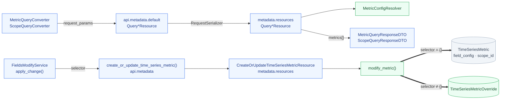

**查询协议**：`QueryTimeSeriesMetricResource` 与 `QueryTimeSeriesScopeResource` 新增两个可选参数：

| 参数 | 类型 | 默认 | 说明 |
| --- | --- | --- | --- |
| `report_labels` | `object` | `{}` | [a] 视图的 scope 标签，决定按哪个视图解析，经 `normalize_selector()` 校验<br />[b] 例如 `{"service_name": "checkout"}` |
| `view` | `string` | `metric` | [a] 取 `metric` 或 `family`，族视图传 `family`<br />[b] 只对 `QueryTimeSeriesMetricResource` 生效 |

请求 `{"group_id": 9, "report_labels": {"service_name": "checkout"}, "view": "metric"}` 中，`duration_seconds_sum` 返回的一项：

```json
{
  "field_id": 1003,
  "name": "duration_seconds_sum",
  "field_scope": "default",
  "scope": {"id": 31, "name": "支付", "create_from": "user", "selector": {"service_name": "checkout"}},
  "field_config": {"alias": "请求耗时"},
  "override": {"selector": {"service_name": "checkout"}, "field_config": {"unit": "ms"}, "scope_id": 31},
  "meta": {"value_id": 3, "original_name": "duration_seconds", "original_type": "histogram", "metric_type": "counter", "unit": "s"},
  "effective_config": {"unit": "ms", "alias": "请求耗时", "aggregate_method": "AVG", "function": [], "interval": "auto"},
  "effective_source": {"unit": "service", "alias": "global", "aggregate_method": "table", "function": "table", "interval": "table", "scope_id": "service"},
  "type_conflict": false,
  "report_scopes": [{"service_name": "checkout", "scope_name": "http"}],
  "family": {"key": {"scope_id": 31, "original_name": "duration_seconds"}, "role": "sum"}
}
```

每个指标新增七个字段，`scope` 新增两个子字段：

| 字段 | 类型 | 必填 | 说明 |
| --- | --- | --- | --- |
| `metrics[].scope` | `object` | 是 | 该视图的有效页面分组，新增 `create_from` 与 `selector` |
| `metrics[].override` | `object \| null` | 是 | 选择器与 `report_labels` 完全相同的覆盖，供页面编辑与清除 |
| `metrics[].meta` | `object \| null` | 是 | 该视图解析出的上报取值，`value_id` 是取值主键 |
| `metrics[].effective_config` | `object` | 是 | [a] 按「有效配置与页面编辑」合成的有效配置<br />[b] 键为 `RESOLVED_KEYS` |
| `metrics[].effective_source` | `object` | 是 | 每个键与 `scope_id` 的来源，取 `Source` 的五个值之一 |
| `metrics[].type_conflict` | `bool` | 是 | 候选取值的 `metric_type` 或 `original_type` 不止一种 |
| `metrics[].report_scopes[]` | `array<object> \| null` | 是 | [a] 命中视图且上报该指标的 scope 标签<br />[b] 数据源没有任何 scope 时为 `null`<br />[c] 有 scope 但都未上报时为 `[]` *[1]* |
| `metrics[].family` | `object \| null` | 是 | [a] 所属指标族与族内角色 `role`，规则见「指标族与复合视图」<br />[b] 由 `metric_family_of()` 计算，`key` 由有效页面分组与原名组成 |

- *[1] 两种空值语义不同：`null` 让 SaaS 回落到白名单，`[]` 表示该服务确实没有上报这个指标。*

**页面分组查询**：`QueryTimeSeriesScopeResource` 不带 `report_labels` 时只返回全局分组，旧调用方看到的结果不变。带 `report_labels` 时返回全局分组与选择器命中该视图的分组，指标按有效页面分组归入，`duration_seconds_sum` 在 checkout 视图归入 `31`，在 cart 视图归入 `22`。

**写入路由**：入口 `modify_metric()` 按选择器写指标项或覆盖，路由规则见「有效配置与页面编辑」：

```python
# metadata/models/custom_report/metric_report.py
@atomic(config.DATABASE_CONNECTION_NAME)
def modify_metric(group_id: int, field_name: str, selector: Mapping[str, str],
                  field_config: Mapping | None = None, scope_id: int | None = None) -> None:
    selector = normalize_selector(selector)
    if not selector:                                               # 全局：沿用 TimeSeriesMetric.batch_create_or_update
        return _modify_global(group_id, field_name, field_config, scope_id)
    inherited = MetricConfigResolver(group_id, selector).inherited(field_name)  # 去掉本级覆盖后的生效值与页面分组
    config = {k: v for k, v in (field_config or {}).items()
              if k in OVERRIDE_KEYS and v not in UNSET_VALUES and v != inherited.config.get(k)}
    scope_id = None if scope_id == inherited.scope_id else scope_id
    _check_page_group(group_id, selector, scope_id)                # 分组的选择器必须是本选择器的子集
    key = {"group_id": group_id, "selector_hash": selector_hash(selector), "field_name": field_name}
    if not config and scope_id is None:                            # 空覆盖直接删除，保持表稀疏
        TimeSeriesMetricOverride.objects.filter(**key).delete()
        return
    TimeSeriesMetricOverride.objects.update_or_create(
        **key, defaults={"selector": selector, "field_config": config, "scope_id": scope_id})
```

写入覆盖时有四条校验，任一不满足返回校验错误：

| 校验 | 规则 |
| --- | --- |
| 选择器 | 只能是三级之一，值不为空且不含 `\|\|` |
| 配置键 | 只接受 `OVERRIDE_KEYS`，带 `disabled` 时拒绝 |
| 页面分组 | [a] 分组属于该数据源<br />[b] 分组的选择器是写入选择器的子集，即全局分组或同一服务的分组 |
| 指标项 | 只能修改已有指标项，选择器下不能新建 |

`CreateOrUpdateTimeSeriesMetricResource` 新增顶层参数 `selector` 与每项的 `reset_override`。`reset_override` 为 `true` 时删除该选择器下的覆盖，恢复继承：

```json
{
  "group_id": 9,
  "selector": {"service_name": "checkout"},
  "metrics": [
    {"field_id": 1003, "scope_id": 31, "field_config": {"unit": "ms", "alias": "请求耗时"}},
    {"field_id": 1001, "scope_id": 21, "reset_override": true}
  ]
}
```

第一项的 `alias` 与全局相同，不写入覆盖，落库结果即例子中的覆盖 1。

**页面分组带选择器**：页面分组只开放全局与 `{service_name}` 两级，即新建到整个数据源或某个服务。按服务建分组受开关控制，开放时机见「发布顺序」：

| 变更点 *[1]* | 目标 |
| --- | --- |
| **[Change]** `CreateOrUpdateTimeSeriesScopeResource` | [a] `scopes[]` 新增 `selector`，只在新建时生效<br />[b] 带选择器的分组 `create_from=user`，不接受 `auto_rules`<br />[c] `CUSTOM_METRIC_SERVICE_SCOPE_ENABLED` 关闭时拒绝非空选择器 |
| **[Change]** `DeleteTimeSeriesScopeResource` | [a] `scopes[]` 新增 `selector`，默认 `{}`<br />[b] 按 `(group_id, selector_hash, scope_name)` 定位 |
| **[Change]** `TimeSeriesScope.bulk_delete_scopes` | 删除服务分组时，指向它的覆盖 `scope_id` 置 `NULL`，变空的覆盖行一并删除 |
| **[Change]** `TimeSeriesScope._check_scopes_for_create`<br />`TimeSeriesScope._check_scopes_for_modify` | 同名校验限定在同一 `selector_hash` 内 |
| **[Change]** `TimeSeriesScope._collect_metrics_and_dimensions`<br />`TimeSeriesScope._do_bulk_refresh_ts_scopes`<br />`TimeSeriesScope.bulk_refresh_ts_scopes` | 指标同步只读写全局分组，查询加 `selector_hash=""` *[2]* |
| **[Change]** `TimeSeriesMetric.batch_create_or_update` | 全局写入的目标分组必须是全局分组 |
| **[Add]** `config.default.CUSTOM_METRIC_SERVICE_SCOPE_ENABLED` | [a] 默认关闭<br />[b] 在 `bkmonitor.define.global_config.STANDARD_CONFIGS` 注册为 `slz.BooleanField`<br />[c] 关闭时 `modify_metric()` 与建分组都拒绝非空选择器，已有覆盖照常生效 |

- *[1] 路径省略模块前缀：`TimeSeries*` 均相对 `metadata.models.custom_report.time_series`，资源类相对 `metadata.resources.resources`。*
- *[2] 同名分组会串到服务分组：这几处按 `scope_name` 建映射，不加过滤时同名的服务分组会覆盖全局分组。*

四处声明点的变更，Metadata 资源占前三行：

| 变更点 | 目标 |
| --- | --- |
| **[Change]** `metadata.resources.resources.QueryTimeSeriesMetricResource` | [a] 声明 `report_labels` 与 `view`<br />[b] 每项输出上表的新字段<br />[c] `view=family` 的节点分页见「族视图与 Histogram 复合面板」 |
| **[Change]** `metadata.resources.resources.QueryTimeSeriesScopeResource` | [a] 声明 `report_labels`<br />[b] 按视图返回分组并归入指标，每项带新字段 |
| **[Change]** `metadata.resources.resources.CreateOrUpdateTimeSeriesMetricResource` | 声明 `selector` 与 `reset_override`，选择器非空时逐项调用 `modify_metric()` |
| **[Change]** `api.metadata.default` 的五个同名资源 | 声明上述参数并原样透传 |
| **[Change]** `monitor_web.custom_report.handlers.metric.query.MetricQueryConverter`<br />`monitor_web.custom_report.handlers.metric.query.ScopeQueryConverter` | 查询方法加 `report_labels` 与 `view`，写入方法加 `selector` |
| **[Change]** `monitor_web.custom_report.handlers.metric.query.MetricQueryResponseDTO`<br />`monitor_web.custom_report.handlers.metric.query.ScopeQueryMetricResponseDTO` | 解析新字段，缺失时置 `None`，`scope.create_from` 平铺为 `scope_create_from` |

### d. 删除与跨环境导出

**删除指标项时同步清理覆盖与取值引用，跨环境导出保留主键，主键冲突时按映射改写取值 ID 列表。**

| 场景 | 入口 | 清理内容 |
| --- | --- | --- |
| 删除数据源 | `TimeSeriesGroup.remove_metrics` | 该数据源在三张新表中的全部行，每批按主键删 `1,000` 行 |
| 命令删除指标项 | `check_ts_metrics.Command._delete` | 调用 `purge_metric_report()` |
| bmw 删除不活跃指标项 | `TimeSeriesMetricSvc.BulkUpdateMetricsByKeys` | Go 侧按 `purge_metric_report()` 同样清理，见「消费与写入」 |
| 管理页删除指标 | `FieldsModifyService.delete_metric` | 不清理，只把 `scope_id` 置 `0`，恢复后覆盖仍生效 |
| 删除页面分组 | `TimeSeriesScope.bulk_delete_scopes` | 见「查询与写入接口」 |

清理函数按 scope 逐行改写列表，与 bmw 写入共用 `version` 校验：

```python
# metadata/models/custom_report/metric_report.py
def purge_metric_report(group_id: int, field_names: Collection[str]) -> None:
    TimeSeriesMetricOverride.objects.filter(group_id=group_id, field_name__in=field_names).delete()
    value_ids = set(TimeSeriesReportValue.objects.filter(group_id=group_id, field_name__in=field_names)
                    .values_list("id", flat=True))                 # field_name 每批 500 个
    if not value_ids:
        return
    for scope_id, blob in TimeSeriesReportScope.objects.filter(group_id=group_id).values_list("id", "report_value_ids"):
        if value_ids.isdisjoint(decode_report_value_ids(blob)):
            continue
        with atomic(config.DATABASE_CONNECTION_NAME):
            scope = TimeSeriesReportScope.objects.select_for_update().get(id=scope_id)  # 重读，以锁内的列表为准
            ids = decode_report_value_ids(scope.report_value_ids)
            kept = [i for i in ids if i not in value_ids]
            scope.report_value_ids, scope.value_count = encode_report_value_ids(kept), len(kept)
            scope.version += 1                                     # bmw 下一批校验 version 不一致会重读
            scope.save(update_fields=["report_value_ids", "value_count", "version"])
            _decrement_scope_count([i for i in ids if i in value_ids])  # 一条 CASE id 语句，每个 ID 减 1
    TimeSeriesReportValue.objects.filter(id__in=value_ids, scope_count=0).delete()  # 主键每批 1,000 个
```

删除后若服务仍在上报，bmw 会按首次出现重建取值与引用。读取方遇到列表中已不存在的取值 ID 时跳过并计数，不报错。

跨环境导出沿用 `data_migrate` 的保留主键方式，取值 ID 列表随 scope 原样导出 *[1]*：

| 导入情况 | 处理 |
| --- | --- |
| 目标环境无主键冲突 | 三张表按原主键写入，`report_value_ids` 不改，`apply-sequences` 把自增起点抬到导出最大值之后 |
| 取值主键冲突 | [a] 取值不带主键写入，得到旧 ID 到新 ID 的映射<br />[b] scope 不带主键写入，列表经 `remap_report_value_ids()` 改写<br />[c] 新 ID 不小于 `2^32` 时中止导入 |
| 页面分组主键冲突 | 沿用现有冲突报告，不导入覆盖表 *[2]* |

- *[1] 二进制列按 base64 序列化：Django 序列化器把 `BinaryField` 写成 base64 字符串，导入时自动解码。*
- *[2] 覆盖只引用页面分组主键：覆盖的 `scope_id` 指向页面分组，页面分组不能保留主键时覆盖无法对应。*

| 变更点 | 目标 |
| --- | --- |
| **[Change]** `metadata.models.custom_report.time_series.TimeSeriesGroup.remove_metrics` | 删除指标项后再删三张新表中该数据源的行，缺表时跳过并计数 |
| **[Keep]** `metadata.models.custom_report.base.CustomGroupBase.delete_custom_group` | 共享基类同时服务 `EventGroup`，不加入时序专属的删除 |
| **[Change]** `metadata.management.commands.check_ts_metrics.Command._delete` | 删除指标项后调用 `purge_metric_report()` |
| **[Add]** `metadata.models.custom_report.metric_report.purge_metric_report` | 按上面的伪代码清理覆盖、列表中的 ID 与无引用的取值 |
| **[Change]** `monitor_web.data_migrate.fetcher.metadata.data_source.get_metadata_result_table_fetcher` | 按 `group_id__in` 导出三张新表 |
| **[Change]** `monitor_web.data_migrate.partial` | 取值主键冲突时按上表改写 scope 的列表 |

## 0x04 开发方案 —— bmw 消费、写入与分组提示

**bmw 新增一个常驻消费任务写取值与 scope，过期清理与分组提示并入现有指标同步，不新增周期任务。**

### a. 接收协议

**每条记录是一个 scope 上报的一个输出指标，`__type` 是这条输出序列自身的类型，拆分前的类型在 `__original_type`。**

`pkg/bk-monitor-worker/internal/metadata/service/metricmeta.go`（新增）

Kafka 消息体是记录的 JSON 数组。以 checkout 在 `http` 下上报的 `duration_seconds_sum` 为例 *[1]*：

```json
{
  "dataid": 1001,
  "__scope_type": "APM",
  "__scope": "checkout-http",
  "__name": "duration_seconds",
  "__metric": "duration_seconds_sum",
  "__original_type": "histogram",
  "__type": "counter",
  "__description": null,
  "__unit": "s",
  "__temporality": "cumulative",
  "__interval": null,
  "__usage": "sum"
}
```

| 字段 | 类型 | 必填 | 写入列 | 说明 |
| --- | --- | --- | --- | --- |
| `dataid` | `int32` | 是 | 无 | [a] 指标数据所属的 DataID<br />[b] 按 `TimeSeriesGroup.bk_data_id` 映射到启用且未删除的数据源，未命中时丢弃 *[2]*<br />[c] 映射与 `enable_metric_metadata` 每 `5 min` 重读一次 |
| `__scope_type` | `string` | 是 | `scope_type` | 选择 scope 解码器，见下表 |
| `__scope` | `string` | 是 | [a] `labels`<br />[b] `raw_scope` | 解码失败时丢弃，原值截断到 `512` 字符存入 `raw_scope` |
| `__metric` | `string` | 是 | `field_name` | 存储中的实际指标名 |
| `__name` | `string` | 是 | `original_name` | 拆分前的原名，同一 Histogram 拆出的指标相同 |
| `__original_type` | `string` | 是 | `original_type` | 取 `sum`、`gauge`、`histogram`、`summary`、`counter`、`avg`、`unknown` 之一 |
| `__type` | `string` | 是 | `metric_type` | 取 `counter`、`gauge`、`unknown` 之一 |
| `__description` | `string \| null` | 否 | `meta.description` | 缺键与 `null` 等价 *[3]* |
| `__unit` | `string \| null` | 否 | `meta.unit` | 无量纲为 `1` |
| `__temporality` | `string` | 否 | `meta.temporality` | 取 `delta` 或 `cumulative` |
| `__interval` | `int64 \| null` | 否 | `meta.interval` | 上报周期，单位毫秒 |
| `__usage` | `string \| null` | 否 | `meta.usage` | 取 `sum`、`min`、`max`、`avg`、`last` 之一 |

- *[1] 统一例子只列单位：取值表中的 `meta` 只写 `unit`，实际内容是这条记录的全部非空键。*
- *[2] 两类 DataID 不同：`dataid` 不是承载记录的元信息 DataID，后者只决定 topic，其创建与下发在 [Collector 元信息方案](../../../../knowledge/bkmonitor-datalink/issues/2026-09-15-collector-metric-metadata/PLAN.md)中「待确认」。*
- *[3] meta 不存空键：值为 `null` 或缺失的键不写入 `meta`，也不参与指纹。*

scope 解码器把 `__scope` 还原成 `labels`，规范化与 `scope_hash` 见「scope 身份」：

| `__scope_type` | 解码规则 | `labels` 示例 |
| --- | --- | --- |
| `APM` | [a] 按未转义的 `-` 拆成服务名与 `scope_name`<br />[b] 两段各自还原 `%2D`、`%25`<br />[c] 编码时两段先转义 `%` 与 `-`，再用 `-` 连接<br />[d] 如 `checkout-http%2Dclient` 解码为 `scope_name=http-client` | `{"service_name": "checkout", "scope_name": "http"}` |
| `DEFAULT` | `__scope` 为空，每个数据源最多一个 | `{}` |
| 其他类型 | 不解码，带非空值的 `DEFAULT` 同样处理，成为独立的 scope | `{"scope": "<原值>"}` |

指纹覆盖取值的全部内容，同名指标在两个 scope 里类型不同时得到两个取值：

```go
var originalTypes = set("sum", "gauge", "histogram", "summary", "counter", "avg", "unknown")
var metricTypes = set("counter", "gauge", "unknown")

type ReportValueContent struct {
	OriginalName string         // __name
	OriginalType string         // __original_type
	MetricType   string         // __type
	Meta         map[string]any // 只含非 null 键
}

// 四字节字符先替换为 U+FFFD，再校验与计算指纹
// 必填字段缺失、取值不在集合内或超出列长度时返回 reasonInvalid
func parseRecord(raw map[string]any) (ReportRecord, dropReason)

// field_name 已在唯一键中，不计入指纹
func fingerprint(v ReportValueContent) string {
	var buf bytes.Buffer
	enc := json.NewEncoder(&buf)
	enc.SetEscapeHTML(false) // map 按键名升序输出，保留 < > & 原字符
	_ = enc.Encode(map[string]any{
		"original_name": v.OriginalName,
		"original_type": v.OriginalType,
		"metric_type":   v.MetricType,
		"meta":          v.Meta,
	})
	sum := md5.Sum(bytes.TrimSpace(buf.Bytes()))
	return hex.EncodeToString(sum[:])
}
```

### b. 消费与写入

**每个元信息 DataID 一个常驻任务，各分区的消息汇入一个协程聚批，按数据源调用 `Apply()`，全部提交后才标记 offset。**

`pkg/bk-monitor-worker/internal/metadata/task/metricmeta.go`（新增）、`pkg/bk-monitor-worker/internal/metadata/service/metricmeta.go`（新增）

常驻任务的注册写法同 `register_alarm_cache_bmw_task`，Kafka 消费复用 `notifier/kafka.go` 的消费组写法 *[1]*。每个 DataID 只运行一个实例 *[2]*：

```mermaid
flowchart LR
    Register["register_metric_meta_bmw_task()<br/>metadata worker · 每 1 min"] -->|"POST bmw/task/<br/>payload.data_id"| Define["daemon.taskDefine<br/>daemon:metadata:metric_meta_consume"]
    Define --> Op["metricMetaOperator.Start()<br/>每个 DataID 一个实例"]
    Kafka[["Kafka<br/>元信息 DataID 的 topic"]] --> Claim["sarama.ConsumerGroup<br/>ConsumeClaim()<br/>每个分区一个"]
    Op --> Claim
    Claim -->|"msgCh"| Loop["metricMetaOperator.loop()<br/>30,000 条或 30 s"]
    Loop -->|"按 group_id 分组"| Apply["MetricMetaSvc.Apply()"]
    Apply ==>|"INSERT · UPDATE"| Tables[("TimeSeriesReportValue<br/>TimeSeriesReportScope")]
    Loop -->|"本批全部提交后"| Mark["session.MarkMessage()"]

    classDef add fill:#ecfdf3,stroke:#16a34a,color:#14532d
    classDef change fill:#eff6ff,stroke:#2563eb,color:#1e3a8a
    classDef old fill:#f1f5f9,stroke:#94a3b8,color:#334155
    class Register,Op,Loop,Apply,Tables add
    class Define change
    class Kafka,Claim,Mark old
```

- *[1] 首次上线从最新位置消费：沿用的写法设置 `OffsetNewest`，积压的记录由 Collector 的 `2 h` 重发补齐。*
- *[2] 单实例够用：上界 `40,091,444` 条关系每 `2 h` 重发一轮，平均约 `5,600` 条每秒，缓存命中的记录不访问数据库。*

```go
// internal/metadata/task/metricmeta.go
type metricMetaOperator struct{ dataID uint }

// 经 DataSource、KafkaTopicInfo、ClusterInfo 取 topic 与认证
func (o *metricMetaOperator) Start(ctx context.Context, errCh chan<- error, payload []byte)

// 返回 payload.data_id，同一 DataID 只运行一个实例
func (o *metricMetaOperator) GetTaskDimension(payload []byte) string

// 各分区的 ConsumeClaim() 只把消息送进 msgCh，同一数据源因此只有一个写入方
// 本批任一 Apply() 失败时不标记 offset，结束会话，常驻任务退避重启后从上次提交处重放
func (o *metricMetaOperator) loop(ctx context.Context, session sarama.ConsumerGroupSession, msgCh <-chan *sarama.ConsumerMessage) error
```

**进程内缓存**：同日与次日重发都不读库，缓存只在提交成功后更新：

```go
// internal/metadata/service/metricmeta.go，每个数据源一份
type groupCache struct {
	scopes     map[string]*scopeState       // scope_hash → scope
	valueIDs   map[string]map[string]uint32 // field_name → fingerprint → 取值 ID
	scopeTotal int                          // 数据源的 scope 数，接近限额时重读 COUNT
	valueTotal int                          // 数据源的取值数，接近限额时重读 COUNT
}

type scopeState struct {
	id       int64
	version  int
	ids      []uint32  // report_value_ids 解码结果，升序
	lastSeen time.Time // 最近一次写入库的 last_seen
}

// 按 field_name 找这个 scope 当前的取值：取该指标名的候选 ID，再在 ids 中二分查找，没有时返回 0
func (st *scopeState) idOf(c *groupCache, fieldName string) uint32
```

**写入**：`Apply()` 先补齐缓存与缺失的取值，再按「生命周期」的四种情况算出每个 scope 的改动：

```go
func (s *MetricMetaSvc) Apply(ctx context.Context, groupID uint, records []ReportRecord, now time.Time) error {
	c := s.cacheOf(groupID)
	records = keepLast(records) // 同批同一 (scope_hash, field_name) 只留 offset 最大的一条
	if err := s.load(ctx, c, groupID, records); err != nil { // scope 未命中时整组读回，取值按 field_name IN 读回
		return err
	}
	if err := s.insertMissingValues(ctx, c, groupID, records); err != nil { // 只插入缺失的取值
		return err
	}

	plans := newScopePlans()
	for _, r := range records {
		vid, ok := c.valueIDs[r.FieldName][r.Fingerprint]
		if !ok {
			continue // 取值超限或 ID ≥ 2^32，插入时已计数丢弃
		}
		st := c.scopes[r.Scope.Hash()]
		if st == nil && !c.admitScope(r.Scope) {
			drop(reasonScopeLimit)
			continue
		}
		p := plans.of(r, st)
		if old := st.idOf(c, r.FieldName); old == vid {
			p.touch = now.Sub(st.lastSeen) >= 24*time.Hour // 已含这个取值：只按 24 h 刷新 last_seen
		} else {
			p.replace(r.FieldName, old, vid) // old 为 0 表示不含这个指标名，或 scope 不存在
		}
	}

	changed, touch := plans.split() // 有改动的 scope 与只需刷新 last_seen 的 scope ID
	if err := s.commitBatch(ctx, c, groupID, changed, now); err != nil {
		return err
	}
	// 一条 UPDATE … SET last_seen = ? WHERE id IN (…)，影响行数不足时清除这些 scope 的缓存并按新 scope 重放
	return s.touchLastSeen(ctx, c, groupID, touch, now)
}

// 一批一个事务，先锁 scope 再改取值，与 Expire() 加锁顺序相同；取值已被删除或 scope 插入冲突时回滚并重试一次
func (s *MetricMetaSvc) commitBatch(ctx context.Context, c *groupCache, groupID uint, plans []*scopePlan, now time.Time) error {
	return s.retryOnce(ctx, func(tx *gorm.DB) error {
		locked, err := lockScopes(tx, plans) // SELECT id, version … WHERE id IN (…) FOR UPDATE，行已删除时按新 scope 处理
		if err != nil {
			return err
		}
		delta := map[uint32]int{}
		for _, p := range plans {
			st := locked[p.scopeID]
			if st != nil && st.version != c.versionOf(p) {
				st = reloadScope(tx, c, st.id) // 重读列表与未知取值的 field_name，在新列表上重放本批改动
			}
			ids, d := p.applyTo(c, st) // 新列表与每个取值 ID 的 scope_count 增减
			if st == nil {
				err = insertScope(tx, groupID, p, ids, now) // version = 0，唯一键冲突时返回 1062
			} else {
				err = updateScope(tx, st.id, ids, now) // version = version + 1
			}
			if err != nil {
				return err
			}
			mergeDelta(delta, d)
		}
		return bumpScopeCount(tx, delta) // 一条 CASE id，影响行数少于 len(delta) 时返回 errValueMissing
	})
}
```

`commitBatch()` 一批一个事务，S1 冷启动 `29.1 s`。逐个 scope 提交要刷盘 `67,000` 次，耗时 `142 s`，redo 从 `597 MiB` 增到 `868 MiB`。

例如 cart 升级 SDK 后改报 `unit=s`，scope 13 的列表从 `[1, 2, 4, 5]` 变为 `[1, 2, 3, 4]`，事务内三条语句：

```sql
SELECT id, version FROM metadata_timeseriesreportscope WHERE id IN (13) FOR UPDATE;

UPDATE metadata_timeseriesreportscope
SET report_value_ids = ?, value_count = 4, version = version + 1, last_seen = ?
WHERE id = 13;

UPDATE metadata_timeseriesreportvalue
SET scope_count = scope_count + CASE id WHEN 3 THEN 1 WHEN 5 THEN -1 END
WHERE id IN (3, 5);
```

提交后取值 3 的 `scope_count` 为 `2`，取值 5 降为 `0`，下一轮「过期清理」删除取值 5。

写入语句只用 MySQL `5.7` 与 `8.0` 行为一致的写法：

| 规则 | 原因 | 写法 |
| --- | --- | --- |
| 批量定位用单列 `IN` | `5.7` 上多列行构造 `IN` 超过约 `200` 组时走全索引扫描 | [a] 取值用 `group_id = ? AND field_name IN (…)`<br />[b] scope 缓存未命中时读本数据源全部 scope *[1]* |
| 不做分段扫描 | `(a > ? OR (a = ? AND b > ?))` 每段从组首重扫，整体平方复杂度 | 过期只走 `(group_id, last_seen)` 与 `(group_id, scope_count)` 两个索引 |
| 取值只在缺失时插入 | [a] `autoinc_lock_mode=1` 下 upsert 按批预留自增 ID<br />[b] 取值 ID 必须小于 `2^32` | 先查后插，不用 `ON DUPLICATE KEY UPDATE` |
| 插入后按唯一键重读 ID | `8.0` 默认 `autoinc_lock_mode=2`，多行插入的 ID 不保证连续 | 不依赖 `LAST_INSERT_ID()` 推算 |
| 只用 `5.7` 支持的语法 | 行别名 `AS new`、窗口函数、CTE 与 `SKIP LOCKED` 在 `5.7` 上报语法错误 | [a] 排名与计数在 Go 中完成<br />[b] 互斥用普通行锁 |
| 写入前替换四字节字符 | 连接与索引列都是 `utf8`，严格模式下一个四字节字符让整条语句失败 | 码点大于 `0xFFFF` 的字符替换为 `U+FFFD` |
| 提交后再标记 offset | 先标记时失败的批次不会重放 | 重放的记录与已提交的列表相同，不产生写入 |

- *[1] 不按 `scope_hash IN` 批量取：`1,000` 个哈希的 `IN` 在 `5.7` 上选错索引，改走 `(group_id, last_seen)`，每个数据源最多 `2,000` 个 scope，整组读更稳定。*

记录进入 `Apply()` 前后的边界情况：

| 边界情况 | 处理方式 |
| --- | --- |
| 同批重复记录 | 按 `(scope_hash, field_name)` 去重，保留 offset 最大的一条 |
| 字段超长 | [a] `field_name`、`original_name` 超过 `255` 字符时丢弃，计入 `invalid`<br />[b] `raw_scope` 截断到 `512` 字符 |
| scope 超限 | 已有 scope 照常写入，新 scope 的记录丢弃，计入 `scope_limit` |
| 取值超限 | 已有取值照常引用，新取值丢弃，计入 `value_limit` |
| 取值 ID 达到 `2^32` | 拒写该记录，计入 `value_id_overflow`，插入的取值行留给过期清理 |
| `version` 不一致 | 在锁内重读该 scope 的列表，重放本批对它的改动 *[1]* |
| 唯一键冲突 `1062` | 回滚本批事务，重读后重试一次，仍失败时整批不标记 offset |

- *[1] version 变化来源很少：同一数据源只有一个消费实例，变化来自消费组重平衡与删除指标项时的清理。*

元信息写入默认关闭，配置写在 `taskConfig.metadata.metricMeta` 下：

```go
// config/metadata_config.go，每个字段落为一个 MetadataMetricMeta* 变量
type MetricMetaConfig struct {
	Enabled                 bool          `yaml:"enabled"`                 // false；与 enable_metric_metadata 同时为真才写入
	ConsumerGroup           string        `yaml:"consumerGroup"`           // bkmonitor_metric_meta
	BatchSize               int           `yaml:"batchSize"`               // 30000；单个数据源一次聚批的最大条数
	BatchWait               time.Duration `yaml:"batchWait"`               // 30s；与 BatchSize 先满足者触发写入
	MaxReportScopesPerGroup int           `yaml:"maxReportScopesPerGroup"` // 2000
	MaxReportValuesPerGroup int           `yaml:"maxReportValuesPerGroup"` // 60000
}
```

消费、写入与过期共用六个自监控指标，前缀为 bmw 现有的 `bmw_metadata`：

```go
// metrics/metadata.go，在该文件的 init() 中注册
var (
	// result：applied 写库、cached 缓存命中未写库、dropped 丢弃
	MetricMetaRecordsTotal = newCounterVec("metric_meta_records_total", "data_id", "result")
	// reason：unknown_dataid、disabled、decode_failed、invalid、scope_limit、value_limit、value_id_overflow
	MetricMetaDroppedTotal = newCounterVec("metric_meta_dropped_total", "data_id", "reason")
	// table：report_value、report_scope；op：insert、update、delete
	MetricMetaRowsTotal = newCounterVec("metric_meta_rows_total", "table", "op")
	// reason：version_conflict、value_missing、duplicate_key
	MetricMetaRetriesTotal = newCounterVec("metric_meta_retries_total", "reason")
	// op：apply、expire、placement_hints；code：MySQL 错误码
	MetricMetaDBErrorsTotal = newCounterVec("metric_meta_db_errors_total", "op", "code")
	// 单个数据源一次 Apply() 的耗时
	MetricMetaApplySeconds = newHistogram("metric_meta_apply_seconds")
)
```

各类上报的写库量与耗时见「性能基线」。S1 中新服务加入时新建 `1` 个 scope 与 `1` 个取值，并给 `2,001` 个取值的 `scope_count` 加 `1`。

**bk-monitor**

| 变更点 | 目标 |
| --- | --- |
| **[Add]** `config.default.METRIC_METADATA_DATA_IDS` | [a] 列出需要消费的元信息 DataID，默认为空<br />[b] 在 `bkmonitor/define/global_config.py` 的 `ADVANCED_OPTIONS` 注册为 `slz.ListField` |
| **[Add]** `metadata.task.custom_report.register_metric_meta_bmw_task` | [a] 用 `GET bmw/task/` 比对已注册任务，为缺失的 DataID 补建常驻任务<br />[b] `BMW_API_URL` 为空时跳过 |
| **[Change]** `config.role.worker.DEFAULT_CRONTAB` | 登记上一行任务，每 `1 min` 执行，只在默认集群执行 |

**bmw**

| 变更点 *[1]* | 目标 |
| --- | --- |
| **[Add]** `internal/metadata/task.metricMetaOperator` | 消费元信息 topic，聚批交给 `Apply()`，提交后标记 offset |
| **[Change]** `service/scheduler/daemon.taskDefine` | [a] 注册 `daemon:metadata:metric_meta_consume`<br />[b] `initialFunc` 返回 `metricMetaOperator` |
| **[Add]** `internal/metadata/service.MetricMetaSvc` | [a] 提供 `Apply()`、`Expire()`、`Purge()` 与 `PlacementHints()`<br />[b] 新表不存在时 `Apply()` 报错并计数，常驻任务退避重试 |
| **[Add]** `internal/metadata/models/customreport.TimeSeriesReportValue`<br />`internal/metadata/models/customreport.TimeSeriesReportScope` | [a] 表名为 Django 默认的 `metadata_<小写模型名>`<br />[b] 不声明 `default` 标签<br />[c] 带 `//go:generate goqueryset` 与 `// gen:qs` 注释 |
| **[Keep]** `internal/metadata/models/customreport.TimeSeriesMetric` | 字段不变，bmw 不读写覆盖表 |
| **[Change]** `internal/metadata/service.TimeSeriesMetricSvc.BulkUpdateMetricsByKeys` | 删除指标项后调用 `MetricMetaSvc.Purge()`，规则与 Python 的 `purge_metric_report()` 相同 |
| **[Add]** `config.MetadataMetricMeta*` | [a] 声明 `MetricMetaConfig` 的 `6` 个变量，由 `initMetadataVariables()` 读取<br />[b] `BatchWait` 必须传入 `viper.GetDuration` *[2]*<br />[c] `bmw.yaml.tpl` 不新增该分组 |
| **[Add]** `metrics.MetricMeta*` | 在 `metrics/metadata.go` 声明上面的 `6` 个指标 |

- *[1] 路径省略模块前缀：均相对 `pkg/bk-monitor-worker/`。*
- *[2] 时长键要指定读取函数：缺省读取方式下 `value.(time.Duration)` 断言失败会 panic。*

### c. 过期清理

**`Expire()` 并入 `RefreshTimeSeriesMetric()`，每 `5 min` 对每个数据源先删过期 scope，再删无引用的取值。**

`pkg/bk-monitor-worker/internal/metadata/task/customreport.go`、`pkg/bk-monitor-worker/internal/metadata/service/metricmeta.go`

过期时长与指标项共用 `GlobalTimeSeriesMetricExpiredSeconds`，默认 `30 d` *[1]*。图中红线是 `Expire()` 的两步删除：

```mermaid
flowchart LR
    Refresh["RefreshTimeSeriesMetric()<br/>每 5 min · 每个数据源一个协程"] --> Update["UpdateTimeSeriesMetrics()<br/>指标发现"]
    Update --> Metrics["BulkRefreshTSMetrics()<br/>last_modify_time 每 24 h 刷新"]
    Metrics ==>|"UPDATE"| TSM[("TimeSeriesMetric<br/>过期只隐藏，行保留")]
    Refresh --> Expire["MetricMetaSvc.Expire()<br/>UpdateTimeSeriesMetrics() 之后"]
    Expire ==>|"步骤 1：DELETE<br/>last_seen 过期的 scope"| Scope[("TimeSeriesReportScope")]
    Expire ==>|"步骤 1：scope_count - 1<br/>步骤 2：DELETE scope_count = 0"| Value[("TimeSeriesReportValue")]
    Cfg["GlobalTimeSeriesMetricExpiredSeconds<br/>默认 30 d"] -.-> Metrics
    Cfg -.-> Expire

    classDef add fill:#ecfdf3,stroke:#16a34a,color:#14532d
    classDef change fill:#eff6ff,stroke:#2563eb,color:#1e3a8a
    classDef old fill:#f1f5f9,stroke:#94a3b8,color:#334155
    class Expire,Scope,Value add
    class Refresh change
    class Update,Metrics,TSM,Cfg old
    linkStyle 4,5 stroke:#dc2626,color:#7f1d1d
```

- *[1] 两侧时长须一致：bmw 读 `taskConfig.metadata.global.timeSeriesMetricExpiredSeconds`，Python 读 `TIME_SERIES_METRIC_EXPIRED_SECONDS`。*

```go
// 每轮先探测一次表是否存在，1146 时整轮跳过，不逐个数据源报错
// 错误只记日志并计入 metric_meta_db_errors_total，不影响指标同步
func (s *MetricMetaSvc) Expire(ctx context.Context, groupID uint, now time.Time) error
```

```sql
-- 步骤 1：找出过期 scope，走 tsrs_group_seen_idx
SELECT id FROM metadata_timeseriesreportscope WHERE group_id = ? AND last_seen < ?;

-- 步骤 1：每个过期 scope 一个事务，先锁 scope 再改取值，加锁后复查条件，ID 每 1,000 个一条 UPDATE
SELECT report_value_ids FROM metadata_timeseriesreportscope WHERE id = ? AND last_seen < ? FOR UPDATE;
UPDATE metadata_timeseriesreportvalue SET scope_count = scope_count - 1 WHERE id IN (…);
DELETE FROM metadata_timeseriesreportscope WHERE id = ?;

-- 步骤 2：删无引用的取值，走 tsrv_group_count_idx，每 1,000 个 ID 一条 DELETE
SELECT id FROM metadata_timeseriesreportvalue WHERE group_id = ? AND scope_count = 0;
DELETE FROM metadata_timeseriesreportvalue WHERE id IN (…) AND scope_count = 0;
```

每个 scope 内同一 `field_name` 只有一个取值 ID，所以步骤 1 对列表中的每个 ID 统一减 `1`。没有过期 scope 时 S1 一轮 `0.34 ms`，全平台 S3 一轮 `2.6 s`。S3 中 `1%` 的 scope 同时过期时一轮 `9.6 s`，主要花在 `344,673` 行引用数递减。

`Expire()` 与 `Apply()` 争同一行时，加锁后的复查保证列表不指向已删除的取值：

| 竞态 | 结果 |
| --- | --- |
| `Apply()` 先刷新了 `last_seen` | `Expire()` 加锁后复查 `last_seen < ?` 不成立，跳过该 scope |
| `Expire()` 先删除 scope | `Apply()` 加锁时读不到行，按新 scope 插入本批记录 |
| `Expire()` 删除了刚插入、尚未引用的取值 | `Apply()` 的 `CASE` 影响行数不足，回滚后重新插入取值并重试 |

单个指标停报不单独清理，停报范围与视图表现见「生命周期」。cart · http 不再上报任何指标时，scope 13 在 `30 d～31 d` 后删除。`last_seen` 距上次写入满 `24 h` 才刷新，所以删除最多晚一天。

| 变更点 *[1]* | 目标 |
| --- | --- |
| **[Change]** `internal/metadata/task.RefreshTimeSeriesMetric` | [a] 每轮开始探测一次新表<br />[b] 每个数据源的协程在 `UpdateTimeSeriesMetrics()` 之后调用 `Expire()`，前者出错也调用 |
| **[Keep]** `config.GlobalTimeSeriesMetricExpiredSeconds` | 不新增过期阈值，`last_seen` 的 `24 h` 刷新粒度也不做配置 |
| **[Keep]** `service/scheduler/periodic.getPeriodicTasks` | 不新增周期任务，`refresh_ts_metric` 的 `10 min` 超时同时覆盖 `Expire()` |

- *[1] 路径省略模块前缀：均相对 `pkg/bk-monitor-worker/`。*

### d. 分组提示

**新建指标项时，`PlacementHints()` 按指标反查上报它的 scope，用 scope 标签拼出全局页面分组名。**

`pkg/bk-monitor-worker/internal/metadata/service/timeseriesscope.go`、`bkmonitor/metadata/models/custom_report/time_series.py`

分组提示接入现有指标同步的新建分支，归属规则见「页面分组与归属」：

```mermaid
flowchart LR
    Update["UpdateMetrics()<br/>每 5 min"] --> Scopes["BulkRefreshTSScopes()<br/>只取全局分组"]
    Scopes --> Collect["collectMetricsAndDimensions()<br/>新指标与 1 h 重放"]
    Collect --> Hints["MetricMetaSvc.PlacementHints()"]
    Hints -.->|"field_name → 取值 ID"| Value[("TimeSeriesReportValue")]
    Hints -.->|"全部 scope 的 labels<br/>与 report_value_ids"| Scope[("TimeSeriesReportScope")]
    Hints -->|"提示分组名"| Determine["determineScopeNameForNewMetric()<br/>签名不变"]
    Determine -->|"无提示"| Rules["isMatchAutoRules()<br/>auto_rules 或默认分组"]
    Determine --> Create["doBulkRefreshTSScopes()<br/>缺失时新建全局分组"]
    Scopes --> Metrics["BulkRefreshTSMetrics()"]
    Metrics ==>|"全局 scope_id"| TSM[("TimeSeriesMetric")]

    classDef add fill:#ecfdf3,stroke:#16a34a,color:#14532d
    classDef change fill:#eff6ff,stroke:#2563eb,color:#1e3a8a
    classDef old fill:#f1f5f9,stroke:#94a3b8,color:#334155
    class Hints,Value,Scope add
    class Scopes,Collect,Create,Metrics change
    class Update,Determine,Rules,TSM old
```

```go
// 提示分组名只取 labels.scope_name，V2 前缀机制下线后不再拼分组维度
// 查询出错（含 1146）时记日志、计数并返回空 map
func (s *MetricMetaSvc) PlacementHints(groupID uint, fieldNames []string) map[string]string {
	fieldOf := selectValueFields(groupID, fieldNames) // SELECT id, field_name … WHERE group_id = ? AND field_name IN (…)
	counts := map[string]map[string]int{}            // field_name → 提示分组名 → scope 数
	for _, sc := range selectAllScopes(groupID) {    // SELECT labels, report_value_ids … WHERE group_id = ?
		name := sc.Labels["scope_name"]
		if name == "" || name == "default" {
			continue // DEFAULT scope 与默认分组的 scope 不算提示
		}
		for _, id := range sc.ValueIDs {
			if f, ok := fieldOf[id]; ok {
				counts[f][name]++
			}
		}
	}
	return pickMost(counts) // 取 scope 数最多的分组名，相同时按名称升序
}
```

例如新指标 `duration_seconds_sum` 有取值 3、5，分别被 scope 11、13 引用 *[1]*。两个 scope 的 `scope_name` 都是 `http`，提示为 `http`，新指标项落入全局分组 21。

- *[1] 反查要读整个数据源：不建标签表，按指标找 scope 要读全部 scope 的 `report_value_ids`，耗时见「性能基线」。*

提示只决定全局 `TimeSeriesMetric.scope_id`，实现上另有两条约束：

- **重放不重置配置**：`create_time` 在 `1 h` 内、仍在默认分组且出现提示的指标项改入提示分组，不重置 `field_config`。
- **不改 `field_scope`**：提示只作为 `determineScopeNameForNewMetric()` 的分组名参数传入，指标项仍按 `default` 新建。

**bk-monitor**

| 变更点 *[1]* | 目标 |
| --- | --- |
| **[Change]** `time_series.TimeSeriesGroup.is_default_scope_info` | 改从 `ResultTableOption(metric_group_dimensions)` 读取分组维度 |
| **[Add]** `metric_report.placement_hints` | 签名为 `placement_hints(group_id, field_names)`，与 Go 共用测试样例 |
| **[Change]** `time_series.TimeSeriesScope._collect_metrics_and_dimensions` | [a] 为新指标取分组提示<br />[b] 按名称只匹配全局分组 |
| **[Change]** `time_series.TimeSeriesScope._do_bulk_refresh_ts_scopes` | 按名称只匹配 `selector_hash = ''` 的分组，新建分组为全局分组 |
| **[Change]** `time_series.TimeSeriesScope.bulk_refresh_ts_scopes` | 收集 `1 h` 重放的指标项 |
| **[Change]** `time_series.TimeSeriesMetric._bulk_update_metrics` | 重放的指标项改写 `scope_id`，不重置 `field_config` |
| **[Change]** `time_series.TimeSeriesGroup.get_metric_from_bkdata` | [a] 阶段四删除 v2 分支<br />[b] `is_enabled_data_scope()` 另有调用方，保留不删 |

- *[1] 路径省略模块前缀：均相对 `metadata.models.custom_report`，模块文件见「数据模型与迁移」。*

**bmw**

| 变更点 *[1]* | 目标 |
| --- | --- |
| **[Change]** `collectMetricsAndDimensions` | [a] 新指标以提示作为分组名，无提示时传 `default`<br />[b] 按名称只匹配全局分组 |
| **[Keep]** `determineScopeNameForNewMetric` | 提示分组走「数据带分组信息」分支，`default` 仍走 `auto_rules` 分支 |
| **[Change]** `doBulkRefreshTSScopes` | [a] 按名称只匹配 `SelectorHash == ""` 的分组<br />[b] 插入用 `Omit("selector", "selector_hash")` *[2]* |
| **[Change]** `BulkRefreshTSScopes` | [a] 刷新后整行读取分组，在内存中过滤全局分组<br />[b] 标记 `1 h` 重放的指标项 |
| **[Change]** `TimeSeriesMetricSvc.BulkUpdateMetricsByKeys` | 重放的指标项改写 `scope_id`，现有逻辑只在 `scope_id = 0` 时改写 |
| **[Change]** `internal/metadata/models/customreport.TimeSeriesScope` | 新增只读字段 `SelectorHash`，重新生成 QuerySet |
| **[Change]** `TimeSeriesGroupSvc.IsDefaultScopeInfo` | 改从 `ResultTableOption(metric_group_dimensions)` 读取分组维度 |
| **[Change]** `internal/metadata/apiservice.BkdataService.QueryMetricAndDimension` | 阶段四删除 `useV2` 分支 |

- *[1] 路径省略模块前缀：未写全的路径均相对 `internal/metadata/service`。*
- *[2] 插入依赖库默认值：省略两列后由库默认值 `''` 写成全局分组，列缺失时插入也不报错。*

## 0x05 开发方案 —— SaaS 与 APM

**SaaS 不直接读新表，五处改造都经 Metadata 查询接口取得 scope、有效配置与族。** 各项改造依赖「查询与写入接口」的新参数与新字段：

| 改造 | 依赖的 Metadata 能力 |
| --- | --- |
| 服务范围对象 | `report_labels` 查询与 `report_scopes` |
| 图表与维度值 | 服务范围对象与 `effective_config` |
| 管理页与写回 | [a] `override`、`effective_source`<br />[b] 带 `selector` 的写入与页面分组接口 |
| 指标缓存与选择器 | `to_metric_info()` 经解析器补齐单位与描述 |
| 族视图与 Histogram 复合面板 | `family` 与 `view=family` |

### a. 服务范围对象

**`ServiceMetricScope` 只看该服务是否上报了指标，与指标所在的页面分组无关。** 三个接口每个请求带 `report_labels` 查询 Metadata，再用返回的 `report_scopes` 构造一次对象：

```mermaid
flowchart LR
    subgraph Readers["SaaS 三个接口"]
        direction TB
        Tree["GetCustomTsMetricGroups<br/>指标树"]
        Graph["GetCustomTsGraphConfig<br/>图表"]
        Dim["GetCustomTsDimensionValues<br/>维度值 · 新增 field_id"]
    end
    Readers -->|"report_labels"| Query["query_time_series_scope()<br/>query_time_series_metric()"]
    Query --> Resolver["MetricConfigResolver<br/>服务视图读法"]
    Resolver --> Scope[("TimeSeriesReportScope")]
    Resolver --> Value[("TimeSeriesReportValue")]
    Query -->|"返回 report_scopes"| Load["ServiceMetricScope.load()<br/>visible()<br/>scope_name_filter()"]
    Load -.->|"下线前取并集"| WL[("APP_SCOPE_NAME_KEY<br/>Redis 白名单")]
    Task["cache_application_scope_name<br/>每 10 min 扫描 VM"] ==> WL

    classDef add fill:#ecfdf3,stroke:#16a34a,color:#14532d
    classDef change fill:#eff6ff,stroke:#2563eb,color:#1e3a8a
    classDef del fill:#fef2f2,stroke:#dc2626,color:#7f1d1d
    class Load,Resolver,Scope,Value add
    class Tree,Graph,Dim,Query change
    class Task,WL del
    style Readers fill:#f8fafc,stroke:#cbd5e1
```

Metadata 按「读取路径」中的服务视图读法汇总 checkout 上报的指标，SaaS 只拿到最后的求交结果，即下表第 ④ 步：

| 步骤 | Metadata 读取 | checkout 的结果 |
| --- | --- | --- |
| ① 找 scope | 本数据源全部 scope 的 `id`、`labels` | 读出 `3` 行，按 `service_name` 命中 11、12 |
| ② 读取值 ID | 11、12 两行的 `report_value_ids` | `[1, 2, 3, 4]`、`[1, 6]` |
| ③ 读取值 | 按主键批量读取值 1、2、3、4、6 | 按 `field_name` 归到 `5` 个指标 |
| ④ 求交 | 与活跃指标项按 `field_name` 求交 | 每个指标带上 `report_scopes` |

`ServiceMetricScope` 只在内存中判断，不发起查询：

```python
# monitor_web/scene_view/resources/custom_metric.py
@dataclass(frozen=True)
class ServiceMetricScope:
    reported: dict[str, set[str]] | None  # 指标名 → 该服务上报它的 scope_name，None 表示数据源还没有 scope
    legacy: dict[str, set[str]] | None    # 指标名 → 白名单中的 scope_name，白名单下线后恒为 None

    # metrics 是带 report_labels 查询返回的指标项，非 APM 场景或缺 apm_service_name 时返回 None
    # APM_CUSTOM_METRIC_REPORT_FILTER_ENABLED 关闭时 reported 视为 None，并剔除 apm_、bk_apm_ 前缀的内置指标
    @classmethod
    def load(cls, params: dict, metrics: Iterable[Mapping]) -> "ServiceMetricScope | None": ...

    def visible(self, metric_name: str) -> bool:
        if self.reported is None and self.legacy is None:
            return True                                            # 两份数据都没有时不过滤
        return bool((self.reported or {}).get(metric_name)) or metric_name in (self.legacy or {})

    def scope_name_filter(self, metric_name: str, field_scope: str) -> str | list[str] | None:
        if field_scope != DEFAULT_FIELD_SCOPE:                     # 未收敛的 V2 数据源照旧
            return field_scope
        names = (self.reported or {}).get(metric_name) or (self.legacy or {}).get(metric_name) or set()
        return None if not names else next(iter(names)) if len(names) == 1 else sorted(names)
```

分三步落地，每步可单独发布：

1. **新增对象，复用白名单读取**：`_get_service_scope_metric_whitelist()` 的 Redis 读取与回源移入 `load()`，按指标反转后作为 `legacy`。
2. **三个接口接入**：指标树用 `visible()` 过滤，图表与维度值改调 `scope_name_filter()`。
3. **白名单下线**：上报数据稳定后删除缓存任务与缓存键，`legacy` 恒为 `None`。

| 变更点 *[1]* | 目标 |
| --- | --- |
| **[Add]** `ServiceMetricScope` | [a] 汇总一个服务上报的指标与 `scope_name`，供服务过滤、图表与维度值共用<br />[b] 另剔除 `client_metrics`、`server_metrics` *[2]* |
| **[Delete]** `GetCustomTsMetricGroups._get_service_scope_metric_whitelist` | 白名单改由 `load()` 读取，不按页面分组名比对 |
| **[Change]** `GetCustomTsMetricGroups.perform_request` | [a] 带 `report_labels={"service_name": apm_service_name}` 查询分组<br />[b] 按 `visible()` 过滤指标<br />[c] 分组带 `selector`，`metrics[]` 每项带 `family` |
| **[Add]** `config.default.APM_CUSTOM_METRIC_REPORT_FILTER_ENABLED` | [a] 默认开启，关闭时服务过滤回到白名单<br />[b] 在 `STANDARD_CONFIGS` 注册为 `slz.BooleanField`，紧邻 `APM_METRIC_GROUP_DIMENSIONS_ENABLED` |
| **[Keep]** `apm_web.tasks.cache_application_scope_name` | 阶段四之前每 `10 min` 扫描 VM 继续缓存，提供并集的另一半 |
| **[Delete]** `apm_web.tasks.cache_application_scope_name`<br />`apm_web.constants.ApmCacheKey.APP_SCOPE_NAME_KEY` | 阶段四删除 |

- *[1] 路径省略模块前缀：未写全的路径均相对 `monitor_web.scene_view.resources.custom_metric`。*
- *[2] 多剔除两类指标：现有代码没有这项过滤，来源「待确认」。*

### b. 图表与维度值

**图表与维度值只换查询条件和配置的来源，面板组装与 PromQL 拼接不变。** 未收敛的数据源行为也不变：

- **图表**：带 `report_labels` 查询指标，scope 名条件取 `scope_name_filter()`，单位、别名、汇聚方法与函数取 `effective_config`。
- **维度值**：请求新增可选的 `field_id`，后端据此反查 scope 并取 `scope_name_filter()`，不带时沿用请求值。
- **空值边界**：`scope_name_filter()` 返回 `None` 时不写 `scope_name` 条件。

```python
# GetCustomTsGraphConfig.perform_request()
labels = {"service_name": params["apm_service_name"]} if params.get("is_apm_scenario") else {}
metrics = api.metadata.query_time_series_metric(
    group_id=group_id, page_size=-1, conditions=field_id_in(metric_ids), report_labels=labels)["metrics"]
scope = ServiceMetricScope.load(params, metrics)
for m in metrics:
    metrics_list.append({
        "name": m["name"],
        "scope_name": scope.scope_name_filter(m["name"], m["field_scope"]) if scope else m["field_scope"],
        **m["effective_config"],                                   # unit、alias、aggregate_method、function、interval
        "family": m["family"], "meta": m["meta"],
    })
# GetCustomTsDimensionValues：带 field_id 时同样查询并取 scope_name_filter()，不带时沿用请求值
```

| 变更点 *[1]* | 目标 |
| --- | --- |
| **[Change]** `GetCustomTsGraphConfig.perform_request` | [a] 带 `report_labels` 查询指标<br />[b] `metrics_list[].scope_name` 取 `scope_name_filter()`<br />[c] 配置项取 `effective_config` |
| **[Change]** `GetCustomTsGraphConfig.time_or_no_compare`<br />`GetCustomTsGraphConfig.metric_compare` | `scope_name` 为 `None` 时不写入 `filter_dict.scope_name` *[2]* |
| **[Change]** `GetCustomTsDimensionValues.RequestSerializer.MetricSerializer` | 新增可选字段 `field_id`，保留 `scope_name` 与 `name` |
| **[Change]** `GetCustomTsDimensionValues.perform_request` | 带 `field_id` 时查询 Metadata 并取 `scope_name_filter()`，不带时沿用请求值 |

- *[1] 路径省略模块前缀：均相对 `monitor_web.scene_view.resources.custom_metric`。*
- *[2] 列表值走正则匹配：`scope_name` 为列表时沿用现有多值过滤 `=~"^(a|b)$"`。*

### c. 管理页与写回

**管理页按视图展示生效值与来源，按选择器写回。** 服务视图里能看出「本服务覆盖」还是「继承全局」，能清除覆盖、能建服务分组。

APM 管理页请求中的 `service_name` 只表示页面上下文，不用来推断写入范围 *[1]*。写入范围由新增参数 `selector` 显式指定，`effective_source` 的各来源在页面上显示为：

| `effective_source` | 页面标签 | 可清除 |
| --- | --- | --- |
| `scope` | 本 scope 覆盖 | 是 |
| `service` | 本服务覆盖 | 是 |
| `global` | 继承全局 | 否 |
| `report` | 上报值 | 否 |
| `table` | 默认值 | 否 |

- *[1] 推断范围会改变现有行为：现有 APM 页面保存的修改都写全局，按 `service_name` 推断会把它们全部变成本服务覆盖。*

指标写回与分组接口都新增 `selector` 参数，沿现有链路传到 Metadata：

```mermaid
flowchart LR
    Page["IndicatorDimension<br/>全局 / 本服务"] -->|"config · selector<br/>reset_override"| Modify["ApmModifyCustomTsFields<br/>ModifyCustomTsFields"]
    Modify --> Svc["FieldsModifyService<br/>apply_change()"]
    Svc --> CU["create_or_update_time_series_metric()"]
    CU --> Route["modify_metric()<br/>Metadata"]
    Route ==>|"selector = {}"| TSM[("TimeSeriesMetric<br/>field_config · scope_id")]
    Route ==>|"selector ≠ {}"| Override[("TimeSeriesMetricOverride")]
    Page -->|"selector"| Rule["CreateOrUpdateGroupingRule<br/>DeleteGroupingRule"]
    Rule --> ScopeApi["create_or_update_time_series_scope()<br/>delete_time_series_scope()"]
    ScopeApi ==> TSS[("TimeSeriesScope<br/>selector · selector_hash")]

    classDef add fill:#ecfdf3,stroke:#16a34a,color:#14532d
    classDef change fill:#eff6ff,stroke:#2563eb,color:#1e3a8a
    classDef old fill:#f1f5f9,stroke:#94a3b8,color:#334155
    class Route,Override add
    class Page,Modify,Svc,CU,Rule,ScopeApi,TSS change
    class TSM old
```

在 checkout 服务页把 `duration_seconds_sum` 改为 `ms` 并移入服务分组「支付」，同时清除 `request_total` 的覆盖：

```json
{
  "bk_biz_id": 2,
  "app_name": "demo",
  "service_name": "checkout",
  "selector": {"service_name": "checkout"},
  "update_fields": [
    {"type": "metric", "id": 1003, "scope": {"id": 31}, "config": {"unit": "ms", "alias": "请求耗时"}},
    {"type": "metric", "id": 1001, "scope": {"id": 21}, "reset_override": true}
  ],
  "delete_fields": []
}
```

后端变更：

| 变更点 *[1]* | 目标 |
| --- | --- |
| **[Change]** `GetCustomTsFields.RequestSerializer` | 新增可选参数 `selector`，转为 Metadata 的 `report_labels` |
| **[Change]** `GetCustomTsFields.perform_request` | [a] 每项返回上报值 `meta` 与覆盖 `override`<br />[b] 每项返回 `effective_config` 与 `effective_source`<br />[c] 新字段都不并入 `config` |
| **[Change]** `GetCustomTsFields.get_movable` | 改按 `scope_create_from != "data"` 判定 *[2]* |
| **[Change]** `ModifyCustomTsFields.RequestSerializer` | [a] 新增可选参数 `selector`，默认 `{}`<br />[b] `UMetricSerializer` 新增 `reset_override` |
| **[Change]** `ModifyCustomTsFields.perform_request` | 把 `selector` 与 `reset_override` 交给 `FieldsModifyService` |
| **[Change]** `monitor_web.custom_report.handlers.metric.service.FieldsModifyService` | [a] `__init__` 新增参数 `selector`<br />[b] 全局回写跳过 `""`、`0`、`[]` |
| **[Change]** `apm_web.custom_metric.resources.ApmModifyCustomTsFields`<br />`apm_web.custom_metric.resources.ApmGetCustomTsFields` | `selector.service_name` 必须等于请求的 `service_name` |
| **[Change]** `CustomTsGroupingRuleList`<br />`DeleteGroupingRule` | 新增可选参数 `selector`，按视图列出或删除分组 |
| **[Change]** `CreateOrUpdateGroupingRule` | [a] 新增可选参数 `selector`，新建的分组带选择器<br />[b] 带选择器时 `update_ids` 写覆盖的 `scope_id`<br />[c] `remove_ids` 把覆盖的 `scope_id` 置 `NULL` |
| **[Change]** `ImportCustomTimeSeriesFields.perform_request` | 导入已收敛数据源时把非 `default` 的 `field_scope` 归一为 `default`，不静默跳过 |
| **[Change]** `ModifyCustomTimeSeries.update_fields` | 带分组维度的数据源只更新、不删除指标 *[3]* |
| **[Keep]** `metadata.models.custom_report.time_series.TimeSeriesMetric.field_id` | 收敛前后保留项的 `field_id` 与 `scope_id` 不变 |

- *[1] 路径省略模块前缀：未写全的路径均相对 `monitor_web.custom_report.resources.metric`。*
- *[2] 不改则全部可移动：现状按 `field_scope == default` 判定，收敛后全部指标项的 `field_scope` 都是 `default`。*
- *[3] 不改会误删指标项：现状只处理 `default` 指标项并删除调用方未传入的部分，收敛后原非 `default` 指标项也落入删除范围。*

前端变更，路径相对 `bkmonitor/webpack/src`：

| 变更点 | 目标 |
| --- | --- |
| **[Change]** `monitor-ui/chart-plugins/plugins/apm-custom-graph-v2/components/metric-manage/index.tsx` | 把当前服务名传给 `IndicatorDimension` |
| **[Change]** `monitor-pc/pages/custom-escalation/metric-manage/components/indicator-dimension/index.tsx` | [a] `isAPMPage` 时顶部加「全局 / 本服务」切换<br />[b] 切换后带 `selector` 重查指标与分组 |
| **[Change]** `.../indicator-dimension/components/metric-list/index.tsx` | [a] 配置列按 `effective_source` 显示标签<br />[b] 有覆盖的行显示「清除覆盖」 |
| **[Change]** `.../metric-list/components/metric-detail/index.tsx` | 并列展示上报值 `meta` 与生效值，`type_conflict` 时提示类型不一致 |
| **[Change]** `.../metric-list/components/batch-edit/index.tsx` | 本服务视图批量编辑带 `selector` |
| **[Change]** `.../indicator-dimension/components/edit-group/index.tsx` | 本服务视图新建的分组带 `selector`，开关关闭时隐藏入口 |

### d. 指标缓存与选择器

**策略选择器的单位与描述改在 Metadata 的 `to_metric_info()` 中经解析器补齐，SaaS 的缓存读取路径不变。** 指标缓存用不分服务的视图，只合成全局配置、默认取值与表级兜底 *[1]*：

| 变更点 | 目标 |
| --- | --- |
| **[Keep]** `monitor_web.strategies.metric_list_cache.BaseMetricCacheManager._run` | 增量写入指标缓存，按 `metric_md5` 跳过未变化的指标 |
| **[Change]** `monitor_web.strategies.metric_list_cache.CustomMetricCacheManager.get_apm_extra_tables` | 合并多张 APM 表的同名指标时取第一个非空单位 *[2]* |
| **[Keep]** `bkmonitor.strategy.serializers.TimeSeriesQueryConfigSerializer.unit` | 保留策略保存时的单位快照，已保存策略不随上报单位变化 |

- *[1] 缓存仍走原接口：`CustomMetricCacheManager` 经 `api.metadata.query_time_series_group` 读取，Metadata 内部走 `batch_get_metric_info_maps()`。*
- *[2] 现状单位取决于表序：多个 APM 应用的同名指标合并为 `custom:${data_label}:${field}`，现状只保留最先返回的表中的一条。*

### e. 族视图与 Histogram 复合面板

**族在 Metadata 判定后随 `family` 返回，SaaS 只在图表配置一处组装族面板。** SaaS 按 `family.key` 归组，不重新判定族，判定规则见「指标族与复合视图」：

```mermaid
flowchart LR
    Req["GetCustomTsGraphConfig<br/>perform_request()"] -->|"view=metric<br/>或指标对比"| Old["time_or_no_compare()<br/>metric_compare()"]
    Old --> Out1["每个指标一个面板<br/>各 1 个 target"]
    Req -->|"view=family"| Group["按 family.key 归组<br/>original_type = histogram"]
    Group --> Build["build_family_panel()"]
    Build --> Out2["每个族一个面板<br/>每个方法 1 个 target"]
    Old -.->|"抽出 _build_query_config()"| Build

    classDef add fill:#ecfdf3,stroke:#16a34a,color:#14532d
    classDef change fill:#eff6ff,stroke:#2563eb,color:#1e3a8a
    classDef old fill:#f1f5f9,stroke:#94a3b8,color:#334155
    class Group,Build,Out2 add
    class Req,Old change
    class Out1 old
```

服务视图的族键取该服务的有效页面分组，`build_family_panel()` 的骨架：

```python
FAMILY_METHODS: tuple[str, ...] = ("AVG", "SUM", "COUNT", "P50", "P90", "P95", "P99")

# 只生成所依赖族成员齐全的方法，group_by 取族成员维度的交集去掉 le，只有 _bucket 查询追加 le
# 族成员 method 固定为 SUM，不继承各自 effective_config 的 aggregate_method 与 function
# _count 取值的 meta.temporality 为 cumulative 时，每个查询的 functions 最前面加 increase
# increase 窗口取当前周期与 2 × 上报周期的较大值，上报周期取 _count 取值的 meta.interval，缺失时取 2m
# sub_title 取 _count 族成员的真实指标 ID，跳转与策略链路仍按单指标解析
# 拆图以 _count 族成员查 series，其余族成员跟随同一组，时间对比照常写在每个 target 的 function
def build_family_panel(
    family: dict[str, Any],
    members: dict[str, dict[str, Any]],  # role → 族成员的 metrics_list 项，含 meta 与 effective_config
    common: dict[str, Any],              # interval、table、data_label、where、filter_dict 等公共字段
) -> dict[str, Any]: ...
```

`view=family` 把一个族或一个独立指标作为一个分页节点：

| 节点字段 | 取值 |
| --- | --- |
| 键 | 族键或 `field_id` |
| 名称 | 族内最小的 `field_name` |
| 更新时间 | 族内最大的 `last_modify_time` |
| 排序 | 沿用 `ORDER_FIELD_MAPPING` |

| 变更点 *[1]* | 目标 |
| --- | --- |
| **[Add]** `build_family_panel` | 组装族面板，每个方法一个 target |
| **[Change]** `GetCustomTsGraphConfig.time_or_no_compare` | 把循环内的 `query_config` 构造抽成 `_build_query_config()`，供族面板复用 |
| **[Change]** `GetCustomTsGraphConfig.RequestSerializer` | 新增参数 `view`，取值 `metric`（默认）或 `family` |
| **[Change]** `GetCustomTsGraphConfig.perform_request` | [a] `view=family` 且不是指标对比时，同一 `family.key` 的指标交给 `build_family_panel()`<br />[b] 族面板不生效 Top/Bottom |
| **[Change]** `metadata.resources.resources.QueryTimeSeriesMetricResource.perform_request` | `view=family` 时整组读出指标项与取值原名，在内存中归组、排序与分页，再补齐本页节点的全部族成员 *[2]* |
| **[Change]** `monitor-pc/pages/custom-escalation/metric-detail/components/view-main/components/metrics-select/components/render-metrics-group/render-metric/index.tsx` | 指标树按 `family` 把族成员折叠为一个节点 |
| **[Add]** `config.default.CUSTOM_METRIC_FAMILY_VIEW_ENABLED` | [a] 默认关闭，关闭时 `GetCustomTsMetricGroups` 不返回 `family`<br />[b] 在 `STANDARD_CONFIGS` 注册为 `slz.BooleanField` |

- *[1] 路径省略模块前缀：未写全的 Python 路径均相对 `monitor_web.scene_view.resources.custom_metric`，前端路径相对 `bkmonitor/webpack/src`。*
- *[2] 内存分页比联表快：MySQL `5.7` 上实测内存分页的首页为 `100.7 ms`，按节点 `GROUP BY` 的联表语句仅分页就要 `201 ms`。*

## 0x06 开发方案 —— 迁移、发布与兼容

**发布分四个阶段加一个独立开关，每步都有进入条件与回退方式，回退按相反顺序执行，四个阶段中只有 APM V2 收敛的回退有损。** 新旧版本可以共存，迁移失败时已有功能降级运行。

### a. 发布顺序

**发布分四个阶段，按服务建分组与编辑在全部组件升级到阶段一之后单独开放，回退按相反顺序执行。**

节点主标题是控制该步骤的迁移、开关或命令。实线是推荐顺序 *[1]*，阶段四例外 *[2]*：

```mermaid
flowchart LR
    subgraph S1["阶段一 · 回退：重新发布上一版本"]
        direction TB
        NewTables["TimeSeriesReportValue 等三张新表<br/>建表"]
        ScopeDDL["TimeSeriesScope<br/>加 selector 两列 · 换唯一键"]
        Read["MetricConfigResolver<br/>读取改造 · 只取全局分组"]
        NewTables --> Read
        ScopeDDL --> Read
    end
    subgraph S2["阶段二 · 回退：关闭开关"]
        direction TB
        Bmw["enable_metric_metadata<br/>bmw 写入"] --> Col["metric_metadata.enabled<br/>Collector 上报"]
        Bmw -.-> Fam["CUSTOM_METRIC_FAMILY_VIEW_ENABLED<br/>族视图"]
    end
    subgraph S3["阶段三 · 回退：按快照恢复，有损"]
        Collapse["collapse_ts_metric_scope<br/>APM V2 收敛"]
    end
    subgraph S4["阶段四 · 回退：重新发布上一版本"]
        Shrink["cache_application_scope_name<br/>白名单与 V2 前缀逻辑下线"]
    end
    Svc["CUSTOM_METRIC_SERVICE_SCOPE_ENABLED<br/>按服务建分组与编辑<br/>回退：关闭开关"]
    Read --> Bmw
    Col --> Collapse
    Collapse --> Shrink
    Read -.->|"Python 与 bmw<br/>全部升级"| Svc

    classDef add fill:#ecfdf3,stroke:#16a34a,color:#14532d
    classDef change fill:#eff6ff,stroke:#2563eb,color:#1e3a8a
    classDef del fill:#fef2f2,stroke:#dc2626,color:#7f1d1d
    class NewTables,Bmw,Col,Fam,Svc add
    class ScopeDDL,Read,Collapse change
    class Shrink del
```

- *[1] 虚线只表示依赖：族视图只依赖 bmw 写入，按服务编辑只依赖阶段一在全部实例上完成升级。*
- *[2] 阶段四删除代码：前三个阶段的代码可以任意先后部署，进入条件只约束开关与命令，阶段四必须最后部署。*

新功能由五个开关控制，Collector 侧的 `metric_metadata.enabled` 属于 Collector 方案：

| 开关 | 配置名 | 组件 | 默认 | 关闭后 |
| --- | --- | --- | --- | --- |
| bmw 写入总开关 | `taskConfig.metadata.metricMeta.enabled` | bmw | 关闭 | bmw 不写取值与 scope |
| 数据源写入开关 | `enable_metric_metadata` | [a] Metadata 的 `ResultTableOption`<br />[b] bmw 每 `5 min` 重读 | 关闭，逐个数据源打开 | 该数据源不写取值与 scope |
| 服务过滤开关 | `APM_CUSTOM_METRIC_REPORT_FILTER_ENABLED` | SaaS | 开启 | 服务过滤回到白名单 |
| 族视图开关 | `CUSTOM_METRIC_FAMILY_VIEW_ENABLED` | SaaS | 关闭 | `GetCustomTsMetricGroups` 不返回 `family` |
| 按服务建分组与编辑开关 | `CUSTOM_METRIC_SERVICE_SCOPE_ENABLED` | SaaS、Metadata | 关闭 | [a] `modify_metric()` 与建分组拒绝非空选择器<br />[b] 已有覆盖照常生效 |

每个步骤的进入条件与回退方式：

| 步骤 | 组件 | 发布内容 | 进入条件 | 回退与后果 |
| --- | --- | --- | --- | --- |
| 建表与加列 | Metadata | [a] 建三张新表<br />[b] `TimeSeriesScope` 加两列并换唯一键，耗时见「已有表的 DDL 风险」 | 无 | [a] 重新发布上一版本，新表与新列保留<br />[b] 需要删除时先删全部服务分组，再反向执行 `0279`、`0278` |
| 读取改造 | SaaS、Metadata、bmw | [a] 解析器、查询接口新字段与服务范围对象<br />[b] 按名称取分组的入口只取全局分组<br />[c] 分组维度只写 `ResultTableOption` | 建表与加列已发布 | [a] 关闭 `APM_CUSTOM_METRIC_REPORT_FILTER_ENABLED`<br />[b] 其余改造重新发布上一版本，前提是没有服务分组 *[1]* |
| bmw 写入 | bmw、Metadata | [a] 配置 `METRIC_METADATA_DATA_IDS`<br />[b] 打开 `taskConfig.metadata.metricMeta.enabled`<br />[c] 逐个数据源打开 `enable_metric_metadata` | 读取改造已发布 | 关闭 `enable_metric_metadata` *[2]* |
| Collector 上报 | Collector | 逐个集群打开 `metric_metadata.enabled` | bmw 写入已发布 | 关闭 `metric_metadata.enabled` *[2]* |
| 族视图 | SaaS | 打开 `CUSTOM_METRIC_FAMILY_VIEW_ENABLED` | bmw 写入已发布，Collector 上报前仍逐个展示族成员 | 关闭该开关 |
| APM V2 收敛 | Metadata | 逐个数据源执行 `collapse_ts_metric_scope` | 读取改造已发布，数据源已有 scope 数据 | 按快照执行 `--phase rollback`，覆盖收敛后的用户修改 |
| 白名单与 V2 前缀逻辑下线 | SaaS、Metadata、bmw | [a] 删除白名单任务与缓存键<br />[b] 删除 Python、Go 两侧的 v2 分支<br />[c] 删除分组名前缀逻辑 *[3]* | [a] 全部 Collector 已升级满 `30 d`<br />[b] `collapse_ts_metric_scope --all-v2 --dry-run` 没有待收敛的数据源 | [a] 重新发布上一版本<br />[b] 白名单任务每 `10 min` 扫描一轮，积累完成前服务视图只在缓存未命中时回查最近 `5 min` |
| 按服务建分组与编辑 | SaaS、Metadata | 打开 `CUSTOM_METRIC_SERVICE_SCOPE_ENABLED` | 全部 Python 与 bmw 实例运行读取改造之后的版本 | [a] 关闭开关只停止新建与编辑，已有覆盖与服务分组保留<br />[b] 回退阶段一前先删除全部服务分组 |

- *[1] 服务分组让旧代码取错分组：旧代码按 `(group_id, scope_name)` 取分组，明细见「版本共存」。*
- *[2] 关开关不撤销已写入值：撤销已显示的上报值要删除该数据源在两张上报表中的行，复用删除数据源的分批删除。*
- *[3] 前缀逻辑即 V2 前缀机制：分组名前缀、按前缀建默认分组与匹配 `auto_rules`，见「页面分组与归属」。*

发布与回退有五条顺序不能颠倒：

| 顺序约束 | 原因 |
| --- | --- |
| 读取改造先于收敛发布、晚于收敛回退 | 旧 SaaS 把 `field_scope` 当作 `scope_name` 过滤，收敛后图表无数据 |
| 全部收敛后才删除 v2 分支 | 未收敛的数据源按 v1 同步新建 `default` 指标项，`field_id` 随之改变，已保存视图失效 |
| 阶段四最后发布、最先回退 | 收敛回退会恢复 `metric_group_dimensions`，v2 分支已删时这些数据源按 v1 新建指标项 |
| 按服务建分组晚于全部组件升级，服务分组先于阶段一回退删除 | 旧代码遇到同名的服务分组会取错或报错 |
| 删除新表排在回退最后，且先重新发布上一版本 | 解析器、bmw 与 SaaS 都读写新表 |

### b. 上线影响与兼容

**已有指标项的结构与可见指标项的 `field_id` 不变，新代码遇到旧表结构或旧组件时降级运行。**

| 对象 | 可见变化 | 兼容与撤销 |
| --- | --- | --- |
| 普通自定义指标数据源 | [a] 阶段一后，空串的单位与描述改显示表级值 *[1]*<br />[b] 打开写入后显示上报值，Collector 是否为普通自定义指标上报元信息「待确认」 | 空值回落没有开关，撤销要重新发布上一版本 |
| APM V2 数据源 | 收敛后同名的多行指标项合并为一行，非保留项从列表隐藏 | 按快照恢复为多行，收敛后的用户修改被覆盖 |
| APM 服务视图 | [a] 移入自建分组的指标仍可见<br />[b] Collector 上报后，大应用与低频指标不再截断 | 关闭服务过滤开关后回到白名单 |
| 按服务修改的配置 | APM 用户可按服务修改单位等配置，写入 `TimeSeriesMetricOverride` | 回退 SaaS 后不生效，覆盖表中的行保留 |
| 按服务的页面分组 | 服务页可建只属于该服务的分组，与全局分组同名不冲突 | 回退阶段一前必须先删除 |
| 新建 APM 应用 | 不再启用 v2 分组发现，Collector 上报前新指标按 `auto_rules` 或默认分组归属 | 回退后旧代码是否补写 `metric_group_dimensions`「待确认」 |
| 告警策略与指标选择器 | [a] 显示上报单位与描述<br />[b] 多个 APM 应用的同名指标取第一个非空单位 | [a] 已保存策略保留单位快照<br />[b] 按 `scope_name` 过滤的存量策略是否受影响「待确认」 |
| 已保存视图与链接 | 保留项的 `field_id` 与分组不变，引用非保留项原分组的视图缺少该指标 *[2]* | [a] 按快照回退后恢复<br />[b] 关闭族视图后，带统计方法参数的链接如何展示「待确认」 |
| 旧 ESB 调用方 | `ModifyCustomTimeSeries.update_fields` 对带分组维度的数据源只更新不删除 | 依赖「未传入即删除」的调用方会看到残留指标项 |

- *[1] 空串单位很普遍：管理页整包回写会把未设置的键补成空串，现状 `to_metric_info()` 对空串原样返回。*
- *[2] 视图按分组名匹配指标：非保留项离开原分组后，用页面分组名加指标名还原时匹配不到，受影响的视图数待统计。*

### c. 版本共存

**各组件新旧版本共存时都有兜底，唯一的例外是服务分组，它只能在全部实例升级后开放。**

| 新版本组件 | 旧版本组件 | 表现 | 兼容方式 |
| --- | --- | --- | --- |
| 表结构 *[1]* | bmw | [a] 新表无人写入<br />[b] 旧代码插入分组时 `selector_hash` 取库默认值 `''` | [a] 解析器回落到用户配置与表级字段<br />[b] 新分组即全局分组 |
| bmw | 表结构 | `Apply()` 报 `1146` 并计数，`Expire()` 整轮跳过 | 常驻任务退避重试，指标同步不受影响 |
| Metadata | SaaS | 旧 SaaS 忽略新字段，策略选择器经 `to_metric_info()` 读到上报单位 | 逐个数据源开启写入 |
| SaaS | Metadata | 响应缺少新字段，DTO 置 `None` | 新 SaaS 对 `None` 走旧逻辑 |
| SaaS、bmw | Collector | 不上报元信息 | 服务视图走白名单，页面分组回落到 `auto_rules` 与默认分组 |
| bmw | Collector 协议 *[2]* | 记录缺少 `__original_type` | 整条丢弃并计入 `invalid` |

- *[1] 表结构以迁移为界：新旧以三张新表与 `TimeSeriesScope` 两列是否存在区分。*
- *[2] 协议以新字段为界：新协议要求 `__original_type` 必填，`__type` 改为输出序列的类型，旧协议的记录不写入。*

旧代码只认 `(group_id, scope_name)`，遇到同名的服务分组会取错或报错：

| 旧代码入口 | 遇到同名服务分组时 |
| --- | --- |
| `TimeSeriesScope._do_bulk_refresh_ts_scopes` | 按名称建字典时可能取到服务分组，新指标的全局 `scope_id` 指向服务分组 |
| `TimeSeriesScope.bulk_delete_scopes` | `objects.get()` 报 `MultipleObjectsReturned`，删除分组失败 |
| `TimeSeriesScope._check_scopes_for_create`<br />`TimeSeriesScope._create_scope_data` | 判重时误报分组名已存在，回填 ID 时可能取到服务分组 |
| bmw `doBulkRefreshTSScopes`<br />bmw `BulkRefreshTSScopes` | 按名称建 map 时可能取到服务分组，新指标的全局 `scope_id` 指向服务分组 |

新版本的这些入口都只匹配 `selector_hash = ''` 的分组。旧代码插入分组不带 `selector_hash`，所以该列必须保留库默认值 `''`，迁移写法见「数据模型与迁移」。

### d. 新表缺失时的降级

**迁移失败时已有功能降级运行：新表缺失 `1146` 视为没有上报数据，`TimeSeriesScope` 新列缺失 `1054` 视为全部是全局分组。**

| 入口 | 所在的已有功能 | 新表缺失 `1146` | 新列缺失 `1054` |
| --- | --- | --- | --- |
| `MetricConfigResolver.prefetch` | 指标缓存、管理页、指标树、图表与维度值 | 没有上报取值，配置回落到指标项与表级字段 | 不涉及 |
| `ServiceMetricScope.load` | APM 服务视图 | 服务过滤回落到白名单 | 只列全局分组 |
| `metric_report.placement_hints`<br />bmw `MetricMetaSvc.PlacementHints` | 指标同步 | 返回空提示，新指标按 `auto_rules` 与默认分组归属 | 不涉及 |
| `TimeSeriesScope` 的 Python 读取 | 管理页、指标树、指标同步 | 不涉及 | 去掉两列重查，全部视为全局分组 *[1]* |
| `TimeSeriesScope` 的 Python 写入 | 指标同步、新建分组 | 不涉及 | 只写旧列，实现方式「待确认」 |
| bmw `TimeSeriesScope` 读写 | 指标同步 | 不涉及 | 整行读取取不到该列即全局，插入省略两列，不报错 |
| `TimeSeriesGroup.remove_metrics` | 删除数据源 | 跳过新表中的行 | 不涉及 |
| `get_metadata_result_table_fetcher` | 数据迁移导出 | 不导出新表 | 不导出两列 |

- *[1] 缺列状态每个进程记一次：首次遇到 `1054` 后，管理器对两列调用 `defer()`，且不再按选择器过滤。*

新功能入口不降级，包括 bmw `Apply()` 与按服务写入，缺表或缺列时直接报错并计数。Python 侧计入 `bkmonitor_metadata_metric_report_degraded_total`，bmw 侧计入 `metric_meta_db_errors_total`。发布后任一计数中 `code=1146` 或 `code=1054` 持续增长即说明迁移失败，可据此配置告警。

### e. APM V2 收敛

**存量 V2 数据源要逐个收敛，把同名指标项改写为一行 `field_scope=default`，页面分组不动，收敛完成后才删除前缀逻辑。**

停用 v2 后，指标同步按 `(field_name, default)` 匹配指标项。未收敛的数据源会新建指标项，并把原指标项置为不活跃，`field_id` 随之改变。

收敛只改动以下对象：

| 对象 | 收敛时的处理 |
| --- | --- |
| 同名指标项 | 改写 `field_scope`、`scope_id` 与 `field_config` |
| 占位的 `default` 旧指标项 | 删除 |
| `TimeSeriesGroup.metric_group_dimensions` | 清空，`ResultTableOption` 中的同名选项保留，供分组提示使用 |
| 页面分组 | 不动，加列时 `selector_hash` 已是 `''`，V2 页面分组即全局分组 *[1]* |
| VM 存储绑定 | 不动 |

- *[1] 前缀分组名原样保留：多级分组维度留下的 `checkout||http` 等分组名，阶段四删除前缀逻辑后按普通名称处理。*

收敛期间无法暂停同步 *[1]*，写快照时刻 `T0` 前启动的 v2 同步可能在收敛后新建指标项。`rerun` 在事务提交满 `10 min` 后，删除 `T0` 之后新建的非 `default` 指标项。改写与清空在同一事务内提交 *[2]*，清空不触碰 VM 绑定 *[3]*：

```mermaid
flowchart LR
    Check["precheck()<br/>统计同名指标项"] --> Snapshot["snapshot()<br/>T0 · 写快照时刻<br/>指标项整行<br/>metric_group_dimensions"]
    Snapshot --> Tx
    subgraph Window["RefreshTimeSeriesMetric() v2 · 竞态窗口 ≤ 10 min<br/>一轮指标同步的超时上限"]
        direction TB
        Tx["transaction.atomic()<br/>保留项 field_scope<br/>= default<br/>metric_group_dimensions<br/>= []"] --> Stale["BulkRefreshTSMetrics()<br/>T0 前启动的 v2 同步<br/>可能新建<br/>(field_name, field_scope)"]
    end
    Window -->|"提交满 10 min<br/>提交前启动的 v2 同步都已结束"| Rerun["--phase rerun<br/>删除 T0 后创建的<br/>field_scope != default<br/>指标项"]
    Rerun --> V1["RefreshTimeSeriesMetric()<br/>按 v1 同步"]

    classDef add fill:#ecfdf3,stroke:#16a34a,color:#14532d
    classDef old fill:#f1f5f9,stroke:#94a3b8,color:#334155
    class Check,Snapshot,Tx,Rerun add
    class Stale,V1 old
    style Window fill:#f8fafc,stroke:#94a3b8,stroke-dasharray:4 3
```

- *[1] 停用数据源会中断上报：不能用停用来暂停同步，bmw 与订阅下发都按 `is_enable` 过滤数据源。*
- *[2] 两步改写必须同一事务：先单独清空 `metric_group_dimensions` 时，下一轮 v1 同步会抢先新建 `(field_name, default)` 指标项。*
- *[3] 清空列不触碰 VM 绑定：清空用 `save(update_fields=["metric_group_dimensions"])`，不走 `modify_time_series_group`，VM 绑定保留 v2 维度对 v1 结果的影响「待确认」。*

同名指标项按以下顺序选出保留项，保留项的 `field_scope` 改为 `default`：

```text
scope_id ≠ 0  →  is_active = true 优先  →  last_modify_time 最近  →  field_id 最小
```

| 同名情况 | 保留项 | 其余指标项 |
| --- | --- | --- |
| 只有一个指标项 | 该指标项 | 无 |
| 有多个指标项 | 按上述顺序选出 *[1]* | [a] `scope_id` 置 `0`，从列表隐藏<br />[b] `field_id` 保留<br />[c] 配置并入保留项 *[2]* |
| 另有 `scope_id = 0` 的 `default` 旧指标项 | 从旧指标项以外的指标项中选出 *[3]* | 旧指标项记入快照后删除，其他非保留项按上一行处理 |

- *[1] 活跃优先于修改时间：bmw 会把本轮缺失的指标项置为不活跃并刷新修改时间，只看修改时间会选中不活跃项。*
- *[2] 保留项的键优先：其余指标项的 `field_config` 按修改时间由旧到新并入保留项。*
- *[3] 旧指标项不能当保留项：它占用保留项改写后的唯一键，且 `scope_id = 0` 的指标项在同步命中时会被重置 `field_config`。*

收敛命令的写法参照 `refresh_ts_metric`：

```text
python manage.py collapse_ts_metric_scope [选项]

# 要处理的数据源 ID，可重复传入，与 --all-v2 二选一
--group-id <group_id>
# 选中 metric_group_dimensions 非空的全部数据源，已收敛的数据源选不中，rollback 必须用 --group-id
--all-v2
--phase <collapse|rerun|rollback>
# 快照目录，必填，必须位于持久卷，文件名为 <group_id>-<T0>.json
--snapshot-dir <dir>
# 只输出同名指标项统计与保留项，不写库
--dry-run
```

三个阶段都以快照文件为准，`rollback` 不合并 `T0` 之后的修改：

| 阶段 | 行为 |
| --- | --- |
| `collapse` | [a] 加锁、预检、写快照，再执行单事务改写<br />[b] 结束时输出 `T0` 与事务提交时刻，两者都写入快照文件 |
| `rerun` | [a] 距事务提交不足 `10 min` 时拒绝执行<br />[b] 否则删除 `T0` 之后创建且 `field_scope != default` 的指标项 |
| `rollback` | [a] 按快照恢复指标项的 `field_scope`、`scope_id` 与 `field_config`<br />[b] 按快照恢复 `metric_group_dimensions`<br />[c] 重建被删除的旧指标项<br />[d] 只恢复上述四列，`T0` 之后对这四列的修改不合并<br />[e] 快照之后新建的指标项如何处理「待确认」 |

收敛锁让 Python 侧的写入入口等到锁过期再重试，bmw 同步不受锁约束 *[1]*：

| 写入入口 | 收敛锁生效时 |
| --- | --- |
| `refresh_ts_metric` 命令 | 被拒绝，锁过期后重试 |
| `kernel_api.rpc.functions.admin.custom_report.refresh_custom_report_metrics` | 被拒绝，锁过期后重试 |
| `CustomGroupBase.modify_custom_group`，带 `metric_info_list` 时 | 被拒绝，锁过期后重试 |
| bmw `RefreshTimeSeriesMetric()` | 不检查此锁，`T0` 前启动的同步留下的指标项由 `rerun` 删除 |

- *[1] 锁在指标写入方法内检查：`collapse` 期间持有缓存锁 `metadata:collapse_ts_metric_scope:<group_id>`，TTL 为 `10 min`，`TimeSeriesGroup.update_metrics()` 检测到锁时拒绝写入。*

其他执行约束：

- **可重入**：`metric_group_dimensions` 为空且没有 `scope_id ≠ 0` 的非 `default` 指标项时视为已收敛，命令直接跳过。
- **事务规模**：单事务改写一个数据源的全部同名指标项，最大数据源约 `20,000` 个，事务耗时与行锁等待未压测「待确认」。
- **前缀逻辑后删**：收敛后 `field_scope` 都是 `default`，前缀为空，前缀逻辑不再生效，阶段四删除。

从读取改造起，分组维度的写回入口只写 `ResultTableOption`，收敛窗口内不写回 `metric_group_dimensions` 列：

| 变更点 *[1]* | 目标 |
| --- | --- |
| **[Add]** `metadata/management/commands/collapse_ts_metric_scope.py` | 按 `--phase` 执行收敛、复跑与回退，快照写入 `--snapshot-dir` |
| **[Change]** `TimeSeriesGroup.update_metrics` | 检测到收敛锁时拒绝同步该数据源 |
| **[Change]** `TimeSeriesGroup.create_time_series_group` | 只把分组维度写入 `ResultTableOption`，APM 新建应用经 `MetricDataSource.create_or_update_result_table` 传入 |
| **[Change]** `TimeSeriesGroup.modify_time_series_group` | 只把分组维度写入 `ResultTableOption` |
| **[Delete]** `TimeSeriesScope.get_scope_name_prefix`<br />`internal/metadata/service.GetScopeNamePrefix` | 阶段四删除，自动建 `<前缀>||default` 分组的逻辑一并删除 |
| **[Keep]** `apm/management/commands/refresh_apm_datalink.py` | 继续经 `api.metadata.modify_time_series_group` 写入分组维度，随该接口只写 `ResultTableOption` |

- *[1] 路径省略模块前缀：未写全的路径均相对 `metadata.models.custom_report.time_series`。*

### f. 上线前置检查

**每个环境上线前逐项检查，后两项分别在开放按服务编辑与回退阶段一之前执行。**

| 检查项 | 方法 | 关注点 | 处置 |
| --- | --- | --- | --- |
| MySQL 版本 | `SELECT VERSION()` | 是否为 `5.7` 或 `8.0` | 两个版本都按本方案执行 |
| 索引前缀上限 | `SELECT @@innodb_default_row_format` | 单列索引前缀上限是否不小于 `767 B` | [a] 任何行格式都满足<br />[b] `utf8` 的 `varchar(255)` 单列只占 `765 B` |
| 新表字符集 | 对三张新表执行 `SHOW CREATE TABLE` | 索引文本列是否为 `utf8_bin` 或 `ascii_bin` | 出现 `utf8mb4` 时改回 `utf8` |
| 页面分组新列 | `SHOW CREATE TABLE metadata_timeseriesscope` | [a] `selector_hash` 是否带 `DEFAULT ''`<br />[b] 唯一键是否含 `selector_hash` | 缺默认值时旧代码插入报 `1364`，补上库默认值 |
| `is_active` 库默认值 | `SHOW CREATE TABLE metadata_timeseriesmetric` | 缺失时 bmw 省略该列会报 `1364` | 登记为独立缺陷，不对指标项表做 DDL |
| `sql_mode` | `SELECT @@sql_mode` | 是否含 `STRICT_TRANS_TABLES` | 含该模式时确认四字节字符替换生效 |
| 单包上限 | `SELECT @@max_allowed_packet` | 是否不小于 `4 MiB` | 单个 scope 的 `report_value_ids` 最大约 `234 KiB`，默认值满足 |
| V2 同名指标项 | `collapse_ts_metric_scope --dry-run` | 同名指标项是否跨 `scope_name` | 跨 `scope_name` 时人工确认保留项 |
| 多级分组维度 | 列出 `metric_group_dimensions` 多于一级的数据源 | 分组提示名是否带 `\|\|` 前缀 | 人工确认提示名，APM 默认只有 `scope_name` 一级 |
| 组件版本 | 发布记录 | Python 与 bmw 是否都已运行读取改造之后的版本 | 未齐时不开放按服务建分组与编辑 |
| 服务分组 | `SELECT COUNT(*) FROM metadata_timeseriesscope WHERE selector_hash <> ''` | 回退阶段一前是否为 `0` | 不为 `0` 时先删除服务分组 |

## 0x07 验收与验证

**合并前过测试门禁，上线前过场景验收与性能基线。** 用例与场景都用架构设计中的统一例子，即 `group_id = 9` 的 checkout、cart 两个服务。

### a. 测试门禁

**bk-monitor 与 bmw 的四组用例与数据库兼容检查全部通过才能合并。** 两个仓库的执行命令：

```bash
cd bkmonitor && pytest metadata/tests packages/monitor_web/tests packages/apm_web/tests
cd pkg/bk-monitor-worker && go test -race ./internal/metadata/...
```

**存储编码**：取值 ID 列表与指纹由 bmw 写入、Metadata 读取，两仓库各存一份相同的样例 *[1]*：

| 用例 | 断言重点 |
| --- | --- |
| `TestReportValueIDs`（Go）<br />`TestReportValueIds`（Python） | [a] `[1, 2, 3, 4]` 编码为 `16 B`，前 `4 B` 为 `01 00 00 00`<br />[b] 空列表编码为 `0 B`，`value_count` 恒等于字节数除以 `4`<br />[c] 长度不是 `4` 的倍数时解码报错<br />[d] 取值 ID 不小于 `2^32` 时拒写并计数 |
| `TestFingerprint`（Go） | [a] 键序不同的同一内容指纹相同，值为 `null` 与键缺失的指纹相同<br />[b] 取值 3 与 5 只差 `unit`，指纹不同<br />[c] `original_type` 或 `metric_type` 不同时指纹不同<br />[d] 四字节字符先替换为 `U+FFFD` 再计算 |
| `TestScopeDecoderAPM`（Go） | [a] `%`、`-` 转义往返一致<br />[b] 标签值含 `\|\|` 时拒收<br />[c] 同一组标签的 `scope_hash` 与键序无关 |
| `TestSelector`（Python） | [a] `{"service_name": "checkout"}` 的规范串为 `service_name:checkout`<br />[b] 全局选择器 `{}` 的 `selector_hash` 为 `''`<br />[c] 只含 `scope_name`、含其他键或值含 `\|\|` 时拒收 |

- *[1] 样例逐字节比对：Python 与 Go 读同一份样例文件，编码结果与指纹必须逐字节相等。*

**bmw 写入与过期**：

| 用例 | 断言重点 |
| --- | --- |
| `TestMetricMetaApply` | [a] 四种情况的写库行数与「生命周期」的写入表一致<br />[b] cart 改报 `unit=s` 后，scope 13 的列表由 `[1, 2, 4, 5]` 变为 `[1, 2, 3, 4]`<br />[c] 同一次改动让取值 3 的 `scope_count` 增到 `2`，取值 5 降到 `0`<br />[d] 取值已存在时不插入，不消耗自增 ID<br />[e] 超出 `2,000` 个 scope 或 `60,000` 个取值时丢弃新增并计数 |
| `TestMetricMetaApplyResend` | [a] 同日 `2 h` 重发不访问数据库<br />[b] 次日首次重发不改列表，每个 scope 只刷新一次 `last_seen`<br />[c] 同批重复记录与消息重放都不产生写入 |
| `TestMetricMetaApplyVersion` | [a] 提交前 `version` 被改时，重读该 scope 并重放本批改动<br />[b] 重放结果与串行写入一致，`version` 只增 `1`<br />[c] 进程缓存过期只会多写，不会写错 |
| `TestMetricMetaExpire` | [a] scope 13 的 `last_seen` 超过 `30 d` 时被删除，取值 1、2、4 的 `scope_count` 各减 `1`<br />[b] 取值 5 降到 `0` 后在同一轮删除<br />[c] scope 仍在上报时，停报的指标留在列表中<br />[d] 每天上报一次的 scope 在 `30 d` 内不被删除 |
| `TestPlacementHints`（Go、Python） | [a] 两侧共用样例，输出一致<br />[b] `duration_seconds_sum` 查到取值 3、5，提示来自 scope 11、13<br />[c] scope 不带 `scope_name` 或新表不存在时返回空，指标同步照常完成 |
| `TestSyncKeepsUserSettings`（Go、Python） | [a] `Apply()` 不写覆盖表与页面分组的选择器<br />[b] 指标项 1003 移入分组 22 后，多轮同步与 `1 h` 重放都不改它的 `scope_id`<br />[c] 覆盖 1 的 `scope_id = 31` 在同步后不变 |

**解析、写入路由与族**：

| 用例 | 断言重点 |
| --- | --- |
| `TestMetricConfigResolver` | [a] 逐键按五级生效顺序查找，三个视图的结果与统一例子的读取结果表一致<br />[b] `""`、`0`、`[]` 视为未设置<br />[c] 不分服务视图中 DEFAULT scope 的取值优先<br />[d] 无 DEFAULT 时取值 3、5 并列，取 ID 小者 3<br />[e] 同一服务的多个 scope 引用不同取值时，取 `last_seen` 最近者<br />[f] `metric_type` 或 `original_type` 不止一种时返回冲突标志 |
| `TestModifyMetric` | [a] `selector = {}` 只写 `TimeSeriesMetric`，覆盖表不变<br />[b] `selector` 非空只写覆盖表，指标项不变<br />[c] 清除覆盖后读取回到继承，查询结果能区分「本服务覆盖」与「继承全局」<br />[d] 按服务建分组的入口在开放前拒绝写入 |
| `TestPagePlacement` | [a] `duration_seconds_sum` 在 checkout 视图归入分组 31，在 cart 视图与不分服务视图归入 22<br />[b] checkout 视图的分组为全局 21、22 与选择器命中的 31<br />[c] 22 与 31 同名共存 |
| `TestServiceMetricScope` | [a] checkout 命中 scope 11、12，可见指标为取值 1、2、3、4、6 对应的指标项<br />[b] 筛选 scope 的语句只选 `id`、`labels` 两列<br />[c] 指标移入用户分组后仍可见<br />[d] `request_total` 的 `scope_name_filter()` 返回 `["grpc", "http"]`<br />[e] 白名单下线前，scope 数据为空时等价于现状白名单 |
| `TestMetricFamily` | [a] scope 11 视图中取值 2、3、4 组成族 `duration_seconds`<br />[b] 族判断只看 `original_type` 与 `original_name`，族成员的 `metric_type` 为 counter 不影响<br />[c] `original_name` 为自身的独立 Counter `duration_seconds_sum` 不入族 |
| `TestBuildFamilyPanel` | [a] 校验 delta 与 cumulative 的 `functions`，规则见「族视图与 Histogram 复合面板」<br />[b] 缺 `_bucket` 时不生成分位方法<br />[c] `_bucket` 之外的查询不带 `le` |

**迁移、兼容与降级**：

| 用例 | 断言重点 |
| --- | --- |
| `TestTimeSeriesScopeMigration` | [a] 迁移后 `selector_hash` 仍带库默认值 `''`，写法见「数据模型与迁移」<br />[b] 旧 Django 模型与旧 bmw gorm 模型不写新列也能新建分组，新行落为全局分组<br />[c] 新代码按 `(group_id, selector_hash, scope_name)` 匹配分组，同名的服务分组不被改写 |
| `TestDegrade` | [a] 新表报 `1146` 时，解析器、服务范围对象与分组提示回落到改造前<br />[b] `TimeSeriesScope` 缺新列报 `1054` 时，指标树、管理页与指标同步照常<br />[c] 两种降级都按入口与错误码计数，新功能入口直接报错 |
| `TestCollapseTsMetricScope` | [a] 三种同名情况的保留项与配置合并正确，不活跃的指标项不被选为保留项<br />[b] 模拟 `T0` 前启动的 v2 同步写入后，复跑删除新建的指标项<br />[c] 按快照回退后与收敛前一致<br />[d] 收敛后新指标按 v1 归属，不再新建带 `\|\|` 前缀的分组 |

**数据库兼容**：在 MySQL `5.7` 与 `8.0` 上各执行一遍，两个版本结果一致才算通过：

| 检查项 | 断言 |
| --- | --- |
| 迁移 | 三张新表与 `TimeSeriesScope` 迁移都执行成功，`SHOW CREATE TABLE` 一致 |
| 执行计划 | 写入、过期与读取的关键语句在两个版本上命中同一索引 |
| 行构造 `IN` | 每条语句不超过 `200` 组，超过时分段 *[1]* |
| 分段扫描 | 不使用 `(a > ? OR (a = ? AND b > ?))` 式的续扫条件 *[1]* |
| 索引长度 | 索引文本列为 `utf8_bin` 或 `ascii_bin`，单列前缀不超过 `767 B` |

- *[1] 两种写法在 5.7 上退化：行构造 `IN` 超过约 `200` 组时走全索引扫描，续扫条件让每段都从组首重扫。*

Collector 的协议用例见「关联方案」中 Collector 方案的验收章节。

### b. 场景验收

**场景验收逐项核对端到端结果，不以配置正确代替数值正确。** 每行都从统一例子的初始数据开始，互不叠加 *[1]*。

- *[1] 新增数据不写 ID：场景中新出现的取值与 scope 按自增分配 ID，例子中已有的 ID 与数值不变。*

**服务视图与元信息**：服务视图只列该服务 scope 引用的取值，元信息按 scope 读取。

| 场景 | 操作 | 预期 |
| --- | --- | --- |
| checkout 服务视图 | 打开 checkout 的指标树 | [a] 列出 `request_total`、`queue_size` 与 `duration_seconds` 的三个族成员<br />[b] `request_total` 的 `scope_name` 条件为 `grpc`、`http` 两值<br />[c] `queue_size` 只带 `grpc` |
| cart 旧版 SDK | 打开 cart · http 的 `duration_seconds_sum` 图表 | 单位为 `ms`，来自取值 5 |
| 不分服务 | 打开数据源的管理页 | `duration_seconds_sum` 单位为 `s`，别名为「请求耗时」，页面分组为 22 |
| 同名指标类型不同 | cart 在 `http` 下以 Counter 上报 `queue_size` | [a] cart · http 视图中 `queue_size` 为 counter<br />[b] checkout · grpc 视图中仍为 gauge<br />[c] 不分服务取 ID 较小的取值 6，并标出类型冲突 |
| 稀疏上报 | cart 每天只上报一次 | scope 13 的 `last_seen` 每天刷新，一直保留 |
| scope 过期 | cart 停止全部上报满 `30 d` | [a] scope 13 被删除，取值 5 随之删除<br />[b] 取值 1、2、4 的 `scope_count` 各减 `1`<br />[c] cart 视图不再列出指标 |
| 停报单个指标 | checkout 停报 `queue_size`，`request_total` 照常上报 | [a] `30 d` 内 checkout · grpc 仍列出 `queue_size` *[1]*<br />[b] 指标项过期后不再显示 |

- *[1] 全数据源停报按指标项过期：scope 12 仍在上报，不单独清理 `queue_size`，读取方按指标项的 `last_modify_time` 隐藏它。*

**修改与页面分组**：用户在哪个选择器下修改，就只在那一级生效。

| 场景 | 操作 | 预期 |
| --- | --- | --- |
| 按服务修改 | 在 checkout 视图把 `duration_seconds_sum` 的单位改为 `ms` | [a] 写入覆盖 1，指标项 1003 不变<br />[b] checkout · http 为 `ms`，不分服务仍为 `s` |
| 同步不覆盖修改 | 覆盖 1 写入后，bmw 继续消费 checkout 上报的 `unit=s`，指标同步跑满 `1 h` | checkout · http 仍为 `ms`，覆盖 1 与分组 31 不变 |
| 全局修改不覆盖按服务修改 | 全局把 `duration_seconds_sum` 的单位改为 `us` | [a] 不分服务与 cart · http 为 `us`<br />[b] checkout · http 仍为 `ms`<br />[c] 三个视图的别名都是「请求耗时」 |
| 清除覆盖 | 在 checkout 视图清除单位覆盖 | [a] 全局未设单位，checkout · http 的单位回到取值 3 的 `s`，页面标为「上报值」<br />[b] 覆盖 1 只保留 `scope_id = 31` |
| 按服务分组 | 在 checkout 视图把 `duration_seconds_sum` 移入「支付」 | [a] 新建分组 31，与全局分组 22 同名共存<br />[b] checkout 视图中它在 31 下，cart 视图与不分服务视图中在 22 下 |
| 按 scope 修改 | 在 checkout · grpc 视图把 `queue_size` 的别名改为「gRPC 队列长度」 | [a] 写入覆盖 2<br />[b] checkout · grpc 视图与 checkout 服务视图显示新别名，不分服务视图不显示 |

**Histogram 族面板**：族成员按各自视图的取值判断，复合计算与 cumulative 窗口两行要核对实际存储的查询结果。

| 场景 | 操作 | 预期 |
| --- | --- | --- |
| checkout 族面板 | 打开 checkout · http 的 `duration_seconds` | 一个面板含 `AVG`、`COUNT` 与分位方法，族成员为取值 2、3、4 |
| cart 族面板 | 打开 cart · http 的 `duration_seconds` | 族成员为取值 2、5、4，`AVG` 的单位为 `ms` |
| 独立 Counter | cart 在 `grpc` 下以独立 Counter 上报 `duration_seconds_sum` | [a] cart · grpc 视图逐个展示，不生成族面板<br />[b] checkout · http 的族面板不变 |
| 复合计算 | delta 的 `_sum` 为 `[0.3, 0.9]`，`_count` 为 `[2, 3]` | `AVG` 为 `0.24`，样本只累计一次 |
| cumulative 窗口 | 当前周期 `5 min`，上报周期 `30 s` | `increase` 窗口为 `300s`，`COUNT` 等于该周期内的请求数 |

**兼容与降级**：已有功能在任何发布顺序下都不报错，新功能缺表时报错并计数。

| 场景 | 操作 | 预期 |
| --- | --- | --- |
| 元信息先到 | 元信息早于指标同步到达 | 新指标项直接按分组提示归入页面分组 |
| 元信息后到 | 元信息晚于指标同步到达 | 默认分组中的新指标项在 `1 h` 内重放一次 |
| V2 收敛 | 已保存视图引用收敛前的 `field_id` | 视图正常打开，页面分组不变，图表有数据 |
| 新表缺失 | 新代码运行在没有三张新表的库上 | 指标同步、指标缓存、管理页、指标树、APM 服务视图、图表与删除数据源正常 |
| 页面分组表未迁移 | 新代码运行在 `TimeSeriesScope` 缺新列的库上 | 已有功能正常，按服务建分组报错并计数 |
| 旧版本共存 | 旧 bmw 与旧 SaaS 在迁移后的 `TimeSeriesScope` 上新建页面分组 | 新建成功，新行落为全局分组 |

### c. 性能基线

**上线前在目标 MySQL `5.7` 上复跑 [终版复现工程](./validation/final/README.md)，新表各项不超过上限。** 场景 S1～S3x 从同构上报到全平台上界，定义见「完整方案对比」。

| 基线项 | 场景 | 统计量 | E 实测 | 参照：D 实测 | 上限 *[1]* |
| --- | --- | --- | --- | --- | --- |
| 体积 | S1 / S2 / S3 | 数据加索引 | `18.1 MiB` / `41.2 MiB` / `960.5 MiB` | `346.7 MiB` / `336.6 MiB` / `7,849 MiB` | `30.4 MiB` / `61.6 MiB` / `1,114 MiB` |
| 冷启动写入 | S1 | 总耗时 | `29.1 s` | `77.3 s` | `60 s` |
| 同日 `2 h` 重发 | S1 | 写库行数 | `0` 行 | `2,000` 行 | `0` 行 |
| 次日首次重发 | S1 | 写库行数 / 耗时 | `1,000` 行 / `1.7 s` | `2,002,940` 行 / `133.4 s` | `1,000` 行 / `15 s` *[2]* |
| 新服务加入 | S1，每服务 `2,000` 条 | p50 | `31 ms` | `108 ms` | `100 ms` |
| 服务视图 | S1 / S2 / S3x | p50 | `16.8 ms` / `15.5 ms` / `13.3 ms` | `10.2 ms` / `9.4 ms` / `8.5 ms` | `20 ms` |
| 整组预取有效元信息 | S2 | p50 | `185 ms` | `133 ms` | `250 ms` |
| 按指标取全部 scope | S1 | p50 | `16.7 ms` | `10.2 ms` | `30 ms` |
| 过期扫描一轮 | S1 / S3 | 一轮耗时 | `0.34 ms` / `2.6 s` | `1,190 ms` / 无 | `10 ms` / `10 s` |
| `TimeSeriesScope` 迁移 | `5.7` / `8.0`，`10` 万行 | 加两列换唯一键 | `3.7 s` / `3.5 s` | 无 | `5 s` |

- *[1] 上限取早期压测版实测：该版本列表每条占 `6 B` 并多一张 scope 标签表，体积与写入是本方案的上界，读取上限留约 `2` 倍余量。*
- *[2] 次日只刷新 scope：每个 scope 每天至多写 `1` 行 `last_seen`，S1 有 `1,000` 个 scope，取值行不写。*

端到端读取在集成环境按真实代码验收，上限除两项待拍板外沿用现有基线。E 未单独实测，预期为 D 在 `4,009` 万行关系上的全量实测加同库差值 *[1]*：

| 基线项 | 统计对象 | 统计量 | 参照：D 实测，amd64 模拟 `5.7.44` | 参照：D 实测，arm64 原生 `5.7.30` | 上限 |
| --- | --- | --- | --- | --- | --- |
| 服务视图完整路径 | 最大数据源 | p50 | `214 ms` | `188 ms` | `350 ms` |
| 管理页首页 | 最大数据源 | p50 增量 *[2]* | `1.2 ms` | `0.6 ms` | `2 ms` |
| 管理页搜索 | 最大数据源 | p50 增量 *[2]* | `0.8 ms` | `0.4 ms` | `2 ms` |
| 族视图首页完整步骤 | 最大数据源 | p50 | `100.7 ms` | `91.0 ms` | 原 `150 ms`，现 `200 ms` *[3]* |
| 指标缓存全平台扫描 | 全平台 | 一轮耗时 | `9.6 s` | `8.6 s` | 原 `6 s`，现 `15 s` *[3]* |

- *[1] E 比 D 多出同库差值：服务视图多约 `5 ms～7 ms`，S2 规模的整组预取多 `52 ms`，指标树与族视图首页都含整组预取，族视图首页因此约 `153 ms`。*
- *[2] 增量不受硬件影响：增量相对同一环境中改造前的现状计算。*
- *[3] 两项上限按 5.7 重定：原上限按 MySQL `9.2` 环境设定，现按 amd64 实测加 E 的差值留余量，是否接受「待确认」。*

## 0x08 实施进展

选型在 `2026-10-13` 由 D 改为 E，下表按时间倒序只记结论性进展。

| 时间 | 结论性进展 |
| --- | --- |
| `2026-10-13 20:30` | [a] 方案由 D「元信息建表」改为 E「取值去重」，D 有三个问题<br />[b] 问题一：定义与例外取值结构相同，同一份元信息存两张表<br />[c] 问题二：类型放在指标级，S2 中 D 有 `1.6%` 的上报读到错误类型，E 为 `0`<br />[d] 问题三：每「scope × 指标」仍占一行，S1 存 `2,005,000` 行、`346.7 MiB`<br />[e] 画像共享、取值倒排与 E 三个方向与 D 同库压测，选定 E<br />[f] 终版复测 S1 为 `18.1 MiB`，次日重发写库从 `2,002,940` 行降到 `1,000` 行，读取比 D 慢 `1.4～1.7` 倍<br />[g] 用户拍板：选择器只有全局、服务、服务加 `scope_name` 三级，全局修改仍写 `TimeSeriesMetric`<br />[h] 用户同意 `TimeSeriesScope` 加两列并换唯一键，指标项表仍零 DDL<br />[i] 废弃 scope 标签表，按标签找 scope 改为读出 `id`、`labels` 后在内存中过滤<br />[j] `report_value_ids` 只存取值 ID 列表，过期并入指标同步，不按单个指标清理<br />[k] Collector 新增 `__original_type`，`__type` 改为输出序列自身类型，族判断改用 `original_type`<br />[l] 写入改为一批一个事务，S1 冷启动从 `142 s` 降到 `29.1 s` |
| `2026-10-13 02:30` | [a] 在 MySQL `5.7` 上把 C、D 的关系表装满上界规模 `4,009` 万行复测，读写耗时与 `232` 万行时相差在 `11%` 以内，结论不变<br />[b] 方案对比与性能基线的数字换为全量实测<br />[c] 管理页首页增量为 `1.2 ms`，回到原上限 `2 ms` 以内 |
| `2026-10-12 18:00` | [a] 收敛复跑的等待改从事务提交起算<br />[b] 按快照回退只恢复四项：`field_scope`、`scope_id`、`field_config`、`metric_group_dimensions`<br />[c] 补齐 bmw 写入的四条边界规则，均「待确认」：同批去重、超长字段、成员超限、并发写入遇 `1062` 重试<br />[d] 不再区分迁移失败是否阻断发布，统一按迁移失败设计降级 |
| `2026-10-12 16:00` | [a] 在 MySQL `5.7` 上完成四个方案的端到端压测与 arm64 原生复核，结论仍为元信息建表<br />[b] 方案对比与性能基线的数字换为 `5.7` 实测<br />[c] 定义改为单独一条语句读取，族视图节点改在内存中组装<br />[d] 管理页搜索与现状持平，节点分页低于 `150 ms`<br />[e] 两项性能上限按 `5.7` 实测重定「待确认」：管理页首页增量 `3.5 ms`，指标缓存扫描 `15 s` |
| `2026-10-12 12:00` | [a] 四个完整方案端到端对比，选定元信息建表<br />[b] 给出上线影响、两层兼容、新表缺失时的降级与回退顺序<br />[c] 实测四种按范围存放元信息的存法，选定定义加例外引用<br />[d] 例外取值按指纹去重，停用满 `valueRetireGrace` 后回收<br />[e] 补齐开发契约：解析器接入、接口四处同改、服务范围对象、族面板、bmw 任务注册、收敛命令、按服务写回<br />[f] 修正收敛保留项（活跃优先）、页面归属顺序与空串回落的生效时机 |
| `2026-10-11 18:00` | [a] 按 `1,000,000` 指标项完成活跃规模、上界规模满量压测与 MySQL `5.7`、`8.0` 兼容实测，选定窄成员表，不分表<br />[b] 按上线风险选定独立定义表，已有表零 DDL<br />[c] 给出分阶段发布与版本共存矩阵，APM V2 收敛改为单事务改写加复跑修复 |
| `2026-09-15 10:00` | 完成自定义指标模型、指标发现与图表接口链路回查，确定 Histogram 复合视图沿用多指标运算协议 |

## 0x09 参考 & 版本锚点

代码依据的链接与行号固定到「版本锚点」中的提交，开发前按最新 master 复核行号。

### a. 代码依据

**bk-monitor**：基线为 `0925d8561f`，路径相对 `bkmonitor/`。

| 符号 | 源码 | 本方案依据 |
| --- | --- | --- |
| `TimeSeriesGroup.is_enabled_data_scope` | [<源码> time_series.py#L114](https://github.com/TencentBlueKing/bk-monitor/blob/0925d8561fe9012df30b4be276f876a04663defe/bkmonitor/metadata/models/custom_report/time_series.py#L114-L119) | `metric_group_dimensions` 非空即启用 V2 |
| `TimeSeriesGroup.get_scope_name_from_group_key` | [<源码> time_series.py#L121](https://github.com/TencentBlueKing/bk-monitor/blob/0925d8561fe9012df30b4be276f876a04663defe/bkmonitor/metadata/models/custom_report/time_series.py#L121-L155) | V2 把分组键按 `\|\|` 拼成 `field_scope` |
| `TimeSeriesGroup.is_default_scope_info` | [<源码> time_series.py#L157](https://github.com/TencentBlueKing/bk-monitor/blob/0925d8561fe9012df30b4be276f876a04663defe/bkmonitor/metadata/models/custom_report/time_series.py#L157-L182) | 按 `\|\|` 的末级判定默认分组 |
| `TimeSeriesGroup.get_metric_from_bkdata` | [<源码> time_series.py#L573](https://github.com/TencentBlueKing/bk-monitor/blob/0925d8561fe9012df30b4be276f876a04663defe/bkmonitor/metadata/models/custom_report/time_series.py#L573-L650) | Python 侧的 v1、v2 指标发现 |
| `TimeSeriesGroup.modify_time_series_group` | [<源码> time_series.py#L861](https://github.com/TencentBlueKing/bk-monitor/blob/0925d8561fe9012df30b4be276f876a04663defe/bkmonitor/metadata/models/custom_report/time_series.py#L861-L913) | 分组维度的写回入口 |
| `TimeSeriesGroup.delete_time_series_group` | [<源码> time_series.py#L914](https://github.com/TencentBlueKing/bk-monitor/blob/0925d8561fe9012df30b4be276f876a04663defe/bkmonitor/metadata/models/custom_report/time_series.py#L914-L921) | 删除数据源的入口 |
| `TimeSeriesGroup.batch_get_metric_info_maps` | [<源码> time_series.py#L1131](https://github.com/TencentBlueKing/bk-monitor/blob/0925d8561fe9012df30b4be276f876a04663defe/bkmonitor/metadata/models/custom_report/time_series.py#L1131-L1169) | 指标缓存整组读取，按过期时长过滤指标项 |
| `TimeSeriesScope.Meta` | [<源码> time_series.py#L1247](https://github.com/TencentBlueKing/bk-monitor/blob/0925d8561fe9012df30b4be276f876a04663defe/bkmonitor/metadata/models/custom_report/time_series.py#L1247-L1250) | 页面分组唯一键为 `(group_id, scope_name)` |
| `TimeSeriesScope.get_scope_name_prefix` | [<源码> time_series.py#L1263](https://github.com/TencentBlueKing/bk-monitor/blob/0925d8561fe9012df30b4be276f876a04663defe/bkmonitor/metadata/models/custom_report/time_series.py#L1263-L1276) | V2 分组名按 `\|\|` 取前缀，`auto_rules` 只在同前缀分组内匹配 |
| `TimeSeriesScope._determine_scope_name_for_new_metric` | [<源码> time_series.py#L1335](https://github.com/TencentBlueKing/bk-monitor/blob/0925d8561fe9012df30b4be276f876a04663defe/bkmonitor/metadata/models/custom_report/time_series.py#L1335-L1358) | 数据带分组时直接归属，否则依次匹配 `auto_rules` 与默认分组 |
| `TimeSeriesScope.bulk_refresh_ts_scopes` | [<源码> time_series.py#L1485](https://github.com/TencentBlueKing/bk-monitor/blob/0925d8561fe9012df30b4be276f876a04663defe/bkmonitor/metadata/models/custom_report/time_series.py#L1485-L1512) | Python 指标同步按 `scope_name` 新建页面分组 |
| `TimeSeriesMetric.Meta` | [<源码> time_series.py#L1916](https://github.com/TencentBlueKing/bk-monitor/blob/0925d8561fe9012df30b4be276f876a04663defe/bkmonitor/metadata/models/custom_report/time_series.py#L1916-L1918) | 指标项唯一键 `(group_id, field_scope, field_name)` 不变 |
| `TimeSeriesMetric.bulk_refresh_ts_metrics` | [<源码> time_series.py#L2167](https://github.com/TencentBlueKing/bk-monitor/blob/0925d8561fe9012df30b4be276f876a04663defe/bkmonitor/metadata/models/custom_report/time_series.py#L2167-L2240) | Python 指标同步建行与刷新活跃时间 |
| `TimeSeriesMetric.to_metric_info` | [<源码> time_series.py#L2436](https://github.com/TencentBlueKing/bk-monitor/blob/0925d8561fe9012df30b4be276f876a04663defe/bkmonitor/metadata/models/custom_report/time_series.py#L2436-L2512) | 单位与描述取 `field_config`，缺键才取表级字段 |
| `CreateOrUpdateTimeSeriesMetricResource` | [<源码> resources.py#L1449](https://github.com/TencentBlueKing/bk-monitor/blob/0925d8561fe9012df30b4be276f876a04663defe/bkmonitor/metadata/resources/resources.py#L1449-L1483) | 指标项写入接口，全局修改沿用 |
| `QueryTimeSeriesMetricResource` | [<源码> resources.py#L1612](https://github.com/TencentBlueKing/bk-monitor/blob/0925d8561fe9012df30b4be276f876a04663defe/bkmonitor/metadata/resources/resources.py#L1612-L1779) | 指标查询的计数、分页与排序 |
| `QueryTimeSeriesScopeResource` | [<源码> resources.py#L1841](https://github.com/TencentBlueKing/bk-monitor/blob/0925d8561fe9012df30b4be276f876a04663defe/bkmonitor/metadata/resources/resources.py#L1841) | 指标树的整组读取 |
| `api.metadata.default` 的三个同名资源 | [<源码> default.py#L539](https://github.com/TencentBlueKing/bk-monitor/blob/0925d8561fe9012df30b4be276f876a04663defe/bkmonitor/api/metadata/default.py#L539) | SaaS 侧请求声明，另两个在 L609、L658 |
| `GetCustomTsMetricGroups._get_service_scope_metric_whitelist` | [<源码> custom_metric.py#L61](https://github.com/TencentBlueKing/bk-monitor/blob/0925d8561fe9012df30b4be276f876a04663defe/bkmonitor/packages/monitor_web/scene_view/resources/custom_metric.py#L61-L140) | 按页面分组名比对白名单 |
| `GetCustomTsDimensionValues` | [<源码> custom_metric.py#L283](https://github.com/TencentBlueKing/bk-monitor/blob/0925d8561fe9012df30b4be276f876a04663defe/bkmonitor/packages/monitor_web/scene_view/resources/custom_metric.py#L283-L363) | 维度值的 `scope_name` 直接取请求值 |
| `GetCustomTsGraphConfig.perform_request` | [<源码> custom_metric.py#L711](https://github.com/TencentBlueKing/bk-monitor/blob/0925d8561fe9012df30b4be276f876a04663defe/bkmonitor/packages/monitor_web/scene_view/resources/custom_metric.py#L711-L810) | L767 把 `field_scope` 当作 `scope_name` 过滤 |
| `ModifyCustomTimeSeries.update_fields` | [<源码> metric.py#L477](https://github.com/TencentBlueKing/bk-monitor/blob/0925d8561fe9012df30b4be276f876a04663defe/bkmonitor/packages/monitor_web/custom_report/resources/metric.py#L477) | 只处理 `default` 指标项并删除未传入的部分 |
| `GetCustomTsFields.get_movable` | [<源码> metric.py#L812](https://github.com/TencentBlueKing/bk-monitor/blob/0925d8561fe9012df30b4be276f876a04663defe/bkmonitor/packages/monitor_web/custom_report/resources/metric.py#L812) | 按 `field_scope` 是否为 `default` 判定能否移动 |
| `ModifyCustomTsFields` | [<源码> metric.py#L845](https://github.com/TencentBlueKing/bk-monitor/blob/0925d8561fe9012df30b4be276f876a04663defe/bkmonitor/packages/monitor_web/custom_report/resources/metric.py#L845-L946) | 管理页写回入口，请求不带服务信息 |
| `ImportCustomTimeSeriesFields` | [<源码> metric.py#L1192](https://github.com/TencentBlueKing/bk-monitor/blob/0925d8561fe9012df30b4be276f876a04663defe/bkmonitor/packages/monitor_web/custom_report/resources/metric.py#L1192-L1273) | 导入时不新建非 `default` 的指标项 |
| `MetricConfigResponseDTO` | [<源码> query.py#L81](https://github.com/TencentBlueKing/bk-monitor/blob/0925d8561fe9012df30b4be276f876a04663defe/bkmonitor/packages/monitor_web/custom_report/handlers/metric/query.py#L81-L91) | 响应补齐空值 |
| `MetricQueryConverter` | [<源码> query.py#L338](https://github.com/TencentBlueKing/bk-monitor/blob/0925d8561fe9012df30b4be276f876a04663defe/bkmonitor/packages/monitor_web/custom_report/handlers/metric/query.py#L338) | 请求只发送列出的键 |
| `FieldsModifyService.apply_change` | [<源码> service.py#L185](https://github.com/TencentBlueKing/bk-monitor/blob/0925d8561fe9012df30b4be276f876a04663defe/bkmonitor/packages/monitor_web/custom_report/handlers/metric/service.py#L185) | 管理页修改落到指标项 |
| `ApmModifyCustomTsFields` | [<源码> resources.py#L44](https://github.com/TencentBlueKing/bk-monitor/blob/0925d8561fe9012df30b4be276f876a04663defe/bkmonitor/packages/apm_web/custom_metric/resources.py#L44) | APM 写回入口 |
| `cache_application_scope_name` | [<源码> tasks.py#L299](https://github.com/TencentBlueKing/bk-monitor/blob/0925d8561fe9012df30b4be276f876a04663defe/bkmonitor/packages/apm_web/tasks.py#L298-L376) | 白名单任务每 `10 min` 扫描 VM |
| `MetricHelper.get_monitor_info` | [<源码> helper.py#L143](https://github.com/TencentBlueKing/bk-monitor/blob/0925d8561fe9012df30b4be276f876a04663defe/bkmonitor/packages/apm_web/handlers/metric_group/helper.py#L143-L236) | 白名单回查最近 `5 min`，`slimit` 为 `3000` |
| `MetricHelper.merge_monitor_info` | [<源码> helper.py#L237](https://github.com/TencentBlueKing/bk-monitor/blob/0925d8561fe9012df30b4be276f876a04663defe/bkmonitor/packages/apm_web/handlers/metric_group/helper.py#L237-L306) | 白名单只并不删 |
| `CUSTOM_METRICS_PROMQL_FILTER` | [<源码> apm.py#L2351](https://github.com/TencentBlueKing/bk-monitor/blob/0925d8561fe9012df30b4be276f876a04663defe/bkmonitor/constants/apm.py#L2351) | 白名单排除 `client_metrics`、`server_metrics` 与 RPC 内置指标 |
| `CustomMetricCacheManager.get_apm_extra_tables` | [<源码> metric_list_cache.py#L534](https://github.com/TencentBlueKing/bk-monitor/blob/0925d8561fe9012df30b4be276f876a04663defe/bkmonitor/packages/monitor_web/strategies/metric_list_cache.py#L534) | 多个 APM 应用的同名指标只保留最先返回的一条 |
| 自定义时序订阅下发 | [<源码> subscription_config.py#L263](https://github.com/TencentBlueKing/bk-monitor/blob/0925d8561fe9012df30b4be276f876a04663defe/bkmonitor/metadata/models/custom_report/subscription_config.py#L263-L265) | 订阅下发按 `is_enable` 过滤数据源 |
| `register_alarm_cache_bmw_task` | [<源码> report_cron.py#L67](https://github.com/TencentBlueKing/bk-monitor/blob/0925d8561fe9012df30b4be276f876a04663defe/bkmonitor/alarm_backends/service/scheduler/tasks/report_cron.py#L67) | 注册 bmw 常驻任务的写法 |
| `PatchFeatures.minimum_database_version` | [<源码> settings.py#L77](https://github.com/TencentBlueKing/bk-monitor/blob/0925d8561fe9012df30b4be276f876a04663defe/bkmonitor/settings.py#L77-L89) | Django `4.2` 最低数据库版本放宽到 MySQL `5.7` |
| `TIME_SERIES_METRIC_EXPIRED_SECONDS` | [<源码> default.py#L1653](https://github.com/TencentBlueKing/bk-monitor/blob/0925d8561fe9012df30b4be276f876a04663defe/bkmonitor/config/default.py#L1653) | 过期时长默认 `30 d`，可在全局配置中修改 |
| `DATABASES["monitor_api"]` | [<源码> default.py#L911](https://github.com/TencentBlueKing/bk-monitor/blob/0925d8561fe9012df30b4be276f876a04663defe/bkmonitor/config/default.py#L911-L919) | 库连接未设置 `lock_wait_timeout` |
| `metadata/migrations/` | [<源码> migrations](https://github.com/TencentBlueKing/bk-monitor/tree/0925d8561fe9012df30b4be276f876a04663defe/bkmonitor/metadata/migrations) | [a] 最新迁移为 `0277`<br />[b] `0251`、`0252` 发布后 bmw 对应提交的跟进时间 |

**bkmonitor-datalink**：基线为 `b7f6acae`，bmw 路径相对 `pkg/bk-monitor-worker/`。

| 符号 | 源码 | 本方案依据 |
| --- | --- | --- |
| `periodic:metadata:refresh_ts_metric` | [<源码> periodic.go#L40](https://github.com/TencentBlueKing/bkmonitor-datalink/blob/b7f6acae5445cb18be7e115e3860ba8372cf7033/pkg/bk-monitor-worker/service/scheduler/periodic/periodic.go#L40-L59) | 每 `5 min` 执行，超时 `10 min`，过期清理并入此任务 |
| `RefreshTimeSeriesMetric` | [<源码> customreport.go#L34](https://github.com/TencentBlueKing/bkmonitor-datalink/blob/b7f6acae5445cb18be7e115e3860ba8372cf7033/pkg/bk-monitor-worker/internal/metadata/task/customreport.go#L34) | 逐数据源同步指标项 |
| `TimeSeriesMetricSvc.BulkRefreshTSMetrics` | [<源码> timeseriesmetric.go#L62](https://github.com/TencentBlueKing/bkmonitor-datalink/blob/b7f6acae5445cb18be7e115e3860ba8372cf7033/pkg/bk-monitor-worker/internal/metadata/service/timeseriesmetric.go#L62-L147) | 按键差集新建、置为不活跃与 `scope_id = 0` 重置 |
| `TimeSeriesMetricSvc.BulkUpdateMetricsByKeys` | [<源码> timeseriesmetric.go#L225](https://github.com/TencentBlueKing/bkmonitor-datalink/blob/b7f6acae5445cb18be7e115e3860ba8372cf7033/pkg/bk-monitor-worker/internal/metadata/service/timeseriesmetric.go#L225-L348) | L278 距上次写入满 `24 h` 才刷新 `last_modify_time` |
| `GlobalTimeSeriesMetricExpiredSeconds` | [<源码> metadata_config.go#L167](https://github.com/TencentBlueKing/bkmonitor-datalink/blob/b7f6acae5445cb18be7e115e3860ba8372cf7033/pkg/bk-monitor-worker/config/metadata_config.go#L167) | bmw 侧的过期时长，默认 `30 d` |
| `initMetadataVariables` | [<源码> metadata_config.go#L153](https://github.com/TencentBlueKing/bkmonitor-datalink/blob/b7f6acae5445cb18be7e115e3860ba8372cf7033/pkg/bk-monitor-worker/config/metadata_config.go#L153) | `taskConfig.metadata.*` 的配置惯例 |
| `determineScopeNameForNewMetric` | [<源码> timeseriesscope.go#L58](https://github.com/TencentBlueKing/bkmonitor-datalink/blob/b7f6acae5445cb18be7e115e3860ba8372cf7033/pkg/bk-monitor-worker/internal/metadata/service/timeseriesscope.go#L58-L75) | 用 `GetScopeNamePrefix()` 限定 `auto_rules` 的匹配范围 |
| `collectMetricsAndDimensions` | [<源码> timeseriesscope.go#L97](https://github.com/TencentBlueKing/bkmonitor-datalink/blob/b7f6acae5445cb18be7e115e3860ba8372cf7033/pkg/bk-monitor-worker/internal/metadata/service/timeseriesscope.go#L97-L210) | 按 `fieldScope` 汇总新指标与维度 |
| `doBulkRefreshTSScopes` | [<源码> timeseriesscope.go#L225](https://github.com/TencentBlueKing/bkmonitor-datalink/blob/b7f6acae5445cb18be7e115e3860ba8372cf7033/pkg/bk-monitor-worker/internal/metadata/service/timeseriesscope.go#L225-L310) | 按 `scope_name` 匹配已有分组，新建时只写现有列 |
| `customreport.TimeSeriesScope` | [<源码> timeseriesscope.go#L22](https://github.com/TencentBlueKing/bkmonitor-datalink/blob/b7f6acae5445cb18be7e115e3860ba8372cf7033/pkg/bk-monitor-worker/internal/metadata/models/customreport/timeseriesscope.go#L22-L30) | gorm 唯一索引 `idx_group_scope` 为 `(group_id, scope_name)` |
| `TimeSeriesGroupSvc.IsDefaultScopeInfo` | [<源码> timeseriesgroup.go#L51](https://github.com/TencentBlueKing/bkmonitor-datalink/blob/b7f6acae5445cb18be7e115e3860ba8372cf7033/pkg/bk-monitor-worker/internal/metadata/service/timeseriesgroup.go#L51-L80) | Go 侧按 `\|\|` 的末级判定默认分组 |
| `GetScopeNamePrefix` | [<源码> timeseriesgroup.go#L83](https://github.com/TencentBlueKing/bkmonitor-datalink/blob/b7f6acae5445cb18be7e115e3860ba8372cf7033/pkg/bk-monitor-worker/internal/metadata/service/timeseriesgroup.go#L83-L96) | Go 侧的 V2 分组名前缀 |
| `getScopeNameFromGroupKey` | [<源码> bkdata.go#L34](https://github.com/TencentBlueKing/bkmonitor-datalink/blob/b7f6acae5445cb18be7e115e3860ba8372cf7033/pkg/bk-monitor-worker/internal/metadata/apiservice/bkdata.go#L34-L76) | Go 侧的分组键推导 |
| `BkdataService.QueryMetricAndDimension` | [<源码> bkdata.go#L85](https://github.com/TencentBlueKing/bkmonitor-datalink/blob/b7f6acae5445cb18be7e115e3860ba8372cf7033/pkg/bk-monitor-worker/internal/metadata/apiservice/bkdata.go#L85-L222) | L117 按分组维度是否为空进入 `useV2` 分支 |
| `Operator`、`taskDefine` | [<源码> daemon.go#L47](https://github.com/TencentBlueKing/bkmonitor-datalink/blob/b7f6acae5445cb18be7e115e3860ba8372cf7033/pkg/bk-monitor-worker/service/scheduler/daemon/daemon.go#L47-L82) | 常驻任务的接口与注册表 |
| `consumeHandler.ConsumeClaim` | [<源码> kafka.go#L132](https://github.com/TencentBlueKing/bkmonitor-datalink/blob/b7f6acae5445cb18be7e115e3860ba8372cf7033/pkg/bk-monitor-worker/internal/apm/pre_calculate/notifier/kafka.go#L132) | Kafka 消费组的写法，L198 创建消费组 |
| MySQL DSN | [<源码> mysql.go#L54](https://github.com/TencentBlueKing/bkmonitor-datalink/blob/b7f6acae5445cb18be7e115e3860ba8372cf7033/pkg/bk-monitor-worker/store/mysql/mysql.go#L54) | DSN 未设置 `lock_wait_timeout` |
| `StorageMysqlCharset` | [<源码> config.go#L305](https://github.com/TencentBlueKing/bkmonitor-datalink/blob/b7f6acae5445cb18be7e115e3860ba8372cf7033/pkg/bk-monitor-worker/config/config.go#L305) | 连接字符集默认为 `utf8` |
| `metricsConverter.Extract` | [<源码> metrics.go#L271](https://github.com/TencentBlueKing/bkmonitor-datalink/blob/b7f6acae5445cb18be7e115e3860ba8372cf7033/pkg/collector/exporter/converter/metrics.go#L271-L289) | OTLP 先规范化名称，再按类型拆分 |
| `metricsConverter.convertHistogramMetrics` | [<源码> metrics.go#L133](https://github.com/TencentBlueKing/bkmonitor-datalink/blob/b7f6acae5445cb18be7e115e3860ba8372cf7033/pkg/collector/exporter/converter/metrics.go#L133-L204) | Histogram 拆成计数类子项与可选的 `_min`、`_max` |
| `metricsConverter.convertSummaryMetrics` | [<源码> metrics.go#L227](https://github.com/TencentBlueKing/bkmonitor-datalink/blob/b7f6acae5445cb18be7e115e3860ba8372cf7033/pkg/collector/exporter/converter/metrics.go#L227-L269) | 分位数序列沿用原名，带 `quantile` 标签 |
| `pushGatewayConverter.publishEventsFromMetricFamily` | [<源码> pushgateway.go#L120](https://github.com/TencentBlueKing/bkmonitor-datalink/blob/b7f6acae5445cb18be7e115e3860ba8372cf7033/pkg/collector/exporter/converter/pushgateway.go#L120-L271) | 按 MetricFamily 类型输出序列 |
| `pushGatewayConverter.compactTrpcOTFilter` | [<源码> pushgateway.go#L275](https://github.com/TencentBlueKing/bkmonitor-datalink/blob/b7f6acae5445cb18be7e115e3860ba8372cf7033/pkg/collector/exporter/converter/pushgateway.go#L275-L333) | trpc 按 `_name`、`_type` 标签改名 |
| `stat.ToEvents` | [<源码> tars.go#L352](https://github.com/TencentBlueKing/bkmonitor-datalink/blob/b7f6acae5445cb18be7e115e3860ba8372cf7033/pkg/collector/exporter/converter/tars.go#L352-L404) | Tars Stat 输出计数与 Histogram 子项 |
| `tarsConverter.handleProp` | [<源码> tars.go#L613](https://github.com/TencentBlueKing/bkmonitor-datalink/blob/b7f6acae5445cb18be7e115e3860ba8372cf7033/pkg/collector/exporter/converter/tars.go#L613-L654) | Tars Property 按 Policy 输出 |
| `NormalizeName` | [<源码> normalize.go#L17](https://github.com/TencentBlueKing/bkmonitor-datalink/blob/b7f6acae5445cb18be7e115e3860ba8372cf7033/pkg/collector/internal/utils/normalize.go#L17) | 非法字符折成 `_`，不同原名可能落到同一指标名 |

**第三方**

- [<源码> jinzhu/gorm v1.9.16 callback_create.go](https://github.com/jinzhu/gorm/blob/v1.9.16/callback_create.go)：带 `default` 标签的零值字段不进 INSERT。

### b. 关联方案

- [bk-collector 指标元信息采集与同步方案](../../../../knowledge/bkmonitor-datalink/issues/2026-09-15-collector-metric-metadata/PLAN.md)：元信息字段（含 `__original_type`）、APM scope 编码、Exporter 去重与重发周期。
- [APM 应用级配置](../../../../knowledge/bkmonitor/issues/2026-03-04-apm-app-level-config/PLAN.md)：分清存储对象与读取视角。

### c. 版本锚点

代码依据按下列提交核对，上游 master 之后的提交没有改动本方案涉及的文件 *[1]*：

| 仓库 | 分支 | 提交 | 提交时间 |
| --- | --- | --- | --- |
| bk-monitor | `master` | `0925d8561f` | `2026-10-12 10:19` |
| bkmonitor-datalink | `master` | `b7f6acae` | `2026-09-14 17:53` |

- *[1] 上游已领先少量提交：bk-monitor 领先 `8` 个，bkmonitor-datalink 领先 `2` 个。*

开发按五个里程碑提交 PR：

| 状态 | 分支 | 里程碑 | PR |
| --- | --- | --- | --- |
| 🔄 | `<branch_name>` | 里程碑 1：Metadata 三张新表、`TimeSeriesScope` 迁移、解析器与查询接口 | 待创建 |
| 🔄 | `<branch_name>` | 里程碑 2：SaaS/APM 服务视图、图表、维度值、管理页与按服务编辑 | 待创建 |
| 🔄 | `<branch_name>` | 里程碑 3：bmw 元信息消费、写入、过期清理与页面分组提示 | 待创建 |
| 🔄 | `<branch_name>` | 里程碑 4：APM V2 收敛与白名单下线 | 待创建 |
| 🔄 | `<branch_name>` | 里程碑 5：指标族与 Histogram 复合视图 | 待创建 |
