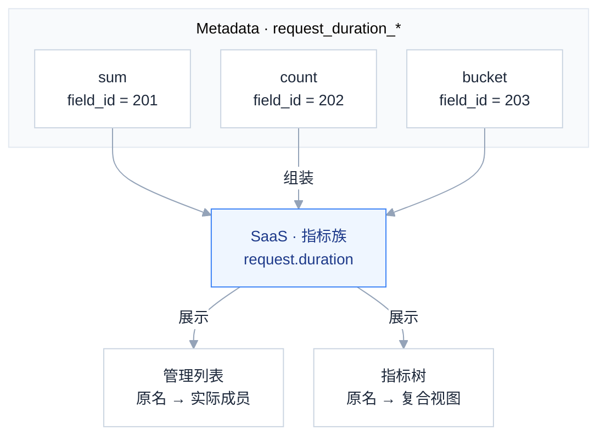
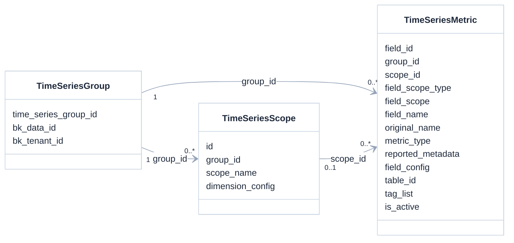
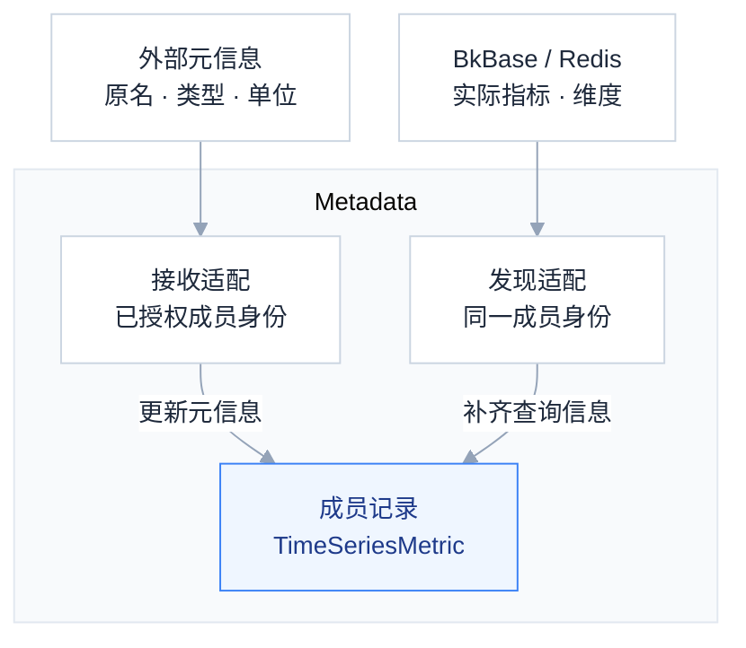
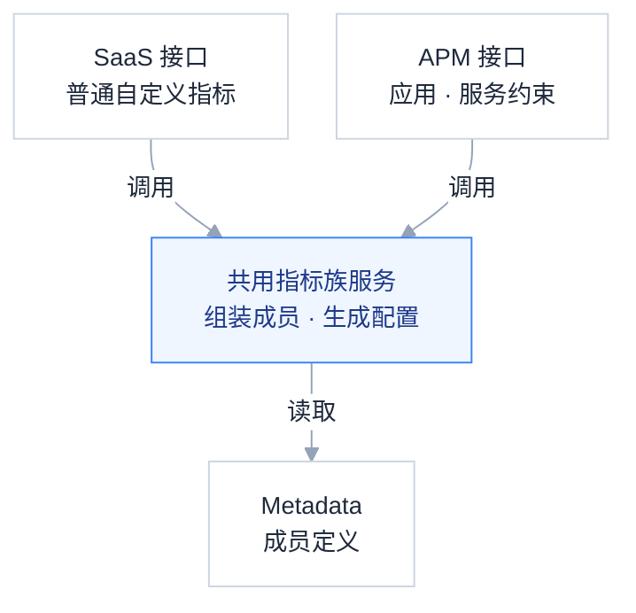
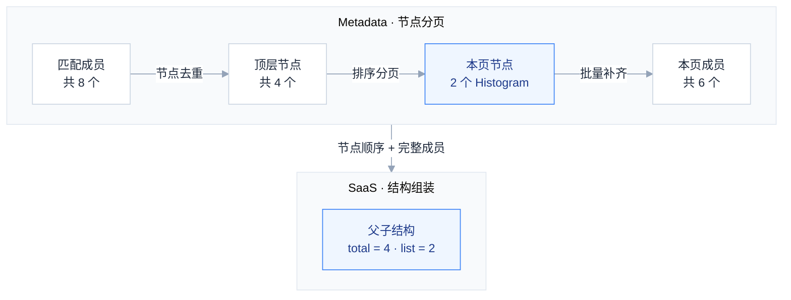
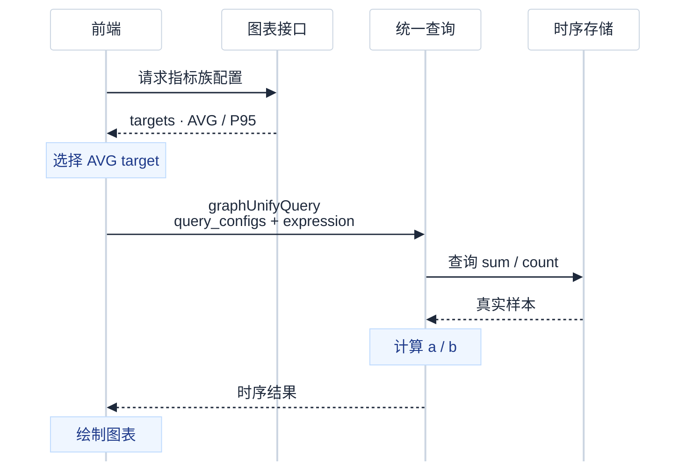
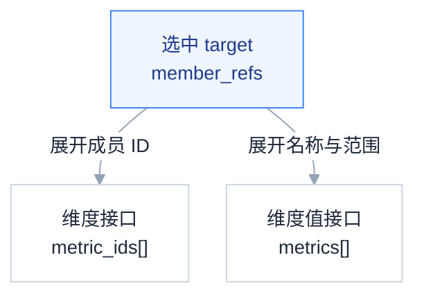

# 指标元信息存储与 SaaS/APM 自定义指标开发方案

## 0x01 架构设计

### a. 从实际成员到指标族

**按实际成员存储，按指标族展示，按实际成员查询。** 指标族是读取时生成的展示对象，不新增存储表。

以请求耗时 `request.duration` 为例，Histogram（直方图）拆成三个实际成员：sum 保存耗时总和，count 保存请求次数，bucket 保存各耗时上界内的请求次数。



- *[1] Metadata 保存成员定义，数值样本仍在现有时序存储中，图表通过统一查询读取样本并计算结果。*
- *[2] 一个 bucket 成员可以包含多个实例、多个 `le` 值的时序，成员行数不等于时序条数。*
- *[3] 本方案覆盖 Metadata、SaaS 与 APM，Collector 的采集和传输由[独立方案](../../../../knowledge/bkmonitor-datalink/issues/2026-09-15-collector-metric-metadata/PLAN.md)交付。*

### b. 存储对象与配置归属

`TimeSeriesGroup` 表示数据源，`TimeSeriesScope` 表示页面分组，`TimeSeriesMetric` 表示实际成员。



- *[1] 连线表示通过 ID 关联的模型关系，现有 group_id、scope_id 是整数列，不是数据库外键。*
- *[2] 成员元信息保存在 original_name、metric_type、reported_metadata，成员配置保存在 field_config，分组维度配置保存在 dimension_config。*

```text
成员身份：DataID + 范围类型 + 采集范围 + 实际名称
页面归属：scope_id

同名成员换采集范围 → 不同成员行，配置各自保存
同一成员换页面分组 → 原成员行不变，配置随成员保留
```

- *[1] 采集范围保存为 field_scope，页面分组保存为 scope_id，两者不是同一个概念。*
- *[2] 单成员的展示单位按“用户配置 → 上报单位 → 原有默认值”取值，是否覆盖按配置键是否存在判断。*
- *[3] 复合视图使用固定计算模板，不继承成员的聚合方法和查询函数。*

### c. 元信息接收与实际发现

元信息接收说明“指标是什么”。实际发现说明“哪些指标可以查询”，复用现有成员刷新入口，读取 BkBase 或 Redis 中的指标、维度记录。



```text
元信息先到：建立待发现成员 → 实际发现补齐查询信息 → 可参与绘图
实际发现先到：建立可查询成员 → 元信息补齐原名与类型 → 可按族展示
```

- *[1] 待发现成员不参与绘图，合并时保留成员 ID 与已有用户配置，禁用成员的恢复仍沿现有规则处理。*
- *[2] 元信息接收不改变活跃状态，所属范围的完整发现结果负责标记失活。*
- *[3] 元信息按接收处理顺序更新，输入没有源版本或源时间，不能保证取到源端最新值。*

### d. SaaS 与 APM 的协作



共用服务只做两件事：把实际成员组织成指标族，把指标族转换成查询配置。APM 复用这套逻辑，并保留应用授权、服务过滤及内置指标排除。

## 0x02 管理与分页

### a. 指标族的边界

```text
同一数据源
  └─ 同一采集范围（范围类型 + 范围值）
      └─ 同一页面分组
          └─ 同一原名、类型为 histogram
              └─ 一个指标族 → 多个实际成员
```

族键使用 `{scope_type, scope_name, name, group_scope_id}`，数据源由接口上下文确定。普通指标和缺少原名的旧成员仍使用 `field_id`。

```json
{
  "total": 1,
  "list": [{
    "kind": "family",
    "family_key": {"scope_type": "APM", "scope_name": "checkout-http", "name": "request.duration", "group_scope_id": 12},
    "name": "request.duration", "metric_type": "histogram", "metadata_source": "reported",
    "member_count": 3,
    "available_methods": ["AVG", "COUNT", "P95"], "unavailable_methods": [],
    "children": [
      {"field_id": 201, "metric_name": "request_duration_sum", "role": "sum"},
      {"field_id": 202, "metric_name": "request_duration_count", "role": "count"},
      {"field_id": 203, "metric_name": "request_duration_bucket", "role": "bucket"}
    ]
  }]
}
```

- *[1] 管理列表保留可编辑成员，图表只使用活跃且未隐藏、未禁用的成员。*
- *[2] 计算方法按自身依赖判断可用性，成员缺失只影响依赖该成员的方法，无可用方法时保留原始成员入口。*

```text
类型 histogram + 原名 request.duration
  → 候选名称：request.duration、request_duration
  → 实际名称 request_duration_sum
  → 匹配角色 sum
```

- *[1] 仅对 histogram 按原名或已支持的规范化名称匹配成员后缀，无法匹配时保留原始成员，usage 只保存默认查询汇聚操作。*

### b. 分页对象从成员变为节点

分页在 Metadata 完成；SaaS 只把本页成员组装成父子结构。示例包含两个三成员 Histogram 和两个普通指标，第 1 页选中两个 Histogram。



```text
搜索 request_duration_bucket
  → 命中 request.duration
  → 返回完整 sum / count / bucket

名称排序：节点名称 → 节点键
时间排序：完整成员的最大修改时间 → 节点名称 → 节点键
```

- *[1] 族节点名称取原名，普通节点名称取实际名称，首项按请求方向排序，其余项固定升序。*
- *[2] 名称搜索覆盖原名、实际名和别名，类型与页面分组按 AND 组合，total 与侧栏计数共用节点口径。*
- *[3] 计数、分页与补齐使用同一数据库快照，普通事务不自动保证该条件，跨请求翻页不冻结结果集。*
- *[4] 默认 flat 分支保持不变，page_size=-1 保留不分页语义，family 正数分页不加载全量成员。*

Metadata 的 family 响应为 `{total, page_keys, metrics}`。`page_keys` 确定父节点顺序，`metrics` 包含本页完整成员，前端分页器使用父节点总数。

### c. 父行操作与子行操作

```text
父行隐藏或禁用 → 展开为实际成员 → 同一事务批量修改
父行移动分组   → 展开为实际成员 → 沿现有规则校验并移动
子行修改配置   → 按 field_id 更新 → 保留独立配置
```

- *[1] 父行不批量设置单位或函数，同一成员在一次请求中不能重复操作。*
- *[2] 子成员被单独移走后，两侧按各自页面分组重新组族，原族只保留剩余成员支持的方法。*
- *[3] 数据自动创建的分组仍按现有规则限制移动，旧族链接在分组变化后重新校验，不能悄悄查询其他组。*

## 0x03 复合视图

### a. 配置生成与数据查询

图表接口返回计算配置，不返回数值。前端选中一个 target 后，统一查询执行其中的成员查询和表达式。



- *[1] 图中执行最终配置，首次打开时先完成下节的维度校验，再发起数值查询。*

以下展开 `groups[].panels[]` 中一个面板的 AVG、P95 配置。示例使用 delta 数据，查询周期为 `300s`，采集周期未知；接入上下文确认服务为 checkout、原始 scope 为 http。

```json
{
  "title": "request.duration",
  "sub_title": "checkout / http",
  "default_method": "AVG",
  "resolved_interval": 300,
  "family_key": {
    "scope_type": "APM",
    "scope_name": "checkout-http",
    "name": "request.duration",
    "group_scope_id": 12
  },
  "targets": [{
    "method": "AVG",
    "member_refs": [
      {"field_id": 201, "name": "request_duration_sum", "scope_name": "http"},
      {"field_id": 202, "name": "request_duration_count", "scope_name": "http"}
    ],
    "expression": "a / b",
    "alias": "平均耗时",
    "unit": "s",
    "metric": {"name": "request.duration", "alias": ""},
    "function": {},
    "query_configs": [{
      "metrics": [{"field": "request_duration_sum", "method": "SUM", "alias": "a"}],
      "interval": 300,
      "table": "2_bkmonitor_time_series_1001.__default__",
      "data_source_label": "custom",
      "data_type_label": "time_series",
      "group_by": ["method"],
      "where": [],
      "filter_dict": {"service_name": "checkout", "scope_name": "http"},
      "functions": []
    }, {
      "metrics": [{"field": "request_duration_count", "method": "SUM", "alias": "b"}],
      "interval": 300,
      "table": "2_bkmonitor_time_series_1001.__default__",
      "data_source_label": "custom",
      "data_type_label": "time_series",
      "group_by": ["method"],
      "where": [],
      "filter_dict": {"service_name": "checkout", "scope_name": "http"},
      "functions": []
    }]
  }, {
    "method": "P95",
    "member_refs": [
      {"field_id": 203, "name": "request_duration_bucket", "scope_name": "http"}
    ],
    "expression": "a",
    "alias": "P95 耗时",
    "unit": "s",
    "metric": {"name": "request.duration", "alias": ""},
    "function": {},
    "query_configs": [{
      "metrics": [{"field": "request_duration_bucket", "method": "SUM", "alias": "a"}],
      "interval": 300,
      "table": "2_bkmonitor_time_series_1001.__default__",
      "data_source_label": "custom",
      "data_type_label": "time_series",
      "group_by": ["method", "le"],
      "where": [],
      "filter_dict": {"service_name": "checkout", "scope_name": "http"},
      "functions": [
        {"id": "histogram_quantile", "params": [{"id": "scalar", "value": 0.95}]}
      ]
    }]
  }]
}
```

- *[1] method 表示可切换的计算方法，内部 metrics.method 保持 SUM，前端只执行选中的 target。*
- *[2] member_refs 只列数值依赖，P95 的单位来源成员不加入，前端无需按名称后缀猜成员。*
- *[3] family_key.scope_name 是采集范围，member_refs.scope_name 是维度值接口需要的原始标签值，由后端接入适配提供。*

### b. 维度与维度值



```text
选中 AVG → 传 sum、count → 可用维度取两成员交集
选中 P95 → 传 bucket    → 可用维度排除 le

多个面板：全局聚合与筛选使用各面板可用维度的交集
单个面板：下钻与拆图使用当前面板的可用维度
```

辅助接口保持原协议：维度接收 `metric_ids[]`，维度值接收 `metrics[{name, scope_name}]`、维度名和起止时间。维度值是候选并集，不保证表达式一定有配对样本。

```text
首次打开：获取初始配置 → 查询成员维度 → 恢复合法条件 → 获取最终配置 → 执行查询
切换方法：选择新 target → 查询成员维度 → 校验已有条件 → 更新配置与候选值
```

- *[1] 初始配置使用空聚合、空用户筛选且关闭 Top/Bottom，不执行数据查询，避免图表与维度互相等待。*
- *[2] APM 按同一应用、服务和原始 scope 分请求，再合并候选值，避免指标名称与 scope 交叉组合。*
- *[3] 普通 SaaS 的旧维度值实现不使用 scope_name，共享数据源的插件隔离仍需后端应用已有范围过滤，无法定位范围时不开放候选查询。*

### c. 计算口径

普通成员使用 usage 推荐汇聚：sum 不等于单调 Counter，delta 也可能表示点值，不能仅凭时间性推断 rate。

以下口径用于 Histogram，组合方法要求数值依赖的时间性一致。令 `G` 为聚合维度，`D` 为时间聚合：delta 对真实增量样本求和；cumulative 的 count/bucket 先逐时序执行 increase，再合并实例。

| 方法 | 数值依赖 | 表达式 | 展示单位 |
| --- | --- | --- | --- |
| `AVG` | `sum, count` | `sum(D(sum)) / sum(D(count))` | sum 的单位 |
| `SUM` | `sum` | `sum(D(sum))` | sum 的单位 |
| `COUNT` | `count` | `sum(D(count))` | 次数 |
| `P50 / P95 / P99` | `bucket` | `histogram_quantile(p, sum by(G,le)(D(bucket)))` | sum/min/max 的一致单位 |

- *[1] 前三项均按 G 聚合，Pxx 额外保留 le，单位来源必须同族且活跃可见。*
- *[2] 元信息没有非负性声明，不能对累计 sum 默认使用 increase，本方案不自动生成累计 AVG/SUM。*
- *[3] delta 使用既有 SUM 对应的直接时间聚合，不追加 sum_over_time 函数形成子查询，避免真实样本重复累计。*

查询周期由图表接口解析为秒数，前端使用返回的 `resolved_interval`。采集周期 `__interval` 按毫秒存储，参与窗口计算时除以 `1000`，null 不参与推导。

族视图关闭 Top/Bottom 并拒绝指标对比，时间对比沿用现有能力。

同一表达式的成员使用相同时间窗口、聚合维度、范围过滤和时间偏移。零分母、缺少有效桶产生的非有限值显示为空；任意中间桶缺失不能靠现有分位函数可靠识别，需在接入验收中核对。

## 0x04 开发改造

### a. 成员模型扩展

**改造对象是现有 `TimeSeriesMetric`：新增 4 列，复用已有列保存 11 个上报字段。** 一行仍表示一个实际成员，成员 ID、查询信息和用户配置继续保留，模型关系见 [存储对象与配置归属](#b-存储对象与配置归属)。

**（1）新增列**

范围类型、原名和类型需要参与身份判断或组族查询，使用独立列；描述、单位、时间性、采集周期和默认汇聚操作放入一个 JSON 列。

| 新增列                 | 类型               | 默认值       |
| ------------------- | ---------------- | --------- |
| `field_scope_type`  | `CharField(255)` | `DEFAULT` |
| `original_name`     | `CharField(255)` | `""`      |
| `metric_type`       | `CharField(16)`  | `unknown` |
| `reported_metadata` | `JSONField`      | `{}`      |

- *[1] 默认值用于兼容旧成员，原名为空、类型为 unknown 时仍按普通成员展示。*

**（2）输入字段落库**

11 个输入字段分别落到 3 个已有列、3 个新增列和 1 个新增 JSON 列。所有字段必须提供键，可空字段允许 null；接收入口校验后按成员身份整体更新。

```json
{
  "dataid": 1001,
  "__scope_type": "APM",
  "__scope": "checkout-http",
  "__name": "request.duration",
  "__metric": "request_duration_sum",
  "__description": "请求耗时",
  "__unit": "s",
  "__temporality": "delta",
  "__interval": null,
  "__type": "histogram",
  "__usage": "sum"
}
```

| 输入字段 | 类型 | 模型字段 | 约束 |
| --- | --- | --- | --- |
| `dataid` | int32 | `group_id` | 大于 0，经鉴权与租户校验后定位数据源 |
| `__scope_type` | string | `field_scope_type` | 预定义 APM／PLUGIN／DEFAULT，允许使用方扩展 |
| `__scope` | string | `field_scope` | Scope.Name 原样保存，允许空字符串 |
| `__metric` | string | `field_name` | 实际输出的单个指标名，不能为空 |
| `__name` | string | `original_name` | 拆分、规范化前的逻辑名，同族子项一致 |
| `__description` | string / null | `reported_metadata.description` | 原始描述，不生成猜测性说明 |
| `__unit` | string / null | `reported_metadata.unit` | 子项数值单位；未知为 null，无量纲为 `1` |
| `__temporality` | string | `reported_metadata.temporality` | 仅 `delta`／`cumulative` |
| `__interval` | int64 / null | `reported_metadata.interval` | 毫秒；已知时大于 0 |
| `__type` | string | `metric_type` | `sum`／`gauge`／`histogram`／`summary`／`counter`／`avg`／`unknown` |
| `__usage` | string / null | `reported_metadata.usage` | 默认查询汇聚操作：`sum`／`min`／`max`／`avg`／`last`；未知为 null |

- *[1] 除 dataid 映射外，各字段原样保存，包括大小写和 null，后续 null 覆盖旧元信息值，不清除用户配置。*
- *[2] scope_type 不设封闭枚举，扩展类型原样存储，范围查询须由对应接入适配提供过滤条件。*
- *[3] type 描述逻辑指标类型，unit、temporality、usage 描述实际子项，不要求同族子项取值相同。*

**（3）身份与索引**

同一数据源中，APM 与插件可能使用相同范围名和指标名，因此业务唯一键必须加入范围类型。物理主键仍为 field_id。

```text
物理主键：field_id                                               保留
业务唯一键：(group_id, field_scope, field_name)                    替换
         → (group_id, field_scope_type, field_scope, field_name)
族查询索引：(group_id, field_scope_type, field_scope, original_name) 新增
```

- *[1] 名称和范围区分大小写，接收入口按列长度拒绝超长值，不静默截断，迁移核对索引字节限制，不使用前缀唯一索引。*

### b. 接口增量

| 接口 | 请求增量 | 响应增量 |
| --- | --- | --- |
| `QueryTimeSeriesMetricResource` | `view` | 节点顺序、成员元信息与活跃状态 |
| `GetCustomTsFields` | `view`、`conditions[].key` | 父子节点 |
| `GetCustomTsMetricGroups` | `view` | 族节点、族视图能力标记 |
| `GetCustomTsGraphConfig` | `family_keys[]`、`agg_interval` | 族面板、方法与成员引用 |
| `ModifyCustomTsFields` | `family_updates[]`、`update_fields[].clear_config_fields` | 保持原结构 |
| `GetCustomTsMetricAggInfo` | — | — |
| `GetCustomTsDimensionValues` | — | — |

`view` 默认为 flat；family 分支按族返回，树接口和普通数据源详情均返回 `capabilities.metric_family`。`family_keys[]` 与非空 `metric_ids` 互斥，普通成员与族混选时分别请求图表配置后合并。

```json
{
  "family_updates": [{
    "family_key": {"scope_type": "APM", "scope_name": "checkout-http", "name": "request.duration", "group_scope_id": 12},
    "config": {"hidden": true}
  }]
}
```

- *[1] family_updates 的 config 只接受 hidden/disabled，移动使用 target_scope_id，子行清除配置通过 clear_config_fields 删除覆盖键。*
- *[2] scope_name、name 均为字符串，group_scope_id 为整数，agg_interval 为正整数秒或 auto，member_refs 的 field_id 为整数。*
- *[3] 图表入口与辅助入口均保留后端授权，member_refs 不是授权凭据，APM 应用和服务仍从现有请求上下文传入。*

### c. 代码落点

```text
bkmonitor/
├─ metadata/models/custom_report/time_series.py
│    调整成员唯一键、发现身份与待发现成员合并
├─ metadata/models/custom_report/metric_metadata.py（新增）
│    接收 11 字段元信息，按成员身份更新
├─ metadata/resources/resources.py
│    新增接收入口，调整节点分页及成员响应
├─ kernel_api/views/v3/meta.py、api/metadata/default.py
│    注册接收路由，透传分页结果、元信息与 is_active
├─ packages/monitor_web/custom_report/handlers/metric/
│    query.py 透传字段，family.py 组族，service.py 展开父行编辑
├─ packages/monitor_web/scene_view/resources/custom_metric.py
│    调整树与图表，扩展请求、响应序列化器
├─ apm/models/datasource.py、packages/apm_web/custom_metric/
│    调整范围映射、存量发现配置与应用约束
└─ webpack/.../metric-detail/components/view-main/
     调整父子行、方法选择、辅助查询与配置保存
```

- *[1] Metadata 当前未返回 is_active，必须连同 SaaS 转换对象一起透传，table_id 继续从授权数据源取得。*
- *[2] 图表当前会执行全部 targets 并改写内部聚合方法，family 分支改为只执行选中 target，同时保留内部 SUM。*
- *[3] 方法或时间变化后清理候选缓存，保存和检索跳转复制选中 target 的完整配置，URL 使用族键与选中方法。*

### d. 接入与迁移

元信息接收原样保存 Scope.Name。APM 发现与查询适配复用 [Collector 范围绑定](../../../../knowledge/bkmonitor-datalink/issues/2026-09-15-collector-metric-metadata/PLAN.md#b-范围绑定)的编码约定，不新增映射表。

```text
发现适配（Metadata）
  真实 service、scope → 分别编码后用连字符连接 → 保存 field_scope
  checkout、http-client → checkout-http%2Dclient

查询适配（SaaS/APM）
  授权服务 checkout + field_scope=checkout-http%2Dclient
  → 匹配编码后的服务前缀 checkout- → 解码剩余部分 http%2Dclient
  → 生成 service_name=checkout、scope_name=http-client 过滤
```

- *[1] 当前发现函数使用另一套维度拼接，新增 APM 身份分支必须改为上述约定，元信息接收仍原样保存范围。*
- *[2] 编码先将百分号转为 %25，再将连字符转为 %2D，查询只解码一次，存储值不解码或重新编码。*
- *[3] 旧数据不能确定来源编码时保持旧身份分支，不能仅凭字符串形状执行新身份迁移或元信息合并。*
- *[4] APM 增加服务与 scope 双维度发现，并更新已有结果表配置，只有新建入口变更不足以覆盖存量。*

DEFAULT 的新发现身份使用接入方选定的 Scope.Name，空字符串不替换为 default。旧 default 成员仅在来源范围确定时迁移，避免与显式空范围形成重复成员。

```text
旧成员可唯一对应新范围 → 原位迁移，保留成员 ID 和用户配置
旧成员混有多个服务     → 保留旧成员，新范围由实际发现创建
只有独立维度枚举       → 保持旧成员，不用笛卡尔积构造范围
```

发布顺序：增加字段 → 升级身份与发现 → 校验并替换唯一键 → 开启元信息接收 → 验证数值 → 开启族视图。

- *[1] 切换唯一键时停止旧写入，实际发现只刷新所属身份范围，不能使保留的旧成员失活。*
- *[2] 回退关闭接收与族入口，保留新身份读取能力，已产生跨类型同名成员后不能直接恢复旧唯一键。*

## 0x05 验收

| 场景 | 输入 | 预期 |
| --- | --- | --- |
| 元信息存储 | 已确认的 11 字段记录 | 原值入库，null 保留，用户配置不变 |
| 必填与可空 | 缺少 description、description=null | 前者拒绝，后者覆盖旧描述 |
| 类型与范围 | DataID=0、interval=0、temporality=unknown、usage=count | 均拒绝，不写入该条元信息 |
| 扩展与单位 | 扩展 scope_type、unit=null、unit="1" | 扩展类型保留，未知单位与无量纲分别保存 |
| 到达顺序 | 元信息先到、实际发现先到 | 两种顺序定位同一成员，待发现成员补齐后激活 |
| 父节点分页 | 两个三成员族与两个普通成员 | total 为 4，页长 2 返回两父节点及其完整成员 |
| 成员搜索 | 搜索 request_duration_bucket | 返回 request.duration 及完整三个成员 |
| 辅助接口 | AVG 与 P95 切换 | 使用对应实际成员，维度、候选缓存同步变化 |
| 范围隔离 | 同名成员分属不同服务或插件 | 元信息、配置与候选值不跨范围合并 |
| 平均值 | delta sum=[0.3,0.9]、count=[2,3] | AVG=0.24，真实样本只累计一次 |
| 累计与分位 | 多实例重启、不同桶边界 | 先逐时序处理重置，再合并实例，异常结果不补零 |
| 旧功能 | 成员链接、分组编辑、保存与检索跳转 | 旧分支可用，族配置保持内部运算与完整身份 |

- *[1] 性能验收检查数据库节点分页与批量取成员，数值验收必须走实际存储路径，配置 JSON 正确不能替代结果验证。*
- *[2] 本次交付开发方案，业务代码测试尚未执行。*

## 0x06 实施进展

| 时间 | 结论性进展 |
| --- | --- |
| `2026-09-15 10:00` | 围绕成员存储、父节点展示与实际查询重建架构，完成模型、分页及接口链路代码回查。 |

## 0x07 参考与版本锚点

### a. 代码依据

| 来源 | 核查内容 |
| --- | --- |
| [<源码> bk-monitor/bkmonitor/metadata/models/custom_report/time_series.py](https://github.com/TencentBlueKing/bk-monitor/blob/798e996354/bkmonitor/metadata/models/custom_report/time_series.py#L1861) | 指标身份和配置 |
| [<源码> bk-monitor/bkmonitor/metadata/models/custom_report/time_series.py](https://github.com/TencentBlueKing/bk-monitor/blob/798e996354/bkmonitor/metadata/models/custom_report/time_series.py#L2167) | 活跃状态与增量入口边界 |
| [<源码> bk-monitor/bkmonitor/packages/monitor_web/custom_report/resources/metric.py](https://github.com/TencentBlueKing/bk-monitor/blob/798e996354/bkmonitor/packages/monitor_web/custom_report/resources/metric.py#L747) | 管理列表和编辑 |
| [<源码> bk-monitor/bkmonitor/packages/monitor_web/scene_view/resources/custom_metric.py](https://github.com/TencentBlueKing/bk-monitor/blob/798e996354/bkmonitor/packages/monitor_web/scene_view/resources/custom_metric.py#L364) | 图表协议、序列发现与多 target |
| [<源码> bk-monitor/bkmonitor/packages/apm_web/custom_metric/resources.py](https://github.com/TencentBlueKing/bk-monitor/blob/798e996354/bkmonitor/packages/apm_web/custom_metric/resources.py#L35) | SaaS 继承与内置指标过滤 |
| [<源码> bk-monitor/bkmonitor/bkmonitor/data_source/data_source/__init__.py](https://github.com/TencentBlueKing/bk-monitor/blob/798e996354/bkmonitor/bkmonitor/data_source/data_source/__init__.py#L1095) | 时间聚合与空间聚合分离 |
| [<源码> bk-monitor/bkmonitor/apm/models/datasource.py](https://github.com/TencentBlueKing/bk-monitor/blob/798e996354/bkmonitor/apm/models/datasource.py#L358) | 当前单 scope 默认与存量结果表提前返回 |
| [<源码> bk-monitor/bkmonitor/webpack/src/monitor-pc/pages/custom-escalation/metric-detail/components/view-main/components/panel-chart-view/components/layout-chart-table/components/metric-chart/index.tsx](https://github.com/TencentBlueKing/bk-monitor/blob/798e996354/bkmonitor/webpack/src/monitor-pc/pages/custom-escalation/metric-detail/components/view-main/components/panel-chart-view/components/layout-chart-table/components/metric-chart/index.tsx#L539) | family target 选择、保存与窗口改造 |
| [<源码> bk-monitor/bkmonitor/metadata/resources/resources.py](https://github.com/TencentBlueKing/bk-monitor/blob/798e996354/bkmonitor/metadata/resources/resources.py#L1699) | 成员分页与响应字段 |
| [<源码> bk-monitor/bkmonitor/metadata/models/custom_report/time_series.py](https://github.com/TencentBlueKing/bk-monitor/blob/798e996354/bkmonitor/metadata/models/custom_report/time_series.py#L730) | 实际成员刷新入口 |
| [<源码> bk-monitor/bkmonitor/webpack/src/monitor-api/modules/grafana.js](https://github.com/TencentBlueKing/bk-monitor/blob/798e996354/bkmonitor/webpack/src/monitor-api/modules/grafana.js#L38) | 统一查询请求入口 |

### b. 写作参考

- [APM 共享数据源](../../../../knowledge/bkmonitor/issues/2026-03-03-apm-shared-datasource/PLAN.md)：先说明对象关系，再展开开发改造。
- [APM 应用级配置](../../../../knowledge/bkmonitor/issues/2026-03-04-apm-app-level-config/PLAN.md)：分清存储对象与读取视角。
- [Collector 自适应限流](../../../../knowledge/bkmonitor-datalink/issues/2026-06-10-collector-adaptive-throttling/PLAN.md)：用协作图表达主流程。

### c. 版本锚点

| 状态 | 分支 | 里程碑 | PR |
| --- | --- | --- | --- |
| 🔄 | `<branch_name>` | Metadata 模型、成员身份与元信息接收 | 待创建 |
| 🔄 | `<branch_name>` | SaaS/APM 指标族展示与复合查询 | 待创建 |
