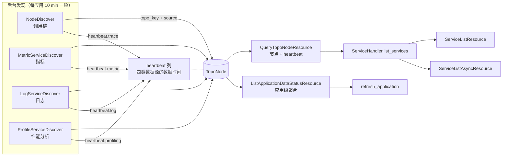
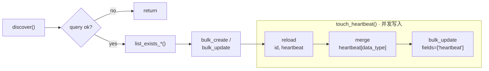

# APM 服务数据状态下沉到后台服务发现 —— 实施方案

## 0x01 调研与约束

### a. 请求侧状态重算

`apm_web.metric.resources.ServiceListAsyncResource._get_data_status_mapping` 先枚举服务全集，再逐类判定状态，全部在请求线程内完成。

| 数据类型 | `NORMAL` 判据 | 查询载体 |
| --- | --- | --- |
| 指标 | `bk_apm_count` 四路分组结果中存在服务键 | UnifyQuery × `4` |
| 日志 | 关联索引集不含 `NO_DATA` 标签，或 APM 日志表聚合命中服务名 *[1]* | 索引集元数据 + `es_query_dsl` × `2` |
| 调用链 | Flow 指标出现该服务作为调用方或被调方 | UnifyQuery × `1` |
| 性能分析 | `ProfileService.last_check_time > 窗口起点 - 10 min` | `apm_api.query_profile_services_detail` |

- *[1] 日志标签与 APM 状态的关系见「日志标签与服务状态」。*

### b. 慢 Trace 耗时构成

| 子调用（按发生顺序）                      |        耗时 | 用途                                            |
| ------------------------------- | --------: | --------------------------------------------- |
| `QueryTopoNodeResource`         |  `401 ms` | 服务全集：拓扑节点                                     |
| `QueryProfileServicesDetail`    |  `404 ms` | 服务全集：性能分析独有服务                                 |
| `GraphUnifyQueryResource` × `4` | `1211 ms` | 指标状态：`bk_apm_count` 四路分组                      |
| `DetailApplicationResource`     |  `162 ms` | 读日志数据源配置                                      |
| `ESQueryDslResource` × `2`      | `1607 ms` | 日志状态：两个服务名字段的 terms 聚合                        |
| `unify_query`                   |  `314 ms` | 调用链状态：`apm_service_to_apm_service_flow_count` |
| `QueryProfileServicesDetail`    |  `962 ms` | 性能分析状态：带 `last_check_time__gt` 过滤             |

- *[1] 样本：Trace `aa9a057ba090042a43eeb6012be6e024`，`data_status` 缓存未命中；入口耗时 `5.235 s`，资源内部 `5.149 s`，`19` 个直接子 Span 连续执行。*
- *[2] ES 两次聚合并行，表中 `1607 ms` 为墙钟耗时，非执行时间之和；ES 执行耗时分别为 `1279 ms`、`1317 ms`。*
- *[3] 服务全集重复枚举 `2` 次，性能分析接口分别用于服务枚举和状态判定。*

### c. 后台发现现状

调度入口均位于 `apm.task.tasks`，发现器由 `apm.apps.ApmApiConfig.ready` 注册。

| 数据源  | 发现器                                                 | 调度入口与周期                                                              | 写入对象                                              | 时间语义           |
| ---- | --------------------------------------------------- | -------------------------------------------------------------------- | ------------------------------------------------- | -------------- |
| 调用链  | `apm.core.discover.node.NodeDiscover` 等 `7` 个       | [a] `topo_discover_cron`<br />[b] 每分钟分片，单应用每 `10 min` 一轮 *[1]*       | `TopoNode`：合并 `source=["trace"]`，刷新 `updated_at`  | 节点更新时间，未记录数据时间 |
| 指标   | `apm.core.discover.metric.service.ServiceDiscover`  | [a] `datasource_discover_cron`<br />[b] 每分钟分片，单应用每 `10 min` 一轮 *[2]* | `TopoNode`：合并 `source=["metric"]`，刷新 `updated_at` | 节点更新时间，未记录数据时间 |
| 性能分析 | `apm.core.discover.profile.service.ServiceDiscover` | [a] `profile_discover_cron`<br />[b] 每 `10 min` 一轮，应用间串行执行           | `ProfileService`：刷新 `last_check_time`             | 发现样本的检查窗口结束时间  |
| 日志   | 无                                                   | 无                                                                    | 无                                                 | 无              |

- *[1] 新建应用每 `2 min` 一轮，eBPF 应用不参与调用链发现。*
- *[2] 指标发现包含 eBPF 应用，按 `200 s` 切分子窗口；起点误用当前时间，窗口指向未来，修正方案见「指标心跳」。*
- *[3] `TopoNode.updated_at` 由多个发现器共用，无法表达各数据类型的更新时间。*
- *[4] `apm.core.discover.cached_mixin.CachedDiscoverMixin` 的 Redis 心跳只用于对象回收，不区分数据类型，也不覆盖 `TopoNode`、`ProfileService`，不能用于服务状态判定。*

### d. 日志标签与服务状态

| 维度 | 日志平台 `NO_DATA` 标签 | APM 服务数据状态（心跳方案） |
| --- | --- | --- |
| 含义 | 整个索引集无数据 | 每个服务、每类数据的 `NORMAL` / `NO_DATA` / `DISABLED` 三态 |
| 用途 | 索引集选择器“隐藏无数据”（`tag_id=4`）、APM 关联日志判定 | 服务列表四类状态列与筛选项 |
| 判据窗口 | 近 `1` 天 | 无数据周期（默认 `10 min`）+ 一个发现周期 *[1]* |
| 刷新周期 | `15 min` *[2]* | 随发现调度，通常 `10 min` |
| 覆盖范围 | 近 `1` 天有人检索过的空间下的有效索引集 | 应用服务全集，受各数据源发现范围约束 |
| 缺省表现 | 缺少该标签不代表已确认有数据 | 模块开启但无有效心跳时返回 `NO_DATA` 并打点 *[1]* |

- *[1] 日志模块开启时，自身日志心跳有效或服务级关联索引可用，任一条件成立即为 `NORMAL`；心跳改造保留关联索引的标签判据。*
- *[2] 标签检查入口为 `apps.log_search.tasks.no_data.no_data_check`，查询异常也按无数据处理。*

## 0x02 架构设计

### a. 架构命题

把「服务是否有数据」从请求时重新证明改为发现时记录事实：每个 telemetry 发现器在写服务拓扑的同时落盘本数据源的服务级数据心跳，服务拓扑查询接口一次返回服务全集与四类心跳，SaaS 只保留心跳到三态的纯映射。

### b. 复杂度来源与收敛点

复杂度来自发现链路与状态链路对同一事实做了两次独立计算：

- 发现器从窗口数据里已经知道哪些服务有数据，却只留下一个被 `auto_now` 覆盖、且被两个发现器共享的 `updated_at`。
- 状态链路只能用另一套查询（四路 `bk_apm_count`、Flow 指标、ES 聚合、`ProfileService` 表）重新证明同一件事。
- 服务全集来自拓扑与性能分析两条链路，状态映射的键不能代表服务全集，接口只能先等全集再算状态。

收敛点是服务数据心跳：按「服务 × 数据类型」记录数据时间的后台事实，由四个发现器各写一类、由拓扑查询接口统一读出。

局部补丁解决不了这个问题。把日志聚合改成缓存判断只消除一项开销，指标四路、Flow 指标和性能分析仍留在请求线程，服务全集仍要枚举两次。

### c. 核心对象模型



`TopoNode` 同时承载服务全集与数据心跳，两件事由不同字段表达：

| 字段 | 回答的问题 | 写入方 |
| --- | --- | --- |
| `topo_key` + `source` | 这个应用有哪些服务，各自被谁发现 | 四个发现器共同维护 |
| `heartbeat` | 每个服务的每类数据最后何时出现 | 每个发现器只改自己数据类型对应的子键 |

- *[1] 节点超过 `EXPIRED_DAYS`（`180` 天）未更新即删除，心跳随节点回收。*
- *[2] 性能分析服务须先并入 `TopoNode`，四类心跳才能共用节点；服务全集由拓扑节点与 SaaS 手动自定义服务组成，`QueryProfileServicesDetail` 退出服务列表链路。*
- *[3] 无心跳的服务仍保留在列表中，不能用心跳的键集合代替服务全集。*

### d. 心跳协议

`TopoNode.heartbeat` 分别记录四类数据最后出现的时间和最近一次检查成功的时间：

```json
{
  "trace":     {"last_data_at": 1789530180, "checked_at": 1789530200},
  "metric":    {"last_data_at": 1789530120, "checked_at": 1789530200},
  "log":       {"last_data_at": null,       "checked_at": 1789530200},
  "profiling": {"last_data_at": null,       "checked_at": null}
}
```

| 字段 | 类型 | 说明 |
| --- | --- | --- |
| `<data_type>` | `object` | 每个发现器只更新自己负责的类型，保留其他类型的值 *[1]* |
| `<data_type>.last_data_at` | `int \| null` | 最后有数据的时间（秒），新旧时间取较大值，未发现数据时保留旧值 |
| `<data_type>.checked_at` | `int \| null` | 最近一次检查成功的时间（秒），未检查时为空，检查失败时保留旧值 |

| 读取条件                                                    | 返回值           |
| ------------------------------------------------------- | ------------- |
| 子键缺失，或 `checked_at` 为空、距今超过 `2` 个发现周期                   | `NO_DATA` 并打点 |
| `checked_at` 未超时，且 `last_data_at >= now - 无数据周期 - 发现周期` | `NORMAL`      |
| `checked_at` 未超时，但 `last_data_at` 早于上述时间或为空             | `NO_DATA`     |

- *[1] 写入前读取 `heartbeat`，合并后通过 `bulk_update` 只更新该列，不改 `updated_at`，节点仍按拓扑更新时间回收。*
- *[2] 调用链与指标、日志按 `app_id % 10 == minute % 10` 在同一分钟派发，后写入的旧快照可能覆盖另一类刚写入的值。*
- *[3] 读取安排在写入前，以减少并发覆盖的机会；状态判断多留一个发现周期，允许心跳落后一轮，但不能保证并发更新不丢失。*
- *[4] 心跳只由后台发现器更新，页面查询不更新心跳时间。*

### e. 数据时间取值口径

| 数据源  | 取值方式                                       | 精度       | 额外查询成本            |
| ---- | ------------------------------------------ | -------- | ----------------- |
| 调用链  | 取本轮命中 Span 的最大 `end_time`                  | Span 级   | 无，发现器已持有原始 Span   |
| 指标   | PromQL 按 `60 s` 步长返回 `_time` 序列，取值非空的最大时间戳 | `1 min`  | 无，仅调整现有查询的 `step` |
| 日志   | terms 聚合下挂 `max(time)` 子聚合                 | 秒级       | 无，与服务名发现同一次查询     |
| 性能分析 | 沿用 `last_check_time`，即本轮检查窗口的结束时间          | `10 min` | 无                 |

四类心跳统一按「无数据周期 + 一个发现周期」判定新鲜，与性能分析现有的「再前探 `10 min`」口径一致。指标、调用链、日志三类由实时查询改为读心跳后，服务从有数据变为无数据的判定会晚一个发现周期，这是下沉带来的固有延迟，需要在验收里对照确认。

### f. 状态映射协议

服务级状态由 SaaS 做纯映射，不再发起任何远程查询：

```text
service_status(service, data_type):
    if not application.is_enabled_{data_type}:      -> DISABLED
    if data_type == log:
        if heartbeat_fresh(service, log):            -> NORMAL
        if related_index_available(service):         -> NORMAL
        -> NO_DATA
    if heartbeat_fresh(service, data_type):          -> NORMAL
    -> NO_DATA

heartbeat_fresh(service, data_type):
    last_data_at >= now - no_data_period - discover_interval
```

日志是唯一的双来源状态。心跳只覆盖 APM 自身管理的日志结果表，关联索引的可用性由 SaaS 读 `LogServiceRelation` 后比对索引集元数据得出，全程不发起 ES 聚合。

应用级状态按「任一服务有数据」聚合：

```text
application_status(data_type):
    if not is_enabled_{data_type}:                   -> DISABLED
    if exists service where heartbeat_fresh(service, data_type): -> NORMAL
    -> NO_DATA
```

## 0x03 开发方案 —— 后台心跳生产

### a. 模型与统一写入口

`apm.models.topo.TopoNode` 新增：

- `heartbeat`：`models.JSONField`，默认 `{}`，字段含义见「心跳协议」。
- `touch_heartbeat(...)`：四个发现器共用的写入方法。

```text
touch_heartbeat(
    bk_biz_id: int, app_name: str, data_type: str,
    last_data_at_mapping: dict[str, int | None],  # topo_key -> 本轮最大数据时间
    checked_at: int,                             # 本轮检查成功完成的时间
) -> None
```



- *[1] `list_exists_*()` 指 `apm.core.discover.metric.service.ServiceDiscover.list_exists_mapping` 与 `apm.core.discover.node.NodeDiscover.list_exists`，写心跳前须重新读取，不能复用节点发现时的快照。*
- *[2] `last_data_at_mapping` 的键表示本轮检查覆盖的服务，值为 `None` 时保留旧数据时间，只更新检查时间；这些服务的节点须在写心跳前创建完成。*

### b. 调用链心跳

**[Change]** `apm.core.discover.node.NodeDiscover.discover`：按 `topo_key` 汇总 Span 的最大 `end_time`，节点写入后调用 `touch_heartbeat`，写入 `trace` 心跳。

- *[1] `apm.core.discover.base.TopoHandler.discover` 可分多轮调用发现器，每轮以完成时间作为 `checked_at`，数据时间按「心跳协议」合并。*

### c. 指标心跳

| 变更点                                                                              | 修改内容                                                     |
| -------------------------------------------------------------------------------- | -------------------------------------------------------- |
| **[Change]** `apm.task.tasks.datasource_discover_cron`                           | 下发 `start_time = now - interval * 60`，子窗口覆盖已发生的 `10 min` |
| **[Change]** `apm.core.discover.metric.service.ServiceDiscover.query_dimensions` | `step` 改为 `60 s`，保留 `_time` 序列，提取值非空的最大时间戳               |
| **[Add]** `apm.core.discover.metric.service.ServiceDiscover` 状态查询                | 按 `bk_apm_count` 四路分组取数，写入 `metric` 心跳 *[1]*             |

| 分组维度 | 服务键 |
| --- | --- |
| `service_name` | `{service_name}` |
| `service_name, db_system` | `{service_name}-{db_system}` |
| `service_name, messaging_system` | `{service_name}-{messaging_system}` |
| `peer_service` | `http:{peer_service}` |

- *[1] 服务键沿用 `apm_web.handlers.service_handler.ServiceHandler._combine_metric_data`，覆盖普通服务、组件与自定义服务。*
- *[2] 保留 `count by (service_name, rpc_system)`：它负责从全部自定义指标中发现服务和标记 RPC，四路状态查询只检查 `bk_apm_count`，两者不能合并。*

### d. 日志服务发现

| 变更点 | 修改内容 |
| --- | --- |
| **[Add]** `apm.core.discover.log.base.Discover` | 持有 `LogDataSource`，构造参数与指标发现器一致 |
| **[Add]** `apm.core.discover.log.service.ServiceDiscover` | 聚合服务名和最后数据时间，写入 `TopoNode`，合并 `source=["log"]` 并写入心跳 |
| **[Add]** `apm.apps.ApmApiConfig.ready` 注册 | `DiscoverContainer.register(TelemetryDataType.LOG.value, LogServiceDiscover)` |
| **[Change]** `apm.task.tasks.datasource_discover_cron` | 遍历 `MetricDataSource` 与 `LogDataSource`，按数据类型派发 |
| **[Change]** `apm.task.tasks.datasource_discover_handler` | 数据源参数改为 `(数据类型, 数据源)`，由发现器决定窗口切分方式 |

```text
aggs.service_names = terms(field=<resource.service.name | resource.server>, size=1000)
aggs.service_names.aggs.last_data_at = max(field=time)
```

- *[1] 仅查询 APM 的 `LogDataSource`，索引名由 `result_table_id` 中的 `-`、`.` 替换为 `_` 后追加 `*`，不查询服务关联索引。*
- *[2] 两个服务名字段分别聚合，结果按服务名合并，数据时间取较大值；`size=1000` 避免 ES 默认只返回 `10` 个桶。*

### e. 性能分析心跳

| 变更点 | 修改内容 |
| --- | --- |
| **[Change]** `apm.core.discover.profile.service.ServiceDiscover._upsert` | 保留 `ProfileService.last_check_time`，同时写入 `profiling` 心跳 |
| **[Add]** `apm.core.discover.profile.service.ServiceDiscover` 拓扑写入 | 创建或更新 `TopoNode`，合并 `source=["profiling"]`，设置 `extra_data.kind=profiling` |
| **[Change]** `apm.task.tasks.profile_discover_cron` | 过滤未开启性能分析的应用，通过 `profile_handler.delay()` 派发任务 *[1]* |

- *[1] 现有任务逐应用同步执行，异步派发须与拓扑写入一同上线，避免新增写入延长整轮耗时。*

## 0x04 开发方案 —— 读取协议

### a. 服务粒度读取

**[Change]** `apm.resources.QueryTopoNodeResource`：在节点响应中补充 `source` 与 `heartbeat`。

```json
{
  "topo_key": "activity-microservices.msgcenter",
  "extra_data": {"category": "http", "kind": "service"},
  "source": ["trace", "metric"],
  "heartbeat": {
    "trace":     {"last_data_at": 1789530180, "checked_at": 1789530200},
    "metric":    {"last_data_at": 1789530120, "checked_at": 1789530200},
    "log":       {"last_data_at": null,       "checked_at": 1789530200}
  }
}
```

- *[1] 心跳随节点一同读取，不增加查询；字段为空或缺失的处理见「心跳协议」。*

### b. 应用粒度读取

**[Add]** `apm.resources.ListApplicationDataStatusResource`：按业务批量返回服务数与各类最新心跳，供周期任务和应用列表使用。

```text
入参: bk_biz_id: int, app_names: list[str] | None
出参: {app_name: {"service_count": int,
                  "heartbeat": {data_type: {"last_data_at": ts | null, "checked_at": ts | null}}}}
```

- *[1] 按应用读取节点，在内存中取各类最大的 `last_data_at`，不查询远程存储；容量估算按单业务万级以内节点计算。*

### c. 服务全集

**[Change]** `apm_web.handlers.service_handler.ServiceHandler.list_services`：

- 返回拓扑节点与手动自定义服务，附带映射后的 `data_status`。
- 应用关闭性能分析时，过滤 `source == ["profiling"]` 的节点。
- 移除 `query_profile_services_detail` 调用，合并函数列入「旧对象清理」。

## 0x05 开发方案 —— SaaS 状态映射与旧链路下线

### a. 服务状态

| 变更点 | 修改内容 |
| --- | --- |
| **[Add]** `apm_web.handlers.service_handler.ServiceHandler.build_service_data_status(app, nodes)` | 按「状态映射协议」生成三态，不发起远程查询 |
| **[Add]** `apm_web.handlers.log_handler.ServiceLogHandler.list_available_related_services(app)` | 读取 `LogServiceRelation` 与索引集元数据缓存，返回关联索引可用的服务集合 *[1]* |
| **[Change]** `apm_web.metric.resources.ServiceListAsyncResource._get_data_status_mapping` | 使用 `list_services` 返回的状态，替换请求侧重算 |
| **[Keep]** `apm_web.metric.resources.ServiceListResource` | 同步状态列及 `StatisticsApplyModule`、`StatisticsHaveData` 的筛选规则不变，输入换为心跳映射结果 |

| 日志来源 | 处理 |
| --- | --- |
| 服务级手动关联（`is_global=False`） | 保留标签判定 |
| 应用级全局关联（`is_global=True`） | 不参与状态判定 |
| K8S 关系缓存 | 不参与状态判定，仅用于关联索引列表 |
| APM 自身日志结果表 | ES 聚合改为后台心跳 |

- *[1] 用标签名替代 `tag_id != 4`，遍历全部匹配索引集，空标签不判为可用。*
- *[2] 标签缺少 `NO_DATA` 仍不能证明索引集经过检查，产品说明需保留「日志标签与服务状态」中的口径差异。*

### b. 应用状态与服务数量

| 变更点                                                                                     | 修改内容                                                    |
| --------------------------------------------------------------------------------------- | ------------------------------------------------------- |
| **[Change]** `apm_web.models.application.Application.set_data_status`                   | 读取 `ListApplicationDataStatusResource`，按「任一服务有数据」写入四类状态 |
| **[Change]** `apm_web.models.application.Application.set_service_count_and_data_status` | 仅写服务数量，移除服务状态缓存写入                                       |
| **[Change]** `apm_web.tasks.refresh_application`                                        | 按业务批量调用应用接口                                             |
| **[Keep]** `apm_web.models.application.Application` 状态字段                                | 保留 `{trace,profiling,metric,log}_data_status` 字段名和三态取值  |
| **[Keep]** `apm_web.metric.resources.ServiceListResource` 数量回写                          | 请求侧继续更新 `service_count`                                 |

### c. 请求侧状态检查

| 入口 | 修改内容 |
| --- | --- |
| `apm_web.handlers.application_handler.ApplicationHandler.have_data` | 改读应用状态，移除 `RequestCountInstance` 查询 |
| `apm_web.meta.resources.ApplicationInfoByAppNameResource` | 删除 `have_data()` 覆盖逻辑，直接返回库内 `trace_data_status` *[1]* |
| `apm_web.metric.resources.ApdexQueryResource`、`AlertQueryResource` | 删除 `have_data()` 前置检查，无数据时由主查询返回空序列 |
| `apm_web.service.resources.ServiceInfoResource.get_profiling_info` | `is_profiling_data_normal` 改读服务的 `heartbeat.profiling`，移除仅用于判断有无数据的 Doris `count(*)` |
| `apm_web.profile.resources.ListApplicationServicesResource` | `normal` / `no_data` 分类改读应用级 profiling 状态，服务明细仍按需查询 |

- *[1] 此接口原先按传入时间窗覆盖状态，改造后返回应用当前状态；慢 Trace `8bfa95a9cf8553981b0105f1e89f2064`（`pvpesport.battle`）在原路径耗时约 `12.8 s`，最终报 VM 并发超限。*
- *[2] `apm_web.metric_handler.RequestCountInstance` 继续用于请求量列和图表，仅移除用于生成状态值的调用。*

### d. 旧对象清理

| 删除对象 | 原用途 |
| --- | --- |
| `apm_web.handlers.service_handler.ServiceHandler.get_service_data_status_mapping` | 重算服务级状态 |
| `apm_web.handlers.log_handler.ServiceLogHandler.get_log_count_mapping` | 供上述方法计算日志状态 |
| `apm_web.handlers.log_handler.ServiceLogHandler.get_label_values_in_table` | 供上述日志方法聚合服务名 |
| `apm_web.constants.ApmCacheKey.APP_SERVICE_STATUS_KEY` | 缓存服务状态 *[1]* |
| `apm_web.handlers.service_handler.ServiceHandler._combine_profile_trace_service` | 合并拓扑与性能分析服务 |
| `apm_web.models.application.Application.doc_count` | 按 `es_retention` 查询请求量，无调用方 |
| `apm_web.metrics` 的 `SERVICE_DATA_STATUS`、`REMOTE_SERVICE_DATA_STATUS`、`COMPONENT_DATA_STATUS` | 以请求量判断状态的遗留模板，无调用方 |

- *[1] 周期任务写入该缓存时未传 `timeout`，模块启停和无数据周期变更也不触发失效。*

### e. 保留的查询

| 入口 | 用途 |
| --- | --- |
| `apm_web.meta.resources.DataStatusResource` | 按用户指定时间窗检查数据量 |
| `apm_web.meta.resources.StorageInfoResource`、`StorageStatusResource` | 展示存储配置与健康度 |
| `apm_web.profile.doris.querier.QueryTemplate.get_sample_info` | 返回查询窗口内真实的 `last_report_time` |
| `apm_web.handlers.service_handler.ServiceHandler.get_service_metric_range_mapping` | 查询调用次数、错误率、平均耗时 |
| `apm_web.metric_handler.ServiceFlowCount` | 查询服务拓扑与调用关系 |
| `apm_web.handlers.backend_data_handler.telemetry_handler_registry(...).get_data_count` | 数据接入检查与存储状态展示 |
| `api.apm_api.query_profile_services_detail` | 性能分析页面的服务明细 |

### f. 应用状态消费方

以下入口继续使用 `Application.*_data_status`，调用方式不变。

| 用途 | 入口 |
| --- | --- |
| 有数据应用优先排序 | `apm_web.meta.resources.ListApplicationResource` |
| 应用列表与详情响应 | `apm_web.meta.resources` 的 `CreateApplicationResource`、`ListApplicationInfoResource`、`ApplicationInfoResource`、`ListApplicationResource` |
| 数据源启停时改写状态 | `apm_web.meta.resources.StartResource`、`StopResource` |
| 每日状态快照 | `apm_web.tasks.refresh_apm_app_state_snapshot` *[1]* |
| 周同比分析 | `apm_web.management.commands.week_over_week_analysis.Command.handle` |
| 有 APM 数据的业务数 | `monitor_web.statistics.v2.business.BusinessCollector.apm_biz_count` |
| 应用指标的状态 label | `monitor_web.statistics.v2.apm.APMCollector` |
| 有数据应用数与 Profiling 应用数 | `kernel_api.resource.operation.handlers._apm_enabled_apps`、`apm_profiling_application_count` |

- *[1] 快照键为 `apm:application:{日期}:all_application_data_status`，切换口径会影响快照、周同比及运营统计，需提前知会并记录基线。*

### g. 兼容与迁移

| 阶段或场景 | 处理 |
| --- | --- |
| 首轮发现完成前 | `checked_at` 为空，返回 `NO_DATA` 并打点 |
| 新旧对照 | 心跳生产上线后，按同一无数据周期对照同一批应用的新旧状态 |
| 读取切换 | 先切换读取，再单独删除旧对象，切换时保留旧函数 |
| eBPF 应用 | 不补齐调用链发现，`trace` 状态回退为无数据，指标与日志发现不受影响 |

## 0x06 验收与验证

### a. 测试门禁

```bash
uv run pytest apm/tests packages/apm_web/tests
```

### b. 补充测试用例

| 用例 | 断言重点 |
| --- | --- |
| `test_touch_heartbeat_monotonic` | 传入早于已有值的 `last_data_at` 时保持原值，`checked_at` 仍推进 |
| `test_touch_heartbeat_no_data` | 值为 `None` 时 `last_data_at` 不变、`checked_at` 推进，读取判为 `NO_DATA` |
| `test_touch_heartbeat_keeps_other_data_types` | 写 `trace` 子键后，同行已有的 `metric`、`log` 子键内容原样保留 |
| `test_heartbeat_fresh_tolerates_one_cycle` | `last_data_at` 落后一个发现周期时仍判 `NORMAL`，超过「无数据周期 + 发现周期」才判 `NO_DATA` |
| `test_log_service_discover_agg` | 聚合体携带 `size=1000` 与 `max(time)` 子聚合，两个服务名字段结果按服务名合并取较大时间 |
| `test_log_service_discover_creates_topo_node` | 仅日志发现的服务生成 `source == ["log"]` 的节点 |
| `test_metric_heartbeat_component_keys` | 四路分组分别还原为服务、DB 组件、消息组件与自定义服务键 |
| `test_datasource_discover_window_in_past` | 下发的子窗口全部落在当前时间之前，覆盖完整 `interval` |
| `test_trace_heartbeat_from_span_time` | 心跳时间取本轮 Span 最大结束时间，不取任务运行时间 |
| `test_profile_discover_writes_topo_node` | 性能分析独有服务生成节点，`ProfileService.last_check_time` 行为不变 |
| `test_build_service_data_status_disabled_first` | 数据类型开关关闭时返回 `DISABLED`，不受心跳影响 |
| `test_build_service_data_status_log_dual_source` | 心跳为空但关联索引无 `NO_DATA` 标签时返回 `NORMAL` |
| `test_related_index_available_empty_tags` | 索引集标签列表为空时不判为可用 |
| `test_list_services_excludes_profiling_only_when_disabled` | 关闭性能分析后过滤仅由性能分析发现的节点 |
| `test_service_list_async_no_remote_query` | 状态列不再发起 UnifyQuery、`es_query_dsl` 与性能分析接口调用 |

### c. 回归口径

| 维度 | 口径 |
| --- | --- |
| 状态一致性 | 同一应用、同一无数据周期，新旧状态逐服务比对，差异需能归因到已声明的语义变更 |
| 状态时效 | 停止上报后确认服务在「无数据周期 + 发现周期」内翻转为无数据，不长期停留在正常 |
| 服务全集 | 服务数量、分类、语言、排序与分页结果与切换前一致 |
| 筛选项 | `have_data` 与 `apply_module` 的计数基于全量展示服务，不随分页变化 |
| 性能 | 记录 `service_list` 与 `data_status` 的端到端耗时与下游调用数，`data_status` 的远程调用数降为 `0` |
| 后台开销 | 记录四个发现器的单轮耗时与查询数，确认新增查询不突破现有 `10 min` 调度窗口 |
| 运营口径 | 业务与应用运营统计、每日快照、周同比在口径切换后的首个周期会出现跳变，需提前知会并记录基线 |

## 0x07 实施进展

| 时间 | 结论性进展 |
| --- | --- |
| `2026-09-17 14:00` | [a] 确立收敛判据：「查一次数据存储只为取一个 `bool`」的调用统一归心跳，返回真实数据量或用户自选时间窗的查询保留实时<br />[b] 完成 `apm_web` 全量探测点盘查，补入四处此前遗漏的请求侧探测：`ApplicationInfoByAppNameResource` 覆盖 `trace_data_status`、`ApdexQueryResource` / `AlertQueryResource` 查图前置短路、`ServiceInfoResource.get_profiling_info` 的 Doris `count(*)`、`ListApplicationServicesResource` 的应用有无数据分类<br />[c] 慢 Trace `8bfa95a9cf8553981b0105f1e89f2064` 归因为 `have_data()` → `RequestCountInstance` → VM 整窗 `sum_over_time(bk_apm_count[7d])`，约 `12.8 s` 并以并发超限报错，与服务列表 `data_status` 同源同病<br />[d] `have_data` 定为换源而非删除；Apdex 与告警图的前置短路直接删除，让主查询自然返回空<br />[e] 清理两处以请求量冒充数据状态的遗留：`Application.doc_count`、`metrics.py` 三个 `*_DATA_STATUS` 模板，均全仓无调用方 |
| `2026-09-16 15:00` | [a] 心跳载体定为 `TopoNode.heartbeat` JSON 列，按数据类型分子键，撤回独立表方案。写入沿用发现器现有的读改写加 `bulk_update`，不引入 `JSON_SET`<br />[b] 确认同一应用的调用链与指标、日志发现由同一分片公式派发到同一分钟，读改写必然重叠，用「读取紧贴写入」和「新鲜度阈值放宽一个发现周期」两条约束吸收单次丢更新，代价是无数据判定延后一个周期<br />[c] 应用级状态确认改为「任一服务有数据」，切换前记录运营基线<br />[d] 日志状态保留关联索引来源。查清日志平台没有索引集数据状态字段，`green` 只存在于 ES 索引健康度，判据落到 `NO_DATA` 内置标签<br />[e] eBPF 应用的调用链心跳本期不补齐，转为已知回退 |
| `2026-09-16 12:00` | [a] 基于慢 Trace `aa9a057ba090042a43eeb6012be6e024` 完成耗时归因：服务全集枚举两次、四类状态串行重算，资源内部耗时 `5.149 s`<br />[b] 确认性能分析已有数据库心跳（`ProfileService.last_check_time`），调用链与指标发现不记录数据时间，日志无发现器。现有 `CachedDiscoverMixin` 保活心跳语义不同且不覆盖 `TopoNode`，不可复用<br />[c] 确定收敛点为服务数据心跳，四发现器单写、拓扑接口单读。性能分析服务并入拓扑后服务全集收敛到单一事实源<br />[d] 明确日志状态双来源边界：心跳覆盖 APM 日志结果表，关联索引只含服务级手动关联<br />[e] 完成应用级状态字段消费方梳理，确认字段契约不变、口径变更会传导到每日快照与运营统计<br />[f] 定位三处需一并修复的缺陷：指标发现窗口指向未来、日志 terms 聚合缺少 `size`、关联索引判据只取首个且空标签判为可用 |

## 0x08 参考

- [\<源码\> apm/core/discover/base.py DiscoverContainer / TopoHandler](https://github.com/TencentBlueKing/bk-monitor/blob/master/bkmonitor/apm/core/discover/base.py)
- [\<源码\> apm/core/discover/metric/service.py ServiceDiscover](https://github.com/TencentBlueKing/bk-monitor/blob/master/bkmonitor/apm/core/discover/metric/service.py)
- [\<源码\> apm/core/discover/profile/service.py ServiceDiscover](https://github.com/TencentBlueKing/bk-monitor/blob/master/bkmonitor/apm/core/discover/profile/service.py)
- [\<源码\> apm/task/tasks.py 发现任务调度](https://github.com/TencentBlueKing/bk-monitor/blob/master/bkmonitor/apm/task/tasks.py)
- [\<源码\> apm/models/topo.py TopoNode](https://github.com/TencentBlueKing/bk-monitor/blob/master/bkmonitor/apm/models/topo.py)
- [\<源码\> packages/apm_web/handlers/service_handler.py ServiceHandler](https://github.com/TencentBlueKing/bk-monitor/blob/master/bkmonitor/packages/apm_web/handlers/service_handler.py)
- [\<源码\> packages/apm_web/handlers/log_handler.py ServiceLogHandler](https://github.com/TencentBlueKing/bk-monitor/blob/master/bkmonitor/packages/apm_web/handlers/log_handler.py)
- [\<源码\> packages/apm_web/metric/resources.py ServiceListAsyncResource](https://github.com/TencentBlueKing/bk-monitor/blob/master/bkmonitor/packages/apm_web/metric/resources.py)
- 关联 issue：[APM 关联容器日志采集项慢接口优化](../2026-07-10-apm-k8s-log-relation-cache/README.md)

## 0x09 版本锚点

| 状态 | 分支 | 里程碑 | PR |
| --- | --- | --- | --- |
| 🔄 | `<branch_name>` | 里程碑 1：`TopoNode.heartbeat` 字段与统一写入口 | 待创建 |
| 🔄 | `<branch_name>` | 里程碑 2：调用链与指标心跳生产 | 待创建 |
| 🔄 | `<branch_name>` | 里程碑 3：日志服务发现与心跳生产 | 待创建 |
| 🔄 | `<branch_name>` | 里程碑 4：性能分析心跳并入与服务全集收敛 | 待创建 |
| 🔄 | `<branch_name>` | 里程碑 5：读取协议扩展与 SaaS 状态切换 | 待创建 |
| 🔄 | `<branch_name>` | 里程碑 6：旧状态链路下线 | 待创建 |
