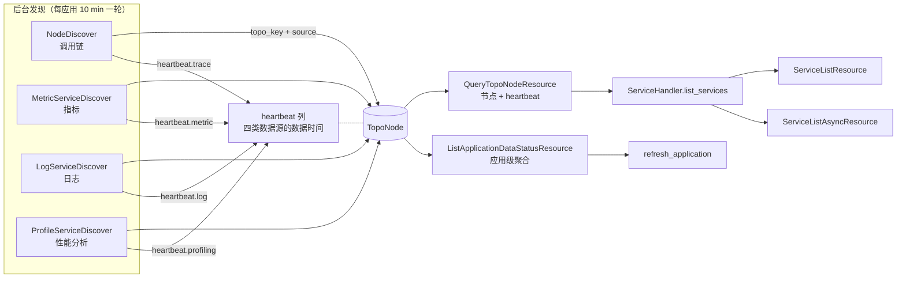
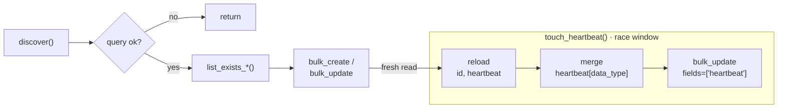

# APM 服务数据状态下沉到后台服务发现 —— 实施方案

## 0x01 调研与约束

### a. 请求侧状态重算

`ServiceListAsyncResource._get_data_status_mapping` 先枚举服务全集，再逐类判定状态，全部在请求线程内完成。

| 数据类型 | NORMAL 判据 | 查询载体 | 代码位置 |
| --- | --- | --- | --- |
| 指标 | `bk_apm_count` 四路分组结果中存在服务键 | UnifyQuery × `4` | `service_handler.py:610` |
| 日志 | 关联索引集 `tag_id != 4`，或 APM 日志表聚合命中服务名 | 索引集元数据 + `es_query_dsl` × `2` | `log_handler.py:66` |
| 调用链 | Flow 指标出现该服务作为调用方或被调方 | UnifyQuery × `1` | `service_handler.py:627` |
| 性能分析 | `ProfileService.last_check_time > 窗口起点 - 10 min` | `apm_api.query_profile_services_detail` | `service_handler.py:645` |

指标的四路分组决定了状态覆盖到组件与自定义服务，服务键构造规则见 `ServiceHandler._combine_metric_data`：

| 分组维度 | 产出服务键 |
| --- | --- |
| `service_name` | `{service_name}` |
| `service_name, db_system` | `{service_name}-{db_system}` |
| `service_name, messaging_system` | `{service_name}-{messaging_system}` |
| `peer_service` | `http:{peer_service}` |

### b. 慢 Trace 耗时构成

Trace `aa9a057ba090042a43eeb6012be6e024` 记录一次缓存未命中的 `data_status` 请求，入口 `5.235 s`，资源内部 `5.149 s`，`19` 个直接子 Span 首尾相接。

| 子调用（按发生顺序）                      |        耗时 | 用途                                            |
| ------------------------------- | --------: | --------------------------------------------- |
| `QueryTopoNodeResource`         |  `401 ms` | 服务全集：拓扑节点                                     |
| `QueryProfileServicesDetail`    |  `404 ms` | 服务全集：性能分析独有服务                                 |
| `GraphUnifyQueryResource` × `4` | `1211 ms` | 指标状态：`bk_apm_count` 四路分组                      |
| `DetailApplicationResource`     |  `162 ms` | 读日志数据源配置                                      |
| `ESQueryDslResource` × `2`      | `1607 ms` | 日志状态：两个服务名字段的 terms 聚合                        |
| `unify_query`                   |  `314 ms` | 调用链状态：`apm_service_to_apm_service_flow_count` |
| `QueryProfileServicesDetail`    |  `962 ms` | 性能分析状态：带 `last_check_time__gt` 过滤             |

两次 ES 聚合并行发起，墙钟合计 `1607 ms`，ES 自身执行 `1279 ms` 与 `1317 ms`，构成本样本最大的单点开销。服务全集枚举了两次，性能分析接口调用了两次。

### c. 后台发现现状

| 数据源 | 发现器 | 调度入口与周期 | 写入对象 | 是否记录数据时间 |
| --- | --- | --- | --- | --- |
| 调用链 | `NodeDiscover` 等 `7` 个 | `topo_discover_cron`，beat 每分钟分片，单应用 `10 min`（新建应用 `2 min`），排除 eBPF 应用 | `TopoNode.source += trace` | 否 *[1]* |
| 指标 | `metric.ServiceDiscover` | `datasource_discover_cron`，beat 每分钟分片，单应用 `10 min`，切 `200 s` 子窗口，不排除 eBPF 应用 | `TopoNode.source += metric` | 否 *[1]* |
| 性能分析 | `profile.ServiceDiscover` | `profile_discover_cron`，`10 min`，应用之间同步串行执行 | `ProfileService.last_check_time` | 记录检查时间，非数据时间 |
| 日志 | 无 | 无 | 无 | 无 |

- *[1] 调用链发现只从 Span 提取维度字段，指标发现只读 `group_keys` 与 `group_values`，两者都丢弃了时间（`node.py:107`、`metric/service.py:57`）。*

`DiscoverContainer` 已按 `TelemetryDataType` 注册发现器（`apm/apps.py:45`），日志发现可以直接挂载。`datasource_discover_cron` 的 docstring 写的是「Metric|Log 数据源数据发现」，实现只遍历 `MetricDataSource`。

指标发现的查询窗口指向未来。`datasource_discover_cron` 以 `current_timestamp` 作为 `start_time` 下发，`datasource_discover_handler` 切出的三个子窗口是 `[now, now+200]`、`[now+200, now+400]` 和 `[now+400, now+600]`。它现在还能发现服务，靠的是 PromQL 瞬时向量的回溯行为，不是窗口真的覆盖了数据。

仓库里已有一套心跳，但语义不同，不能改造复用：

| 维度 | `CachedDiscoverMixin` 保活心跳 | 数据心跳 |
| --- | --- | --- |
| 覆盖对象 | `Endpoint`、`HostInstance`、`TopoInstance`、`RootEndpoint`、`TopoRelation`、`RemoteServiceRelation` | 服务（`topo_key`）× 四类数据源 |
| 存储 | Redis，key 为 `BKMONITOR_{平台}_{环境}_APM_{类型}_HEARTBEAT_{业务}_{应用}`，TTL `7` 天 | MySQL 表 |
| 语义 | 对象最近一次被发现任务处理的时间，用于过期回收 | 数据源最近一次产生数据的时间，用于状态判定 |
| 与 TopoNode 关系 | 不覆盖 `TopoNode`，也不覆盖 `ProfileService` | 以 `topo_key` 对齐 `TopoNode` |

同一批次重复发现对象时，保活心跳只刷新 Redis 时间戳，不区分数据类型。

### d. 关键事实核对

| 问题 | 结论 | 证据 |
| --- | --- | --- |
| 性能分析后台是否已有心跳 | 有。`ProfileService.last_check_time` 由 `ProfileServiceDiscover._upsert` 每轮写入，语义是「本轮检查发现了该服务的样本」 | `apm/core/discover/profile/service.py:104` |
| `TopoNode` 能否按数据类型区分时间 | 不能。`updated_at` 为 `auto_now=True`，调用链与指标两个发现器都显式写 `datetime.now()` | `apm/models/topo.py:31`、`node.py:201`、`metric/service.py:137` |
| 日志状态是否覆盖全部服务 | 不覆盖。`get_label_values_in_table` 的 terms 聚合未设置 `size`，ES 默认只返回 `10` 个桶 | `log_handler.py:126` |
| 日志状态是否包含关联索引全部来源 | 不包含。只读服务级手动关联（`include_global=False`），应用级全局关联与 K8S 关系缓存都不参与 | `log_handler.py:71` |
| 关联索引判据是否严谨 | 不严谨。只取首个匹配索引集，且标签列表为空时 `all([])` 为真，同样判为正常 | `log_handler.py:90` |
| 索引集是否提供顶层数据状态字段 | 没有。列表只返回 `apply_status`（正常／审批中，表达审批进度）与 `tags`，数据状态只能看有没有 `NO_DATA` 内置标签 | `bklog/apps/log_search/handlers/index_set.py:339` |
| `tag_id = 4` 是什么 | `NO_DATA` 内置标签，由 `0040_add_inner_tag` 按创建顺序固定为 `4`，SaaS 的硬编码与之对应 | `bklog/apps/log_search/migrations/0040_add_inner_tag.py:21` |

`NO_DATA` 标签的口径与 APM 服务状态差了两个量级，且覆盖面不完整：

| 维度 | `NO_DATA` 标签 | APM 服务数据状态 |
| --- | --- | --- |
| 判据窗口 | 近 `1` 天 | 无数据周期，默认 `10 min` |
| 刷新周期 | `15 min` | 随发现调度，`10 min` |
| 覆盖范围 | 只检查「近 `1` 天有人检索过的空间」下的索引集 | 应用全部服务 |
| 缺省表现 | 未被检查过的索引集没有标签，SaaS 判为有数据 | 无心跳判为无数据 |

### e. 约束与不做范围

| 类别 | 内容 |
| --- | --- |
| 范围内 | 四类数据源的服务级心跳生产、日志服务发现、拓扑读取协议扩展、SaaS 状态映射与旧链路下线 |
| 范围外 | 指标列（调用次数、错误率、平均耗时）四路串行查询、前端逐行渲染、拓扑接口自身抖动、eBPF 应用的调用链心跳 |
| 语义变更 | 应用级状态由「应用数据量非零」改为「任一服务有数据」 |
| 已知回退 | eBPF 应用的调用链状态显示为无数据，直到其发现链路补上心跳 |
| 待确认 | 关联索引的近 `1` 天口径与服务心跳的 `10 min` 口径不对等，是否需要在产品侧说明 |

## 0x02 架构设计

### a. 架构命题

把「服务是否有数据」从请求时重新证明改为发现时记录事实：每个 telemetry 发现器在写服务拓扑的同时落盘本数据源的服务级数据心跳，服务拓扑查询接口一次返回服务全集与四类心跳，SaaS 只保留心跳到三态的纯映射。

### b. 复杂度来源与收敛点

复杂度来自发现链路与状态链路对同一事实做了两次独立计算：

- 发现器从窗口数据里已经知道哪些服务有数据，却只留下一个被 `auto_now` 覆盖、且被两个发现器共享的 `updated_at`。
- 状态链路只能用另一套查询（四路 `bk_apm_count`、Flow 指标、ES 聚合、`ProfileService` 表）重新证明同一件事。
- 服务全集来自拓扑与性能分析两条链路，状态映射的键不能代表服务全集，接口只能先等全集再算状态。

收敛点是服务数据心跳：按「服务 × 数据类型」记录数据时间的后台事实，由四个发现器各写一类、由拓扑查询接口统一读出。

局部补丁解决不了这个问题。把日志聚合改成缓存判断只消除一项开销，指标四路、Flow 指标和性能分析仍留在请求线程，服务全集仍要枚举两次。

### c. 核心对象模型



`TopoNode` 同时承载服务全集与数据心跳，两件事由不同字段表达：

| 字段 | 回答的问题 | 写入方 |
| --- | --- | --- |
| `topo_key` + `source` | 这个应用有哪些服务，各自被谁发现 | 四个发现器共同维护 |
| `heartbeat` | 每个服务的每类数据最后何时出现 | 每个发现器只改自己数据类型对应的子键 |

节点生命周期不变，超过 `EXPIRED_DAYS`（`180` 天）未更新即删除，心跳随节点一起回收，无需单独清理。

性能分析服务并入 `TopoNode` 后，服务全集收敛为「拓扑节点 + SaaS 本地手动自定义服务」，`QueryProfileServicesDetail` 退出服务列表链路。这也是心跳能落在 `TopoNode` 上的前提：只有性能分析服务都有节点，四类心跳才共用同一行。

### d. 心跳协议

`TopoNode.heartbeat` 是一个以数据类型为顶层键的 JSON 列：

```json
{
  "trace":     {"last_data_at": 1789530180, "checked_at": 1789530200},
  "metric":    {"last_data_at": 1789530120, "checked_at": 1789530200},
  "log":       {"last_data_at": null,       "checked_at": 1789530200},
  "profiling": {"last_data_at": null,       "checked_at": null}
}
```

| 字段 | 类型 | 语义 | 写入规则 |
| --- | --- | --- | --- |
| `<data_type>` | `object` | 顶层键取 `trace` / `metric` / `log` / `profiling` | 只由对应数据类型的发现器写 |
| `<data_type>.last_data_at` | `int`，可空 | 该数据源最后一次观测到数据的秒级时间戳 | 单调前进，窗口内无数据时保持原值 |
| `<data_type>.checked_at` | `int` | 最近一次成功完成的检查时间 | 检查成功才推进，查询异常不写 |

`last_data_at` 与 `checked_at` 成对存在，用于区分三种读取情形：

| 情形 | 判定依据 | 读取结果 |
| --- | --- | --- |
| 检查成功且窗口内有数据 | `last_data_at` 落在无数据周期内 | `NORMAL` |
| 检查成功且窗口内无数据 | `checked_at` 新鲜、`last_data_at` 过旧或为空 | `NO_DATA` |
| 未检查或检查失败 | 顶层键缺失，或 `checked_at` 早于两倍发现周期 | 结果不可信，按 `NO_DATA` 返回并打点 |

写入沿用 `MetricServiceDiscover` 已有的读改写加 `bulk_update` 写法：读出本应用节点的 `heartbeat`，在内存里只合并自己数据类型的子键，再 `bulk_update(fields=["heartbeat"])`。

这条路径存在丢更新的可能，必须正视。`topo_discover_cron` 与 `datasource_discover_cron` 用同一个分片公式 `app_id % 10 == minute % 10`，同一应用的调用链发现与指标、日志发现在同一分钟派发，重叠是必然的。后提交的一方带着较早读到的快照写回整列，会把另一类刚写入的子键抹回上一轮的值。

方案用两条约束把影响压到可接受：

| 约束 | 作用 |
| --- | --- |
| 读取 `heartbeat` 紧贴写入，不在发现开头读 | 冲突窗口从整轮发现耗时（可达数分钟）缩到一次合并加写入 |
| 读取侧新鲜度阈值放宽一个发现周期 | 单次丢更新最多让该类心跳落后一轮，落在阈值容忍范围内 |

阈值放宽本来就是必需的，与并发无关：`last_data_at` 是数据时间，发现每 `10 min` 才跑一轮，持续有数据的服务在下一轮发现前，`last_data_at` 已经比当前时间旧将近 `10 min`。阈值若等于无数据周期，健康服务会在每轮发现前闪一次无数据。

`bulk_update` 只声明 `heartbeat` 字段，不触发 `auto_now`，心跳写入不刷新 `updated_at`，节点存活期仍由拓扑写入决定。

### e. 数据时间取值口径

| 数据源 | 取值方式 | 精度 | 额外查询成本 |
| --- | --- | --- | --- |
| 调用链 | 取本轮命中 Span 的最大 `end_time` | Span 级 | 无，发现器已持有原始 Span |
| 指标 | PromQL 按 `60 s` 步长返回 `_time` 序列，取值非空的最大时间戳 | `1 min` | 无，仅调整现有查询的 `step` |
| 日志 | terms 聚合下挂 `max(time)` 子聚合 | 秒级 | 无，与服务名发现同一次查询 |
| 性能分析 | 沿用 `last_check_time`，即本轮检查窗口的结束时间 | `10 min` | 无 |

四类心跳统一按「无数据周期 + 一个发现周期」判定新鲜，与性能分析现有的「再前探 `10 min`」口径一致。指标、调用链、日志三类由实时查询改为读心跳后，服务从有数据变为无数据的判定会晚一个发现周期，这是下沉带来的固有延迟，需要在验收里对照确认。

### f. 状态映射协议

服务级状态由 SaaS 做纯映射，不再发起任何远程查询：

```text
service_status(service, data_type):
    if not application.is_enabled_{data_type}:      -> DISABLED
    if data_type == log:
        if heartbeat_fresh(service, log):            -> NORMAL
        if related_index_available(service):         -> NORMAL
        -> NO_DATA
    if heartbeat_fresh(service, data_type):          -> NORMAL
    -> NO_DATA

heartbeat_fresh(service, data_type):
    last_data_at >= now - no_data_period - discover_interval
```

日志是唯一的双来源状态。心跳只覆盖 APM 自身管理的日志结果表，关联索引的可用性由 SaaS 读 `LogServiceRelation` 后比对索引集元数据得出，全程不发起 ES 聚合。

应用级状态按「任一服务有数据」聚合：

```text
application_status(data_type):
    if not is_enabled_{data_type}:                   -> DISABLED
    if exists service where heartbeat_fresh(service, data_type): -> NORMAL
    -> NO_DATA
```

### g. 不变量

| 不变量 | 违反后果 |
| --- | --- |
| 心跳只由后台发现器写入，读取路径不得续期 | 页面访问会把无数据服务刷成正常 |
| 发现器只在内存里合并自己数据类型的子键，不改其他子键的值 | 并发写把其他数据类型的心跳清成空 |
| 合并前的读取紧贴写入 | 冲突窗口放大到整轮发现耗时，丢更新从偶发变常态 |
| 新鲜度阈值不小于「无数据周期 + 发现周期」 | 健康服务在每轮发现前闪成无数据 |
| `last_data_at` 单调前进 | 迟到数据或乱序任务会把状态抹回无数据 |
| 查询失败不写 `checked_at` | 失败被当成「检查过且无数据」，产生误报 |
| 服务全集来自 `TopoNode` 与手动自定义服务，不由心跳的键集合代替 | 无数据服务从列表消失 |
| 指标心跳沿用四路分组口径 | 组件服务与自定义服务失去指标状态 |
| 数据类型开关关闭时优先返回 `DISABLED` | 心跳缺失被误解读为模块关闭 |

## 0x03 开发方案 —— 后台心跳生产

承接「心跳协议」与「数据时间取值口径」两节结论，落点在 `apm` 模块。

### a. 模型与统一写入口

| 变更点 | 目标 |
| --- | --- |
| **[Add]** `apm/models/topo.py` `TopoNode.heartbeat` | `models.JSONField`，默认 `{}`，按数据类型分子键存放数据时间 |
| **[Add]** `TopoNode.touch_heartbeat(...)` | 四个发现器的唯一写入口，读改写合并子键后 `bulk_update`，对齐 `MetricServiceDiscover` 现有写法 |

写入口协议骨架：

```text
touch_heartbeat(
    bk_biz_id: int, app_name: str, data_type: str,
    last_data_at_mapping: dict[str, int | None],   # topo_key -> 本轮观测到的最大数据时间
    checked_at: int,                               # 本轮检查成功完成的时间
) -> None
```

心跳写入落在一轮 `discover()` 的尾部：



- *[1] `list_exists_*()` 指 `MetricServiceDiscover.list_exists_mapping()` / `NodeDiscover.list_exists()`，只服务节点 upsert。*
- *[2] `D → E` 的 `fresh read`：必须另读 `heartbeat`，不能复用 *[1]*；否则 race window 会放大到整轮 `discover()`。*
- *[3] `T` 内其他发现器可能并发写同一列，后提交方覆盖整列；窗口只含内存 merge + 一次 `bulk_update`。*

merge 规则：

| 路径 | 规则 |
| --- | --- |
| `heartbeat[data_type].last_data_at` | `max(old, new)`；`new is None` 表示检查完成但无数据，保留 `old` |
| `heartbeat[data_type].checked_at` | 覆盖为本次 `checked_at` |
| 其他顶层键 | 原样带回 |

`last_data_at_mapping` 的键集合即本轮覆盖的 `topo_key`；节点已在 `D` 落库，无需额外 upsert。

### b. 调用链心跳

| 变更点 | 目标 |
| --- | --- |
| **[Change]** `apm/core/discover/node.py` `NodeDiscover.discover` | 在按 Span 聚合拓扑的同时，按 `topo_key` 累计最大 Span 结束时间，落盘 `trace` 心跳 |
| **[Keep]** `TopoNode.updated_at` | 继续表示节点最近一次被发现器处理的时间，不再承担状态语义 |

`NodeDiscover` 每轮处理一批 Span，心跳在 `discover()` 末尾、节点写入之后提交，`checked_at` 取本轮完成时间。`TopoHandler.discover()` 分多轮调用发现器，各轮心跳按单调前进规则合并，多轮之间不需要额外协调。

### c. 指标心跳

| 变更点 | 目标 |
| --- | --- |
| **[Change]** `apm/task/tasks.py` `datasource_discover_cron` 时间基准 | 下发 `start_time = now - interval * 60`，让子窗口覆盖已发生的 `10 min`，取代当前指向未来的窗口 |
| **[Change]** `apm/core/discover/metric/service.py` `query_dimensions` | `step` 由整窗改为 `60 s`，返回维度与 `_time` 序列，提取值非空的最大时间戳 |
| **[Add]** `metric.ServiceDiscover` 状态口径查询 | 按 `bk_apm_count` 四路分组查询，用「请求侧状态重算」给出的服务键构造规则还原键，落盘 `metric` 心跳 |
| **[Keep]** 现有服务发现口径 | `count by (service_name, rpc_system)` 继续负责发现服务与标记 RPC，不与状态口径混用 |

两套口径必须并列执行。服务发现口径覆盖全部自定义指标，但只产出服务名；状态口径覆盖组件与自定义服务，但只认 `bk_apm_count`。合并任何一方都会改变现有语义。

修正查询窗口是取数据时间的前提。窗口指向未来时，序列时间戳要么缺失，要么晚于数据实际产生的时间，写进心跳就违反了「不得用任务时间代替数据时间」。

### d. 日志服务发现

| 变更点 | 目标 |
| --- | --- |
| **[Add]** `apm/core/discover/log/base.py` `Discover` | 日志发现器基类，持有 `LogDataSource`，对齐指标发现器的构造协议 |
| **[Add]** `apm/core/discover/log/service.py` `ServiceDiscover` | 从 APM 日志结果表发现服务并落盘 `log` 心跳 |
| **[Add]** `apm/apps.py` 注册 | `DiscoverContainer.register(TelemetryDataType.LOG.value, LogServiceDiscover)` |
| **[Change]** `apm/task/tasks.py` `datasource_discover_cron` | 遍历 `MetricDataSource` 与 `LogDataSource` 两类数据源，按数据类型派发 |
| **[Change]** `apm/task/tasks.py` `datasource_discover_handler` | 入参由指标数据源改为 `(数据类型, 数据源)`，窗口切分下沉给各发现器决定 |

查询协议：索引名由 `LogDataSource.result_table_id` 按 `-` 与 `.` 归一为 `_` 后追加 `*`，两个服务名字段各发起一次聚合。

```text
aggs.service_names = terms(field=<resource.service.name | resource.server>, size=1000)
aggs.service_names.aggs.last_data_at = max(field=time)
```

- `size` 显式设为 `1000`，修复 SaaS 现状依赖 ES 默认 `10` 桶导致的漏判。
- 两个字段的结果按服务名合并，`last_data_at` 取较大值。
- 发现到的服务按 `source = ["log"]` 创建或更新 `TopoNode`，与指标发现器的处理方式一致。
- 只查询 `LogDataSource`，不涉及服务关联索引。

### e. 性能分析心跳

| 变更点 | 目标 |
| --- | --- |
| **[Change]** `apm/core/discover/profile/service.py` `ServiceDiscover._upsert` | 保留 `ProfileService.last_check_time` 写入，同时落盘 `profiling` 心跳 |
| **[Add]** `profile.ServiceDiscover` 拓扑写入 | 按 `source = ["profiling"]`、`extra_data.kind = profiling` 创建或更新 `TopoNode`，使服务全集收敛到拓扑 |
| **[Change]** `apm/task/tasks.py` `profile_discover_cron` | 补充 `is_enabled_profiling` 过滤，并改为 `.delay()` 投递，避免新增写入放大串行耗时 |

调度方式必须和拓扑写入一起改。`profile_discover_cron` 对每个应用同步调用 `profile_handler`，应用之间串行，新增写入会加重这条链路。

关闭性能分析的应用会残留仅由性能分析发现的节点，读取侧按 `source` 过滤，见「服务全集入口收敛」。

## 0x04 开发方案 —— 读取协议

承接「心跳协议」的三态区分规则，落点在 `apm` 对外资源与 `apm_web` 的服务全集入口。

### a. 服务粒度读取

| 变更点 | 目标 |
| --- | --- |
| **[Change]** `apm/resources.py:779` `QueryTopoNodeResource` | 序列化字段补 `source` 与 `heartbeat`，一次调用同时返回服务全集与四类心跳 |

响应在现有字段基础上追加两段：

```json
{
  "topo_key": "activity-microservices.msgcenter",
  "extra_data": {"category": "http", "kind": "service"},
  "source": ["trace", "metric"],
  "heartbeat": {
    "trace":     {"last_data_at": 1789530180, "checked_at": 1789530200},
    "metric":    {"last_data_at": 1789530120, "checked_at": 1789530200},
    "log":       {"last_data_at": null,       "checked_at": 1789530200}
  }
}
```

- `last_data_at` 为 `null` 且 `checked_at` 非空表示检查过且无数据。
- 顶层键缺失表示该数据类型尚未产生有效检查，读取侧不得当成无数据的确证。
- 心跳与节点同行存储，读取不新增查询。

### b. 应用粒度读取

| 变更点 | 目标 |
| --- | --- |
| **[Add]** `apm/resources.py` `ListApplicationDataStatusResource` | 按业务批量返回各应用的服务数与四类最新心跳时间，供周期任务与应用列表消费 |

```text
入参: bk_biz_id: int, app_names: list[str] | None
出参: {app_name: {"service_count": int,
                  "heartbeat": {data_type: {"last_data_at": ts | null, "checked_at": ts | null}}}}
```

聚合按应用取各数据类型的最大 `last_data_at`，不触发远程查询。`heartbeat` 是 JSON 列，无法直接用 `Max` 聚合，按应用取回节点后在内存内归并；单业务节点量级在万级以内，成本可接受。

### c. 服务全集入口收敛

| 变更点 | 目标 |
| --- | --- |
| **[Change]** `service_handler.py:93` `ServiceHandler.list_services` | 服务全集 = 拓扑节点 + 手动自定义服务，节点自带 `data_status` |
| **[Change]** `ServiceHandler.list_services` 过滤规则 | 应用未开启性能分析时，过滤 `source == ["profiling"]` 的节点，与现状「关闭时不枚举性能分析服务」等价 |
| **[Delete]** `service_handler.py:149` `_combine_profile_trace_service` | 性能分析服务已并入拓扑，合并逻辑失去输入 |
| **[Delete]** `list_services` 中的 `query_profile_services_detail` 调用 | 服务全集不再依赖性能分析接口 |

## 0x05 开发方案 —— SaaS 状态收敛与旧链路下线

承接「状态映射协议」，落点在 `apm_web`。

### a. 状态映射入口

| 变更点 | 目标 |
| --- | --- |
| **[Add]** `apm_web/handlers/service_handler.py` `ServiceHandler.build_service_data_status(app, nodes)` | 唯一的心跳到三态映射入口，纯函数，不发起远程查询 |
| **[Add]** `apm_web/handlers/log_handler.py` `ServiceLogHandler.list_available_related_services(app)` | 返回关联索引可用的服务集合，读取 `LogServiceRelation` 与索引集元数据缓存 |
| **[Change]** `metric/resources.py:1136` `_get_data_status_mapping` | 从 `list_services` 的节点 payload 取心跳，映射后交给筛选项计算 |
| **[Keep]** `metric/resources.py:776` `StatisticsApplyModule`、`:821` `StatisticsHaveData` | 筛选项计算规则不变，输入改为心跳映射结果 |

日志状态的来源边界保持现状，不借改造扩权：

| 来源 | 现状是否参与日志状态 | 处理 |
| --- | --- | --- |
| 服务级手动关联（`is_global=False`） | 参与 | 保持参与 |
| 应用级全局关联（`is_global=True`） | 不参与 | 保持不参与，扩展与否待确认 |
| K8S 关系缓存 | 不参与，仅用于日志索引关联列表 | 保持不参与，扩展与否待确认 |
| APM 自身日志结果表 | 参与，请求侧 ES 聚合 | 改由后台心跳承担 |

关联索引可用判据仍读 `NO_DATA` 内置标签，日志平台没有提供别的数据状态字段。硬编码 `tag_id != 4` 换成按标签名判断，去掉对建表顺序的依赖，同时修正两处缺陷：遍历全部匹配索引集而非只取首个，标签列表为空时不再判为可用。

这条来源保留，代价是同一列里并存两套尺度：有关联索引的服务按近 `1` 天判定，自身上报的服务按无数据周期判定，且没被日志平台检查过的索引集会默认判为有数据。差异需要在产品说明里写清楚。

### b. 应用级状态与服务数量

| 变更点 | 目标 |
| --- | --- |
| **[Change]** `apm_web/models/application.py:349` `set_data_status` | 改为消费 `ListApplicationDataStatusResource` 结果，按「任一服务有数据」写四个状态字段 |
| **[Change]** `apm_web/models/application.py:332` `set_service_count_and_data_status` | 仅保留服务数量写入，服务级状态缓存随之删除 |
| **[Change]** `apm_web/tasks.py:143` `refresh_application` | 按业务批量调用应用级接口，一次请求覆盖同业务全部应用 |
| **[Keep]** `Application.{trace,profiling,metric,log}_data_status` 四个字段 | 下游消费方众多，字段名与三态取值不变，仅更换生产者与判定口径 |
| **[Keep]** `metric/resources.py` `ServiceListResource` 的 `service_count` 回写 | 请求侧回写继续存在，与周期任务写入同一字段，互不冲突 |

### c. 依赖关系与删除清单

服务级状态的消费方：

| 消费方 | 位置 | 读取内容 | 处理 |
| --- | --- | --- | --- |
| 服务列表异步列 | `metric/resources.py:1136` | 服务级四类状态 | 改为读心跳 |
| 服务列表筛选项 | `metric/resources.py:776`、`:821` | 服务级四类状态 | 规则不变，输入换源 |
| 服务列表同步列 | `metric/resources.py:930` | 服务级四类状态 | 规则不变，输入换源 |
| 服务数量与状态缓存刷新 | `models/application.py:332` | 服务级四类状态 | 删除状态部分，保留服务数量 |

`Application.*_data_status` 的消费方。字段名与三态取值不变，但口径改为「任一服务有数据」后，读到的值会变：

| 消费方 | 位置 | 用途 | 处理 |
| --- | --- | --- | --- |
| 应用级状态刷新 | `models/application.py:349` | 生产四个字段 | 改为心跳聚合 |
| 应用列表排序 | `meta/resources.py:1074` | 有数据应用优先 | 不变 |
| 应用列表与详情响应 | `meta/resources.py:216`、`:305`、`:351`、`:1045` | 序列化输出四个字段 | 不变 |
| 数据源启停 | `meta/resources.py:547`、`:597` | 开关切换时改写状态 | 不变 |
| 每日状态快照 | `tasks.py:378` | 写入 `apm:application:{日期}:all_application_data_status` | 不变 |
| 周同比分析命令 | `management/commands/week_over_week_analysis.py:82` | 比较两日快照状态变化 | 不变，口径变更会体现在首次比较结果 |
| 业务运营统计 | `monitor_web/statistics/v2/business.py:164` | 统计有 APM 数据的业务数 | 不变，需知会运营口径变更 |
| 应用运营统计 | `monitor_web/statistics/v2/apm.py:22` | 以 `trace_data_status` 作为指标 label | 同上 |
| operation 接口统计 | `kernel_api/resource/operation/handlers.py:133`、`:170` | 有数据应用数、Profiling 应用数 | 同上 |

#### 探测式判定的收敛范围

**【判据】** 凡是「查一次数据存储、只为取一个 `bool`」的调用，都归心跳；返回真实数据量、或由用户自选任意时间窗的查询保留实时。

除服务列表与周期任务外，以下请求侧探测同样落在本次范围内：

| 位置 | 现状 | 处理 |
| --- | --- | --- |
| `meta/resources.py:481` `ApplicationInfoByAppNameResource` | 传时间窗时调 `have_data()` → `RequestCountInstance` → VM `sum_over_time(bk_apm_count[窗口])`，覆盖响应 `trace_data_status` | 删除覆盖，直接返回库内 `Application.trace_data_status` *[1]* |
| `metric/resources.py:1812` `ApdexQueryResource`、`:2607` `AlertQueryResource` | 同样调 `have_data()` 做查图前置短路 | 删除前置短路，让主查询自然返回空序列，省掉一次整窗 VM |
| `service/resources.py:223` `ServiceInfoResource.get_profiling_info` | `QueryTemplate.get_service_count()` → BKBase Doris `count(*)`，仅取 `bool(count)` 写 `is_profiling_data_normal` | 改读该服务的 `heartbeat.profiling` |
| `profile/resources.py:188` `ListApplicationServicesResource` | 以 `query_profile_services_detail()` 结果 `len(services) > 0` 把应用分入 `normal` / `no_data` | 分类改读应用级 profiling 状态；服务明细查询按需保留 |

- *[1] 慢 Trace `8bfa95a9cf8553981b0105f1e89f2064`（`pvpesport.battle`）即此路径，约 `12.8 s` 卡在 VM，且最终以并发超限报错。*

不受影响、保持独立语义的接口：

| 接口 | 位置 | 语义 |
| --- | --- | --- |
| 数据接入检查页 | `meta/resources.py:1910` `DataStatusResource` | 按用户指定时间窗检查数据量，量级探测不走状态三态 |
| 存储状态 | `meta/resources.py:1851` `StorageInfoResource` / `StorageStatusResource` | 存储配置与健康度，与数据状态无关 |
| 性能分析最近上报时间 | `profile/resources.py:81` `QueryTemplate.get_sample_info` | 返回窗口内真实 `last_report_time`，是展示值而非状态位 |

可删除的对象：

| 对象 | 位置 | 删除依据 |
| --- | --- | --- |
| `ServiceHandler.get_service_data_status_mapping` | `service_handler.py:595` | 唯一职责是重算服务级状态 |
| `ServiceLogHandler.get_log_count_mapping` | `log_handler.py:66` | 唯一调用方是上一项 |
| `ServiceLogHandler.get_label_values_in_table` | `log_handler.py:112` | 唯一调用方是上一项 |
| `ApmCacheKey.APP_SERVICE_STATUS_KEY` | `constants.py:1054` | 心跳从数据库读，不再需要缓存快照 *[2]* |
| `ServiceHandler._combine_profile_trace_service` | `service_handler.py:149` | 性能分析服务并入拓扑后无输入 |
| `Application.doc_count` | `models/application.py:320` | 按 `es_retention` 整窗跑 `RequestCountInstance`，全仓无调用方 |
| `SERVICE_DATA_STATUS` / `REMOTE_SERVICE_DATA_STATUS` / `COMPONENT_DATA_STATUS` | `metrics.py:71`、`:79`、`:87` | 以请求量冒充数据状态的遗留模板，全仓无调用方，保留会诱导重新引入探测 |

- *[2] 该缓存由周期任务写入时未传 `timeout`，模块启停与无数据周期变更也都不触发失效，本身就是一处状态不一致来源。*

需换源而非删除的对象：

| 对象 | 位置 | 处理 |
| --- | --- | --- |
| `ApplicationHandler.have_data` | `handlers/application_handler.py:23` | **[Change]** 判定源换为心跳聚合后的应用状态，禁止再走 `RequestCountInstance` / unify_query *[3]* |

- *[3] `RequestCountInstance` 仍服务于真正的「请求量」列与图表；禁止用「请求量是否非零」冒充 `*_data_status`。*

保留的对象：

| 对象 | 理由 |
| --- | --- |
| `ServiceHandler.get_service_metric_range_mapping` | 仍服务于调用次数、错误率、平均耗时三列 |
| `ServiceFlowCount` | 仍服务于服务拓扑与调用关系视图 |
| `telemetry_handler_registry(...).get_data_count` | 仍服务于数据接入检查页与存储状态展示 |
| `api.apm_api.query_profile_services_detail` | 仍服务于性能分析页面的服务详情 |

### d. 兼容与迁移

| 阶段 | 策略 |
| --- | --- |
| 心跳空窗期 | 心跳表建立后到首轮发现完成前，`checked_at` 为空，读取侧返回 `NO_DATA` 并打点，与应用刚创建时的现状表现一致 |
| 新旧对照 | 心跳生产上线后、读取切换前，保留旧计算路径，按同一无数据周期对同一批应用做新旧状态对照 |
| 读取切换 | 读取侧切换与旧对象删除分两个里程碑，切换里程碑不删除任何旧函数 |
| eBPF 应用 | 只有调用链发现调度排除 eBPF 应用，指标与日志发现不排除，因此仅 `trace` 心跳为空。本期不补齐，该类应用的调用链状态显示无数据，作为已知回退记录在案 |

## 0x06 验收与验证

### a. 测试门禁

```bash
uv run pytest apm/tests packages/apm_web/tests
```

### b. 补充测试用例

| 用例 | 断言重点 |
| --- | --- |
| `test_touch_heartbeat_monotonic` | 传入早于已有值的 `last_data_at` 时保持原值，`checked_at` 仍推进 |
| `test_touch_heartbeat_no_data` | 值为 `None` 时 `last_data_at` 不变、`checked_at` 推进，读取判为 `NO_DATA` |
| `test_touch_heartbeat_keeps_other_data_types` | 写 `trace` 子键后，同行已有的 `metric`、`log` 子键内容原样保留 |
| `test_heartbeat_fresh_tolerates_one_cycle` | `last_data_at` 落后一个发现周期时仍判 `NORMAL`，超过「无数据周期 + 发现周期」才判 `NO_DATA` |
| `test_log_service_discover_agg` | 聚合体携带 `size=1000` 与 `max(time)` 子聚合，两个服务名字段结果按服务名合并取较大时间 |
| `test_log_service_discover_creates_topo_node` | 仅日志发现的服务生成 `source == ["log"]` 的节点 |
| `test_metric_heartbeat_component_keys` | 四路分组分别还原为服务、DB 组件、消息组件与自定义服务键 |
| `test_datasource_discover_window_in_past` | 下发的子窗口全部落在当前时间之前，覆盖完整 `interval` |
| `test_trace_heartbeat_from_span_time` | 心跳时间取本轮 Span 最大结束时间，不取任务运行时间 |
| `test_profile_discover_writes_topo_node` | 性能分析独有服务生成节点，`ProfileService.last_check_time` 行为不变 |
| `test_build_service_data_status_disabled_first` | 数据类型开关关闭时返回 `DISABLED`，不受心跳影响 |
| `test_build_service_data_status_log_dual_source` | 心跳为空但关联索引无 `NO_DATA` 标签时返回 `NORMAL` |
| `test_related_index_available_empty_tags` | 索引集标签列表为空时不判为可用 |
| `test_list_services_excludes_profiling_only_when_disabled` | 关闭性能分析后过滤仅由性能分析发现的节点 |
| `test_service_list_async_no_remote_query` | 状态列不再发起 UnifyQuery、`es_query_dsl` 与性能分析接口调用 |

### c. 回归口径

| 维度 | 口径 |
| --- | --- |
| 状态一致性 | 同一应用、同一无数据周期，新旧状态逐服务比对，差异需能归因到已声明的语义变更 |
| 状态时效 | 停止上报后确认服务在「无数据周期 + 发现周期」内翻转为无数据，不长期停留在正常 |
| 服务全集 | 服务数量、分类、语言、排序与分页结果与切换前一致 |
| 筛选项 | `have_data` 与 `apply_module` 的计数基于全量展示服务，不随分页变化 |
| 性能 | 记录 `service_list` 与 `data_status` 的端到端耗时与下游调用数，`data_status` 的远程调用数降为 `0` |
| 后台开销 | 记录四个发现器的单轮耗时与查询数，确认新增查询不突破现有 `10 min` 调度窗口 |
| 运营口径 | 业务与应用运营统计、每日快照、周同比在口径切换后的首个周期会出现跳变，需提前知会并记录基线 |

## 0x07 实施进展

| 时间 | 结论性进展 |
| --- | --- |
| `2026-09-17 14:00` | [a] 确立收敛判据：「查一次数据存储只为取一个 `bool`」的调用统一归心跳，返回真实数据量或用户自选时间窗的查询保留实时<br />[b] 完成 `apm_web` 全量探测点盘查，补入四处此前遗漏的请求侧探测：`ApplicationInfoByAppNameResource` 覆盖 `trace_data_status`、`ApdexQueryResource` / `AlertQueryResource` 查图前置短路、`ServiceInfoResource.get_profiling_info` 的 Doris `count(*)`、`ListApplicationServicesResource` 的应用有无数据分类<br />[c] 慢 Trace `8bfa95a9cf8553981b0105f1e89f2064` 归因为 `have_data()` → `RequestCountInstance` → VM 整窗 `sum_over_time(bk_apm_count[7d])`，约 `12.8 s` 并以并发超限报错，与服务列表 `data_status` 同源同病<br />[d] `have_data` 定为换源而非删除；Apdex 与告警图的前置短路直接删除，让主查询自然返回空<br />[e] 清理两处以请求量冒充数据状态的遗留：`Application.doc_count`、`metrics.py` 三个 `*_DATA_STATUS` 模板，均全仓无调用方 |
| `2026-09-16 15:00` | [a] 心跳载体定为 `TopoNode.heartbeat` JSON 列，按数据类型分子键，撤回独立表方案。写入沿用发现器现有的读改写加 `bulk_update`，不引入 `JSON_SET`<br />[b] 确认同一应用的调用链与指标、日志发现由同一分片公式派发到同一分钟，读改写必然重叠，用「读取紧贴写入」和「新鲜度阈值放宽一个发现周期」两条约束吸收单次丢更新，代价是无数据判定延后一个周期<br />[c] 应用级状态确认改为「任一服务有数据」，切换前记录运营基线<br />[d] 日志状态保留关联索引来源。查清日志平台没有索引集数据状态字段，`green` 只存在于 ES 索引健康度，判据落到 `NO_DATA` 内置标签<br />[e] eBPF 应用的调用链心跳本期不补齐，转为已知回退 |
| `2026-09-16 12:00` | [a] 基于慢 Trace `aa9a057ba090042a43eeb6012be6e024` 完成耗时归因：服务全集枚举两次、四类状态串行重算，资源内部耗时 `5.149 s`<br />[b] 确认性能分析已有数据库心跳（`ProfileService.last_check_time`），调用链与指标发现不记录数据时间，日志无发现器。现有 `CachedDiscoverMixin` 保活心跳语义不同且不覆盖 `TopoNode`，不可复用<br />[c] 确定收敛点为服务数据心跳，四发现器单写、拓扑接口单读。性能分析服务并入拓扑后服务全集收敛到单一事实源<br />[d] 明确日志状态双来源边界：心跳覆盖 APM 日志结果表，关联索引只含服务级手动关联<br />[e] 完成应用级状态字段消费方梳理，确认字段契约不变、口径变更会传导到每日快照与运营统计<br />[f] 定位三处需一并修复的缺陷：指标发现窗口指向未来、日志 terms 聚合缺少 `size`、关联索引判据只取首个且空标签判为可用 |

## 0x08 参考

- [\<源码\> apm/core/discover/base.py DiscoverContainer / TopoHandler](https://github.com/TencentBlueKing/bk-monitor/blob/master/bkmonitor/apm/core/discover/base.py)
- [\<源码\> apm/core/discover/metric/service.py ServiceDiscover](https://github.com/TencentBlueKing/bk-monitor/blob/master/bkmonitor/apm/core/discover/metric/service.py)
- [\<源码\> apm/core/discover/profile/service.py ServiceDiscover](https://github.com/TencentBlueKing/bk-monitor/blob/master/bkmonitor/apm/core/discover/profile/service.py)
- [\<源码\> apm/task/tasks.py 发现任务调度](https://github.com/TencentBlueKing/bk-monitor/blob/master/bkmonitor/apm/task/tasks.py)
- [\<源码\> apm/models/topo.py TopoNode](https://github.com/TencentBlueKing/bk-monitor/blob/master/bkmonitor/apm/models/topo.py)
- [\<源码\> packages/apm_web/handlers/service_handler.py ServiceHandler](https://github.com/TencentBlueKing/bk-monitor/blob/master/bkmonitor/packages/apm_web/handlers/service_handler.py)
- [\<源码\> packages/apm_web/handlers/log_handler.py ServiceLogHandler](https://github.com/TencentBlueKing/bk-monitor/blob/master/bkmonitor/packages/apm_web/handlers/log_handler.py)
- [\<源码\> packages/apm_web/metric/resources.py ServiceListAsyncResource](https://github.com/TencentBlueKing/bk-monitor/blob/master/bkmonitor/packages/apm_web/metric/resources.py)
- 关联 issue：[APM 关联容器日志采集项慢接口优化](../2026-07-10-apm-k8s-log-relation-cache/README.md)

## 0x09 版本锚点

| 状态 | 分支 | 里程碑 | PR |
| --- | --- | --- | --- |
| 🔄 | `<branch_name>` | 里程碑 1：`TopoNode.heartbeat` 字段与统一写入口 | 待创建 |
| 🔄 | `<branch_name>` | 里程碑 2：调用链与指标心跳生产 | 待创建 |
| 🔄 | `<branch_name>` | 里程碑 3：日志服务发现与心跳生产 | 待创建 |
| 🔄 | `<branch_name>` | 里程碑 4：性能分析心跳并入与服务全集收敛 | 待创建 |
| 🔄 | `<branch_name>` | 里程碑 5：读取协议扩展与 SaaS 状态切换 | 待创建 |
| 🔄 | `<branch_name>` | 里程碑 6：旧状态链路下线 | 待创建 |
