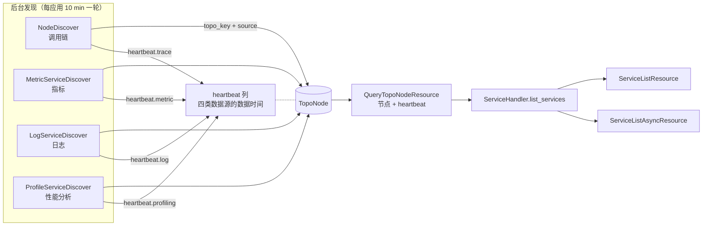
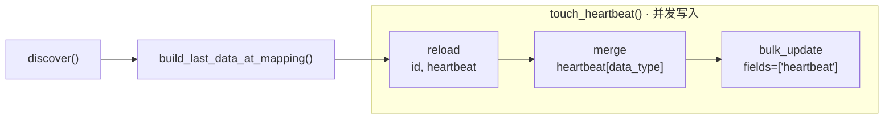
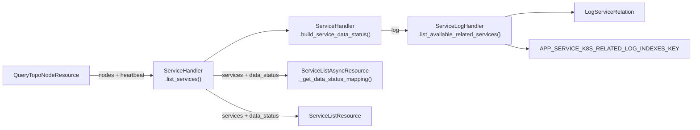

# APM 服务数据状态下沉到后台服务发现 —— 实施方案

## 0x01 调研与约束

### a. 现有数据状态判定

周期任务 `refresh_application` 每 `10 min` 重算一次数据状态，判断最近 `no_data_period` 分钟（默认 `10 min`）内是否有数据 *[1]*：

| 类型   | 应用（`Application.set_data_status`）                                              | 服务（`ServiceHandler.get_service_data_status_mapping`）                                 |
| ---- | ------------------------------------------------------------------------------ | ------------------------------------------------------------------------------------ |
| 调用链  | [a] UnifyQuery：`TraceBackendHandler.get_data_count`<br />[b] `bk_apm_count` 求和 | [a] UnifyQuery：`ServiceFlowCount`<br />[b] Flow 指标含该服务                               |
| 指标   | [a] BKBase：`MetricBackendHandler.get_data_count`<br />[b] 链路消息数 *[2]* *[3]*    | [a] UnifyQuery：`RequestCountInstance`<br />[b] `bk_apm_count` 按服务分组                  |
| 日志   | [a] UnifyQuery：`LogBackendHandler.get_data_count`<br />[b] 索引集 `_index` 计数     | [a] ES：`ServiceLogHandler.get_log_count_mapping`<br />[b] 日志表聚合命中或关联索引无 `NO_DATA` 标签 |
| 性能分析 | [a] BKBase：`ProfilingBackendHandler.get_data_count`<br />[b] 链路消息数 *[2]*       | [a] DB：`query_profile_services_detail`<br />[b] `last_check_time` 晚于窗口起点前 `10 min`   |

- *[1] 页面异步拉取服务状态同样使用该窗口，忽略前端传入的时间范围。*
- *[2] V4 取 DataId 消息数，V3 取存储 `output_count` 且默认按 `1d` 聚合，窗口可能扩大到当天（待确认）。*
- *[3] 含 Trace 生成的 `bk_apm_*` 指标，只上报 Trace 也判为有数据。*

服务日志状态里的 `NO_DATA` 标签不由 APM 计算，而是日志平台巡检索引集后打上的，规则如下：

| 项 | 规则 |
| --- | --- |
| 入口 | `apps.log_search.tasks.no_data.no_data_check`，每 `15 min` |
| 窗口 | 近 `1` 天 |
| 判据 | 整个索引集无数据即打标（`tag_id=4`），查询异常也按无数据处理 |
| 范围 | 近 `1` 天有人检索过的空间下的有效索引集 *[1]* |

- *[1] 范围外的索引集不会被检查，缺少该标签不代表已确认有数据。*

### b. 慢 Trace 耗时构成

| 子调用（按发生顺序）                      |        耗时 | 用途                                            |
| ------------------------------- | --------: | --------------------------------------------- |
| `QueryTopoNodeResource`         |  `401 ms` | 服务全集：拓扑节点                                     |
| `QueryProfileServicesDetail`    |  `404 ms` | 服务全集：性能分析独有服务                                 |
| `GraphUnifyQueryResource` × `4` | `1211 ms` | 指标状态：`bk_apm_count` 四路分组                      |
| `DetailApplicationResource`     |  `162 ms` | 读日志数据源配置                                      |
| `ESQueryDslResource` × `2`      | `1607 ms` | 日志状态：两个服务名字段的 terms 聚合                        |
| `unify_query`                   |  `314 ms` | 调用链状态：`apm_service_to_apm_service_flow_count` |
| `QueryProfileServicesDetail`    |  `962 ms` | 性能分析状态：带 `last_check_time__gt` 过滤             |

- *[1] 样本：Trace `aa9a057ba090042a43eeb6012be6e024`，`data_status` 缓存未命中；入口耗时 `5.235 s`，资源内部 `5.149 s`，`19` 个直接子 Span 连续执行。*
- *[2] ES 两次聚合并行，表中 `1607 ms` 为墙钟耗时，非执行时间之和；ES 执行耗时分别为 `1279 ms`、`1317 ms`。*
- *[3] 服务全集重复枚举 `2` 次，性能分析接口分别用于服务枚举和状态判定。*

### c. 后台发现现状

调度入口均位于 `apm.task.tasks`，发现器由 `apm.apps.ApmApiConfig.ready` 注册。

| 数据源  | 发现器                                                 | 调度入口与周期                                                              | 写入对象                                              | 时间语义           |
| ---- | --------------------------------------------------- | -------------------------------------------------------------------- | ------------------------------------------------- | -------------- |
| 调用链  | `apm.core.discover.node.NodeDiscover` 等 `7` 个       | [a] `topo_discover_cron`<br />[b] 每分钟分片，单应用每 `10 min` 一轮 *[1]*       | `TopoNode`：合并 `source=["trace"]`，刷新 `updated_at`  | 节点更新时间，未记录数据时间 |
| 指标   | `apm.core.discover.metric.service.ServiceDiscover`  | [a] `datasource_discover_cron`<br />[b] 每分钟分片，单应用每 `10 min` 一轮 *[2]* | `TopoNode`：合并 `source=["metric"]`，刷新 `updated_at` | 节点更新时间，未记录数据时间 |
| 性能分析 | `apm.core.discover.profile.service.ServiceDiscover` | [a] `profile_discover_cron`<br />[b] 每 `10 min` 一轮，应用间串行执行           | `ProfileService`：刷新 `last_check_time`             | 任务开始时刻，未记录数据时间 |
| 日志   | 无                                                   | 无                                                                    | 无                                                 | 无              |

- *[1] 新建应用每 `2 min` 一轮，eBPF 应用不参与调用链发现。*
- *[2] 指标发现包含 eBPF 应用，按 `200 s` 切分子窗口；起点误用当前时间导致窗口指向未来，本期暂不修正。*
- *[3] `TopoNode.updated_at` 由多个发现器共用，无法表达各数据类型的更新时间。*
- *[4] `apm.core.discover.cached_mixin.CachedDiscoverMixin` 的 Redis 心跳只用于对象回收，不区分数据类型，也不覆盖 `TopoNode`、`ProfileService`，不能用于服务状态判定。*

## 0x02 架构设计

### a. 架构命题

把「服务是否有数据」从请求时重新证明改为发现时记录事实：每个 telemetry 发现器在写服务拓扑的同时落盘本数据源的服务级数据心跳，服务拓扑查询接口一次返回服务全集与四类心跳，SaaS 只保留心跳到三态的纯映射。

### b. 复杂度来源与收敛点

复杂度来自发现链路与状态链路对同一事实做了两次独立计算：

- 发现器从窗口数据里已经知道哪些服务有数据，却只留下一个被 `auto_now` 覆盖、且被两个发现器共享的 `updated_at`。
- 状态链路只能用另一套查询（四路 `bk_apm_count`、Flow 指标、ES 聚合、`ProfileService` 表）重新证明同一件事。
- 服务全集来自拓扑与性能分析两条链路，状态映射的键不能代表服务全集，接口只能先等全集再算状态。

收敛点是服务数据心跳：按「服务 × 数据类型」记录数据时间的后台事实，由四个发现器各写一类、由拓扑查询接口统一读出。

局部补丁解决不了这个问题。把日志聚合改成缓存判断只消除一项开销，指标四路、Flow 指标和性能分析仍留在请求线程，服务全集仍要枚举两次。

### c. 核心对象模型



`TopoNode` 同时承载服务全集与数据心跳，两件事由不同字段表达：

| 字段 | 回答的问题 | 写入方 |
| --- | --- | --- |
| `topo_key` + `source` | 这个应用有哪些服务，各自被谁发现 | 四个发现器共同维护 |
| `heartbeat` | 每个服务的每类数据最后何时出现 | 每个发现器只改自己数据类型对应的子键 |

- *[1] 节点超过 `EXPIRED_DAYS`（`180` 天）未更新即删除，心跳随节点回收。*
- *[2] 性能分析服务须先并入 `TopoNode`，四类心跳才能共用节点；服务全集由拓扑节点与 SaaS 手动自定义服务组成，`QueryProfileServicesDetail` 退出服务列表链路。*
- *[3] 无心跳的服务仍保留在列表中，不能用心跳的键集合代替服务全集。*

### d. 心跳协议

`TopoNode.heartbeat` 分别记录四类数据最后出现的时间和最近一次检查成功的时间：

```json
{
  "trace":     {"last_data_at": 1789530180, "checked_at": 1789530200},
  "metric":    {"last_data_at": 1789530120, "checked_at": 1789530200},
  "log":       {"last_data_at": null,       "checked_at": 1789530200},
  "profiling": {"last_data_at": null,       "checked_at": null}
}
```

| 字段                         | 类型            | 说明                              |
| -------------------------- | ------------- | ------------------------------- |
| `<data_type>`              | `object`      | 每个发现器只更新自己负责的类型，保留其他类型的值 *[1]*  |
| `<data_type>.last_data_at` | `int \| null` | 最后有数据的时间（秒），新旧时间取较大值，未发现数据时保留旧值 |
| `<data_type>.checked_at`   | `int \| null` | 最近一次检查成功的时间（秒），未检查时为空，检查失败时保留旧值 |

- *[1] 写入前读取 `heartbeat`，合并后通过 `bulk_update` 只更新该列，不改 `updated_at`，节点仍按拓扑更新时间回收。*
- *[2] 调用链与指标、日志按 `app_id % 10 == minute % 10` 在同一分钟派发，后写入的旧快照可能覆盖另一类刚写入的值。*
- *[3] 读取安排在写入前，以减少并发覆盖的机会；状态判断多留一个发现周期，允许心跳落后一轮，但不能保证并发更新不丢失。*
- *[4] 心跳只由后台发现器更新，页面查询不更新心跳时间。*

### e. 状态映射协议

服务级状态由 SaaS 做纯映射，不再发起任何远程查询：

```text
service_status(service, data_type):
    if not application.is_enabled_{data_type}:      -> DISABLED
    if data_type == log:
        if heartbeat_fresh(service, log):            -> NORMAL
        if related_index_available(service):         -> NORMAL
        -> NO_DATA
    if heartbeat_fresh(service, data_type):          -> NORMAL
    -> NO_DATA

heartbeat_fresh(service, data_type):
    last_data_at >= now - no_data_period - discover_interval
```

日志是唯一的双来源状态。心跳只覆盖 APM 自身管理的日志结果表，关联索引的可用性由 SaaS 读 `LogServiceRelation` 后比对索引集元数据得出，全程不发起 ES 聚合。

应用级状态不由心跳推导，沿用 `Application.set_data_status` 的现有链路。

## 0x03 开发方案 —— 后台心跳生产

### a. 模型与统一写入口

`apm.models.topo.TopoNode` 新增：

- `heartbeat`：`models.JSONField`，默认 `{}`，字段含义见「心跳协议」。
- `touch_heartbeat(...)`：四个发现器共用的写入方法。



- *[1] 心跳维护依赖服务发现的结果，但不改动现有节点写入流程：各发现器在 `discover()` 末尾新增 `build_last_data_at_mapping()`，按各数据源小节的取值方式，从本轮窗口数据生成 `topo_key -> last_data_at`。*

`touch_heartbeat` 核心逻辑：

```python
@classmethod
def touch_heartbeat(
    cls,
    bk_biz_id: int,
    app_name: str,
    data_type: str,
    last_data_at_mapping: dict[str, int | None],  # topo_key -> 该服务本轮最后一条数据的时间（秒）
    checked_at: int,  # 本轮检查成功完成的时间（秒）
) -> None:
    # reload：写前重读，拿最新 heartbeat [2]
    nodes: list[TopoNode] = list(
        cls.objects.filter(
            bk_biz_id=bk_biz_id, app_name=app_name, topo_key__in=last_data_at_mapping.keys()
        ).only("id", "topo_key", "heartbeat")
    )

    # merge：只改本类型子键，其他类型原样保留
    for node in nodes:
        sub: dict[str, int | None] = node.heartbeat.get(data_type) or {}
        new_last_data_at: int | None = last_data_at_mapping[node.topo_key]
        if new_last_data_at is not None:  # None 表示本轮窗口内无数据，保留旧值
            sub["last_data_at"] = max(sub.get("last_data_at") or 0, new_last_data_at)
        sub["checked_at"] = checked_at
        node.heartbeat[data_type] = sub

    # bulk_update：只声明 heartbeat 列，不触发 updated_at 的 auto_now
    cls.objects.bulk_update(nodes, fields=["heartbeat"], batch_size=200)
```

- *[2] 新服务的节点已在 `discover()` 内建出，`heartbeat` 默认为 `{}`，reload 能直接读到。*

### b. 调用链心跳

调用链心跳放在 `TopoHandler.discover()`：常规轮次结束后追加一个兜底轮，每个服务取最后一个 Span，既补发现常规轮次漏掉的稀疏服务，也作为 `trace` 心跳的数据来源。`NodeDiscover` 不改动。

| 变更点                                                                       | 修改内容                                                      |
| ------------------------------------------------------------------------- | --------------------------------------------------------- |
| **[Add]** `bkmonitor.data_source.utils.query.BaseQuery._query_group_list` | 签名同 `_query_list`，增加 `group_field`，每组返回排序后的第一条完整记录 *[1]*  |
| **[Add]** `apm.core.handlers.query.span_query.SpanQuery.query_group_list` | 按 `end_time desc` 排序、按服务名分组，返回每个服务最后上报的 Span              |
| **[Change]** `apm.core.discover.base.TopoHandler.discover`                | 抽出拓扑发现任务为 `_discover_spans`，常规轮与兜底轮共用；兜底轮结束后写入 `trace` 心跳 |

```python
# TopoHandler.discover()，位于 discover finished 日志之前
for round_index, trace_ids in enumerate(self.list_trace_ids(index_name)):
    ...
    self._discover_spans(all_spans, topo_params_template)

# 兜底轮 [2]
last_spans: list[dict[str, Any]] = span_query.query_group_list(
    start_time, end_time, group_field=OtlpKey.get_resource_key(ResourceAttributes.SERVICE_NAME),
    offset=0, limit=SpanQuery.QUERY_MAX_LIMIT,
)
self._discover_spans(last_spans, topo_params_template)  # [3]

TopoNode.touch_heartbeat(
    self.bk_biz_id, self.app_name, TelemetryDataType.TRACE.value,
    last_data_at_mapping={get_service_name(s): s[OtlpKey.END_TIME] // 1_000_000 for s in last_spans},
    checked_at=int(time.time()),
)
```

- *[1] 与 `apm_web.llm.query.LLMQuery.query_group_list` 同一机制，后者额外调用 `.values(group_field)` 只取分组值，这里返回整条 Span。*
- *[2] 窗口与常规轮一致（`now-10m`），`limit` 取 `QUERY_MAX_LIMIT`（`10000`），覆盖单应用服务数。*
- *[3] 兜底 Span 走同一套拓扑发现任务，稀疏服务的节点在写心跳前建出；常规轮已发现的服务会再处理一次，发现器按存在性决定创建或更新，无副作用。*

### c. 指标心跳

| 变更点                                                                              | 修改内容                                                     |
| -------------------------------------------------------------------------------- | -------------------------------------------------------- |
| **[Change]** `apm.core.discover.metric.service.ServiceDiscover.query_dimensions` | 新增 `with_last_data_at`，开启时为每个序列返回 `last_data_at`         |
| **[Change]** `apm.core.discover.metric.service.ServiceDiscover.discover`         | 末尾执行心跳查询，按下表展开服务键后调用 `touch_heartbeat` *[1]*             |

```python
def query_dimensions(
    self, promql: str, start_time: int, end_time: int, with_last_data_at: bool = False
) -> list[dict[str, Any]]:
    # ...
    for item in response.get("series", []):
        # ...
        dimension: dict[str, Any] = dict(zip(item["group_keys"], item["group_values"]))
        if with_last_data_at:
            value_index: int = item["columns"].index("_value")
            points: list[float] = [p[value_index] for p in item["values"] if p[value_index] is not None]
            dimension["last_data_at"] = int(max(points)) if points else None  # [2]
        dimensions.append(dimension)
    return dimensions
```

```promql
max by (service_name, db_system, messaging_system, peer_service) (
    timestamp({__name__="custom:<result_table_id>:bk_apm_count"})
)
```

| 序列维度                                | 服务键 *[3]*                           | 写入心跳                   |
| ----------------------------------- | ----------------------------------- | ---------------------- |
| `service_name`                      | `{service_name}`                    | `metric`               |
| `service_name` + `db_system`        | `{service_name}-{db_system}`        | `metric`、`trace` *[4]* |
| `service_name` + `messaging_system` | `{service_name}-{messaging_system}` | `metric`、`trace` *[4]* |
| `peer_service`                      | `http:{peer_service}`               | `metric`、`trace` *[4]* |

- *[1] 选用 `bk_apm_count`：它由 collector 从 Trace 生成并经指标链路写入，最能反映指标数据链路是否畅通。*
- *[2] `timestamp()` 的值是原始样本时间（秒），不受步长影响，已在 bkop 实测；每个求值点只回看 `5 min`，`step` 须不超过 `5 min`，当前子窗口 `200 s` 已满足。*
- *[3] 同一个服务可能同时出现在多条序列里，例如普通调用与 DB 调用各一条，取其中最晚的 `last_data_at`。*
- *[4] 组件与远程服务没有独立的 Span 心跳来源，而 `bk_apm_count` 本就由 Span 生成，因此同时写入 `metric` 与 `trace` 子键。*

### d. 日志服务发现

日志与调用链兜底轮一致，按服务名折叠查询窗口内每个服务的最后一条日志，同一次查询既发现服务，也生成 `log` 心跳。

| 变更点                                                       | 修改内容                                                                          |
| --------------------------------------------------------- | ----------------------------------------------------------------------------- |
| **[Add]** `apm.core.discover.log.base.Discover`           | 持有 `LogDataSource`，构造参数与指标发现器一致                                               |
| **[Add]** `apm.core.discover.log.service.ServiceDiscover` | 折叠查询每个服务的最后一条日志，写入 `TopoNode`（合并 `source=["log"]`）后调用 `touch_heartbeat`       |
| **[Change]** `apm.apps.ApmApiConfig.ready` | 注册 `DiscoverContainer.register(TelemetryDataType.LOG.value, LogServiceDiscover)` |
| **[Change]** `apm.task.tasks.datasource_discover_cron`    | 遍历 `MetricDataSource` 与 `LogDataSource`，按数据类型派发                               |
| **[Change]** `apm.task.tasks.datasource_discover_handler` | 数据源参数改为 `(数据类型, 数据源)`，由发现器决定窗口切分方式                                            |

```python
q: QueryConfigBuilder = (
    QueryConfigBuilder((DataTypeLabel.LOG, DataSourceLabel.BK_LOG_SEARCH))
    .table(str(self.datasource.index_set_id))
    .index_set_id(self.datasource.index_set_id)
    .time_field("time")
    .distinct("resource.service.name")  # [1]
    .order_by("time desc")
)
last_logs: list[dict[str, Any]] = list(
    UnifyQuerySet().start_time(start_time * 1000).end_time(end_time * 1000).add_query(q).limit(QUERY_MAX_LIMIT)
)
```

- *[1] `distinct` 由 `BaseBkMonitorLogDataSource` 编译为 ES `collapse`，与调用链兜底轮同一机制，每个服务返回时间最晚的一条日志，其 `time` 即该服务的 `last_data_at`。*
- *[2] 仅查询 APM 自身的 `LogDataSource`，`index_set_id` 为空时跳过，不查询服务关联索引。*

### e. 性能分析心跳

| 变更点                                                                       | 修改内容                                                                                                                                              |
| ------------------------------------------------------------------------- | ------------------------------------------------------------------------------------------------------------------------------------------------- |
| **[Change]** `apm.core.discover.profile.service.ServiceDiscover.discover` | [a] 本轮发现到的服务以 `check_time` 作为 `last_data_at` 写入 `profiling` 心跳 *[1]*<br />[b] 创建或更新 `TopoNode`，合并 `source=["profiling"]`，设置 `extra_data.kind=profiling` |
| **[Change]** `apm.task.tasks.profile_discover_cron`                       | 过滤未开启性能分析的应用，通过 `profile_handler.delay()` 派发任务 *[2]*                                                                                              |

- *[1] 发现窗口为 `check_time` 前 `10 min`，误差不超过 `10 min`，与旧口径「再往前探查 `10 min`」等价。*
- *[2] 现有任务逐应用同步执行，异步派发须与拓扑写入一同上线，避免新增写入延长整轮耗时。*

## 0x04 开发方案 —— 读取协议

### a. 服务粒度读取

**[Change]** `apm.resources.QueryTopoNodeResource`：在节点响应中补充 `source` 与 `heartbeat`。

```json
{
  "topo_key": "activity-microservices.msgcenter",
  "extra_data": {"category": "http", "kind": "service"},
  "source": ["trace", "metric"],
  "heartbeat": {
    "trace":     {"last_data_at": 1789530180, "checked_at": 1789530200},
    "metric":    {"last_data_at": 1789530120, "checked_at": 1789530200},
    "log":       {"last_data_at": null,       "checked_at": 1789530200}
  }
}
```

- *[1] 心跳随节点一同读取，不增加查询；字段为空或缺失的处理见「心跳协议」。*

### b. 服务全集

**[Change]** `apm_web.handlers.service_handler.ServiceHandler.list_services`：

- 返回拓扑节点与手动自定义服务，附带映射后的 `data_status`。
- 应用关闭性能分析时，过滤 `source == ["profiling"]` 的节点。
- 移除 `query_profile_services_detail` 调用，合并函数列入「旧对象清理」。

## 0x05 开发方案 —— SaaS 状态映射与旧链路下线

### a. 服务状态



| 变更点 | 修改内容 |
| --- | --- |
| **[Add]** `apm_web.handlers.service_handler.ServiceHandler.build_service_data_status(app, nodes)` | 按「状态映射协议」生成三态，不发起远程查询 |
| **[Add]** `apm_web.handlers.log_handler.ServiceLogHandler.list_available_related_services(app, service_names)` | 按应用批量读取服务级与全局 `LogServiceRelation`、K8S 关联日志缓存，比对索引集元数据缓存，返回存在可用关联索引的服务集合 *[1]* |
| **[Change]** `apm_web.metric.resources.ServiceListAsyncResource._get_data_status_mapping` | 使用 `list_services` 返回的状态，替换请求侧重算 |
| **[Keep]** `apm_web.metric.resources.ServiceListResource` | 同步状态列及 `StatisticsApplyModule`、`StatisticsHaveData` 的筛选规则不变，输入换为心跳映射结果 |

```python
def build_service_data_status(app: Application, nodes: list[dict[str, Any]]) -> dict[str, dict[str, str]]:
    # topo_key -> {telemetry_data_type: DataStatus}，与旧 get_service_data_status_mapping 结构一致，例如：
    # {"order": {"trace": "normal", "metric": "normal", "log": "no_data", "profiling": "disabled"}}
    ...


def list_available_related_services(app: Application, service_names: list[str]) -> set[str]:
    # 返回存在可用关联索引的服务；全局关联可用时，service_names 全部计入
    ...
```

| 日志来源                                                              | 处理               |
| ----------------------------------------------------------------- | ---------------- |
| 服务级手动关联（`is_global=False`）                                        | 按标签判定            |
| 应用级全局关联（`is_global=True`）                                         | 按标签判定，对应用下全部服务生效 |
| K8S 关联日志缓存（`ApmCacheKey.APP_SERVICE_K8S_RELATED_LOG_INDEXES_KEY`） | 按标签判定 *[2]*      |
| APM 自身日志结果表                                                       | ES 聚合改为后台心跳      |

- *[1] 索引集 `tags` 含下方「无数据」内置标签即判为不可用；逐个检查该服务的全部关联索引集，`tags` 为空的索引集不判为可用。*
- *[2] 缓存结构为 `service_name -> [{"index_set_id", "bk_biz_id", "updated_at"}]`，由 `cache_application_k8s_related_indexes` 周期写入，按 `bk_biz_id` 查询索引集标签。*

```json
[
  {
    "space_uid": "",
    "name": "无数据",
    "value": "",
    "color": "red",
    "tag_id": 4,
    "tag_type": "inner"
  }
]
```

### b. 应用状态与服务数量

| 变更点                                                                                          | 修改内容                             |
| -------------------------------------------------------------------------------------------- | -------------------------------- |
| **[Keep]** `apm_web.models.application.Application.set_data_status`                          | 应用四态仍由 `get_data_count` 判定，不接入心跳 |
| **[Change]** `apm_web.models.application.Application.set_service_count_and_data_status`      | 仅写服务数量，移除服务状态缓存写入                |
| **[Keep]** `apm_web.models.application.Application.{trace,profiling,metric,log}_data_status` | 字段名和三态取值不变                       |
| **[Keep]** `apm_web.metric.resources.ServiceListResource.perform_request`                    | 请求侧继续回写 `service_count`          |

### c. 请求侧状态检查

| 入口 | 修改内容 |
| --- | --- |
| `apm_web.meta.resources.ApplicationInfoByAppNameResource` | 删除 `have_data()` 覆盖，直接返回库内 `Application.trace_data_status` *[1]* |
| `apm_web.metric.resources.ApdexQueryResource`、`AlertQueryResource` | 删除 `have_data()` 前置检查，无数据时由主查询返回空 |
| `apm_web.service.resources.ServiceInfoResource.get_profiling_info` | `is_profiling_data_normal` 改读 `heartbeat.profiling`，移除 Doris `count(*)` |
| `apm_web.profile.resources.ListApplicationServicesResource` | `normal` / `no_data` 分类改读 `Application.profiling_data_status`，服务明细仍按需查询 |

- *[1] 此接口原先按传入时间窗覆盖状态，改造后返回应用当前状态；慢 Trace `8bfa95a9cf8553981b0105f1e89f2064`（`pvpesport.battle`）在原路径耗时约 `12.8 s`，最终报 VM 并发超限。*
- *[2] `apm_web.metric_handler.RequestCountInstance` 继续用于请求量列和图表，不随 `have_data` 删除。*

### d. 旧对象清理

| 删除对象 | 原用途 |
| --- | --- |
| `apm_web.handlers.service_handler.ServiceHandler.get_service_data_status_mapping` | 重算服务级状态 |
| `apm_web.handlers.application_handler.ApplicationHandler.have_data` | 按传入时间窗重查应用 Trace 是否有数据，调用方移除后无引用 |
| `apm_web.handlers.log_handler.ServiceLogHandler.get_log_count_mapping` | 供上述方法计算日志状态 |
| `apm_web.handlers.log_handler.ServiceLogHandler.get_label_values_in_table` | 供上述日志方法聚合服务名 |
| `apm_web.constants.ApmCacheKey.APP_SERVICE_STATUS_KEY` | 缓存服务状态 *[1]* |
| `apm_web.handlers.service_handler.ServiceHandler._combine_profile_trace_service` | 合并拓扑与性能分析服务 |
| `apm_web.models.application.Application.doc_count` | 按 `es_retention` 查询请求量，无调用方 |
| `apm_web.metrics` 的 `SERVICE_DATA_STATUS`、`REMOTE_SERVICE_DATA_STATUS`、`COMPONENT_DATA_STATUS` | 以请求量判断状态的遗留模板，无调用方 |

- *[1] 周期任务写入该缓存时未传 `timeout`，模块启停和无数据周期变更也不触发失效。*

### e. 保留的查询

| 入口 | 用途 |
| --- | --- |
| `apm_web.meta.resources.DataStatusResource` | 按用户指定时间窗检查数据量 |
| `apm_web.meta.resources.StorageInfoResource`、`StorageStatusResource` | 展示存储配置与健康度 |
| `apm_web.profile.doris.querier.QueryTemplate.get_sample_info` | 返回查询窗口内真实的 `last_report_time` |
| `apm_web.handlers.service_handler.ServiceHandler.get_service_metric_range_mapping` | 查询调用次数、错误率、平均耗时 |
| `apm_web.metric_handler.ServiceFlowCount` | 查询服务拓扑与调用关系 |
| `apm_web.handlers.backend_data_handler.telemetry_handler_registry(...).get_data_count` | 应用级四态、数据接入检查与存储状态展示 |
| `api.apm_api.query_profile_services_detail` | 性能分析页面的服务明细 |

### f. 兼容与迁移

| 阶段或场景 | 处理 |
| --- | --- |
| 首轮发现完成前 | `checked_at` 为空，返回 `NO_DATA` 并打点 |
| 新旧对照 | 心跳生产上线后，按同一无数据周期对照同一批应用的新旧状态 |
| 读取切换 | 先切换读取，再单独删除旧对象，切换时保留旧函数 |
| eBPF 应用 | 不补齐调用链发现，`trace` 状态回退为无数据，指标与日志发现不受影响 |

## 0x06 验收与验证

### a. 测试门禁

```bash
uv run pytest apm/tests packages/apm_web/tests
```

### b. 补充测试用例

| 用例 | 断言重点 |
| --- | --- |
| `test_touch_heartbeat_monotonic` | 传入早于已有值的 `last_data_at` 时保持原值，`checked_at` 仍推进 |
| `test_touch_heartbeat_no_data` | 值为 `None` 时 `last_data_at` 不变、`checked_at` 推进，读取判为 `NO_DATA` |
| `test_touch_heartbeat_keeps_other_data_types` | 写 `trace` 子键后，同行已有的 `metric`、`log` 子键内容原样保留 |
| `test_heartbeat_fresh_tolerates_one_cycle` | `last_data_at` 落后一个发现周期时仍判 `NORMAL`，超过「无数据周期 + 发现周期」才判 `NO_DATA` |
| `test_log_service_discover_collapse` | 每个服务只返回一条日志，且为该服务 `time` 最大的一条，心跳取该条的 `time` |
| `test_log_service_discover_creates_topo_node` | 仅日志发现的服务生成 `source == ["log"]` 的节点 |
| `test_metric_heartbeat_component_keys` | 四路分组分别还原为服务、DB 组件、消息组件与自定义服务键 |
| `test_query_group_list_collapse` | 每个服务只返回一条记录，且为该服务 `end_time` 最大的 Span |
| `test_topo_fallback_round_discovers_sparse_service` | 常规轮次未扫到的服务由兜底轮建出节点 |
| `test_trace_heartbeat_from_span_time` | 心跳取兜底轮中该服务最后一个 Span 的 `end_time`，不取任务运行时间 |
| `test_metric_heartbeat_last_positive_point` | 取值为 `0` 的点不计入，取最后一个大于 `0` 的点的 `_time` |
| `test_profile_heartbeat_from_check_time` | 心跳取本轮 `check_time`，本轮未发现的服务不写入 |
| `test_profile_discover_writes_topo_node` | 性能分析独有服务生成节点，`ProfileService.last_check_time` 行为不变 |
| `test_build_service_data_status_disabled_first` | 数据类型开关关闭时返回 `DISABLED`，不受心跳影响 |
| `test_build_service_data_status_log_dual_source` | 心跳为空但关联索引无 `NO_DATA` 标签时返回 `NORMAL` |
| `test_related_index_available_empty_tags` | 索引集标签列表为空时不判为可用 |
| `test_list_services_excludes_profiling_only_when_disabled` | 关闭性能分析后过滤仅由性能分析发现的节点 |
| `test_service_list_async_no_remote_query` | 状态列不再发起 UnifyQuery、`es_query_dsl` 与性能分析接口调用 |

### c. 回归口径

| 维度 | 口径 |
| --- | --- |
| 状态一致性 | 同一应用、同一无数据周期，新旧状态逐服务比对，差异需能归因到已声明的语义变更 |
| 状态时效 | 停止上报后确认服务在「无数据周期 + 发现周期」内翻转为无数据，不长期停留在正常 |
| 服务全集 | 服务数量、分类、语言、排序与分页结果与切换前一致 |
| 筛选项 | `have_data` 与 `apply_module` 的计数基于全量展示服务，不随分页变化 |
| 性能 | 记录 `service_list` 与 `data_status` 的端到端耗时与下游调用数，`data_status` 的远程调用数降为 `0` |
| 后台开销 | 记录四个发现器的单轮耗时与查询数，确认新增查询不突破现有 `10 min` 调度窗口 |

## 0x07 实施进展

| 时间                 | 结论性进展                                                                                                                                                                                                                                                                                                                                                                                                                                                                                                                                                                                                                                                                             |
| ------------------ | --------------------------------------------------------------------------------------------------------------------------------------------------------------------------------------------------------------------------------------------------------------------------------------------------------------------------------------------------------------------------------------------------------------------------------------------------------------------------------------------------------------------------------------------------------------------------------------------------------------------------------------------------------------------------------- |
| `2026-09-29 11:00` | `ApplicationHandler.have_data` 三个调用方全部移除后列入删除：应用详情改读库内 `trace_data_status`，Apdex 与告警图去掉前置短路，由主查询返回空                                                                                                                                                                                                                                                                                                                                                                                                                                                                                                                                                                               |
| `2026-09-17 14:00` | [a] 确立收敛判据：「查一次数据存储只为取一个 `bool`」的调用统一归心跳，返回真实数据量或用户自选时间窗的查询保留实时<br />[b] 完成 `apm_web` 全量探测点盘查，补入四处此前遗漏的请求侧探测：`ApplicationInfoByAppNameResource` 覆盖 `trace_data_status`、`ApdexQueryResource` / `AlertQueryResource` 查图前置短路、`ServiceInfoResource.get_profiling_info` 的 Doris `count(*)`、`ListApplicationServicesResource` 的应用有无数据分类<br />[c] 慢 Trace `8bfa95a9cf8553981b0105f1e89f2064` 归因为 `have_data()` → `RequestCountInstance` → VM 整窗 `sum_over_time(bk_apm_count[7d])`，约 `12.8 s` 并以并发超限报错，与服务列表 `data_status` 同源同病<br />[d] `have_data` 定为换源而非删除；Apdex 与告警图的前置短路直接删除，让主查询自然返回空<br />[e] 清理两处以请求量冒充数据状态的遗留：`Application.doc_count`、`metrics.py` 三个 `*_DATA_STATUS` 模板，均全仓无调用方 |
| `2026-09-16 15:00` | [a] 心跳载体定为 `TopoNode.heartbeat` JSON 列，按数据类型分子键，撤回独立表方案。写入沿用发现器现有的读改写加 `bulk_update`，不引入 `JSON_SET`<br />[b] 确认同一应用的调用链与指标、日志发现由同一分片公式派发到同一分钟，读改写必然重叠，用「读取紧贴写入」和「新鲜度阈值放宽一个发现周期」两条约束吸收单次丢更新，代价是无数据判定延后一个周期<br />[c] 应用级状态确认改为「任一服务有数据」，切换前记录运营基线<br />[d] 日志状态保留关联索引来源。查清日志平台没有索引集数据状态字段，`green` 只存在于 ES 索引健康度，判据落到 `NO_DATA` 内置标签<br />[e] eBPF 应用的调用链心跳本期不补齐，转为已知回退                                                                                                                                                                                                                                                                                                              |
| `2026-09-16 12:00` | [a] 基于慢 Trace `aa9a057ba090042a43eeb6012be6e024` 完成耗时归因：服务全集枚举两次、四类状态串行重算，资源内部耗时 `5.149 s`<br />[b] 确认性能分析已有数据库心跳（`ProfileService.last_check_time`），调用链与指标发现不记录数据时间，日志无发现器。现有 `CachedDiscoverMixin` 保活心跳语义不同且不覆盖 `TopoNode`，不可复用<br />[c] 确定收敛点为服务数据心跳，四发现器单写、拓扑接口单读。性能分析服务并入拓扑后服务全集收敛到单一事实源<br />[d] 明确日志状态双来源边界：心跳覆盖 APM 日志结果表，关联索引只含服务级手动关联<br />[e] 完成应用级状态字段消费方梳理，确认字段契约不变、口径变更会传导到每日快照与运营统计<br />[f] 定位三处需一并修复的缺陷：指标发现窗口指向未来、日志 terms 聚合缺少 `size`、关联索引判据只取首个且空标签判为可用                                                                                                                                                                                                        |

## 0x08 参考

- [\<源码\> apm/core/discover/base.py DiscoverContainer / TopoHandler](https://github.com/TencentBlueKing/bk-monitor/blob/master/bkmonitor/apm/core/discover/base.py)
- [\<源码\> apm/core/discover/metric/service.py ServiceDiscover](https://github.com/TencentBlueKing/bk-monitor/blob/master/bkmonitor/apm/core/discover/metric/service.py)
- [\<源码\> apm/core/discover/profile/service.py ServiceDiscover](https://github.com/TencentBlueKing/bk-monitor/blob/master/bkmonitor/apm/core/discover/profile/service.py)
- [\<源码\> apm/task/tasks.py 发现任务调度](https://github.com/TencentBlueKing/bk-monitor/blob/master/bkmonitor/apm/task/tasks.py)
- [\<源码\> apm/models/topo.py TopoNode](https://github.com/TencentBlueKing/bk-monitor/blob/master/bkmonitor/apm/models/topo.py)
- [\<源码\> packages/apm_web/handlers/service_handler.py ServiceHandler](https://github.com/TencentBlueKing/bk-monitor/blob/master/bkmonitor/packages/apm_web/handlers/service_handler.py)
- [\<源码\> packages/apm_web/handlers/log_handler.py ServiceLogHandler](https://github.com/TencentBlueKing/bk-monitor/blob/master/bkmonitor/packages/apm_web/handlers/log_handler.py)
- [\<源码\> packages/apm_web/metric/resources.py ServiceListAsyncResource](https://github.com/TencentBlueKing/bk-monitor/blob/master/bkmonitor/packages/apm_web/metric/resources.py)
- 关联 issue：[APM 关联容器日志采集项慢接口优化](../2026-07-10-apm-k8s-log-relation-cache/README.md)

## 0x09 版本锚点

| 状态  | 分支              | 里程碑 | PR  |
| --- | --------------- | --- | --- |
| 🔄  | `<branch_name>` | 里程碑 1：APM 服务心跳统一维护 | 待创建 |
| 🔄  | `<branch_name>` | 里程碑 2：APM 依赖数据状态相关慢接口优化 | 待创建 |
